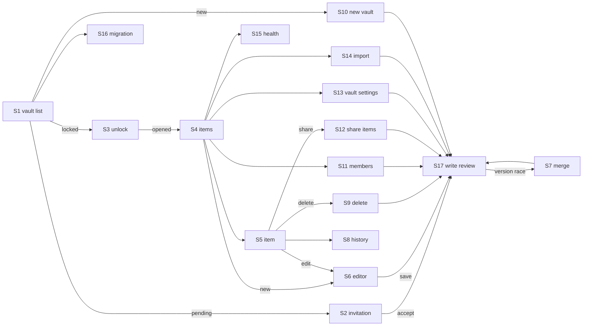
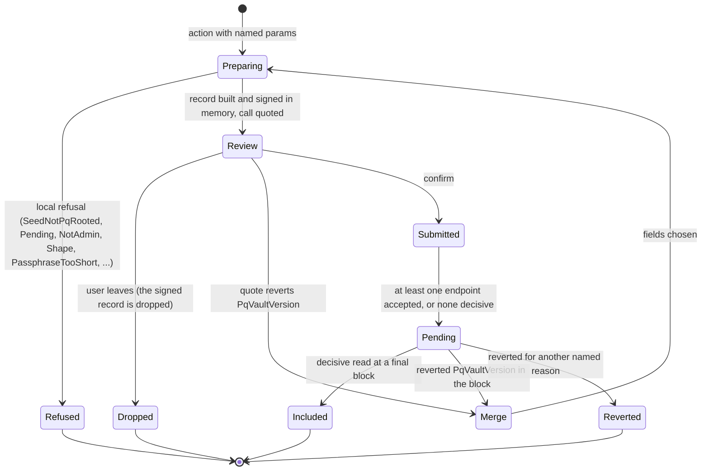
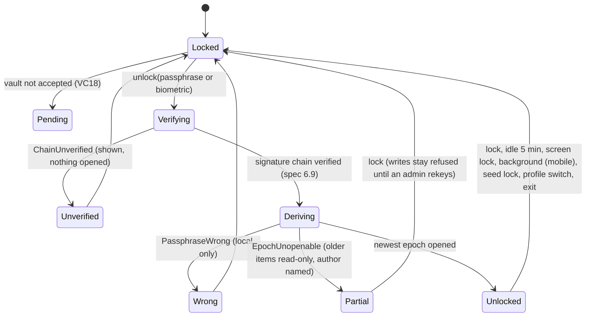
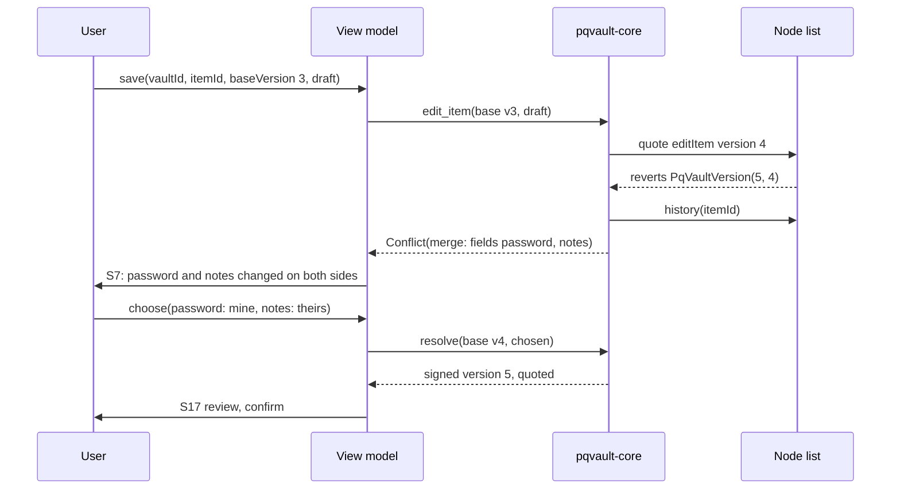
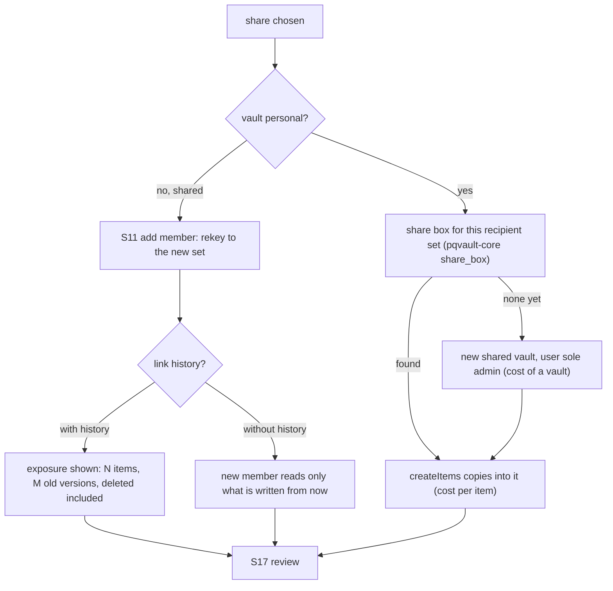

> **Research note — background and rationale only, not normative; the current rules are in docs/ (see decisions.md).**

# PqVault's UI across scaas-app's front-ends and scaas-tui (2026-11-27)

Research of 2026-11-27 for the owner, who asked what the PqVault UI should be on scaas-app's four front-ends (Qt, Flutter,
Dioxus, Tauri with a React UI, the last also as a web app and a browser extension) and on `scaas-tui`. Nothing here is built,
specified or ruled; every recommendation is a proposal for the owner. PqVault's contract, `pqvault-core` and the `ua-rs` paths
they use are **UNAUDITED** ([ARCH-POS-14](../decisions.md#ARCH-POS-14)); so is everything proposed here. Gas figures are the
spec's estimates [E], not measured; build effort is an estimate *(estimate)*.

**Method.** SCaaS facts come from this repository and are cited by path and rule id: the PqVault spec
[`2026-11-17-pqvault.md`](../superpowers/specs/2026-11-17-pqvault.md) (revision 6), the contract rules
[`contracts/pqvault.md`](../contracts/pqvault.md) (CTR-PQV-*), the client rules
[`clients/ua-libraries.md`](../clients/ua-libraries.md#pqvault-clients) (CLI-PQV-*), `clients/pqvault-core/src/` as built on
`dev`, and `scaas-tui`'s vault screens as built on branch `scaas-tui` (plan T14 part A, `1df54236c` to `18fafe612`; its
controller calls (a) to (n) in the `scaas-tui` branch's `docs/decisions.md` §42 under CLI-TUI-01; the T13 findings list).
Other password managers were learned from their **source code and public documentation only, never from screenshots**
(owner rule); sources are listed in §12, each read 2026-11-27. A claim resting only on a vendor's help page is a
**(vendor claim)**. No code was copied.

**Contents**

1. [Summary](#1-summary)
2. [What the rules already fix](#2-what-the-rules-already-fix)
3. [What other managers do](#3-what-other-managers-do)
4. [What the on-chain model changes](#4-what-the-on-chain-model-changes)
5. [Screens and flows](#5-screens-and-flows)
6. [The view model, for scaas-app's contract B10](#6-the-view-model-for-scaas-apps-contract-b10)
7. [Per front-end](#7-per-front-end)
8. [Security rules](#8-security-rules)
9. [What the SDK and `pqvault-core` lack](#9-what-the-sdk-and-pqvault-core-lack)
10. [Cost](#10-cost)
11. [Questions for the owner](#11-questions-for-the-owner)
12. [Sources](#12-sources)

## 1. Summary

**Recommendation** *(proposal)*:

1. **One view model, five renderers.** The screens of §5 and the view model of §6 go into scaas-app's view-model contract
   (task B10) as one PqVault chapter; Qt, Flutter, Dioxus and Tauri render it, and `scaas-tui` keeps its own `vm::vault`
   shaped the same way. The redacting layer the spec's §8 promises (`ItemSummary`, `ItemHandle`, `reveal(field)`,
   `copy(field)`) belongs **in `pqvault-core`**, not in each front-end: today the core returns every item as a plain
   `serde_json::Value` ([T13 finding (n)](#9-what-the-sdk-and-pqvault-core-lack)), so each front-end re-derives which fields are
   secret and holds them in memory it cannot wipe.
2. **Every write is a reviewed, paid transaction, and the UI says so.** One shared review sheet (§5.3, S17) shows the record,
   the payer, the cost and the consequence that differs per write: "the bytes stay" on a delete, the exposure figures on an
   add or a weaker passphrase, the affected items on a remove. No optimistic UI: an item shows "saving" until the
   transaction is final, and a version race comes back as the merge screen, never as an error.
3. **Read-mostly, copy-careful, no autofill in v1.** Reveal one field for 30 s, copy one field on an explicit action with the
   clipboard marked sensitive and cleared after 30 s, auto-lock at 5 min (CLI-PQV-04). OS autofill and browser autofill stay
   out of v1: the spec lists them as non-goals and Q-UP4 refuses app extensions while the app holds the profile open. The TUI
   never copies a secret (CLI-TUI-14).
4. **Reports never become a decryption oracle.** Weak and reused passwords are computed on the device only; a breach check is
   a user action over items the user wrote, sending a padded k-anonymity prefix, and nothing at all is sent about a version
   another member wrote (ARCH-POS-13, CLI-PQV-05).
5. **Build order.** `pqvault-core` first gets the gaps of §9 (the redacting item API with secret fields as `SecretBytes`, the
   secret-field table per type, the card and identity fields, TOTP codes, a password generator and strength estimate, the
   orchestrated "first personal vault" flow, the members' kinds); then Flutter and Qt (the two front-ends with a plan), then
   Dioxus, then Tauri desktop. The web build and the extension wait for the SDK on wasm32. Effort: §10.2.

## 2. What the rules already fix

What the rules already decide for the UI, so no front-end chooses it again:

| Area | Fixed by | What the UI must do |
|---|---|---|
| Who may own a vault | P1, CLI-PQV-06 | `SeedNotPqRooted` before any other work for a classical-rooted seed set or a phrase under 24 words; explain how to make a 24-word set and migrate |
| PQ only | CTR-UA-32 (owner 2026-11-27) | every member holds a KEM key, so is a single PQ kind (`mldsa44`, `mldsa65`, `mldsa87`, `fndsa512`, `fndsa1024`); an `msig` holds none and is reached through its accepted members (`via`); an `msig` admin may have native (classical) members: flag it (spec §10, R6) |
| Personal or shared | ruling (a), O1 (c), CLI-PQV-02 | fixed at creation; a personal vault is never rekeyed to add a member: "share" from it copies items into a share box |
| Passphrase | P2, VC19, CLI-PQV-07, CLI-PQV-10, CLI-PQV-15 | on by default; a generated 6-word BIP-39 passphrase offered; a chosen one ≥ 16 characters with a strength meter; never stored, sent or hinted; "a forgotten passphrase loses the vault" at creation and at every change; a shared vault's passphrase out of band and never the personal one |
| Biometric unlock | O7 (b), CLI-PQV-07 | per device, opt-in, off by default; the client says that on this device the device key and the seed then open the vault |
| KDF | O8 | Argon2id 64 MiB / 3 / 4: the unlock takes visible time on a phone; show progress, never a frozen screen |
| Pending vaults | VC18, CLI-PQV-11 | a vault the user did not create stays pending: creator, admins and members with their UA kinds shown; never unlocked into the item list, never a save or autofill target until accepted |
| Verify first | VC15, spec §6.9 | `ChainUnverified` refuses the unlock; nothing is encrypted under an unverified epoch |
| Delete | spec §5.7 | a tombstone version; the result says the bytes stay |
| Versions | CTR-PQV-08 | every version kept; a race is refused `PqVaultVersion` and the client merges (three-way per field, the loser kept in the item's `history` field) |
| Unreadable versions | spec §5.7, CLI-PQV-05 | fall back to the newest readable version, show who wrote the unreadable one, send nothing |
| Unopenable epoch | spec §6.5 | "epoch N by <author> cannot be opened"; older items read-only |
| Removal | V5 | a removed member keeps what it read; the admin's client lists the items to change at their services and offers a passphrase change |
| Exposure | spec §6.5, §6.7 | before an add or a weaker passphrase, "X will read N items and M old versions, deleted ones included", with the rekey without history offered |
| Hardening | VC13, CLI-PQV-04 | reveal one field, hidden after 30 s or on leaving the foreground; no screenshot of a revealed secret where the platform allows; copy only on an explicit action, marked sensitive, cleared after 30 s; auto-lock 5 min (user-set, at most 1 h), at once on screen lock and exit; never a secret in a log, crash report, notification, URL or error |
| Who wrote what | spec §9 | the author of every version and every membership and passphrase change shown before the user writes a secret into a shared vault |
| Label | VC14, CLI-PQV-08 | "UNAUDITED, test data only" on PqVault and an explicit confirmation before the first item |
| Metadata | CLI-PQV-03 | nothing about an item in the clear in a job, a log or an analytics event; batches for imports |
| Instance | `scaas-tui` §42 (e), owner 2026-11-27 | the instance from the factory catalogue's class 4; an override shown as such on every vault screen (a TUI ruling; the same rule fits every front-end) |
| Non-goals v1 | spec §2 | no deletion of bytes, no per-item sharing beyond the share box, no autofill integrations, no passkey storage, no files beyond 16 KiB on chain (files off chain, Arweave by ARCH-POS-19) |

Two drifts found while reading, for the spec's owner: spec §8 (`generate_passphrase()`: "5 random words") and §9 ("a
generated 5-word passphrase") still state VC19's first form; §6.5, CLI-PQV-10 and CLI-PQV-15 say 6 BIP-39 words, and
`pqvault-core` draws 6. And the spec pins no field of a `card` or an `identity` (`scaas-tui` call (a) fails closed: every
such field secret).

**`scaas-tui` as built** (T14 part A, with part C's scroll): a vault view on a UA row; pending rows offer accept and decline,
others unlock; items drawn with every secret field as a fixed placeholder, one field revealed for 30 s on the idle clock; no
copy of any vault value except the vault id (when the clipboard is turned on); edits of login, note, totp and sshKey by named
fields; the merge path on `PqVaultVersion`; delete says the bytes stay; share and remove show the exposure and the affected
items; every write through the ordinary review. Not offered: a new vault, batches, history, rename; the members' UA kinds
not drawn (call (c)); no anvil e2e.

## 3. What other managers do

### 3.1 Survey table

| Topic | Bitwarden | KeePassXC | Proton Pass | 1Password (vendor claim) | What PqVault takes |
|---|---|---|---|---|---|
| Item types | login, secure note, card, identity, SSH key; bank account, driver's licence, passport in the source's enum, not yet on the help page [B1] | entries: title, username, password, URL, notes, custom attributes, encrypted attachments; TOTP in the `otp` attribute [K6] | login (with email, username, URLs, TOTP, passkeys), alias, note, credit card (cardholder name, type, number, CVV, expiry, PIN), identity (about 36 fields), SSH key, Wi-Fi, custom; extra fields text, hidden, TOTP, timestamp [R1] | 22 categories, among them login, secure note, credit card, identity, password, document, SSH key, crypto wallet [O1] | the spec's nine types; card and identity fields to pin (G3), with Bitwarden's as a model: card `cardholderName`, `brand`, `number`, `expMonth`, `expYear`, `code` [B1] |
| Clipboard clear | Never / 10 s to 5 min, default 5 min on desktop and browser, Never on mobile [B2]; desktop copies kept out of clipboard history through arboard; Android `EXTRA_IS_SENSITIVE`; iOS local-only with an expiry [B2] | on by default, 10 s; each copy marked with the macOS concealed type, the KDE hint and the three Windows history and cloud formats [K1] | extension: Never, 15 s, 1 min, 2 min, default 2 min once the clipboard permission is granted; cleared by an alarm only if the clipboard still holds the copied value; no sensitive marker found [R4] | 90 s, a setting [O2] | 30 s fixed, the sensitive flag and the local-only expiry where the platform has them (CLI-PQV-04) |
| Reveal guard | per-item master-password re-prompt for view, edit, copy of protected fields and autofill; "not an encryption mechanism" [B3] | not checked | not checked | a policy can hide reveal; the white paper says a filled value is still readable with devtools [O8] | no per-item re-prompt: the vault passphrase is a real key factor (P2); reveal is per field and timed |
| History and conflicts | the last 5 passwords per login in the item [B4]; an update carries `lastKnownRevisionDate`, the server refuses one more than 1 s out of date, and without the date the last write wins [B4]; no full version history found | 10 history items and 6 MiB per entry by default; a merge matches entries by UUID, the newer modification time wins and the other goes into history; deletions travel as deleted-object UUIDs [K4] | item history with a timeline, a diff and Restore, revisions kept by the server, on a paid plan [R6] | previous versions viewable and restorable on desktop and the web; how sync conflicts resolve is not documented [O4] | every version kept by the contract; a race is refused and merged per field; S8 shows every version; restore is a new version |
| Sharing | organisations with roles; collections with View, View except passwords, Edit, Edit except passwords, Manage [B5]; emergency access by a wait time, view or takeover [B5]; Send: a link with expiry, access count, password [B5] | KeeShare: a group shared as a password-protected container file (import, export or synchronise), merged in time order; the docs warn that a valid signer's older data could be replayed [K8] | vault and item shares with Manager, Editor and Viewer; secure links with the key in the URL fragment, expiry 1 h to 30 d (default 1 week), an optional view cap [R2] | vaults with view / edit / manage; some permissions enforced by cryptography, some by the server, some only by the client [O5]; links to anyone or named emails, with expiry [O5]; Travel Mode [O5] | shared vaults (any member writes, admins rekey); the share box for single items; no "except passwords" (read access is cryptographic: whoever opens an item reads every field); no emergency access (would be a member whose wrap waits: not in the spec); no links |
| Reports | exposed (SHA-1 prefix to Pwned Passwords with `Add-Padding`), weak (zxcvbn, score ≤ 2), reused, unsecured `http://`, inactive 2FA (a downloaded list), all on the client; the data-breach report sends the username to Bitwarden's server [B6] | Health Check offline (zxcvbn, reuse, expiry); the online HIBP check sends a 5-hex SHA-1 prefix per password and its UI warns that the number of passwords and the IP address are exposed; an offline check against a downloaded hash file in the CLI [K5] | weak (scored in its Rust / wasm core), reused and missing 2FA on the client; compromised passwords by a padded bucket for a 6-hex SHA-1 prefix from Proton's own service; email breaches from Proton's API [R3] | compromised sites and 2FA lists downloaded and compared on the device; only a 5-character SHA-1 prefix leaves it for passwords [O3] | weak and reused on the device; breaches by row 24 only; downloaded lists compared on the device are fine (they send nothing that depends on an open) |
| Browser autofill | the content script collects the form; the background sends one item's fill values to that frame only, refused if the tab or URL changed, warned for an untrusted iframe and for `http:` with an `https:` item; inline menu in an extension-origin iframe; match by base domain by default; fill on page load off by default [B7] | native messaging with NaCl `crypto_box` and a named association per browser; `get-logins` returns only entries matching the URL, after an "Allow Selected / Deny All" dialog; the entry host must equal the site host or be its parent; "Match URL scheme" on by default [K2]; Auto-Type types into a window chosen by title [K3] | the content script receives item previews only (ids, name, user identifier, URL); when the user picks one, the service worker sends that item's credentials to the target frame [R4] | the extension talks to the desktop app over an authenticated link that checks the browser's signature [O6]; "fill anywhere on this website" (eTLD+1) by default, "only this exact host" as an option [O6] | none in v1; later only the Bitwarden shape (one item's values to one exactly matching top frame, on the user's action), with exact host and scheme as the default (VC13), stricter than every surveyed default |
| Mobile autofill | Android autofill service, accessibility service, Credential Manager provider; iOS credential provider extension [B8]; a warning when the Argon2id memory is above **64 MiB** inside the iOS extension [B8] | — | Android `AutofillService` and a Credential Manager provider for passkeys; iOS AutoFill extension [R8] | Universal Autofill on Mac through the accessibility permission [O6] | none in v1 (spec §2, Q-UP4); O8's 64 MiB sits exactly at Bitwarden's extension threshold, so a later iOS extension is at the edge, as O8 foresaw |
| Passkeys | stored in login items; browser, iOS 17+, Android 14+, desktop; behind the re-prompt [B9] | since 2.7.7, through the browser extension, as entry attributes holding the private key [K6] | in login items; extension, Android 14+, iOS 17+ [R5] | extension and apps (iOS 18+, Android 14+) [O7] | out (spec §2; Q8) |
| Offline | the encrypted vault cached on the device and unlocked offline; offline is read-only (blog) [B10] | a local file: always offline | an Argon2-derived offline key and verifier in the persisted session ("unlock offline with password"), in the extension since 1.37.0; offline edits not verified [R7] | not checked | Q9: a cache of verified public records in the profile's store; reads only |
| Lock and biometrics | lock by default; timeout choices, default on restart (desktop, browser), 15 min (web, Android) [B10]; biometric key in Android Keystore with user authentication, iOS Keychain `biometryCurrentSet`, Windows Hello [B10] | lock after 900 s idle and on screen lock by default; Quick Unlock: Windows Hello signs a challenge whose hash keys the in-memory database key, Touch ID keeps its key in the Keychain under `BiometryCurrentSet` [K7] | a PIN lock checked by the server [R7]; biometrics not checked | not checked | 5 min idle (CLI-PQV-04); the biometric key as G14 |

### 3.2 What follows for PqVault

- **Everyone else has a server or a file; PqVault has neither.** Bitwarden's conflict check, Proton's and 1Password's sharing
  limits "enforced by the server" and every "delete" rest on an operator. PqVault's equivalents are the contract's version
  rule and cryptographic read access: so no "view except passwords" (every member who opens an item reads every field), no
  delete, no revocation of what was read. The UI must not borrow wording that promises those.
- **Reveal guards in the UI are not security.** Bitwarden calls its re-prompt an interface guardrail [B3], and 1Password's
  white paper says a concealed, filled password is readable with devtools [O8]. PqVault's reveal timer is the same kind of
  guard; the real factors are the seed and the passphrase.
- **The strict defaults are PqVault's own.** The surveyed defaults are looser than CLI-PQV-04 on every axis: clipboard 90 s
  to never, URL match by registrable domain, timeouts from 15 min to never. A user moving from them will meet stricter
  behaviour; the settings page says why in one line.
- **History is the one place PqVault is richer.** Bitwarden keeps five passwords; PqVault keeps every version of every field
  for ever, including what was "deleted". S8 makes that visible, which is also the honest warning.
- **Reports run on the device, as everyone's do,** with one more restriction: nothing that depends on opening another
  member's version leaves the device (row 24). KeePassXC's warning that an online check exposes the number of passwords and
  the IP address [K5] is the honest line S15 should show too; Bitwarden pads the request [B6], Proton fetches a padded bucket
  by a longer prefix [R3].
- **The desktop clipboard has a known-good recipe.** KeePassXC marks every copy with the macOS concealed type, the KDE hint
  and the Windows history and cloud formats [K1]; Bitwarden's desktop and Tauri's `write_secret` reach the same through
  arboard [B2, P11]; Proton clears only if the clipboard still holds the copied value [R4]. Row 8 is the union of the three.
- **Merging as KeePassXC does, per field.** KeePassXC keeps the newer entry and puts the other in history [K4];
  `pqvault-core` does the same per field and records the loser in the item's `history` field, so S7 asks only about fields
  both sides changed. That `history` field holds old secrets (row 25).
- **The extension's content script gets nothing until the user picks.** Bitwarden [B7] and Proton [R4] both hand the page
  only previews, then one item's fill values for one frame; KeePassXC returns only matching entries after an access dialog
  [K2]. That is the shape for Q7, if it comes.

## 4. What the on-chain model changes

What no other manager has to show, and how the UI shows it:

- **Every write is a signed, paid transaction.** Create, edit, delete, accept, decline, share, remove, leave and a
  passphrase change each cost gas (§10.1) and take a block or more. The UI quotes before it asks (spec §8: "costs are
  estimated and shown before any write"), names the payer, and offers fee 0 through a relayer where the user's lane allows it
  (CTR-PQV-11). There is no "save" that is free.
- **No optimistic state.** A saved item is "saving" until a decisive read at a final block shows it; until then the item
  list shows the last confirmed version with a pending mark. A send that the endpoints refused may still land, and one they
  accepted may never land: the UI never shows "failed" while the bytes may land (scaas-app contract §6, "Neither is a
  verdict"). The plaintext draft of a pending write stays in memory only and goes at the lock; the signed record holds only
  ciphertext and may stay queued.
- **A race is a merge, not an error.** Two devices or members writing version `n + 1` race; the loser gets
  `PqVaultVersion(n + 2, n + 1)`. The SDK's quote simulates the call, so most races show before anything is sent; a race
  lost in the block costs the loser's gas. Either way the UI opens the merge screen (S7) with the fields both sides changed.
- **The bytes stay.** A delete is a tombstone; every earlier version stays readable by everyone who could read it, for ever.
  A removed member keeps everything it read. A passphrase change protects only what is written after it. These are three
  sentences the UI shows at the moment they matter, never in a settings page only.
- **Batching.** An import or a share by copy is many items; `createItems` takes about 33 to 35 password items per 60 M
  block (FN-DSA-512, spec §5.8), sized by the chain's limits (`ChainLimits`), never a constant. The import screen shows
  batches, gas and progress per batch, and resumes after a partial run.
- **Members' UA kinds.** A shared vault is only as quantum-safe as its weakest member's seed, and no chain shows a seed's
  class. The member list shows each member's UA kind (all PQ, CTR-UA-32), an `msig` admin's members with a native member
  flagged, and the line "other members' seed roots cannot be checked".
- **Public metadata.** Vault ids, members, item counts, edit times, size buckets and authors are public for ever (spec §10).
  The vault details screen says so once, plainly, beside the per-vault UA that hides the link for personal vaults.
- **Recovery from the chain.** A new device needs the seed (and the passphrase): no export file, no server account. The
  "add device" story is the seed's, not PqVault's. The UI's recovery is the vault list filling from the index vault.
- **No events to subscribe to.** Clients read state, never logs (CTR-PQV-10). The list refreshes on open, after a write
  and on the user's pull; a background poll, if any, is spread over the node list and over time (spec §9, node-side
  linkage).
- **Rollback.** `pqvault-core` keeps the highest version and epoch seen (`Seen`) and refuses a lower one (`Rollback`); the UI
  shows "a node answered an older state" and offers the strict-majority read (ARCH-POS-15).

## 5. Screens and flows

### 5.1 Screens

| Id | Screen | Reached from | Main actions |
|---|---|---|---|
| S1 | Vault list | the app's PqVault entry (`scaas` build with `pqvault`) | open, create, refresh; sections: unlocked, locked, invitations (pending), declined (folded) |
| S2 | Invitation | S1, a pending row | accept, decline, decide later |
| S3 | Unlock | S1, a locked row | passphrase, biometric (if on for this device), cancel |
| S4 | Items | S3, an unlocked row | search, filter (type, folder, tag, "written by others", "show deleted"), new item, open item, lock |
| S5 | Item | S4 | reveal field, copy field, TOTP code, edit, history, delete, share (personal vault) |
| S6 | Item editor | S4 (new), S5 (edit) | per-type form, password generator, save |
| S7 | Merge | a save refused `PqVaultVersion` | per conflicting field keep mine / take theirs, save again |
| S8 | History | S5 | list versions (author, epoch, time), open one read-only, restore as a new version |
| S9 | Delete | S5 | confirm with "the bytes stay" |
| S10 | New vault | S1 | personal or shared, name, members (shared), passphrase (generated, chosen, off), mode (portable default), cost |
| S11 | Members | S4 (shared vault) | add (exposure, with or without history), remove (affected items, passphrase change offered), leave (not for the only member) |
| S12 | Share items | S5 / S4 multi-select (personal vault) | pick recipients, share box found or created, copy items (cost per item), unshare (tombstone of the copy) |
| S13 | Vault settings | S4 | name (rekey), passphrase change / on / off (exposure), biometric on this device, vault details (mode, instance, public metadata) |
| S14 | Import | S4 | pick file and format, plan (items, batches, cost), run, resume |
| S15 | Health | S4 or S1 | weak, reused (local), breach check (user action, own items only) |
| S16 | Migration | S1 | plan (moves, skipped, unreadable, the warning), run |
| S17 | Write review | every write | record summary, payer, cost, consequence, confirm |
| S18 | PqVault settings | app settings | auto-lock (5 min, at most 1 h), reveal and clipboard 30 s (shown, fixed by CLI-PQV-04), the "UNAUDITED, test data only" confirmation |

The index vault (per-vault UA 0) never appears as a vault: it is where accept, decline and the user's vault list live.
`vaultRef` items never appear in S4.

### 5.2 Navigation

### 5.3 The write flow (S17), one for every write

`pqvault-core` signs a record when it builds it (`scaas-tui` call (h)); nothing leaves the device before the confirm, and a
review left drops the call. The review shows: the operation in words ("save login 'bank' as version 4"), the vault and
instance, the payer and its balance, gas, the maximum fee and any relay fee, and one consequence block per write:

| Write | Consequence block |
|---|---|
| save (create) | the item as typed, secret fields as the placeholder; "test data only" until the audit |
| save (edit) | the fields that change; the merge result if any |
| delete | "The earlier versions stay on chain for ever, readable by everyone who could read this item" |
| accept / decline | the vault's creator, admins and members with kinds; "decline is written into your index vault and costs gas; decide later costs nothing" |
| add member | the exposure: "X will read N items and M old versions, deleted ones included", the choice "with history" / "without history" |
| remove member | "X keeps everything it could read"; the affected items to change at their services; the passphrase change offered |
| leave | "your earlier reads stay with you; the vault's admins may rekey" |
| passphrase change, off, weaker | what stays under the old passphrase; the exposure figures; "without history" offered |
| new personal vault | every step and its cost (per-vault UA registration, the index vault if it is the first, the vault, the `vaultRef`) |
| import / share by copy | items, batches, gas per batch and total |

### 5.4 Unlock

`Deriving` is Argon2id at 64 MiB: a visible step with a spinner, cancellable. `Wrong` says only "wrong passphrase" and
sends nothing. `wrongHistory` ("epoch N by <author> carries a wrong history key") is shown inside `Unlocked` as a banner.

### 5.5 Save, with a race

### 5.6 Sharing

Unsharing a copy is a tombstone of the copy; what the recipient read stays read (spec §6.7). Removing a member is the
reverse of S11 with the affected-items list.

### 5.7 First personal vault

A new user's first personal vault is several transactions: the per-vault UA 0 (the index vault's holder) registered with its
KEM key, the index vault, the per-vault UA 1 registered, the vault, and a `vaultRef` into the index vault. The UI shows them as
one plan with one total and one confirm per transaction (each is signed by its own UA), sends the registrations and the
creations through different relayers or apart in time where it can (spec §9, node-side linkage), and resumes after a partial
run (each step is visible on chain). `scaas-tui` does not offer creation yet (call (i)), because no SDK flow registers a
per-vault UA (§9).

## 6. The view model, for scaas-app's contract B10

Written in the terms of `app-common/viewmodel/README.md`: per screen its models and roles, its actions with named
parameters, its events and the states of its flow; no Qt, Flutter or Rust type. Values: `id` a `0x` 32-byte hex string;
`ua` the same; `secret` a value the front-end never stores, logs or puts in a model (it passes it from the input field to
the action and drops it); `amount` a decimal string with its token. Every model row that may hold a secret holds a
**placeholder** until a `reveal` event fills one field for its timer.

### 6.1 Shared models

| Model | Roles |
|---|---|
| `VaultRow` | `vaultId`, `state` (`pending` \| `locked` \| `unlocked` \| `partial` \| `declined`), `name` (unlocked only, else empty), `kind` (`personal` \| `shared`), `mode` (`portable` \| `chainBound`), `passphrase` (`on` \| `off`), `latestEpoch`, `memberCount`, `creator` (`ua`), `isMine` (bool), `instance` (`chain`, `contract`, `source`: `catalogue` \| `override`), `unopenable` (`epoch`, `author`) or empty, `wrongHistory` (`epoch`, `author`) or empty, `biometric` (bool, this device) |
| `MemberRow` | `ua`, `label` (contact name or short id), `uaKind` (`mldsa44` \| `mldsa65` \| `mldsa87` \| `fndsa512` \| `fndsa1024` \| `msig`), `admin` (bool), `via` (`ua` of the `msig` or empty), `flags` (`nativeMember`, `removed`, `left`, `me`), `keyIds` (list) |
| `ItemRow` | `itemId`, `type` (`login` \| `note` \| `card` \| `identity` \| `sshKey` \| `totp` \| `file` \| `unsupported`), `title`, `subtitle` (username or host, never a secret), `folder`, `tags`, `versionCount`, `author`, `authorIsMe`, `unreadable` (bool, the newest readable shown), `deleted` (bool), `writing` (write id or empty) |
| `FieldRow` | `key` (the item's field name), `label`, `kind` (`text` \| `multiline` \| `url` \| `secret` \| `totpCode` \| `date`), `value` (text, or the placeholder for a secret), `revealed` (bool), `revealLeft` (seconds), `copyable` (bool; false for every field in the TUI) |
| `VersionRow` | `version`, `epoch`, `author`, `authorIsMe`, `ts` (display only), `deleted`, `unreadable` |
| `WriteReview` | `writeId`, `operation` (words), `vaultId`, `instance`, `entry`, `payer`, `payerBalance`, `gas`, `maxFee`, `relayFee`, `steps` (list for a multi-step plan), `record` (list of `name`, `value` with secrets as the placeholder), `consequence` (`bytesStay` \| `exposure{items, versions}` \| `affected[itemId, title]` \| `batches{count, gasEach}` \| none), `warnings` (list of codes) |
| `WriteStatus` | `writeId`, `state` (`preparing` \| `review` \| `submitted` \| `pending` \| `included` \| `merge` \| `reverted` \| `refused` \| `dropped`), `code` (named error or empty), `txId` |

### 6.2 Per screen

| Screen | Models | Actions (named parameters) | Events | Flow states |
|---|---|---|---|---|
| S1 | `VaultRow` list | `refresh(account)`, `open(vaultId)`, `create()`, `migrate()` | `vaultsChanged`, `rollbackSeen(vaultId)`, `recoverProgress(done, total)` | `loading`, `ready`, `empty`, `refusedSeedNotPq` |
| S2 | `VaultRow`, `MemberRow` list | `accept(vaultId)`, `decline(vaultId)`, `later(vaultId)` | `review(WriteReview)` | `showing`, `review` |
| S3 | `VaultRow` | `unlock(vaultId, passphrase: secret)`, `unlockBiometric(vaultId)`, `cancel()` | `unlocked(vaultId)`, `unlockFailed(code)` | §5.4 |
| S4 | `ItemRow` list, `VaultRow` | `search(query)`, `filter(type, folder, tag, othersOnly, showDeleted)`, `open(itemId)`, `newItem(type)`, `lock(vaultId)` | `itemsChanged`, `locked(vaultId, reason)` | `loading`, `ready`, `partial` (read-only), `empty` |
| S5 | `ItemRow`, `FieldRow` list | `reveal(itemId, key)`, `hide()`, `copy(itemId, key)`, `totpCode(itemId)`, `edit(itemId)`, `history(itemId)`, `delete(itemId)`, `share(itemIds)` | `revealed(key, seconds)`, `revealEnded`, `copied(key, seconds)`, `clipboardCleared`, `totpTick(seconds)` | `redacted`, `revealed`, `unreadable`, `unsupported` |
| S6 | `FieldRow` list (editable) | `setField(key, value)`, `setSecret(key, value: secret)`, `generatePassword(length, classes)`, `save(vaultId, itemId, baseVersion, type)`, `discard()` | `strength(score, guessesLog10)`, `review(WriteReview)` | `editing`, `invalid(code)`, `review` |
| S7 | `FieldRow` pairs (`ours`, `theirs`, secrets as placeholders until revealed) | `choose(key, side: ours \| theirs)`, `save()` | `review(WriteReview)` | `choosing`, `review` |
| S8 | `VersionRow` list | `openVersion(itemId, version)`, `restore(itemId, version)` | `review(WriteReview)` | `ready`, `version` |
| S9 | `ItemRow` | `confirmDelete(itemId)` | `review(WriteReview)` | `confirm`, `review` |
| S10 | form | `setKind(personal \| shared)`, `setName(name)`, `addMember(ua)`, `setPassphrase(choice: generated \| chosen \| off, value: secret)`, `setMode(portable \| chainBound)`, `create()` | `passphraseGenerated(words: secret)`, `strength(...)`, `review(WriteReview)` | `form`, `showWords`, `confirmWords`, `review`, `steps(done, total)` |
| S11 | `MemberRow` list | `add(vaultId, members, history: link \| none)`, `remove(vaultId, members, changePassphrase)`, `leave(vaultId)` | `exposure(items, versions)`, `affected(list)`, `review(WriteReview)` | `list`, `review` |
| S12 | recipients, `ItemRow` list | `share(fromVault, itemIds, recipients)`, `unshare(boxVaultId, itemId)` | `boxFound(vaultId)` or `boxNew`, `review(WriteReview)` | `pick`, `review`, `batches(done, total)` |
| S13 | `VaultRow` | `rename(vaultId, name)`, `changePassphrase(vaultId, choice, value: secret, history: link \| none)`, `setBiometric(vaultId, on)` | `exposure(...)`, `review(WriteReview)` | `form`, `review` |
| S14 | plan | `plan(vaultId, format, file)`, `run(planId)`, `resume(planId)` | `planned(items, batches, gas)`, `batchDone(i, n)` | `pick`, `planned`, `running`, `partial`, `done` |
| S15 | findings (`itemId`, `title`, `finding`: `weak` \| `reused` \| `breached`, `authorIsMe`) | `run(vaultIds)`, `checkBreaches(itemIds)` | `findings(list)` | `idle`, `running`, `ready` |
| S16 | plan | `plan(fromVaults, toSeed)`, `run(planId)` | `planned(moves, skipped, unreadable, warning)` | `plan`, `confirm`, `running`, `done` |
| S17 | `WriteReview`, `WriteStatus` | `confirm(writeId)`, `cancel(writeId)` | `status(WriteStatus)` | §5.3 |

Cross-screen events: `locked(vaultId, reason)` with `reason` one of `user`, `idle`, `screenLock`, `background`,
`seedLocked`, `profileSwitch`, `exit`; on it every model of that vault is emptied before the next frame, any revealed field
hidden, the clipboard cleared if it still holds a copied value.

## 7. Per front-end

### 7.1 Feasibility

What each target can give for CLI-PQV-04's hardening and O7 (b)'s biometric `P_k`. "Own code" means a few lines of
platform code beside the toolkit, not a missing capability. [I] marks an inference not checked in a source.

| Target | Profile keys at rest | Biometric `P_k` (O7 (b), needs G14) | Sensitive copy and 30-s clear | No screenshot of a reveal | OS / browser autofill |
|---|---|---|---|---|---|
| Qt desktop | qtkeychain: Keychain, Windows Credential Store or DPAPI, Secret Service / KWallet [P13] | macOS Keychain with `biometryCurrentSet` [P8]; Windows Hello's key signs only (RSA-2048) [P10], so it gates `W` only through a derivation [I]; Linux none | through `app-core-rust` with arboard's `exclude_from_history` (Windows formats, KDE hint, macOS concealed type) [P12], one implementation for every desktop target; `QClipboard` documents no such hints [P13], yet KeePassXC, a Qt app, sets all four on each copy [K1] | Windows and macOS window flags [I]; Linux none | none in v1 |
| Flutter Android | `flutter_secure_storage` (Keystore RSA-OAEP + AES-GCM) [P14] | own code: a Keystore key with `setUserAuthenticationRequired` and a `CryptoObject` in `BiometricPrompt` [P5]; `local_auth` returns a yes / no only, a UI gate, not a key gate [P14] | own code: `EXTRA_IS_SENSITIVE` (API 33, a rendering hint) [P4]; clear by a timer while the app runs | own code: `FLAG_SECURE` [P4] | `AutofillService` (API 26) and `CredentialProviderService` (API 34) exist [P3]; out of v1; in-process only under Q-UP4 |
| Flutter iOS | `flutter_secure_storage` (Keychain) | own code: Keychain item with `biometryCurrentSet` [P8] | own code: `UIPasteboard` `localOnly` and `expirationDate` = 30 s [P7]: the system clears it even when the app is gone | iOS gives no screenshot block [I]; the app hides its content on the app switcher snapshot | AutoFill extension refused (Q-UP4); O8's 64 MiB is also near what extensions are reported to allow (only a community figure of 120 MB found, no Apple number) [P6] |
| Dioxus desktop | keyring-rs (Keychain, Credential Manager, Secret Service) [P12] | as Qt | arboard [P12]; the Dioxus SDK has no clipboard or secure storage [P12] | as Qt [I] | none in v1 |
| Tauri desktop | stronghold or keyring-rs [P11, P12] | as Qt (the biometric plugin covers Android and iOS only) [P11] | `clipboard-manager` `write_secret` (arboard's hints) and `clear` [P11] | as Qt [I] | none in v1 |
| Tauri mobile | stronghold; or the platform stores | the biometric plugin's opt-in `biometric_cipher` [P11] (to check against G14) | the plugin writes plain text only on mobile [P11]: own code for the sensitive flag | own code (`FLAG_SECURE`) | as Flutter |
| Web (Tauri UI, wasm core) | the profile store in IndexedDB (wasm store PLANNED, user-profiles §9) | none from the OS [I]; a WebAuthn-derived key would be a new design for the owner | `navigator.clipboard.writeText` has no sensitive flag and no clear while the page is in the background [I]: copy shown with that warning, or copy off | none | none |
| Browser extension (own instance) | as web, in the extension's storage | as web | since Chrome 157 the service worker may write the clipboard without an offscreen document [P9], so the 30-s clear runs after the popup closes; no sensitive flag | none | content scripts share the page's DOM [P9]; no content script in v1 |
| `scaas-tui` | the SDK's store | none | no secret copy at all (CLI-TUI-14); OSC 52 reaches the local terminal even over SSH and its clearing varies by terminal [P15] | the alternate screen and the overwrite (CLI-TUI-16) | none |

### 7.2 Notes

- **One Rust core for every behaviour that a test must hold.** Every front-end but Qt links `app-core-rust` as a crate or
  through a bridge, and Qt reaches it through the C ABI (SDK CLI-SDK-12, scaas-app contract §12). So the clipboard write
  with its hints and its timed clear, the reveal timer, the auto-lock deadline and the lock fan-out belong in
  `app-core-rust` (or `pqvault-core` where they are PqVault's), each tested once; front-ends call `copy(itemId, key)` and
  never see the copied value. The reveal is the one place a secret must reach the UI toolkit.
- **What no front-end can wipe.** A revealed value becomes a QML / JS string (Qt, Tauri, Dioxus's WebView DOM) or a Dart
  string (Flutter), none of which can be zeroized. Keep it to the one revealed field for 30 s, drop the reference at
  `revealEnded`, and say so in the security notes. Dioxus keeps the value in Rust until it is drawn, but the WebView still
  holds the drawn text [I].
- **WebView front-ends: vault text is hostile.** Another member writes the titles, notes and URLs. In Dioxus and Tauri the UI
  is HTML: a note that is inserted as HTML could run script that calls the app's commands (`reveal`, `copy`, a write). Text
  bindings only, Markdown rendered without raw HTML, a strict Content Security Policy, and in Tauri the window's capabilities
  limited to the commands that window uses (row 22). The TUI's `inert` text and Flutter's and Qt's text widgets are not
  exposed this way, but a Qt `Text` with rich text on would be [I].
- **Qt.** PqVault needs `app-core-rust` with `pqvault` even when the Qt binary runs `app-core-qt` for native chains
  (`SCAAS_PQVAULT` implies linking the Rust library, scaas-app contract §12). Every PqVault call crosses the C ABI with a
  completion callback onto the GUI thread; secret fields cross as a revealed value only.
- **Flutter.** The mobile front-end. Lifecycle `paused` locks at once (CLI-PQV-04 "leaves the foreground" for the reveal;
  the seeds' auto-lock on background per user-profiles §9). Platform code is small and the same four pieces in each app:
  `FLAG_SECURE`, the sensitive clip, the `UIPasteboard` options, the biometric key.
- **Dioxus.** Desktop first (scaas-app README). The closest to the TUI's model: Rust view models, no IPC.
- **Tauri with React.** The UI's state lives in TypeScript: models get placeholders only, and a reveal is a command
  returning one value. The web build and the extension reuse the React UI with the core compiled to wasm32 (G19); Tauri has
  no extension target [P11], so the extension is a separate build of the same UI.
- **The extension, when it comes.** As its own instance with its own profile (CLI-UPR-06: no local channel to the desktop
  app), so the surveyed managers' extension-to-app link (§3) does not fit. v1: popup or side panel, search, reveal, copy;
  no content script, no host permission. A later fill (Q7) would inject on the user's action into the top frame whose origin
  matches exactly (G9), handing the page only that item's username and password; nothing else of the vault ever enters a
  content script.
- **`scaas-tui`.** Keep what is built (§2). Add, in this order: history (read-only, S8), search (G8), the members' kinds
  (G6), the TOTP code on reveal (G4), creation after G7. It never copies a secret; a public value it copied is cleared at the
  lock (CLI-TUI-14's forward note).

## 8. Security rules

Each row a rule every front-end holds, with the test that shows it can fail (a positive control beside each refusal, as
AGENTS.md asks). Rows 1 to 21 restate existing rules; rows 22 to 25 are proposals *(proposal)*.

| # | Rule | Source | In the UI | Test that can fail |
|---|---|---|---|---|
| 1 | Only a PQ-rooted 24-word seed set acts for a vault | CLI-PQV-06 | `SeedNotPqRooted` on S1 and S10 before any read | a 12-word set and an EOA-rooted set: zero calls reach the network seam; a 24-word set reaches it |
| 2 | Pending is never unlocked, saved into or offered | VC18, CLI-PQV-11 | S1 "Invitations"; S4 unreachable for a pending row | `save` into a pending vault refused `Pending`; the accepted twin saves |
| 3 | Verify the signature chain before trusting an epoch | VC15, spec §6.9 | `ChainUnverified` on S3, nothing opened | a forged epoch from one node of the list refused; the honest state unlocks |
| 4 | No decryption oracle | ARCH-POS-13, CLI-PQV-05 | no network call, retry, report, auto-repair edit, analytics or crash report depends on whether a version or a passphrase opened | count the network calls after an unreadable version and after a wrong passphrase: equal to the readable control |
| 5 | Secrets drawn as a fixed placeholder (no length, no characters) until revealed | CLI-PQV-04, CLI-TUI-16 | `FieldRow.value` is the placeholder | a scan of every rendered frame / widget tree for the test secrets finds none before `reveal` |
| 6 | One field revealed for 30 s, hidden on leaving the item or the foreground | CLI-PQV-04 | `revealed` / `revealEnded` | fake clock at 29 s shown, 30 s hidden; a background event hides at once |
| 7 | No screenshot or task-switcher preview of a revealed secret where the platform allows | CLI-PQV-04 | §7.1 per platform | platform check where a test API exists, else a manual check row |
| 8 | Copy only on an explicit action; marked sensitive; cleared after 30 s only if it still holds the copied value | CLI-PQV-04 | `copy`, `copied`, `clipboardCleared` | the clear does not erase a value the user copied after; the sensitive flag is set on the platform's format |
| 9 | The TUI copies no secret | CLI-TUI-14 | `copyable` false for every vault field in the TUI | a key that would copy a field does nothing (built: `no_copy_of_a_secret`) |
| 10 | Auto-lock: 5 min idle (at most 1 h), screen lock, background on mobile, seed lock, profile switch, exit; keys and plaintexts dropped | VC13, CLI-UPR-07 | `locked(vaultId, reason)` empties every model | after `locked`, no model holds a test secret (built in the TUI: `vault_locks_with_seed`) |
| 11 | Never a secret in a log, crash report, notification, URL, error text, window title or test snapshot | CLI-PQV-04, CLI-TUI-16 | silent `Debug` for item types; errors carry codes only | secret scan of logs and goldens (built in the TUI: `vault_item_not_logged`, `secret_scan_vault`) |
| 12 | Item text from other members is inert | `scaas-tui` `item_text_is_inert`; spec §10 "malicious member" | titles, notes, URLs drawn as plain text; no link opened without a confirm showing the full URL | a title with control sequences or markup renders as text |
| 13 | Unknown types and fields are kept and never acted on | spec §6.8 | `unsupported` row, no edit form | an edit of an item with an unknown field keeps it byte for byte |
| 14 | Show who wrote what; flag an `msig` admin with native members; "other members' seed roots cannot be checked" | spec §9, §6.1 | `authorIsMe`, `MemberRow.flags` | a vault with an `msig` admin holding a native member shows the flag; one without does not |
| 15 | Exposure before a weaker rekey or an add; the rekey without history offered | CLI-PQV-10 | S11, S13 consequence block | the figures equal `Exposure` from the core; "without history" sends `Link::None` |
| 16 | The told-plainly lines at the moment they matter | spec §9 | S9, S11, S13, S16 consequence blocks | each write's review holds its line |
| 17 | "UNAUDITED, test data only" and a confirmation before the first item | VC14, CLI-PQV-08 | banner on S1 and S4; S6 asks once per profile | the first save without the confirmation is refused locally (built in the TUI: `unaudited_label`) |
| 18 | The passphrase never stored; a generated one shown once; the loss warning | P2, CLI-PQV-07 | S10 `showWords`, `confirmWords` | after creation no store, log or model holds the words |
| 19 | A shared vault's passphrase never the personal one | spec §6.5 | `PassphraseReused` on S10 / S13 | equal passphrase refused, a different one accepted |
| 20 | Nothing about an item in the clear in a job, a log or an analytics event; search local | CLI-PQV-03 | search over the in-memory index only | the submitted job's fields hold no title, URL or tag of the test item |
| 21 | Rollback refused | spec §7 "Recovery" | `rollbackSeen` banner, strict-majority offered | a node answering a lower version count is refused |
| 22 | A WebView front-end never inserts vault text as HTML, and its UI process gets only the commands it needs *(proposal)* | §7.2 | text bindings only; Tauri capabilities scoped per window; a strict CSP | a note holding markup and script renders as text and calls no command |
| 23 | Nothing is signed before the confirm *(proposal)* | `scaas-tui` T13 list, T14c (d) for `pqchat-core`; the same holds for `pqvault-core` (call (h)) | the record is built for the review, signed after `confirm` | a review left produces no signature call |
| 24 | Breach checks never touch a version another member wrote *(proposal)* | ARCH-POS-13 | S15 checks items whose latest version the user wrote, on the user's action only | a member-written item never reaches the breach request; the user's own item does |
| 25 | A secret field's earlier values are secrets too *(proposal)* | `pqvault-core` `merge` keeps the losing value in the item's `history` field | `history` entries of a secret field drawn as placeholders | a merged item's `history` holds no visible secret before `reveal` |

## 9. What the SDK and `pqvault-core` lack

Against spec §8's app-facing API and the screens above. "Core" is `pqvault-core` on `dev` (`clients/pqvault-core/src/`).

| # | Gap | Today | Proposal *(proposal)* | Where |
|---|---|---|---|---|
| G1 | The redacting item API: `items(vault, filter) -> [ItemSummary]`, `item(vault, id) -> ItemHandle`, `reveal(field)`, `copy(field)` (spec §8) | not built: `ItemVersion.value` is a plain `serde_json::Value`, every field's text in non-zeroizing heap buffers (T13 finding, `scaas-tui` call (n)); each front-end decides what is secret | the core returns fields typed `Plain(text)` / `Secret(SecretBytes)`, unknown fields as an opaque kept part; a draft of the same shape in; the canonical JSON built and parsed inside zeroizing buffers (the core has its own canonical parser, `content::parse_canonical`) | core |
| G2 | Which fields are secret, per type | the spec names a login's `password` and `totp`, a `totp`'s `secret`, an `sshKey`'s `privateKey` and `passphrase`; `scaas-tui` call (a) treats every card and identity field as secret | a table in the spec and the core (one place), read by every front-end through G1 | spec, core |
| G3 | The fields of `card` and `identity` | unpinned (spec §6.8 names the types only) | named fields in the spec, as the other types have; §3 lists what the surveyed managers use | spec |
| G4 | TOTP codes | none | RFC 6238 code and seconds left, computed in the core from the `Secret` field, returned as `Secret` | core |
| G5 | A password generator and a strength estimate | the passphrase generator only (`generate_passphrase`, 6 BIP-39 words) | `generate_password(length, classes)` over the SDK's `random_bytes`; one estimate for the passphrase meter (VC19) and the login editor, so every front-end shows the same figure | core |
| G6 | The members' UA kinds | `VaultState` carries each member's UA and key id only; CLI-PQV-01 "not built yet: the members' kind flags"; `scaas-tui` call (c) | a kind per member and admin, an `msig`'s members with a native flag, read once per unlock (`member_key` per member, spread over the node list) | core |
| G7 | The first personal vault as one flow | `create_vault` and `accept` exist; registering a per-vault UA with its KEM key has no SDK flow (`scaas-tui` call (i)) | the SDK registers a derived per-vault UA with its KEM key (relayed, fee 0 allowed); the core's `create_personal` plans §5.7's steps, resumable | SDK, core |
| G8 | Local search | none (spec §7 "Local index": memory or the device's encrypted store) | an in-memory index of titles, usernames, hosts and tags over unlocked vaults, dropped at the lock; `search(query)` in the core | core |
| G9 | URL matching | none (`autofill_candidates` of spec §8 not built) | the exact host and scheme rule as a core function now, used by "open site" and the phishing warning, later by autofill | core |
| G10 | Import | none (`import` / `ImportPlan` of spec §8) | parsers for the surveyed managers' plain export formats into drafts, then `create_items` batches; the import file is plaintext and the UI says to delete it | core |
| G11 | Files | none (`attach` / `fetch`, V7; Arweave by ARCH-POS-19) | after the Arweave store; fetch on the user's action only | core, SDK |
| G12 | Migration's run | the plan only (`migration_plan`; CLI-PQV-01) | the run, resumable per batch | core |
| G13 | Rename and vault settings | `rekey` copies the newest `sealedInfo`'s name and settings; no call changes them (`scaas-tui` call (i)) | a rekey with a new `VaultInfo` (same members, `Link::Prev`) | core |
| G14 | Biometric `P_k` (O7 (b)) | "scaas-app's" (CLI-PQV-01); no SDK call seals a handle for a device keystore | the SDK seals `P_k` under a fresh key `W` and gives `W`'s bytes once to the platform keystore behind biometrics; at unlock the platform returns `W` and the SDK reopens `P_k` as a handle. `P_k` never leaves `ua-rs`; `W` crosses into the platform's keystore only | SDK |
| G15 | Reads spread over the node list and over time (spec §9) | "a `scaas-rpc` / SDK follow-up" (CLI-PQV-01) | as stated there | SDK, `scaas-rpc` |
| G16 | Sign after the confirm | the core signs when it builds a record (`scaas-tui` call (h)) | build the typed record for the review; sign on `confirm` (row 23) | core |
| G17 | A multi-step plan's total cost | each `prepare_*` returns one quoted `AppCall` | a plan type summing its steps' quotes (first vault, import, share by copy, migration) | core |
| G18 | Health | none | weak and reused over unlocked vaults in the core (one implementation); the breach request, if the owner allows one, through one SDK call that pads and spreads it | core, SDK |
| G19 | `pqvault-core` on wasm32 | not checked; the SDK's JS / TS binding over wasm-bindgen is BUILT (CLI-SDK-12) | build and test the core on wasm32 before the web build and the extension | core |

## 10. Cost

### 10.1 What the user pays, per write [E]

From spec §5.14 (gas, not measured; per-operation pins come with the contract's gas tests). `sealedInfo` is padded to
1,024 B since 2026-11-21 (CLI-PQV-09), about +1.18 M state gas per vault or epoch record, after §5.14's figures were made:
added below as "+1.2 M".

| Write | FN-DSA-512 | ML-DSA-65 cached | ML-DSA-65 by precompile |
|---|---:|---:|---:|
| save a login (new) | ≈ 3.9 M | ≈ 7.4 M | ≈ 1.8 M |
| save a login (edit), delete (tombstone), accept / decline (a `vaultRef`) | ≈ 3.6–3.9 M | ≈ 7.1–7.4 M | ≈ 1.5–1.8 M |
| save a 4 KiB note | ≈ 10.0 M | ≈ 13.5 M | ≈ 7.9 M |
| new personal vault (`createVault`, one wrap) | ≈ 8.8 + 1.2 M | ≈ 16.3 + 1.2 M | ≈ 10.7 + 1.2 M |
| per-vault UA registration with its KEM key | ≈ 4–6 M | 9.58 + 13.41 M first (cache) | ≈ 4–6 M |
| add one member (`rekeyVault` 1 → 2) | ≈ 11.5 + 1.2 M | ≈ 19 + 1.2 M | ≈ 13.6 + 1.2 M |
| share by copy | ≈ 1.3–1.4 M per login in a batch, plus ≈ 8–10 M for a new share box | | |
| import 500 logins | ≈ 15 batches, ≈ 0.8 G gas | | |

A new user's **first personal vault** (§5.7) is two registrations, two vaults (the index vault and the vault) and one
`vaultRef`: ≈ 2 × 5 + 2 × 10 + 3.9 ≈ **34 M gas** with FN-DSA-512 *(estimate)*. The UI shows gas, the price it was quoted at
and the total in the chain's native token, never a figure that assumes a gas price (AGENTS.md: no chain assumptions).

### 10.2 What building it costs *(estimate)*

Person-weeks, one developer experienced in the toolkit, from the view model of §6 with no designer; screens S1 to S13 and
S17, S18 first (S14 to S16 after).

| Piece | Person-weeks | Notes |
|---|---:|---|
| `pqvault-core` gaps G1–G8, G13, G16, G17 | 3–5 | G1 is the largest: the item API's types through every binding |
| SDK gaps G7 (per-vault UA registration), G14 (biometric seal) | 1–2 | |
| B10's PqVault chapter | 1 | §6, in the contract's own form |
| Flutter (mobile first) | 3–5 + 1–2 glue | `FLAG_SECURE`, the sensitive clipboard and the keystore through platform channels |
| Qt (desktop) | 4–6 | the C ABI hop into `app-core-rust` for every call; models in C++ |
| Dioxus (desktop) | 3–5 + 1 glue | the core as a crate: secrets stay in Rust types until drawn |
| Tauri + React desktop | 3–5 + 1 | command scoping (row 22); the UI's state in TypeScript |
| Tauri web build | 2–3 after G19 (2–4) | no OS keystore, no biometric `P_k`; the browser's clipboard limits (§7.2) |
| Browser extension (no autofill) | 2–3 after the web build | its own instance and profile; popup or side panel |
| `scaas-tui` remainder | 1–2 | history, search, members' kinds, TOTP code; creation after G7 |
| S14 import, S15 health, S16 migration | 2–4 per front-end set | after G10, G12, G18 |

## 11. Questions for the owner

None blocks the spec; each is a proposal of this note.

| Id | Question | Recommendation |
|---|---|---|
| Q1 | Where the redacting item layer lives | in `pqvault-core` (G1), so the TUI and every front-end share one secret table and one zeroizing path |
| Q2 | The `card` and `identity` fields and the secret table per type (G2, G3) | pin them in the spec; card number, security code and PIN secret; identity's document numbers secret; names and addresses plain |
| Q3 | A note's body: secret or plain by default | plain by default (as the surveyed managers do and as `scaas-tui` does), with a per-item "hide body" choice stored in the item |
| Q4 | A TOTP code: shown or reveal-gated | reveal-gated like a password (fail closed, CLI-PQV-04); copyable with the 30-s clear except in the TUI |
| Q5 | Breach checks | allowed only on the user's action, for items whose latest version the user wrote, as a padded k-anonymity range request (row 24); or none |
| Q6 | "Decide later" for an invitation | yes: no write; decline stays the written choice that follows the user to other devices |
| Q7 | Autofill after v1 | first an Android autofill service in the app's own process (Q-UP4 refuses only a separate process), then the browser extension filling on the user's action from its own instance; iOS waits for Q-UP4 and for O8's extension memory |
| Q8 | Passkeys | stay out (spec §2): a passkey is a classical key, and in a shared vault every member could use it |
| Q9 | Offline reads | allowed from a cache of verified records and ciphertexts kept inside the profile's encrypted store (the ciphertexts are public; the set of vaults is not); no offline writes |
| Q10 | The web build and the extension | after G19, and after the Flutter, Qt and Dioxus front-ends |

## 12. Sources

All read 2026-11-27; GitHub paths on each repository's `main` (or default) branch that day. Source files were read for
behaviour; none was copied.

**Bitwarden**

- [B1] Cipher types and fields: <https://github.com/bitwarden/clients/blob/main/libs/common/src/vault/enums/cipher-type.ts>,
  `libs/common/src/vault/models/view/card.view.ts`, `identity.view.ts`, `login.view.ts`; <https://bitwarden.com/help/managing-items/>
- [B2] Clipboard: `libs/common/src/autofill/constants/index.ts`, `libs/common/src/autofill/services/autofill-settings.service.ts`;
  Android <https://github.com/bitwarden/android/blob/main/app/src/main/kotlin/com/x8bit/bitwarden/data/platform/manager/clipboard/BitwardenClipboardManagerImpl.kt>,
  `data/platform/repository/model/ClearClipboardFrequency.kt`; iOS
  <https://github.com/bitwarden/ios/blob/main/BitwardenShared/Core/Platform/Services/PasteboardService.swift>; desktop
  `apps/desktop/desktop_native/core/src/clipboard/arboard_backend.rs`, `apps/desktop/src/platform/services/electron-platform-utils.service.ts`
- [B3] Re-prompt: `libs/common/src/vault/enums/cipher-reprompt-type.ts`, `libs/vault/src/services/copy-cipher-field.service.ts`;
  <https://bitwarden.com/help/master-password-re-prompt/>
- [B4] Password history: `libs/common/src/vault/services/cipher.service.ts`; conflicts:
  <https://github.com/bitwarden/server/blob/main/src/Core/Vault/Services/Implementations/CipherService.cs>,
  `libs/common/src/vault/models/request/cipher.request.ts`
- [B5] Sharing: <https://bitwarden.com/help/user-types-access-control/>,
  `apps/web/src/app/admin-console/organizations/shared/components/access-selector/access-selector.models.ts`;
  <https://bitwarden.com/help/emergency-access/>; <https://bitwarden.com/help/about-send/>
- [B6] Reports: <https://bitwarden.com/help/reports/>; `libs/common/src/services/audit.service.ts`;
  `apps/web/src/app/dirt/reports/pages/weak-passwords-report.component.ts`, `inactive-two-factor-report.component.ts`;
  `libs/common/src/dirt/services/hibp-api.service.ts`
- [B7] Browser autofill: `apps/browser/src/autofill/services/autofill.service.ts`,
  `apps/browser/src/autofill/overlay/inline-menu/iframe-content/autofill-inline-menu-iframe.service.ts`,
  `libs/common/src/models/domain/domain-service.ts`; <https://bitwarden.com/help/uri-match-detection/>,
  <https://bitwarden.com/help/auto-fill-browser/>
- [B8] Mobile autofill: <https://github.com/bitwarden/android/tree/main/app/src/main/kotlin/com/x8bit/bitwarden/data/>
  (`autofill/`, `credentials/`); <https://bitwarden.com/help/auto-fill-android/>; iOS
  `BitwardenShared/Core/Platform/Utilities/Constants.swift`, `BitwardenShared/UI/Auth/VaultUnlock/VaultUnlockProcessor.swift`
  (the extension KDF memory warning, 48 MiB in commit `bbb428bd4e` of 2024-02-22, 64 MiB in `bf62d918f0` of 2024-02-26);
  <https://bitwarden.com/help/auto-fill-ios/>
- [B9] Passkeys: <https://bitwarden.com/help/storing-passkeys/>
- [B10] Offline and lock: <https://bitwarden.com/help/vault-timeout/>; blog
  <https://bitwarden.com/blog/configuring-bitwarden-clients-for-offline-access/>; biometric keys: Android
  `data/platform/manager/BiometricsEncryptionManagerImpl.kt`, iOS `BitwardenShared/Core/Auth/Services/KeychainRepository.swift`,
  desktop `apps/desktop/desktop_native/biometric/src/windows.rs`

**1Password** (public documentation; the vendor's own description)

- [O1] Item categories: <https://support.1password.com/item-categories/>
- [O2] Copy and clipboard: <https://support.1password.com/copy-passwords/>, <https://support.1password.com/mobile-device-management/>
- [O3] Watchtower: <https://support.1password.com/watchtower/>, <https://support.1password.com/watchtower-privacy/>
- [O4] Item history: <https://support.1password.com/item-history/>; release notes <https://releases.1password.com/windows/stable/>
- [O5] Sharing: <https://support.1password.com/create-share-vaults-teams/>, <https://support.1password.com/permission-enforcement/>,
  <https://support.1password.com/share-items/>, <https://support.1password.com/travel-mode/>
- [O6] Autofill: <https://support.1password.com/mac-universal-autofill/>,
  <https://support.1password.com/1password-browser-connection-security/>, <https://support.1password.com/autofill-behavior/>
- [O7] Passkeys: <https://support.1password.com/save-use-passkeys/>
- [O8] Security white paper, "Story 9: A day in the life of a concealed password":
  <https://1passwordstatic.com/files/security/1password-white-paper.pdf>

**KeePassXC** (branch `develop`)

- [K1] Clipboard: <https://github.com/keepassxreboot/keepassxc/blob/develop/src/core/Config.cpp>,
  <https://github.com/keepassxreboot/keepassxc/blob/develop/src/gui/Clipboard.cpp>
- [K2] Browser integration: <https://github.com/keepassxreboot/keepassxc-browser/blob/develop/keepassxc-protocol.md>,
  `src/browser/BrowserService.cpp`, `src/browser/BrowserAccessControlDialog.ui`
- [K3] Auto-Type: <https://github.com/keepassxreboot/keepassxc/blob/develop/docs/topics/AutoType.adoc>
- [K4] History and merge: `src/core/Metadata.cpp`, `src/core/Merger.cpp`, `docs/topics/DatabaseOperations.adoc`
- [K5] Reports: `src/core/PasswordHealth.cpp`, `src/networking/HibpDownloader.cpp`, `src/gui/reports/ReportsWidgetHibp.ui`,
  `src/cli/Analyze.cpp`, `CHANGELOG.md`
- [K6] Entries, TOTP, passkeys: `src/core/EntryAttributes.cpp`, `src/core/Totp.cpp`, `docs/topics/Passkeys.adoc`
- [K7] Lock and Quick Unlock: `src/core/Config.cpp`, `src/quickunlock/WindowsHello.cpp`, `src/quickunlock/TouchID.mm`
- [K8] KeeShare: <https://github.com/keepassxreboot/keepassxc/blob/develop/docs/topics/KeeShare.adoc>

**Proton Pass** (WebClients at commit `27722b49`, 2026-11-26)

- [R1] Item types: <https://github.com/ProtonMail/WebClients/blob/main/packages/pass/types/protobuf/protos/item-v1.proto>
- [R2] Sharing: `packages/pass/types/data/shares.ts`, `packages/pass/components/Invite/Member/ShareRoleOptions.tsx`,
  `packages/pass/components/Form/Field/Custom/ExpirationTimeSelect.tsx`, `packages/pass/lib/secure-links/secure-links.utils.ts`;
  <https://proton.me/support/pass-secure-link-security>
- [R3] Pass Monitor: `packages/pass/lib/monitor/service.ts`, `compromised-password.request.ts`, `monitor.request.ts`;
  <https://proton.me/support/how-to-use-pass-monitor>
- [R4] Extension autofill and clipboard: `packages/pass/types/worker/autofill.ts`,
  `applications/pass-extension/src/app/worker/services/autofill.ts`, `applications/pass-extension/src/app/worker/services/clipboard.ts`,
  `packages/pass/lib/clipboard/types.ts`, `packages/pass/lib/clipboard/service.ts`
- [R5] Passkeys: <https://proton.me/support/pass-use-passkeys>; `applications/pass-extension/CHANGELOG.md`
- [R6] Item history: <https://github.com/ProtonMail/WebClients/tree/main/packages/pass/components/Item/History>;
  <https://proton.me/support/item-history>
- [R7] Offline and lock: `packages/pass/lib/cache/crypto.ts`, `packages/pass/lib/auth/lock/types.ts`,
  `packages/pass/components/Settings/Offline.tsx`; <https://proton.me/support/pass-offline-access>
- [R8] Mobile autofill:
  <https://github.com/protonpass/android-pass/blob/main/pass/autofill/impl/src/main/kotlin/proton/android/pass/autofill/ProtonPassAutofillService.kt>,
  `pass/features/credentials/src/main/kotlin/proton/android/pass/features/credentials/shared/services/PassCredentialProviderService.kt`;
  <https://github.com/protonpass/ios-pass/blob/main/AutoFill/CredentialProviderViewController.swift>

**Platforms and libraries**

- [P1] Have I Been Pwned, Pwned Passwords range API and `Add-Padding`: <https://haveibeenpwned.com/API/v3#PwnedPasswords>
- [P2] KDE Klipper `x-kde-passwordManagerHint`:
  <https://invent.kde.org/plasma/plasma-workspace/-/raw/master/klipper/historymodel.cpp>; Secret Service API:
  <https://specifications.freedesktop.org/secret-service/latest/>
- [P3] Android `AutofillService`: <https://developer.android.com/reference/android/service/autofill/AutofillService>;
  `CredentialProviderService`: <https://developer.android.com/reference/android/service/credentials/CredentialProviderService>,
  <https://developer.android.com/identity/sign-in/credential-provider>
- [P4] Android `EXTRA_IS_SENSITIVE`: <https://developer.android.com/reference/android/content/ClipDescription#EXTRA_IS_SENSITIVE>,
  <https://developer.android.com/develop/ui/views/touch-and-input/copy-paste>; `FLAG_SECURE`:
  <https://developer.android.com/reference/android/view/WindowManager.LayoutParams#FLAG_SECURE>
- [P5] Android biometric keys: <https://developer.android.com/identity/sign-in/biometric-auth>
- [P6] iOS AutoFill extension memory: no Apple figure found; community report of 120 MB:
  <https://community.bitwarden.com/t/unable-to-autofill-on-ios/51041/6>; Bitwarden's 64 MiB warning [B8]
- [P7] `UIPasteboard` `localOnly`, `expirationDate`: <https://developer.apple.com/documentation/uikit/uipasteboard/optionskey/localonly>,
  <https://developer.apple.com/documentation/uikit/uipasteboard/optionskey/expirationdate>
- [P8] `ASCredentialProviderViewController`:
  <https://developer.apple.com/documentation/authenticationservices/ascredentialproviderviewcontroller>;
  `ASPasskeyCredentialRequest`: <https://developer.apple.com/documentation/authenticationservices/aspasskeycredentialrequest>;
  `biometryCurrentSet`: <https://developer.apple.com/documentation/security/secaccesscontrolcreateflags/biometrycurrentset>;
  `org.nspasteboard.ConcealedType`: <http://nspasteboard.org/>
- [P9] Chrome `offscreen` (service-worker clipboard writes since Chrome 157):
  <https://developer.chrome.com/docs/extensions/reference/api/offscreen>; content scripts:
  <https://developer.chrome.com/docs/extensions/develop/concepts/content-scripts>
- [P10] Windows clipboard formats: <https://learn.microsoft.com/en-us/windows/win32/dataxchg/clipboard-formats>; DPAPI:
  <https://learn.microsoft.com/en-us/windows/win32/api/dpapi/nf-dpapi-cryptprotectdata>; Windows Hello
  `KeyCredentialManager`: <https://learn.microsoft.com/en-us/uwp/api/windows.security.credentials.keycredentialmanager>
- [P11] Tauri 2: <https://v2.tauri.app/plugin/clipboard/> and
  <https://raw.githubusercontent.com/tauri-apps/plugins-workspace/v2/plugins/clipboard-manager/src/desktop.rs> (`write_secret`);
  <https://v2.tauri.app/plugin/biometric/>; <https://v2.tauri.app/plugin/stronghold/>; targets <https://v2.tauri.app/distribute/>
- [P12] Dioxus SDK: <https://github.com/DioxusLabs/sdk>; arboard (`exclude_from_history`): <https://github.com/1Password/arboard>;
  keyring-rs: <https://github.com/open-source-cooperative/keyring-rs>
- [P13] `QClipboard`: <https://doc.qt.io/qt-6/qclipboard.html>; qtkeychain: <https://github.com/frankosterfeld/qtkeychain>
- [P14] `flutter_secure_storage` 11.2.0: <https://pub.dev/packages/flutter_secure_storage>; `local_auth` 3.0.2:
  <https://pub.dev/packages/local_auth>
- [P15] OSC 52: xterm control sequences <https://invisible-island.net/xterm/ctlseqs/ctlseqs.txt>; tmux clipboard wiki
  <https://github.com/tmux/tmux/wiki/Clipboard>
