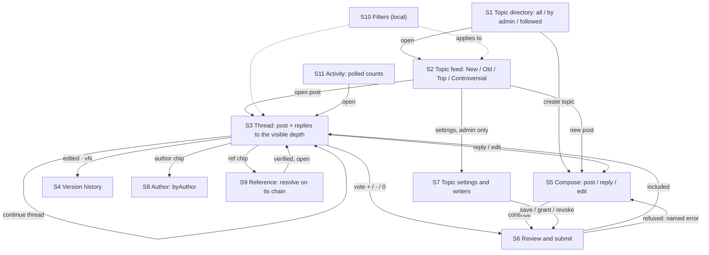
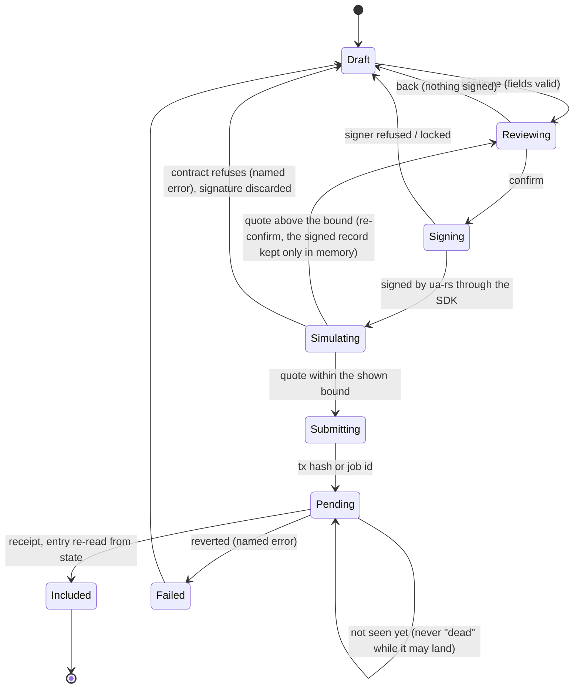

> **Research note — background and rationale only, not normative; the current rules are in docs/ (see decisions.md).**

# PqChat Public Topics UI across scaas-app's front-ends and scaas-tui (2026-11-27)

Research of 2026-11-27 for the owner, who asked what the Public Topics UI of PqChat should be in scaas-app's four
front-ends (Qt, Flutter, Dioxus, Tauri with React, the last also as a web page and a browser extension) and in scaas-tui.
Nothing here is built, specified or ruled; every recommendation is a proposal. PqChat and `pqchat-core` are **UNAUDITED**
([ARCH-POS-14](../decisions.md#ARCH-POS-14)). Other apps were learned from their source code and documentation, never from
screenshots; no code is copied. Gas figures marked *(estimate)* are computed from the EIP-8037 prices of the topics spec §6,
not measured.

## Summary

**Recommendation.** One screen set and one view-model for every front-end (§4, §5), fed by `pqchat-core` reading contract
state only: a **topic directory**, a **topic feed** sorted **New** by default (the append-only list read from its end), a
**thread** drawn to a fixed visible depth with **"continue thread"** past it (as Lemmy, Reddit and Bluesky do, §2), a
**version history** of every entry (nothing is removed, so the UI shows every version, as Discourse does), **up and down
counts shown apart** (the contract keeps no combined score), and **one review screen for every write** that shows the signed
fields, the public-and-permanent warning and the quoted cost before anything is signed. **Top**, **Controversial** and
**Best** are computed by the client over a stated window of the newest ids; **Hot** and **Active** are not offered, because
no entry carries a time in state (§6). Bodies render as CommonMark with raw HTML off, no remote image or link preview fetched
ever without a tap, links opened outside the app after a confirm; the TUI shows the Markdown source as inert text (§7).
Spam is filtered locally (mutes, keywords, a down-vote fold, "writers only"), always with a visible "hidden by your filter"
row (§7.3). In the contract, one packed field and two views would enable a real **Hot** sort and remove most of the read
cost (§8): a `postedAt` time packed into the entry slot (no new slot), a batched row view, and the nonce in `entryOf` so a
pinned `contentHash` can be checked; in `pqchat-core`, a relayed (gateway) path for topic writes and the signature moved
after the user's confirm.

| Area | Recommendation | Needs |
|---|---|---|
| Feed order | New (default), Old; Top / Controversial over the newest 256 | nothing new |
| Thread | 5 visible levels on a phone, 8 on desktop and web, 32 in the TUI (as built); "continue thread" opens the entry as a root | nothing new |
| Reply sort | Best (Wilson lower bound), Top, New, Old, over the first 256 replies of a parent | nothing new |
| Hot / Active | not offered until entries carry a time | §8 G1 (`postedAt`) |
| Reply counts | direct replies from `replies(parentId, 0, 0)`; no total of a whole thread | §8 G4 optional |
| Edits | "edited · vN" mark; a history screen with every version and a text diff | `editedAt` for times (§8 G1) |
| Writes | review before signing, cost from the SDK's quote, fee-0 relayed path offered | §8 G3 (gateway path) |
| Rendering | CommonMark, raw HTML off, no remote fetch, external-link confirm; TUI inert text | per-toolkit settings, §7 |

## 1. Ground truth: what the contract and `pqchat-core` give a UI

From the topics spec ([2026-11-07-pqchat-public-topics.md](../superpowers/specs/2026-11-07-pqchat-public-topics.md), P33–P46,
D18–D22), [CTR-CHAT-15](../contracts/pqchat.md#CTR-CHAT-15) to [CTR-CHAT-18](../contracts/pqchat.md#CTR-CHAT-18),
`smartcontracts/evm/src/pqchat/IPqChat.sol`, `PqChatCore.sol` and `clients/pqchat-core/src/topics.rs` (read 2026-11-27):

- **Records** (all signed by a UA, typed EIP-712 in the portable domain, relayable by anyone, fee 0 too): `PqTopic`
  (create), `PqTopicUpdate` (name, `about`, `openReplies` at `seq + 1`), `PqTopicWriter` (grant or revoke at `seq + 1`),
  `PqTopicEntry` (a post when `parentId` is zero, else a reply; optional `ref`), `PqTopicEdit` (version `count + 1`),
  `PqTopicVote` (+1, −1, 0 at `seq + 1`).
- **Rights** (P37): posts by the topic's admin (CTR-GOV-23 renamed `owner` to `admin`) and granted writers; replies by any
  registered UA while `openReplies` is true (the default, D19), else by the admin and writers; edits by the author only;
  votes by any registered UA. No hide flag, no moderator, no ban list (D18); the instance's owner UA has no power (Q2).
- **Views** (P42, CTR-CHAT-18): `topicOf` (latest values and `seq`; earlier names and `about` texts have no pointer, so topic
  history is not readable), `entryOf` (`topicId`, `author`, `parentId`, `depth`, `ref`, `mediaType`, latest `body`,
  `sigHash`, `versionCount`), `versionAt(entryId, v)`, `writerOf`, `scoreOf` (`up`, `down`), `voteOf(entry, ua)`, and six
  append-only lists paged as `(ids, total)`: `topics`, `topicsByAdmin`, `writersOf`, `posts(topicId)`, `replies(parentId)`,
  `byAuthor` (originals, every topic). `count = 0` is the length view, so **the direct reply count of any entry is one call**.
- **What state does not hold:** no time of any kind (the `Entry` slot is the head blob's address and `depth`, 192 of 256
  bits; `versions` is an `address[]`), no count of a whole thread's replies, no last-activity mark, no list of an entry's
  voters, no topic history, no version's nonce (so a pinned `contentHash` of a `ref` cannot be rebuilt: `topics.rs`
  reports `HashUnchecked`).
- **`pqchat-core`'s topic API**: `create_topic`, `update_topic`, `set_writer`, `post` (post or reply), `edit`, `vote`, each
  signing through the SDK's `prepare_pqchat_topic*` and returning a `TopicWrite { id, call: AppCall }` whose `AppCall`
  carries the review fields and a `NativeQuote` (the payer's own transaction; `SubmitQuote` with `gas`, `max_cost`,
  `fee_to_relayer`, `path`); reads `topic`, `entry`, `version_at`, `score`, `vote_of`, `page(list, start, count)` (count
  clipped to `PAGE_MAX` 64), `resolve_ref` (`Verified` or `Unverified(ChainNotServed | Unlisted | Unreadable | OtherHome |
  HashUnchecked)`). An `msig` author is `MsigAuthorPlanned`.
- **Built in scaas-tui** (branch `scaas-tui`, `f75335d3a`; decisions CLI-TUI-31 there, controller calls (a)–(m) of
  `f2220bab5`): a view of a UA row; pages of 16 ids; `]` / `[` page keys; `t` opens a selection's replies; at most 32 levels
  and 1,024 rows drawn, each id once; `+`, `-`, `0` vote; every write reviewed (contract, entry, every signed field, the
  signature, the payer's transaction, the fee to a relayer drawn as 0); nonces of 8 bytes from the OS generator; an `msig`
  author refused; bodies drawn as lossy UTF-8, line by line, inert, three lines per thread row and up to 400 per version; a
  4,096-byte body field. Open at T13 (the local findings file of the TUI round): **the record is signed when it is built,
  before the user confirms** (nothing leaves the device before the confirm, but a signed record lingers in memory); no
  topic goldens or PTY test; nothing kept on the device.
- **Cost** (spec §6, measured with a stand-in verifier, state gas): post of 1 KiB 3.08 M, reply of 256 B 1.90 M, edit of
  1 KiB 2.49 M, first vote 0.20 M, changed vote 0, create topic 1.85 M, grant 0.29 M; plus the signature's regular gas
  (FN-DSA-512 ≈ 2.3 M, ML-DSA-65 cached ≈ 5.8 M, a precompile ≈ 0.2 M); about 1.57 M state gas per further KiB of body.
- **Farcaster comparison** ([2026-11-25-farcaster-comparison.md](2026-11-25-farcaster-comparison.md) §4–§6): Farcaster
  channels keep moderators, bans and pins as signed messages and say posting rules are advisory and enforced by clients;
  ranking and moderation are client-side. PqChat topics go further on the first point (nothing hidden, D18) and match on
  the second.

## 2. Survey: how other discussion apps do it (source and docs, read 2026-11-27)

Every claim below was read on 2026-11-27 in the named file or page; behaviour is described in our words, no code is copied.
Commits read: Lemmy `b26c35a9`, lemmy-ui `a7b54f8d`, Jerboa `527cdbe7`, Voyager `6a157574`, Discourse `5b9da3ab3b`; Reddit
`reddit-archive/reddit` `master`; Bluesky `social-app` and `atproto` `main`; herocast `main`.

### 2.1 Threads: depth, "continue thread", collapse

| App | What it fetches and draws | Past the depth | Source |
|---|---|---|---|
| Lemmy server | an ltree `path` per comment; writes refused past 50 levels; a tree read returns at most 300 rows ("a kludge to prevent attacks") | — | [`crates/utils/src/lib.rs`](https://github.com/LemmyNet/lemmy/blob/b26c35a97783f30724dfcf291e56a91ae908669a/crates/utils/src/lib.rs), [`crates/db_views/comment/src/impls.rs`](https://github.com/LemmyNet/lemmy/blob/b26c35a97783f30724dfcf291e56a91ae908669a/crates/db_views/comment/src/impls.rs) |
| lemmy-ui | 8 levels (`commentTreeMaxDepth`), tree built on the client from the flat list; 15 root comments drawn, 15 more on scroll; depth as a coloured left border cycling 7 colours | "N more replies" loads the subtree in place | [`src/shared/utils/config.ts`](https://github.com/LemmyNet/lemmy-ui/blob/a7b54f8d1f363798273bebb230ba3d67273152b2/src/shared/utils/config.ts), [`comment-node.tsx`](https://github.com/LemmyNet/lemmy-ui/blob/a7b54f8d1f363798273bebb230ba3d67273152b2/src/shared/components/comment/comment-node.tsx) |
| Jerboa | 6 levels; placeholder nodes for a missing parent; a collapsed header shows the descendant count | "more replies" appends 6 more levels | [`PostViewModel.kt`](https://github.com/LemmyNet/jerboa/blob/527cdbe77862b399df085fdf6da8f0e32a500790/app/src/main/java/com/jerboa/model/PostViewModel.kt), [`Utils.kt`](https://github.com/LemmyNet/jerboa/blob/527cdbe77862b399df085fdf6da8f0e32a500790/app/src/main/java/com/jerboa/Utils.kt) |
| Voyager | 6 levels fetched; a collapsed header shows the count and a chevron | past 10 relative levels a "continue thread" link opens a sub-thread route rooted at that comment | [`CommentTree.tsx`](https://github.com/aeharding/voyager/blob/6a157574a425ac8770c1b33ae6c97da160d51ccd/src/features/comment/inTree/CommentTree.tsx), [`ContinueThread.tsx`](https://github.com/aeharding/voyager/blob/6a157574a425ac8770c1b33ae6c97da160d51ccd/src/features/comment/inTree/ContinueThread.tsx) |
| Reddit (r2) | depth limit 10 (`MAX_RECURSION`), 5 in the compact render; 100 comments a page by default (500 max) | "continue this thread" links to the comment's permalink at depth 0; "load more comments (N replies)" fetches 20 at a time | [`r2/r2/models/builder.py`](https://github.com/reddit-archive/reddit/blob/master/r2/r2/models/builder.py), [`r2/r2/controllers/front.py`](https://github.com/reddit-archive/reddit/blob/master/r2/r2/controllers/front.py) |
| Discourse | flat by default ("in reply to" expands the parent; replies below a post 20 at a time); a nested view in core since 2026-04-16 (`nested_replies_max_depth` 3, range 1–10; deeper replies flattened) | the nested view's controller names a "Continue this thread" mode | [`site_settings.yml`](https://github.com/discourse/discourse/blob/5b9da3ab3b/config/site_settings.yml), [`lib/nested_replies/tree_loader.rb`](https://github.com/discourse/discourse/blob/5b9da3ab3b/lib/nested_replies/tree_loader.rb) |
| Bluesky | thread v2 (unspecced, "will change"): `below` 6 by default (max 20), `branchingFactor` 10; the app asks 4 levels on a phone and 6 on desktop web in tree view, 10 in linear view | "Read N more replies" re-anchors the thread at that post | [`getPostThreadV2.json`](https://github.com/bluesky-social/atproto/blob/main/packages/api/lexicons/app/bsky/unspecced/getPostThreadV2.json), [`usePostThread/index.ts`](https://github.com/bluesky-social/social-app/blob/main/src/state/queries/usePostThread/index.ts) |
| herocast (Farcaster) | parents, the cast and its direct replies as one flat list | opening a reply opens its conversation | [`CastThreadView.tsx`](https://github.com/hero-org/herocast/blob/main/src/common/components/CastThreadView.tsx) |

**Lesson.** Everyone draws a small depth (4–10) and re-roots the view at the row past it; nobody draws an unbounded tree. A
PqChat thread is unbounded (P33), so the re-rooting link is required, not optional.

### 2.2 Sorting and what each sort needs

| Sort | Inputs | Where |
|---|---|---|
| Reddit hot | sign · log10 of the net score, plus seconds since a fixed epoch / 45,000: **needs the submission time** | [`r2/r2/lib/db/_sorts.pyx`](https://github.com/reddit-archive/reddit/blob/master/r2/r2/lib/db/_sorts.pyx) |
| Reddit controversy, Lemmy `controversy_rank` | up and down only: (up + down) to the power min/max, 0 when either is 0 | same; Lemmy [`replaceable_schema/utils.sql`](https://github.com/LemmyNet/lemmy/blob/b26c35a97783f30724dfcf291e56a91ae908669a/crates/diesel_utils/replaceable_schema/utils.sql) |
| Reddit "best" (`confidence`, the default comment sort) | up and down only: Wilson lower bound, z = 1.2816 | `_sorts.pyx`, [`r2/r2/lib/menus.py`](https://github.com/reddit-archive/reddit/blob/master/r2/r2/lib/menus.py) |
| Lemmy hot | log(max(2, score + 2)) over (age in hours + 2)^1.8, 0 after 7 days: **needs a time** | `utils.sql` |
| Lemmy active | hot on the newest comment's time: **needs a time and a thread aggregate** | [`triggers.sql`](https://github.com/LemmyNet/lemmy/blob/b26c35a97783f30724dfcf291e56a91ae908669a/crates/diesel_utils/replaceable_schema/triggers.sql) |
| Lemmy scaled | hot over log(2 + the community's monthly interactions): **needs a scheduled server job** | `utils.sql`, [`scheduled_tasks.rs`](https://github.com/LemmyNet/lemmy/blob/b26c35a97783f30724dfcf291e56a91ae908669a/crates/routes/src/utils/scheduled_tasks.rs) |
| Lemmy top by window | score with a filter on `published_at`: **needs a time** | [`crates/db_views/post/src/impls.rs`](https://github.com/LemmyNet/lemmy/blob/b26c35a97783f30724dfcf291e56a91ae908669a/crates/db_views/post/src/impls.rs) |
| Bluesky replies | top (the app's default), oldest, newest | [`useThreadPreferences.ts`](https://github.com/bluesky-social/social-app/blob/main/src/state/queries/preferences/useThreadPreferences.ts) |
| Discourse nested view | top, hot (tunable weights), new, old | `site_settings.yml` |

Every server above keeps aggregates the PqChat contract does not: Lemmy's `child_count` counts all descendants through
triggers on every ancestor (`triggers.sql`), Bluesky's counts come from the AppView ([`feed/defs.json`](https://github.com/bluesky-social/atproto/blob/main/packages/api/lexicons/app/bsky/feed/defs.json)),
herocast asks a hosted indexer for an "algorithmic" sort with low-quality replies folded
([`conversation/route.ts`](https://github.com/hero-org/herocast/blob/main/app/api/casts/conversation/route.ts)). From state
alone PqChat has the order of arrival, up, down and direct reply counts: enough for New, Old, Top, Controversial and Best
over a window (§6), not for Hot, Active, Scaled or a time window.

### 2.3 Edits, votes, drafts

- **Edits.** Lemmy keeps no earlier version; lemmy-ui shows a pencil and the edit time when the edit came more than 5
  minutes after creation ([`moment-time.tsx`](https://github.com/LemmyNet/lemmy-ui/blob/a7b54f8d1f363798273bebb230ba3d67273152b2/src/shared/components/common/moment-time.tsx)).
  Bluesky's post lexicon has no edit (inferred from the lexicon, [`feed/post.json`](https://github.com/bluesky-social/atproto/blob/main/packages/api/lexicons/app/bsky/feed/post.json));
  Farcaster has only add and remove, so an edit is a delete and a new cast ([`message.proto`](https://github.com/farcasterxyz/snapchain/blob/main/proto/definitions/message.proto)).
  **Discourse** keeps revisions and shows a history with inline, side-by-side and side-by-side Markdown diffs (mobile
  inline by default), public by default (`edit_history_visible_to_public`); edits within 300 s and under a small diff fold
  into the current version ([`post_revision.rb`](https://github.com/discourse/discourse/blob/5b9da3ab3b/app/models/post_revision.rb),
  [`lib/post_revisor.rb`](https://github.com/discourse/discourse/blob/5b9da3ab3b/lib/post_revisor.rb),
  [`modal/history.gjs`](https://github.com/discourse/discourse/blob/5b9da3ab3b/frontend/discourse/app/components/modal/history.gjs)).
  PqChat is the Discourse case without hiding and without a grace period: every edit is a version forever (P38), so the
  history screen (S4) with inline and side-by-side diffs is the model.
- **Votes.** Lemmy users choose to show the score, up and down separately, or hide them
  ([`schema.rs`](https://github.com/LemmyNet/lemmy/blob/b26c35a97783f30724dfcf291e56a91ae908669a/crates/db_schema_file/src/schema.rs));
  lemmy-ui waits for the server's answer before changing a count, Jerboa and Voyager change it at once and roll back on
  error ([`vote-buttons.tsx`](https://github.com/LemmyNet/lemmy-ui/blob/a7b54f8d1f363798273bebb230ba3d67273152b2/src/shared/components/common/vote-buttons.tsx),
  [`Voting.kt`](https://github.com/LemmyNet/jerboa/blob/527cdbe77862b399df085fdf6da8f0e32a500790/app/src/main/java/com/jerboa/feat/Voting.kt),
  [`postSlice.ts`](https://github.com/aeharding/voyager/blob/6a157574a425ac8770c1b33ae6c97da160d51ccd/src/features/post/postSlice.ts)).
  Discourse core has likes and flags, no down vote; its bundled post-voting plugin has up and down
  ([`post_voting_vote.rb`](https://github.com/discourse/discourse/blob/5b9da3ab3b/plugins/discourse-post-voting/app/models/post_voting_vote.rb)).
  Bluesky has likes only. A PqChat vote is a paid, signed write, so lemmy-ui's wait-for-the-answer is the fitting model.
- **Drafts.** lemmy-ui saves every Markdown field to the browser's local storage on each change, keyed by type and id
  ([`markdown-textarea.tsx`](https://github.com/LemmyNet/lemmy-ui/blob/a7b54f8d1f363798273bebb230ba3d67273152b2/src/shared/components/common/markdown-textarea.tsx));
  Voyager keeps one recovery slot ([`useTextRecovery.ts`](https://github.com/aeharding/voyager/blob/6a157574a425ac8770c1b33ae6c97da160d51ccd/src/helpers/useTextRecovery.ts));
  Discourse saves drafts on its server, debounced at 2 s, with a sequence number that detects two tabs
  ([`app/models/draft.rb`](https://github.com/discourse/discourse/blob/5b9da3ab3b/app/models/draft.rb),
  [`services/composer.js`](https://github.com/discourse/discourse/blob/5b9da3ab3b/frontend/discourse/app/services/composer.js));
  Bluesky keeps drafts in private server storage (`app.bsky.draft.*`, [`draft/defs.json`](https://github.com/bluesky-social/atproto/blob/main/packages/api/lexicons/app/bsky/draft/defs.json)).
  PqChat has no server of its own: drafts stay local (S5), keyed like lemmy-ui's.

### 2.4 Rendering, links, media, moderation

- **Markdown.** lemmy-ui: markdown-it with raw HTML off, bare URLs linked, every link `rel="noopener nofollow"`
  ([`markdown.ts`](https://github.com/LemmyNet/lemmy-ui/blob/a7b54f8d1f363798273bebb230ba3d67273152b2/src/shared/utils/markdown.ts));
  Voyager: react-markdown without a raw-HTML plugin, links through an in-app interceptor
  ([`Markdown.tsx`](https://github.com/aeharding/voyager/blob/6a157574a425ac8770c1b33ae6c97da160d51ccd/src/features/shared/markdown/Markdown.tsx));
  Discourse: markdown-it, then an allow-list sanitizer that keeps only `http(s)`, relative, `#` and `mailto:` links
  ([`pretty-text/sanitizer.ts`](https://github.com/discourse/discourse/blob/5b9da3ab3b/frontend/discourse/pretty-text/sanitizer.ts));
  Bluesky: no Markdown, byte-range facets ([`richtext/facet.json`](https://github.com/bluesky-social/atproto/blob/main/packages/api/lexicons/app/bsky/richtext/facet.json)).
- **Remote content.** Lemmy proxies every remote image through its server by default (`ProxyAllImages`, with an SSRF check,
  [`enums.rs`](https://github.com/LemmyNet/lemmy/blob/b26c35a97783f30724dfcf291e56a91ae908669a/crates/db_schema_file/src/enums.rs));
  Discourse's server fetches link previews (onebox, SSRF filter) and downloads hotlinked images
  ([`lib/oneboxer.rb`](https://github.com/discourse/discourse/blob/5b9da3ab3b/lib/oneboxer.rb)); herocast's server fetches
  Open Graph pages itself ([`embeds/metadata/route.ts`](https://github.com/hero-org/herocast/blob/main/app/api/embeds/metadata/route.ts));
  Bluesky builds a link card at compose time through its own service and loads third-party players only after an
  "External Media" consent kept per source
  ([`ExternalPlayer.tsx`](https://github.com/bluesky-social/social-app/blob/main/src/components/Post/Embed/ExternalEmbed/ExternalPlayer.tsx)),
  and warns when a link's visible domain differs from its target
  ([`url-helpers.ts`](https://github.com/bluesky-social/social-app/blob/main/src/lib/strings/url-helpers.ts)). Each of these
  either runs a proxy the reader trusts or asks first. PqChat runs no proxy, so it asks first, always (§7.2).
- **Moderation.** Lemmy: blocks of persons, communities and instances, server keyword blocks; Voyager adds local keyword
  and website filters ([`PostCommentFeed.tsx`](https://github.com/aeharding/voyager/blob/6a157574a425ac8770c1b33ae6c97da160d51ccd/src/features/feed/PostCommentFeed.tsx)).
  Discourse: ignore (posts removed and the stream marked with gaps), flags that hide a post behind a placeholder, new-user
  limits on links and media ([`lib/topic_view.rb`](https://github.com/discourse/discourse/blob/5b9da3ab3b/lib/topic_view.rb),
  [`post_validator.rb`](https://github.com/discourse/discourse/blob/5b9da3ab3b/lib/validators/post_validator.rb)).
  Bluesky: labels from chosen labellers, mute words run in the client, a thread author's hidden replies moved under "Show
  more replies", never deleted ([`mutewords.ts`](https://github.com/bluesky-social/atproto/blob/main/packages/api/src/moderation/mutewords.ts),
  [`usePostThread/views.ts`](https://github.com/bluesky-social/social-app/blob/main/src/state/queries/usePostThread/views.ts)).
  The Bluesky fold ("Show more replies") is the closest to PqChat: nothing removed, the reader one tap away (§7.3).
- **Paging.** Lemmy pages by an opaque cursor, 20 a page, 50 at most
  ([`pagination.rs`](https://github.com/LemmyNet/lemmy/blob/b26c35a97783f30724dfcf291e56a91ae908669a/crates/diesel_utils/src/pagination.rs));
  Discourse's client holds every post id of a topic and loads posts 20 at a time, filling gaps
  ([`post-stream.ts`](https://github.com/discourse/discourse/blob/5b9da3ab3b/frontend/discourse/app/models/post-stream.ts)).
  PqChat's append-only lists give the Discourse shape for free: `(list, index)` is a permanent cursor (§6).

## 3. Principles carried into the UI

1. **State is the answer.** Every row the UI draws is read from a view of the topic's home instance through the user's
   list of nodes ([ARCH-POS-15](../decisions.md#ARCH-POS-15)): failover by default, a strict majority on request. No event
   log is read for content (P42), and the app runs no indexer of its own. The node's open indexer (P45: "may mirror topics
   for full-text search and feeds") may later feed search, and then every mirrored row names `(chain_uid, instance, list,
   index)` and is re-read from state before it is drawn as fact.
2. **Home, not mirror.** The UI reads the topic's `homeChain` / `homeChatContract`; when the user opened it in another
   instance it says "mirror" and offers the home (P43; Fable P3-4).
3. **Public and permanent.** Every compose screen says, before the first keystroke is sent anywhere: public to everyone,
   kept forever, an edit adds a version and never removes one, and the post links this UA (P34: a client offers a separate
   UA for public use). The first public write of a UA that is also a session member asks once more.
4. **Rights are the contract's.** The UI reads `writerOf(topic, me)`, `openReplies` and the admin to show or grey an
   action with its reason ("only the admin and writers post here"), and still lets the quote (a simulation) be the judge
   (CLI-TUI-31 (i) as built offers every write). It never hides an entry for rights reasons: there are none (D18).
5. **Every write is a signed, paid transaction** or a signed record carried by a relayer, fee 0 too. The UI shows who pays,
   what it costs and that it cannot be undone, then signs (§5.6).
6. **Nothing fetched from outside the chains the app serves** without a tap: no remote image, no link preview, no
   embed (P46). A cross-chain `ref` is read only from a chain the app already serves, through its list of nodes.
7. **One view-model, five renderers.** The screen contract below (§5) is toolkit-free so it can enter scaas-app's B10
   view-model contract as is; scaas-tui keeps its own built names and maps onto the same states.

## 4. Screens and flows

| # | Screen | Opened from | Main actions |
|---|---|---|---|
| S1 | Topic directory | the chat area (scaas build), the TUI's UA row (built) | browse all, by admin, followed; create a topic |
| S2 | Topic feed | S1, a followed topic, a link | sort, page, open a post, new post, follow, settings (admin) |
| S3 | Thread | S2, S11, a `ref`, "continue thread" | collapse, more replies, reply, vote, edit (own), versions, author |
| S4 | Version history | S3 "edited · vN" | open any version, diff two adjacent versions |
| S5 | Compose (post, reply, edit) | S2, S3 | write, preview, attach a `ref`, split a long text, save draft, continue |
| S6 | Review and submit | every write | review the signed fields and the cost, confirm, sign, submit, follow status |
| S7 | Topic settings and writers | S2 (admin) | name, `about`, `openReplies`; grant and revoke writers |
| S8 | Author | any author chip | the UA's entries in this instance (`byAuthor`), mute locally |
| S9 | Reference | a `ref` chip | resolve, show the fault, open the referenced entry (S3 on that chain) |
| S10 | Filters | settings, S3 overflow | muted UAs, muted words, down-vote fold, writers only |
| S11 | Activity | the chat area | new posts in followed topics, new replies to own entries (polled counts) |

**The write flow** (every write: create, update, writer, post, reply, edit, vote). The proposal moves the signature after
the user's confirm (the T13 finding): the review shows the typed fields the user is about to sign and a cost estimate; the
SDK signs only after the confirm; the simulation then runs on the signed record, and a refusal or a cost above the shown
bound discards the signature and returns to the form.

## 5. View-model needs per screen (input to scaas-app B10)

Notation as B10 plans it (`scaas-app` `app-common/viewmodel/README.md`): models with roles, actions with named parameters,
events, states. Every id is lower-case `0x` hex; `at` is `{chain, instance}` as `pqchat-core`'s `At`. No toolkit type.

### 5.1 S1 Topic directory

| Kind | Content |
|---|---|
| Model `topics` | rows: `topicId`, `name` (sanitised, one line), `admin` (UA + local label), `openReplies`, `postCount` (`posts(t, 0, 0).total`), `followed` (local), `isMirror` |
| Model `source` | `at`, `list` ∈ {`all`, `byAdmin(ua)`, `followed`}, `total`, `pageStart`, `pageSize` |
| Actions | `browse(list)`, `nextPage()`, `prevPage()`, `refresh()`, `open(topicId)`, `follow(topicId, on: bool)`, `createTopic()` → S5 in topic mode |
| Events | `pageLoaded(list, start, total)`, `newTopicsAvailable(count)` (the list's `total` grew since the snapshot), `readFailed(code)` |
| States | `loading`, `ready`, `empty`, `error(code)`, `instanceUnlisted` |

### 5.2 S2 Topic feed

| Kind | Content |
|---|---|
| Model `topic` | `topicId`, `name`, `about` (rendered, §7), `admin`, `writerCount`, `openReplies`, `seq`, `home` `{chainUid, instance}`, `isMirror`, `myRole` ∈ {`admin`, `writer`, `none`} |
| Model `posts` | rows: `entryId`, `author`, `authorRole`, `preview` (first lines, inert), `up`, `down`, `myVote` ∈ {−1, 0, 1}, `replyCount` (direct), `versionCount`, `hasRef`, `refState`, `listIndex`, `hiddenBy` (filter name or none) |
| Model `sort` | `mode` ∈ {`new`, `old`, `top`, `controversial`}, `window` (ids scored, e.g. 256), `snapshotTotal` |
| Actions | `setSort(mode, window)`, `nextPage()`, `prevPage()`, `showNew()`, `open(entryId)`, `vote(entryId, value)`, `newPost()`, `follow(on)`, `openSettings()`, `revealHidden(entryId)` |
| Events | `newPostsAvailable(count)`, `voteStateChanged(entryId, up, down, myVote)`, `writeQueued(kind, id)` |
| States | `loading`, `ready`, `scoring(done, of)` (a Top / Controversial window being read), `error(code)` |

### 5.3 S3 Thread

| Kind | Content |
|---|---|
| Model `root` | the entry drawn at the top: `entryId`, `author`, `body` (rendered), `depth` (absolute), `up`, `down`, `myVote`, `versionCount`, `ref`, `refState`, `parentId` (a "parent" link when not a post) |
| Model `nodes` (a flat tree) | rows: `entryId`, `parentId`, `relDepth`, `author`, `body` (rendered or inert), `up`, `down`, `myVote`, `replyCount`, `loadedReplies`, `collapsed`, `continueHere` (depth cap reached), `hiddenBy`, `versionCount` |
| Model `sort` | `replySort` ∈ {`best`, `top`, `new`, `old`}, `window` (first replies scored per parent, e.g. 256) |
| Actions | `expand(entryId)`, `collapse(entryId)`, `moreReplies(parentId)`, `continueThread(entryId)` (push S3 rooted there), `openParent()`, `reply(parentId)`, `edit(entryId)` (own only), `vote(entryId, value)`, `versions(entryId)`, `author(ua)`, `resolveRef(entryId)`, `setReplySort(mode)`, `revealHidden(entryId)` |
| Events | `repliesLoaded(parentId, start, total)`, `rowCapReached(rows)`, `refResolved(entryId, state)`, `newRepliesAvailable(parentId, count)` |
| States | `loading`, `ready`, `partial` (cap reached), `error(code)` |

### 5.4 S4 Version history

| Kind | Content |
|---|---|
| Model `versions` | rows: `version` (1 = the original), `mediaType`, `body`, `sigHash`, `isLatest`; `editedAt` only after §8 G1 |
| Actions | `show(version)`, `diff(from, to)` (a client-side line diff of the two texts), `close()` |
| States | `loading`, `ready`, `error(code)` |

### 5.5 S5 Compose (topic, post, reply, edit)

| Kind | Content |
|---|---|
| Model `form` | `mode` ∈ {`topic`, `topicUpdate`, `post`, `reply`, `edit`}, `at`, `topicId`, `parentId` or `entryId`, `name` (topic), `about` / `body` (text), `openReplies` (topic), `ref` `{chainUid, pqchat, entryId, contentHash}` or none, `bytes`, `bodyBudget` (bytes that fit one transaction on this chain, from the SDK), `parts` (when split), `author` (UA), `payerChoice` |
| Model `preview` | the rendered body (§7), `warnings` (raw HTML dropped, images not loaded, bidi controls shown) |
| Model `draft` | `key` = `(chainUid, instance, mode, topicId, parentId or entryId)`, `savedAt` (device time), `body` |
| Actions | `setText(field, value)`, `setRef(chainUid, pqchat, entryId, contentHash)`, `clearRef()`, `togglePreview()`, `split()` (Q1: the rest as replies by the same author, marked "continued"), `saveDraft()`, `discardDraft()`, `continue()` → S6 |
| Events | `overBudget(bytes, budget)`, `draftRestored(key)` |
| States | `editing`, `invalid(field, reason)`, `ready` |

### 5.6 S6 Review and submit (shared by every write)

| Kind | Content |
|---|---|
| Model `review` | `contract` (instance and its factory listing), `entry` (e.g. `IPqChat.postEntry`), the record's typed fields in order with their display strings (CLI-APP-09: rendered from the decoded record, strings sanitised), `recordId` (topic or entry id), `bodyText` (inert), `publicNotice`, `linkNotice` (P34) |
| Model `cost` | `path` ∈ {`self` (the payer's transaction), `relayed`}, `payer`, `estimateGas`, `maxCost` (native unit), `feeToRelayer` (0 shown as 0), `quoteSource` (`gas_from`: measured rows, module table, reference table), `boundExceeded` |
| Actions | `choosePath(path)`, `choosePayer(keyRef)`, `confirm()`, `back()`, `cancel()` |
| Events | `signed(recordId)`, `simulated(ok, code)`, `submitted(txHash or jobId)`, `included(blockRef)`, `failed(code)` |
| States | the state diagram of §4 |

### 5.7 S7 Topic settings and writers (admin)

| Kind | Content |
|---|---|
| Model `settings` | `name`, `about`, `openReplies`, `seq` (the next update is `seq + 1`) |
| Model `writers` | rows from `writersOf` (first grant order): `ua`, `granted`, `seq`; paged |
| Actions | `save(name, about, openReplies)` → S6, `grant(ua)` → S6, `revoke(ua)` → S6, `nextPage()`, `prevPage()` |
| States | `loading`, `ready`, `notAdmin` (read-only), `error(code)` |

### 5.8 S8 Author, S9 Reference, S10 Filters, S11 Activity

| Screen | Models | Actions | States |
|---|---|---|---|
| S8 Author | `author` (UA, local label, kind), `entries` (`byAuthor`, originals in every topic of this instance, newest first) | `open(entryId)`, `mute(ua, on)`, `nextPage()` | `loading`, `ready`, `error` |
| S9 Reference | `ref` (four fields), `chainName` or "not served", `state` (`unresolved`, `verified`, `unverified(fault)`), `target` (topic name, author, preview) once read | `resolve()`, `openTarget()` | `unresolved`, `resolving`, `verified`, `unverified(fault)` |
| S10 Filters | `mutedUas`, `mutedWords`, `foldBelow` (down − up threshold), `writersOnly` per topic | `add(kind, value)`, `remove(kind, value)`, `set(name, value)` | `ready` |
| S11 Activity | `followedTopics` with `lastSeenTotal` and `total`; `ownEntries` (the user's `byAuthor` ids, newest N) with `lastSeenReplies` and `replies` | `open(id)`, `markSeen(id)`, `refresh()` | `polling`, `ready`, `error` |

Local data (S1 followed, S5 drafts, S10 filters, S11 seen counts) belongs in the user profile's settings
(`docs/superpowers/specs/2026-11-27-user-profiles.md`, branch `user-profiles-spec`: one settings struct per profile), never
on a chain and never synced by the app.

## 6. Ranking and paging from state only

**Stable cursors.** Every topic list is append-only, so `(list, index)` names one id forever. A page is `[start, start +
count)`; the UI takes a snapshot `total` at its first read and pages against it, so a new post never shifts a page; when a
later `count = 0` read returns more, it shows "N new" and `showNew()` moves the snapshot. Pages of 16 (the TUI's, built) to
32 ids; the crate clips at 64.

| Sort | Rule | Reads per page of 16 | From state only |
|---|---|---:|---|
| **New** (default) | the list from its end: `start = max(0, snapshot − k·page)`, drawn newest first | 1 + 16·4 = 65 (*page*, `entryOf`, `scoreOf`, reply count, `voteOf` me) | yes |
| **Old** | the list from index 0 | 65 | yes |
| **Top** (window W) | `up − down` over the newest W ids, ties by index | W/64 + W + 16·3 (≈ 308 at W = 256) | yes, over a window, labelled "top of the latest W" |
| **Controversial** (window W) | Reddit's form: `(up + down)^(min(up,down)/max(up,down))`, 0 when either is 0 | as Top | yes, over a window |
| **Best** (replies of one parent) | Wilson score lower bound on `up / (up + down)`, z = 1.2816 (80 %) as Reddit's `confidence` | W/64 + W | yes, over the first W replies |
| **Hot**, **Active** | need the entry's time (and Active the thread's newest reply) | — | **no**: not offered until §8 G1 / G4 |

W is 256 by default (*a proposal*); a list longer than W says so ("scored among the latest 256"). A UI must never call a
window sort "Top of all time" unless W covered the whole list. Position in a list is not time: a "hot by position" (score
over the distance from the list's end) keeps old posts hot in a quiet topic and is not proposed.

**Threads.** The UI walks `replies(parentId, …)` breadth-first under a row cap, each id once (CLI-TUI-31 (g): an untrusted
answer may repeat a row or name it under itself), with `relDepth` counted from the screen's root. Past the visible depth
the row shows "continue thread (N replies)" and opens S3 rooted there; the absolute `depth` is shown in S3's header.
Collapsing a row hides its loaded subtree and shows its direct `replyCount`. The contract keeps no total of a whole
thread; the UI writes "N replies" for direct replies and never sums what it has not read.

**Votes.** Up and down counts are shown apart, with the user's own vote marked; a combined number may be shown beside
them as the client's arithmetic. A vote is a paid write (state gas 0.20 M on an entry's first vote by this UA, 0 when
changed, plus the signature), so the vote buttons open S6 like any write; the TUI's one-key votes (`+`, `-`, `0`) prepare
the form at once, and the review still gates them. No optimistic count change before inclusion: a pending vote is drawn as
"pending" beside the stored counts.

**Polling for activity.** S11 reads `posts(t, 0, 0)` of each followed topic and `replies(e, 0, 0)` of the user's newest
own entries (N = 64, a proposal), every few minutes while the app is open; a grown total is news. No log subscription is
needed; a log may be used as a hint to re-read sooner (P42).

## 7. Safety rules

### 7.1 Rendering a body (every GUI front-end)

A body is public, untrusted Markdown (P46). One rule for every renderer: **CommonMark, raw HTML dropped, no remote
resource loaded, links inert until confirmed, nesting bounded.** What each toolkit needs for that (read 2026-11-27):

| Front-end | Parser / renderer | Settings the rule needs |
|---|---|---|
| Tauri + React (web, extension) | markdown-it 15.x: its default preset has `html: false`, `linkify: false`, `typographer: false`, `maxNesting: 100` (`src/presets/default.ts`, [markdown-it](https://github.com/markdown-it/markdown-it)) | keep `html: false`; render images as a placeholder (a renderer rule for `image`), no `` element; links as buttons that open the confirm; the page's CSP `img-src 'self' data:`, `connect-src` the configured nodes only; never `dangerouslySetInnerHTML` without an allow-list sanitizer |
| Dioxus (system WebView) | pulldown-cmark 0.13.x: its HTML writer passes `Html` and `InlineHtml` events through unescaped (`pulldown-cmark/src/html.rs`, [docs.rs](https://docs.rs/pulldown-cmark/latest/pulldown_cmark/enum.Event.html)) | drop `Html` / `InlineHtml` events (or turn them into text) before rendering; map `Image` to a placeholder; intercept navigation in the WebView; CSP as above. The TUI shares the crate if it ever renders structure |
| Flutter | `flutter_markdown` is discontinued; pub.dev names `flutter_markdown_plus` as the replacement ([pub.dev](https://pub.dev/packages/flutter_markdown)) | an image builder that returns a placeholder; `onTapLink` opens the confirm, then `url_launcher` outside the app; no HTML extension |
| Qt (QML) | `Text` with `Text.MarkdownText` (CommonMark plus GitHub tables and task lists); Qt warns that every format except `PlainText` supports inline images "including loading images remotely over the network" ([Qt Text](https://doc.qt.io/qt-6/qml-qtquick-text.html)); `QTextDocument::MarkdownNoHTML` discards HTML tags ([QTextDocument](https://doc.qt.io/qt-6/qtextdocument.html)) | do **not** feed a body to a QML `Text` as Markdown; parse it in C++ (`QTextDocument::setMarkdown` with `MarkdownNoHTML`), replace image fragments by placeholders, and give the view a `QQmlNetworkAccessManagerFactory` that refuses `http`/`https` for content views; links through `onLinkActivated` to the confirm, then `QDesktopServices::openUrl` |

Common to all: control characters other than tab and newline shown as visible escapes; bidirectional controls (U+202A–U+202E,
U+2066–U+2069) and zero-width characters shown as marks in links and names, never applied silently; a link's display text
and target both shown when they differ (Bluesky warns on a differing domain, §2); host names in IDNA form beside the Unicode
form; a body over a render cap (for example 64 KiB of text, above the ≈ 38 KB one transaction holds at 60 M) drawn as text
with a "show more". `name` (1–512 B) and `about` follow the same rule; `name` is one line.

### 7.2 Links, media and references

- **No remote fetch, ever, without a tap.** No image, no link card, no Open Graph preview, no embed player. Discourse's
  onebox and herocast's server fetch remote pages to build previews; Bluesky fetches a card at compose time through its own
  service and asks before loading third-party players (§2). PqChat has no service to proxy through and must not leak the
  reader's address to a URL an author chose, so the image placeholder says "image from `<host>` — load once" and the load
  happens in the system browser, not in the app.
- **Links** open outside the app (the system browser) after a confirm that shows the full URL; `javascript:`, `data:`,
  `file:`, `vbscript:` and every scheme other than `https`, `http` and the app's own entry-link scheme are inert text.
- **A `ref`** is a chip: "entry on `<chain>` · unverified" until `resolve_ref` runs; resolving reads only a chain the
  app's chain profiles serve, through its list of nodes; a fault is named (`ChainNotServed`, `Unlisted`, `Unreadable`,
  `OtherHome`, `HashUnchecked`); a verified target opens S3 on that chain. Resolution is on demand in S3 and S9, and
  automatic only for refs on chains the user already reads (no new endpoint is contacted without a tap).

### 7.3 Spam: filtered by the client, always visibly

The owner's rulings leave spam to the client (D18; [CTR-CHAT-15](../contracts/pqchat.md#CTR-CHAT-15): "A client may
filter locally"). Proposals, all local and per profile:

1. **Mute a UA** (S8, S10): its entries fold into a "hidden by your filter · show" row; its replies' subtrees fold with it.
2. **Muted words** (as Bluesky's mute words, §2): same fold.
3. **Down-vote fold**: an entry whose `down − up` reaches the threshold (default 5, a proposal) folds. Votes count UAs, not
   people (P40), so the fold is a hint and never a hide.
4. **Writers only** per topic: shows replies from the admin and writers, others folded with a count.
5. **Spam pays**: every reply costs its sender ≈ 1.9 M state gas plus the signature; the UI says nothing more.

A fold is never silent: the row stays with its reason, and `revealHidden` shows it. Nothing is reported to a server; there
is no report button, because no one could act on it (D18).

### 7.4 Untrusted answers and bounds

A node's answer is untrusted until checked: a page longer than asked is refused (`page` as built); a walk draws each id once
and stops at a row cap (1,024 in the TUI); `depth` from `entryOf` is shown, never used to allocate; a body over the render
cap is cut for display; every decode is bounded by length and depth (the node's rule, AGENTS.md, applied here too: a
Markdown nesting limit, `maxNesting` or its equal). Reads go through the list of nodes; a user who wants it asks a strict
majority (ARCH-POS-15). No read here feeds a decryption, so the discovered-node limit of ARCH-POS-15 does not apply.

### 7.5 scaas-tui: inert text

The TUI keeps CLI-TUI-31 (k) as built: lossy UTF-8, line by line, inert, no Markdown rendering. Additions proposed: C0 and
C1 controls and `ESC` shown as visible escapes (a body must never move the cursor, set a title or emit an OSC 8
hyperlink); bidirectional controls shown as marks; links as plain text that the user can copy; no clipboard write without a
key. A later "light structure" mode (headings bold, code blocks boxed) would come from the same parser with HTML events
dropped.

## 8. What the contracts, the SDK and `pqchat-core` lack

| # | Gap | Where | Change (proposal) | Cost |
|---|---|---|---|---|
| G1 | No time on an entry or a version: no Hot, no Active, no "2 h ago", no edit time | contract | `postedAt` (`uint64` `block.timestamp`) packed into the `Entry` slot (192 of 256 bits used today); `editedAt` beside each `versions` pointer (an `address[]` today, one slot per element with 96 bits free); returned by `entryOf` and `versionAt` | **no new slot**: ≈ 0 state gas, a few hundred regular gas *(estimate)*; a new `PqChat` release, the layout pin and the gas pins move; record typehashes and vectors unchanged |
| G2 | A feed page costs ≈ 65 calls (§6) and a Top window of 256 ≈ 308 | contract (view only) | `entryRows(bytes32[] ids, bytes32 viewer)` returning per id: `EntryView` without `body`, `bodyLength`, `up`, `down`, the viewer's vote, the direct reply count; `body` stays in `entryOf` | view only, no state; bytecode in `PqChatTopics` (16,396 B today) |
| G3 | Topic writes go only by the payer's own transaction (`topic_write` prepares a `NativeQuote`; CLI-TUI-31 (d)); a UA with no gas cannot post | `pqchat-core`, SDK | a gateway path for the six topic records over the node's PqChat rows (PT6, [job-api](../node/job-api.md)), fee 0 or a `RelayFeeRouter` fee ([CTR-MTX-27](../contracts/metatx.md#CTR-MTX-27)) | crate and SDK work, no contract change |
| G4 | No total reply count or last activity of a thread | contract | optional: `rootId` per reply (a new slot) and a `(descendants, lastActivityAt)` slot on the post, updated per reply | ≈ 0.098 M state gas per reply (+5 % of a 256-B reply) and one slot update *(estimate)*; **not proposed now**: direct counts suffice for the UI |
| G5 | A pinned `contentHash` of a `ref` cannot be checked (`HashUnchecked`): no version's nonce in any view | contract (view only) | return `nonce` in `entryOf` (latest version) and `versionAt` | view only |
| G6 | The record is signed before the user confirms (T13 finding) | `pqchat-core`, SDK | a quote from the record's sizes and the SDK's gas rows before signing; sign after the confirm; simulate after | crate and SDK work |
| G7 | No batched or newest-first page helper; no `my vote` batch | `pqchat-core` | `page_newest(list, before, count)`; rows over G2 when present | crate work |
| G8 | No local follows, drafts, filters, seen counts | app, profile settings | in the profile's one settings struct (CLI-UPR, spec 2026-11-27) | app work |
| G9 | An `msig` author is `MsigAuthorPlanned` | `pqchat-core` | as planned (CLI-PQC-02 Change of 2026-11-17) | — |

Not proposed: an **on-chain sort index** (a sorted structure costs writes per vote and still needs time for Hot; the client
sorts a window), an on-chain **reply count of a whole thread** (G4 above, deferred), and any **hide or report** state (D18).
G1, G2 and G5 change the EVM `PqChat` release only: topics are built on EVM alone today (no other family holds
`postEntry`); a family port takes the same views when it is built (one rule on every chain).

## 9. Cost

**Of a write, as the review screen should show it** (spec §6, measured state gas; the SDK's quote is the figure shown,
never a constant in the app): post 1 KiB 3.08 M, reply 256 B 1.90 M, edit 1 KiB 2.49 M, first vote 0.20 M, changed vote 0,
create topic 1.85 M, grant 0.29 M, plus the signature (FN-DSA-512 ≈ 2.3 M, ML-DSA-65 cached ≈ 5.8 M, a precompile ≈ 0.2 M).
Each further KiB of body ≈ 1.57 M state gas. S5's byte counter turns that into "≈ X per KiB on this chain" from the quote.

**Of reads** (per page of 16 posts): ≈ 65 `eth_call`s today, ≈ 2 with G2; a Top window of 256: ≈ 308 today, ≈ 8 with G2 (4 pages and 4 batches of 64 rows).

**Of the work** *(estimate, agent-days)*:

| Item | Size |
|---|---:|
| `pqchat-core`: G3 gateway path, G6 sign after confirm, G7 helpers, sorts and filters as shared functions | 3–4 |
| Contract release with G1, G2, G5; layout and gas pins; node rows unchanged (views) | 2–3 |
| View-model contract rows of §5 in B10 | 1 |
| Qt front-end (S1–S11, C++ Markdown path of §7.1) | 5–7 |
| Flutter front-end | 4–6 |
| Dioxus front-end | 4–5 |
| Tauri + React, web build and extension (CSP, packaging) | 5–7 |
| scaas-tui follow-ups (sorts, versions diff, filters, drafts, escapes of §7.5, goldens and PTY test) | 2–3 |
| **Total** | **26–36** |

## 10. Questions for the owner

1. G1: pack `postedAt` / `editedAt` into the existing slots (no new slot) so that Hot, Active and times can be shown, in a
   new `PqChat` release?
2. G2 and G5: add the batched row view and the nonce in `entryOf` / `versionAt`?
3. G3: should topic writes offer the relayed path by default (fee 0 where the operator's lane allows it)?
4. G6: move the signature after the user's confirm, with the quote estimated from sizes first?
5. Drafts: kept in the profile's local store (never synced), or in memory only as the TUI does now?
6. The down-vote fold threshold and the default windows (W = 256, pages of 16 to 32): proposals only.

## 11. Sources

Repository (read 2026-11-27): the topics spec and `contracts/pqchat.md` as linked; `smartcontracts/evm/src/pqchat/IPqChat.sol`,
`PqChatCore.sol`, `PqChatTopics.sol`; `clients/pqchat-core/src/topics.rs`; `clients/scaas-sdk/src/app_core.rs` (`AppCall`),
`src/op/quote.rs` (`SubmitQuote`); [clients/app.md](../clients/app.md) CLI-APP-09; branch `scaas-tui` at `de993fd74`
(`docs/decisions.md` CLI-TUI-31 and its Change; the round's local architecture notes, section "State after T14c"); the TUI
round's local T13 findings; scaas-app `app-common/viewmodel/README.md`.

External: as cited inline in §2 and §7.1, each read on 2026-11-27.
