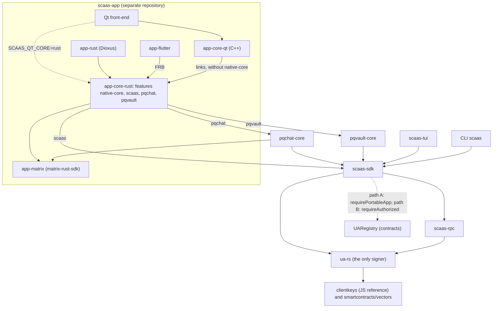

> **Research note — background and rationale only, not normative; the current rules are in docs/ (see decisions.md).**

# Client stack: components, layers, specs, plans and code (status note, 2026-11-17)

A map of the client-side work and the last contract change before the pre-freeze tag: what each part is, where its spec and
plan live, how far its code is, and what it waits for. Owner 2026-11-17: save the table of parts, with spec, plan, code,
groups and content, under docs/research. This note is a snapshot; the specs, plans and `docs/decisions.md` are the sources. Everything here is
UNAUDITED.

## 1. Layers

Owner rulings 2026-11-17: `ua-rs` is the only signer from `scaas-sdk` down (CLI-UAL-01 scope); app cores depend on
`scaas-sdk`, never the reverse (the dependency reversed, for pqchat-core too); app contracts may sign by path A (an
open portable app namespace in `UARegistry`) or path B (chain-bound `requireAuthorized`), both supported.

The default scaas-app build links none of `scaas-sdk`, `ua-rs` or an app core: native chains through Trust Wallet Core or
the C++ codec, ordinary Matrix chat. The `scaas` build adds them.

## 2. Components

State of 2026-11-17 evening. "Branch" is a local branch of this repository unless a repository is named.

| Component | What it is | Spec | Plan | Code | Waits for |
|---|---|---|---|---|---|
| `ua-rs-native` | `ua-rs` + clientkeys: Bitcoin P2WPKH / P2TR, NEAR, Polkadot sr25519, raw messages, envelope calls, native vectors, C ABI and six bindings | `superpowers/specs/2026-11-17-ua-rs-native.md` (branch `ua-rs-native`) | `superpowers/plans/2026-11-17-ua-rs-native.md` | T0–T12 built; `ua-sizes` baseline moved (owner); T13 closing review (Fable, P0 0 / P1 1 / P2 2 / P3 5): fixes in progress | merge into `ua-rs-sign` on the owner's word |
| `ua-rs-sign` | the signer round, integration branch | `superpowers/specs/2026-11-05-ua-rs-sign.md` | `superpowers/plans/2026-11-05-ua-rs-sign.md` | built; main (PR #18) merged in locally, not pushed | `ua-rs-native` in, then push and a PR to `main` |
| `scaas-rpc` | the shared network crate: endpoint lists, failover, strict majority, bounded transport | `superpowers/specs/2026-11-17-scaas-rpc.md`, rules `clients/scaas-rpc.md` (CLI-RPC-01..12, CLI-RPC-50; Q1–Q6 settled) (branch `scaas-sdk`) | `superpowers/plans/2026-11-17-scaas-rpc.md` | T0–T12 started; T13 review after | — |
| `scaas-sdk` | the one API apps call: `vault` (seeds), `account`, `wallet`, `confidential`, `dex`, `admin`; the app-core surface | `superpowers/specs/2026-11-17-scaas-sdk.md`, rules `clients/scaas-sdk.md` (CLI-SDK-01..18) (branch `scaas-sdk`); §25 settled; revised for the reversed stack | `superpowers/plans/2026-11-17-scaas-sdk.md` | none | rpc T1; `ua-rs-native` merged (T2a, T5, T19); the bindings spike T3 decides Q-B1 |
| PqVault | on-chain PQ notes and passwords: contract (class 4), `pqvault-core` above the SDK | `superpowers/specs/2026-11-17-pqvault.md`, rules `contracts/pqvault.md` (CTR-PQV-*), CLI-PQV-* in `clients/pqvault-core.md`, research `research/pqvault.md` (branch `pqvault`); revised for paths A and B and per-vault modes | `superpowers/plans/2026-11-17-pqvault.md` (Part R, Part V, V10e real-crypto e2e) | none | Fable review of revision 2; Part R before the pre-freeze tag |
| Registry path A | `UARegistry.requirePortableApp(ua, appId, typedDigest, auth)`: open portable app namespace (CTR-UA-45, CTR-UA-46) | in the PqVault spec, Part R; `contracts/accounts.md` | PqVault plan Part R | none | Fable review; then the last contract change before the pre-freeze tag |
| `pqchat-core` | PqChat's Rust client core above the SDK, over `app-matrix`'s client | being written (branch `pqchat-core`); protocol: `superpowers/specs/2026-10-25-ua7-pq-e2e-sessions.md`, `2026-11-07-pqchat-public-topics.md`, `contracts/pqchat.md` | being written, with a real-crypto e2e (owner) | none (JS reference `clients/clientkeys/src/pqchat.js`, vectors `smartcontracts/vectors/pqchat/`; contract BUILT) | the SDK's app-core surface |
| `scaas-tui` | terminal front-end, SCaaS only, over the SDK and scaas-app's view model | being written (branch `scaas-tui`) | being written | none | the SDK |
| CLI `scaas` | thin client of the SDK | in the SDK spec (CLI-SDK-17) | SDK plan T22 | none | SDK T18 |
| scaas-app contract | the app-core contract both app cores implement | scaas-app repo `app-common/spec/app-core-contract.md` (pushed, `main`) | — | — | — |

## 3. scaas-app task groups

Plans: `docs/superpowers/plans/2026-11-17-scaas-app-next.md` in the Qt repository (groups A, B, C) and, being moved, groups
R, M, X with a new F into the scaas-app repository (owner 2026-11-17: moved to scaas-app).

| Group | Crate / part | Content | Code |
|---|---|---|---|
| A | docs | the app-core contract, the replacement spec and shell plan | contract written |
| B | `app-core-qt`, default build | B1 backend interface, B1b TxCodec without Qt types, B2 path table, B3 chain table and flags, B4 TWC default per chain, B5 cross-check gate, B6 vault format, B7 empty `SCAAS` flag, B8 endpoint lists, B9 stub inventory, B10 view-model contract, B11 name and brand | Tasks 1–16 of the earlier core plan built |
| C | `app-core-qt`, `scaas` build | backend (c) through the SDK; the two Qt paths (`SCAAS_QT_CORE`) | none |
| R | `app-core-rust` | R1 crate frame and features, R2 C ABI, R3 vault, R4 tables, R5 TWC, R6 TxCodec via `cxx`, R7 endpoint lists, R8 cross-check of the two cores, R9 FRB, R10 the `scaas` / `pqchat` / `pqvault` features | none |
| M | `app-matrix` | M1 crate and pinned `matrix-sdk`, M2 login and session, M3 rooms and timeline, M4 verification and key backup, M5 C ABI, M6 the Qt chat controller, M7 the PqChat hook (`pqchat-core` uses the same client) | none |
| X | `app-rust` (Dioxus) | the Rust front-end over `app-core-rust` as a crate | none |
| F | `app-flutter` | new frame: FRB project, view model, screens, chat, the `scaas` build's screens | none |

## 4. Decisions of 2026-11-17 behind this map

- CLI-UAL-01 holds from `scaas-sdk` down; an app above it may sign native chains itself.
- scaas-app: flag `scaas`; three native backends per chain; the app vault is clientkeys / `ua-rs` vault v1; Polkadot sr25519
  on the bare mnemonic; chat (b): Matrix in the default build, PqChat in the `scaas` build, one stack, one login.
- In the `scaas` build the SDK opens the vault (Q-A1 (a)); EVM through `EvmTx`; error 32 `Argument`; Paseo SS58 42.
- `scaas-rpc` Q6 (b): a decryption-feeding majority holds a named or default endpoint.
- PqVault: O1 (c) sharing by copy, O2–O6 as recommended, O8 after V0; O7 and O9 open.
- Paths A and B for app contracts; PqVault supports both by a per-vault mode (controller call).
- App cores above the SDK, PqChat included; coordinator conditions: key handles only, no SCaaS-purpose signing through the
  generic app call (PqChat's records through the SDK's named typed entries, controller call).
- `app-core-rust` is the app's one Rust library (no separate aggregating crate); Qt on either core (`SCAAS_QT_CORE`).
- Real-crypto client e2e in the `pqchat-core` and PqVault plans: today's on-chain PqChat runs use stand-in wraps
  (`smartcontracts/evm/script/onchain/PqChat.s.sol`), contract-only.
- The `0x05` / `0x19 0x01` first-byte refusal withdrawn from `ua-rs` and the SDK raw entry (closing review C1).
- Specs are written early as frames (owner: specs are written so that a frame is ready).

## 5. Open points

| Point | Where | State |
|---|---|---|
| PqVault O7 (biometric-wrapped passphrase key), O9 (outside-firm audit) | PqVault spec §14 | owner, no recommendation |
| Cosmos and GRAM signing in the `scaas` build | scaas-app contract §10 point 11; SDK spec §8.6 | owner question |
| UA-7 call keys (SFrame) outside `ua-rs` | `pqchat-core` spec | open |
| Key-label scoping between app cores | SDK spec, App cores section | proposal |
| Q-B1: UniFFI + `uniffi-bindgen-cpp`, or the fallback | SDK plan T3 | decided by the spike |

## 6. Order to the pre-freeze tag

1. `ua-rs-native` T13 fixes → into `ua-rs-sign` → gates → push → PR to `main`.
2. Part R (registry path A and the PqChat shared base) after the Fable review → full forge gates → PR.
3. Pre-freeze tag on `main` → audit (prompt files per unit in the private scratchpad) → audit fixes and gates.

Client work runs beside it: `scaas-rpc` → `scaas-sdk` → `pqchat-core`, `pqvault-core`, `scaas-tui` → the scaas-app groups.
