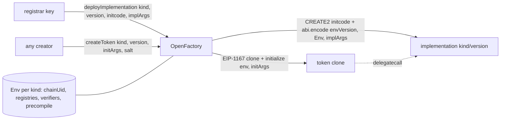

> **Research note — background and rationale only, not normative; the current rules are in docs/ (see decisions.md).**

# Factory and deployer patterns in common smart contracts, compared with the SCaaS OpenFactory

Written 2026-10-20 at the owner's request, after the rulings of 2026-10-19 / 20 on CTR-ZTH-20 (plan
`docs/superpowers/plans/2026-10-19-pqzl-fs3.md` Task 5g-Z). The question is general: **how does a factory supply the
dependencies of an implementation or an instance** (system addresses and parameters: registries, chain identity,
entry points, oracles, fee recipients, routers, verifiers), **who chooses them** (the factory, an admin, governance,
the creator), how releases are versioned and whether a delay protects users. Zether verifiers are one case of it.
Research only: nothing here is built. Every URL was read on **2026-10-20**; source files were read at the tag or
commit named in the link; values marked "mainnet RPC" were read by `eth_call` from a public Ethereum mainnet endpoint
at block 26,228,256 the same day. Tags: **[source]** official documentation, a specification, tagged source or a
live chain value; **[inference]** this note's reasoning; **[estimate]** a number computed here from sources plus
stated assumptions.

## 1. Result

| Question | Answer |
|---|---|
| Is a factory-held set of canonical dependencies, injected at deployment, common practice? | **Yes.** Uniswap V3 hands every pool its parameters from the factory; Compound III bakes a governance-set configuration into each implementation as immutables; OP Stack ships one `OPContractsManager` per release with the implementation set fixed in it; ERC-4337 factories bind the EntryPoint immutably. [source, §3] |
| Is "anyone may pick any version, existing instances never change" common? | **Rare among large protocols** (Aave, Compound, OP Stack, zkSync, Scroll upgrade live instances through governance). The closest precedents are Uniswap V2 / V3 pools, Tornado Cash pools after the operator was renounced, and Aztec, whose rollup instances are immutable and new versions are registered beside them. [source, §3–4] |
| Do creators choose dependencies anywhere? | Yes: Safe (caller-chosen singleton), Uniswap V4 (pool-creator-chosen hooks), Semaphore deployers (verifier). V4 bounds a hook by permission bits in its address and by the singleton's accounting; no protocol found lets a creator pick an unbounded proof verifier for funds that other people deposit and still lists the result as vetted. [source / inference, §3.1, §4] |
| What does the industry have that SCaaS does not (yet)? | (1) a **delay** before new code becomes usable (Aave 1 d, Uniswap and Compound 2 d, zkSync 5–9 d, Aztec ≥ 12 d of notice); (2) a **published release registry** with addresses and code hashes (superchain-registry, safe-deployments); (3) an **on-chain validator** that checks a deployment against the release (OP `StandardValidator`); (4) a multisig or council as the key, never one EOA. [source, §6] |
| What limits does `deployImplementation` hit? | EIP-3860 refuses `CREATE2` init code above 49,152 B on Ethereum today; the largest SCaaS implementation's init code is 61,702 B. It fits the SCaaS testnet (65,536 / 131,072) and Ethereum after EIP-7954 (scheduled for Glamsterdam). Deploying it costs ≈ 13 M gas, under the 2^24 per-transaction cap of EIP-7825. [source / estimate, §5] |

## 2. The SCaaS design being compared

Today (`smartcontracts/evm/src/factory/OpenFactory.sol`, main at `cbd251dd`): the registrar (an immutable address)
appends implementations deployed elsewhere (`registerImplementation(kind, version, impl)`); the factory checks only
`kind()`, `factory()` and `chainUid()` by `staticcall`, i.e. it asks the implementation about itself. Each
implementation receives its dependencies (factory, `SmartKeyAccount` implementation, `chainUid`, UA registry,
`ZetherDisclosure`) as constructor arguments from `script/DeployBase.sol`, deployed through the deterministic deployer
`0x4e59…956c`. Creation clones the implementation (EIP-1167, `CREATE2`, salt scoped by the creator) and calls
`initialize`. A confidential token's **verifier came from the creator's `TokenConfig`**; the factory asked that
verifier `isSupportedOnThisChain()`, an answer the verifier itself controls: review finding W-B / V1-02
(`pqz-core/research/code-review-2026-10-19/U-agy-chain.md`, `V1-claude-plugin-pqz-zether.md`). Two other SCaaS
contracts already follow the "fixed at deployment" pattern: `SmartKeyAccountFactory` builds its implementation in its
constructor with `chainUid` (as ERC-4337 factories do with the EntryPoint), and `UARegistry` takes its per-kind
verifier table as immutable constructor arguments.

Owner rulings 2026-10-19 / 20 (Task 5g-Z; decisions.md CTR-ZTH-20, CTR-TOK-15 / -16 / -17):

- `OpenFactory` keeps a per-kind, versioned **`Env`**: the canonical dependencies of that kind (for the Zether kinds
  the transfer, burn and inner-product verifiers and the disclosure contract per curve; for the PQZ kinds the fixed
  precompile; for every kind the chain identity and the registries).
- The registrar releases code through an admin-only **`deployImplementation(kind, version, initcode, bytes implArgs)`**:
  the factory deploys by `CREATE2` with `abi.encode(envVersion, Env, implArgs)` appended as constructor arguments.
- **`createToken(kind, version, bytes initArgs, salt)`**: anyone picks any non-deprecated version of any kind; the
  factory clones it and calls `initialize(env, initArgs)`. Creators never supply verifiers.
- `createTokenUnregistered` stays for plain kinds (version 0, unvetted, `isRegisteredToken` false) and is refused for
  confidential kinds. Existing tokens never change. The registrar key is the trust root for code (multisig or UA
  `msig` recommended; a timelock for new versions an option for 22776).
- Rejected: an admin-managed verifier allowlist (moves the trust to the admin without fixing the root), clients pinning
  canonical addresses only (the earlier CTR-ZTH-20), `CREATE2` / codehash pins in a library.

## 3. Factory patterns

### 3.1 Uniswap V2, V3, V4

- **V2** ([`UniswapV2Factory.sol` v1.0.1](https://github.com/Uniswap/v2-core/blob/v1.0.1/contracts/UniswapV2Factory.sol)):
  `createPair` is permissionless, deploys `type(UniswapV2Pair).creationCode` by `CREATE2` with salt
  `keccak256(token0, token1)` and calls `initialize(token0, token1)`. The only dependency is the factory itself
  (`msg.sender` in the pair's constructor). The admin (`feeToSetter`) can only set `feeTo`, the protocol-fee
  recipient read by every pair; pair code never changes and there is one code version per factory. [source]
- **V3** ([`UniswapV3Factory.sol`](https://github.com/Uniswap/v3-core/blob/v1.0.0/contracts/UniswapV3Factory.sol),
  [`UniswapV3PoolDeployer.sol`](https://github.com/Uniswap/v3-core/blob/v1.0.0/contracts/UniswapV3PoolDeployer.sol),
  tag v1.0.0): the factory writes `Parameters {factory, token0, token1, fee, tickSpacing}` to storage, deploys
  `new UniswapV3Pool{salt: keccak256(token0, token1, fee)}()` with **no constructor arguments**, and deletes the
  parameters; the pool's constructor reads them back by calling `parameters()` on `msg.sender` and stores them as
  immutables. Purpose: the init code hash is one constant, so any pool address is computable from (tokens, fee)
  alone. The owner can add a fee tier (`enableFeeAmount`: only new tiers, `fee < 1,000,000`,
  `0 < tickSpacing < 16384`, never change or remove one) and set protocol fees; pools themselves are immutable.
  [source] Mainnet RPC: the factory `0x1F98…F984` is owned by a contract whose `owner()` is the Uniswap Timelock
  `0x1a9C…35BC`, `delay()` = 172,800 s (2 days); that intermediate contract exposes `FACTORY()` and corresponds to
  the protocol-fee adapter that Uniswap documents as the factory owner
  ([V3FeeAdapter](https://docs.uniswap.org/contracts/protocol-fee/technical-reference/V3FeeAdapter)) [source /
  inference: the exact contract name was not confirmed on chain].
- **V4** ([`PoolManager.sol`](https://github.com/Uniswap/v4-core/blob/v4.0.0/src/PoolManager.sol),
  [`Hooks.sol`](https://github.com/Uniswap/v4-core/blob/v4.0.0/src/libraries/Hooks.sol), tag v4.0.0): one singleton
  holds every pool; `initialize(PoolKey, sqrtPrice)` is permissionless and the **pool creator chooses the hook
  contract** in the key. V4 bounds that choice: the 14 permission flags are the low bits of the hook's *address*
  (`BEFORE_SWAP_FLAG = 1 << 7`, …), so which callbacks a hook gets is fixed when the hook is deployed;
  `isValidHookAddress` refuses inconsistent flags (a "returns delta" flag without its action flag); the
  singleton's flash accounting requires every delta to settle. Users must still trust a hook with the powers its
  flags grant; the pool id commits to the hook address, so a UI can filter pools by known hooks. The owner (mainnet
  RPC: the PoolManager `0x0000…8A90` from the
  [v4 deployments page](https://developers.uniswap.org/llms.mdx/docs/protocols/v4/deployments) is owned by the same
  Timelock) only manages protocol fees. [source]

### 3.2 ERC-4337 account factories

[`SimpleAccountFactory.sol`](https://github.com/eth-infinitism/account-abstraction/blob/v0.8.0/contracts/accounts/SimpleAccountFactory.sol)
(v0.8.0): the constructor takes the EntryPoint, builds `accountImplementation = new SimpleAccount(_entryPoint)` and
stores both as immutables; `createAccount(owner, salt)` (callable only from the EntryPoint's `SenderCreator`) deploys
an `ERC1967Proxy` by `CREATE2` and returns the existing address if already deployed. In
[`SimpleAccount.sol`](https://github.com/eth-infinitism/account-abstraction/blob/v0.8.0/contracts/accounts/SimpleAccount.sol)
the EntryPoint is an immutable of the implementation: a new EntryPoint means a new implementation and a new factory
(the account itself is `UUPSUpgradeable`, so its owner may move it). EntryPoint v0.8 "is always deployed at address
`0x4337084d9e255ff0702461cf8895ce9e3b5ff108`"
([README](https://github.com/eth-infinitism/account-abstraction/blob/v0.8.0/README.md)). Dependencies: chosen by
whoever deploys the factory, fixed thereafter; no admin. [source] `SmartKeyAccountFactory` is this pattern with
`chainUid` in place of the EntryPoint [inference].

### 3.3 Safe

[`SafeProxyFactory.sol` v1.4.1](https://github.com/safe-global/safe-smart-account/blob/v1.4.1/contracts/proxies/SafeProxyFactory.sol):
`createProxyWithNonce(_singleton, initializer, saltNonce)` deploys a `SafeProxy` whose creation code has the
**caller-chosen singleton** appended; the only check is that the singleton has code; the salt includes
`keccak256(initializer)` (and the chain id in `createChainSpecificProxyWithNonce`). The factory has no admin and no
notion of a vetted version. Trust comes from outside the chain: the
[safe-deployments](https://github.com/safe-global/safe-deployments/blob/e9cc9798ab834e7fe515d361566eb4a28c65387f/README.md)
package lists every released contract per version with its address per chain and its **`codeHash`** (e.g.
[`v1.4.1/safe_proxy_factory.json`](https://github.com/safe-global/safe-deployments/blob/e9cc9798ab834e7fe515d361566eb4a28c65387f/src/assets/v1.4.1/safe_proxy_factory.json):
canonical `0x4e1D…ec67`, codeHash `0x50c3…3317`) [source]; wallets and tooling are expected to compare
proxies and singletons with that list [inference]. This is the
"clients pin canonical addresses" model that the owner rejected for confidential kinds: the factory itself would list
a token with a forged verifier [inference].

### 3.4 OpenZeppelin clones and proxies

- [`Clones.sol` v5.7.0](https://github.com/OpenZeppelin/openzeppelin-contracts/blob/v5.7.0/contracts/proxy/Clones.sol):
  EIP-1167 minimal proxies (`clone`, `cloneDeterministic`, `predictDeterministicAddress`); since 5.2.0
  `cloneWithImmutableArgs` / `cloneDeterministicWithImmutableArgs` append per-instance bytes to the clone's code,
  read with `fetchCloneArgs`
  ([CHANGELOG](https://github.com/OpenZeppelin/openzeppelin-contracts/blob/v5.7.0/CHANGELOG.md)). Clones cannot be
  upgraded; the source warns that a clone of an address without code initialises "successfully" with no effect. [source]
- [`UpgradeableBeacon`](https://github.com/OpenZeppelin/openzeppelin-contracts/blob/v5.7.0/contracts/proxy/beacon/UpgradeableBeacon.sol)
  / [`BeaconProxy`](https://github.com/OpenZeppelin/openzeppelin-contracts/blob/v5.7.0/contracts/proxy/beacon/BeaconProxy.sol):
  every proxy reads its implementation from one beacon whose owner calls `upgradeTo`, so one key changes all
  instances at once. [source]
- [Transparent](https://github.com/OpenZeppelin/openzeppelin-contracts/blob/v5.7.0/contracts/proxy/transparent/TransparentUpgradeableProxy.sol)
  (an immutable `ProxyAdmin` per proxy) and
  [UUPS](https://github.com/OpenZeppelin/openzeppelin-contracts/blob/v5.7.0/contracts/proxy/utils/UUPSUpgradeable.sol)
  (upgrade logic in the implementation): per-instance upgrades by an admin. [source]
- SCaaS uses only plain clones: a token's code is fixed at creation and a new release reaches only tokens created
  later. A beacon would turn the registrar into an owner of every token's code, which CTR-TOK-15 / -17 exclude.
  [inference]

### 3.5 Compound III (Comet)

[`Configurator.sol`](https://github.com/compound-finance/comet/blob/f766f51583c23acc33b2a7824654ef2029a96804/contracts/Configurator.sol)
stores a `Configuration` per market (price feeds, governor, pause guardian, rate curve, assets) that only the
governor sets; "all params can later be updated by the governor except for `baseToken` and `trackingIndexScale`".
`deploy(cometProxy)` calls the market's factory, whose `clone(config)` is
`new CometWithExtendedAssetList(config)`
([factory](https://github.com/compound-finance/comet/blob/f766f51583c23acc33b2a7824654ef2029a96804/contracts/CometFactoryWithExtendedAssetList.sol)):
the configuration becomes **immutables of a new implementation**
([`CometWithExtendedAssetList.sol`](https://github.com/compound-finance/comet/blob/f766f51583c23acc33b2a7824654ef2029a96804/contracts/CometWithExtendedAssetList.sol)),
and
[`CometProxyAdmin.deployAndUpgradeTo`](https://github.com/compound-finance/comet/blob/f766f51583c23acc33b2a7824654ef2029a96804/contracts/CometProxyAdmin.sol)
points the market's proxy at it. "All instances of Compound III are controlled by the Timelock contract"
([governance docs](https://docs.compound.xyz/governance/)); mainnet RPC: the Compound Timelock `0x6d90…3925` has
`delay()` = 172,800 s (2 days). [source] Closest to the SCaaS `deployImplementation`: dependencies are injected by
the system into an implementation's constructor; the difference is that Comet then upgrades the live market,
SCaaS does not touch existing tokens [inference].

### 3.6 Aave V3 PoolAddressesProvider

[`PoolAddressesProvider.sol` v1.19.4](https://github.com/aave/aave-v3-core/blob/v1.19.4/contracts/protocol/configuration/PoolAddressesProvider.sol)
is a per-market registry of dependencies keyed by `bytes32` (`POOL`, `POOL_CONFIGURATOR`, `PRICE_ORACLE`,
`ACL_MANAGER`, `ACL_ADMIN`, `PRICE_ORACLE_SENTINEL`, `DATA_PROVIDER`, plus free ids through `setAddress` /
`setAddressAsProxy`); every setter is `onlyOwner`, and the pool and configurator are proxies whose implementation
the owner replaces (`setPoolImpl`). Components read their dependencies from the provider at call time, so a change
takes effect for every user at once. Mainnet RPC: the Ethereum market's provider `0x2f39…4E9e` is owned by
`0x5300…192A`, which the [Aave governance docs](https://aave.com/docs/ecosystem/governance) list as the Level 1
("Short") Executor: 3-day vote, then a **1-day timelock**; Level 2 has a 10-day vote and a 7-day timelock. [source]
This is a live, admin-mutable `Env`: the opposite of SCaaS's choice to freeze dependencies per version [inference].

### 3.7 OP Stack: OPContractsManager, release versioning, SuperchainConfig

- [`OPContractsManagerV2`](https://github.com/ethereum-optimism/optimism/blob/op-contracts/v8.0.0/packages/contracts-bedrock/src/L1/opcm/OPContractsManagerV2.sol)
  (tag `op-contracts/v8.0.0`): "Each official release of the OP Stack contracts is packaged with its own unique
  instance of OPContractsManagerV2"; the release's blueprints and implementation addresses are fixed in its
  [`OPContractsManagerContainer`](https://github.com/ethereum-optimism/optimism/blob/op-contracts/v8.0.0/packages/contracts-bedrock/src/L1/opcm/OPContractsManagerContainer.sol)
  constructor, which also refuses development features on mainnet. `deploy(FullConfig)` is open to anyone and mixes
  `msg.sender` into the `CREATE2` salt; `upgrade` and `upgradeSuperchain` must be `DELEGATECALL`ed by the chain's
  proxy-admin owner. OPCM versions have their own rule: major = a new required sequential upgrade, minor = a
  replacement OPCM for the same upgrade. [source]
- The [superchain-registry](https://github.com/ethereum-optimism/superchain-registry/blob/main/validation/standard/standard-versions-mainnet.toml)
  publishes per release (`op-contracts/v8.0.0`) every contract's semver and implementation address (e.g.
  `op_contracts_manager = { version = "8.0.1", address = "0x1951…896a" }`); `OPContractsManagerStandardValidator`
  checks a chain against its release on chain. [source]
- [`SuperchainConfig.sol`](https://github.com/ethereum-optimism/optimism/blob/op-contracts/v8.0.0/packages/contracts-bedrock/src/L1/SuperchainConfig.sol)
  (version 2.4.3): a guardian can pause, and a pause expires by itself. The
  [privileged roles page](https://docs.optimism.io/superchain/privileged-roles) gives the L1 ProxyAdmin owner of the
  Optimism-governed chains as a 2-of-2 of "an Optimism Foundation 5/7 multisig and … the Security Council
  multisig"; it states no upgrade delay, and a compromised guardian "could pause withdrawals for 3 months". [source]
- Relevance: an OPCM is a **release bundle** (a versioned set of implementations and their wiring), deployed once
  per release, used permissionlessly for new chains; it matches SCaaS's per-kind version plus `Env` more closely
  than any other pattern here. The difference is that OP upgrades existing chains with it. [inference]

## 4. ZK verifiers as dependencies

| System | How the verifier is supplied | Who can change it | Delay |
|---|---|---|---|
| Tornado Cash ([`Tornado.sol` v2.1](https://github.com/tornadocash/tornado-core/blob/v2.1/contracts/Tornado.sol)) | constructor argument per pool | `operator` via `updateVerifier` ("after the final trusted setup ceremony operator rights are supposed to be transferred to zero address"); mainnet RPC: the 1 ETH (`0x47CE…2936`) and 10 ETH (`0x910C…DbF`) pools have `operator() = 0` and share verifier `0xce17…557A` | frozen: no one can change it |
| Semaphore ([`Semaphore.sol` v4.14.5](https://github.com/semaphore-protocol/semaphore/blob/v4.14.5/packages/contracts/contracts/Semaphore.sol)) | constructor argument of each deployment | nobody (no setter); a new verifier means a new Semaphore deployment | — |
| zkSync Era ([`BaseZkSyncUpgrade.sol`](https://github.com/matter-labs/era-contracts/blob/96d41f23cbef2b570bd38b9d482cd7f54c81766a/l1-contracts/contracts/upgrades/BaseZkSyncUpgrade.sol)) | part of a protocol upgrade (`ProposedUpgrade.verifier`, `verifierParams`) | token governance through `ProtocolUpgradeHandler`; emergency board (Security Council 6/8, Guardians 5/8, Foundation 3/6) | 5–9 d standard, **0 on the emergency path** ([L2BEAT](https://l2beat.com/scaling/projects/zksync2)) |
| Scroll | `MultipleVersionRollupVerifier`: latest verifier per batch version | `ScrollAdminMultisig` (3-of-4) through `TimelockSCEmergency` | **none**; an emergency verifier swap on 2026-02-23 ([L2BEAT](https://l2beat.com/scaling/projects/scroll)) |
| Aztec | each rollup version is a new, immutable stack (rollup, verifier, inbox, outbox); governance registers the canonical one in a Registry | token governance | ≥ 12 d of notice (3 d pending, 7 d vote, 2 d queue) ([L2BEAT](https://l2beat.com/scaling/projects/aztecnetwork)) |
| Ethereum KZG ([EIP-4844](https://github.com/ethereum/EIPs/blob/master/EIPS/eip-4844.md)) | precompile at `0x0A` | only a hard fork | network upgrade process |

[source, all rows] Observations [inference]: rollups treat the verifier as a protocol dependency held by the system,
never chosen per user, and change it through governance, where delays range from none (Scroll, zkSync emergency) to
weeks; Tornado and Semaphore show the immutable end; **Aztec is the model SCaaS follows** (old instances keep their
verifier, a new version sits beside them and a registry says which is current); the PQZ precompile is the EIP-4844
model (fixed address, changed only by a chain upgrade).

## 5. Deterministic deployers and size limits

- **Arachnid's proxy** ([source at master `be3c597`](https://github.com/Arachnid/deterministic-deployment-proxy/blob/be3c5974db5028d502537209329ff2e730ed336c/source/deterministic-deployment-proxy.yul),
  [README](https://github.com/Arachnid/deterministic-deployment-proxy/blob/be3c5974db5028d502537209329ff2e730ed336c/README.md)):
  calldata = 32-byte salt ‖ init code, `CREATE2` with the call value; deployed by a keyless pre-EIP-155 transaction to
  `0x4e59b44847b379578588920ca78fbf26c0b4956c`. Note: the `v1.0.0` tag still has salt 0; the deployed code takes the
  salt from calldata. [source] **EIP-7997** ([Last Call](https://github.com/ethereum/EIPs/blob/master/EIPS/eip-7997.md),
  scheduled for Glamsterdam in [EIP-7773](https://github.com/ethereum/EIPs/blob/master/EIPS/eip-7773.md)) makes this
  factory a requirement: a chain deploys it or includes it "in the genesis state with a nonce equal to `1`". [source]
- **Safe singleton factory** ([README v2.0.0](https://github.com/safe-global/safe-singleton-factory/blob/v2.0.0/README.md)):
  the same code at `0x914d…43d7`, deployed per chain by an EIP-155 transaction signed by a Safe-held key, for chains
  that refuse pre-EIP-155 transactions. **CreateX** ([v1.0.0](https://github.com/pcaversaccio/createx/blob/v1.0.0/README.md))
  at `0xba5E…a5Ed` adds `CREATE3` and salt guards: first 20 bytes = `msg.sender` ("permissioned deploy protection"),
  21st byte = cross-chain redeploy protection. [source] `OpenFactory._salt(creator, salt)` and OPCM's salt mixer are
  the same guard [inference].
- **Limits a factory's `CREATE2` hits.** [EIP-170](https://github.com/ethereum/EIPs/blob/master/EIPS/eip-170.md):
  deposited code ≤ 24,576 B. [EIP-3860](https://github.com/ethereum/EIPs/blob/master/EIPS/eip-3860.md): "If length of
  `initcode` to `CREATE` or `CREATE2` instructions exceeds `MAX_INITCODE_SIZE`" (2 × 24,576 = 49,152 B) the
  instruction aborts, plus 2 gas per 32-byte word. [EIP-7954](https://github.com/ethereum/EIPs/blob/master/EIPS/eip-7954.md)
  (Last Call, deadline 2026-11-01, scheduled for Glamsterdam) raises them to 65,536 / 131,072 B. Go-ethereum already
  carries both pairs (`MaxCodeSize`, `MaxInitCodeSize = 2 * MaxCodeSize`, `…Amsterdam` = 65,536 / 2×) and the
  EIP-7825 cap `MaxTxGas = 1 << 24`, and its pool refuses transactions over 128 KB (`txMaxSize`)
  ([protocol_params.go](https://github.com/ethereum/go-ethereum/blob/17e0a6ca4ed14f46997f6d0f1edb4cca33b86024/params/protocol_params.go),
  [legacypool.go](https://github.com/ethereum/go-ethereum/blob/17e0a6ca4ed14f46997f6d0f1edb4cca33b86024/core/txpool/legacypool/legacypool.go)).
  [source]
- **Applied to `deployImplementation`** (sizes from `smartcontracts/evm/size-baseline.json`: `UnderlyingPqzToken`
  60,105 B runtime / 61,702 B init, `UnderlyingZetherToken` 57,475 / 59,170 B; SCaaS testnet `maxCodeSize` 65,536 and
  init 131,072 per `src/chains/private7622/README.md`):
  - init code + appended `Env` (≈ 1 KB) ≈ 62.7 KB: over 49,152 on any chain without EIP-7954, under 131,072 on the SCaaS testnet;
    the transaction is under the 128 KB pool limit. The factory route adds no new limit compared with a direct
    `0x4e59` deployment: the same EIP-3860 check applies to the factory's `CREATE2`. [estimate]
  - gas: code deposit 200 × 60,105 ≈ 12.02 M, `CREATE2` 32,000 + 8 gas per init word ≈ 16 k, calldata ≈ 0.8 M (16 /
    4 gas per non-zero / zero byte, ≈ 75 % non-zero assumed), memory and copy ≈ 30 k, intrinsic 21 k: **≈ 12.9 M**
    plus the constructor, under the 16,777,216 cap with ≈ 3.8 M to spare. EIP-8037 (also scheduled for Glamsterdam,
    [Last Call](https://github.com/ethereum/EIPs/blob/master/EIPS/eip-8037.md)) reprices code deposit per state
    byte; its constant was "not yet final", so this margin must be re-measured after Glamsterdam. [estimate]
  - every `Env` entry kept as an `immutable` is inlined as a 32-byte `PUSH32` at each place the code reads it, so
    `UnderlyingPqzToken` (5,431 B under 65,536) has room for at most ≈ 170 such references [inference].

## 6. Comparison

| Pattern | Dependencies supplied by | Who chooses the code | Versioning | Existing instances | Delay | Trust root |
|---|---|---|---|---|---|---|
| Uniswap V2 | the factory (itself) | fixed in the factory | none (new factory) | immutable | — | factory deployer (`feeToSetter` for the fee recipient) |
| Uniswap V3 | factory `parameters()`, immutables in the pool | fixed in the factory; owner adds fee tiers only | none | immutable | 2 d (Timelock) for fee tiers | governance |
| Uniswap V4 | singleton + **creator-chosen hook** | singleton fixed; hook by creator, bounded by address flags | none | immutable | — | creator for the hook, users filter |
| ERC-4337 `SimpleAccountFactory` | EntryPoint immutable in factory and implementation | factory deployer | new factory per EntryPoint | UUPS, owner of each account | — | factory deployer |
| Safe | **caller-chosen singleton** | caller | off-chain list (safe-deployments, code hashes) | per-Safe owners can switch | — | the published list |
| OZ beacon | beacon | beacon owner | beacon upgrade | **all upgraded together** | none built in | beacon owner |
| Compound III | Configurator → immutables of a new implementation | governance | per deploy | proxy upgraded | 2 d (Timelock) | governance |
| Aave V3 | `PoolAddressesProvider`, read at call time | governance | proxy upgrade | live change | 1 d (Level 1) / 7 d (Level 2) | governance |
| OP Stack | OPCM per release (implementation set fixed) | release process; anyone deploys a chain | per release, registry + validator | upgraded by proxy-admin owner | none stated | Foundation + Security Council 2-of-2 |
| Rollup verifiers (zkSync, Scroll) | system contract, per protocol version | governance / multisig | protocol version | upgraded | 0 – 9 d | governance, council |
| Aztec | new immutable stack per version, registry | governance | registry of instances | **immutable, new beside old** | ≥ 12 d notice | governance |
| **SCaaS (5g-Z)** | **factory `Env` per kind and version, injected at `deployImplementation` and `createToken`** | **registrar releases; any creator picks a version** | **per kind, append-only, deprecation** | **immutable** | **none yet (option)** | **registrar key** |

[source for the rows, per §3–4; inference for the summary cells]

## 7. Where SCaaS sits

- **Dependency supply**: like Comet and OPCM (the system, not the deployer of each instance, supplies the wiring),
  and unlike Aave (no live mutable registry) and Safe / V4 (no caller-chosen code for confidential kinds). The gain
  over today's `registerImplementation` is that the factory knows the `Env` it gave, instead of asking an
  implementation `factory()` / `chainUid()`, answers that a dishonest implementation controls. [inference]
- **What it does not fix**: the init code still comes from the registrar, and code can ignore its `Env`. A wrong or
  malicious release is exactly as dangerous as before for tokens created from it; injection removes
  misconfiguration and creator-chosen verifiers, not the registrar's power. [inference]
- **Instance lifecycle**: Uniswap V2 / V3 / Aztec (immutable instances, new versions beside old ones), so a bad
  release cannot reach existing tokens, and a good fix cannot either: holders of a token on a deprecated version
  migrate by moving to a new token. [inference]
- **Openness**: anyone may create from any non-deprecated version (CTR-TOK-15), with provenance for clients
  (CTR-TOK-17); `createTokenUnregistered` for plain kinds is the V4-hook / Safe-singleton freedom, marked unvetted.
  [inference]

## 8. Gaps the industry covers that SCaaS does not (yet)

1. **Delay before new code is usable.** Aave, Compound, Uniswap, zkSync (standard path) and Aztec give users
   ≥ 1 day between approval and effect; Scroll, the zkSync emergency path and the OP proxy-admin owner (per its
   docs) have none. SCaaS needs it less (existing tokens are unaffected), but a
   new version is usable immediately by any creator, and a leaked registrar key could release a draining
   implementation that wallets list as registered. [inference]
2. **Release registry with code hashes.** superchain-registry and safe-deployments publish, per version, addresses
   and code hashes that wallets check. SCaaS has the deploy JSON (`vm.serializeAddress` in `DeployBase.sol`) per run,
   not a versioned, reviewed list per chain. [source / inference]
3. **Reproducible verification of init code.** OP's on-chain validator and Safe's `codeHash` let anyone compare a
   deployment with a release. With `Env` appended to the init code, the published value must be the hash of the
   compiled init code *without* arguments plus the argument bytes; the factory can emit both. [inference]
4. **Key custody.** OP uses a Foundation + Security Council 2-of-2, zkSync a three-party emergency board, Aave and
   Compound token governance; in the SCaaS deploy script the registrar is `REGISTRAR`, defaulting to the deployer key
   (`script/Deploy.s.sol`).
   [source / inference]
5. **Pause / guardian with expiry** (SuperchainConfig): not needed for tokens that never change; `deprecate` is the
   fast path once 5g-Z makes `createToken` refuse deprecated versions (today's `createToken` does not check the
   flag). [source / inference]

## 9. Recommendations

For **22776 (mainnet)** [inference]:
- Registrar = a multisig (Safe, or a UA `msig` once audited), never an EOA, keys held by distinct people.
- **Notice period on `deployImplementation`**: store `usableFrom = block.timestamp + DELAY` per (kind, version);
  `createToken` refuses before it; `deprecate` stays immediate. A constructor constant (e.g. 2–7 days, matching
  Compound / Uniswap 2 d and Aave Level 2 7 d) costs one slot per version and no `TimelockController`. `Env` changes
  happen only through a new `envVersion` with the same delay; there is no in-place `Env` setter.
- Emit, per release, kind, version, `envVersion`, `keccak256(Env)`, the implementation's code hash and the hash of
  the init code without arguments; publish a reviewed release list per chain (address, code hash, source commit,
  compiler settings) the way superchain-registry and safe-deployments do, and have clients pin the list, not single
  addresses.
- Put `0x4e59…956c` in the 22776 genesis with nonce 1 (EIP-7997's genesis route) so the stack deploys at fixed
  addresses whatever the gas parameters.
- Launch after Glamsterdam (EIP-7954) or keep the raised code-size limit in the 22776 chainspec; re-measure the
  `deployImplementation` gas under EIP-8037.

For **SCaaS testnet** [inference]:
- Keep the deployer as registrar, but build the delay with a small value (minutes) so the code path and the client
  handling of "not yet usable" are tested before 22776.
- Generate the release list from the deploy JSON already produced, to rehearse the format.
- Keep `createTokenUnregistered` for plain kinds as is.

Not recommended [inference]: a beacon (one key over every token's code), an Aave-style live dependency registry read
at call time (changes existing tokens), and the V3 `parameters()` callback (only worth it if a constant init code
hash per version were needed; appended arguments are simpler and the factory emits them).

## 10. Uncertain points

- The name of the contract that owns the Uniswap V3 factory (`0xf237…bf5a`) was not confirmed; only its
  `FACTORY()` and `owner()` were read. [source / inference]
- OP Stack: the privileged-roles page states no upgrade delay; whether the Security Council's own process adds one
  was not checked. [source]
- zkSync and Scroll figures come from L2BEAT (a secondary source that cites contracts); the contracts were not read
  beyond `BaseZkSyncUpgrade.sol`. [source]
- The gas estimate of §5 assumes 75 % non-zero init-code bytes and a cheap constructor; measure with forge before
  fixing a delay or a chain limit. [estimate]
- Whether the 22776 genesis already contains `0x4e59…956c` was not checked here. [inference]
