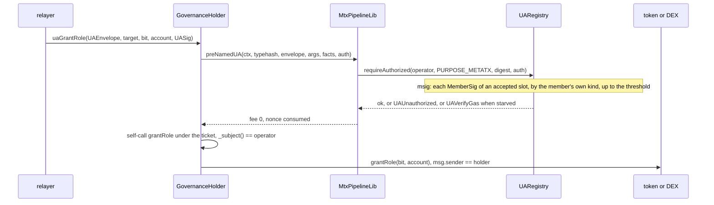

> **Research note — background and rationale only, not normative; the current rules are in docs/ (see decisions.md).**

# Permission model: the gaps closed before the prototype (2026-11-02)

Companion of [permission-model.md](permission-model.md) (v2). The owner's decisions D1-D9 are in the register as CTR-GOV-01 to
-09, the bit bands as CTR-GOV-10; gap 1 was that. This note holds gaps 2-6 and does not reopen a decision. Everything here is
design text: nothing in §1, §2 or §5 is built, and the cryptography it leans on is `UNAUDITED`.

Code citations are `path:line` under `smartcontracts/evm/src/` at `2a864638` (`main`), the base of branch `governance`, read
with `git show` because the prototype moves those lines. `src/` did not change between `b3cf5718` (where v2 was read) and
`2a864638`. Tags as in v2: **[V]** read this session, **[I]** inferred, **[est.]** a figure not measured, **[M]** measured, with
the harness in [prototype/](prototype/RESULTS.md).

## 1. Gap 2: a holder for a UA

### 1.1 The gap

`owner` and every holder are `address` (`metatx/AdminLib.sol:52`, `:61`). `_msgSender()` is `UA_POOL` for every derived subject
(`metatx/MetaTxBase.sol:296-300`), and no role-gated entry is on a UA allowlist, so a derived UA, an `msig` included, can hold
nothing today. v2's "msig `SmartKeyAccount`" (§1.6) does not exist: `account/SmartKeyAccount.sol:13-17` has the key kinds P-256
and secp256k1, any one key signs (`:358-370`), there is no threshold and no PQ kind. A Safe has neither. **So today there is no PQ
owner of any SCaaS contract at all**, and A7's "fixed by statement" fixed nothing.

### 1.2 The contract

`GovernanceHolder`, a `UAMetaTxBase` child (`metatx/UAMetaTxBase.sol:18`), the base meant for contracts that are not tokens
(`test/metatx/UAMetaTxBase.t.sol:16` is the only other child today). The holder is an ordinary address to the contract it governs:
the token sees `msg.sender == holder`, and every rule about `owner` and holders stays as it is.

| Part | Text |
|---|---|
| Shape | EIP-1167 clone, one per operator and salt, made by a per-chain `GovernanceHolderFactory` in the shape of `account/SmartKeyAccountFactory.sol:19-40`: implementation built in the constructor, `predict` and permissionless `deploy`, CREATE2. Not a `TokenKind`: that enum is closed (A14), and `OpenFactory` does not change |
| Immutables | the chain's UA registry, `chain_uid`, the `SmartKeyAccount` implementation (for the 400 k ERC-1271 cap on the address path), `operatorDelay` as a clone argument written once |
| State | `operator: bytes32`, `pendingOperator: bytes32`, `operatorEta: uint64`, in its own ERC-7201 namespace |
| The check | every op starts `if (_subject() != operator) revert NotOperator(_subject())`. `_subject()` (`metatx/UAMetaTxBase.sol:134-137`) is the signer's id under a ticket and the padded caller otherwise, so a native operator can call directly, and a derived one only through a signed entry |
| Holds nothing | no `receive`, no balance, no allowance. A mint names `to`; nothing is minted to the holder by this contract's own logic |
| Fee | `supportedModes() == 0x03`, fee mode `NONE` (`metatx/MetaTxBase.sol:73-75`). A relayer is paid, if at all, through `MtxRelayFee` (CTR-MTX-27), which names "any SCaaS contract's entry with fee `NONE`" |

### 1.3 Entries

One direct op per operation, each with a named typed `mtx<Op>` and `ua<Op>` twin on `_named` / `_namedUA` (`metatx/MetaTxBase.sol:144-149`,
`metatx/UAMetaTxBase.sol:147-151`), `target` the first explicit parameter. **No `execute(bytes)`:** a generic forwarder is never added
(CTR-MTX-16), and escalation F10's confused deputy stays closed.

| Group | Ops |
|---|---|
| Owner, any `GovernanceBase` target | `grantRole(target, bit, account)`, `revokeRole`, `setGrant(target, bit, holder, GrantTerms)`, `disableFeature(target, bit)`, `transferOwnership(target, newOwner)`, `acceptOwnership(target)`, `renounceOwnership(target)` |
| Holder of a bit | `renounceRole(target, bit)` |
| Powers on tokens | `mint(target, to, amount)`, `mintToUA(target, to, amount)`, `disableWrap(target, leg, reason)`, `proposeRate(target, leg, num, den)`, `cancelRate(target)`, `executeRate(target)` |
| Powers on the DEX | `setMarket(target, base, quote, listed)`, `setExchangeTarget(target, t, listed)`, `setListedOnly(target, on)`, `setFeeSplit(target, ppm, treasury)` |
| Its own | `proposeOperator(next)`, `acceptOperator()` |

Application bits 64-127: the application ships its own child of the same abstract base (`operator`, the check, nothing else) with one
typed entry per bit. `GovernanceHolder` itself is a closed table, and the node's call table mirrors it both ways (AGENTS.md, allow-lists).

### 1.4 How an `msig` of PQ members reaches it

1. Each member registers a single-key PQ UA (`mldsa44`, `mldsa65`, `fndsa512`, `slhdsa128s`). `registerMsig` registers the structure;
   the `msig` id derives from it.
2. Each member calls `acceptMembership` (CTR-UA-37). Below the threshold of accepted weight the `msig` authorizes nothing on any
   contract, so a holder naming it is inert. A client reads `memberAccepted` and does not name such an `msig` as an operator.
3. The creator deploys the holder (or predicts its address) with `operator = msigId` and names it as `TokenConfig.owner`. A counterfactual
   owner works for the owner (nothing checks code on it, `metatx/AdminLib.sol:91-94`) but not for a contract-only bit, whose holder
   must have code at the grant (`:180`).
4. The members sign the entry's digest; the registry alone knows them. The holder never reads a member.

### 1.5 The gas it runs under

Three limits, in this order:

1. **Registration bound.** `_membersWorst` (`ua/UARegistryLib.sol:686-726`) refuses an `msig` whose worst minimal signing set does not fit
   `verifyBudget`: `c × (cap + 45,000) + 2,500 + (largest cap − 400,000) / 63`. `verifyBudget` is 12,000,000 on EIP-7825 chains and 10,500,000 on
   Hedera (`script/DeployBase.sol:75-76`). So an `msig` that registers always authorizes within the budget.
2. **The transaction.** 2^24 = 16,777,216 regular gas (`script/DeployBase.sol:99`). At the bound, about 4.7 M is left for the
   intrinsic and calldata cost of the member signatures, the pipeline, the call into the target. Neither that remainder nor the calldata of
   eight SLH-DSA signatures has been measured: [est.].
3. **No ERC-1271 cap applies.** The token never verifies the holder's signature; it sees a call. The 50,000 / 400,000 caps of
   `SigCheck` and `SmartKeyAccount` would refuse every PQ kind, so a PQ owner has no other route.

A starved relayer gets `UAVerifyGas`, never a verdict; the nonce is not consumed.

**What the bound permits**, computed from `_membersWorst` and the gen-1 caps without a precompile (`script/DeployBase.sol:85-88`), identical members:

| Member kind | Cap | Signers needed `c`, most that registers at 12 M | Worst at that `c` | At Hedera's 10.5 M |
|---|---|---|---|---|
| `mldsa44` | 4,250,000 | 2 | 8,653,611 | 2 |
| `mldsa65` | 5,950,000 | **1** (2 needs 12,080,595) | 6,085,595 | 1 |
| `fndsa512` | 2,500,000 | 4 | 10,215,833 | 4 |
| `slhdsa128s` | 1,400,000 | 8 | 11,578,373 | 7 |

A threshold of two ML-DSA-65 signers does not register on a chain without a precompile. That is a real ceiling on the PQ owner, stated here so a
wallet does not promise it. With a precompile the caps fall and the table moves; the rule is the bound, not this table.

### 1.6 Rotation and loss

An `msig` id derives from its structure and members cannot be changed (CTR-UA-37; the decision on membership changes is still the owner's), so
rotating the operator is the only way to change who controls a holder. `proposeOperator(next)` by the operator, then `acceptOperator()` signed by
`next`, after `operatorEta = now + operatorDelay`. The delay is immutable, 0 allowed, shown by a wallet. **Without it, rotating the operator
replaces the holder of a power without touching the token, and CTR-GOV-04's delay is bypassed** (escalation F15's "a mutable holder is a
replacement without a grant").

A wallet shows "operator X, can be replaced after D" only when the address is a clone of the factory's implementation (code hash), and otherwise
"whole shape, mutable by its own rules". A lost operator loses the holder and whatever it owns: there is no guardian and no recovery, as with any
lost key. A threshold below `n` is the mitigation.

### 1.7 Not designed here

The family forms. On every chain the sentence is the same (a derived UA reaches a power through a contract on that family's UA path), and
CTR-GOV-07 covers only the admin entries. Which families can express it is spec work, each family on its own.

## 2. Gap 3: relayed owner operations

v1 flagged it, v2 is silent, `HANDOFF` lists it as a known gap: `grantRole`, `setGrant` and the rest have no typed entry and are not in
`mtxSelectors()` (`metatx/NormalToken.sol:70-78`). Proposed rule for the spec:

> **An owner or holder operation of a `GovernanceBase` contract has one direct entry and no `mtx*` or `ua*` twin on that contract, and is on
> neither of its allow-lists. Its relayed form lives once, in `GovernanceHolder`: a named typed `mtx<Op>` and `ua<Op>` per operation, fee mode
> `NONE`, relayable at fee 0. An owner that wants gasless administration is a holder; a creator names the holder as `owner` at creation (its address
> is predictable), so no first gas is needed. A `SmartKeyAccount` owner is relayable through its own `mtxExecute`. An EOA or a Safe that keeps the
> power directly pays its own gas.**

Why this and not an entry per token:

- **It cannot work on the token for a derived UA.** `owner` is an `address`, and a `ua*` twin runs with `_msgSender() == UA_POOL`.
- **It does not fit.** Measured below in [§8](#8-the-relay-probe): a single named `mtx` entry on `WrappedPqzToken`, against the room left. Eight of them, with their
  `ua*` twins, cannot.
- **The generic path breaks "explicit parameters".** Allow-listing `grantRole` under `mtxExecute` carries it as a `bytes data` blob: hex in a wallet,
  for the most dangerous signature an owner makes. It would also fail the same way for a derived UA.
- **"Every state-changing `mtx*` is relayable" holds:** there is no `mtx*` on the governed contract to be unrelayable, and every `mtx*` on the holder
  is relayable, as CTR-MTX-19's general rule says. The owner's reason of 2026-10-20 (a gasless wallet does every write, owner operations included, by
  signing an envelope) holds through the holder. This is the shape D8 already chose for `moderatedTransfer`.

Cost, stated: an EOA owner that did not name a holder at creation needs gas once, to transfer ownership to one. The node needs rows for the holder's entries
in its own call table (NODE-JOB-20), checked both ways.

## 3. Gap 4: the governance matrix

The matrix the owner asked for on 2026-10-20, from code at `2a864638`, replacing [gov-inventory.md](gov-inventory.md)'s Z2 line numbers. **Fixed** = by the
implementation (`Env`, constructor, constant). **Creation** = per instance (`initArgs`). **After** = changeable after deployment: who, delay, lockable.
"—" = no. Rows marked *model* state what CTR-GOV changes; the rest is today's code.

### 3.1 Releases and Env (`factory/OpenFactory.sol`)

| Property or power | Fixed | Creation | After: who, delay, lockable | Ref |
|---|---|---|---|---|
| Registrar | constructor immutable, no setter, no renounce | — | — . A contract registrar rotates its own signers; otherwise a new factory | `:38`, `:60` |
| `noticePeriod` | immutable, at most 30 days | — | — | `:36`, `:40`, `:59` |
| Publish an `Env` | — | — | registrar, no delay on publishing; append-only, version ≥ 1, never changed, no revoke; `env.factory`, `env.chainUid`, pins checked | `:73-79`, `:263-279` |
| Content of an `Env` (registry, `smartKeyAccountImpl`, `hedera`, `deps`, `libs`, `libCodeHashes`) | becomes immutable in each release built on it | — | as above, per version | `factory/IFactoryToken.sol:29-38` |
| **`deployImplementation`: which Env** | — | — | registrar **names `envVersion` explicitly**, no default to the latest, `EnvUnknown` otherwise; the delay is `usableFrom = now + noticePeriod`; append-only. **The owner's "must not simply bind the kind's latest Env" is met by the code**, marked interim in `factory/IOpenFactory.sol:111-112` "until the governance-matrix spec" | `:95-113`, `:283-305` |
| `deployDexImplementation` | — | — | as above, DEX domain | `:206-224` |
| `deprecate`, `deprecateDex` | — | — | registrar, immediate, one-way; existing instances untouched | `:115-119`, `:232-236` |
| `setKindEnabled` | plain kinds start on (`_enabled = 3`) | — | registrar, immediate, both ways, not lockable | `:50`, `:121-125` |
| `createToken`, `createDex` | — | anyone; salt scoped by creator; ≤ 8 legs | — . The DEX has no enable switch | `:145-154`, `:242-255`, `:335-351` |
| `createTokenUnregistered` | plain kinds only | anyone, any implementation answering `kind()`, `factory()`, `chainUid()`; `version = 0` | — ; clients trust `isRegisteredToken` only | `:156-162` |
| Upgrade of an instance | clones, no proxy | — | — . A release reaches new creations only; nothing deployed changes | `:332-351` |
| *model:* bits 18-20 (`PUBLISH`, `DEPRECATE`, `ENABLE_KIND`) | | | not on a deployed factory: "later" in v2. The registrar stays one address until a new factory | v2 §1.4 |

### 3.2 Every token kind

| Property or power | Fixed | Creation | After: who, delay, lockable | Ref |
|---|---|---|---|---|
| `kind()`, `FACTORY`, `CHAIN_UID`, registry, `SMART_KEY_ACCOUNT_IMPL`, `IS_HEDERA` | Env, per release | — | — | `metatx/MetaTokenBase.sol:53-60`, `metatx/UAMetaTxBase.sol:42-49` |
| `creator`, `version` | — | supplied by the factory | — | `metatx/MetaTokenBase.sol:73-74` |
| `name`, `symbol`, `decimals` | — | `TokenConfig` | — , no setter | `metatx/MetaTokenBase.sol:103-108` |
| `features` | valid set per kind: `metatx/AdminLib.sol:193-201` | `TokenConfig.features` | owner `disableFeature`, immediate, one-way; refused on a locked bit | `metatx/AdminLib.sol:77-85`, `:121-128` |
| `lockedFeatures` | `PAYABLE`, `BURNABLE` always | `⊆ features` | — . "Locked" means the power exists forever, not that it is off | `metatx/AdminLib.sol:37`, `:81`, `:85` |
| Flags 5-8 | refused `FeatureNotBuilt` on `NORMAL`, `WRAPPED`; refused `FeatureInvalidForKind` on the confidential kinds. **This is the current state, not a permanent rule** (owner 2026-11-02, §7) | — | — | `metatx/AdminLib.sol:33-34`, `:80`, `:198-199` |
| `owner` | — | `TokenConfig.owner`, 0 = none ever | two-step transfer, no delay; renounce, immediate | `metatx/AdminLib.sol:91-94`, `:130-151` |
| Grant, revoke a role | role bits 1, 3, 4 | `Roles` | owner, immediate; several holders; `RATE_ADJUSTABLE` holder must have code | `metatx/AdminLib.sol:99-110`, `:176-184` |
| Renounce a role | — | — | the holder, immediate | `metatx/AdminLib.sol:113-118` |
| After `renounceOwnership` | — | — | holders keep their roles | `metatx/AdminLib.sol:145-151` |
| Allow-lists | per kind, pure | — | — | `metatx/NormalToken.sol:70-88` |
| Transfer and pay fees | `MAX_FEE_PPM = 10,000` (1 %) | — | per signed intent; no token-level fee, no protocol fee | `common/FeePolicy.sol:22`, `:41-47` |
| Pause, blacklist, clawback, rescue, sweep | absent | — | — | `metatx/ERC20MetaTx.sol:386-389` |
| *model:* `features`, `owner`, holders | | | same powers in `scaas.governance`; a holder is whole-shape or limited by a `Grant`; revoke by owner or the leaf's grantor; renounce refused while an unlocked bit has holders (CTR-GOV-01, -02) | §8 |
| *model:* grant delay | | `grantDelay`, immutable | two-call `grantRole` (CTR-GOV-04) | not prototyped |

### 3.3 `NORMAL*`

| Property or power | Fixed | Creation | After: who, delay, lockable | Ref |
|---|---|---|---|---|
| Initial supply | — | `initialSupply`, `initialHolder` | — | `metatx/NormalToken.sol:35` |
| Further supply (`mint`, `mintToUA`) | public balance only | `MINTABLE`, `minter` | holder, immediate, **no cap, no rate limit**; ends by `disableFeature` if unlocked, else by revoking every minter | `metatx/NormalToken.sol:39-48` |
| Holder `burn` | — | `BURNABLE`, always locked | any holder of units, own units | `metatx/NormalToken.sol:51-54` |
| *model:* mint limits | | | `Grant` on `MINTABLE`: input (1) of §3.8 | |

### 3.4 `WRAPPED*`

| Property or power | Fixed | Creation | After: who, delay, lockable | Ref |
|---|---|---|---|---|
| Legs, order | 1-8 | `TokenConfig.legs` | — , never added or removed | `metatx/WrappedLib.sol:69`, `:84-85`, `:105-131` |
| Leg check at `_addLeg` | code and decimals only | — | — . *model:* refuses a SCaaS leg with bit 6 or 9 (CTR-GOV-05) | `metatx/WrappedLib.sol:105-131` |
| Rate | `num, den` in `[1, 2^96)` | per leg | `RATE_ADJUSTABLE` holder (a contract): `proposeRate`, then `executeRate`; delay `rateDelay`, window 7 days, step `maxRateStepBps`; collateral checked; locked off by `disableFeature` | `metatx/WrappedLib.sol:72`, `:362-420` |
| `rateDelay`, `maxRateStepBps` | 2-30 days, 1-1000 bps, with the flag | `TokenConfig.rate` | — | `metatx/WrappedLib.sol:91-101` |
| Wrap paused while a change is pending | — | — | side effect on every adjustable leg; ends at execute, cancel or `eta + 7 days` | `metatx/WrappedLib.sol:143`, `:237` |
| `disableWrap` | — | `WRAP_DISABLEABLE`, `guardian` | holder, immediate, one-way per leg; unwrap stays open | `metatx/WrappedLib.sol:345-354` |
| `addReserve` | — | — | anyone, no mint | `metatx/WrappedToken.sol:126-129` |
| Stray underlying | stuck | — | — . *model:* `rescue` to immutable `rescueTo` (CTR-GOV-06) | `metatx/WrappedLib.sol:158` |

### 3.5 Classical Zether (`NORMAL_ZETHER`, `WRAPPED_ZETHER`)

| Property or power | Fixed | Creation | After: who, delay, lockable | Ref |
|---|---|---|---|---|
| Verifiers, disclosure, curve | `Env.deps`, 4 positions | the creator picks by picking a version | — ; not on Hedera | `zether/ZetherLayer.sol:101`, `factory/IFactoryToken.sol:61-62` |
| Runs here | verifier self-check at `init`; open on every chain (owner 2026-10-31), no chain list; the factory's kind gate stays | — | — | `zether/ZetherLib.sol:186-191` |
| `shieldScale`, `maxShielded` | `maxShielded ≤ 2^54` | `conf` | — | `zether/ZetherLib.sol:166`, `:194`, `:211-212` |
| `confidentialFee`, `minDecoyFee` | `< 2^64`, `< maxShielded` | `conf` | — | `zether/ZetherLib.sol:195-197` |
| `auditorKey`, `auditorMode`, `disclosureMode` | — | `conf` | — , no rotation | `zether/ZetherLib.sol:198`, `:202-206` |
| Roll-over mode | — | — | the account, signed, immediate, both ways | `zether/ZetherLib.sol:389` |
| Regulated flags | **refused today** (CTR-ZTH-47): current state, §7 | — | — | `metatx/AdminLib.sol:198-199` |

### 3.6 PQZ (`NORMAL_PQZ`, `WRAPPED_PQZ`)

| Property or power | Fixed | Creation | After: who, delay, lockable | Ref |
|---|---|---|---|---|
| `UAPqzVerifier` | `Env.deps[0]`; not on Hedera | by picking a version | — | `pqz/PqzLayer.sol:89` |
| Precompile, proof system | self-test at `init`, no chain list (owner 2026-10-31); PQZH value tokens only where they fit | — | — | `pqz/PqzStateLib.sol:43-48`, `pqz/PqzSafety.sol:7-10` |
| `shieldScale`, `maxShielded` | `≤ 2^62` | `conf` | — | `pqz/PqzCore.sol:182`, `pqz/PqzStateLib.sol:25`, `:52-53` |
| `confidentialFee`, `minDecoyFee` | `< 2^64`, `< maxShielded` | `conf` | — | `pqz/PqzStateLib.sol:26-28` |
| Auditor, modes | a registered 32-byte UA | `conf` | — , no rotation | `pqz/PqzStateLib.sol:32-40`, `:50-51`, `:56` |
| Roll-over | — | — | anyone, by `(ua, n)` | `pqz/PqzStateLib.sol:77` |
| Regulated flags | **refused today**: current state, §7 | — | — | `metatx/AdminLib.sol:198-199` |

### 3.7 `SCaaSDex`, accounts, registry

| Property or power | Fixed | Creation | After: who, delay, lockable | Ref |
|---|---|---|---|---|
| `admin` | — | `DexConfig.admin`, 0 accepted | — , no transfer, no renounce. *model:* `owner`, two-step, renounce (CTR-GOV-01) | `dex/SCaaSDex.sol:154`, `:203-207` |
| Markets, exchange targets, `listedOnly` | — | `listedOnly` | admin, immediate. *model:* holders of bit 11 `LISTING` | `dex/SCaaSDex.sol:161-194` |
| Fee split | — | `relayerSharePpm`, `treasury` | admin, immediate, `ppm ≤ 10^6`. *model:* bit 12 `FEE_ROUTING` | `dex/SCaaSDex.sol:180-182`, `:196-201` |
| Fee amount | at most 1 % | — | per signed order; the admin never sets it | `trade/TradeLib.sol:63`, `:158` |
| Pause, upgrade, access to funds | absent; "no timelock" (CTR-DEX-03) | — | — | `dex/SCaaSDex.sol:145-207` |
| Strays | — | — | swept by the next exchange submitter, §4 row CTR-DEX-20 | |
| `MandateWallet` | `owner` immutable | constructor | owner sets mandates, payees, revokes, immediate; the delegate may revoke | `wallet/MandateWallet.sol:37`, `:79-104`, `:145` |
| `SmartKeyAccount` | no owner | first key, guardian | self: keys, guardian, immediate; recovery by the guardian after 2 days, adds a key | `account/SmartKeyAccount.sol:50`, `:186-243` |
| `UARegistry` | all constructor immutables, no owner | — | — ; anyone registers; a new generation is a new contract | `ua/UARegistry.sol:107-134` |

### 3.8 The owner's three inputs of 2026-10-21

| Input | Today | Under the model | Open |
|---|---|---|---|
| (1) **Mint allowance per minter**: `{total, perWindow, window, expiry}`, two tiers (USDC's masterMinter), a reduce-only role | none: `mint` is unbounded (`metatx/NormalToken.sol:39-42`) | a `Grant` on bit 1: `total`, `perWindow`, `window`, `validUntil`; the masterMinter is a `delegable` holder, the minters its leaves. Prototyped (§8). "Reduce-only role" is not one: a delegable holder can create leaves, within its own limit | nothing |
| (2) **Moderator transfer**: no signature of the user, bounded by a per-moderator total and window, own event, relayable, public balances only, never on confidential kinds; enabled at INIT only | absent | `MODERATE` bit 9, CTR-GOV-08, with a `Grant` for the bound. "Relayable" is met by the holder, as CTR-GOV-08 states. Later, with flags 5-8. **The clause "never on confidential kinds" is the owner's input of 2026-10-21 and is untouched by the statement of §7 until the owner says otherwise** | the owner's, with §7 |
| (3) **Hybrid underlying**: wrap plus issuer mint under one `maxSupply`, reserve accounting; proposal: unbacked units not redeemable for the underlying; alternatives pro-rata or a queue; PQZ and Zether minters never mint shielded value | **absent, and refused**: `MINTABLE` is not a valid bit on a wrapped kind (`metatx/AdminLib.sol:195`), no `maxSupply` exists anywhere in `src/`, and the invariant `Σ⌊reserve_i·num_i/den_i⌋ ≥ totalSupply()` that `executeRate` checks (`metatx/WrappedLib.sol:422`) is false for a token with unbacked units | **absent from v2** and from CTR-GOV. Nothing here decides it. It needs a choice on redemption, a `maxSupply` field, and a change to the reserve invariant, which sits in `WrappedLib` and is shared by the confidential wrapped kinds, the two tightest contracts | **the owner's**: which redemption rule. It adds bytes on the wrapped kinds that nothing has measured |

## 4. Gap 5: v2 re-verified at `2a864638`

v2 was read at `b3cf5718`. Between it and `2a864638`, `smartcontracts/evm/src/` is unchanged and `docs/contracts/` differs only in `accounts.md` (CTR-UA-37's
acceptance details and scope, the node relaying nine registry writes, not eight). Every EVM line v2 cites still holds; sample re-read: `AdminLib.sol:36`, `:37`, `:48-62`,
`:61`, `:178`, `:180`, `:193-201`; `MetaTokenBase.sol:202`; `ERC20MetaTx.sol:307-318`, `:390-407`; `MetaTxBase.sol:296-300`; `UAMetaTxBase.sol:134`; `SCaaSDex.sol:66-80`;
`IOpenFactory.sol:12-14`; `OpenFactory.sol:106`, `:165`.

| v2 claim | Tag in v2 | Found | Verdict |
|---|---|---|---|
| CTR-DEX-20: strays at rest go to any submitter (§3 A15) | [I] | [dex.md CTR-DEX-20](../../contracts/dex.md#CTR-DEX-20) states it: "the next exchange-path submitter can sweep it", through an interaction, in any token outside its plan. But with `listedOnly` on, an interaction reaches listed targets only (CTR-DEX-23), so a stray there waits for its token to be listed | **Holds, narrower.** It goes to whoever submits first, not to a fixed destination, so the DEX stays an exception to D6's "anyone, fixed destination" by rule, not by accident. Outcome per D6: no `rescue` on the DEX; `DexPuller` is the case left: nothing can move a stray there (`dex/DexPuller.sol:24-33`) |
| `DexPuller` keeps `rescueTo` | [I] | the puller has one immutable, `dex`, and one entry, `pull`. `rescueTo` would be a constructor argument passed by the DEX's `initialize` | Holds; D6 is a bytecode change to a contract v2 listed as a single line |
| Relay router: no rescue, holds nothing by construction, CTR-MTX-27 forbids the entry | [I, report] | CTR-MTX-27: "one stateless contract with no owner, no stored state", the executor "holds nothing". No sentence forbids a rescue entry; there is simply none, and no owner to give it to | Holds in effect; "forbids" overstates the text |
| Tender: "rescue only when I2's `owed` is on chain" | [I] | CTR-TND-08: "**no owner, pause, upgrade or sweep; stray tokens sent directly are unrecoverable**" | **Contradicts a current rule.** Any tender rescue needs CTR-TND-08 amended; v2 does not say so |
| "Every SCaaS contract that has rights at all inherits `GovernanceBase`" (§1.1) | — | Tender: "**No admin.**" (CTR-TND-08), one immutable contract per chain, the buyer a per-tender party. `VestingGrant`, `Distribution`, `ExchangeOffer`: parties fixed per clone (`grantor`, `admin`, `approver`, `sweepTo`), no owner, by design permissionless | **Too wide.** A party fixed at creation is not a holder of a bit: it cannot be granted, revoked or counted, and the promise of those contracts is that nothing administers them. State it as "every contract with a power that can change hands" |
| Bit 10 `RECORD` | [I] | CTR-AS-04: `compliance` records and revokes orders; `issuer` forces. `metatx/AdminLib.sol:87` still ties `compliance` to `ALLOWLIST`, which v2 makes a capability with no holder | Holds; `Roles.compliance` must map to bit 10. CTR-AS-03's two roles over bits 5-7 become per-bit holders, which its "no `issuer` left" relaxation has to be reworded for |
| Bit 11 `LISTING`, 12 `FEE_ROUTING` | [V] | `dex/SCaaSDex.sol:161-194`, CTR-DEX-03's four powers | Holds |
| Bit 13 `DISQUALIFY`: reduce-only, "never the last one, with a public reason" | [I] | [tender.md](../../contracts/tender.md) I4 and CTR-TND-06 match the sentence. But it is the buyer's right on one tender, the leader only, and with a `forfeitClass` it sends the deposit to `slashSink` | **Does not fit as stated.** Not a contract-wide bit (see above), and **not reduce-only**: it can take a bidder's deposit. Keep the number if the owner likes; the row must change |
| Bit 14 `REVOKE_GRANT`: reduce-only | [I] | `VestingGrant.revoke()` by `grantor` if `revocable`, `renounceRevocation` exists; `ExchangeOffer.close()`; `Distribution.cancel()` by its `admin` in the review window (three different rights); all per-clone | **Same.** And it cuts a beneficiary's entitlement, so under A9's re-label ("reduces power over holders") it is not reduce-only. The name also collides with the `Grant` record: "revoke grant" reads as a permission |
| Bit 15 `ARBITRATE`, bit 16 `CORRECT` | [I] | `docs/contracts/templates.md` does not exist; no spec defines either power | **Unverifiable.** Reserved names for specs not written |
| Bit 17 `RESCUABLE` | [I] | `VestingGrant` and `Distribution` already specify `rescue(token)` by anyone, to the grantor or `sweepTo` (asset-suite.md), a fixed destination | Holds; a useful precedent |
| Bits 18-20 | [V] | `OpenFactory` has them under `registrar` | Hold, but no bit covers `publishEnv`, the most powerful of the four: an `Env` is the verifiers |
| "It suffices" (§1.4) | [I] | true only because the application band absorbs anything. `approveMilestone`, the registry admin's `addAttester` and disabling, the buyer's bond claim have no row | Holds as stated; a SCaaS contract in the application band means the wallet table does not name it |
| `use` on a whole-shape holder costs one SLOAD | [I] | one SLOAD, as stated; `mint` +78 gas from dispatch and one compare | Holds in substance [M] |
| `Grant`: "4 slots", `spentInWindow`, `window`, `windowStart` "in one word", "the one write" (§1.3, §5.2) | [V as written] | the struct as drawn needs **6 slots**: `uint128 perWindow` + `uint128 spentInWindow` fill a word, so `window` and `windowStart` cannot share it; a limited `use` writes up to 3 of them (`spentTotal`, `spentInWindow`, `uses`) | **Wrong in v2.** Measured cost in §8 |
| Grant to a "contract-only" bit; `grantDelay` packs with `owner` | [I] | `address` + `uint64` fit one slot beside `owner` | Holds; not measured, D4 is not in the prototype |
| A17: +2,100 on a cold `features` read | [V by EIP-2929] | measured at this `evm_version` (Amsterdam): cold 2,100, warm 100 (probe overhead 12) | **Confirmed** [M], `test/governance/GovGas.t.sol` |
| A17: pay entries read `PAYABLE` first, so `mtxPay*` would pay +100 | [V, I on the path] | `metatx/MetaTokenBase.sol:202`, `:218`, `:299`, `:309`, `:361`, `:387` read it before `_update` | Holds |
| KATs stay byte-identical (§2.3) | [V] | `dex_order_kat.json` breaks: any DEX bytecode change moves its CREATE2 address and domain; the others pass | **Wrong for that vector** [M] |
| Soroban: write-once admin, no `set_admin` | [I] | `soroban/contracts/token/src/lib.rs:195-209`, `dex/src/lib.rs:164-171`: one admin at init, no setter in either | Holds |
| NEAR: write-once admin | [I] | `near/token/src/lib.rs:41`, `:102`, `:166`, `:172`, `:187`: set in `new`, no setter | Holds |
| Algorand: write-once admin | [I] | `algorand/contracts/token.py:48`, `:67`, `:139`: written at create only | Holds |
| Sui: `AdminCap` has `key` without `store` | [I] | `move/sui/sources/meta.move:69` | Holds |
| Aptos: `admin_sweep` | [I] | `move/aptos/tests/dex_tests.move:224-226` exercises it | Holds |
| TON: `mintable` a constant, `WithdrawFees` | [I] | `ton/contracts/jetton.tact:100` (`mintable: true`), `ton/contracts/dex.tact:43`, `:158` | Holds |
| Cosmos: `Sweep{token, recipient, amount}`, CW20 `minter` | [I] | `cosmos/dex/src/lib.rs:60`, `:137`; `cosmos/token/src/lib.rs:32`, `:68`, `:144` | Holds |
| Solana: `PermanentDelegate` accepted, "not a gap" | [I] | `docs/networks/solana.md:500-505`: accepted as issuer risk, owner decision, BUILT. `HANDOFF` still lists it as a known gap | v2 is right; the handoff line is stale |
| Hedera: wizard reads every key, nothing refused on chain | [I] | [NET-HED-07](../../networks/hedera.md#NET-HED-07) | Holds |

The rest of §4 of v2 (the "cannot express" column, Aptos Refs, TON bounce accounting) is design inference and stays [I].

## 5. Gap 6: the Change to CTR-AS-17

D3 conflicts with CTR-AS-17's placement. Proposed text, for the owner. **Regulated confidential kinds:** the owner stated on 2026-11-02 that `WrappedPqzToken` and
`WrappedZetherToken` will have regulated versions and has not worked out how; the text keeps that open and designs nothing.

For [asset-suite.md](../../contracts/asset-suite.md) CTR-AS-17, replacing its first paragraph:

> **CTR-AS-17** — **Regulated controls are flags 5–8 (`FREEZE`, `FORCE`, `PAUSE`, `ALLOWLIST`), on the ABI of a kind's regulated implementation; one regulated
> implementation per kind, never per feature; a plain transfer rises by 0 gas** (owner, T8, T11; owner 2026-11-02, CTR-GOV-03). The flags stay creation-time flags of
> [CTR-TOK-22](token-wrappers.md#CTR-TOK-22), chosen per token and locked or disableable per flag; their roles are held and administered as that bullet says; the rules of
> [CTR-AS-03](#CTR-AS-03)…[CTR-AS-09](#CTR-AS-09) apply to any token with one of the flags. What changes is where the hook lives: the plain implementation of a kind
> carries no hook in `_update` or `_uaMove` and refuses flags 5–8, so its holders pay nothing for a control their token does not have; the regulated implementation of the
> same kind is the same source with the hook compiled in, and takes any combination of flags 5–8. So a control combination still needs no implementation of its own, the reason
> this rule exists. Ids 8 `NORMAL_REGULATED` and 9 `WRAPPED_REGULATED` are reserved. A regulated version of the wrapped confidential kinds is the owner's stated intent;
> how it works is open, owner, not designed. Today a confidential kind refuses flags 5–8 in `initialize` (`FeatureInvalidForKind`; the token validates, not the factory):
> this is the built state, not a permanent rule.

Its **Transitional** line stays. In the same file §1 Scope, last sentence of its first paragraph, "there are no regulated kinds or contracts of their own" becomes "each kind has at
most one regulated implementation; there is none per feature". For the register, a Change line under CTR-AS-17:

> Change (2026-11-02, owner, CTR-GOV-03): the flags move from "on the ordinary kinds" to "on the ABI of one regulated implementation per kind". Why: a `features` read on the hot
> path is +2,100 gas on every plain transfer (measured, cold SLOAD), against the owner's rule. The cost named by this entry ("separate regulated kinds multiply implementations")
> stands in part: per kind, not per feature, so the count is one more per kind and not one more per combination. Status: not built. Regulated confidential versions: open, owner, not designed.

CTR-ZTH-47 ("Regulated flags are refused on confidential kinds") and the `FeatureInvalidForKind` row of asset-suite.md §2.2 need the same "current state" wording; they are not rewritten
here, because how those versions work is not designed.

## 6. What this leaves to the owner

| Item | Why it is the owner's |
|---|---|
| Hybrid underlying (§3.8) | a redemption rule, a `maxSupply`, a changed invariant |
| Whether `MODERATE`'s "never on confidential kinds" survives the statement of §7 | the two statements meet there |
| Regulated confidential versions | open, not designed; two more enum ids will be needed beyond 8 and 9 |
| Bits 13 and 14 (§4): keep them as contract-wide bits, or leave those rights as creation-time parties | the table is the owner's |
| Any tender rescue: CTR-TND-08 says none | an amendment to a current rule |
| `operatorDelay` (§1.6): the rule that a holder's operator cannot be replaced faster than the grant delay | a new rule this note proposes |
| Which of the prototype's choices in §8 stand | D2 is subject to measuring |

## 7. Lines contradicted by the owner's statement on confidential kinds

Owner 2026-11-02: `WrappedPqzToken` and `WrappedZetherToken` **will** have regulated versions. These lines say or imply otherwise. They are not edited here; v2 and the attack report are
research records. Read them with this note.

| File | Line | Says | Status |
|---|---|---|---|
| [permission-model-attack.md](permission-model-attack.md) | :17 | "force never possible on a confidential kind" is true of the token's ABI | contradicted as a lasting statement |
| [permission-model-attack.md](permission-model-attack.md) | :76 | "confidential kinds keep `MODERATE` and flags 5–8 refused on their ABI" (listed under "what held") | current state only |
| [permission-model.md](permission-model.md) | :260, :316, :443 | the regulated set is `NORMAL_REGULATED` / `WRAPPED_REGULATED`, "two implementations", "+2 rows" | too narrow: one per kind covers the wrapped confidential kinds |
| [permission-model.md](permission-model.md) | :453 | "the regulated kinds are built with flags 5–8" | not for those two: open |
| [gov-inventory.md](gov-inventory.md) | :192 | `FORCE` "Never allowed on confidential kinds" | contradicted as a lasting statement |
| [permission-model-v1.md](permission-model-v1.md) | §5, §10.2 per the attack report | "never on this token's ABI" and the like | superseded with v1, listed for completeness |

In current docs, for the Change of §5 to carry: [asset-suite.md](../../contracts/asset-suite.md) §1 "Not covered: confidential (Zether) regulated tokens", CTR-AS-17, and its §2.2 row; [zether.md](../../contracts/zether.md)
CTR-ZTH-47; the `non-confidential` cells of [token-wrappers.md](../../contracts/token-wrappers.md) lines 530-533.

`D5` and the wording of §1.5 of v2 do not depend on it: they speak of a leg's issuer, whatever the wrapper is.

## 8. The measurement

The figures and the harness are in [prototype/RESULTS.md](prototype/RESULTS.md). In short: D1 + D2 puts `WrappedPqzToken` at 65,520 B, over the 64,500 stop line; the fallback of v2 §7 leaves it 485 B. A plain transfer touches no governance slot, and its figure still moved by the dispatcher. `setGrant` measures 812,687 gas against v2's 90-110 k.

### 8.1 The relay probe

One named `mtx` entry measures 287-301 B per kind, and pushes `WrappedPqzToken` past 65,536 B, where it grows by 4,675 B. On the fallback's 485 B of room, one entry leaves 190 B and eight do not fit.
