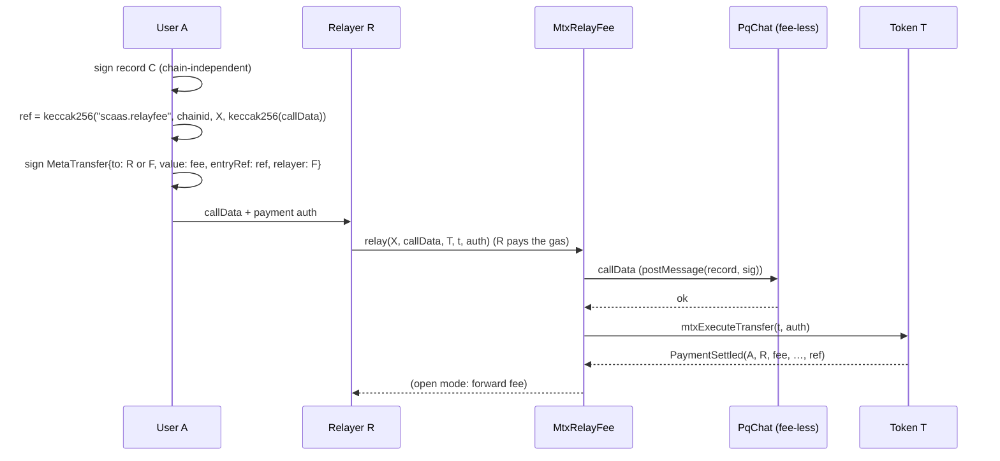

> **Research note — background and rationale only, not normative; the current rules are in docs/ (see decisions.md).**

# Mtx tokens paying for on-chain calls: payment metadata and relay fees

**Status:** research (controller, 2026-10-26). Nothing is decided or built; the open questions in §5 do not block any
current phase.

**Request (owner 2026-10-26).** Research extension for the mtx tokens — paying for on-chain services:
1. `mtxPay` pays an off-chain service today; it should carry **metadata** about its `paymentId`.
2. For PqChat (or PqMessage) and any other mtx write: let a user **pay a fee in an mtx token** for creating a session,
   sending a message or any other mtx call.

**Clarification (owner, same day):** there are two payers. **The relayer pays the native transaction's gas. User A
pays the relayer in a token, so that the relayer executes one mtx call that has no fee of its own.**

This keeps the 2026-10-25 ruling of UA-7 / UA-8 intact. Those writes stay fee-less, chain-independent and carry no token
logic ([UA-7 C1](../superpowers/specs/2026-10-25-ua7-pq-e2e-sessions.md)). The token payment is a separate layer
between A and the relayer: until now "a relayer that wants payment arranges it off chain", and this note moves that
arrangement on chain, as an option.

## 1. What exists today

- **`mtxPay(from, to, amount, payId, validUntil, mode, relayer, fee, feeRecipient, sig)`**
  ([CTR-MTX-10](../contracts/metatx.md#CTR-MTX-10)): a `MetaTransfer` with `entryRef = payId`, lane
  `payLane(payId) = keccak256("scaas.pay.lane" ‖ payId)`, nonce 0, so each request is paid at most once
  ([CTR-MTX-04](../contracts/metatx.md#CTR-MTX-04)). `payId` is 32 random bytes and carries no information on purpose
  ([CTR-MTX-03](../contracts/metatx.md#CTR-MTX-03): unlinkable, cannot be brute-forced from invoice numbers). Its UA twin
  is `uaPay`. The only on-chain trace is `PaymentSettled(from, to, value, feeAmount, feeRecipient, entryRef)`.
- **Relayer fee inside a token's own mtx call.** Every token mtx call has `fee` / `feeRecipient`; with
  `feeRecipient = 0` the fee goes to `msg.sender` (`ERC20MetaTx.sol:216, :400`). This pays the relayer only for calls
  **of the token itself**; a call on another contract (PqChat, `UARegistry`, `MandateWallet`) has fee mode `NONE`.
- **The service-bound payment of Tender** ([CTR-TND-01](../contracts/tender.md#CTR-TND-01)) is the pattern §3 builds
  on: the payer signs a `MetaTransfer` with `to = tender`, `entryRef = keccak256(DEPOSIT_TAG, chainid, tender, tenderId,
  commitment)` and `MODE_RESTRICT_RELAYER` with `relayer = tender`. The tender calls `token.mtxExecuteTransfer(t, sig)`
  inside `commitBid`, so the deposit cannot be spent outside that bid, and the bid cannot be made without the deposit.
- **No allowance from an EOA** on a SCaaS token ([CLI-SGN-36](../decisions.md#cli-sgn-36--no-eoa-approve-of-a-scaas-token-a-scaas-underlying-is-wrapped-by-signature)):
  every payment below is a signed mtx transfer, never `approve` + `transferFrom`.

## 2. Part A — metadata of a payment id

**Goal.** The payment states what it pays for (an invoice, a service action, a note), and the metadata is bound to the
payer's signature, all without breaking `payId`'s unlinkability.

**Proposal A1: the payment id commits to its metadata, with no typehash change.** **Adopted** (owner 2026-10-26) as
[CTR-MTX-26](../contracts/metatx.md#CTR-MTX-26), SPECIFIED.

```text
salt  = 32 bytes from a CSPRNG
payId = keccak256(abi.encode("scaas.pay.meta", salt, keccak256(meta)))
```

The payer's signature already covers `entryRef = payId`, so it binds `meta` without a new field in `MetaTransfer`.
There are then two ways to use it:
- **Off chain (no contract change):** plain `mtxPay` with this `payId`. The payee receives `(salt, meta)` through its
  own channel and checks the commitment. Unlinkability is unchanged: the salt is random, and nothing is published.
- **On chain:** a new named function `mtxPayMeta(…, bytes32 salt, bytes meta, …)` (and `uaPayMeta`) recomputes `payId`,
  builds the same `MetaTransfer` as `mtxPay`, and emits `PaymentMeta(payId, meta)` before `PaymentSettled`. Indexers,
  the payee and auditors read the metadata from the chain; no separate channel is needed.

**Metadata format.** `meta = abi.encode(uint16 schema, bytes body)`. Proposed schemas:

| schema | body | public on chain |
|---|---|---|
| 1 | UTF-8 note | yes |
| 2 | structured reference (creditor reference / invoice number / due date, in the spirit of ISO 20022 structured remittance) | yes |
| 3 | an on-chain call that the payment is bound to: `(chainid, target, callHash)` (§3) | yes |
| 4 | any of the above, encrypted to the payee: a KEM wrap to the payee's ML-KEM-1024 + X25519 key in `UARegistry` (UA-8 P7) ‖ AES-256-GCM | ciphertext only |

**Privacy.** Publishing a plain `meta` publishes it forever: CTR-MTX-03's warning about business identifiers applies
to the meta, not to `payId` (the salt protects that). Schema 4 or off-chain use keeps it private.

**Wallet display.** EIP-712 wallets show `entryRef` as an opaque 32-byte value. A connector or `clientkeys` can
recompute `payId` from `(salt, meta)` and show the meta next to the typed data, as a client rule. A new typed struct
with a `meta` field (`MetaPayment`) would show natively in wallets, but it costs a new typehash, a second struct path
and more bytecode in every token. Not proposed now.

**Prior art.** ERC-7699 (draft): `transfer(to, amount, bytes transferReference)` plus a `TransferReference` event. It
carries the same idea, but its reference is not bound to a signature, and it uses the allowance path for
`transferFrom`. A1 gets the binding from the existing signature.

**Cost [estimate].** Calldata for `salt` and `meta`, one keccak, and the `PaymentMeta` event (≈ 375 + 375 per topic +
8 per data byte, plus memory).

## 3. Part B — a token fee to the relayer for a fee-less mtx call

**Model (owner).** Relayer R submits the transaction and pays the gas. Call C is a fee-less mtx write on contract X:
PqChat `postMessage(record, sig)`, `createSession`, a UA-8 `UARegistry` write, a `MandateWallet` action, or any
`MetaTxBase` contract with fee `NONE`. A pays R in token T.

**Requirements.**
- **R1, atomic:** A pays if and only if C executes in the same transaction.
- **R2, bound:** A's payment can pay only for C. It cannot be reused for another call, and nobody can collect it
  without executing C.
- **R3, X unchanged:** C and X keep no token logic; C stays chain-independent (UA-7 / UA-8 rulings).
- **R4, never locked:** the payment is optional. C can always be submitted without it (by A itself, or by a relayer
  that does not charge).
- **R5:** no EOA allowance (CLI-SGN-36); relayable; one rule on every chain.

### B1 (recommended): a stateless router, Tender's pattern generalised

One small contract, `MtxRelayFee` (name open), with no owner and no stored state:

```text
relay(target, callData, token, MetaTransfer t, bytes payAuth):     nonReentrant
  1. ref = keccak256(abi.encode("scaas.relayfee", block.chainid, target, keccak256(callData)))
  2. require t.entryRef == ref, t.batch == payLane(ref), t.nonce == 0,
     MODE_RESTRICT_RELAYER set and t.relayer == address(this)
  3. (ok, ) = target.call(callData); require ok          // C: the fee-less mtx entry with A's own signature inside
  4. token.mtxExecuteTransfer(t, payAuth)                  // A → payee; UA payer: uaExecuteTransfer(t, payAuth)
  5. open mode only (t.to == address(this)): token.transfer(msg.sender, t.value)
  6. emit RelayFeePaid(ref, target, token, t.from, payee, t.value)
```

Why it holds:
- **R2:** A's signature covers `ref`, that is the chain, the target and the exact call bytes (C's own signature
  included). The relayer restriction means only the router can consume the payment, and the router consumes it only
  right after executing exactly that call.
- **R1:** steps 3 and 4 are one transaction, and either failing reverts both.
- **Pay once:** the pay lane gives each `ref` one payment per chain.
- **R3, R4:** X never sees the router; C is the same call that anyone could submit directly.

A different but valid signature over the same record changes `callHash`, so the payment no longer matches and the
transaction reverts; it fails safe.

**Who is paid.**
- **Bound payee (`t.to = R`):** A picks a relayer that quoted a price. If another relayer copies the bundle from the
  mempool, R is still paid and the copier only burns gas.
- **Open (`t.to = router`, forwarded to `msg.sender`):** any relayer may take the job; copying the bundle becomes an
  ordinary race for the fee. The forward runs after C, so a target cannot reach a balance the router holds mid-call.
- **Any other payee:** the router does not care who `t.to` is. With `t.to` = X's treasury, or a session creator for a
  paid channel, the same router pays **for the service** rather than for gas. This covers request item 2 in its
  original sense as well.

**Chain independence.** `ref` includes `block.chainid`. A record copied to chain B is either submitted free there or
paid by a new payment on B. The record itself does not change.

**Cost [estimate].**
- On top of C:
  - one external call;
  - the token's transfer path, ≈ 50 k warm (`mtxPay` 53,868 measured, metatx.md);
  - the payer's signature check: ECDSA ≈ 3 k, ERC-1271 up to its cap, a UA ML-DSA ≈ 6–19 M (accounts.md §1.6);
  - the pay lane's first-use slot (+17 k, CTR-MTX-03);
  - `PaymentSettled` and `RelayFeePaid`.
- Against a stored PqChat message (≈ 2.1–2.4 M gas, UA-7 C6b), an ECDSA payer adds ≈ 3 %. A PQ-signing UA payer
  roughly doubles the cost, because C already carries one PQ signature. That is the reason for B2 / B3.

### Example (owner 2026-10-26): pay in mtxUSD for someone to send a pqMessage

Token T = mtxUSD. The payer A signs `MetaTransfer{from: A, to: R, value: 0.02 mtxUSD, entryRef: ref, relayer: router}`
over one PqChat `postMessage(record, sig)`, and relayer R submits it and pays the gas. The payer does not have to be
the message's author: `ref` binds the exact call, not who wrote it. That gives three cases:
- **A sends its own message:** A signs the record and the payment.
- **A sponsors someone else's message:** B (a customer, a member) signs the record, and A signs the payment over B's
  `callData`. For example, a company pays the relay of its customers' messages. A must see B's signed record before
  signing, because the payment covers those exact bytes.
- **A pays the recipient of the work:** `t.to` is whoever should earn the fee — the relayer, the session creator, or a
  service.

Sponsoring messages that do not exist yet (a budget instead of one signature per message) needs a standing
authorisation with caps, as `MandateWallet` gives for payments ([CTR-ACC-06](../contracts/mandates.md#CTR-ACC-06)).
That is open question 7 in §5.

### Alternatives

- **B2, prepaid with the relayer, off chain:** A pays R once (`mtxPay`, metadata schema 2 "relay credit"), and R keeps
  the credit off chain. This is today's "arranged off chain", with an on-chain receipt. It is cheap per call but trusts
  R.
- **B3, one signature for both C and the fee:** A's single signature would authorise C and the payment together. That
  needs either X to understand payments (breaks R3), or the token to accept X's signature format (every token would
  learn every X). A narrower variant, "consent by payment" (X accepts a token payment bound to `recordId` as the
  record's authorisation), saves the second PQ signature but makes that record chain-bound (no copy). It stays an open
  question for PQ payers.
- **B4, pay-and-call in the token (ERC-1363 `transferAndCall` style):** the token calls the target after the payment.
  **Not proposed:** it adds a new outbound call to every token implementation (re-entry surface, CTR-MTX-18) and
  bytecode to each of them, and the target must trust the token. B1 gives the same result with no token change.
- **Analogues outside SCaaS:**
  - ERC-4337 token paymasters: the user pays gas in an ERC-20 to a paymaster, inside the 4337 stack, usually through an
    allowance;
  - the Gas Station Network RelayHub: deposit-based, with relayer accounting in a hub;
  - EIP-2771 trusted forwarders: they forward the sender but carry no payment.
  - B1 is closer to the GSN shape, without a hub balance or an allowance.

### Node and clients (if adopted)

- **The relayer node:**
  - quotes `(token, amount, payee, validUntil)` for a call;
  - simulates the whole `relay` (C succeeds, the payment succeeds, and the fee covers the gas at its price);
  - submits it.
  - These would be new NODE-LANE rules next to the existing simulation step. Price discovery and oracles are out of
    scope.
- **Clients** (`clients/ua-rs`, `ua-qt`, the JS wallet) build C's record and signature, then the `MetaTransfer` over
  `ref`, then sign it. That is two signatures from the user, or one prompt that shows both.

## 4. How A and B fit together

B's `ref` is a commitment to a call, as A1's `payId` is a commitment to its metadata. B can therefore be described as
schema 3: an indexer that reads `PaymentSettled(…, entryRef = ref)` together with `RelayFeePaid` knows what was paid
for. Neither part needs a change to `MetaTransfer` or to any token's typehash. A needs one new named function per token
tier (only for the on-chain variant), and B needs one new contract.



## 5. Owner answers (2026-10-26) and what is still open

1. **Name and place: controller's choice** — `MtxRelayFee` in `smartcontracts/evm/src/metatx/` (it sits next to the
   token's mtx path it calls; no application owns it). **Deployment** (owner question 2026-10-26, "in OpenFactory,
   like UARegistry and the verifiers?"): `OpenFactory` deploys neither of those. `script/DeployBase.sol` deploys
   `UARegistry` and the UA / Zether / PQZ verifiers through the deterministic CREATE2 deployer (`0x4e59…`,
   `DEPLOY_SALT`), and the factory only names the registry in the env it publishes (`IFactoryToken.Env.registry`,
   `deps`). The router goes the same way: `DeployBase`, CREATE2, no constructor argument, no owner, so it has **the same
   address on every EVM chain**. No token needs to know it, because the payer's signature names it
   (`relayer = router`), and clients take the address from the deployment record. Deploying it through the factory's
   registrar would add a trust root it does not need.
2. **Open to every relayer** (owner): the client default is open mode, `t.to = router`, forwarded to `msg.sender`.
   A bound payee (`t.to = R`) stays possible, but it is not the default.
3. **Two PQ signatures — explained, still open.** A UA that signs with a PQ key signs twice for one paid call: the
   record (`pq_msg` over the chain-independent record, checked by PqChat) and the payment (the token's
   `UAMetaTransfer`, chain-bound), so the transaction verifies two PQ signatures. Cost per ML-DSA verify: small where
   the EIP-8355 precompile exists (the SCaaS chains, `0x…5caa5…12 / 13`); ≈ 6–19 M gas in Solidity on a chain without
   it (no-zero-gas rule: the contracts may run on customer chains). Options:
   - (a) accept two signatures: simplest, the record stays portable;
   - (b) "consent by payment" (B3): PqChat accepts the payment bound to `recordId` as the author's authorisation and
     skips its own check: one verify, but that record cannot be copied to another chain;
   - (c) one signature over both digests, verified once: the UA signs `keccak256(recordDigest ‖ paymentDigest)`; the
     shared UA verifier marks `(key, message)` verified in transient storage (EIP-1153) for the rest of the
     transaction, and the second consumer reads that mark instead of verifying again. The record stays portable,
     because on another chain the 32-byte `paymentDigest` travels with it as an opaque value. It needs both PqChat and
     the token to verify through the same verifier contract.
   - Controller lean: (c) where PQ payers are common, (a) as the first build.
4. **`mtxPayMeta` / `uaPayMeta` on every token tier** (owner).
5. **Fees only from public balances** (owner): the fee token is any mtx token's public balance (a PQZ / Zether token's
   public side included); no confidential payment of a fee.
6. **Non-EVM must work too** (owner). The same rule per family: an on-chain check that the payment's reference commits
   to the call, and that the payment is consumed only together with the call.

   | Family | Shape |
   |---|---|
   | Soroban, Solana, Cosmos (CosmWasm) | a router contract / program that invokes the target, then the token's relay pay (cross-contract call, CPI, sub-messages with reply), atomic as on EVM |
   | Sui, Aptos | a Move entry function in the router module that calls the target's entry and the token's `relay_pay` in one transaction; the pay function checks the reference and the router as relayer |
   | GRAM (TON) | **no cross-contract atomicity:** the payment goes into the router's escrow; it is released to the relayer when the target's confirmation message arrives, and refunded to the payer on a bounce or after a timeout (as the GRAM DEX escrow, NET-TON-03) |

   Hedera: the EVM shape.
7. **Sponsoring calls not yet signed (a budget): unclear** (owner). It stays open: a mandate-like standing
   authorisation on the router (delegate = router, per-call and per-period caps, allowed targets), against one payment
   signature per call.
