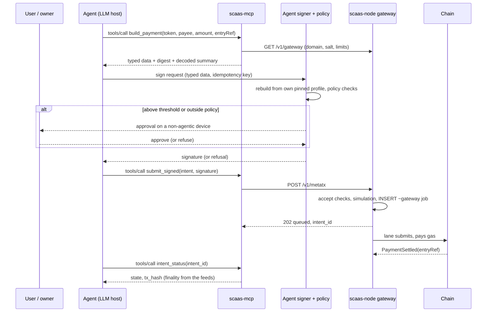
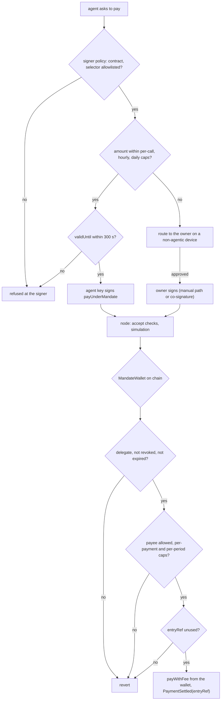
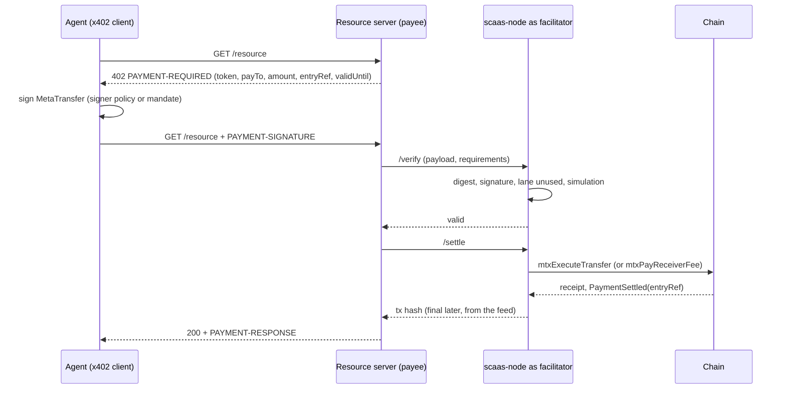

> **Research note — background and rationale only, not normative; the current rules are in docs/ (see decisions.md).**

# scaas-node and AI agents — direction

Written 2026-10-11 for the owner ("Định hướng node có thể làm việc với AI Agent": the node should be able to work
with AI agents). This is a direction, not a spec: nothing here changes a rule. SCaaS facts cite rule ids of the
component docs; outside facts cite the sources in §7. **[unverified]** marks a claim that rests on secondary
reporting or memory and was not confirmed against a primary source. Most agent-payment standards below are Drafts or
betas and change monthly.

## 1. Summary

**The short answer.** SCaaS already has the hard part: an agent is just another **subject** that signs intents
([architecture.md](../architecture.md) glossary: "a person, a company, an AI agent, a device. Subjects sign; nobody
signs for them"), and the node never holds subject keys ([NODE-GEN-01](../node/README.md#NODE-GEN-01)). What is
missing is (1) a tool surface agents can discover and call (MCP), (2) a bounded spending authority made for agents
(today `MandateWallet` comes close, `SmartKeyAccount` does not), and (3) a bridge to the agent-payment standards
(x402 above all). None of this needs a new trust model. The node stays a relayer and indexer; agents get tools that
read, build and submit, and every value movement still needs a signature that passes a signer-side policy and, for
delegated payments, the chain's own caps.

| # | Component | Fits today's design? | What is new | Effort | Depends on | Recommendation |
|---|---|---|---|---|---|---|
| a | MCP server (tools, resources) | yes: a thin client of the gateway and job API | an MCP adapter process; a dry-run accept route; mandate reads | S (read) / M (build + submit) | read tools: nothing; feeds: node P4; builders: P5 | **now** (read-only), **next** (build + submit) |
| b | Agent identity and auth to the node | yes: gateway `none`/`bearer`/`hmac`, namespaced HMAC keys, OIDC verifier | OAuth 2.1 resource-server metadata for a remote MCP endpoint; per-agent quotas | S (stdio) / M (remote) | node P2 (keys), P2b (OIDC) | **next**; ERC-8004 **later** |
| c | Agent spending authority on chain | partly: `MandateWallet` has caps, payees, expiry, revoke | several delegates per token, per-payee caps, a co-sign threshold; a gateway route for mandate payments | M | contracts P4 (`MandateWallet` on `MetaTxBase`) | **next** (fold into P4 if accepted in time) |
| d | Payments: x402 facilitator, AP2 mapping | partly: `MetaTransfer` + pay-once + receiver-pays look like an x402 "exact" payload | a SCaaS transfer method/scheme for x402; `/verify` + `/settle` on the node | L | P5, receiver-pays RP1, sponsorship SP1 | x402: **next** (spec), build **later**; AP2: **later** (mapping only) |
| e | Node as an agent (ops) vs node serving agents | yes for serving; ops automation must stay read-mostly | read-only admin tools (viewer role) for runbook triage; drafts for sponsorship rows | S–M | P2b (admin routes, OIDC) | serving: as a–d; ops: **later**, read-only first |
| f | Safety | yes: signatures, simulation, breakers, audit chain, finality | treat tool output as untrusted data; per-agent velocity; signer-side policy service | M (mostly `SigningPolicyService`, already PLANNED) | `SigningPolicyService`, NODE-LANE-01 ruling | **now** as principles; service **next** |
| g | ERP/Odoo agent flows (procure-to-pay) | yes: auto-pay policy + `MandateWallet` already is a deterministic agent | AI drafts bills and payment requests; humans or mandates authorize | S on the node side (none) | bamboo-dms work | **next**, on the ERP side |

Standards that matter, in one line each (detail in §2): **MCP** — the tool protocol to expose (revision 2026-07-28,
stateless Streamable HTTP, OAuth 2.1); **x402** — the HTTP payment handshake agents will use (Linux Foundation's x402
Foundation since 2026-04-02); **AP2** — signed user mandates for agent purchases (v0.2, donated to the FIDO Alliance,
April 2026); **ERC-7715/7710** — wallet permissions and delegation on EVM (Drafts); **ERC-8004** — on-chain agent
identity and reputation (Draft); **A2A**, **ACP**, Visa/Mastercard agent programmes — little direct value for the node.

## 2. Standards, status and what they mean for SCaaS

| Standard | Status (as of 2026-10-11) | What it is | Relevance to SCaaS |
|---|---|---|---|
| **MCP** (Model Context Protocol) | Spec revision **2026-07-28** (previous 2025-11-25). Governance: the Agentic AI Foundation under the Linux Foundation **[unverified]** | JSON-RPC between an LLM host and servers offering **tools**, **resources**, prompts. 2026-07-28 made the protocol **stateless** (no `initialize`, no `Mcp-Session-Id`), added `server/discover`, `subscriptions/listen`, multi-round-trip requests (`resultType: "input_required"`) replacing server-initiated elicitation, tasks as an extension; HTTP+SSE deprecated in favour of Streamable HTTP. Auth (HTTP only, optional): the server is an **OAuth 2.1 resource server**, MUST publish RFC 9728 protected-resource metadata, MUST check the token audience (RFC 8707), MUST NOT pass tokens through; stdio servers take credentials from the environment | **High.** A stateless protocol fits the node (no session state); the read routes and the intake doors map to tools almost one to one |
| **A2A** (Agent2Agent) | v**1.0.0**; JSON-RPC, gRPC and HTTP+JSON bindings; signed Agent Cards; the spec page says it joined the Agentic AI Foundation (2026-08) **[unverified detail]** | Agent-to-agent tasks (states submitted, working, input-required, auth-required, completed, failed, canceled, rejected) | **Low** for the node: the node is a service, not a peer agent. Possibly a tender or DEX RFQ agent later |
| **x402** | Contributed by Coinbase to the Linux Foundation's **x402 Foundation**, announced **2026-04-02** (members include Google, Visa, Mastercard, Stripe, Cloudflare, AWS, Circle). Headers `PAYMENT-REQUIRED` / `PAYMENT-SIGNATURE` / `PAYMENT-RESPONSE`; schemes `exact`, `upto`, `batch-settlement` (EVM); SDKs for EVM, SVM, Aptos, Stellar, Hedera, TVM and others. v2 release date **[unverified]** | A server answers `402` with payment requirements; the client signs a payment payload; a **facilitator** `/verify`s and `/settle`s it and pays gas. EVM `exact` moves funds by **EIP-3009** `transferWithAuthorization` (default), **Permit2** (via an `x402ExactPermit2Proxy`, needs an allowance) or **ERC-7710** delegations (`redeemDelegations`, verified by simulation); "the facilitator cannot modify the amount or destination" | **High** but **not plug-and-play**: SCaaS tokens implement neither EIP-3009 nor permit, and Permit2 needs an EOA `approve`, which [CTR-TOK-01](../contracts/token-wrappers.md#CTR-TOK-01) forbids. See §3 (d) |
| **AP2** (Agent Payments Protocol, Google) | **v0.2** (April 2026; release day 2026-04-28 **[unverified]**), donated to the **FIDO Alliance** (Agentic Authentication / Payments working groups) | Signed mandates as SD-JWT credentials: **Checkout Mandate** (merchant-signed checkout bound by hash) and **Payment Mandate**; each **open** (user constraints, the agent's key in `cnf`, short `exp`) or **closed** (bound to one checkout). Human-not-present: the user authorizes open mandates on a non-agentic **Trusted Surface**; the agent signs the closed ones with its key. v0.1 (2025-09) named them Intent, Cart and Payment mandates **[my reading of the change; unverified]** | **Medium, later.** Conceptually identical to `MandateWallet` (open mandate = `setMandate`, closed = the delegate-signed payment), but AP2 is verified off chain by card-network roles; SCaaS enforces on chain |
| **ERC-8004** (Trustless Agents) | **Draft**, created 2025-08-13 | Three registries: **Identity** (ERC-721; `agentURI` → a registration file listing MCP/A2A endpoints, `x402Support`, an `agentWallet`), **Reputation** (signed feedback, optional `proofOfPayment`), **Validation** (validator scores 0–100) | **Low now.** Discovery and reputation, not authentication. A node could list its MCP endpoint; sponsorship could one day key on a registered agent |
| **EIP-7702** / **EIP-8141** | 7702 Final, live; 8141 Draft, Hegotá | Code on EOAs; frame transactions | Covered in [eip7702-eip8141-vs-metatx.md](eip7702-eip8141-vs-metatx.md). For agents: a 7702 wallet's session key **cannot** sign a SCaaS intent today (`SigCheck` verifies designator accounts by ECDSA only; the open "1271 fallback" decision there) |
| **ERC-7715** / **ERC-7710** | Both **Draft** (created 2024-05-24 / 2024-05-20) | 7715: `wallet_requestExecutionPermissions` (permission type + rules such as `expiry`, answered with a `context` and a `delegationManager`); 7710: `redeemDelegations(contexts, modes, executionCallData)` on a delegation manager that calls the delegator | **Medium.** The industry's "session key" path. A 7710 delegator that calls `token.transfer` or `payWithFee` itself is a direct call, so it works with SCaaS tokens without an allowance **[analysis, untested]**; it bypasses the meta-tx fee and lane model |
| **ACP** (Agentic Commerce Protocol, OpenAI + Stripe) | **Beta**; latest dated spec **2026-04-17** (adds an MCP binding) | Checkout API + delegated payment (scoped, time-limited payment tokens; "Shared Payment Token" is Stripe's term **[secondary]**) | **Low.** Card/PSP checkout; a SCaaS token "payment handler" is conceivable for an ERP merchant, nothing for the node |
| **Visa Trusted Agent Protocol**, **Mastercard Agent Pay** | Visa TAP announced 2025-10 (RFC 9421 HTTP message signatures, aligned with Web Bot Auth); Mastercard agentic tokens 2025-04 **[secondary]** | Card-network agent recognition and agent-bound card tokens | **None** for the node. The RFC 9421 idea (agents sign their HTTP requests with a published key) is a possible later gateway auth mode |

## 3. Design direction, component by component

### (a) The node exposes an MCP server

**Fit.** The node's public surface is already tool-shaped: `GET /v1/gateway` (chains, tokens, fee recipient, DEX,
limits, [NODE-GW-05](../node/gateway.md#NODE-GW-05)), `POST /v1/metatx`, `POST /v1/ops`, `GET /v1/intents/{id}`, the
DEX routes ([dex-venue.md](../node/dex-venue.md#routes)), and for server-side clients the job API and the feeds
([NODE-IDX-04](../node/indexer-feeds.md#NODE-IDX-04)). Built today: only `/healthz`, `/v1/metatx` (EVM) and
`/v1/dex/*` on the gateway listener, `/healthz`, `/readyz`, `/metrics` on the admin listener
(`scaas-node/src/gateway.rs`, `admin.rs`); nothing about MCP exists in the code.

**Shape.** An MCP server is a **client** of those routes, never a second intake path: every submit goes through the
same accept checks (simulate before insert, [door A rules](../node/gateway.md#NODE-GW-01)). The laziest correct first
step is a small separate process (`scaas-mcp`, stdio first) next to clientkeys, which already has the EIP-712 and
family builders ([CLI-SGN-05](../clients/signers-clientkeys.md#CLI-SGN-05)); no new listener and no new attack surface
in the node. A remote Streamable HTTP endpoint inside the node can follow once OIDC is built (b).

| Tool / resource | Backed by | Phase |
|---|---|---|
| `gateway_info` (resource `scaas://gateway`) | `GET /v1/gateway` | PA1 |
| `intent_status(intent_id)` | `GET /v1/intents/{id}` | PA1 |
| `dex_markets`, `dex_depth`, `dex_ticker`, `dex_trades`, `dex_orders(maker)` | `/v1/dex/*` (BUILT) | PA1 |
| `mandate_status(wallet, token)` — caps, spent in period, expiry, payees, epoch | chain read of `MandateWallet` | PA1 |
| `quote_fee(chain, token, op, amount)` — fee floor, whether a sponsor policy would match, `max_valid_for_secs` | new: a dry-run of the accept checks (`?dry_run=1`), no insert | PA2 |
| `build_transfer`, `build_payment(entryRef)`, `build_mandate_payment`, `build_dex_order`, `build_cancel_nonce` | clientkeys builders; return EIP-712 typed data (or the family envelope), the digest and a decoded summary | PA2 |
| `submit_signed(intent, signature)` | `POST /v1/metatx`, `/v1/ops`, `/v1/dex/orders` | PA2 |
| `events_since(cursor)`, `jobs_since(cursor)`; MCP `subscriptions/listen` | the feeds (long-poll `wait ≤ 25 s`) — namespaced, so only with a namespace credential | PA2 (needs node P4) |
| `tender_*` (commit, reveal) | [tender.md](../contracts/tender.md) entry points; the bid salt stays with the bidder | later |

**Never.** No `sign_*` tool, no key import, no "custodial signing" tool, no `call` job tool for arbitrary calldata
([NODE-JOB-01](../node/job-api.md#NODE-JOB-01)). A `build_*` tool is a convenience: the signer still rebuilds and
checks what it signs ([CLI-SGN-05](../clients/signers-clientkeys.md#CLI-SGN-05)), because a prompt-injected agent may
ask the node to build the wrong thing.

### (b) Agent identity and auth to the node

**Fit.** Three existing credentials cover it. Public doors (gateway `none` behind a proxy, `bearer`, `hmac`,
[NODE-GW-02](../node/gateway.md#NODE-GW-02)) need no agent identity at all: the subject's signature is the
authority. Server-side agents of a client use **namespaced HMAC keys** with `submit`/`read` scopes
([NODE-JOB-05](../node/job-api.md#NODE-JOB-05)), which are server-side only and never admin
([NODE-ADM-06](../node/admin-auth.md#NODE-ADM-06)) — an agent runtime on a server is such a client; a desktop or
browser agent is not and gets no key. Operators' automation uses OIDC tokens with roles
([NODE-ADM-02](../node/admin-auth.md#NODE-ADM-02), [NODE-ADM-04](../node/admin-auth.md#NODE-ADM-04)).

**New.** (1) For a stdio `scaas-mcp`, credentials come from the environment (as MCP requires for stdio): nothing new.
(2) A remote MCP endpoint must be an OAuth 2.1 resource server: publish RFC 9728 metadata naming the operator's IdP,
accept only JWTs whose audience is that endpoint, and map scopes to the existing namespace scopes (`scaas.read`,
`scaas.submit`); the node already plans a JWT verifier for admin OIDC
([NODE-ADM-03](../node/admin-auth.md#NODE-ADM-03)), so this reuses it with a different audience, never the admin
roles. (3) Per-agent quotas: today the per-`from` bucket (60/h) and the reverse-proxy per-IP limit
([NODE-GW-01](../node/gateway.md#NODE-GW-01)) bound abuse; velocity per agent in a reporting currency is the open
[NODE-LANE-01](../node/submit-lanes.md#NODE-LANE-01).

**ERC-8004.** Useful for discovery (a node lists its MCP endpoint and `x402Support` in a registration file) and,
later, as a sponsorship match key ("sponsor gas for registered agents with feedback ≥ X"). It does not authenticate an
HTTP request, so it replaces none of the above. Later; Draft.

### (c) Agent spending authority on chain

The owner's open requirement [CLI-SGN-01](../clients/signers-clientkeys.md#CLI-SGN-01) asks for short-lived agent
session keys (1–8 h) bounded by a delegation contract and a per-transaction cap. The options, compared:

| Option | Limits enforced by | Fit for agents | Status |
|---|---|---|---|
| **`MandateWallet` delegate** ([CTR-ACC-06](../contracts/mandates.md#CTR-ACC-06)) | the chain: delegate, expiry, per-payment cap, per-period cap, allowed payees, single-use `entryRef`, revoke with epoch ([CTR-ACC-07](../contracts/mandates.md#CTR-ACC-07)) | **best today**: the agent's key is the delegate; a stolen agent key can spend at most the caps to approved payees until expiry or revoke | BUILT (EVM); equivalents on the other families (Sui/Aptos/Cosmos one-shot) |
| `SmartKeyAccount` key ([CTR-ACC-09](../contracts/accounts.md#CTR-ACC-09)) | nothing: every key validates any digest and can `addKey` ([CTR-ACC-10](../contracts/accounts.md#CTR-ACC-10)) | **no**: an agent key there is a root key. A scoped key kind is only planned for receiver-fee co-signing ([limitations](../contracts/accounts.md#smart-account-limitations)) | BUILT, no scoped keys |
| Signer-side policy (custodial / `delegated` path, [signing policy](../clients/signers-clientkeys.md#signing-policy)) | off chain, co-located with the signer: contract and selector allowlist, caps per call/hour/day, `validUntil ≤ 300 s`, risk classes | good **in addition**; alone it is only as strong as the custody host | `SigningPolicyService` PLANNED |
| 7702 wallet + session-key delegate | the delegate code | does **not** reach SCaaS intents (ECDSA-only check for designators) unless the open 1271-fallback decision changes | — |
| ERC-7710 delegation (MetaMask-style caveats) | the delegation manager's caveat enforcers | works only as direct calls by the delegator (no meta-tx, no fee in token), Draft | **[analysis, untested]** |

**Direction.** Answer CLI-SGN-01 with mandates, not with keys on accounts: the "session key" is a fresh agent key made
the delegate of a `MandateWallet` with an expiry of hours, caps and payees; revocation is one owner call or a
delegate-signed `revoke(token, epoch)` relayed at once. The gaps for agents, all in one contract that P4 rebuilds
anyway (`MandateWallet` on `MetaTxBase`):

1. **One delegate per token** (`mapping(token => Mandate)`): two agents need two wallets. Lazy answer today: one
   `MandateWallet` per (payer, agent) — no contract change, funds split per agent. Contract answer: key mandates by
   `(token, delegate)`.
2. **Payees are per token, shared by every delegate**, with no per-payee cap ("per-merchant cap"). Add an optional
   `maxPerPeriod` per `(token, payee)`.
3. **No human-in-the-loop threshold**: a payment above the cap simply reverts. Add `coSignAbove`: above it the
   payment needs the owner's co-signature over the same digest (the receiver-pays pattern of a second typed message,
   [CTR-MTX-05](../contracts/metatx.md#CTR-MTX-05)). Until then, the threshold lives in the signer policy and above-cap
   payments go through the owner's manual path.
4. **No gateway route**: mandate payments reach the node only as job-API `call` jobs. Add `MandateWallet`
   `MetaTransaction`s to `/v1/metatx` (`struct = call`), with the per-wallet `chainUid()` binding the gateway already
   specifies for user-deployed wallets ([NODE-GW-07](../node/gateway.md#NODE-GW-07)).

### (d) Payments: x402 and AP2

**x402: SCaaS can be a facilitator, not with the stock EVM methods.** A facilitator verifies a signed payload,
simulates, pays gas and settles — what door A already does. The stock `exact` EVM methods do not fit SCaaS tokens:
no `transferWithAuthorization`, no permit, and Permit2 needs the payer's `approve`, which an EOA may never give on a
SCaaS token ([CTR-TOK-01](../contracts/token-wrappers.md#CTR-TOK-01)). The typed **`MetaTransfer`**
([CTR-MTX-15](../contracts/metatx.md#CTR-MTX-15)) is close to an EIP-3009 authorization and stronger in the ways
x402 cares about:

| EIP-3009 `transferWithAuthorization` | SCaaS payment `MetaTransfer` |
|---|---|
| `from, to, value` | `from, to, value` |
| `validAfter, validBefore` | `validUntil` (no `validAfter`) |
| random `nonce` (bytes32) | `entryRef` + pay lane `payLane(entryRef)`, nonce 0: pays once per reference ([CTR-MTX-03](../contracts/metatx.md#CTR-MTX-03)) |
| facilitator pays gas, gets nothing in the protocol | `fee` in the token, bound `feeRecipient`, or receiver-pays: the payee co-signs the fee ([CTR-MTX-05](../contracts/metatx.md#CTR-MTX-05)) |
| `Transfer` event | `PaymentSettled(…, entryRef)` for reconciliation |

So the direction is a SCaaS transfer method for x402 (an `assetTransferMethod` such as `scaas-metatransfer` under
`exact`, or a scheme of its own; which one is an open question for the x402 Foundation's process), with the node
as facilitator: `/verify` = the gateway accept checks without insert; `/settle` = insert, submit, answer with the
transaction hash. The resource server's payment id becomes the `entryRef`; receiver-pays lets the seller, not the
agent, pay the facilitator — the usual x402 economics. Non-EVM families have no fee fields; there sponsorship rows
([NODE-SPN-01](../node/sponsorship.md#NODE-SPN-01)) pay.

Open points: x402 expects settlement before the response, SCaaS books only after finality
([NODE-GEN-08](../node/README.md#NODE-GEN-08)); the facilitator would answer at inclusion (x402's own
`settlement_pending` covers an unconfirmed broadcast) and the payee books from the feed. Agents paying **through**
a `MandateWallet` need the x402 payload to carry a `MetaTransaction` on the wallet instead of a token
`MetaTransfer` — a second method. The `upto` scheme (pay per use) has no SCaaS equivalent yet.

**AP2: map, do not implement.** An AP2 open Payment Mandate (user constraints, the agent's key in `cnf`, short
`exp`) is a `setMandate` (delegate = the agent key, caps, payees, expiry); a closed Payment Mandate bound to a
checkout hash is the delegate-signed `payUnderMandate` with an `entryRef` derived from that checkout (kept random-
looking on chain, as `entryRef` must be). AP2's non-agentic "Trusted Surface" is exactly the passkey signer of the
console app. The difference: AP2 mandates are SD-JWT credentials checked by card-network roles off chain; SCaaS
mandates are enforced by the contract. A SCaaS role in AP2 would be "credential provider + payment processor" for
token payments; worth a mapping note when a merchant asks, not code.

### (e) Node as an agent vs node serving agents

**Serving agents** is (a)–(d). **Being an agent** means LLM automation of operations: runbook triage from `/readyz`,
`/metrics`, breaker states and the audit chain; drafting sponsorship rows or breaker changes for an operator. The
safety model stays: the node never signs for subjects, lane keys hold no role ([NODE-GEN-01](../node/README.md#NODE-GEN-01)),
and the runbooks already say human approval is mandatory, never delegated to an agent, for the land gate,
confidentiality horizons, credit/gas budgets per agent, factory registrations and controlled-token interventions
([RACI](../node/runbooks.md#raci)). Direction: an ops assistant gets **viewer**-role tools only (read metrics, readiness,
job and lane state, audit rows); anything it proposes is a draft an operator applies through the admin API under
their own credential, so every change keeps a human actor in the hash-chained audit
([NODE-ADM-07](../node/admin-auth.md#NODE-ADM-07)). Later; after P2b.

### (f) Safety

| Threat | Defence (existing → new) |
|---|---|
| Prompt injection makes the agent pay the wrong party | only a subject signature moves value; the signer rebuilds and checks every intent from its own pinned profile ([CLI-SGN-05](../clients/signers-clientkeys.md#CLI-SGN-05), [CLI-SGN-08](../clients/signers-clientkeys.md#CLI-SGN-08)); mandate payees and caps on chain → per-payee caps (c) |
| Injected text inside tool output | on-chain data carries no free text (addresses, amounts, random `entryRef`s); operator-registered names and **revert data** reach the LLM → the MCP adapter returns structured fields, marks `detail`/revert strings as untrusted data, never instructions |
| A doomed or griefing intent | simulation before insert, breakers per `(from, selector)`, per-`from` bucket ([NODE-GW-01](../node/gateway.md#NODE-GW-01)) → per-agent quota |
| Agent spends too fast | mandate period caps; signer velocity caps → reporting-currency velocity per agent (open [NODE-LANE-01](../node/submit-lanes.md#NODE-LANE-01)) |
| Stale or replayed signature | `validUntil ≤ 300 s` at the policy signer; lanes and pay-once ([CTR-MTX-03](../contracts/metatx.md#CTR-MTX-03)); revoke with epoch |
| Agent key stolen | mandate expiry of hours, delegate-signed revoke relayed at once; never a `SmartKeyAccount` key |
| Human-in-the-loop bypass | approval happens on a non-agentic device (passkey); MCP `input_required` is a UX prompt, not a control |
| No audit of who decided | `entryRef` on `PaymentSettled`, events feed, idempotency key per sign request, hash-chained admin audit → log the agent id with the idempotency key on the signer side |
| Agent books before money is final | the feeds deliver only final ranges ([NODE-GEN-08](../node/README.md#NODE-GEN-08)); `intent_status` says "accepted", not "paid" |

### (g) ERP/Odoo agent flows (procure-to-pay)

[Procure-to-pay](../integration.md#procure-to-pay) already has the right cut: the bill is approved in the ERP, the
amount comes from the document, a signer signs, the node relays, both ERPs book from the feed. The auto-pay policy
with a `delegated` wallet ([mandates.md §1.1](../contracts/mandates.md#11-client-integration-auto-pay),
[INT-ERP-04](../integration.md#INT-ERP-04)) is already a deterministic agent with on-chain limits. An AI agent adds
value **before** step 1 (read the supplier invoice, three-way match, draft the bill and the payment request with a
fresh `entryRef`) and after step 7 (explain exceptions such as a `repeat_of` second payment). It never signs outside
the mandate or the policy, and the risk-class-3 maker-checker stays human. Node side: nothing new. ERP side
(bamboo-dms): an agent role that creates drafts and calls the auto-pay path; next, owned by the ERP stream.

## 4. Proposed phases

Slots relative to [TODO.md](../../TODO.md) (not edited here). "Node P2/P2b/P4/P5" are the node stream, "contracts P4"
the `MandateWallet`/`SmartKeyAccount` phase.

| Phase | Content | After | Effort |
|---|---|---|---|
| **PA0** | This note; if accepted, fold the principles (no signing tools, tool output untrusted, agent authority = mandates) into `clients/signers-clientkeys.md` (closing CLI-SGN-01) and `node/gateway.md` | now | S |
| **PA1** | `scaas-mcp` read-only, stdio: `gateway_info`, `intent_status`, DEX reads, `mandate_status` | now (routes BUILT) | S |
| **PA2** | builders + `submit_signed` + `quote_fee` (dry-run accept route) + feeds tools | node P5 (new ABI), node P4 for feeds | M |
| **PA3** | agent mandates: `(token, delegate)` keys, per-payee caps, `coSignAbove`; gateway route for `MandateWallet` `MetaTransaction`s | contracts P4 (fold in if accepted before it starts) | M |
| **PA4** | remote MCP in the node: Streamable HTTP, OAuth 2.1 resource server on the OIDC verifier, per-agent quotas | node P2b | M |
| **PA5** | x402: spec a SCaaS transfer method, then `/verify` + `/settle` | RP1 receiver-pays, SP1 sponsorship, PA2 | L |
| **PA6** | ops assistant, viewer-role tools only | node P2b | S–M |
| watch | ERC-8004 listing, AP2 mapping note, A2A, ACP, card-network programmes | — | — |

## 5. Open questions

1. Where the MCP adapter lives: beside clientkeys (TypeScript, reuses the builders; the default here) or inside
   `scaas-node` (Rust, one deployable)?
2. Several agents per payer: one `MandateWallet` per agent (works today, funds split) or `(token, delegate)` mandates
   in P4?
3. The human-in-the-loop threshold: on chain (`coSignAbove`), in the signer policy only, or both?
4. x402: a transfer method under `exact` or a SCaaS scheme; settle answer at inclusion or after finality; how a
   `MandateWallet` payment is carried.
5. How `entryRef` is derived from an x402 payment id or an AP2 checkout hash without making payments linkable on chain.
6. Non-payment agent authority (DEX orders, tender bids): a `TradeOrder` mandate, a scoped `SmartKeyAccount` key kind,
   or no agent trading at all?
7. The 7702 `SigCheck` decision (ECDSA only vs ECDSA else ERC-1271) from the sibling note: with the fallback, 7702
   wallets with session keys could sign SCaaS intents directly.
8. Whether a public node lists itself in an ERC-8004 registry, and on which chain.

## 6. Unverified points to re-check

MCP's governance home (Agentic AI Foundation); A2A joining it in 2026-08; x402 v2's release date and whether a custom
`assetTransferMethod` can be registered; AP2 v0.2's exact release day and the v0.1 → v0.2 mandate renaming; ACP's
"Shared Payment Token" naming; Visa TAP and Mastercard Agent Pay dates and scope; that an ERC-7710 delegator's direct
`transfer`/`payWithFee` works with SCaaS tokens (analysis only, untested).

## 7. Sources

- MCP specification 2026-07-28: https://modelcontextprotocol.io/specification/2026-07-28
- MCP changelog 2026-07-28: https://modelcontextprotocol.io/specification/2026-07-28/changelog
- MCP authorization: https://modelcontextprotocol.io/specification/2026-07-28/basic/authorization
- A2A specification: https://a2a-protocol.org/latest/specification/
- x402 (x402 Foundation repository): https://github.com/x402-foundation/x402
- x402 EVM `exact` scheme: https://github.com/x402-foundation/x402/blob/main/specs/schemes/exact/scheme_exact_evm.md
- Linux Foundation, x402 Foundation launch (2026-04-02): https://www.linuxfoundation.org/press/linux-foundation-is-launching-the-x402-foundation-and-welcoming-the-contribution-of-the-x402-protocol
- AP2 site and v0.2 specification: https://ap2-protocol.org/ and https://ap2-protocol.org/ap2/specification/
- AP2 donated to the FIDO Alliance: https://fidoalliance.org/google-donates-agent-payments-protocol-to-fido-alliance/
- AP2 repository: https://github.com/google-agentic-commerce/AP2
- ERC-8004: https://eips.ethereum.org/EIPS/eip-8004
- ERC-7715: https://eips.ethereum.org/EIPS/eip-7715
- ERC-7710: https://eips.ethereum.org/EIPS/eip-7710
- Agentic Commerce Protocol: https://github.com/agentic-commerce-protocol/agentic-commerce-protocol
- Visa Trusted Agent Protocol: https://developer.visa.com/capabilities/trusted-agent-protocol/trusted-agent-protocol-specifications
- Mastercard Agent Pay (secondary): https://eco.com/support/en/articles/15192003-mastercard-agent-pay-vs-visa-trusted-agent-2026-compared
- EIP-7702 / EIP-8141 for SCaaS: [eip7702-eip8141-vs-metatx.md](eip7702-eip8141-vs-metatx.md)
