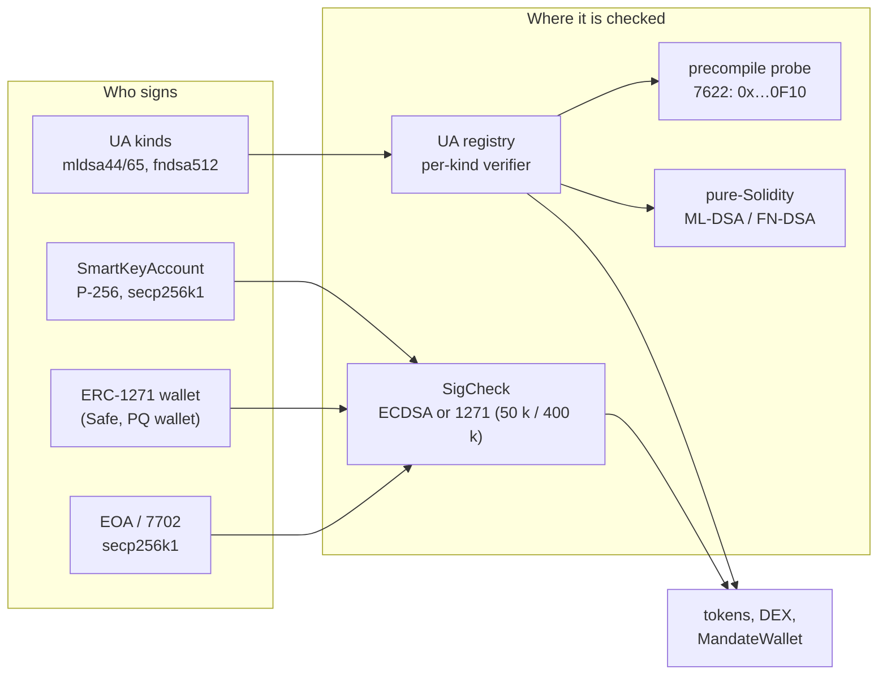

> **Research note — background and rationale only, not normative; the current rules are in docs/ (see decisions.md).**

# Post-quantum EIP drafts and SCaaS

Written 2026-10-11 for the owner ("the PQ EIP drafts now on the table: should SCaaS move its design toward them?").
Consider-only: nothing here changes a rule. SCaaS facts cite rule ids of the component docs; outside facts cite §9.
Fork status comes from the forkcast EIP data (`ethereum/forkcast`, `src/data/eips/<n>.json`), read on 2026-10-11.
**[unverified]** marks a claim that rests on secondary reporting or memory and was not confirmed against a primary
source; **[inference]** marks a conclusion drawn here, not stated by any source. Every EIP below is a Draft: numbers,
addresses and gas may change.

## 1. Summary

| Component | EIPs that touch it | Verdict |
|---|---|---|
| Meta-tx intents, `SigCheck` (EOA ECDSA, ERC-1271) | 8141 (PQ accounts are contracts), 8355 / 8052 (make a PQ ERC-1271 wallet fit the 50 k cap), 7851 (`0xef0101`) | **design for**: already agile; adopt nothing |
| `SmartKeyAccount` | 8355 / 8052 / 7885 | **design for**: keep `KeyKind` append-only; no PQ key kind now |
| Universal Account registry, PQ kinds | 8355, 8051, 8052, 7932, 8288 | **design for**: already PQ (probe, per-kind verifier); four gaps listed as open questions |
| DEX `TradeOrder` | as `SigCheck` | **watch**: no PQ maker path on public chains until a precompile exists |
| Classical Zether | none | **not applicable** (dev-only gate; PQZ replaces it) |
| PQ Zether (PQZ) | 7885 (NTT) at most | **not applicable**: no draft offers lattice-proof verification; keep the private precompile |
| Node: gossip, identity, lane keys | 8141 (relayer as a PQ account, later) | **already adopted** (ML-KEM key exchange); **watch** the rest |
| Ethereum consensus (leanXMSS, 8310, 8292) | — | **not applicable** (chain 7622's Clique signer stays classical, stated) |
| In-mempool hash-based aggregation | 8288 | **watch**: the cheapest L1 PQ path on paper; needs 8141 |
| Hedera and other non-EVM families | none (not EIPs) | **watch** each chain's native plan |

**What is on the table.** Six precompile or signature-registry drafts — EIP-7619 (Falcon-512, 2023), EIP-7885 (NTT),
EIP-7932 (secondary signature algorithms), EIP-8051 (ML-DSA), EIP-8052 (Falcon), EIP-8355 (ML-DSA-44/65/87) — and a
newer hash-based track around the frame transaction: EIP-8141 (frames, `ARBITRARY` signatures), EIP-8250 (keyed
nonces for frames), EIP-8288 (STARK aggregation of leanSPHINCS signatures in the mempool). Consensus work (leanXMSS,
EIP-8310 keystore, EIP-8292 aggregators) does not reach contracts. **None of the precompiles is scheduled for any
fork**: 7619, 7932 and 8051 were declined for Glamsterdam (ACDE #225, 2025-12-04; ACDE #228, 2026-01-15); 8355 was
proposed for Hegotá (ACDE #243, 2026-08-13) and declined three days ago (ACDE #247, 2026-10-08); 7885 and 8052 were
never proposed for a fork. The only PQ-relevant item scheduled is EIP-8141, Scheduled for Inclusion in Hegotá
(ACDE #244, 2026-08-27), with EIP-8250 Considered (ACDE #246, 2026-09-24). The EF roadmap places "PQ signature
precompiles (execution)" at fork **J\***, two forks after Hegotá, and "core PQ infrastructure" by about 2029.

**Bottom line for SCaaS.** SCaaS already designed for PQ where it matters and is ahead of Ethereum on paper: PQ
signing kinds (`mldsa44`, `mldsa65`, `fndsa512`) are enabled for Universal Accounts on every EVM chain with a pure
Solidity verifier and precompile **probing** ([CTR-UA-23](../contracts/accounts.md#CTR-UA-23)); PQ Zether runs on a
private precompile of chain 7622 ([CTR-PQZ-10](../contracts/pq-zether.md#CTR-PQZ-10)); private mesh traffic uses
X25519MLKEM768 ([NODE-GSP-03](../node/gossip.md#NODE-GSP-03)). The drafts change no SCaaS decision. They expose four
compatibility gaps worth keeping open (§7): the ML-DSA context string versus EIP-8355's empty context, EIP-8051's
expanded key format, FN-DSA versus EIP-8052's Falcon hash variants, and the absence of a hash-based kind while
Ethereum's base layer is moving to hash-based signatures. Keep the agility hooks; depend on no draft; adopt nothing now.

## 2. The drafts and roadmap items

| EIP / item | Title | Status, created | Fork status (forkcast) | What it gives |
|---|---|---|---|---|
| [7619](https://eips.ethereum.org/EIPS/eip-7619) | Precompile Falcon512 generic verifier | Draft, 2023-07-03 | Glamsterdam: declined (ACDE #225, 2025-12-04) | Falcon-512 verify, ~1 465 gas + 6/word **[unverified: forum figure]**; superseded in practice by 8052 **[inference]** |
| [7885](https://eips.ethereum.org/EIPS/eip-7885) | Precompile for NTT operations | Draft, 2025-02-12 | none | `NTT_FW`, `NTT_INV` (600 gas each in the spec), `VECMULMOD`, `VECADDMOD`; addresses TBD (the client implementation uses 0x12–0x15); building block for Falcon, ML-DSA and STARK verifiers |
| [7932](https://eips.ethereum.org/EIPS/eip-7932) | Secondary Signature Algorithms | Draft, 2025-04-12 | Glamsterdam: declined (ACDE #225) | an algorithm registry for address-deriving signatures and a `SIGRECOVER` precompile at 0x12 (3 000 gas base); 8051 and 8052 require it |
| [8051](https://eips.ethereum.org/EIPS/eip-8051) | Precompile for ML-DSA signature verification | Draft, 2025-10-15 | Glamsterdam: declined (ACDE #228, 2026-01-15) | `VERIFY_MLDSA` 0x12, `VERIFY_MLDSA_ETH` (Keccak variant) 0x13, 4 500 gas each; input 32-byte message, 2 420-byte signature (ML-DSA-44), **20 512-byte expanded public key** |
| [8052](https://eips.ethereum.org/EIPS/eip-8052) | Precompile for Falcon support | Draft, 2025-10-17 | none | `FALCON_HASH_TO_POINT_SHAKE256` or `_KECCAKPRNG` (1 000) + `FALCON_CORE` (2 000) = 3 000 gas; Falcon-512, 666-byte signature, 896-byte key; addresses TBD |
| [8355](https://eips.ethereum.org/EIPS/eip-8355) | Precompiles for ML-DSA Verification | Draft, 2026-07-30 | Hegotá: proposed ACDE #243 (2026-08-13), **declined ACDE #247 (2026-10-08)** | `VERIFY_MLDSA44/65/87` at 0x12/0x13/0x14; 6 500 / 9 000 / 13 500 gas + 6 per message word; input `pk ‖ sig ‖ msg`; **always the empty FIPS 204 context** |
| [8141](https://eips.ethereum.org/EIPS/eip-8141) | Frame Transaction | Draft, 2026-01-29 | Hegotá: **Scheduled** (ACDE #244, 2026-08-27) | account code decides validity; signature schemes `ARBITRARY` (100 gas, read by `SIGDATACOPY`), `SECP256K1`, `P256`; `MAX_VERIFY_GAS = 100 000` for public-mempool validation; the spec calls it "a native off-ramp" from elliptic curves |
| [8250](https://eips.ethereum.org/EIPS/eip-8250) | Keyed Nonces for Frame Transactions | Draft, 2026-04-16 | Hegotá: Considered (ACDE #246, 2026-09-24) | up to 16 nonce keys per frame transaction; key 0 is the account nonce |
| [8288](https://eips.ethereum.org/EIPS/eip-8288) | In-mempool signature and proof aggregation | Draft, 2026-06-03 | none | a frame mode that declares `(scheme, data_hash, vk_hash)` dependencies; the mempool aggregates them into one recursive STARK per block; scheme `leanSPHINCS` (0x10); 30 000 gas per dependency; signatures never land on chain |
| [7851](https://eips.ethereum.org/EIPS/eip-7851) | Code-Controlled EOA Delegation | Draft, 2024-12-27 | none | prefix `0xef0101` disables a 7702 account's ECDSA key for good (the migration step for 7702 wallets; the EIP itself does not mention quantum) |
| [8310](https://eips.ethereum.org/EIPS/eip-8310) | Post-Quantum Keystore for Stateful Keys | Draft (Interface), 2026-06-19 | — | keystore v5 for leanXMSS validator keys: leaf-state durability, partitions, no silent reset |
| 8292 | Post-Quantum Attestation Aggregators | Draft, 2026-06-07 | none | consensus aggregator role (forkcast data; not on eips.ethereum.org on 2026-10-11) |
| 8215 | Hash-Committed Account | Draft, 2026-04-02 | none | address = Merkle root of spending conditions; reception skeptical (forkcast data and the Magicians thread; not on eips.ethereum.org) |
| 8130 / 8388 | Keystore Accounts / Keystore Signatures for Execution Txs | Draft, 2025-10-14 / 2026-08-21 | none | Base's alternative: actors bound to authenticator contracts; 8388 routes 1559/2930 signatures through it "so those types can use post-quantum authenticators" (8388 only in forkcast data) |
| ERC-8231 | Post-Quantum Key Registry | forum draft, 2026-04-14 | — | ML-KEM / ML-DSA / SLH-DSA key registry with PoP, rotation, revocation |
| EF roadmap (pq.ethereum.org, ethereum.org) | Lean Ethereum | updated 2026-06-27 / 2026-09-08 | I\* PQ key registry (consensus); **J\* PQ signature precompiles (execution)**; L\* PQ attestations, leanVM; M\* PQ aggregation and blobs; later PQ transactions | "could be completed by 2029"; users migrate "through account abstraction, without a flag day"; candidates Falcon, Dilithium, SPHINCS+; base layer "purely hash-based" (Vitalik on 8288, 2026-06-15) |

Two facts shape everything below. **Address chaos:** 7932, 8051, 8355 and the 7885 implementation all claim 0x12
(and 0x13–0x15 overlap); whichever lands first takes them, so no SCaaS code may assume an address — which is already
the rule ("any future EIP-8051/8052/8355 address by probe, never by assumption", CTR-UA-23). **Hash-based drift:** the
EF's own execution path (8288 with leanSPHINCS) and its consensus path (leanXMSS) are hash-based; the precompile drafts
are lattice-based (ML-DSA, Falcon) and are the ones being declined. Which family an Ethereum account will verify most
cheaply in 2028 is open.

## 3. What SCaaS already plans for PQ

- **Meta-transaction intents.** v1/v2 intents (`MetaTransaction`, `MetaTransfer`, `TradeOrder`) go through one
  `SigCheck`: an EOA (or a 7702-delegated EOA, code `0xef0100‖addr`) by ECDSA low-s, a contract by ERC-1271 with a
  50 k gas cap, 400 k only for `SmartKeyAccount` clones ([CTR-MTX-25](../contracts/metatx.md#CTR-MTX-25),
  [CTR-ACC-05](../contracts/accounts.md#CTR-ACC-05)). The PQ path is the Universal Account path: a UA of a PQ kind
  signs `UAMetaTransaction` / `UAMetaTransfer`, verified by the registry ([CTR-UA-02](../contracts/accounts.md#CTR-UA-02)).
  `approve` and `trade` are refused on every `ua*` path ([functions](../contracts/accounts.md#function-kinds)).
- **Universal Account PQ kinds** ([CTR-UA-23](../contracts/accounts.md#CTR-UA-23)): `mldsa44` (0x0130), `mldsa65`
  (0x0131), `fndsa512` (0x0132) on every EVM chain; ML-DSA signs `ua_msg` with **context = `kind_tag`**; `fndsa512`
  freezes the FIPS 206 draft encoding (a final FIPS 206 that differs is a new kind version); precompile where probed,
  else pure Solidity; every check fits one transaction under `UA_VERIFY_BUDGET` with a measured per-kind cap ≤ ~50 %
  of it on public chains, else the kind is disabled on that chain; a later standard precompile means a new verifier in a
  new registry generation. Hybrid `msig {mldsa65, p256}` is the recommended long-lived authority. Status: SPECIFIED,
  nothing built (the built registry still has the retired `PQ_COMMITMENT` "verify off chain" scheme).
- **`SmartKeyAccount`** ([CTR-ACC-11](../contracts/accounts.md#CTR-ACC-11); built code still at
  `smartcontracts/evm/src/account/SubjectAccount.sol`, renamed in P4): `KeyKind` `{NONE, P256_WEBAUTHN, SECP256K1}`,
  guardian recovery, key changes by its own `MetaTransaction` ([CTR-ACC-09](../contracts/accounts.md#CTR-ACC-09), [CTR-ACC-10](../contracts/accounts.md#CTR-ACC-10)). No PQ key.
- **Confidentiality.** Classical Zether is dev-only ([CTR-ZTH-02](../contracts/zether.md#CTR-ZTH-02)); a quantum
  adversary could read balances and forge proofs. PQ Zether (`PqzToken`, MLWE encryption, LNP22 proofs) is specified
  for chain 7622 only, behind an allowlist and a precompile self-test; precompiles `PQZ` at `0x…0F01` and `MLDSA65` at
  `0x…0F10` ("EIP-8355's layout plus a context field"), placed off 0x12/0x13 on purpose
  ([CTR-PQZ-01](../contracts/pq-zether.md#CTR-PQZ-01), [CTR-PQZ-10](../contracts/pq-zether.md#CTR-PQZ-10)). Public
  chains: wait for a lattice-verification precompile there; no Solidity split, no STARK wrap, no appchain. Its
  authorization is a PQ `authRef` ([CTR-PQZ-12](../contracts/pq-zether.md#CTR-PQZ-12)). Token kinds `*_PQZ` are
  reserved in `IOpenFactory.TokenKind` ([CTR-TOK-21](../contracts/token-wrappers.md#CTR-TOK-21)).
- **What stays classical, stated** ([list](../contracts/pq-zether.md#what-stays-classical)): the Clique block signer,
  relayer lane keys (gas only), public ERC-20 legs, a v1 envelope signer of its public balance.
- **Node.** Admitted-peer traffic is PQ only (X25519MLKEM768 via `aws-lc-rs`); identity stays Ed25519, with a stated
  upgrade path to an ML-DSA-65 `pq_pubkey` signed by both keys ([NODE-GSP-02](../node/gossip.md#NODE-GSP-02),
  [NODE-GSP-03](../node/gossip.md#NODE-GSP-03)).
- **Clients.** PQ seeds come from the BIP-39 seed by HKDF (`scaas.ua.pq.v1`) into FIPS 204 / FN-DSA keygen; the PQZ
  leaf is sealed in the key worker.
- **Non-EVM families.** No SCaaS PQ kind outside EVM; PQZ "no" on Hedera, Soroban, Sui, Aptos, Solana, TON, Cosmos
  "feasible later" ([availability](../networks/README.md#availability)).
- Hash-based signatures: none in SCaaS. The only "Lamport" in the tree is EIP-2333 BLS key derivation in
  `clients/zether-prover`, which is not a signature scheme.

## 4. Cost of one PQ check on an EVM chain

Execution gas only unless stated; calldata at 16 gas/byte (execution dominates) to 40 gas/byte (EIP-7623 floor, binds
when execution is small).

| Scheme | Signature / key | Pure Solidity today | With a draft precompile | Calldata of the signature |
|---|---|---|---|---|
| ML-DSA-44 | 2 420 / 1 312 B | 1.23 M (Fireblocks, 2026-09-02; key deployed once as code, ~4.1 M) | 8355: 6 500 + 6/word; 8051: 4 500 but with a 20 512-byte expanded key | 39–97 k |
| ML-DSA-65 | 3 309 / 1 952 B | SCaaS estimate 1.2–8.1 M (see §7 Q5) | 8355: 9 000 + 6/word (≈ 20 k with SCaaS key loading, as on chain 7622) | 53–132 k |
| FN-DSA / Falcon-512 | ~666 / 897 B | SCaaS estimate 0.6–2.5 M; ~2 M (Keccak variant, older ethresear.ch figure) | 8052: 3 000 | 11–27 k |
| SLH-DSA-SHA2-128s (FIPS 205) | 7 856 / 32 B | ~0.6 M (SCaaS table) | none drafted | 126–314 k |
| SPHINCS- (Keccak, non-FIPS) | 3 704–6 512 B | 94–276 k (ethresear.ch, 2026-06-12) | none needed | 59–260 k |
| leanSPHINCS via 8288 | off chain | — | 30 000 per dependency, signature never in calldata | 96 B per dependency |
| NTT-assisted ML-DSA | — | ~5.73 M with 7885 (the EIP's projection, **[unverified, secondary]**) | — | as above |

Consequences **[inference]**: (1) with a precompile, a PQ check costs about what an ERC-1271 passkey check costs and
fits `SigCheck`'s 50 k cap; without one, no lattice scheme fits 50 k or 400 k, and every Solidity ML-DSA/Falcon check
exceeds EIP-8141's `MAX_VERIFY_GAS = 100 000`, so a public-mempool frame account can verify PQ only with a precompile,
an SLH-DSA-Keccak-class hash scheme (~94 k, marginal) or 8288 aggregation. (2) On L1 the calldata of a lattice
signature alone (53–132 k for ML-DSA-65) is several ECDSA transactions; Falcon is the cheapest in bytes. (3) SCaaS's
measured-cap rule already prices this per chain, so none of it needs a rule change.

## 5. Timing

| Path | Earliest | Basis |
|---|---|---|
| Glamsterdam (mainnet planned early December 2026) | no PQ item | ACDE #244 plan; Sepolia 2026-10-06 |
| Hegotá | EIP-8141 (+ 8250 if it moves to SFI); **no PQ precompile** | 8355 declined 2026-10-08; fork date not set (2027 **[unverified]**); first devnets planned from 2026-10-15 (not agreed) |
| I\* | possible slot for a precompile re-proposal | no proposals listed yet **[inference]** |
| J\* | "PQ signature precompiles (execution)" on the EF roadmap | pq.ethereum.org; at the strawmap's ~6-month cadence after Glamsterdam this is around 2028 **[inference]** |
| L2s / public EVM chains SCaaS profiles | no RIP or L2 PQ precompile found | search 2026-10-11 **[unverified absence]** |
| Chain 7622 | now, by our own client | [CTR-PQZ-10](../contracts/pq-zether.md#CTR-PQZ-10) |
| Quantum threat | "early-to-mid 2030s" in most engineering roadmaps | pq.ethereum.org |

## 6. Applicability to SCaaS, component by component

**(1) Meta-tx intents and `SigCheck`.** Nothing to adopt. Three draft effects, all absorbed by the current rule:
(a) **8141**: an account that signs with a PQ scheme is a contract (code), so `SigCheck` sends it to ERC-1271 — the
right path; whether its 1271 fits 50 k depends on (b). (b) **8355/8052** would let any PQ ERC-1271 wallet sign SCaaS
intents within the existing 50 k cap; without them a PQ 1271 wallet cannot sign v1/v2 intents (Solidity verify > 50 k)
and must use the UA path instead. (c) **7851**: a 7702 account that disables its ECDSA key gets code `0xef0101‖addr`;
`SigCheck.isContract` matches only `0xef 0x01 0x00`, so such an account is treated as a contract and checked through
its delegate's ERC-1271 — correct, since its key no longer signs (checked against
`smartcontracts/evm/src/common/SigCheck.sol`). A plain 7702 account stays quantum-exposed through its root key
whatever its delegate verifies. Agility hook to keep: one `SigCheck` for every contract, caps as named constants, so a
per-signer cap for a known PQ wallet codehash could be added the way the 400 k clone rule was.

**(2) `SmartKeyAccount`.** Its keys are P-256 and secp256k1, both quantum-breakable; recovery adds
a key ([CTR-ACC-03](../contracts/accounts.md#CTR-ACC-03)), so "add a PQ key, remove the classical ones" would be the
migration once a PQ `KeyKind` exists. Today that kind is not worth adding: a Solidity ML-DSA verify (1.2 M+) breaks
the 400 k clone cap and the 8141 validation budget. With a probed precompile it would fit. Agility hook: `KeyKind`
stays append-only and verification dispatches by kind, so a later `MLDSA65` / `FNDSA512` / hash-based kind is an
additive change in the account phase, not a migration. The route that exists today is not the account at all: a
subject that wants PQ authority uses a PQ or hybrid `msig {mldsa65, p256}` UA, CTR-UA-23's recommended long-lived form.

**(3) Universal Account registry.** This is SCaaS's PQ front door and it is already "designed for agility": kinds
are versioned, verifiers are per kind behind `IUAKindVerifier`, precompiles are probed, caps are measured per chain,
and a standard precompile arrives as a new verifier in a new registry generation. Four draft frictions (open
questions Q1–Q4): EIP-8355 has no context field while SCaaS's ML-DSA signs with `ctx = kind_tag`; EIP-8051 takes an
expanded key and a 32-byte message; EIP-8052's hash-to-point comes in SHAKE256 and Keccak-PRNG variants while
`fndsa512` freezes the FIPS 206 draft; and SCaaS has no hash-based kind although Ethereum's own path (8288,
leanXMSS) and Aptos's (SLH-DSA, AIP-137 **[unverified status]**) are hash-based.

**(4) DEX orders.** `TradeOrder` makers sign through `SigCheck`; the UA path refuses `trade`. So a PQ maker exists only
as a PQ ERC-1271 wallet, which fits the cap only with a precompile, or later as a `SmartKeyAccount` with a PQ key.
Watch; it follows (1) and (2). On chain 7622 the private `MLDSA65` precompile could serve a PQ 1271 wallet today.

**(5) Classical Zether.** Not applicable: a quantum adversary reads and mints; the dev-only gate and the PQZ migration
([migration](../contracts/pq-zether.md#migration)) are the answer, not an EIP.

**(6) PQ Zether.** Not applicable to any draft. PQZ needs LNP22 proof verification (key, encryption, carry relations),
not signature verification; no draft offers it. EIP-7885's NTT and vector ops are the only generic building blocks
and are not proposed for any fork; even with them a Solidity LNP22 verifier would be multi-million gas
**[inference]**. 8288's recursive STARK verifies leanSPHINCS and reserves leanSTARK; arbitrary programs are not in
scope yet. The chain-7622 design stays; its addresses `0x…0F01`/`0x…0F10` avoid the 0x12–0x15 contest but sit inside
the EIP-1352 precompile range (Q6).

**(7) Node and relayer keys.** Key exchange: already PQ, ahead of the drafts. Identity: Ed25519 with a stated ML-DSA
upgrade path; nothing in the EIPs changes it (libp2p has no PQ key type). Lane keys: secp256k1 because every target
chain requires ECDSA transaction signatures today; they hold gas only. After Hegotá a relayer on L1 could submit from
an 8141 frame account verified by a PQ scheme — only useful once a cheap PQ check exists there (§4). Watch.

**(8) Ethereum consensus.** leanXMSS, EIP-8310 and EIP-8292 change validators, not contracts. Chain 7622 runs Clique
with one secp256k1 signer and states "consensus PQ is out of scope"; nothing to do.

**(9) Hedera and non-EVM families.** Not EIPs; each chain moves on its own: **Hedera** (blog, 2026-04-10): hybrid
Ed25519 + FN-DSA node signing, then a PQ user key type targeted for 2027 after FIPS 206 (ML-DSA if FIPS 206 slips), no
HIP number cited. **Solana** (Solana Foundation, 2026): Anza and Firedancer both chose Falcon and have implementations;
no SIMD number; Blueshift's Winternitz vault is an opt-in program today. **Aptos**: AIP-137, SLH-DSA opt-in accounts,
proposed 2025-12 **[unverified: secondary reporting, AIP not reachable]**. **Sui, Cosmos, Soroban, TON**: no plan found
in this pass **[unverified absence]**. For SCaaS the effect is uniform **[inference]**: where the subject is a native
account (Hedera via HIP-632 `isAuthorizedRaw`, Aptos, Solana key ops), a native PQ key type flows in once the chain's
own verification primitive covers it; SCaaS adds no PQ kind of its own off EVM.

## 7. Open questions

Kept open; none blocks the current contract phase (DEX, then Zether kinds) or the node phases.

- **Q1 ML-DSA context.** **Decided (owner 2026-10-11):** empty context, tag in the message, `pq_msg = keccak256(TAG(kind) ‖ ua_msg)`, P6 ([CTR-UA-23](../contracts/accounts.md#CTR-UA-23)). FIPS 204 prefixes the message with `0x00 ‖ len(ctx) ‖ ctx`, so a signature made with
  `ctx = kind_tag` cannot be checked by an empty-context verifier such as EIP-8355. Does SCaaS keep `ctx = kind_tag`
  (and need a context-taking precompile, as chain 7622's `MLDSA65` is), or does a later kind version move the tag into
  the message with an empty context, so a standard precompile could serve it? Both are compatible with CTR-UA-23's
  "new verifier in a new generation" rule; nothing is built yet.
- **Q1 finding (P6a, 2026-10-12): EIP-8051's μ.** The draft's pseudocode computes `μ = shake_256(tr + message)` over a
  32-byte message with a 32-byte `tr` (key 20,512 B), i.e. `ML-DSA.Verify_internal` without the FIPS 204 prefix
  `0x00 ‖ len(ctx) ‖ ctx`. Its own vectors disagree: all 100 records of `assets/eip-8051/mldsa_nist.rsp` (33-byte
  messages, 2,560-byte secret keys, i.e. a 64-byte `tr`) verify as FIPS 204 **pure ML-DSA with the empty context** and
  none verifies without the prefix (checked with `@noble/post-quantum` 0.7.1); the reference Solidity (ZKNox
  `ETHDILITHIUM`, `ZKNOX_dilithium.sol`) also builds `M' = 0x00 ‖ 0x00 ‖ m` and reads a 64-byte `tr`, and stores
  `NTT(t1·2^d)` where the text says `t1`. A precompile built from the text would reject every SCaaS (and every FIPS 204)
  signature; SCaaS's probe (a valid and a flipped `pq_msg` vector, exact 32-byte answers) refuses such a precompile
  rather than mis-verifying. P6a's expanded-key layout follows the reference implementation: `Â ‖ tr (64) ‖
  NTT(t1·2^d)`, u32 big-endian, 20,544 B for ML-DSA-44. EIP-8355 has no such gap: empty context, FIPS 204 `M'`.
- **Q2 EIP-8051 key format.** If 8051 (expanded 20 512-byte key, 32-byte message) rather than 8355 wins, the stored
  key per UA grows about tenfold and the message becomes a digest. Would SCaaS store the expanded key, or expand it per
  call?
- **Q2 finding (P6a).** Measured pure-Solidity ML-DSA (`test/ua/PqGas.t.sol`): 11.4 M (ML-DSA-44) / 18.9 M (ML-DSA-65)
  on the FIPS 204 key — `ExpandA` alone is ~80 / ~150 Keccak-f permutations at ~66 k gas each — and 4.1 M / 5.8 M on the
  expanded key. Without a precompile, ML-DSA fits CTR-UA-23's ~50 % bound only if the registry stores the expanded key;
  what that costs at registration (SSTORE2 of 20.5 / 36.9 KB, and proving the expansion on chain) is the P6c question. Practical consequence: without an EIP-8355 precompile or a stored expanded key, ML-DSA is over budget on public chains, so `slhdsa128s` and `fndsa512` are the practical PQ kinds there. The verifiers are home-written and unaudited: an audit is required before any public chain enables them.
- **Q3 FN-DSA final.** FIPS 206 is still a draft (final expected late 2026 / early 2027 **[unverified]**). Does the
  final encoding match the frozen `fndsa512` vectors, and is EIP-8052's SHAKE256 hash-to-point exactly FN-DSA's? The
  Keccak-PRNG variant is not.
- **Q3 finding (P6a).** No FIPS 206 draft is public yet (NIST slides 2025: "initial public draft soon"; an IETF LAMPS
  draft of May 2026 still says "forthcoming"), so `fndsa512` is the NIST third-round Falcon-512 (v1.2) with EIP-8052's
  SHAKE256 hash-to-point over a 32-byte message: verified against the NIST KATs published with EIP-8052 (pk and
  compressed `s2` from `kat_FALCONCORE_512.rsp`, the salt from `kat_HASHTOPOINT_512.rsp`). EIP-8052's text has small
  gaps: the precompile input splits the 666 bytes as salt 40 ‖ `s2` 626 while the padded format is header 1 ‖ salt 40 ‖
  625; `FALCON_CORE` takes `h` in the NTT domain; it accepts `‖(s1, s2)‖² < ⌊β²⌋` where the reference code and noble
  accept `≤`. Falcon keys from a seed are implementation-specific (noble's note), so SCaaS pins derivation to one
  implementation by vectors.
- **Q4 Hash-based kind.** **Decided (owner 2026-10-11):** kind `slhdsa128s` (0x0133, SLH-DSA-SHA2-128s), SPECIFIED (P6), public chains after a gas measurement ([CTR-UA-23](../contracts/accounts.md#CTR-UA-23)). Ethereum's base layer prefers hash-based (8288 leanSPHINCS, leanXMSS); SLH-DSA verifies in
  Solidity at ~0.6 M and SPHINCS- at ~0.1 M with no precompile, the only PQ family whose Solidity verifier comes near
  the 100 k / 400 k bounds of §4 (at the price of 4–8 KB signatures). Is an `slh-dsa` (or leanSPHINCS) UA kind worth reserving next to the lattice kinds? Stateful XMSS/WOTS keys
  would need the leaf-state discipline of EIP-8310, which SCaaS clients do not have. *P6a:* SLH-DSA-SHA2-128s verifies in
  Solidity on SHA-256 `0x02` for 0.79 M gas (valid) and at most 1.32 M (the worst case any input can force) — the gas
  gate passes.
- **Q5 Solidity cost basis.** Fireblocks' 1.23 M is **ML-DSA-44**, while `pq-zether.md` §3 and the CTR-UA-23
  estimates attribute it to ML-DSA-65; the ML-DSA-65 worst case is likely higher **[inference]**. The per-chain
  T-GAS measurement settles it before any cap is set.
- **Q6 Private precompile addresses.** `0x…0F01`/`0x…0F10` lie in the EIP-1352 reserved range; a future upstream
  precompile there would collide on chain 7622. The self-test catches a wrong answer, not a shadowed address.
- **Q7 PQ makers and 1271 wallets on public chains.** Until a precompile exists, a PQ wallet can sign UA-path intents
  but not v1/v2 intents or DEX orders. Acceptable as a stated gap, or does a known PQ wallet codehash deserve its own
  cap the way `SmartKeyAccount` clones got 400 k?
- **Q8 Link rot.** The EF post cited in `pq-zether.md` (pq.ethereum.org/blog/pq-precompiles-eip-8051-8052/) returned
  404 on 2026-10-11 although search engines still list it.

## 8. Recommendations

| Stance | What | Risk if wrong |
|---|---|---|
| **Keep** | Probe-not-assume for every PQ precompile; per-kind verifiers; measured caps; disable a kind rather than let it receive unusable funds (CTR-UA-23) | none new: four drafts contest 0x12–0x15 |
| **Keep** | PQZ on chain 7622's own precompile; public chains wait | no public chain may ever offer lattice-proof verification; PQZ stays private-chain |
| **Keep** | ML-KEM key exchange on the mesh; Ed25519 identity with the stated upgrade path | live quantum impersonation of a node identity (later threat) |
| **Design for** | `SmartKeyAccount` `KeyKind` append-only; `SigCheck` caps as constants with room for a codehash rule; UA kind versions for context/encoding changes (Q1–Q3) | a precompile shape that SCaaS's signing formats cannot use without a new kind version |
| **Watch** | 8355 / 8051 / 8052 re-proposal for I\* or J\*; 8141 + 8250 + 8288 on Hegotá devnets; FIPS 206 final; Hedera's PQ key type; Solana Falcon SIMD | timing: precompiles have slipped from Glamsterdam to Hegotá to "J\*" |
| **Do not** | Depend on a draft address or ABI; ship a pure-Solidity PQ verifier into `SigCheck`'s 1271 path; add a stateful hash-based kind without a leaf-state store | stuck funds, unbounded verification gas, reused one-time keys |

Re-check before relying on any of this: the Hegotá date; whether 8355 or 8051 is re-proposed for I\*; the EIP-8052
addresses and FN-DSA equivalence; AIP-137's status; Hedera's PQ HIP number; any L2 that ships a PQ precompile first.

## 9. Sources

- EIP-7619: https://eips.ethereum.org/EIPS/eip-7619 · forum: https://ethereum-magicians.org/t/eip-7619-falcon-512-precompiled-generic-signature-verifier/18569
- EIP-7851: https://eips.ethereum.org/EIPS/eip-7851
- EIP-7885: https://eips.ethereum.org/EIPS/eip-7885 · forum: https://ethereum-magicians.org/t/eip-7885-precompile-for-ntt-operations/22895
- EIP-7932: https://eips.ethereum.org/EIPS/eip-7932
- EIP-8051: https://eips.ethereum.org/EIPS/eip-8051 · forum: https://ethereum-magicians.org/t/eip-8051-ml-dsa-verification/25857
- EIP-8052: https://eips.ethereum.org/EIPS/eip-8052 · forum: https://ethereum-magicians.org/t/eip-8052-precompile-for-falcon-support/25860
- EIP-8130: https://eips.ethereum.org/EIPS/eip-8130
- EIP-8141: https://eips.ethereum.org/EIPS/eip-8141
- EIP-8215 forum: https://ethereum-magicians.org/t/discussion-hash-committed-account-hca-quantum-safe-address-derivation-for-ethereum/28094
- EIP-8250: https://eips.ethereum.org/EIPS/eip-8250
- EIP-8288: https://eips.ethereum.org/EIPS/eip-8288 · forum: https://ethereum-magicians.org/t/eip-8288-frame-type-for-pq-sig-and-stark-aggregation/28723
- EIP-8292 forum: https://ethereum-magicians.org/t/eip-8292-pq-attestation-aggregators/28778
- EIP-8310: https://eips.ethereum.org/EIPS/eip-8310
- EIP-8355: https://eips.ethereum.org/EIPS/eip-8355 · forum: https://ethereum-magicians.org/t/eip-8355-precompiles-for-ml-dsa-verification/29211
- ERC-8231 forum: https://ethereum-magicians.org/t/erc-8231-post-quantum-key-registry/28235
- Fork status per EIP (forkcast data): https://github.com/ethereum/forkcast/tree/main/src/data/eips
- Hegotá EL tracker: https://github.com/ethereum/execution-specs/issues/3664
- ACDE #243 transcript index (8355 proposed): https://github.com/pettinarip/upgrade-register/pull/9
- ACDE #244 (8141 SFI, Glamsterdam schedule): https://christinedkim.substack.com/p/acde-244
- PQTS breakout kickoff, 2026-02-04: https://ethereum-magicians.org/t/post-quantum-transaction-signature-pqts-breakout-room-kickoff-call/27554
- EF PQ hub: https://pq.ethereum.org/ · ethereum.org quantum resistance: https://ethereum.org/roadmap/future-proofing/quantum-resistance/ · strawmap: https://strawmap.org/
- Fireblocks ML-DSA-44 verifier: https://www.fireblocks.com/blog/post-quantum-signatures-ethereum-cheaper-gas
- SPHINCS-: https://ethresear.ch/t/sphincs-minus-efficient-stateless-post-quantum-signature-verification-on-the-evm/25165
- Hedera PQ plan: https://hedera.com/blog/post-quantum-cryptography-and-blockchain/
- Solana quantum readiness: https://solana.com/news/quantum-readiness
- Aptos AIP-137 (secondary): https://cointelegraph.com/news/aptos-introduces-post-quantum-signatures-proposal
- FIPS 206 status (secondary): https://www.encryptionconsulting.com/education-center/fn-dsa-fips-206/
- Companion note: [eip7702-eip8141-vs-metatx.md](eip7702-eip8141-vs-metatx.md)
