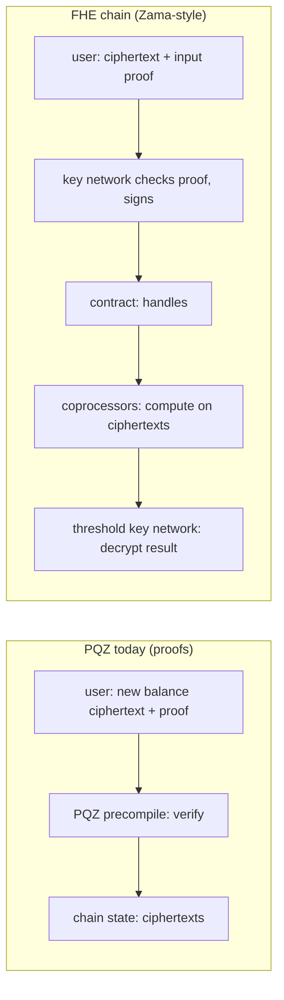

> **Research note — background and rationale only, not normative; the current rules are in docs/ (see decisions.md).**

# Post-quantum fully homomorphic encryption (FHE) and PQZ: what it is, where it stands, what it would mean here

Written 2026-10-18 at the owner's questions "do LaZer and Ligero support fully homomorphic encryption?" and "add the
post-quantum FHE information to the research documents". Nothing here is built or measured by us. Tags:
**[source]** a cited publication or vendor page (checked 2026-10-18), **[inference]** this note's reasoning,
**[measured]** our own runs.

## 1. Result

| Question | Answer |
|---|---|
| Do LaZer (PQZL) or Ligero (PQZH) do FHE? | **No.** Both are zero-knowledge *proof* systems: they prove a statement about secret data, they do not compute on encrypted data. |
| Does PQZ use homomorphic encryption at all? | **Yes, additive only.** Balances are MLWE ciphertexts with BFV-style encoding: Enc / Add / Dec, no multiplication (decisions.md CTR-PQZ-02; full FHE stacks were rejected for their relinearisation keys and decryption-failure probabilities). |
| Is practical FHE post-quantum? | **Yes, by construction.** Every scheme in use (BGV, BFV, CKKS, TFHE / FHEW) rests on LWE or Ring-LWE, the same family as ML-KEM (FIPS 203) and our MLWE balances [inference]. |
| Is FHE standardised? | **Not yet.** ISO/IEC 28033 parts 1–4 were in late draft / approval in early 2026; NIST has no FHE standard, only the FHE category of its threshold call (§4) [source]. |
| Does SCaaS need FHE? | **Not for confidential transfers.** Each user proves their own balance update and the chain only verifies. FHE would matter only for computation over values that no single party knows (§8) [inference]. |

## 2. Proofs, homomorphic encryption and FHE

| Tool | What it gives | Post-quantum? | In SCaaS |
|---|---|---|---|
| Zero-knowledge proof (LaZer, Ligero, STARKs) | "I know secret data satisfying X", nothing else revealed; the verifier computes nothing on the data | depends on the system (lattice and hash-based are) | PQZL, PQZH |
| Additively homomorphic encryption | Enc(a) + Enc(b) = Enc(a + b) | lattice versions yes; elliptic-curve ElGamal and Paillier no | PQZ balances (MLWE); Zether (elliptic-curve ElGamal, not PQ) |
| Leveled / somewhat homomorphic | additions and a bounded number of multiplications | yes (lattice) | — |
| **Fully homomorphic (FHE)** | any computation on ciphertexts, unbounded depth through *bootstrapping* (a homomorphic decryption that resets the noise) | yes (lattice) | — |

The difference that matters for a chain: with ZK proofs the party who knows the data does the work and the chain
checks it; with FHE the chain (or a network attached to it) does the work on data nobody there can read, and a
key-holding party must later decrypt the result.

## 3. The scheme families

| Family | Arithmetic | Typical use | Bootstrapping |
|---|---|---|---|
| BGV, BFV | exact, modulo a plaintext modulus t, SIMD batching | integer statistics, exact counters | slow, usually avoided (leveled use) |
| CKKS | approximate fixed-point | machine-learning inference, analytics | possible, costly |
| TFHE / FHEW (CGGI) | small integers or booleans; *programmable bootstrapping* applies a lookup table while it refreshes | arbitrary programs, comparisons, blockchain (Zama) | fast, every gate or block |

Security rests on (Ring-)LWE with parameters taken from the HomomorphicEncryption.org security standard tables
[inference: the libraries cite them]. Ciphertexts are much larger than the plaintext: kilobytes per encrypted small
integer for TFHE, and keys (bootstrapping / key-switching) of tens to hundreds of megabytes [inference: order of
magnitude only, it depends on the parameter set].

## 4. Standards

- **ISO/IEC 28033** "Fully homomorphic encryption": part 1 general, part 2 exact arithmetic on modular integers
  (BGV / BFV), part 3 approximate numbers (CKKS), part 4 lookup-table evaluation (CGGI / TFHE). As of early 2026
  the parts were at DIS / FDIS stages; publication as an International Standard could not be confirmed
  ([ISO 28033-4](https://www.iso.org/standard/87641.html),
  [DIN draft part 2](https://www.dinmedia.de/en/draft-standard/iso-iec-dis-28033-2/399825297),
  [DIN draft part 3](https://www.dinmedia.de/en/draft-standard/iso-iec-dis-28033-3/398741185)) [source].
- **ISO/IEC 18033-6:2019** covers *partially* homomorphic encryption (ElGamal, Paillier): not post-quantum
  [inference].
- **NIST**: no FHE standard. The Multi-Party Threshold Cryptography call (NIST IR 8214C) has a Class S with FHE as
  category S5 (key generation S4, zero-knowledge proofs S6); package deadline expected 2026-11-16, postponed from
  2026-10-19 ([TCall-1](https://csrc.nist.gov/projects/threshold-cryptography/tcall-1),
  [NIST news 2026](https://csrc.nist.gov/News/2026/nist-and-multi-party-threshold-schemes),
  [NIST IR 8214C](https://www.nist.gov/publications/nist-first-call-multi-party-threshold-schemes)). Zama's preview
  covers TFHE and its threshold decryption ([Zama PW01](https://csrc.nist.gov/csrc/media/Projects/threshold-cryptography/documents/TCall-1/Zama-PW01.pdf))
  [source].

## 5. Security caveats

- **Decryption results leak (IND-CPA-D).** If an attacker sees decryptions of ciphertexts it influenced, imperfect
  correctness becomes a key-recovery oracle. Shown first for CKKS (Li–Micciancio 2021), then for the "exact" schemes
  BFV, BGV and TFHE: Cheon, Choe, Passelègue, Stehlé, Suvanto ([ePrint 2024/127](https://eprint.iacr.org/2024/127))
  and Checri, Sirdey, Boudguiga, Bultel (CRYPTO 2024, [artifact](https://artifacts.iacr.org/crypto/2024/a11/readme.html)).
  Mitigation: a negligible decryption / bootstrapping failure probability, and **smudging noise after each partial
  decryption** in threshold variants [source]. This is the same failure mode CTR-PQZ-02 / CTR-PQZ-03 avoid in PQZ by
  worst-case noise bounds ("an accepted state never fails to decrypt") [inference].
- **Someone must hold the decryption key.** A chain computing on encrypted state needs one global FHE key; in practice
  it is split across a threshold MPC network (Zama: a key-management system of MPC nodes, a quorum such as 9 of 13
  decrypts, [KMS docs](https://docs.zama.org/protocol/protocol/overview/kms),
  [TKMS](https://www.zama.org/post/introducing-zama-threshold-key-management-system-tkms)) [source]. Confidentiality
  then depends on that network's honest majority — an assumption PQZ does not have (each user holds their own key)
  [inference].
- **Inputs must be proven well formed.** Users attach a zero-knowledge proof of knowledge of each encrypted input;
  fhEVM has the key-management network check it and sign, and the contract checks only the signature
  ([fhEVM inputs](https://docs.zama.ai/fhevm-backend/fundamentals/fhevm/inputs)) [source].

## 6. Performance (vendor figures)

- TFHE programmable bootstrapping: about 10–12 ms on a 192-core AMD EPYC CPU and about 0.8–0.95 ms on one H100 GPU
  for boolean / 4-bit messages; 53 ms for 4-bit integers on CPU in 2021
  ([Zama, sub-millisecond bootstrapping](https://www.zama.ai/post/bootstrapping-tfhe-ciphertexts-in-less-than-one-millisecond),
  [FHE.org 2026 poster](https://fhe.org/conferences/conference-2026/resources/posters/%5B07%5D%20-%20Sub-Millisecond%20TFHE%20Bootstrapping%20on%20GPU.pdf?raw=true),
  [TFHE-rs CPU benchmarks](https://docs.zama.ai/tfhe-rs/get-started/benchmarks/cpu/cpu-programmable-bootstrapping))
  [source].
- A 64-bit encrypted integer is a radix of small blocks, so one 64-bit operation chains many bootstraps; expect
  milliseconds on GPUs and tens to hundreds of milliseconds on CPUs per operation [inference]. For comparison, the PQZL
  specialised verifier checks a whole confidential transfer (`R_TX`) in about 8 ms on one CPU core [measured,
  pqz-core/README.md §5.5].

## 7. FHE on public chains today

| Project | Model | Status [source] |
|---|---|---|
| **Zama Protocol** (fhEVM) | contracts hold handles to ciphertexts; off-chain coprocessors compute TFHE; threshold MPC key management decrypts | live on Ethereum mainnet since 2025-12-30 (first transaction a confidential USDT transfer); an FHE sealed-bid token auction in January 2026; Solana planned ([litepaper](https://docs.zama.ai/protocol/zama-protocol-litepaper), [fhEVM coprocessor](https://zama.ai/post/fhevm-coprocessor)) |
| **Fhenix** CoFHE | FHE coprocessor reached by a Solidity import; with EigenLayer, fraud proofs settled on the host chain | live on Arbitrum per Fhenix ([fhenix.io](https://www.fhenix.io), [Fhenix × EigenLayer](https://www.fhenix.io/blog/fhe-coprocessors-tm-fhenix-eigenlayer-join-forces-for-next-gen-onchain-confidentiality), [IPTF profile](https://iptf.ethereum.org/vendors/fhenix/)) |
| Inco and others | FHE / TEE confidentiality layers | not checked for this note |

Libraries [inference unless marked]: **TFHE-rs** (Zama, Rust) — BSD-3-Clause-Clear, free **only** for development,
research, prototyping and experimentation; commercial use needs Zama's patent licence
([docs.rs tfhe](https://docs.rs/crate/tfhe/), [GitHub](https://github.com/zama-ai/tfhe-rs)) [source]. OpenFHE
(BSD-2-Clause, C++; BGV / BFV / CKKS / FHEW / TFHE), Lattigo (Apache-2.0, Go; BGV / BFV / CKKS, multiparty),
Microsoft SEAL (MIT, C++; BFV / BGV / CKKS). For SCaaS the patent position matters: it would fall under the licence /
patent gate G-LIC like PQZ (decisions.md CTR-PQZ-01).

## 8. Where FHE and our proof systems meet

- **Verifiable FHE**: proving that a homomorphic computation, bootstrapping included, was done correctly. TFHE
  bootstrapping proven with plonky2 in under 20 minutes, ≈ 200 kB proof (Thibault–Walter,
  [ePrint 2024/451](https://eprint.iacr.org/2024/451)); lattice SNARKs for the maintenance operations
  (Atapoor et al., [ePrint 2024/032](https://eprint.iacr.org/2024/032)); a publicly verifiable FHEW-style scheme
  (Huang et al., [ePrint 2024/1764](https://ia.cr/2024/1764)); HasteBoots, seconds per bootstrapped NAND gate
  ([ePrint 2025/261](https://eprint.iacr.org/2025/261)); a lattice folding scheme proving TFHE bootstrapping (Deo,
  Tremblay Thibault, Zama, [ePrint 2026/1127](https://eprint.iacr.org/2026/1127)) [source]. Still far from per-block
  practicality [inference].
- **LaZer** is the natural fit for *input* proofs of a lattice FHE scheme: proving that an (R)LWE ciphertext is well
  formed with small noise is what PQZL already proves for its MLWE balances (`R_REG`, `R_TX`) [inference].
- **Ligero** proves arbitrary arithmetic circuits (pqz-general-purpose.md level 1), so it could prove FHE operations in
  principle, but each FHE operation is a large circuit over a different ring, so proofs would be big and slow
  [inference].

## 9. What FHE would mean for SCaaS

- **Not needed for what PQZ does.** A confidential transfer is a computation by its sender on their own data;
  ZK proofs fit, with no extra trust party. Encrypted sums (a vote tally, total supply checks) also need only the
  additive homomorphism PQZ already has [inference].
- **Needed for shared hidden state**: sealed-bid auctions, a confidential order book or AMM, private voting with
  hidden intermediate results — any computation needing multiplication or comparison over values from several
  parties, none of whom may see the others' [inference]. Alternatives: MPC networks, or TEEs (weaker, hardware trust).
- **Cost of adopting it** [inference]: an off-chain coprocessor network or a heavy new precompile class (milliseconds
  of GPU time per operation); a threshold key-management network with its own trust and liveness assumptions;
  kilobyte ciphertexts in state; IND-CPA-D hardening of every decryption path; a new audit scope; and, for TFHE-rs,
  a commercial patent licence.
- **Post-quantum end to end** would also require the input proofs, the key network's signatures and any
  coprocessor fraud / validity proofs to be post-quantum — today's deployments use elliptic-curve signatures and
  proofs in places [inference].

- **Ready-made homomorphic precompiles (owner question 2026-10-19: "build add / sub / mul / div now, as a precompile
  for whoever needs it?"): not built.**
  - *Add / sub* already exist where PQZ needs them: `pqzRollOver` computes `acc' = acc + Σ cts` in Solidity
    (pq-zero-knowledge.md §7.6: 64-bit lanes, one `mod q` per lane). Its cost is calldata, ≈ 0.52 M gas per
    16,512-byte ciphertext, not the additions, so a precompile would save almost nothing. Subtraction on `acc` is
    left out on purpose: a debit re-encrypts the new balance fresh, which resets noise and digit growth (CTR-PQZ-05).
  - *Mul / div of two ciphertexts* is not possible with the additive MLWE scheme; it needs FHE (BFV / TFHE) with
    relinearisation keys, a threshold key network to decrypt results, KB–MB ciphertexts and milliseconds of GPU per
    operation. Division has no native FHE form (bootstrapping / LUT approximations only). Under the Zether model each
    account has its own key, so a product of two accounts' ciphertexts would not even decrypt.
  - Each precompile is a consensus change (chainspec activation, gas pricing, audit scope, maintenance on the SCaaS testnet and
    22776), so none is added without a user and a spec. *Ciphertext × public scalar* works with today's scheme
    and fits in Solidity if a contract needs it. Shared hidden state (auctions, a confidential order book) would be
    its own FHE project (off-chain coprocessor + key network), specified when a use case exists.

Status: **research only, no decision** (owner questions 2026-10-18 / 2026-10-19; nothing planned).
