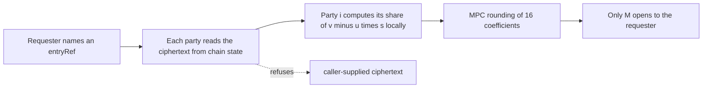

> **Research note — background and rationale only, not normative; the current rules are in docs/ (see decisions.md).**

> Vietnamese version: [pq-mpc-threshold.vi.md](pq-mpc-threshold.vi.md). This English file is the reference version.

# Multi-party computation and threshold cryptography for SCaaS: state of the art (2026-11)

Written 2026-11-06 at the owner's request. Research only: nothing here is a rule, and nothing is scheduled by it except
where an owner ruling is quoted (§6). Everything cryptographic in SCaaS is **UNAUDITED**, and so is every scheme below.
Zether (classical ElGamal) and PQZ (MLWE) are separate systems and are treated separately throughout.

**Evidence tags.** [paper] peer-reviewed publication; [to appear] accepted, published version not yet out; [preprint]
ePrint or arXiv, not peer-reviewed; [NIST preview] a talk or preview document for the NIST threshold call; [vendor] a
claim by the authors' company or a press release; [repo] read from this repository; [inference] our reasoning;
[estimate] our arithmetic on paper; [unverified] could not be checked. Sources: §10.

## 1. At a glance

| Topic | State of the art | Evidence | Fits SCaaS today? | Recommendation |
|---|---|---|---|---|
| MuSig2 / FROST (classical) | Kinds `0x0110`–`0x0113`; ua-rs sessions on `ua-rs-sign` | [repo] | yes, built kinds | keep |
| MPC-ECDSA (GG20, CGGMP21) | Deployed widely; many implementation breaks 2023–2025 | [paper] [vendor] | yes: native key or `0x0101` | allow via T16 external key, no work |
| Threshold ML-DSA, FIPS 204 output | Quorus (USENIX 2026); masked-Lagrange preprint | [to appear] [preprint] | yes: verifies as `0x0130`/`0x0131`/`0x0134` | watch; T16 once mature |
| Ringtail, threshold Raccoon, Tanuki | Two-round lattice threshold, own signature format | [paper] [NIST preview] | no: new kind + verifier | not before NIST or the market chooses |
| Threshold Falcon | MPC Gaussian sampling, CCS 2026 | [to appear] | maybe `0x0132`/`0x0135` [unverified] | watch |
| HAWK / Kettle | Threshold HAWK, ePrint 2026/2288 | [preprint] | no: no HAWK kind | watch |
| SLH-DSA by generic MPC | Millions of gates per signature; impossibility for malicious majority | [preprint] [NIST preview] | output fits `0x0133`, cost does not | no |
| Zether threshold decryption | Threshold ElGamal, mature; owner rule CTR-ZTH-41 | [paper] [repo] | yes, off chain, no contract change | build with CTR-ZTH-29 when scheduled |
| Zether threshold spending | Distributed Σ-Bullets prover | [paper] [inference] | research | no |
| PQZ threshold decryption, smudging | Needs `q` ≥ 2^78 … 2^138 at `n2304-kmax4096` | [estimate] | **no** (§4.2) | no parameter change |
| PQZ threshold decryption, MPC rounding | Noise removed by MPC rounding (CCS 2025) | [paper] | yes in principle, off chain | the only viable route; research |
| PQZ threshold spending | Distributed LNP22 / Ligero prover | [inference] | research, far off | no |
| UA KEM key (ML-KEM-1024 + X25519) | Threshold ML-KEM via MPC, 290 rounds; threshold X25519 easy | [preprint] | no need: MD-11 seals per member | no |
| msig-held PQZ account | One operator holds view + prove key | [repo] | risk accepted, mitigated by (A) | (A) accepted, (B) rejected (owner 2026-11-06) |
| Standards | NIST IR 8214C threshold call, packages ≥ 2027-03-01 | [paper] | — | watch |
| **Overall** | | | | **no work now; watch** |

## 2. Terms

- **Threshold (t-of-n).** A key is split among n parties; any t can use it, fewer learn nothing. **n-of-n** (MuSig2) is
  the special case t = n.
- **DKG.** Distributed key generation: no party ever holds the whole key. The alternative is a **dealer** that generates
  the key and splits it, then deletes it.
- **MPC.** Secure multi-party computation: parties compute a function of their shares and learn only its output.
- **On-chain msig vs threshold key.** SCaaS's `msig` `0x0120` checks m signatures on chain (the quorum is public, the gas
  grows with m). A threshold key yields **one** ordinary signature under **one** public key; the chain cannot tell it from
  a single signer.

## 3. Signatures

### 3.1 Classical, already in SCaaS

| Kind | Name | Scheme | On chain |
|---|---|---|---|
| `0x0110` | `musig2-secp256k1` | BIP-327 MuSig2, n-of-n, 2 ≤ n ≤ 16 | KeyAgg recomputed at registration; one BIP-340 signature by `x(Q)` |
| `0x0111` | `frost-secp256k1` | RFC 9591 FROST(secp256k1, SHA-256), 2 ≤ t ≤ n ≤ 16 | DKG proofs of knowledge and `Y = Σ C_i0` at registration; one signature by `Y` |
| `0x0112` | `musig2-bn254` | MuSig2 port to bn254 | one scaas Schnorr by `Q` |
| `0x0113` | `frost-bn254` | FROST(bn254, keccak256), SCaaS ciphersuite | one FROST signature, verifies as `schnorr-bn254` |

Source: [accounts.md kind table](../contracts/accounts.md) [repo]. In ua-rs, branch `ua-rs-sign` task T3c (`b149726b`) built
`Musig2Session` (the secret nonce lives in the wallet's arena and is wiped by the first sign; a second sign is refused) and
`FrostSession` (round 1 / round 2 over the caller's `KeyPackage`, nonces used once); `frost.rs` runs the RFC 9591 DKG of ZF
`frost-core` (`dkg`, `Dkg::sign`, every participant simulated in one process for the fixtures); `musig2.rs` is checked
against the official BIP-327 vectors [repo]. These are classical: they are not PQZ holders and count as non-PQ weight
inside an `msig` ([CTR-PQZ-12](../contracts/pq-zero-knowledge.md#CTR-PQZ-12)).

### 3.2 MPC-ECDSA

GG18 / GG20 ([ePrint 2020/540](https://eprint.iacr.org/2020/540)) and CGGMP21
([ePrint 2021/060](https://eprint.iacr.org/2021/060)) are the protocols most custody vendors run [paper]. Their history
is a warning: BitForge (Fireblocks, 2023) and TSSHOCK (Verichains, 2023) extracted full keys from GG18 / GG20 / CGGMP21
implementations that skipped or weakened Paillier zero-knowledge proofs [vendor]
([Threshold Network](https://www.threshold.network/blog/bitforge-and-tsshock),
[Verichains](https://www.verichains.io/tsshock/)); further CGGMP21 issues were disclosed and fixed in 2025
([Dfns](https://dfns.co/article/cggmp21-vulnerabilities-patched-and-explained)) [vendor]. The `cggmp21` Rust crate notes
that the paper defines only the n-of-n protocol and its t-of-n variant is the implementers' extension
([docs.rs](https://docs.rs/cggmp21)) [vendor].

**Fit.** The output is a plain ECDSA signature, so MPC-ECDSA works **today** with no SCaaS change: as a native secp256k1
EOA, or as a `0x0101` `p256` UA (ECDSA-P256-SHA256, low-s) where the MPC library supports P-256 [inference]. On the client,
ua-rs plan task T16 (branch `ua-rs-sign`, MD-13) makes the `Signer` trait public as phase 2's external-key interface; an
MPC wallet is one more implementation of it [repo]. It is classical: no PQ weight, no PQZ holder.

### 3.3 Post-quantum threshold signatures

The hard part for lattice signatures is rejection sampling (ML-DSA) or Gaussian sampling (Falcon) on a shared secret, and
the size of Lagrange coefficients, which break the norm bounds the verifier checks
([arXiv 2601.20917](https://arxiv.org/abs/2601.20917)) [preprint].

| Scheme | Output | Model and cost | Evidence | SCaaS kind |
|---|---|---|---|---|
| **Quorus** (J.P. Morgan; [ePrint 2025/1163](https://eprint.iacr.org/2025/1163)) | standard ML-DSA signature and key, all levels | MPC, honest majority, offline preprocessing, any number of parties; online ≈ 100–150 KB per party per rejection round (the ePrint and USENIX abstracts differ) | [to appear] USENIX Security 2026 ([USENIX](https://www.usenix.org/conference/usenixsecurity26/presentation/bienstock)); [NIST preview] ([PW01](https://csrc.nist.gov/csrc/media/Projects/threshold-cryptography/documents/TCall-1/Quorus-PW01.pdf)) | `0x0130` / `0x0131` / `0x0134`, unchanged |
| **Masked Lagrange** (Kao, [arXiv 2601.20917](https://arxiv.org/abs/2601.20917)) | FIPS 204 signature, ≈ 3.3 KB at ML-DSA-65 | pairwise-cancelling masks hide the Lagrange coefficients; claims MSIS reduction in the ROM; success rate and round counts differ across v1–v5 | [preprint], single author, unreviewed | same |
| **Ringtail** ([ePrint 2024/1113](https://eprint.iacr.org/2024/1113)) | own lattice signature | two rounds, one online; LWE | [paper] IEEE S&P 2025; NTT WAN proof of concept, 8 countries (May 2025, [NTT](https://group.ntt/en/newsrelease/2025/05/12/250512a.html)) [vendor] | none: new kind + verifier |
| **Threshold Raccoon** ([ePrint 2024/184](https://eprint.iacr.org/2024/184)) | Raccoon signature ≈ 13 KiB | up to 1024 signers, ≈ 40 KiB per user | [paper] Eurocrypt 2024; Raccoon left NIST's extra-signature process after round 1 ([NIST round 2 list](https://csrc.nist.gov/projects/pqc-dig-sig/standardization)) | none |
| **Tanuki** | own format, EKT24 + Ringtail code | preview | [NIST preview] ([MPTS 2026](https://csrc.nist.gov/Presentations/2026/mpts2026-3b2)) | none |
| **Threshold Falcon** ([ePrint 2026/1300](https://eprint.iacr.org/2026/1300)) | "unmodified Falcon verifier" | MPC discrete Gaussian with private centre, Klein sampler over authenticated VOLE; 73 bits of fixed-point precision; dishonest and honest majority benchmarks | [to appear] ACM CCS 2026; ATMACA (Mitaka + ANTRAG, < 180 online rounds per attempt) [NIST preview] ([TCPT3](https://csrc.nist.gov/Presentations/2026/tcpt3-2a1)) | `0x0132` / `0x0135` only if the output matches the round-3 v1.2 encoding with SHAKE256 hash-to-point SCaaS verifies [unverified] |
| **Kettle** (HAWK; [ePrint 2026/2288](https://eprint.iacr.org/2026/2288)) | specification-compliant HAWK signature, the shortest lattice threshold signature claimed | UC-secure, any number of parties, as few as 2 online rounds | [preprint]; [NIST preview] ([TCPT3](https://csrc.nist.gov/Presentations/2026/tcpt3-2a2)); HAWK itself is still a candidate and saw 2026 key-recovery work ([ePrint 2026/1298](https://eprint.iacr.org/2026/1298)) | none: no HAWK kind |
| **SLH-DSA by generic MPC** | standard SLH-DSA | SHA-2 / SHAKE inside MPC: "several million gates" per signature ([ePrint 2026/2194](https://eprint.iacr.org/2026/2194.pdf)); no oracle-respecting protocol secure against a malicious majority exists for any hash-based signature ([MPTS 2026, Kondi–Kumar–Vanegas](https://csrc.nist.gov/presentations/2026/mpts2026-4b4)); threshold-FHE route ([ePrint 2026/2360](https://eprint.iacr.org/2026/2360)) | [preprint] [NIST preview] | `0x0133` verifies it, but signing cost rules it out |

**What verifies with no contract change.** A FIPS 204-compatible threshold ML-DSA key is an ordinary ML-DSA key: it
registers as `mldsa44` / `mldsa65` / `mldsa87`, signs `pq_msg` with an empty context, verifies through `UAMldsaVerifier`,
and can even be a PQZ holder as a single-key UA [inference from [CTR-PQZ-12](../contracts/pq-zero-knowledge.md#CTR-PQZ-12)].
Threshold Falcon may verify as `fndsa512` / `fndsa1024` if its output is byte-compatible [unverified]. SLH-DSA would
verify as `slhdsa128s`. Everything else (Ringtail, Raccoon, Tanuki, HAWK / Kettle) needs a new kind, a new verifier and a
registry generation that enables it ([CTR-UA-13](../contracts/accounts.md#CTR-UA-13): records are immutable, kinds are
added by deploy).

**Today's alternative** is the on-chain `msig` `0x0120`: a t-of-n of ML-DSA members already works and is PQ-eligible
([CTR-PQZ-12](../contracts/pq-zero-knowledge.md#CTR-PQZ-12)); it costs m signature checks and shows the quorum, which a
threshold key would hide.

## 4. Encryption and decryption of balances

### 4.1 Zether (lifted ElGamal on bn254 / BLS12-381 G1)

**Threshold decryption is mature** [paper]. A balance `(C, D)` decrypts as `C · D^{-x} = g^b`; with `x` Shamir-shared each
party returns `D^{x_i}` with a DLEQ proof, the combiner multiplies by Lagrange coefficients in the exponent, and the existing
BSGS step recovers `b`. No noise, no parameter issue. Penumbra specified the same pattern ("flow encryption": threshold
ElGamal on decaf377, a FROST-style DKG run by validators per epoch) but did not ship it in V1
([Penumbra flow encryption](https://protocol.penumbra.zone/main/crypto/flow.html),
[threshold encryption](https://protocol.penumbra.zone/main/crypto/flow-encryption/threshold-encryption.html),
[DKG](https://protocol.penumbra.zone/main/crypto/flow-encryption/dkg.html)) [vendor].

SCaaS already has the rule: **the Zether auditor key should be a k-of-n threshold key** split off chain by a DKG, no
contract change, the prover / CLI protocol following with the disclosure CLI
([CTR-ZTH-41](../contracts/zether.md#CTR-ZTH-41), [CTR-ZTH-29](../contracts/zether.md#CTR-ZTH-29), PLANNED) [repo].
[CLI-SGN-32](../clients/signers-clientkeys.md#CLI-SGN-32) names a 3-of-5 threshold ElGamal `y_audit` and a Shamir 2-of-3
`x` for B2B Zether, PLANNED [repo]. An `AUDITOR` opening is a Σ-proof in `x_a`; making it threshold is a threshold Schnorr
pattern (shared nonces, one response per party) [inference].

**Threshold spending** needs the Σ-Bullets proof to be produced over a shared `x`. The general tool is a collaborative
proof: Ozdemir and Boneh lift Groth16, Plonk, Marlin and Fractal to N provers at about single-prover cost for a malicious
minority ([USENIX Security 2022](https://www.usenix.org/conference/usenixsecurity22/presentation/ozdemir),
[ePrint 2021/1530](https://eprint.iacr.org/2021/1530)) [paper]; none covers Bulletproofs. The key-oracle interface of
[CLI-SGN-31](../clients/signers-clientkeys.md#CLI-SGN-31) already narrows what touches `x` to `zk_mul_by_x`,
`zk_nonce_commit` and `zk_response`; a threshold version of those three calls is a narrower problem than a general
collaborative prover [inference, not built]. Research either way. **Classical security only**: a quantum adversary
reading stored ciphertexts later breaks it whatever the sharing.

### 4.2 PQZ (MLWE): threshold decryption and the noise budget

**How it would work.** A PQZ ciphertext decrypts as `v − uᵀs = Δ·M + e` on 16 coefficients, then `M_i = round(w_i / Δ)`
([decryption](../contracts/pq-zero-knowledge.md#CTR-PQZ-16)) [repo]. Decryption is linear in `s`: with `s` shared
(`s = Σ λ_i s_i`), party i returns `d_i = λ_i·uᵀs_i (+ smudging noise E_i)` and the combiner rounds `v − Σ d_i`. Without
`E_i` the combiner learns the exact noise `e`, and an attacker who built the ciphertext (and so knows `r`, `e1`, `e2`)
learns linear equations in `s` — the IND-CPA^D failure mode the PQZ doc already cites
([Li–Micciancio](https://eprint.iacr.org/2020/1533)). Classic fix: each party floods its share with noise much larger than
`e` ([Boneh et al., CRYPTO 2018](https://eprint.iacr.org/2017/956)) [paper].

**Inputs at `n2304-kmax4096`** [repo] (`smartcontracts/evm/src/pqz/PqzSet.sol`,
`pqz-core/params/sets/n2304-kmax4096/set.toml` and `SET.md`, [noise](../contracts/pq-zero-knowledge.md#noise)):

| Item | Value |
|---|---|
| `q` | 61,275,424,977,257 ≈ 2^45.80 |
| `Δ` | ⌊q / 2^18⌋ = 233,747,196 ≈ 2^27.80; rounding is correct while \|noise\| < Δ/2 = 116,873,598 ≈ 2^26.80 |
| Plaintext | 16 digits base 16; digit sums `M_i` < 2^16 at `K_MAX` 4,096 (this fixes q/Δ = 2^18) |
| Fresh ciphertext noise | `B_FRESH` = 13,212 ≈ 2^13.69 (proven norms β_s 38, β_e 173, β_2 64) |
| Worst accumulated noise | 4,095 · B_FRESH = 54,103,140 ≈ 2^25.69 (the plain term has noise 0); debit proof range E = 2^26 |
| Headroom for smudging | fresh: Δ/2 − B_FRESH ≈ 2^26.80; accumulated: Δ/2 − 54,103,140 = 62,770,458 ≈ 2^25.90 |

**Arithmetic** [estimate]. Uniform smudging in `[−B_sm, B_sm]` hides a shift of at most `B` per coefficient up to
statistical distance ≈ `B / B_sm`; over `N = 16·Q` coefficients (Q decryptions under one key) an honest party needs
`B_sm ≥ 16·Q·B·2^κ`. Correctness needs `B + t·B_sm < Δ/2` (t partial shares, each smudged). With t = 3:

| Ciphertext | κ | Q | B_sm | B + 3·B_sm | over Δ/2 by | q needed (q/Δ = 2^18 kept) |
|---|---|---|---|---|---|---|
| fresh (auditor copy, credit) | 40 | 1 | 2^57.7 | 2^59.3 | 2^32.5 | ≥ 2^78.3 |
| fresh | 40 | 2^20 | 2^77.7 | 2^79.3 | 2^52.5 | ≥ 2^98.3 |
| fresh | 80 | 1 | 2^97.7 | 2^99.3 | 2^72.5 | ≥ 2^118.3 |
| fresh | 80 | 2^20 | 2^117.7 | 2^119.3 | 2^92.5 | ≥ 2^138.3 |
| accumulated balance | 40 | 1 | 2^69.7 | 2^71.3 | 2^44.5 | ≥ 2^90.3 |
| accumulated balance | 80 | 2^20 | 2^129.7 | 2^131.3 | 2^104.5 | ≥ 2^150.3 |

t = 2 or 5 moves these by under 1.5 bits. A short Python script reproduced the table (kept in a private scratchpad, not
committed; it asserts Δ = ⌊q/2^18⌋ and 4,095·13,212 = 54,103,140).

**Result: statistical smudging does not fit.** Even one decryption at 2^-40 needs smudging of 2^57.7, above `q` itself
(2^45.8); no choice of `Δ` inside this `q` can absorb it. To fit, `q` would have to grow to roughly 2^78 (κ = 40, one
decryption) up to 2^138 (κ = 80, 2^20 decryptions), keeping q/Δ = 2^18. No existing set comes close (the largest `q` is
`n2816-kmax65536`'s 2^54), the set-generic cores assume `PQZ_LOG2Q ≤ 55` in 64-bit arithmetic (a core rewrite, not a
parameter edit), and MLWE hardness at constant error needs `n` to grow about in proportion to log q — roughly
n ≈ 4,000–7,000 for the same β ≥ 450 [inference, not run through the lattice estimator], with keys, ciphertexts, proofs and
gas growing with it, a new `proofSystemId`, new vectors and a full gate. **Any such change is the owner's; this note does
not propose one.**

**Two routes that need no parameter change.**

1. **Remove the noise instead of flooding it: MPC rounding.** The parties compute `round((v − uᵀs)/Δ)` inside MPC and
   open only `M`. Zyskind, Zarchy, Leibovich and Peikert do this for threshold FHE decryption, UC-secure, with abort against
   a dishonest majority or guaranteed output with an honest majority ([ePrint 2025/1781](https://eprint.iacr.org/2025/1781),
   ACM CCS 2025) [paper]; Ajax ([ePrint 2025/1834](https://eprint.iacr.org/2025/1834), USENIX Security 2026) [to appear]
   and Damgård–Kolby–Orlandi–Pawlak ([ePrint 2026/1058](https://eprint.iacr.org/2026/1058)) [preprint] cut the cost
   further. For PQZ this is a strong fit [inference]: every accepted ciphertext has proven worst-case noise below Δ/2, so
   `M` is exact and a deterministic function of the plaintext and reveals nothing else; it is 16 roundings of a 46-bit
   value per decryption.
2. **Smaller, Gaussian flooding** analysed by Rényi divergence or by Gaussian simulation
   ([Micciancio–Suhl, ePrint 2023/1728](https://eprint.iacr.org/2023/1728); [Boudgoust–Scholl, ePrint 2023/016](https://eprint.iacr.org/2023/016),
   Asiacrypt 2023) [preprint] [paper]. Our arithmetic [estimate]: Gaussian smudging with `s = B·√(2π·16·Q)` (Rényi
   divergence of order 2 ≤ e) fits a fresh ciphertext for t = 3 up to Q ≈ 2^12 decryptions per key (`B + 13σ√3` ≈ 2^26.2
   < 2^26.8) and never fits an accumulated balance (2^32.2 at Q = 1). Two caveats keep this as research: an attack on the
   Boudgoust–Scholl construction was published ([Passelègue–Stehlé, ePrint 2024/1984](https://eprint.iacr.org/2024/1984),
   Asiacrypt 2024) [paper], and the Gaussian-noise analysis assumes honest noise, whereas a PQZ sender may pick its
   encryption noise anywhere inside the proven norm bounds [inference].

A viewing service can keep `B = B_FRESH` by decrypting entries one by one (credits, auditor copies, the fresh `v_f` after
each debit) instead of the accumulated `acc` [inference]; the ciphertexts stay in contract state, so they are always
available ([CTR-PQZ-14](../contracts/pq-zero-knowledge.md#CTR-PQZ-14)) [repo].

**Decryption is off chain**: if the MPC-rounding route is used, no contract and no parameter change follows. Two
conditions:

- **Key setup.** `R_REG` proves `‖s‖ ≤ 38`; a DKG whose parties each add a short secret gives a longer `s` that fails it,
  so a DKG with a registration proof needs MPC sampling plus a distributed `R_REG` prover (research). The practical setup is
  a dealer: the auditor generates and registers its key, splits `s` (or its `seed32`), and deletes it [inference].
- **Decrypt only on-chain state.** The service must refuse caller-supplied ciphertexts: a crafted `(u, v)` with noise
  outside the proven range turns rounding into a key-recovery oracle. This is the PQZ twin of the `ChainWitness` rule of
  [CLI-SGN-31](../clients/signers-clientkeys.md#CLI-SGN-31) [inference].

A threshold `AUDITOR` or `RECEIVER_X` **opening** is an LNP22 proof with `s` as witness, so it needs a distributed prover
(§4.3), not just threshold decryption [repo].

### 4.3 PQZ threshold spending

Every debit carries an LNP22 proof (PQZL) or a Ligero proof (PQZH) whose witness includes `s_f`
([R_TX rows](../contracts/pq-zero-knowledge.md#CTR-PQZ-26)) [repo]. Spending from a shared key means producing that proof
over a shared witness: rejection sampling and norm proofs inside MPC, which is the same obstacle threshold ML-DSA faces,
on a proof 30–80 KB large instead of a 3 KB signature. We found no published distributed prover for LNP22 or for Ligero
[unverified]; Ozdemir–Boneh-style collaborative proving covers pairing and IOP SNARKs, not these. **Research, far off.**

### 4.4 The UA KEM key (ML-KEM-1024 + X25519)

The UA KEM key seals and backs up (X-Wing-style combiner, `kemPk = 0x01 ‖ ek ‖ pk`, 1,601 B,
[CTR-UA-32](../contracts/accounts.md#CTR-UA-32)) [repo].

- **Threshold ML-KEM.** Ta, Liu, Chau and Wang (CSIRO) run ML-KEM decapsulation in MPC; Scheme A keeps ML-KEM's keys,
  encapsulation and ciphertexts and needs 145 / 218 / 290 rounds at ML-KEM-512 / -768 / -1024; Scheme B (35 rounds) is not
  ML-KEM-compatible; the MPC is semi-honest ([ePrint 2026/2220](https://eprint.iacr.org/2026/2220)) [preprint].
- **Threshold X25519.** Shared scalar, partial `[x_i]P`, Lagrange in the exponent; the combination needs full point
  addition rather than the x-only ladder, and RFC 7748 clamping must be reconciled with shared scalars
  ([draft-hallambaker-threshold](https://datatracker.ietf.org/doc/html/draft-hallambaker-threshold)) [preprint, expired
  individual draft] [inference].
- **The combiner** hashes both shared secrets, so whoever finishes decapsulation learns the seal key — inherent to opening
  a seal [inference].

SCaaS does not need it: an `msig` has no KEM key and seals go to each accepted member's own key (MD-11 on `ua-rs-sign`;
CTR-UA-32 change in round 3c) [repo].

## 5. What SCaaS has instead today

**Zether.** Per token, `auditorMode ∈ {NONE, FULL, OPTIONAL}`, immutable
([CTR-ZTH-49](../contracts/zether.md#CTR-ZTH-49)); audited legs carry `C_aud_j = [v_j]G + [t_j]Y_a` with per-leg
randomness; four opening kinds `SENDER_S`, `RECEIVER_X`, `AUDITOR`, `SENDER_CP` ([CTR-ZTH-40](../contracts/zether.md#CTR-ZTH-40))
in the stateless `ZetherDisclosure` ([CTR-ZTH-43](../contracts/zether.md#CTR-ZTH-43)); the auditor key should be k-of-n
([CTR-ZTH-41](../contracts/zether.md#CTR-ZTH-41)). Clients derive a Zether confidential key `…/7` and a viewing key path
`…/8` ([signers-clientkeys.md](../clients/signers-clientkeys.md#CLI-SGN-10)) [repo].

**PQZ.** `auditorMode` as classical with an `auditorUA` whose PQZ key decrypts auditor copies, each leg at its own
coefficient window ([CTR-PQZ-24](../contracts/pq-zero-knowledge.md#CTR-PQZ-24),
[CTR-PQZ-26](../contracts/pq-zero-knowledge.md#CTR-PQZ-26)); disclosure only by zero-knowledge proof, never by revealing
randomness or noise: `SENDER_S`, `RECEIVER_X`, `AUDITOR` ([CTR-PQZ-14](../contracts/pq-zero-knowledge.md#CTR-PQZ-14)). There
is no separate PQZ viewing key: the PQZ key both decrypts and proves [repo].

**msig authorization over a confidential account.** A PQ-dominant `msig` may hold a PQZ key; "the PQZ key decrypts and
proves, the signer's key authorizes", and for an `msig` holder the PQZ key is "one view / prove key held by an operator,
every spend needs the m-of-n" ([CTR-PQZ-12](../contracts/pq-zero-knowledge.md#CTR-PQZ-12)) [repo]. So the quorum controls
spending; the key holder can see the balance and must build every proof. Viewing is the single point left — and, as §6
shows, so is liveness. A Zether key is a SIGNING UA (`zether-bls12381`) and not an `msig` member
([zether.md](../contracts/zether.md)) [repo].

## 6. msig-held PQZ accounts: the operator model, its risks, mitigations

The owner raised this on 2026-11-06.

**Current design** [repo]. [CTR-PQZ-12](../contracts/pq-zero-knowledge.md#CTR-PQZ-12): for an `msig` holder the PQZ key
is "one view / prove key held by an operator, every spend needs the m-of-n". The operator's `seed32` is derived in its
key worker from its own BIP-39 seed and sealed as a 32-byte PQZ leaf
([CTR-PQZ-13](../contracts/pq-zero-knowledge.md#CTR-PQZ-13), `signers-clientkeys.md` on `ua-rs-sign`).

**Risks.**

1. **One person sees everything.** The operator decrypts the whole balance and its history (every credit, every debit's
   new balance) [repo].
2. **Loss of the seed or the operator strands the balance for ever.** Every debit (transfer, burn, refresh) proves
   `pk_f = A·s_f + e_f` and decrypts `T` with `s_f` (R_TX rows 1 and 6), so no spend exists without the key. The registry
   keeps "at most one PQZ key per UA per chain, written once": a second `setPqzKey` reverts `UAPqzKeySet`, and the only
   exception (ruling R-cross-set) replaces an **unproven** key whose length is not this chain's set — never a proven key of
   this set ([CTR-UA-16](../contracts/accounts.md#CTR-UA-16)) [repo]. A UA has no key rotation
   ([CTR-UA-13](../contracts/accounts.md#CTR-UA-13)). **What is possible today:** nothing on chain; the funds are
   recoverable only if the operator's `seed32` (or the BIP-39 seed it derives from) survives somewhere, such as the
   operator's own vault backup.
3. **Changing the operator needs the old operator.** Rotation is "a new UA + moving the funds"
   ([CTR-UA-13](../contracts/accounts.md#CTR-UA-13)); the move is a confidential transfer or a burn, each proved with the
   old `s_f`. An operator who refuses, or simply stops, freezes the balance: the m-of-n can authorize but nobody can prove.

**Mitigations.**

| | Mitigation | Fixes | Cost | Where | Status |
|---|---|---|---|---|---|
| (A) | k-of-n backup of the operator's PQZ `seed32` | risks 2 and 3 (the quorum can rebuild the key) | client code: Shamir split / join of 32 bytes (not in ua-rs today), one sealed container per member; no contract change | `ua-rs` (branch `ua-rs-sign`), clientkeys | **accepted** (owner 2026-11-06), built after T16 |
| (B) | PQZ key rotation for an `msig` holder | none without the old key | registry (`UAPqzKeySet` rule), PQZ tokens (balance under the old key), a registry generation | contracts | **rejected** (owner 2026-11-06) |
| (C) | threshold decryption (§4.2) | risk 1 only for a view-only key | MPC service, off chain | research | research |
| (D) | threshold proving (§4.3) | risks 1–3: no operator at all | distributed LNP22 / Ligero prover | research | research, far off |

**(A) — owner ruling 2026-11-06: accepted; built in `ua-rs-sign` after T16.** The client rule: **an `msig` PQZ holder must
have a k-of-n seed backup.** Recommended shape:

- **Share the PQZ `seed32` only**, never the operator's whole wallet entropy: the T9 backup payload carries the BIP-39
  entropy, which would hand the members the operator's other keys. A dedicated account index for the `msig`'s PQZ key keeps
  the operator's own keys apart [inference].
- **Seal each share to the member's own single-key UA KEM key** with ua-rs's sealed container (T8 `seal` / container JSON,
  T9 backup; branch `ua-rs-sign`). An `msig` has no KEM key (MD-11), so the shares go to the members' single-key UAs, never
  to the `msig` [repo].
- **Reconstruction makes the reconstructor the new operator**, who then sees the balance and history. k colluding members
  can do the same; the backup does not reduce risk 1, it removes risks 2 and 3.
- Suggested defaults [inference]: k = the `msig` threshold, n = its accepted members; the client builds the backup before it
  signs `register` / `setPqzKey` for an `msig` holder. A membership change is a new UA anyway
  ([CTR-UA-13](../contracts/accounts.md#CTR-UA-13)), so shares never need re-dealing for the same key.

**(B) — owner ruling 2026-11-06: rejected.** A rotation still needs the old operator's key to migrate the balance: a
refresh or self-transfer under the old key proves with the old `s_f`, and no on-chain path can move a PQZ balance without a
proof by its key (that is the soundness of PQZ, not a gap). So it does not help when the operator will not cooperate, and
when the operator cooperates, moving the funds to a new UA already works today. It would also have touched the registry's
`UAPqzKeySet` rule in the 3c registry generation (`requirePortable`); that is not pursued.

**(C)** removes the single viewer only for a key that never proves, such as a PQZ auditor key; an `msig` operator still
needs `s` to prove, so threshold decryption alone does not remove risk 1 there [inference]. **(D)** would remove the operator
altogether and is research (§4.3).

## 7. Standards

- **NIST IR 8214C**, *First Call for Multi-Party Threshold Schemes*, final January 2026
  ([NIST](https://www.nist.gov/publications/nist-first-call-multi-party-threshold-schemes),
  [PDF](https://nvlpubs.nist.gov/nistpubs/ir/2026/NIST.IR.8214C.pdf)) [paper]. It gathers "a public body of reference
  materials" that "will inform the development of future NIST recommendations": a call, not a competition with winners
  [paper, our reading of §1]. **Class N** = NIST-specified primitives: N1 signing (EdDSA, ECDSA, ML-DSA, SLH-DSA; FN-DSA
  once standardized), N2 PKE (ML-KEM decrypt among them), N3 symmetric, N4 key generation. **Class S** = special primitives:
  S1 signing, S2 PKE, S3 symmetric, S4 key generation, S5 FHE, S6 ZKPoK, S7 gadgets.
- **Schedule** ([TCall-1](https://csrc.nist.gov/projects/threshold-cryptography/tcall-1)): previews at MPTS 2026
  (January), TCPT2 (July 7–8, 2026) and TCPT3 (September 30 and October 6, 7, 13, 2026); optional preliminary packages
  December 1–31, 2026; package deadline "expected to be set to 2027-Mar-01 (it will not be before)", confirmed after TCPT3.
  `pq-fhe.md` (2026-10-18) quoted an earlier expected date; the page has moved since.
- **Previews relevant here:** Quorus (threshold ML-DSA), Tanuki (lattice two-round), Kettle (HAWK), ATMACA (Falcon),
  Kondi–Kumar–Vanegas (hash-based impossibility), Zama (TFHE threshold decryption,
  [PW01](https://csrc.nist.gov/csrc/media/Projects/threshold-cryptography/documents/TCall-1/Zama-PW01.pdf)).
- **Classical:** FROST is [RFC 9591](https://www.rfc-editor.org/rfc/rfc9591) and MuSig2 is
  [BIP-327](https://github.com/bitcoin/bips/blob/master/bip-0327.mediawiki); threshold ECDSA has no IETF or NIST standard.

**What to watch.** (1) Packages for N1 ML-DSA and N2 ML-KEM in 2027: a FIPS-compatible threshold ML-DSA with a public,
reviewed implementation is the trigger for §8 option 4. (2) Whether NIST follows the call with a recommendation (an SP)
for threshold ML-DSA. (3) Falcon / FN-DSA: FIPS 206 status and whether threshold Falcon output matches SCaaS's verifier.
(4) MPC-rounding threshold decryption libraries (the CCS 2025 line) for a PQZ viewing service. (5) Cryptanalysis of HAWK
and of lattice threshold schemes. (6) Any distributed prover for LNP22 or Ligero.

## 8. Options for SCaaS

| # | Option | Cost | Where | Recommendation |
|---|---|---|---|---|
| 1 | Off-chain threshold viewing service for PQZ (auditor keys) | statistical smudging does not fit (§4.2); MPC rounding: a 3-party honest-majority MPC, dealer key setup, an on-chain-state-only rule; weeks of client / service work plus review; no contract change | a separate service, never the node ([CLI-SGN-31](../clients/signers-clientkeys.md#CLI-SGN-31) rule) | not now; MPC-rounding route if a customer needs it |
| 2 | Threshold Zether viewing (auditor) | small: threshold ElGamal + DLEQ; already an owner rule ([CTR-ZTH-41](../contracts/zether.md#CTR-ZTH-41)) | prover / CLI ([CTR-ZTH-29](../contracts/zether.md#CTR-ZTH-29)) | build with CTR-ZTH-29 when it is scheduled |
| 3 | MPC-ECDSA through the T16 external-key interface | none in SCaaS beyond T16; vendor risk sits with the wallet | client (`Signer` implementations) | allow; document "use a CGGMP21-family implementation with the 2023–2025 fixes" |
| 4 | FIPS-compatible threshold ML-DSA through T16 | none on chain (verifies as `0x0130`/`0x0131`/`0x0134`); a vendor or open-source MPC signer | client | once a reviewed implementation exists (watch 2027 packages) |
| 5 | New kinds for Ringtail, threshold Raccoon, Tanuki, Kettle | a verifier per kind, gas and size work, a registry generation, every family | contracts | only after NIST or the market chooses |
| 6 | Threshold UA KEM | 290-round MPC per decapsulation | client | no: MD-11 sealing per member covers groups |
| 7 | Threshold PQZ or Zether spending | research-level provers | — | no |

**Overall recommendation: no work now; watch.** The one accepted item is the `msig` seed backup (§6 (A)), a client rule.

## 9. Open questions for the owner

1. **PQZ threshold viewing (option 1).** Build a viewing service for PQZ auditor keys? *Recommendation:* no now; if a
   customer asks, use MPC rounding (no parameter change) after the NIST packages of 2027, never statistical smudging.
2. **Parameter change for smudging.** Statistical smudging would need `q` ≈ 2^78–2^138 and a new set. *Recommendation:* no;
   keep `n2304-kmax4096`. (Any parameter change is the owner's.)
3. **Zether threshold auditor (CTR-ZTH-41).** When does the prover / CLI protocol land? *Recommendation:* with CTR-ZTH-29 in
   the client rounds after the freeze; no contract change.
4. **Threshold ML-DSA via T16.** Accept a FIPS 204-compatible MPC signer as a phase-2 external key once one is published
   and reviewed? *Recommendation:* yes; no SCaaS code beyond T16.
5. **New threshold kinds.** Add Ringtail / Raccoon / Tanuki / Kettle kinds? *Recommendation:* no until NIST or the market
   chooses.
6. **MPC-ECDSA guidance.** State in the client docs that MPC-ECDSA works as a native key, a `0x0101` UA or an external key,
   with the implementation warning? *Recommendation:* yes, one line when the external-key docs are written.
7. **Threshold UA KEM.** *Recommendation:* no; per-member sealing (MD-11) stays.
8. **`msig` PQZ seed backup (A) — answered: accepted (owner 2026-11-06), built in `ua-rs-sign` after T16.** Remaining detail:
   should the client refuse to build `register` / `setPqzKey` for an `msig` PQZ holder until the k-of-n backup containers
   exist, with k = the `msig` threshold and n = its accepted members by default? *Recommendation:* yes; share `seed32` only,
   seal each share to a member's own single-key UA KEM key; the reconstructor becomes the new operator.
9. **PQZ key rotation for an `msig` holder (B) — answered: rejected (owner 2026-11-06)**: the balance migration still needs
   the old operator's key. Nothing to decide.
10. **Review cadence.** Re-read this note after the NIST package deadline (≥ 2027-03-01)? *Recommendation:* yes, one update
    then.

## 10. Sources

Repository [repo]: [accounts.md](../contracts/accounts.md) (kind table, CTR-UA-13, CTR-UA-16, CTR-UA-32),
[pq-zero-knowledge.md](../contracts/pq-zero-knowledge.md) (CTR-PQZ-12/13/14/16/24/26, §4.3 noise),
[zether.md](../contracts/zether.md) (CTR-ZTH-29/40/41/43/49), [signers-clientkeys.md](../clients/signers-clientkeys.md)
(CLI-SGN-31/32), `smartcontracts/evm/src/pqz/PqzSet.sol`, `pqz-core/params/sets/n2304-kmax4096/{set.toml,SET.md}`, branch
`ua-rs-sign` (`clients/ua-rs/src/{musig2,frost}.rs`, commit `b149726b`, plan `docs/superpowers/plans/2026-11-05-ua-rs-sign.md`
MD-11, MD-13, T8, T9, T16), [pq-fhe.md](pq-fhe.md).

Signatures:
- Quorus: https://eprint.iacr.org/2025/1163 ; https://www.usenix.org/conference/usenixsecurity26/presentation/bienstock ;
  https://csrc.nist.gov/csrc/media/Projects/threshold-cryptography/documents/TCall-1/Quorus-PW01.pdf ;
  https://csrc.nist.gov/presentations/2026/mpts2026-3b6
- Masked Lagrange threshold ML-DSA: https://arxiv.org/abs/2601.20917
- Ringtail: https://eprint.iacr.org/2024/1113 ; NTT: https://group.ntt/en/newsrelease/2025/05/12/250512a.html
- Threshold Raccoon: https://eprint.iacr.org/2024/184 ; NIST round 2 list:
  https://csrc.nist.gov/projects/pqc-dig-sig/standardization
- Tanuki: https://csrc.nist.gov/Presentations/2026/mpts2026-3b2 ;
  https://csrc.nist.gov/csrc/media/Projects/threshold-cryptography/documents/TCall-1/Tanuki-PW01.pdf
- Threshold Falcon: https://eprint.iacr.org/2026/1300 ; ATMACA: https://csrc.nist.gov/Presentations/2026/tcpt3-2a1
- Kettle: https://eprint.iacr.org/2026/2288 ; https://csrc.nist.gov/Presentations/2026/tcpt3-2a2 ; HAWK weak keys:
  https://eprint.iacr.org/2026/1298
- SLH-DSA in MPC: https://eprint.iacr.org/2026/2194.pdf (title not confirmed) ;
  https://csrc.nist.gov/presentations/2026/mpts2026-4b4 ; https://eprint.iacr.org/2026/2360
- MPC-ECDSA: https://eprint.iacr.org/2020/540 ; https://eprint.iacr.org/2021/060 ;
  https://www.threshold.network/blog/bitforge-and-tsshock ; https://www.verichains.io/tsshock/ ;
  https://dfns.co/article/cggmp21-vulnerabilities-patched-and-explained ; https://docs.rs/cggmp21
- FROST: https://www.rfc-editor.org/rfc/rfc9591 ; MuSig2: https://github.com/bitcoin/bips/blob/master/bip-0327.mediawiki

Encryption:
- Penumbra flow encryption: https://protocol.penumbra.zone/main/crypto/flow.html ;
  https://protocol.penumbra.zone/main/crypto/flow-encryption/threshold-encryption.html ;
  https://protocol.penumbra.zone/main/crypto/flow-encryption/dkg.html
- Collaborative zk-SNARKs: https://www.usenix.org/conference/usenixsecurity22/presentation/ozdemir ;
  https://eprint.iacr.org/2021/1530
- Noise flooding: https://eprint.iacr.org/2017/956 ; IND-CPA^D: https://eprint.iacr.org/2020/1533
- MPC rounding: https://eprint.iacr.org/2025/1781 ; https://eprint.iacr.org/2025/1834 ; https://eprint.iacr.org/2026/1058
- Polynomial-modulus flooding: https://eprint.iacr.org/2023/1728 ; https://eprint.iacr.org/2023/016 ; attack:
  https://eprint.iacr.org/2024/1984
- Threshold ML-KEM: https://eprint.iacr.org/2026/2220 ; threshold X25519 draft:
  https://datatracker.ietf.org/doc/html/draft-hallambaker-threshold

Standards:
- NIST IR 8214C: https://www.nist.gov/publications/nist-first-call-multi-party-threshold-schemes ;
  https://nvlpubs.nist.gov/nistpubs/ir/2026/NIST.IR.8214C.pdf ; https://csrc.nist.gov/projects/threshold-cryptography/tcall-1 ;
  https://csrc.nist.gov/News/2026/nist-and-multi-party-threshold-schemes
- Zama preview: https://csrc.nist.gov/csrc/media/Projects/threshold-cryptography/documents/TCall-1/Zama-PW01.pdf

Not verified: the exact verifier compatibility of threshold Falcon output with SCaaS's round-3 v1.2 / SHAKE256
hash-to-point encoding; the title of ePrint 2026/2194; whether any distributed LNP22 or Ligero prover exists; the n range
quoted for a larger `q` (not run through the lattice estimator).
