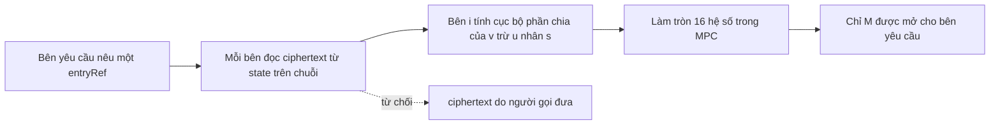

> **Research note — background and rationale only, not normative; the current rules are in docs/ (see decisions.md).**

> **Ghi chú nghiên cứu — chỉ là bối cảnh và lý do, không mang tính quy phạm; các quy tắc hiện hành nằm trong docs/ (xem decisions.md).**

> Bản tiếng Việt là bản phụ, ngoại lệ theo phán quyết của chủ dự án (owner, 2026-11-06) đối với quy tắc "docs bằng tiếng Anh" của AGENTS.md. Bản tham chiếu là bản tiếng Anh: [pq-mpc-threshold.md](pq-mpc-threshold.md); khi hai bản khác nhau, bản tiếng Anh được ưu tiên.

# Tính toán đa bên và mật mã ngưỡng cho SCaaS: hiện trạng kỹ thuật (2026-11)

Viết ngày 2026-11-06 theo yêu cầu của chủ dự án. Chỉ là nghiên cứu: không có gì ở đây là quy tắc, và ghi chú này không
xếp lịch việc gì, trừ chỗ trích phán quyết của chủ dự án (§6). Mọi thứ mật mã trong SCaaS đều **UNAUDITED**, và mọi lược đồ
dưới đây cũng vậy. Zether (ElGamal cổ điển) và PQZ (MLWE) là hai hệ riêng biệt và được xét riêng trong suốt ghi chú.

**Nghiên cứu sâu hơn (2026-11-06).** Hai phân tích chuyên sâu tiếp theo bản khảo sát này và làm rõ ba dòng của §1. **PQZ:**
[pqz-threshold-decrypt-prove.vi.md](pqz-threshold-decrypt-prove.vi.md) §12. Làm tròn MPC mô phỏng bằng `pqz_dec` trên các
vectors đóng băng ở cả bốn bộ, và một oracle làm tròn trên bản mã do người gọi đưa vào khôi phục `s` sau 8·K truy vấn. Bộ chứng
minh LNP22 phân tán đã có chi phí: trực tuyến vừa, mặt nạ Gauss ngoại tuyến khoảng 0.35 GB mỗi bên mỗi bằng chứng, và trở ngại
là chứng minh an toàn cho việc mở lần thử bị hủy. **Zether:** [zether-threshold-mpc.vi.md](zether-threshold-mpc.vi.md) §5.10.
Một bằng chứng chuyển chung 3-of-5 qua được verifier native thật, nên dòng "Zether chi tiêu ngưỡng: nghiên cứu" ở §1 không còn
đúng: nó khả thi mà không đổi hợp đồng. Tất cả đều UNAUDITED.

**Nhãn bằng chứng.** [paper] công bố có bình duyệt; [to appear] đã được nhận đăng, bản chính thức chưa ra; [preprint]
ePrint hoặc arXiv, chưa bình duyệt; [NIST preview] bài nói hoặc tài liệu preview cho lời kêu gọi ngưỡng của NIST; [vendor]
tuyên bố của công ty tác giả hoặc thông cáo báo chí; [repo] đọc từ kho mã này; [inference] suy luận của chúng tôi;
[estimate] tính toán trên giấy của chúng tôi; [unverified] không kiểm chứng được. Nguồn: §10.

## 1. Tóm tắt nhanh

| Chủ đề | Hiện trạng kỹ thuật | Bằng chứng | Hợp với SCaaS hôm nay? | Khuyến nghị |
|---|---|---|---|---|
| MuSig2 / FROST (cổ điển) | Các kind `0x0110`–`0x0113`; phiên ua-rs trên `ua-rs-sign` | [repo] | có, kind đã có | giữ nguyên |
| MPC-ECDSA (GG20, CGGMP21) | Triển khai rộng; nhiều lỗi triển khai 2023–2025 | [paper] [vendor] | có: khóa native hoặc `0x0101` | cho phép qua khóa ngoài T16, không làm gì thêm |
| ML-DSA ngưỡng, đầu ra FIPS 204 | Quorus (USENIX 2026); preprint masked-Lagrange | [to appear] [preprint] | có: xác minh như `0x0130`/`0x0131`/`0x0134` | theo dõi; T16 khi chín muồi |
| Ringtail, Raccoon ngưỡng, Tanuki | Ngưỡng lattice hai vòng, định dạng chữ ký riêng | [paper] [NIST preview] | không: kind + verifier mới | không trước khi NIST hoặc thị trường chọn |
| Falcon ngưỡng | Lấy mẫu Gauss trong MPC, CCS 2026 | [to appear] | có thể `0x0132`/`0x0135` [unverified] | theo dõi |
| HAWK / Kettle | HAWK ngưỡng, ePrint 2026/2288 | [preprint] | không: không có kind HAWK | theo dõi |
| SLH-DSA bằng MPC tổng quát | Hàng triệu cổng mỗi chữ ký; bất khả cho đa số ác ý | [preprint] [NIST preview] | đầu ra hợp `0x0133`, chi phí thì không | không |
| Giải mã ngưỡng Zether | ElGamal ngưỡng, chín muồi; quy tắc chủ dự án CTR-ZTH-41 | [paper] [repo] | có, ngoài chuỗi, không đổi hợp đồng | xây cùng CTR-ZTH-29 khi được xếp lịch |
| Chi tiêu ngưỡng Zether | Prover Σ-Bullets phân tán | [paper] [inference] | nghiên cứu | không |
| Giải mã ngưỡng PQZ, smudging | Cần `q` ≥ 2^78 … 2^138 tại `n2304-kmax4096` | [estimate] | **không** (§4.2) | không đổi tham số |
| Giải mã ngưỡng PQZ, làm tròn MPC | Khử nhiễu bằng làm tròn trong MPC (CCS 2025) | [paper] | về nguyên tắc có, ngoài chuỗi | con đường khả thi duy nhất; nghiên cứu |
| Chi tiêu ngưỡng PQZ | Prover LNP22 / Ligero phân tán | [inference] | nghiên cứu, còn xa | không |
| Khóa KEM của UA (ML-KEM-1024 + X25519) | ML-KEM ngưỡng qua MPC, 290 vòng; X25519 ngưỡng dễ | [preprint] | không cần: MD-11 niêm phong cho từng thành viên | không |
| Tài khoản PQZ do msig nắm | Một operator giữ khóa xem + chứng minh | [repo] | rủi ro được chấp nhận, giảm nhẹ bằng (A) | (A) chấp nhận, (B) bác bỏ (owner 2026-11-06) |
| Tiêu chuẩn | Lời kêu gọi ngưỡng NIST IR 8214C, gói nộp ≥ 2027-03-01 | [paper] | — | theo dõi |
| **Tổng thể** | | | | **chưa làm gì; theo dõi** |

## 2. Thuật ngữ

- **Ngưỡng (t-of-n).** Một khóa được chia cho n bên; bất kỳ t bên nào cũng dùng được, ít hơn thì không biết gì. **n-of-n**
  (MuSig2) là trường hợp riêng t = n.
- **DKG.** Sinh khóa phân tán: không bên nào từng giữ cả khóa. Cách thay thế là một **dealer** sinh khóa rồi chia, rồi xóa.
- **MPC.** Tính toán đa bên an toàn: các bên tính một hàm trên phần chia của mình và chỉ biết đầu ra.
- **msig trên chuỗi và khóa ngưỡng.** `msig` `0x0120` của SCaaS kiểm m chữ ký trên chuỗi (quorum công khai, gas tăng theo
  m). Khóa ngưỡng cho ra **một** chữ ký bình thường dưới **một** khóa công khai; chuỗi không phân biệt được với một người ký.

## 3. Chữ ký

### 3.1 Cổ điển, đã có trong SCaaS

| Kind | Tên | Lược đồ | Trên chuỗi |
|---|---|---|---|
| `0x0110` | `musig2-secp256k1` | BIP-327 MuSig2, n-of-n, 2 ≤ n ≤ 16 | KeyAgg tính lại khi đăng ký; một chữ ký BIP-340 bởi `x(Q)` |
| `0x0111` | `frost-secp256k1` | RFC 9591 FROST(secp256k1, SHA-256), 2 ≤ t ≤ n ≤ 16 | chứng minh tri thức DKG và `Y = Σ C_i0` khi đăng ký; một chữ ký bởi `Y` |
| `0x0112` | `musig2-bn254` | MuSig2 chuyển sang bn254 | một scaas Schnorr bởi `Q` |
| `0x0113` | `frost-bn254` | FROST(bn254, keccak256), ciphersuite SCaaS | một chữ ký FROST, xác minh như `schnorr-bn254` |

Nguồn: [bảng kind của accounts.md](../contracts/accounts.md) [repo]. Trong ua-rs, task T3c của nhánh `ua-rs-sign` (`b149726b`)
xây `Musig2Session` (nonce bí mật nằm trong arena của ví và bị xóa ở lần ký đầu; lần ký thứ hai bị từ chối) và
`FrostSession` (vòng 1 / vòng 2 trên `KeyPackage` của người gọi, nonce dùng một lần); `frost.rs` chạy DKG RFC 9591 của ZF
`frost-core` (`dkg`, `Dkg::sign`, mọi bên được mô phỏng trong một tiến trình cho fixture); `musig2.rs` được kiểm theo bộ
vector BIP-327 chính thức [repo]. Đây là cổ điển: không phải holder PQZ và được tính là trọng số phi-PQ trong một `msig`
([CTR-PQZ-12](../contracts/pq-zero-knowledge.md#CTR-PQZ-12)).

### 3.2 MPC-ECDSA

GG18 / GG20 ([ePrint 2020/540](https://eprint.iacr.org/2020/540)) và CGGMP21
([ePrint 2021/060](https://eprint.iacr.org/2021/060)) là các giao thức mà phần lớn nhà cung cấp lưu ký chạy [paper]. Lịch sử
của chúng là một lời cảnh báo: BitForge (Fireblocks, 2023) và TSSHOCK (Verichains, 2023) rút được toàn bộ khóa từ các bản
triển khai GG18 / GG20 / CGGMP21 bỏ qua hoặc làm yếu chứng minh không tiết lộ Paillier [vendor]
([Threshold Network](https://www.threshold.network/blog/bitforge-and-tsshock),
[Verichains](https://www.verichains.io/tsshock/)); thêm các lỗi CGGMP21 được công bố và sửa năm 2025
([Dfns](https://dfns.co/article/cggmp21-vulnerabilities-patched-and-explained)) [vendor]. Crate Rust `cggmp21` ghi rằng bài
báo chỉ định nghĩa giao thức n-of-n và biến thể t-of-n là phần mở rộng của người triển khai
([docs.rs](https://docs.rs/cggmp21)) [vendor].

**Mức phù hợp.** Đầu ra là chữ ký ECDSA thường, nên MPC-ECDSA chạy **ngay hôm nay** mà SCaaS không phải đổi gì: như một EOA
secp256k1 native, hoặc như một UA `0x0101` `p256` (ECDSA-P256-SHA256, low-s) khi thư viện MPC hỗ trợ P-256 [inference]. Ở
phía client, task T16 của kế hoạch ua-rs (nhánh `ua-rs-sign`, MD-13) công khai trait `Signer` làm giao diện khóa ngoài của
giai đoạn 2; một ví MPC là thêm một triển khai của nó [repo]. Đây là cổ điển: không có trọng số PQ, không phải holder PQZ.

### 3.3 Chữ ký ngưỡng hậu lượng tử

Phần khó với chữ ký lattice là rejection sampling (ML-DSA) hoặc lấy mẫu Gauss (Falcon) trên bí mật được chia, và độ lớn
của hệ số Lagrange, phá vỡ các cận chuẩn mà verifier kiểm ([arXiv 2601.20917](https://arxiv.org/abs/2601.20917)) [preprint].

| Lược đồ | Đầu ra | Mô hình và chi phí | Bằng chứng | Kind SCaaS |
|---|---|---|---|---|
| **Quorus** (J.P. Morgan; [ePrint 2025/1163](https://eprint.iacr.org/2025/1163)) | chữ ký và khóa ML-DSA chuẩn, mọi mức | MPC, đa số trung thực, tiền xử lý offline, số bên tùy ý; online ≈ 100–150 KB mỗi bên mỗi vòng rejection (tóm tắt ePrint và USENIX khác nhau) | [to appear] USENIX Security 2026 ([USENIX](https://www.usenix.org/conference/usenixsecurity26/presentation/bienstock)); [NIST preview] ([PW01](https://csrc.nist.gov/csrc/media/Projects/threshold-cryptography/documents/TCall-1/Quorus-PW01.pdf)) | `0x0130` / `0x0131` / `0x0134`, không đổi |
| **Masked Lagrange** (Kao, [arXiv 2601.20917](https://arxiv.org/abs/2601.20917)) | chữ ký FIPS 204, ≈ 3,3 KB ở ML-DSA-65 | mặt nạ triệt tiêu theo cặp che hệ số Lagrange; tuyên bố quy về MSIS trong ROM; tỷ lệ thành công và số vòng khác nhau giữa v1–v5 | [preprint], một tác giả, chưa bình duyệt | như trên |
| **Ringtail** ([ePrint 2024/1113](https://eprint.iacr.org/2024/1113)) | chữ ký lattice riêng | hai vòng, một vòng online; LWE | [paper] IEEE S&P 2025; bản thử nghiệm WAN của NTT, 8 quốc gia (tháng 5/2025, [NTT](https://group.ntt/en/newsrelease/2025/05/12/250512a.html)) [vendor] | không có: kind + verifier mới |
| **Raccoon ngưỡng** ([ePrint 2024/184](https://eprint.iacr.org/2024/184)) | chữ ký Raccoon ≈ 13 KiB | tới 1024 người ký, ≈ 40 KiB mỗi người | [paper] Eurocrypt 2024; Raccoon rời quy trình chữ ký bổ sung của NIST sau vòng 1 ([danh sách vòng 2 của NIST](https://csrc.nist.gov/projects/pqc-dig-sig/standardization)) | không có |
| **Tanuki** | định dạng riêng, EKT24 + mã Ringtail | preview | [NIST preview] ([MPTS 2026](https://csrc.nist.gov/Presentations/2026/mpts2026-3b2)) | không có |
| **Falcon ngưỡng** ([ePrint 2026/1300](https://eprint.iacr.org/2026/1300)) | "verifier Falcon không sửa đổi" | Gauss rời rạc trong MPC với tâm bí mật, Klein sampler trên VOLE xác thực; 73 bit độ chính xác dấu phẩy tĩnh; benchmark đa số không trung thực và đa số trung thực | [to appear] ACM CCS 2026; ATMACA (Mitaka + ANTRAG, < 180 vòng online mỗi lần thử) [NIST preview] ([TCPT3](https://csrc.nist.gov/Presentations/2026/tcpt3-2a1)) | `0x0132` / `0x0135` chỉ khi đầu ra khớp mã hóa round-3 v1.2 với hash-to-point SHAKE256 mà SCaaS xác minh [unverified] |
| **Kettle** (HAWK; [ePrint 2026/2288](https://eprint.iacr.org/2026/2288)) | chữ ký HAWK đúng đặc tả, tuyên bố là chữ ký ngưỡng lattice ngắn nhất | an toàn UC, số bên tùy ý, chỉ 2 vòng online | [preprint]; [NIST preview] ([TCPT3](https://csrc.nist.gov/Presentations/2026/tcpt3-2a2)); bản thân HAWK vẫn là ứng viên và có công trình khôi phục khóa năm 2026 ([ePrint 2026/1298](https://eprint.iacr.org/2026/1298)) | không có: không có kind HAWK |
| **SLH-DSA bằng MPC tổng quát** | SLH-DSA chuẩn | SHA-2 / SHAKE trong MPC: "vài triệu cổng" mỗi chữ ký ([ePrint 2026/2194](https://eprint.iacr.org/2026/2194.pdf)); không có giao thức tôn trọng oracle nào an toàn trước đa số ác ý cho bất kỳ chữ ký dựa trên băm nào ([MPTS 2026, Kondi–Kumar–Vanegas](https://csrc.nist.gov/presentations/2026/mpts2026-4b4)); hướng FHE ngưỡng ([ePrint 2026/2360](https://eprint.iacr.org/2026/2360)) | [preprint] [NIST preview] | `0x0133` xác minh được, nhưng chi phí ký loại trừ nó |

**Cái gì xác minh được mà không đổi hợp đồng.** Một khóa ML-DSA ngưỡng tương thích FIPS 204 là một khóa ML-DSA bình thường:
nó đăng ký như `mldsa44` / `mldsa65` / `mldsa87`, ký `pq_msg` với ngữ cảnh rỗng, xác minh qua `UAMldsaVerifier`, và thậm chí
có thể là holder PQZ như một UA đơn khóa [inference từ [CTR-PQZ-12](../contracts/pq-zero-knowledge.md#CTR-PQZ-12)]. Falcon
ngưỡng có thể xác minh như `fndsa512` / `fndsa1024` nếu đầu ra tương thích từng byte [unverified]. SLH-DSA sẽ xác minh như
`slhdsa128s`. Mọi thứ còn lại (Ringtail, Raccoon, Tanuki, HAWK / Kettle) cần kind mới, verifier mới và một thế hệ registry
bật nó lên ([CTR-UA-13](../contracts/accounts.md#CTR-UA-13): bản ghi bất biến, kind được thêm qua deploy).

**Phương án hôm nay** là `msig` `0x0120` trên chuỗi: t-of-n các thành viên ML-DSA đã chạy và đủ điều kiện PQ
([CTR-PQZ-12](../contracts/pq-zero-knowledge.md#CTR-PQZ-12)); nó tốn m lần kiểm chữ ký và lộ quorum, điều mà khóa ngưỡng sẽ
che đi.

## 4. Mã hóa và giải mã số dư

### 4.1 Zether (ElGamal nâng trên bn254 / BLS12-381 G1)

**Giải mã ngưỡng đã chín muồi** [paper]. Một số dư `(C, D)` giải mã thành `C · D^{-x} = g^b`; khi `x` được chia Shamir, mỗi
bên trả `D^{x_i}` kèm chứng minh DLEQ, bên kết hợp nhân hệ số Lagrange ở số mũ, và bước BSGS sẵn có khôi phục `b`. Không
nhiễu, không vấn đề tham số. Penumbra đã đặc tả cùng mô hình ("flow encryption": ElGamal ngưỡng trên decaf377, DKG kiểu
FROST do validator chạy mỗi epoch) nhưng không phát hành trong V1
([Penumbra flow encryption](https://protocol.penumbra.zone/main/crypto/flow.html),
[threshold encryption](https://protocol.penumbra.zone/main/crypto/flow-encryption/threshold-encryption.html),
[DKG](https://protocol.penumbra.zone/main/crypto/flow-encryption/dkg.html)) [vendor].

SCaaS đã có quy tắc: **khóa auditor của Zether nên là khóa ngưỡng k-of-n**, chia ngoài chuỗi bằng DKG, không đổi hợp đồng,
giao thức prover / CLI đi cùng CLI công bố
([CTR-ZTH-41](../contracts/zether.md#CTR-ZTH-41), [CTR-ZTH-29](../contracts/zether.md#CTR-ZTH-29), PLANNED) [repo].
[CLI-SGN-32](../clients/signers-clientkeys.md#CLI-SGN-32) nêu một `y_audit` ElGamal ngưỡng 3-of-5 và một `x` chia Shamir
2-of-3 cho Zether B2B, PLANNED [repo]. Một opening `AUDITOR` là một chứng minh Σ theo `x_a`; làm nó thành ngưỡng là mô hình
Schnorr ngưỡng (nonce chia sẻ, mỗi bên một phản hồi) [inference].

**Chi tiêu ngưỡng** cần tạo chứng minh Σ-Bullets trên một `x` được chia. Công cụ tổng quát là chứng minh cộng tác: Ozdemir
và Boneh nâng Groth16, Plonk, Marlin và Fractal lên N prover với chi phí xấp xỉ một prover khi thiểu số ác ý
([USENIX Security 2022](https://www.usenix.org/conference/usenixsecurity22/presentation/ozdemir),
[ePrint 2021/1530](https://eprint.iacr.org/2021/1530)) [paper]; không cái nào bao Bulletproofs. Giao diện key oracle của
[CLI-SGN-31](../clients/signers-clientkeys.md#CLI-SGN-31) đã thu hẹp phần chạm tới `x` còn `zk_mul_by_x`, `zk_nonce_commit` và
`zk_response`; phiên bản ngưỡng của ba lời gọi đó là bài toán hẹp hơn một prover cộng tác tổng quát [inference, chưa xây].
Đằng nào cũng là nghiên cứu. **Chỉ an toàn cổ điển**: kẻ tấn công lượng tử đọc ciphertext lưu trữ về sau sẽ phá được, dù
chia khóa thế nào.

### 4.2 PQZ (MLWE): giải mã ngưỡng và ngân sách nhiễu

**Cách nó vận hành.** Một ciphertext PQZ giải mã thành `v − uᵀs = Δ·M + e` trên 16 hệ số, rồi `M_i = round(w_i / Δ)`
([giải mã](../contracts/pq-zero-knowledge.md#CTR-PQZ-16)) [repo]. Giải mã tuyến tính theo `s`: khi `s` được chia
(`s = Σ λ_i s_i`), bên i trả `d_i = λ_i·uᵀs_i (+ nhiễu smudging E_i)` và bên kết hợp làm tròn `v − Σ d_i`. Không có `E_i`
thì bên kết hợp biết chính xác nhiễu `e`, và kẻ tấn công đã dựng ciphertext (nên biết `r`, `e1`, `e2`) thu được các phương
trình tuyến tính theo `s` — đúng kiểu thất bại IND-CPA^D mà tài liệu PQZ đã dẫn
([Li–Micciancio](https://eprint.iacr.org/2020/1533)). Cách sửa kinh điển: mỗi bên làm ngập phần chia của mình bằng nhiễu
lớn hơn `e` rất nhiều ([Boneh và cộng sự, CRYPTO 2018](https://eprint.iacr.org/2017/956)) [paper].

**Đầu vào tại `n2304-kmax4096`** [repo] (`smartcontracts/evm/src/pqz/PqzSet.sol`,
`pqz-core/params/sets/n2304-kmax4096/set.toml` và `SET.md`, [noise](../contracts/pq-zero-knowledge.md#noise)):

| Mục | Giá trị |
|---|---|
| `q` | 61.275.424.977.257 ≈ 2^45,80 |
| `Δ` | ⌊q / 2^18⌋ = 233.747.196 ≈ 2^27,80; làm tròn đúng khi \|nhiễu\| < Δ/2 = 116.873.598 ≈ 2^26,80 |
| Bản rõ | 16 chữ số cơ số 16; tổng chữ số `M_i` < 2^16 tại `K_MAX` 4.096 (điều này cố định q/Δ = 2^18) |
| Nhiễu ciphertext mới | `B_FRESH` = 13.212 ≈ 2^13,69 (chuẩn đã chứng minh β_s 38, β_e 173, β_2 64) |
| Nhiễu tích lũy xấu nhất | 4.095 · B_FRESH = 54.103.140 ≈ 2^25,69 (số hạng rõ có nhiễu 0); khoảng của chứng minh debit E = 2^26 |
| Dư địa cho smudging | mới: Δ/2 − B_FRESH ≈ 2^26,80; tích lũy: Δ/2 − 54.103.140 = 62.770.458 ≈ 2^25,90 |

**Tính toán** [estimate]. Smudging đều trong `[−B_sm, B_sm]` che một dịch chuyển tối đa `B` mỗi hệ số tới khoảng cách thống
kê ≈ `B / B_sm`; trên `N = 16·Q` hệ số (Q lần giải mã dưới một khóa), một bên trung thực cần `B_sm ≥ 16·Q·B·2^κ`. Tính đúng
cần `B + t·B_sm < Δ/2` (t phần giải mã, mỗi phần đều được smudge). Với t = 3:

| Ciphertext | κ | Q | B_sm | B + 3·B_sm | vượt Δ/2 | q cần (giữ q/Δ = 2^18) |
|---|---|---|---|---|---|---|
| mới (bản auditor, credit) | 40 | 1 | 2^57,7 | 2^59,3 | 2^32,5 | ≥ 2^78,3 |
| mới | 40 | 2^20 | 2^77,7 | 2^79,3 | 2^52,5 | ≥ 2^98,3 |
| mới | 80 | 1 | 2^97,7 | 2^99,3 | 2^72,5 | ≥ 2^118,3 |
| mới | 80 | 2^20 | 2^117,7 | 2^119,3 | 2^92,5 | ≥ 2^138,3 |
| số dư tích lũy | 40 | 1 | 2^69,7 | 2^71,3 | 2^44,5 | ≥ 2^90,3 |
| số dư tích lũy | 80 | 2^20 | 2^129,7 | 2^131,3 | 2^104,5 | ≥ 2^150,3 |

t = 2 hoặc 5 dịch các số này dưới 1,5 bit. Một script Python ngắn đã tái tạo bảng (giữ trong scratchpad riêng, không
commit; nó assert Δ = ⌊q/2^18⌋ và 4.095·13.212 = 54.103.140).

**Kết quả: smudging thống kê không vừa.** Chỉ một lần giải mã ở 2^-40 đã cần smudging 2^57,7, lớn hơn cả `q` (2^45,8);
không lựa chọn `Δ` nào trong `q` này hấp thụ được. Để vừa, `q` phải tăng tới khoảng 2^78 (κ = 40, một lần giải mã) đến
2^138 (κ = 80, 2^20 lần giải mã), giữ q/Δ = 2^18. Không bộ tham số nào hiện có đến gần (`q` lớn nhất là 2^54 của
`n2816-kmax65536`), các core tổng quát theo bộ giả định `PQZ_LOG2Q ≤ 55` trong số học 64 bit (phải viết lại core, không chỉ
sửa tham số), và độ khó MLWE với nhiễu không đổi đòi `n` tăng xấp xỉ tỉ lệ với log q — đại khái n ≈ 4.000–7.000 cho cùng
β ≥ 450 [inference, chưa chạy lattice estimator], kéo theo khóa, ciphertext, chứng minh và gas tăng, một `proofSystemId`
mới, vector mới và một full gate. **Mọi thay đổi như vậy là của chủ dự án; ghi chú này không đề xuất thay đổi nào.**

**Hai con đường không cần đổi tham số.**

1. **Khử nhiễu thay vì làm ngập: làm tròn trong MPC.** Các bên tính `round((v − uᵀs)/Δ)` bên trong MPC và chỉ mở `M`.
   Zyskind, Zarchy, Leibovich và Peikert làm việc này cho giải mã FHE ngưỡng, an toàn UC, có abort trước đa số không trung
   thực hoặc đảm bảo đầu ra với đa số trung thực ([ePrint 2025/1781](https://eprint.iacr.org/2025/1781), ACM CCS 2025)
   [paper]; Ajax ([ePrint 2025/1834](https://eprint.iacr.org/2025/1834), USENIX Security 2026) [to appear] và
   Damgård–Kolby–Orlandi–Pawlak ([ePrint 2026/1058](https://eprint.iacr.org/2026/1058)) [preprint] giảm chi phí thêm. Với
   PQZ đây là lựa chọn rất hợp [inference]: mọi ciphertext được chấp nhận có nhiễu xấu nhất đã chứng minh dưới Δ/2, nên `M`
   chính xác, là hàm tất định của bản rõ và không tiết lộ gì khác; mỗi lần giải mã là 16 phép làm tròn một giá trị 46 bit.
2. **Làm ngập Gauss nhỏ hơn**, phân tích bằng phân kỳ Rényi hoặc mô phỏng Gauss
   ([Micciancio–Suhl, ePrint 2023/1728](https://eprint.iacr.org/2023/1728); [Boudgoust–Scholl, ePrint 2023/016](https://eprint.iacr.org/2023/016),
   Asiacrypt 2023) [preprint] [paper]. Tính toán của chúng tôi [estimate]: smudging Gauss với `s = B·√(2π·16·Q)` (phân kỳ
   Rényi bậc 2 ≤ e) vừa cho một ciphertext mới với t = 3 tới Q ≈ 2^12 lần giải mã mỗi khóa (`B + 13σ√3` ≈ 2^26,2
   < 2^26,8) và không bao giờ vừa cho số dư tích lũy (2^32,2 ở Q = 1). Hai lưu ý giữ nó ở mức nghiên cứu: một tấn công vào
   cấu trúc Boudgoust–Scholl đã được công bố ([Passelègue–Stehlé, ePrint 2024/1984](https://eprint.iacr.org/2024/1984),
   Asiacrypt 2024) [paper], và phân tích nhiễu Gauss giả định nhiễu trung thực, trong khi người gửi PQZ có thể chọn nhiễu mã
   hóa ở bất cứ đâu trong cận chuẩn đã chứng minh [inference].

Một dịch vụ xem có thể giữ `B = B_FRESH` bằng cách giải mã từng mục (credit, bản auditor, `v_f` mới sau mỗi debit) thay vì
`acc` tích lũy [inference]; ciphertext nằm trong state hợp đồng nên luôn sẵn có
([CTR-PQZ-14](../contracts/pq-zero-knowledge.md#CTR-PQZ-14)) [repo].

**Giải mã diễn ra ngoài chuỗi**: nếu dùng con đường làm tròn MPC, không có thay đổi hợp đồng hay tham số nào. Hai điều kiện:

- **Thiết lập khóa.** `R_REG` chứng minh `‖s‖ ≤ 38`; một DKG mà mỗi bên cộng một bí mật ngắn cho ra `s` dài hơn và trượt
  chứng minh này, nên DKG có chứng minh đăng ký cần lấy mẫu trong MPC cộng một prover `R_REG` phân tán (nghiên cứu). Thiết
  lập thực tế là dealer: auditor sinh và đăng ký khóa, chia `s` (hoặc `seed32` của nó), rồi xóa [inference].
- **Chỉ giải mã state trên chuỗi.** Dịch vụ phải từ chối ciphertext do người gọi đưa: một `(u, v)` dựng sẵn với nhiễu ngoài
  khoảng đã chứng minh biến phép làm tròn thành oracle khôi phục khóa. Đây là bản PQZ của quy tắc `ChainWitness` trong
  [CLI-SGN-31](../clients/signers-clientkeys.md#CLI-SGN-31) [inference].

Một **opening** `AUDITOR` hoặc `RECEIVER_X` theo ngưỡng là một chứng minh LNP22 với `s` làm witness, nên nó cần prover phân
tán (§4.3), không chỉ giải mã ngưỡng [repo].

### 4.3 Chi tiêu ngưỡng PQZ

Mỗi debit mang một chứng minh LNP22 (PQZL) hoặc Ligero (PQZH) có witness gồm `s_f`
([các dòng R_TX](../contracts/pq-zero-knowledge.md#CTR-PQZ-26)) [repo]. Chi tiêu từ khóa được chia nghĩa là tạo chứng minh
đó trên witness được chia: rejection sampling và chứng minh chuẩn trong MPC, đúng trở ngại mà ML-DSA ngưỡng gặp, nhưng trên
một chứng minh 30–80 KB thay vì chữ ký 3 KB. Chúng tôi không tìm thấy prover phân tán nào đã công bố cho LNP22 hay Ligero
[unverified]; chứng minh cộng tác kiểu Ozdemir–Boneh bao SNARK pairing và IOP, không bao các hệ này. **Nghiên cứu, còn xa.**

### 4.4 Khóa KEM của UA (ML-KEM-1024 + X25519)

Khóa KEM của UA dùng để niêm phong và sao lưu (bộ kết hợp kiểu X-Wing, `kemPk = 0x01 ‖ ek ‖ pk`, 1.601 B,
[CTR-UA-32](../contracts/accounts.md#CTR-UA-32)) [repo].

- **ML-KEM ngưỡng.** Ta, Liu, Chau và Wang (CSIRO) chạy decapsulation ML-KEM trong MPC; Scheme A giữ nguyên khóa,
  encapsulation và ciphertext của ML-KEM và cần 145 / 218 / 290 vòng ở ML-KEM-512 / -768 / -1024; Scheme B (35 vòng) không
  tương thích ML-KEM; MPC ở mô hình bán trung thực ([ePrint 2026/2220](https://eprint.iacr.org/2026/2220)) [preprint].
- **X25519 ngưỡng.** Vô hướng được chia, phần `[x_i]P`, Lagrange ở số mũ; phép kết hợp cần cộng điểm đầy đủ thay cho
  ladder chỉ-x, và việc clamping của RFC 7748 phải được dung hòa với vô hướng chia sẻ
  ([draft-hallambaker-threshold](https://datatracker.ietf.org/doc/html/draft-hallambaker-threshold)) [preprint, bản nháp cá
  nhân đã hết hạn] [inference].
- **Bộ kết hợp** băm cả hai bí mật chung, nên ai hoàn tất decapsulation sẽ biết khóa niêm phong — vốn có của việc mở một
  niêm phong [inference].

SCaaS không cần nó: một `msig` không có khóa KEM và niêm phong đi tới khóa riêng của từng thành viên đã chấp nhận (MD-11 trên
`ua-rs-sign`; thay đổi CTR-UA-32 trong vòng 3c) [repo].

## 5. Những gì SCaaS có thay thế hôm nay

**Zether.** Mỗi token có `auditorMode ∈ {NONE, FULL, OPTIONAL}`, bất biến
([CTR-ZTH-49](../contracts/zether.md#CTR-ZTH-49)); chân được kiểm toán mang `C_aud_j = [v_j]G + [t_j]Y_a` với ngẫu nhiên
riêng từng chân; bốn loại opening `SENDER_S`, `RECEIVER_X`, `AUDITOR`, `SENDER_CP`
([CTR-ZTH-40](../contracts/zether.md#CTR-ZTH-40)) trong `ZetherDisclosure` không trạng thái
([CTR-ZTH-43](../contracts/zether.md#CTR-ZTH-43)); khóa auditor nên là k-of-n ([CTR-ZTH-41](../contracts/zether.md#CTR-ZTH-41)).
Client dẫn xuất khóa bảo mật Zether `…/7` và đường dẫn khóa xem `…/8`
([signers-clientkeys.md](../clients/signers-clientkeys.md#CLI-SGN-10)) [repo].

**PQZ.** `auditorMode` như cổ điển với một `auditorUA` có khóa PQZ giải mã các bản auditor, mỗi chân ở cửa sổ hệ số riêng
([CTR-PQZ-24](../contracts/pq-zero-knowledge.md#CTR-PQZ-24),
[CTR-PQZ-26](../contracts/pq-zero-knowledge.md#CTR-PQZ-26)); công bố chỉ bằng chứng minh không tiết lộ, không bao giờ bằng
cách lộ ngẫu nhiên hay nhiễu: `SENDER_S`, `RECEIVER_X`, `AUDITOR` ([CTR-PQZ-14](../contracts/pq-zero-knowledge.md#CTR-PQZ-14)).
Không có khóa xem PQZ riêng: khóa PQZ vừa giải mã vừa chứng minh [repo].

**Ủy quyền msig trên tài khoản bảo mật.** Một `msig` thiên PQ có thể giữ khóa PQZ; "the PQZ key decrypts and proves, the
signer's key authorizes", và với holder `msig` thì khóa PQZ là "one view / prove key held by an operator, every spend needs
the m-of-n" ([CTR-PQZ-12](../contracts/pq-zero-knowledge.md#CTR-PQZ-12)) [repo]. Vậy quorum kiểm soát chi tiêu; người giữ khóa
thấy được số dư và phải dựng mọi chứng minh. Xem là điểm đơn còn lại — và như §6 cho thấy, tính sẵn sàng cũng vậy. Khóa
Zether là một SIGNING UA (`zether-bls12381`) và không phải thành viên `msig` ([zether.md](../contracts/zether.md)) [repo].

## 6. Tài khoản PQZ do msig nắm: mô hình operator, rủi ro, giảm nhẹ

Chủ dự án nêu vấn đề này ngày 2026-11-06.

**Thiết kế hiện tại** [repo]. [CTR-PQZ-12](../contracts/pq-zero-knowledge.md#CTR-PQZ-12): với holder `msig`, khóa PQZ là "one
view / prove key held by an operator, every spend needs the m-of-n". `seed32` của operator được dẫn xuất trong key worker
của nó từ BIP-39 seed riêng và niêm phong thành một lá PQZ 32 byte
([CTR-PQZ-13](../contracts/pq-zero-knowledge.md#CTR-PQZ-13), `signers-clientkeys.md` trên `ua-rs-sign`).

**Rủi ro.**

1. **Một người thấy tất cả.** Operator giải mã toàn bộ số dư và lịch sử (mọi credit, số dư mới sau mỗi debit) [repo].
2. **Mất seed hoặc mất operator làm số dư kẹt vĩnh viễn.** Mọi debit (transfer, burn, refresh) chứng minh
   `pk_f = A·s_f + e_f` và giải mã `T` bằng `s_f` (dòng 1 và 6 của R_TX), nên không có chi tiêu nào thiếu khóa. Registry giữ
   "at most one PQZ key per UA per chain, written once": `setPqzKey` lần hai revert `UAPqzKeySet`, và ngoại lệ duy nhất
   (phán quyết R-cross-set) chỉ thay một khóa **chưa chứng minh** có độ dài không thuộc bộ của chuỗi này — không bao giờ
   một khóa đã chứng minh của bộ này ([CTR-UA-16](../contracts/accounts.md#CTR-UA-16)) [repo]. UA không có xoay khóa
   ([CTR-UA-13](../contracts/accounts.md#CTR-UA-13)). **Điều có thể làm hôm nay:** không gì trên chuỗi; tiền chỉ cứu được
   nếu `seed32` của operator (hoặc BIP-39 seed sinh ra nó) còn ở đâu đó, chẳng hạn bản sao lưu vault của chính operator.
3. **Đổi operator cần operator cũ.** Xoay là "một UA mới + chuyển tiền"
   ([CTR-UA-13](../contracts/accounts.md#CTR-UA-13)); việc chuyển là một confidential transfer hoặc một burn, mỗi cái chứng
   minh bằng `s_f` cũ. Một operator từ chối, hoặc chỉ đơn giản ngừng làm, sẽ đóng băng số dư: m-of-n ủy quyền được nhưng không
   ai chứng minh được.

**Giảm nhẹ.**

| | Giảm nhẹ | Khắc phục | Chi phí | Ở đâu | Trạng thái |
|---|---|---|---|---|---|
| (A) | sao lưu k-of-n `seed32` PQZ của operator | rủi ro 2 và 3 (quorum dựng lại được khóa) | mã client: chia / ghép Shamir 32 byte (chưa có trong ua-rs), một container niêm phong mỗi thành viên; không đổi hợp đồng | `ua-rs` (nhánh `ua-rs-sign`), clientkeys | **chấp nhận** (owner 2026-11-06), xây sau T16 |
| (B) | xoay khóa PQZ cho holder `msig` | không gì nếu thiếu khóa cũ | registry (quy tắc `UAPqzKeySet`), token PQZ (số dư dưới khóa cũ), một thế hệ registry | hợp đồng | **bác bỏ** (owner 2026-11-06) |
| (C) | giải mã ngưỡng (§4.2) | rủi ro 1 chỉ với khóa chỉ-xem | dịch vụ MPC, ngoài chuỗi | nghiên cứu | nghiên cứu |
| (D) | chứng minh ngưỡng (§4.3) | rủi ro 1–3: không còn operator | prover LNP22 / Ligero phân tán | nghiên cứu | nghiên cứu, còn xa |

**(A) — phán quyết của chủ dự án 2026-11-06: chấp nhận; xây trong `ua-rs-sign` sau T16.** Quy tắc client: **một holder PQZ
`msig` phải có bản sao lưu seed k-of-n.** Hình thức khuyến nghị:

- **Chỉ chia `seed32` PQZ**, không bao giờ chia toàn bộ entropy ví của operator: payload sao lưu T9 mang entropy BIP-39, thứ
  sẽ trao cho các thành viên những khóa khác của operator. Một chỉ số account riêng cho khóa PQZ của `msig` giữ các khóa
  riêng của operator tách biệt [inference].
- **Niêm phong mỗi phần chia tới khóa KEM của UA đơn khóa riêng của thành viên** bằng container niêm phong của ua-rs (T8
  `seal` / container JSON, T9 sao lưu; nhánh `ua-rs-sign`). `msig` không có khóa KEM (MD-11), nên phần chia đi tới UA đơn khóa
  của các thành viên, không bao giờ tới `msig` [repo].
- **Việc dựng lại biến người dựng lại thành operator mới**, người đó khi ấy thấy số dư và lịch sử. k thành viên thông đồng
  cũng làm được như vậy; bản sao lưu không giảm rủi ro 1, nó loại bỏ rủi ro 2 và 3.
- Mặc định gợi ý [inference]: k = ngưỡng của `msig`, n = các thành viên đã chấp nhận; client dựng bản sao lưu trước khi ký
  `register` / `setPqzKey` cho holder `msig`. Thay đổi thành viên dù sao cũng là một UA mới
  ([CTR-UA-13](../contracts/accounts.md#CTR-UA-13)), nên phần chia không bao giờ phải chia lại cho cùng một khóa.

**(B) — phán quyết của chủ dự án 2026-11-06: bác bỏ.** Việc xoay vẫn cần khóa của operator cũ để di chuyển số dư: một
refresh hay self-transfer dưới khóa cũ chứng minh bằng `s_f` cũ, và không đường nào trên chuỗi chuyển được số dư PQZ mà
không có chứng minh bởi khóa của nó (đó là tính đúng đắn của PQZ, không phải lỗ hổng). Vì thế nó không giúp được khi operator
không hợp tác, còn khi operator hợp tác thì chuyển tiền sang UA mới đã chạy được hôm nay. Nó cũng sẽ chạm tới quy tắc
`UAPqzKeySet` của registry trong thế hệ registry 3c (`requirePortable`); hướng này không được theo đuổi.

**(C)** chỉ loại bỏ người xem duy nhất với một khóa không bao giờ chứng minh, như khóa auditor PQZ; operator của `msig` vẫn
cần `s` để chứng minh, nên riêng giải mã ngưỡng không loại bỏ rủi ro 1 ở đó [inference]. **(D)** sẽ loại bỏ hẳn operator và là
nghiên cứu (§4.3).

## 7. Tiêu chuẩn

- **NIST IR 8214C**, *First Call for Multi-Party Threshold Schemes*, bản cuối tháng 1/2026
  ([NIST](https://www.nist.gov/publications/nist-first-call-multi-party-threshold-schemes),
  [PDF](https://nvlpubs.nist.gov/nistpubs/ir/2026/NIST.IR.8214C.pdf)) [paper]. Nó thu thập "a public body of reference
  materials" mà "will inform the development of future NIST recommendations": một lời kêu gọi, không phải cuộc thi có người
  thắng [paper, cách chúng tôi đọc §1]. **Class N** = nguyên thủy do NIST đặc tả: N1 ký (EdDSA, ECDSA, ML-DSA, SLH-DSA; FN-DSA
  khi đã chuẩn hóa), N2 PKE (trong đó có giải mã ML-KEM), N3 đối xứng, N4 sinh khóa. **Class S** = nguyên thủy đặc biệt: S1
  ký, S2 PKE, S3 đối xứng, S4 sinh khóa, S5 FHE, S6 ZKPoK, S7 gadget.
- **Lịch** ([TCall-1](https://csrc.nist.gov/projects/threshold-cryptography/tcall-1)): preview ở MPTS 2026 (tháng 1), TCPT2
  (7–8/7/2026) và TCPT3 (30/9 và 6, 7, 13/10/2026); gói sơ bộ tùy chọn 1–31/12/2026; hạn nộp gói "expected to be set to
  2027-Mar-01 (it will not be before)", xác nhận sau TCPT3. `pq-fhe.md` (2026-10-18) dẫn một ngày dự kiến sớm hơn; trang đã
  đổi từ đó.
- **Các preview liên quan:** Quorus (ML-DSA ngưỡng), Tanuki (lattice hai vòng), Kettle (HAWK), ATMACA (Falcon),
  Kondi–Kumar–Vanegas (bất khả cho chữ ký dựa trên băm), Zama (giải mã ngưỡng TFHE,
  [PW01](https://csrc.nist.gov/csrc/media/Projects/threshold-cryptography/documents/TCall-1/Zama-PW01.pdf)).
- **Cổ điển:** FROST là [RFC 9591](https://www.rfc-editor.org/rfc/rfc9591) và MuSig2 là
  [BIP-327](https://github.com/bitcoin/bips/blob/master/bip-0327.mediawiki); ECDSA ngưỡng chưa có chuẩn IETF hay NIST.

**Cần theo dõi.** (1) Các gói cho N1 ML-DSA và N2 ML-KEM năm 2027: một ML-DSA ngưỡng tương thích FIPS có bản triển khai công
khai, đã được xem xét là điều kiện kích hoạt phương án 4 ở §8. (2) NIST có tiếp nối bằng một khuyến nghị (một SP) cho ML-DSA
ngưỡng không. (3) Falcon / FN-DSA: trạng thái FIPS 206 và đầu ra Falcon ngưỡng có khớp verifier của SCaaS không. (4) Thư viện
giải mã ngưỡng bằng làm tròn MPC (dòng CCS 2025) cho một dịch vụ xem PQZ. (5) Phân tích mật mã HAWK và các lược đồ ngưỡng
lattice. (6) Bất kỳ prover phân tán nào cho LNP22 hoặc Ligero.

## 8. Phương án cho SCaaS

| # | Phương án | Chi phí | Ở đâu | Khuyến nghị |
|---|---|---|---|---|
| 1 | Dịch vụ xem ngưỡng ngoài chuỗi cho PQZ (khóa auditor) | smudging thống kê không vừa (§4.2); làm tròn MPC: MPC 3 bên đa số trung thực, thiết lập khóa bằng dealer, quy tắc chỉ state trên chuỗi; vài tuần việc client / dịch vụ cộng review; không đổi hợp đồng | một dịch vụ riêng, không bao giờ trong node (quy tắc [CLI-SGN-31](../clients/signers-clientkeys.md#CLI-SGN-31)) | chưa làm; theo hướng làm tròn MPC nếu khách hàng cần |
| 2 | Xem ngưỡng Zether (auditor) | nhỏ: ElGamal ngưỡng + DLEQ; đã là quy tắc của chủ dự án ([CTR-ZTH-41](../contracts/zether.md#CTR-ZTH-41)) | prover / CLI ([CTR-ZTH-29](../contracts/zether.md#CTR-ZTH-29)) | xây cùng CTR-ZTH-29 khi được xếp lịch |
| 3 | MPC-ECDSA qua giao diện khóa ngoài T16 | không gì trong SCaaS ngoài T16; rủi ro nhà cung cấp nằm ở ví | client (các triển khai `Signer`) | cho phép; ghi "dùng bản triển khai họ CGGMP21 với các bản sửa 2023–2025" |
| 4 | ML-DSA ngưỡng tương thích FIPS qua T16 | không gì trên chuỗi (xác minh như `0x0130`/`0x0131`/`0x0134`); một bộ ký MPC của nhà cung cấp hoặc mã nguồn mở | client | khi có bản triển khai đã được xem xét (theo dõi các gói 2027) |
| 5 | Kind mới cho Ringtail, Raccoon ngưỡng, Tanuki, Kettle | mỗi kind một verifier, việc gas và kích thước, một thế hệ registry, mọi họ chuỗi | hợp đồng | chỉ sau khi NIST hoặc thị trường chọn |
| 6 | KEM ngưỡng cho UA | MPC 290 vòng mỗi lần decapsulation | client | không: niêm phong từng thành viên theo MD-11 đã đủ cho nhóm |
| 7 | Chi tiêu ngưỡng PQZ hoặc Zether | prover ở mức nghiên cứu | — | không |

**Khuyến nghị tổng thể: chưa làm gì; theo dõi.** Mục duy nhất được chấp nhận là bản sao lưu seed cho `msig` (§6 (A)), một
quy tắc client.

## 9. Câu hỏi mở cho chủ dự án

1. **Xem ngưỡng PQZ (phương án 1).** Có xây dịch vụ xem cho khóa auditor PQZ không? *Khuyến nghị:* chưa; nếu khách hàng yêu
   cầu, dùng làm tròn MPC (không đổi tham số) sau các gói NIST năm 2027, không bao giờ dùng smudging thống kê.
2. **Đổi tham số cho smudging.** Smudging thống kê cần `q` ≈ 2^78–2^138 và một bộ tham số mới. *Khuyến nghị:* không; giữ
   `n2304-kmax4096`. (Mọi thay đổi tham số là của chủ dự án.)
3. **Auditor ngưỡng Zether (CTR-ZTH-41).** Khi nào giao thức prover / CLI được làm? *Khuyến nghị:* cùng CTR-ZTH-29 trong các
   vòng client sau khi đóng băng; không đổi hợp đồng.
4. **ML-DSA ngưỡng qua T16.** Chấp nhận một bộ ký MPC tương thích FIPS 204 làm khóa ngoài giai đoạn 2 khi có bản công bố và
   đã được xem xét? *Khuyến nghị:* có; không thêm mã SCaaS ngoài T16.
5. **Kind ngưỡng mới.** Thêm kind Ringtail / Raccoon / Tanuki / Kettle? *Khuyến nghị:* không, cho đến khi NIST hoặc thị trường
   chọn.
6. **Hướng dẫn MPC-ECDSA.** Ghi trong tài liệu client rằng MPC-ECDSA chạy như khóa native, UA `0x0101` hoặc khóa ngoài, kèm
   cảnh báo về bản triển khai? *Khuyến nghị:* có, một dòng khi viết tài liệu khóa ngoài.
7. **KEM ngưỡng cho UA.** *Khuyến nghị:* không; giữ niêm phong từng thành viên (MD-11).
8. **Sao lưu seed PQZ cho `msig` (A) — đã trả lời: chấp nhận (owner 2026-11-06), xây trong `ua-rs-sign` sau T16.** Chi tiết
   còn lại: client có nên từ chối dựng `register` / `setPqzKey` cho holder PQZ `msig` cho tới khi các container sao lưu k-of-n
   tồn tại, mặc định k = ngưỡng `msig` và n = các thành viên đã chấp nhận? **Đã trả lời (owner 2026-11-06): không** — client
   chỉ cảnh báo và vẫn dựng. Chỉ chia `seed32`, niêm phong mỗi
   phần chia tới khóa KEM của UA đơn khóa riêng của thành viên; người dựng lại trở thành operator mới.
9. **Xoay khóa PQZ cho holder `msig` (B) — đã trả lời: bác bỏ (owner 2026-11-06)**: việc di chuyển số dư vẫn cần khóa của
   operator cũ. Không còn gì để quyết.
10. **Nhịp xem lại.** Đọc lại ghi chú này sau hạn nộp gói của NIST (≥ 2027-03-01)? *Khuyến nghị:* có, cập nhật một lần khi đó.

## 10. Nguồn

Kho mã [repo]: [accounts.md](../contracts/accounts.md) (bảng kind, CTR-UA-13, CTR-UA-16, CTR-UA-32),
[pq-zero-knowledge.md](../contracts/pq-zero-knowledge.md) (CTR-PQZ-12/13/14/16/24/26, §4.3 noise),
[zether.md](../contracts/zether.md) (CTR-ZTH-29/40/41/43/49), [signers-clientkeys.md](../clients/signers-clientkeys.md)
(CLI-SGN-31/32), `smartcontracts/evm/src/pqz/PqzSet.sol`, `pqz-core/params/sets/n2304-kmax4096/{set.toml,SET.md}`, nhánh
`ua-rs-sign` (`clients/ua-rs/src/{musig2,frost}.rs`, commit `b149726b`, kế hoạch
`docs/superpowers/plans/2026-11-05-ua-rs-sign.md` MD-11, MD-13, T8, T9, T16), [pq-fhe.md](pq-fhe.md).

Chữ ký:
- Quorus: https://eprint.iacr.org/2025/1163 ; https://www.usenix.org/conference/usenixsecurity26/presentation/bienstock ;
  https://csrc.nist.gov/csrc/media/Projects/threshold-cryptography/documents/TCall-1/Quorus-PW01.pdf ;
  https://csrc.nist.gov/presentations/2026/mpts2026-3b6
- ML-DSA ngưỡng masked Lagrange: https://arxiv.org/abs/2601.20917
- Ringtail: https://eprint.iacr.org/2024/1113 ; NTT: https://group.ntt/en/newsrelease/2025/05/12/250512a.html
- Raccoon ngưỡng: https://eprint.iacr.org/2024/184 ; danh sách vòng 2 của NIST:
  https://csrc.nist.gov/projects/pqc-dig-sig/standardization
- Tanuki: https://csrc.nist.gov/Presentations/2026/mpts2026-3b2 ;
  https://csrc.nist.gov/csrc/media/Projects/threshold-cryptography/documents/TCall-1/Tanuki-PW01.pdf
- Falcon ngưỡng: https://eprint.iacr.org/2026/1300 ; ATMACA: https://csrc.nist.gov/Presentations/2026/tcpt3-2a1
- Kettle: https://eprint.iacr.org/2026/2288 ; https://csrc.nist.gov/Presentations/2026/tcpt3-2a2 ; khóa yếu HAWK:
  https://eprint.iacr.org/2026/1298
- SLH-DSA trong MPC: https://eprint.iacr.org/2026/2194.pdf (chưa xác nhận tiêu đề) ;
  https://csrc.nist.gov/presentations/2026/mpts2026-4b4 ; https://eprint.iacr.org/2026/2360
- MPC-ECDSA: https://eprint.iacr.org/2020/540 ; https://eprint.iacr.org/2021/060 ;
  https://www.threshold.network/blog/bitforge-and-tsshock ; https://www.verichains.io/tsshock/ ;
  https://dfns.co/article/cggmp21-vulnerabilities-patched-and-explained ; https://docs.rs/cggmp21
- FROST: https://www.rfc-editor.org/rfc/rfc9591 ; MuSig2: https://github.com/bitcoin/bips/blob/master/bip-0327.mediawiki

Mã hóa:
- Penumbra flow encryption: https://protocol.penumbra.zone/main/crypto/flow.html ;
  https://protocol.penumbra.zone/main/crypto/flow-encryption/threshold-encryption.html ;
  https://protocol.penumbra.zone/main/crypto/flow-encryption/dkg.html
- zk-SNARK cộng tác: https://www.usenix.org/conference/usenixsecurity22/presentation/ozdemir ;
  https://eprint.iacr.org/2021/1530
- Làm ngập nhiễu: https://eprint.iacr.org/2017/956 ; IND-CPA^D: https://eprint.iacr.org/2020/1533
- Làm tròn MPC: https://eprint.iacr.org/2025/1781 ; https://eprint.iacr.org/2025/1834 ; https://eprint.iacr.org/2026/1058
- Làm ngập với modulus đa thức: https://eprint.iacr.org/2023/1728 ; https://eprint.iacr.org/2023/016 ; tấn công:
  https://eprint.iacr.org/2024/1984
- ML-KEM ngưỡng: https://eprint.iacr.org/2026/2220 ; bản nháp X25519 ngưỡng:
  https://datatracker.ietf.org/doc/html/draft-hallambaker-threshold

Tiêu chuẩn:
- NIST IR 8214C: https://www.nist.gov/publications/nist-first-call-multi-party-threshold-schemes ;
  https://nvlpubs.nist.gov/nistpubs/ir/2026/NIST.IR.8214C.pdf ; https://csrc.nist.gov/projects/threshold-cryptography/tcall-1 ;
  https://csrc.nist.gov/News/2026/nist-and-multi-party-threshold-schemes
- Preview của Zama: https://csrc.nist.gov/csrc/media/Projects/threshold-cryptography/documents/TCall-1/Zama-PW01.pdf

Chưa kiểm chứng: mức tương thích verifier chính xác của đầu ra Falcon ngưỡng với mã hóa round-3 v1.2 / hash-to-point
SHAKE256 của SCaaS; tiêu đề của ePrint 2026/2194; có tồn tại prover LNP22 hay Ligero phân tán nào không; khoảng n nêu cho
một `q` lớn hơn (chưa chạy qua lattice estimator).
