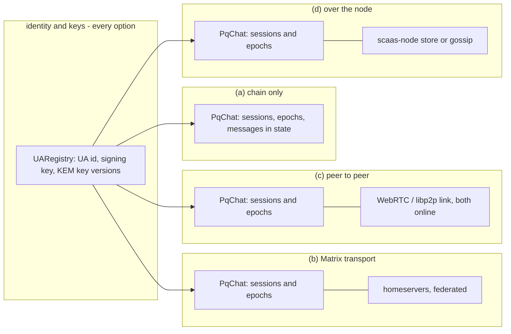
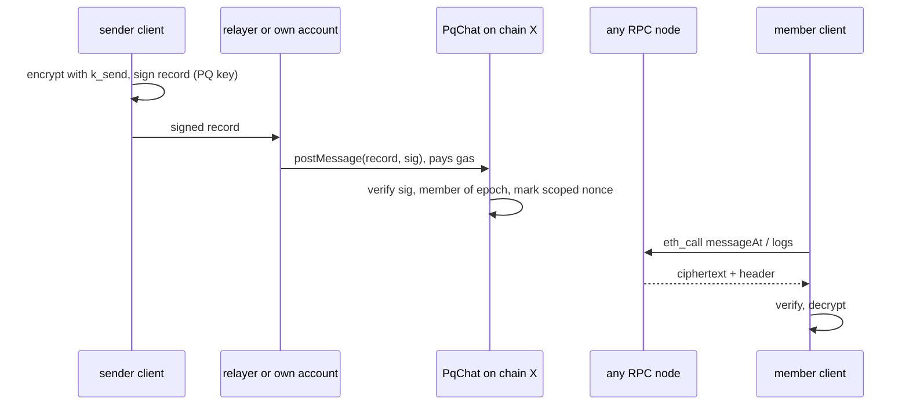
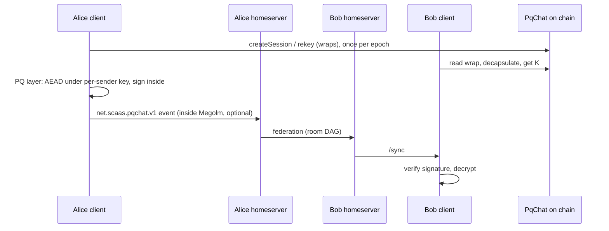
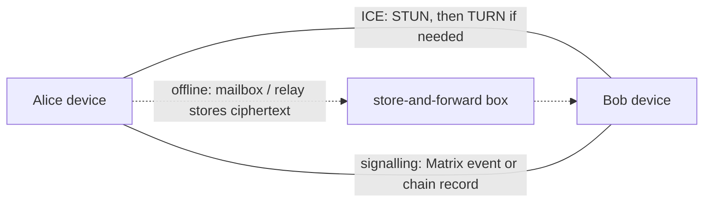
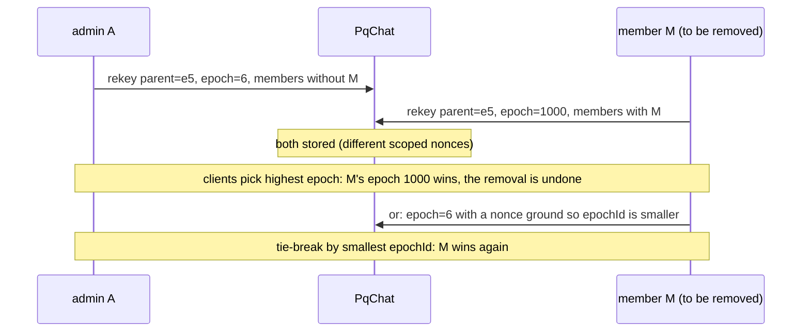
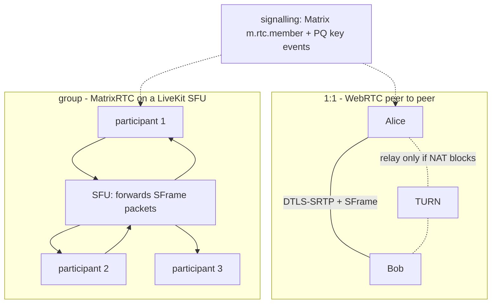

> **Research note — background and rationale only, not normative; the current rules are in docs/ (see decisions.md).**

# PqChat architecture: transport, ordering, metadata, security, features, calls and cost (research, 2026-11-04)

**Status:** research and overview for the owner (request 2026-11-04: "UA-7 still feels vague; a decentralised or
semi-decentralised application, Matrix as the semi-decentralised option; what is missing, what is extra, what must be
added for sessions, metadata, chat features and security"; addition the same day: voice and video calls). Nothing
here is decided. The design under study is the UA-7 spec
([`2026-10-25-ua7-pq-e2e-sessions.md`](../superpowers/specs/2026-10-25-ua7-pq-e2e-sessions.md), C1 to C10, owner
answers in its §4); the hiding of who talks to whom is in [`pqchat-unlinkability.md`](pqchat-unlinkability.md). The
two-page summary with the owner's decisions is [`pqchat-overview.md`](pqchat-overview.md).

**Labels.** **[verified 2026-11-04]** = read in the named source today; **[repo]** = a rule or measurement in this
repository; **[estimate]** = arithmetic on stated assumptions; **[inference]** = this note's reasoning;
**[background]** = well-known published design, not re-read for this note. The owner's answers in spec §4 are not
reopened; where a later rule now conflicts with them, §9 lists it.

**Contents**

1. [What UA-7 is, in four layers](#1-what-ua-7-is-in-four-layers)
2. [Architecture options](#2-architecture-options)
3. [Ordering](#3-ordering)
4. [Sessions and metadata](#4-sessions-and-metadata)
5. [Security gaps against the state of the art](#5-security-gaps-against-the-state-of-the-art)
6. [Chat features](#6-chat-features)
7. [Voice and video calls](#7-voice-and-video-calls)
8. [Cost](#8-cost)
9. [Where the spec now conflicts with later rules](#9-where-the-spec-now-conflicts-with-later-rules)
10. [What the spec must add](#10-what-the-spec-must-add)
11. [Sources](#11-sources)

## 1. What UA-7 is, in four layers

The spec mixes four layers. Separating them is most of what makes the design clear [inference]:

| Layer | What it holds | Where it lives in UA-7 | Who must agree on it |
|---|---|---|---|
| **Identity** | the UA id, its signing key, its kind | `UARegistry`, the same id on every chain ([CTR-UA-03](../contracts/accounts.md#CTR-UA-03)), portable registration ([CTR-UA-07](../contracts/accounts.md#CTR-UA-07), [CTR-UA-31](../contracts/accounts.md#CTR-UA-31)) | every chain; built |
| **Key directory** | the UA's KEM public key, versioned, write-once, never revoked | `UARegistry` KEM records ([CTR-UA-32](../contracts/accounts.md#CTR-UA-32)); ML-KEM-1024 + X25519, 1,601 B with the scheme byte | every chain; built on EVM |
| **Control plane** | sessions, members, epochs, the wrapped epoch key `K` | `PqChat` (C3, C4, C5) | all members of a session, in one order |
| **Data plane** | messages, attachments, receipts, calls | Matrix (C7) or contract state (C6b) | each recipient; order per sender is enough |

The identity and key-directory layers are built and fit the job. The control plane is where UA-7 is vague: it has no
ordering authority, no roles and no consent (§3, §5). The data plane has two candidates and no rule for choosing
between them (§2).

## 2. Architecture options



In every option the identity and key layers stay on chain. The options differ in where the control plane is
**ordered** and where the data plane is **carried and stored**.

### 2.1 (a) Chain only: messages in contract state (C6b)



| Question | Answer |
|---|---|
| Who reads what | Everyone reads every ciphertext, header, member list, sender, session id, time and size, forever [repo: C8, unlinkability note §1]. Content needs the epoch key. |
| Who can censor or drop | A relayer can refuse; the sender then submits itself. A block builder or sequencer can delay, not alter. Nothing can delete a landed record. |
| Offline delivery | Native: the chain is the mailbox; a member reads whenever it comes online. |
| Cost | Gas per byte stored; 1 KB message ≈ 2.5–13 M gas, ≈ $1.7–9.2 on Ethereum today, cents on a layer 2 [estimate, §8]. |
| Order | Total order per chain (block, transaction index, log index) and an append index per session; but records "in any order" and copies across chains make that order differ between chains (§3). |
| What breaks | Cost at any real volume; attachments (1 MiB ≈ 1.6 G state gas) are impossible; no deletion, no disappearing messages; metadata is public forever; every record costs a PQ signature check (FN-DSA-512 2.3 M, ML-DSA-65 5.8 M on the cached key [repo: accounts.md §1.6]). |

### 2.2 (b) Matrix homeservers as transport (semi-decentralised)



| Question | Answer |
|---|---|
| Who reads what | Every homeserver with a member in the room stores the event and sees: room id, Matrix user ids of the members, sender, time, size, the event type and our header fields unless Megolm wraps them (then type `m.room.encrypted`) [background: Matrix spec]. Content needs `K`. The chain shows only the control plane. |
| Who can censor or drop | Each user's homeserver can drop or delay that user's traffic; a federating server can refuse a room; a user changes homeserver (Matrix ids are per server, so the UA, not the Matrix id, is the identity that survives). |
| Offline delivery | Native: homeservers store and federate; `/sync` catches up. |
| Cost | No gas for messages. Hosting a homeserver; one event ≤ 65,536 B [background: Matrix spec size limit]. |
| Order | Per room DAG (`prev_events`), linearised per server; no global order (§3.3). |
| What breaks | Servers see the social graph and timing; standard clients (Element) cannot read the custom events (spec C7); Matrix's own E2EE (Olm/Megolm) is classical, and no PQ Olm is in the Matrix spec today, only research wrappers [verified 2026-11-04: SBSeg 2026 "msgX", Matrix Conference 2026 talk]. Matrix room membership must be kept in step with PqChat membership. |

Matrix and MLS: the Matrix MLS proposals (MSC2883 "Matrix-flavoured MLS", MSC4244, MSC4256) are not ready; federation
and network partitions are the stated blockers [verified 2026-11-04: Matrix 2025 conference slides]. Decentralised MLS
(DMLS, draft-kohbrok-mls-dmls) keeps old group states so commits can be processed out of order, at some cost to forward
secrecy [verified 2026-11-04: the draft]; "Project Tachyon" proposes Matrix over DMLS with servers passing only
to-device payloads [verified 2026-11-04: Matrix Conference 2026 talk listing].

### 2.3 (c) Direct peer to peer



What it needs: **NAT traversal** (WebRTC ICE with STUN and a TURN relay for symmetric NATs; libp2p hole punching with
circuit relays), a **signalling channel** to exchange addresses (Matrix, or a record), **both peers online**, and for
offline delivery a **store-and-forward box** (Briar's Mailbox, a phone-sized always-on device; SimpleX's SMP queues;
Session's swarms) [background]. Matrix's own P2P work (Pinecone, P2P Dendrite) has been on hold since late 2023 pending
funding [verified 2026-11-04, secondary sources only: forum quotes of the Matrix December 2023 update].

| Question | Answer |
|---|---|
| Who reads what | The peer sees the other's IP (unless over Tor, as Briar); a TURN relay sees both IPs and volume, not content. Nothing persists outside the two devices. |
| Who can censor or drop | Only the network path (blocking, NAT, a TURN operator). |
| Offline delivery | None without a mailbox; with one, the mailbox is a small server again. |
| Cost | No gas; TURN bandwidth. |
| Order | One FIFO stream per pair; nothing across devices or members. |
| What breaks | Groups (n·(n−1) links), multi-device, history on a new device, mobile background limits. Good for calls (§7) and LAN / offline use, not as the primary chat transport. |

### 2.4 (d) Chat over the node

`scaas-node` today relays signed writes, indexes events and runs a mesh; its gossip is libp2p gossipsub over QUIC with
X25519MLKEM768, **SPECIFIED, not built** [repo: [gossip.md](../node/gossip.md)]. Carrying chat over it means one of:

1. **Relay only** (what the node does already): the node submits `PqChat` records. This is option (a)'s submit path, not
   a new transport. It needs `call`-table rows for the `PqChat` entries kept equal to the contract's allow-list
   ([NODE-JOB-01](../node/job-api.md#NODE-JOB-01)).
2. **A message store** (a Waku-store / SimpleX-SMP-like role): the node keeps ciphertexts and serves them by session tag.
3. **A gossip topic** for chat envelopes (a Waku-relay-like role).

What 2 and 3 make the node: **a message server**. The node is open, so the guarantee (retention, who may fetch, rate
limits, size limits, deletion) must be written in the node's own spec as a module any operator can run, never as a
promise to one application. The operator then hosts third parties' ciphertexts (storage abuse, takedown requests),
needs spam control (Waku uses rate-limiting nullifiers [background]), and still sees IPs and timing. The node never
calls a client ([ARCH-POS-05](../decisions.md#ARCH-POS-05) non-goals: no webhooks), so it cannot push. [inference]

| Question | Answer (2 and 3) |
|---|---|
| Who reads what | The node operator: IPs, tags, sizes, timing; with `sessionId` in the clear also the social graph. |
| Who can censor | Each node; clients use several. |
| Offline delivery | Retention as the node spec sets it. |
| Cost | Operator storage and bandwidth; no gas. |
| Order | Arrival order per node; nothing global. |
| What breaks | Scope: a second product inside the relayer; a new trust and abuse surface; duplicates Matrix, which already does federation, history, push and media. |

### 2.5 Comparison and recommendation

| | (a) chain | (b) Matrix | (c) P2P | (d) node store |
|---|---|---|---|---|
| Server to run or trust | none | homeserver(s) | TURN, mailbox | node operators |
| Metadata public | everything, forever | to servers | to the peer | to operators |
| Offline delivery | yes | yes | mailbox only | yes |
| Cost per 1 KB message | $1.7–9.2 L1, cents L2 [estimate] | 0 gas | 0 | 0 gas |
| Attachments | no | yes (media repo) | yes | would need a design |
| Deletion / expiry | never | redaction, retention | local | node spec |
| Built pieces | registry; `PqChat` to write | libQuotient, homeservers | WebRTC stacks | relayer; gossip SPECIFIED |

**Recommendation [inference].** **Primary: (b)** — the chain is the identity, key directory and **control plane**
(sessions, epochs, wraps, membership, in one order, §3.2), Matrix carries the **data plane**. **Fallback: (a)** — the
same signed message record posted to `PqChat` (C6b) when a homeserver refuses or is gone, or when a message must be
kept on chain (owner answer 6 stands: messages may be stored on chain). Why: (b) is the only option with offline
delivery, history, multi-device, attachments, push and calls already built and run by others; the chain adds what
Matrix lacks (a PQ key directory not run by any server, an ordering authority for group keys no homeserver can
rewrite, and a censorship-resistant last resort). (c) belongs to calls (§7). (d) stays relay-only.

## 3. Ordering

### 3.1 What order the chain gives

- **Within one chain:** a total order `(block number, transaction index, log index)`, and the per-session append index
  of C6b (`messageAt(sessionId, index)`) [repo: spec C6b]. Final once the chain's finality gate passes
  ([indexer-feeds.md](../node/indexer-feeds.md)); before that, a reorg can reorder.
- **Across chains: none.** A record is identical on every chain and may be copied in any order (spec C1, owner answer 4),
  so message 7 may sit before message 5 on chain Y. Chain position is therefore **not** the conversation order.
- **Scoped nonce bitmaps** (spec C1, owner answer 7) give uniqueness, not order: nonce 5 may land before 4, and a gap
  never blocks. A client must treat the nonce as a **per-sender counter with gaps allowed**.

### 3.2 The control plane needs one order; the spec does not give it

Group key agreement needs every member to agree which epoch follows which. MLS states this as a Delivery Service duty:
handshake messages (Commits) must be ordered, or the group forks [verified 2026-11-04: RFC 9750 as cited by the DMLS
draft, §5.2.2 "eventually consistent" DS]. UA-7's rule — "highest `epoch` number, then smallest `epochId`" (C4) —
converges, but **it lets anyone in the parent epoch win** [inference]:



So the removal of a member can always be undone by that member. The fix needs three rules [inference]:

1. **`epoch = parent.epoch + 1`**, checked by the contract.
2. **One child per parent, first landed wins, on one ordering chain.** The session names its **home chain** as data in
   the signed record (the record stays chain-independent and copyable; copies elsewhere are replicas that follow the
   home chain's order). This is the chain acting as the MLS Delivery Service.
3. **Membership changes by role** (§5.5): a plain rekey (same members) by any member; adding or removing others only by
   an admin; anyone may leave.

The alternative without a home chain is DMLS-style fork resolution in clients (keep forks, pick by a rule), which
weakens forward secrecy and still needs a removal-wins rule [verified 2026-11-04: DMLS draft].

### 3.3 What order Matrix gives

A room is a DAG: each event names `prev_events`; servers linearise it by topological order and depth, and resolve
conflicting **state** by state resolution [background: Matrix spec]. Two clients on two servers may see different
interleavings for a while; per-sender order within a Megolm session is fixed by its ratchet index.

### 3.4 What order P2P gives

FIFO per link, nothing else. Groups over P2P need the same causal metadata as below.

### 3.5 What a client must do, and what the spec must state

| Rule | Why |
|---|---|
| Every message carries `(epochId, sender, device, counter)`; `counter` strictly increases per `(sender, device, epoch)` | gap detection, replay refusal, ratchet index (§5.1) |
| Every message carries `parents`: the ids of the current heads the sender has seen (a bounded set, e.g. ≤ 4), replacing C6b's single `lastSeen` | one id cannot express a group's causal past; Matrix uses the same idea (`prev_events`) |
| Display order: topological by `parents`, ties by the sender's timestamp, then id | identical on every chain and transport |
| A message for an unknown epoch is buffered until the epoch record arrives | records in any order |
| Epoch order is the home chain's, final after its finality gate | §3.2 |
| The same record on two transports (Matrix and chain) is one message (same id) | fallback (a) must not duplicate |

## 4. Sessions and metadata

### 4.1 What each option exposes

| Metadata | (a) chain | (b) Matrix | (c) P2P | (d) node |
|---|---|---|---|---|
| Member list | public, forever (wraps name members, C3) | homeservers of members (room state) | peers only | operator, if ids are clear |
| Who sent | public (signed, verified by the contract) | homeservers | peer | operator |
| When | block time, public | servers, to the millisecond | peer | operator |
| Size | calldata and blob size, public | servers | peer, path | operator |
| Frequency | public | servers | path | operator |
| IP | RPC provider and relayer see the submitter's and reader's IP | homeserver sees the client's | peer and TURN | operator |
| Link to the chain session | — | the room id if stored on chain (C7 "may") links both worlds | — | — |

### 4.2 What the current spec puts on chain forever

Member UAs and the KEM key version each wrap is for; the creator; every rekey's author and member set; with C6b, every
message's session, sender, size and time; the Matrix room id if C7's optional public field is used [repo:
unlinkability note §1]. Everything on chain is public forever (C8); unlike a server log it cannot be deleted, subpoenaed
away or expired.

### 4.3 What C10 can hide, and at what cost

The unlinkable mode (key-private wraps with view tags, one contract-wide queue with rotating tags, sender and signature
inside the ciphertext) hides members, session grouping and sender **on chain** [repo: unlinkability note §2]. Costs:
clients scan the whole queue; anonymity set = users of the mode; insider tag squatting is open; the contract can no
longer authorise writes. It does **not** help on Matrix, where room membership is server state [inference]. Adopt it
only for option (a) traffic, after the basics.

### 4.4 What must be added in any case [inference]

1. **Never put the Matrix room id on chain in the clear.** Put it inside the wrap's plaintext or derive the room alias
   from `K`; otherwise the public member list is joined to the server's view.
2. **Padding.** Pad plaintexts to buckets before encryption: NIP-44 pads to power-of-two-related sizes with a 32-byte
   minimum [verified 2026-11-04: NIP-44]; SimpleX uses a fixed 16 KB block [verified 2026-11-04: SimpleX v5.6 post].
   Proposal: 256 B / 1 KiB / 4 KiB / 16 KiB buckets off chain; on chain, padding costs 1,530 gas per byte, so one
   bucket of 1 KiB for text and nothing finer.
3. **Sealed sender** for the Matrix path: the PQ sender id and signature inside the ciphertext, so the inner sender is
   not in our header (the Matrix sender is still visible to servers). On chain this is C10's item 4.
4. **Timing.** Submit chain records through a relayer, optionally batched with delay; randomised timestamps as Nostr's
   gift wraps do (up to two days back) [verified 2026-11-04: NIP-17 / NIP-59] are not possible on chain (block time is
   public), only inside the ciphertext.
5. **A hidden member set** needs C10 on chain; on Matrix only a per-user mailbox room (one room per recipient, sealed
   sender inside) hides the group from servers, at the price of fan-out per message.
6. **Receipts and typing** must go inside our encrypted events, not as Matrix's unencrypted ephemeral events [background].

## 5. Security gaps against the state of the art

### 5.1 Forward secrecy and post-compromise security

| Design | FS | PCS | Source |
|---|---|---|---|
| Signal Double Ratchet + PQXDH + SPQR (triple ratchet) | per message; PQ via ML-KEM-768 ratchet | per round trip, PQ | [verified 2026-11-04: Signal blog 2025-10-02] |
| Apple PQ3 | per message | PQ rekey ≈ every 50 messages, at least every 7 days (Kyber-768 ratchet; Kyber-1024 + P-256 initial) | [verified 2026-11-04: Apple security blog 2024-02-21] |
| MLS (RFC 9420) | per epoch + per-sender secret tree | each Commit with a path update | [background] |
| Megolm (Matrix) | forward only from the shared index; rotation 100 messages / 1 week by default | none within a session | [verified 2026-11-04: ruma docs of `m.room.encryption` defaults] |
| Session protocol v1 | none (removed 2021) | none | [verified 2026-11-04: Session V2 announcement] |
| NIP-44 | none ("no forward secrecy", "no post-compromise security") | none | [verified 2026-11-04: NIP-44] |
| **UA-7 today** | **none in practice** | **only by a new KEM key version + rekey** | [inference, below] |

The epoch key `K` is wrapped on chain to a **long-term** KEM key that is never revoked and stays readable forever
([CTR-UA-32](../contracts/accounts.md#CTR-UA-32)). Whoever obtains that KEM secret at any time decapsulates **every**
wrap ever made to it and re-derives every `k_send`: rekeys and any per-sender ratchet give no forward secrecy against
that compromise, because the chain re-serves the root. A rekey after a compromise gives no PCS either while the same KEM
key is used: the attacker decapsulates the new wrap too. The spec's C8 says this in part; the consequence is stronger
than "no forward secrecy beyond C4": **FS and PCS are bounded by the lifetime of the KEM key version.** [inference]

What the state of the art would add, in increasing cost:

1. **A per-sender hash ratchet inside an epoch** (Megolm-like): `ck_0 = HKDF(K, "scaas/pqchat/v1/chain" ‖ sessionId ‖
   epochId ‖ sender ‖ device)`, message key and next chain key by HMAC, counter nonces, old keys deleted. FS against a
   **device** compromise that happens after deletion, as long as the KEM secret is not also taken. Cheap, off chain.
2. **Scheduled KEM key rotation with secret deletion** (a new version by `setKemKey`, then a rekey of every session):
   FS and PCS at the rotation interval. Cost ≈ 6–14 M gas per new key version plus the rekeys [estimate, §8]. History older
   than the deleted secret is then readable only from an explicit backup (§6).
3. **An off-chain ratchet** (PQXDH-style first contact using the on-chain KEM key as the last-resort prekey, then a
   triple ratchet for 1:1; MLS with an ML-KEM or X-Wing ciphersuite for groups): full FS and PCS; the chain keeps only
   identity, keys and the first contact. XMTP runs MLS on a decentralised network with X-Wing HPKE for Welcome messages
   and states it does not give harvest-now-decrypt-later protection after removal [verified 2026-11-04: libxmtp
   security overview].

The choice between "history recoverable from chain with the KEM secret" (today) and forward secrecy is an owner
decision (overview D6).

### 5.2 The long-term, write-once KEM key without revocation

By rule there is no revocation ([CTR-UA-32](../contracts/accounts.md#CTR-UA-32)); this note does not reopen it. What
follows for clients [inference]:

- A sender may wrap to **any** stored version (C2, C3). After a leak, an honest sender on a chain where the newer
  version has not been copied yet still wraps to the leaked one. **Client rule needed:** wrap only to the highest
  version seen on any source the client reads, and treat a member whose highest version changed as a trigger for a
  rekey.
- **No proof of possession of the KEM secret** (by design): Mallory may list Alice's KEM key under Mallory's UA; a
  sender inviting "Mallory" then writes to Alice. Mallory gains nothing she could not get by forwarding, but the UI must
  show a KEM key fingerprint per member, and clients should warn when two UAs list the same key.
- The hash-commit form may leave `kemKeyAt(ua, 0)` empty until repaired (`checkedOf.kem = NONE`); such a UA cannot be
  invited yet.
- On a family where a relayer checked the KEM record ([CTR-UA-34](../contracts/accounts.md#CTR-UA-34)), clients
  re-verify the record signature before wrapping to it.

### 5.3 KEM key well-formedness

The registry checks the scheme byte and the length only ([CTR-UA-32](../contracts/accounts.md#CTR-UA-32)); the
cryptography is UA-7's. Before every encapsulation the client must run the FIPS 203 §7.2 encapsulation-key check (type
check: `ek` is 1,568 B for ML-KEM-1024; modulus check: `ByteEncode12(ByteDecode12(ek)) == ek`) and refuse an all-zero
X25519 shared secret (low-order point) [background: FIPS 203; the missing all-zero check was the one confirmed issue in
the 2026 vodozemac report, verified 2026-11-04: Matrix blog 2026-02]. The combiner must hash the X25519 ciphertext and
public key, as X-Wing does (`SHA3-256(ss_M ‖ ss_X ‖ ct_X ‖ pk_X ‖ label)`) [background: draft-connolly-cfrg-xwing-kem];
X-Wing proper fixes ML-KEM-768, so ours is "X-Wing-style" and needs its own label and vectors. The HKDF `info` of a
wrap should also bind the scheme byte and `kemPkHash`, so a wrap can never be read as one for another key.

### 5.4 Multi-device

One KEM key per UA (owner answer 3) means every device holds the same KEM secret and the same signing key: a device
loss compromises the UA, and devices share counters. Rules needed now: a **device id** in every sender derivation and
counter (the spec's GCM-SIV random nonce is a patch for exactly this); device linking off chain (the primary device
hands the secrets to the new one over an authenticated channel). Per-device KEM keys (keyed `(ua, keyId)`, "later" in
CTR-UA-32) multiply wraps by the device count: 1,648 B × devices × members per epoch.

### 5.5 Member add and remove

- **Who rekeys:** today any member of the parent epoch may add or remove anyone, the creator included; with §3.2's fork
  rule a removed member can undo the removal. Needed: roles in the session record (admins), membership changes by
  admins, self-leave by anyone, plain rekeys by any member.
- **Removed members and new epochs:** a removed member gets no wrap of the new `K` and cannot read it — **provided** the
  new `K` is fresh randomness, not derived from the old one (the spec draws it at random: correct). It still reads every
  epoch it held, forever, from the chain.
- **Consent:** listing a UA in a session is no consent (the same principle as
  [CTR-UA-37](../contracts/accounts.md#CTR-UA-37) for `msig` slots); anyone can make a public on-chain link between
  themselves and any UA. Clients hide such sessions (owner answer 2); the public link remains.

### 5.6 Message authentication and deniability

- On chain (C6b) every message is signed by the author's PQ key and checked by the contract: strong origin
  authentication, **no deniability** (a signature on a public chain proves authorship of a ciphertext forever, and
  anyone given `K` can prove the content) [inference].
- Over Matrix (C7) the event content (`sessionId, epoch, sender, keyId, counter, ciphertext`) carries **no signature**.
  `k_send` is derived from `K`, which every member holds, so **any member can forge a message as any other member**
  [inference]. SFrame has the same property for media and says so [verified 2026-11-04: RFC 9605 §6.1.1]. Needed: the
  same signed record over Matrix as on chain (signature inside the ciphertext: hidden from servers; FN-DSA-512 adds
  666 B), so the fallback (a) can post the identical bytes.
- A deniable mode (MAC only, Signal-like) cannot coexist with the on-chain fallback; not recommended.

### 5.7 Replay

On one chain the scoped nonce refuses a replay; on another chain the copy is the intended "same record". Off chain the
client keeps the seen set `(sessionId, epochId, sender, device, counter)` and the AAD binds session and epoch, so a
record cannot be moved between sessions. A message whose epoch is not yet known is buffered, not dropped.

### 5.8 Group size

Per epoch: one 1,648 B wrap per member, ≈ 2.52 M state gas each [estimate, §8]. A 20-member rekey is ≈ 55–58 M gas,
about a whole 60 M block; one SSTORE2 blob holds at most 14 wraps under a 24,576 B code limit or 39 under 64 KiB
[estimate]. The contract must not assume a block limit (no assumptions about a chain): wraps go in several blobs and a
large epoch spans several transactions (an epoch is complete when every wrap has landed). MLS-style trees cut wraps to
O(log n) per update but need a strict commit order (§3.2) [background].

### 5.9 "Everything on chain is public forever" and harvest-now-decrypt-later

On chain the adversary needs no tap: every wrap and C6b ciphertext is archived by every full node. Breaking **both**
ML-KEM-1024 and X25519 (or stealing one KEM secret) opens every epoch key wrapped to that key, and with stored or
captured ciphertexts the history. Matrix ciphertexts are on homeservers only, and the client-server TLS is classical
unless the server offers a hybrid group. Mitigations: the hybrid KEM (owner answer 1), KEM key rotation with deletion
(§5.1 item 2), keeping messages off chain by default (§2.5), and the reserved scheme 2 (ML-KEM-1024 + HQC + X25519)
for diversity of assumptions [repo: CTR-UA-32 scheme byte].

### 5.10 Nested `msig` members

A PQ-eligible `msig` may hold a KEM key ([CTR-UA-32](../contracts/accounts.md#CTR-UA-32) holders), signed by a minimal
quorum of its members, and since [CTR-UA-38](../contracts/accounts.md#CTR-UA-38) its members may be `msig`s one level
down. But an `msig` has **no single KEM secret**: the KEM key is one ML-KEM key that some party generated and holds,
and ML-KEM has no threshold decapsulation. Options [inference]:

1. **The `msig` is a member with its own KEM key**, the secret shared by its operators off chain. Anyone holding it reads
   everything; the quorum signs the key record, not the decryption.
2. **Expand the `msig` into its accepted members** (CTR-UA-37 acceptance, two levels per CTR-UA-38): each epoch wraps to
   each leaf UA's own KEM key; leaving the `msig` means losing the next epoch.
3. **Refuse `msig` members.**

Writes: an `msig` author would need a quorum of PQ signatures per message (the minimal-form rule, several signatures of
2.4–3.3 KB each) [repo: CTR-UA-07 minimal form]; impractical per message. Recommendation: option 2, with messages
always authored by a leaf UA, optionally "on behalf of" the `msig` inside the ciphertext.

## 6. Chat features

| Feature | Spec today | What it needs | Where [inference] |
|---|---|---|---|
| Invites | creator lists members (C3) | an invite = the session or epoch record; consent and hiding in clients; optional join requests | chain + client |
| Leaving | not specified | a signed leave record; others rekey without the leaver | chain |
| Admin roles | none | `admins[]` in the session record; who adds, removes, renames | chain |
| Session name, avatar, topic | none | encrypted fields under `K` (Matrix state or a chain record) | Matrix |
| Attachments | none | file encrypted with a random key, key and hash inside our event, bytes on the Matrix media repository; never on chain (1 MiB ≈ 1.6 G state gas) | Matrix |
| Read receipts, typing | none | inside our encrypted events, opt-in; never as Matrix plaintext ephemeral events | Matrix |
| Edits | none | a new message with `replaces = <id>`; the original stays | both |
| Deletes | "nobody can edit or delete" (C6b) | on chain: impossible, a "delete" is only a request clients honour; on Matrix: redaction plus retention | both; the UI must say so |
| Disappearing messages | none | Matrix retention + local deletion; impossible on chain | Matrix |
| Push notifications | none | Matrix push gateway to APNs / FCM carrying only an event id; the node cannot push (no callbacks) | Matrix |
| Backup and key recovery | none | KEM key from a seed: ML-KEM key generation is deterministic from `(d, z)` (FIPS 203) and X25519 from 32 bytes, so a recovery seed restores the KEM secret; with it every on-chain wrap restores every epoch key (history for free, the FS trade-off of §5.1) | client |
| Search | none | local index on the device; servers cannot search | client |
| Mentions, replies, reactions | none | fields inside the plaintext | client |
| Spam control | clients hide unknown sessions | plus Matrix invite filtering; on chain the gas cost | both |

**Extra or premature in the spec [inference]:**

- **C10 unlinkable mode** before roles, ordering and authentication exist.
- **A contract-checked PQ signature on every message** when Matrix is the primary path: needed only for the fallback.
- **Scheduled on-chain rekeys every 1,000 messages or 7 days** (C4): each costs ≈ 2.5 M gas per member; a per-sender
  hash ratchet gives the message-level part for free, and a rekey is only worth it with a new KEM key version (§5.1).
- **Storing the message signature bytes in state** (C6b): see §9 row 4.
- **`lastSeen`** as a single id: replace by `parents` (§3.5).
- **"Fits one transaction and one block on every chain we target"** (C5): drop; the client splits (§5.8).

## 7. Voice and video calls

### 7.1 Transport options



1. **1:1: WebRTC peer to peer.** ICE, STUN, TURN when needed; signalling over Matrix (or a record). The peer sees the
   IP; TURN sees both IPs and volume.
2. **Groups: MatrixRTC (MSC4143) with Element Call's LiveKit SFU transport (MSC4195).** MSC4143 was merged on
   2026-10-21 (accepted, spec text pending) [verified 2026-11-04: GitHub PR 4143]. Membership is `m.rtc.member` sticky
   events (about 1 hour) with a delayed leave event as a dead man's switch; each client draws a random media key on
   joining and sends it in Olm-encrypted to-device messages (`m.rtc.encryption_key`, key index 0–255) only to the
   devices of joined members; clients should rotate on every change of the joined set and periodically, with a ~5 s
   delay before use; WebRTC transports may use the key index as the SFrame key id [verified 2026-11-04: MSC4143 text].
   MSC4195 maps this onto LiveKit's frame encryption [verified 2026-11-04, from a mirror of the PR].
3. **Mesh P2P for small groups:** each participant uploads (n − 1) streams; practical up to about 4–6 [estimate].
4. **The node as TURN or SFU:** it would make the node a **media relay** — the heaviest bandwidth of anything here
   (an SFU forwards n·(n − 1) streams; 720p video ≈ 1–2.5 Mbit/s each [estimate]), it sees every participant's IP and
   timing, and as an open-node guarantee it would need its own module spec (capacity, abuse, limits). It adds no
   security: the media is end-to-end encrypted either way. Recommendation: no; any standard TURN / LiveKit server,
   discovered via MSC4143 transports.

### 7.2 End-to-end media encryption

- **DTLS-SRTP alone is hop-by-hop and classical.** With an SFU, each participant's DTLS ends at the SFU, which sees
  the media in the clear; its key exchange is classical ECDHE unless a hybrid group is negotiated (Chrome offers a
  post-quantum WebRTC key agreement behind a policy since version 140, per a browser policy page [verified 2026-11-04,
  secondary]). A recorded call is open to harvest-now-decrypt-later on that hop.
- **SFrame (RFC 9605, August 2024)** encrypts each frame end to end with AEAD; the SFU forwards without reading.
  Browsers apply it through WebRTC Encoded Transform (insertable streams) [background: W3C]. RFC 9605's MLS profile
  derives `base_key = MLS-Exporter("SFrame 1.0 Base Key", "", AEAD.Nk)` per epoch and builds the key id from a context,
  the sender index and the low epoch bits [verified 2026-11-04: RFC 9605 §5.2]. Each `base_key` is used for encryption
  by one sender only, and keys SHOULD change when participants join or leave [verified: RFC 9605 §4.4.1, §7.3].
- **SFrame does not authenticate senders inside the group:** every receiver holds the symmetric keys and can forge
  another's media [verified: RFC 9605 §6.1.1].

### 7.3 Media keys from the PQ session key

Proposal [inference]: a call has a random 32-byte `callSecret`; the media key mixes it with the session's epoch key so
that only current session members **and** current call participants can derive it:

```text
callBase   = HKDF-SHA-256(K_epoch || callSecret, "scaas/pqchat/v1/call" || sessionId || epochId || callId || callEpoch)
senderBase = HKDF-SHA-256(callBase, "scaas/pqchat/v1/sframe" || sender || device)     // one sender per base_key (RFC 9605)
SFrame KID = (context, senderIndex, callEpoch low bits)                                // RFC 9605 §5.2 layout
```

- `callSecret` is distributed **off chain** in a Matrix event as one KEM wrap per participant's KEM key (1,648 B each,
  0 gas) — the PQ replacement for MatrixRTC's classical Olm to-device keys.
- **Rotation:** a join or leave of the call starts `callEpoch + 1` with a fresh `callSecret` wrapped to the remaining
  participants (no chain write, seconds, not blocks); a change of **session** membership (an on-chain epoch) ends every
  call key of the old epoch.
- **1:1 calls** may skip `callSecret` and use `K_epoch` with a per-call salt, since both parties hold it already.
- The SFU cannot derive any key; a session member not in the call can derive nothing without `callSecret`.

### 7.4 What a call leaks

| Observer | Sees | Cannot see |
|---|---|---|
| SFU | every participant's IP, join and leave times, stream count, simulcast layers, packet sizes and rates (voice activity; variable-bitrate speech is known to leak words), SFrame header (sender index, epoch bits, counter) [verified: RFC 9605 KID and header are not confidential] | media content |
| TURN | both IPs, volume, duration | content (DTLS-SRTP and SFrame inside) |
| Homeserver | `m.rtc.member` events: who joined, when, which SFU, which device; key-distribution events between devices | keys, media |
| Chain | nothing, unless call records are written there (not proposed) | — |

Mitigations: constant-bitrate Opus for voice; the RTP audio-level header extension disabled (it is sent unencrypted)
[background: RFC 6464]; the SFU chosen per call by the participants; no call records on chain.

## 8. Cost

**Assumptions.** EIP-8037 fixed cost per state byte **1,530 gas**, a new storage slot = 64 state bytes = 97,920 gas, a
new account = 120 bytes = 183,600 gas [verified 2026-11-04: EIP-8037 test constants in the execution specs and the revm
docs; repo: zether.md uses 1,530 and 97,920]; spreading the blob account and the SSTORE2 prefix byte over a full
64 KiB blob gives ≈ 1,533 per stored byte, over a 1.2 KB message blob ≈ 1,683 [estimate]. Calldata floor 15,000 + 64 gas per byte (EIP-7976), regular gas
capped at 2^24 per transaction (EIP-7825), state gas on top [repo: networks/evm.md]. Signature checks: FN-DSA-512 2.3 M,
ML-DSA-65 5.8 M on the cached expanded key (18.9 M on the FIPS 204 key: above the 2^24 regular cap, so not usable
without the cache or a precompile), ML-DSA-65 by precompile ≈ 0.1 M assumed [repo: accounts.md §1.6; precompile figure
estimate]. Prices: **ETH = $2,261.87** (Fortune, 2026-11-03 06:45 ET) and **0.31 gwei** normal priority on Ethereum
(Chaingate gas tracker, 2026-11-03), with a stress case at 5 gwei; a layer 2 at 0.005 gwei that prices state like
EIP-8037 (an assumption; a layer 2 without EIP-8037 is cheaper per byte), its layer-1 data fee not included
[verified 2026-11-04 for the two prices; the rest estimate]. The arithmetic behind the table:

```text
state(session, n) = (1 + n*(1648 + 32)) * 1530 + 183600 + 3 * 97920      blob of wraps + member ids, account, 3 slots
regular(session)  = max(21000 + 16*calldata + verify + 60000, 15000 + 64*calldata)
state(message)    = (1 + 1040 + 160 + sigOrHash) * 1530 + 183600 + 97920 sigOrHash = 666 / 3309 B stored, or 32 B hash
regular(message)  = max(21000 + 16*calldata + verify + 40000, 15000 + 64*calldata)
USD               = gas * gwei * 1e-9 * 2261.87
```

**Sizes [estimate unless marked].** KEM ciphertext 1,600 B (ML-KEM-1024 1,568 + X25519 32) [repo: CTR-UA-32]; a wrap =
ciphertext ‖ AES-256-GCM(K) = 1,600 + 32 + 16 = **1,648 B** [repo: spec C3]; a 1 KiB text message = 1,024 + 16 tag +
a 160 B header (session, epoch, sender, nonce, parents) ≈ 1.2 KB; FN-DSA-512 signature 666 B, ML-DSA-65 3,309 B [repo].

| Item | State gas | Regular gas | Total | USD at 0.31 gwei | at 5 gwei | layer 2 |
|---|---|---|---|---|---|---|
| one wrap (1,648 B) | 2.52 M | 0.11 M floor | ≈ 2.6 M | ≈ $1.8 | ≈ $30 | < $0.03 |
| session, 2 members, FN-DSA-512 creator | 5.62 M | 2.45 M | 8.1 M | $5.7 | $91 | $0.09 |
| session, 10 members, FN-DSA-512 | 26.2 M | 2.7 M | 28.9 M | $20 | $326 | $0.33 |
| session, 20 members, FN-DSA-512 | 51.9 M | 2.9 M | 54.8 M | $38 | $620 | $0.62 |
| session, 20 members, ML-DSA-65 cached | 51.9 M | 6.5 M | 58.4 M | $41 | $660 | $0.66 |
| message 1 KiB, FN-DSA-512, signature stored | 3.14 M | 2.39 M | 5.5 M | $3.9 | $63 | $0.06 |
| message 1 KiB, FN-DSA-512, signature hash only | 2.17 M | 2.40 M | 4.6 M | $3.2 | $52 | $0.05 |
| message 1 KiB, ML-DSA-65 cached, signature stored | 7.18 M | 5.93 M | 13.1 M | $9.2 | $148 | $0.15 |
| message 1 KiB, ML-DSA-65 precompile, hash only | 2.17 M | 0.31 M | 2.5 M | $1.7 | $28 | $0.03 |
| new KEM key version (`setKemKey`, 1,601 B + signature) | ≈ 3.7–7.7 M | 2.3–5.8 M | ≈ 6–14 M | $4–10 | $70–155 | < $0.15 |
| 1 MiB attachment on chain | 1,604 M | — | does not fit any block | — | — | — |
| the same message over Matrix | 0 | 0 | 0 gas | hosting only | | |

Reading: on Ethereum today a two-person session costs about the price of a coffee and every message a few dollars; at a
5 gwei spike a factor 16 more. Session setup on chain is affordable everywhere; messages on chain are affordable on a
layer 2, and on layer 1 only as the fallback. The spec's earlier "≈ 2.1 M gas, $6–7 per message at 1 gwei and $3,000"
predates the stored signature and the signature check (spec C6b says so); the table adds both.

## 9. Where the spec now conflicts with later rules

The owner's answers in spec §4 stand. These later rules change how they must be written [repo]:

| # | Spec text | Later rule | What changes |
|---|---|---|---|
| 1 | `createSession(record, sig)`, `rekey(record, sig)`, `postMessage(record, sig)`; ids `keccak256(TAG ‖ record)` | Every parameter is explicit ([CTR-MTX-29](../contracts/metatx.md#CTR-MTX-29), owner 2026-10-31), named entries ([CTR-MTX-28](../contracts/metatx.md#CTR-MTX-28)), typed EIP-712 records under a portable domain without chain id ([CTR-UA-07](../contracts/accounts.md#CTR-UA-07) typed structs, owner 2026-10-31) | Typed structs `PqChatSession`, `PqChatEpoch`, `PqChatMessage` with named fields, signed as `typed(...)` in a portable domain; the id is the typed digest. Owner answer 4 (chain-independent, fee-less) is kept: the portable domain has no chain id. |
| 2 | `wrap = ct ‖ AES-256-GCM(...)` as one blob; `wraps[]` | Only one crypto object per `bytes` (CTR-MTX-29) | `Wrap {bytes32 member; uint64 keyId; bytes kemCt; bytes sealedKey}`; the stored bytes may stay one blob (what is stored is what the packed bytes were). |
| 3 | C6b fee table with a "Signer secp256k1" column; C6b "ML-DSA in Solidity ≈ 6–19 M" | Only PQ kinds may hold a KEM key: `mldsa44`, `mldsa65`, `fndsa512`, a PQ-eligible `msig`; `slhdsa128s` is not a holder ([CTR-UA-32](../contracts/accounts.md#CTR-UA-32), UA8-D12) | A secp256k1 or native UA cannot be a member at all. ML-DSA at 18.9 M exceeds the EIP-7825 regular cap; only the cached key (5.8 M), a precompile or FN-DSA-512 (2.3 M) work. |
| 4 | C6b stores "the full record and its signature in contract state" | `msig` signatures: hashes in state, bytes as log data (owner 2026-11-03, [CTR-UA-38](../contracts/accounts.md#CTR-UA-38) limits; CTR-UA-33 A) | Not binding on PqChat, but the same choice applies: ciphertext and header in state (never lose ciphertext), the signature's hash in state and its bytes in the event saves 1.0 M (FN-DSA) to 5.0 M (ML-DSA-65) state gas per message. Owner decision. |
| 5 | C2 "one scheme"; KEM key 1,600 B | Scheme byte first (owner 2026-10-30): `kemPk` = 1,601 B, scheme 2 reserved | Wraps and HKDF info carry the scheme; vectors per scheme. |
| 6 | C3 members from `kemKeyOf` / any stored version | Version 0 is the `register` key; the hash-commit form may leave it empty (owner 2026-10-31) | Clients check `checkedOf.kem` and repair or skip. |
| 7 | C3 "anyone may create a session with any UA"; C4 any member rekeys | Listing is no consent ([CTR-UA-37](../contracts/accounts.md#CTR-UA-37), owner 2026-11-02, for `msig`) | Not binding on PqChat; the same principle argues for consent in clients (§5.5). |
| 8 | Members are UAs; an `msig` member is not discussed | Nested `msig` two levels ([CTR-UA-38](../contracts/accounts.md#CTR-UA-38), owner 2026-11-02) | §5.10: expand to accepted leaf UAs. |
| 9 | C5 "fits one transaction and one block on every chain we target" | No assumptions about a chain: no block limit of ours (AGENTS.md); EIP-8037 inclusion = regular + state ≤ block limit | Chunked wraps and multi-transaction epochs; no group-size bound by block. |
| 10 | C1 "relayable by anyone" | The node relays every write it is asked to and keeps its allow-lists equal to the contract's ([NODE-JOB-01](../node/job-api.md#NODE-JOB-01)); the node's guarantees live in the node spec | `PqChat` entries need call-table rows and a node-spec section; nothing consumer-specific. |
| 11 | C7 "the room id may be stored in the session as a public field" | — (no rule; a metadata finding) | §4.4 item 1: keep the room id off chain or encrypted. |

## 10. What the spec must add

1. **Layers** (§1) named in the spec, with the data plane's primary (Matrix) and fallback (chain) stated.
2. **Typed records** (§9 rows 1–2): structs, fields, portable domain, typehashes, vectors.
3. **Ordering of epochs** (§3.2): `epoch = parent + 1`, one child per parent, first landed on the session's home chain.
4. **Roles** (§5.5): admins, who adds and removes, self-leave.
5. **Message format** (§3.5, §5.6): `(epochId, sender, device, counter, parents)`, signature inside the ciphertext,
   the same bytes on Matrix and on chain, padding buckets (§4.4).
6. **Key schedule** (§5.1): per-sender hash ratchet; KEM key rotation policy and the client rule "wrap to the highest
   version seen"; FIPS 203 §7.2 and X25519 checks (§5.3).
7. **Devices** (§5.4): device id in derivations; linking.
8. **`msig` members** (§5.10).
9. **Features** (§6): leave, edit, delete-as-request, attachments off chain, receipts inside, backups from a seed.
10. **Calls** (§7): signalling over MatrixRTC, SFrame keys from `K_epoch ‖ callSecret`, PQ key distribution, rotation.
11. **Node** (§2.4, §9 row 10): relay only; call-table rows.
12. **Costs** (§8) re-measured in the plan, at the signer kinds that can hold a KEM key.

## 11. Sources

Verified on 2026-11-04 unless marked [background]. Web pages are cited as data.

- UA-7 spec and repo rules: [`2026-10-25-ua7-pq-e2e-sessions.md`](../superpowers/specs/2026-10-25-ua7-pq-e2e-sessions.md);
  [accounts.md](../contracts/accounts.md) CTR-UA-03, -07, -31, -32, -33, -34, -37, -38, §1.6 gas; [metatx.md](../contracts/metatx.md)
  CTR-MTX-27, -28, -29; [networks/evm.md](../networks/evm.md) (EIP-7825, EIP-8037, EIP-7976); [node/README.md](../node/README.md),
  [gossip.md](../node/gossip.md).
- Signal: "Signal Protocol and Post-Quantum Ratchets" (SPQR, triple ratchet), 2025-10-02, https://signal.org/blog/spqr/ ;
  PQXDH specification, https://signal.org/docs/specifications/pqxdh/ [background for the details].
- Apple: "iMessage with PQ3", 2024-02-21, https://security.apple.com/blog/imessage-pq3/ .
- MLS: RFC 9420 (protocol, 2023) [background]; RFC 9750 (architecture, 2025) as cited in draft-kohbrok-mls-dmls,
  https://datatracker.ietf.org/doc/draft-kohbrok-mls-dmls/ ; draft-mahy-mls-xwing (X-Wing ciphersuite for MLS).
- Matrix: client-server spec v1.19, https://spec.matrix.org/latest/ [background for the DAG, state resolution and
  size limits]; `m.room.encryption` defaults as documented in ruma-events, https://docs.rs/ruma-events/ ; Matrix 2025
  conference slides on MSC2883 / MSC4244 / MSC4256, https://matrix-2025.pages.dev/slides/slides_BAKSEA.pdf ; Matrix
  Conference 2026 talks (Project Tachyon; vodozemac PQ wrapper), https://cfp.2026.matrix.org/ ; "Analysis of reported
  issues in vodozemac", 2026-02, https://matrix.org/blog/2026/02/analysis-of-reported-issues-in-vodozemac/ ; msgX,
  SBSeg 2026, https://sol.sbc.org.br/index.php/sbseg/article/view/44327 ; Pinecone / P2P Matrix on hold (secondary:
  forum quotes; https://arewep2pyet.com not reachable in this study).
- MatrixRTC: MSC4143, merged 2026-10-21, https://github.com/matrix-org/matrix-spec-proposals/pull/4143 and
  `proposals/4143-matrix-rtc.md`; MSC4195 (LiveKit transport), PR 4195 (read through a mirror).
- SFrame: RFC 9605, August 2024, https://www.rfc-editor.org/rfc/rfc9605.html ; WebRTC Encoded Transform (W3C)
  [background]; RFC 5764 DTLS-SRTP, RFC 6464 audio level [background]; Chrome WebRTC post-quantum key agreement
  policy, https://developer.samsung.com/browser/policy/web-rtc-post-quantum-key-agreement.html (secondary).
- XMTP: libxmtp security overview (X-Wing HPKE Welcome messages, no HNDL post-remove security),
  https://www.mintlify.com/xmtp/libxmtp/security/overview ; "XMTP and the future of privacy in a quantum world",
  https://blog.xmtp.org/xmtp-and-the-future-of-privacy-in-a-quantum-world/ ; XIP-49 decentralised backend (retention),
  https://community.xmtp.org/t/xip-49-decentralized-backend-for-mls-messages/856 .
- Session: "Session Protocol V2: PFS, Post-Quantum and the Future of Private Messaging" (ML-KEM-768 + X25519 via
  X-Wing; PFS removed in 2021, restored in V2, not finalised), https://getsession.org/session-protocol-v2 ; Privacy
  Guides news 2025-12-03.
- SimpleX: post-quantum double ratchet spec (2024-06-22), https://github.com/simplex-chat/simplexmq/blob/stable/protocol/pqdr.md ;
  v5.6 blog post (sntrup761 family, 16 KB fixed blocks) [unidirectional queues, no user ids: background].
- Briar (Bramble over Tor, Wi-Fi, Bluetooth; Briar Mailbox) and Status / Waku (relay, store, RLN) [background].
- Nostr: NIP-44 (padding, ciphers, limitations), https://github.com/nostr-protocol/nips/blob/master/44.md ;
  NIP-17 and NIP-59 (seal, gift wrap, random timestamps up to two days back), same repository.
- FIPS 203 (ML-KEM) §7.2 input checking; draft-connolly-cfrg-xwing-kem (X-Wing combiner) [background].
- EIP-8037 fixed cost per state byte 1,530: https://eips.ethereum.org/EIPS/eip-8037 and the execution-specs test
  constants, https://steel.ethereum.foundation/docs/execution-specs/tests/amsterdam/eip8037_state_creation_gas_cost_increase/spec/ .
- Prices: ETH $2,261.87, https://fortune.com/article/price-of-ethereum-11-03-2026 ; 0.31 gwei,
  https://chaingate.dev/gas-tracker/ethereum (both 2026-11-03).
