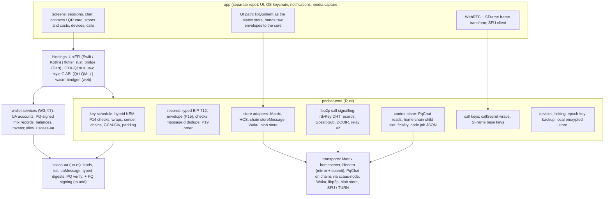

> **Research note — background and rationale only, not normative; the current rules are in docs/ (see decisions.md).**

# PqChat client: fork a chat app, fork a wallet, fork Status, or build our own (research, 2026-11-05)

How to build the PqChat client for UA-7 ([spec](../superpowers/specs/2026-10-25-ua7-pq-e2e-sessions.md); two-page
summary [`pqchat-overview.md`](pqchat-overview.md)). Owner 2026-11-05: the contract side is built first; the client lives
in a **separate repository** and may use a **`pqchat-core`** library (Rust: envelope, key schedule, record checks,
dedupe, transport adapters); the client should hold **assets (a wallet) and chat together**. The owner has **started an
experiment**: a fork of the Status desktop app in a separate folder, libQuotient added, the whole Nim backend cut; nothing
is wired to SCaaS and it has not been run. Status is the leading candidate, **not a decision**; this note compares it with
the other paths at the same depth. **Nothing here is decided.** Labels: **[F]** fact with its source, **[E]** estimate,
**[I]** inference. Licences were read from each repository's licence file or README on 2026-11-05 (GitHub API and the
files themselves).

## 1. What a PqChat client must do

From the spec (P1, P2, §4.2, §6, §7, §10, §12) [F]:

| Need | Spec | What it means for a client |
|---|---|---|
| UA identity, PQ signing | P3, P7, D7 | sign every record with ML-DSA-44 / -65 or FN-DSA-512; verify other members' portable signatures |
| Key schedule | §6 | ML-KEM-1024 + X25519 hybrid (P14 checks), wraps, per-sender per-device chains, AES-256-GCM-SIV, padding |
| Control plane | §5, P17 | read `PqChat` (sessions, epochs, wrap chunks, home-chain child slot, finality); build named-field jobs for the node |
| Several stores per session | P27, §4.2 | replicate every message to Matrix, HCS, chain `storeMessage`, Waku; read any; dedupe by `messageId`; order by `parents` (P19) |
| Call signalling | P30, P21 | libp2p (Kademlia `rdvKey`, GossipSub, DCUtR, relay v2) first, then Matrix, then HCS |
| Calls | §10 | WebRTC 1:1, SFU for groups, SFrame (RFC 9605) keys from `K` and `callSecret` |
| Attachments | P28 | encrypted file in a content-addressed blob store or Matrix media |
| Devices, backup | P6, O5 | device id in every derivation, QR linking, opt-in epoch-key export |
| Wallet-style key UX | P4, P5, O7 | seed / key custody, KEM fingerprints, contact card by QR, cost and "public forever" warnings |
| Assets (owner 2026-11-05) | — | accounts, balances, token lists, transfers; for SCaaS: UA accounts, PQ-signed `mtx*` records relayed by the node, factory tokens (later PQZ, Zether) |

**The shape that matters [I]:** Matrix is optional (D15) and every guarantee (authorship, membership, epochs) comes from
PqChat records, not from the transport. A client built around one transport's data model (a Matrix room, a Status
chat, a SimpleX queue) has to be turned inside out; a client built around PqChat sessions treats each transport as an
adapter.

**What the SCaaS repo already gives a core [F, `clients/`, `docs/clients/ua-libraries.md`]:**

- `clients/ua-rs` (`scaas-ua`): kinds, ids, `uaMessage`, typed portable digests, registry call builders, and, under
  feature `pq`, **verification only** of ML-DSA-44 / -65, SLH-DSA and FN-DSA-512. No PQ signing, no ML-KEM, no
  X25519 wrap, no AES-GCM-SIV.
- `clients/clientkeys` (JS): PQ key generation from the seed and signing (`@noble/post-quantum`), the reference for
  seed-to-key derivation a Rust signer must match.
- `clients/ua-c` (C ABI, version 5), `clients/ua-cxx`, `clients/ua-qt` (CXX-Qt 0.10 QML module `Scaas.Ua`),
  `clients/ua-dart-frb` (flutter_rust_bridge 2.13, Linux today; Android, iOS, desktop, web planned): wrappers over
  `scaas-ua` with a JSON shim. They show the binding pattern a `pqchat-core` would follow.

## 2. Candidates

Licence = the repository's licence file as read on 2026-11-05 [F, link]. "Swap" = how hard it is to replace its E2EE,
identity and transport with PqChat [I].

| Candidate | Licence [F] | Language, platforms [F] | E2EE / identity / transport [F unless marked] | Swap [I] |
|---|---|---|---|---|
| [Element Web](https://github.com/element-hq/element-web) | AGPL-3.0 **or** GPL-3.0 **or** Element Commercial (README "Copyright & License"; `LICENSE-AGPL-3.0`, `LICENSE-GPL-3.0`, `LICENSE-COMMERCIAL`) | TypeScript, React; web, desktop (Electron) | matrix-js-sdk, Rust crypto in WASM; Matrix user id; Matrix CS API | hard: everything is a Matrix room |
| [Element X iOS](https://github.com/element-hq/element-x-ios) / [Android](https://github.com/element-hq/element-x-android) | AGPL-3.0 + `LICENSE-COMMERCIAL` | Swift / Kotlin, two native codebases | [matrix-rust-sdk](https://github.com/matrix-org/matrix-rust-sdk) through `bindings/matrix-sdk-ffi` (UniFFI); Android pins `org.matrix.rustcomponents:sdk-android` | hard, twice: two UIs bound to the SDK's room and timeline types |
| [matrix-rust-sdk](https://github.com/matrix-org/matrix-rust-sdk) | Apache-2.0 | Rust; crates `matrix-sdk`, `matrix-sdk-crypto`, `matrix-sdk-ui`, FFI | Olm / Megolm via [vodozemac](https://github.com/matrix-org/vodozemac) (Apache-2.0), classical | a **library**, not an app: usable as the Matrix adapter inside `pqchat-core` |
| [FluffyChat](https://github.com/krille-chan/fluffychat) | AGPL-3.0 (`LICENSE`, SPDX `AGPL-3.0-or-later`) | Dart / Flutter; Android, iOS, web, Linux, macOS, Windows (repo dirs) | [Matrix Dart SDK](https://github.com/famedly/matrix-dart-sdk) (AGPL-3.0) with `vodozemac` 0.9; calls via `flutter_webrtc` and `livekit_client` (`pubspec.yaml`) | hard: the UI is written against the SDK's `Room` / `Timeline` / `Event` |
| [Nheko](https://github.com/Nheko-Reborn/nheko) | GPL-3.0 | C++, Qt / QML; desktop | mtxclient + libolm (`CMakeLists.txt` `USE_BUNDLED_OLM`); VoIP via GStreamer | hard; libolm is deprecated upstream [I] |
| [NeoChat](https://github.com/KDE/neochat) (mirror of KDE's) | GPL (REUSE; e.g. `src/app/main.cpp` `GPL-3.0-only`; `LICENSES/` lists GPL-2.0/3.0, LGPL, MIT, BSD) | C++, Qt / QML, Kirigami; Linux, Plasma Mobile, Android, Windows | libQuotient | medium-hard; Qt, close to `ua-qt` |
| [Quaternion](https://github.com/quotient-im/Quaternion) | GPL-3.0 | C++, Qt; desktop | libQuotient | medium-hard; desktop only |
| [libQuotient](https://github.com/quotient-im/libQuotient) | LGPL-2.1 | C++ / Qt library | E2EE through `matrix_rust_sdk_crypto_cpp` and OpenSSL; QtKeychain (`CMakeLists.txt`) | a **library**: owner answer 5 (Qt client on libQuotient) uses it as the Matrix store |
| [Cinny](https://github.com/cinnyapp/cinny) | AGPL-3.0 | TypeScript, React; web, desktop wrapper | matrix-js-sdk 41.7 | hard; web only |
| [Status app](https://github.com/status-im/status-app) (was status-desktop) | MPL-2.0 (`LICENSE.md`) | Nim + Qt / QML; desktop and mobile (`mobile/` dir; the old [status-mobile](https://github.com/status-im/status-legacy) is archived) | [status-go](https://github.com/status-im/status-go) (MPL-2.0): `go-waku` v0.10.3, `go-libp2p` (`go.mod`); Status's own protocol and secp256k1 identity [I]; Ethereum wallet built in | hard: three languages, a large monorepo, identity and protocol in status-go; the owner's experiment, §7 |
| [SimpleX Chat](https://github.com/simplex-chat/simplex-chat) | AGPL-3.0 | Haskell core; Kotlin Multiplatform (Android, desktop), Swift (iOS) (`apps/`) | no user identifiers; SMP relays; [PQ double ratchet](https://raw.githubusercontent.com/simplex-chat/simplexmq/stable/protocol/pqdr.md) (sntrup761) for direct chats | very hard: the protocol is the product |
| [Session](https://github.com/session-foundation/session-desktop) (+ [Android](https://github.com/session-foundation/session-android), [iOS](https://github.com/session-foundation/session-ios), [libsession](https://github.com/session-foundation/libsession-util)) | GPL-3.0 (all four) | TypeScript / Electron, Kotlin, Swift, C++ | onion routing over Session nodes, swarms; Ed25519 Session ID [I]; Protocol V2 with ML-KEM and forward secrecy announced Dec 2025, in design ([CyberInsider](https://cyberinsider.com/?p=291647), secondary) | very hard: network-bound |
| [Briar](https://github.com/briar/briar) | GPL-3.0 (`LICENSE.txt`, "version 3 … or later") | Java; Android (desktop separate) | Bramble over Tor, Bluetooth, Wi-Fi | very hard; Android-centred |
| [qTox](https://github.com/TokTok/qTox) | GPL-3.0 (`qTox/qTox` archived 2025-02; TokTok fork active) | C++, Qt; desktop | toxcore: NaCl identity keys | **rejected by D16** (classical identity, no browser client, small ecosystem) |

**Added candidates** (not to fork for PqChat, but strong as models or parts):

| Candidate | Licence [F] | Why it is listed |
|---|---|---|
| [XMTP libxmtp](https://github.com/xmtp/libxmtp) (+ [xmtp-js](https://github.com/xmtp/xmtp-js) SDKs) | MIT | **The closest shape to `pqchat-core`**: one Rust core (MLS, wallet-address identity) with bindings for Swift / Kotlin, WASM and Node; README claims harvest-now-decrypt-later protection. Its protocol is MLS on the XMTP network, so it is a reference, not a base [I]. |
| [Delta Chat core](https://github.com/chatmail/core) | MPL-2.0 (`LICENSE`) | A Rust core with a stdio JSON-RPC server and several UIs ([desktop](https://github.com/deltachat/deltachat-desktop), [Android](https://github.com/deltachat/deltachat-android), both GPL-3.0). Shows "Rust core + RPC + per-platform UI" at production scale; its README deprecates the C FFI for new projects in favour of JSON-RPC. |
| [Berty](https://github.com/berty/berty) | Apache-2.0 **or** MIT (`COPYRIGHT`) | libp2p / IPFS native (Wesh protocol, OrbitDB), Go core + React Native. Licence-compatible with anything, but README: Wesh "partially implemented", API unstable. |
| [Quiet](https://github.com/TryQuiet/quiet) | GPL-3.0 | Tor + libp2p + OrbitDB, Electron and React Native: libp2p-native, but GPL and Tor-bound. |
| Waku: [nwaku / logos-delivery](https://github.com/logos-messaging/logos-delivery), [js-waku](https://github.com/logos-messaging/logos-delivery-js), [go-waku](https://github.com/logos-messaging/logos-delivery-go), [Rust bindings](https://github.com/logos-messaging/logos-delivery-rust-bindings) | Apache-2.0 (nwaku ships `LICENSE-APACHE` and `LICENSE-MIT`) | the P31 store from Rust (bindings over libwaku) and from the browser (js-waku) |
| [rust-libp2p](https://github.com/libp2p/rust-libp2p), [LiveKit](https://github.com/livekit/livekit) server, [client-sdk-js](https://github.com/livekit/client-sdk-js), [rust-sdks](https://github.com/livekit/rust-sdks), [Flutter SDK](https://github.com/livekit/client-sdk-flutter), [hiero-sdk-rust](https://github.com/hiero-ledger/hiero-sdk-rust), [cisco/sframe](https://github.com/cisco/sframe) | MIT; Apache-2.0 (LiveKit ×4, Hiero); BSD-2-Clause (sframe) | the parts every approach reuses |

**LiveKit and SFrame [F]:** LiveKit's built-in E2EE is AES-GCM with a 12-byte IV signalled in the clear and a
codec-dependent unencrypted prefix (`src/e2ee/constants.ts` in client-sdk-js, whose comments refer to Jitsi's JVB), **not the
RFC 9605 SFrame** header the spec names (P22). Its key provider can be fed external keys
([docs](https://docs.livekit.io/home/client/tracks/encryption/)). So P22 as written means our own frame transform
(WebRTC Encoded Transform on the web, libwebrtc's frame transformer natively) in every approach [I]; using LiveKit's
format instead would be a spec change for the owner.

**PQ in the candidates [F/I]:** Matrix (Olm / Megolm) is classical; SimpleX has a PQ ratchet for direct chats; Session
has announced ML-KEM; XMTP claims HNDL protection; Status, Briar, Tox are classical [I]. None uses PQ **signatures** for
authorship, which PqChat requires (D7), so every fork replaces the identity layer, not only the key exchange [I].

## 3. Wallet candidates (an existing open-source wallet, then add chat)

The other way to get "assets and chat together": fork a wallet and add PqChat. Licences read 2026-11-05 [F, link].

| Wallet | Licence [F] | Stack, platforms [F] | Fit [I] |
|---|---|---|---|
| [Cake Wallet](https://github.com/cake-tech/cake_wallet) | MIT (`LICENSE.md`) | Dart / Flutter; Android, iOS, macOS, Linux (README; `windows/` dir too); per-chain packages `cw_evm`, `cw_solana`, `cw_monero` …; already builds Rust through cargokit (`cargokit_options.yaml`) | **best wallet fit**: Flutter like approach C, Rust already in the build, multi-chain with an EVM module, MIT |
| [Unstoppable Wallet](https://github.com/horizontalsystems/unstoppable-wallet-android) ([iOS](https://github.com/horizontalsystems/unstoppable-wallet-ios)) | MIT (both) | Kotlin / Swift, two native codebases; Ethereum, BSC, Avalanche, Solana, TON … (README) | good licence, double UI work (as Element X) |
| [Rabby](https://github.com/RabbyHub/Rabby) | MIT **plus** a brand clause ("You can not use brand name or logo of Rabby") | TypeScript browser extension; [rabby-mobile](https://github.com/RabbyHub/rabby-mobile) has **no licence file** (no grant) | extension only usable; a browser extension is a poor home for libp2p, calls and multi-store chat |
| [Enkrypt](https://github.com/enkryptcom/enKrypt) | MIT | TypeScript browser extension, multi-chain | as Rabby |
| [Rainbow](https://github.com/rainbow-me/rainbow), [Safe{Wallet}](https://github.com/safe-global/safe-wallet-monorepo), [Ambire](https://github.com/AmbireTech/extension), [Stack Wallet](https://github.com/cypherstack/stack_wallet) | GPL-3.0 (all four) | React Native; web; extension; Flutter | GPL: the licence conflict of §4 |
| [Frame](https://github.com/floating/frame) | GPL-3.0, **archived** 2025-03 | Electron desktop | out |
| [MetaMask](https://github.com/MetaMask/metamask-extension) (and mobile) | **source-available, not open source**: ConsenSys copyright, derivative works "solely for Non-Commercial Use" (`LICENSE`) | TypeScript | out |
| Libraries, not apps: [Trust Wallet Core](https://github.com/trustwallet/wallet-core) (Apache-2.0, C++ with bindings), [alloy](https://github.com/alloy-rs/alloy) (Apache-2.0 per GitHub; Rust, the node's EVM library) | permissive | — | the parts an own wallet (W3, §7) is built from |

No maintained Qt wallet apart from Status turned up [I]. Every wallet above signs with secp256k1 (or ed25519) keys; none
knows a UA, a PQ signature or a relayed `mtx*` record, so the SCaaS side of the wallet is new code in every path [I].

## 4. Licence compatibility

Not legal advice: what each text says, and the questions for the owner or a lawyer.

**The SCaaS licence [F, `LICENSE`].** Vegan Community License 1.0: MIT or Apache-2.0 freedoms for eligible users, plus
§2 (prohibited users, by activity), §3 (eligibility: a Vegan Organization, or Gross Revenue below USD 10,000,000), §4
(rights end above the threshold), §6 (verification, automatic termination). §3(i): every distributed copy "must be
licensed to its recipients under this license … not under the MIT License or the Apache License 2.0 alone". §3 also:
"Works You create that only call or link to the Software remain under the licenses You choose for them; the Software
within them stays under this license." So **from the SCaaS side**, an app of any licence may link `pqchat-core`.

**The GPL side [F, GPL-3.0 text].** §10: "You may not impose any further restrictions on the exercise of the rights
granted or affirmed under this License." §7 lists the only additional terms allowed; any other non-permissive term is a
"further restriction" that a recipient may remove. The FSF FAQ
([GPLIncompatibleLibs](https://www.gnu.org/licenses/gpl-faq.html#GPLIncompatibleLibs)): to link a GPL program with a
library not under a compatible licence, the program's **copyright holders** must grant an exception, and "if you want
to use parts of other GPL-covered programs by other authors … you cannot authorize the exception for them". AGPL-3.0
has the same §7 and §10.

**The conflict, plainly [I, owner / lawyer decision].** The Vegan licence's §2–§4 and §6 restrict who may use the
software and end rights on revenue or activity. Those are "further restrictions" in the GPL's sense. An AGPL or GPL app
**forked from someone else's code** (FluffyChat, Element X, Cinny, Nheko, NeoChat, Quaternion, SimpleX, Session, Briar)
that links or bundles a Vegan-licensed `pqchat-core` or `scaas-ua` and is distributed as one program cannot meet both
licences, and we cannot add a linking exception to the upstream authors' code. Talking to the core as a **separate
program** (for example a JSON-RPC daemon, as Delta Chat's `deltachat-rpc-server`) may be "mere aggregation"
([MereAggregation](https://www.gnu.org/licenses/gpl-faq.html#MereAggregation)), but the FSF says the line is for judges,
and for a chat app on a phone it is fragile. The Vegan licence is also not FLOSS by the OSI / FSF / DFSG standards that
[F-Droid's inclusion policy](https://f-droid.org/docs/Inclusion_Policy/) defers to [I], so an app that bundles it is
unlikely to be accepted there.

**What is compatible [I]:**

| App licence | Bundle a Vegan-licensed core? | Why |
|---|---|---|
| Vegan Community 1.0 (own app) | yes | one licence |
| MIT, Apache-2.0, proprietary | yes | permissive; the core keeps its own licence (Vegan §3) |
| MPL-2.0 (Status, Delta Chat core) | yes, as a Larger Work | MPL-2.0 §3.3 lets a Larger Work combine MPL files with code under other terms; MPL files stay MPL |
| LGPL-2.1 library inside the app (libQuotient) | yes | the app may be any licence; LGPL duties (relinking, notices) apply to that library |
| GPL-3.0, AGPL-3.0 (fork of others' code) | **no** (see above) | §7 / §10 further restrictions |

**What MPL-2.0 and LGPL require, by their text [F, MPL-2.0 §3, LGPL-2.1 §6].** MPL-2.0 is **file-level** copyleft:
§3.1, a file that is Covered Software (an upstream file, or a file modified from one) stays under MPL in source form;
§3.2, whoever ships an executable must make that Covered Software's source available and may license the executable under
other terms only if those terms "do not attempt to limit or alter the recipients' rights in the Source Code Form"; §3.3,
"You may create and distribute a Larger Work under terms of Your choice, provided that You also comply with the
requirements of this License for the Covered Software"; §3.4, keep the notices. New files we write are not Covered
Software and may carry any licence. LGPL-2.1 §6: a work that links the library may be distributed "under terms of your
choice, provided that the terms permit modification of the work for the customer's own use and reverse engineering for
debugging such modifications", with the means to relink (shared library or object files). Qt 6's LGPL-3.0 §4 has a
similar rule for its own portions. The Vegan licence anticipates this: its §7 says third-party components such as Qt
under the LGPL keep their own terms [F].

**The Status-experiment combination [I, owner / lawyer to confirm]:**

| Piece | Licence [F] | In the binary as | Works with a Vegan core? |
|---|---|---|---|
| Status app QML, StatusQ, kept C++ ([`LICENSE.md`](https://github.com/status-im/status-app/blob/master/LICENSE.md)) | MPL-2.0 | upstream files, modified or not | yes: they stay MPL, source published (the repo is public anyway) |
| [status-go](https://github.com/status-im/status-go) (only if kept, W1 in §7) | MPL-2.0 | Go `c-archive` / shared library | yes, as above |
| [libQuotient](https://github.com/quotient-im/libQuotient) | LGPL-2.1 | library | yes if linked so a user can relink it, and the app's terms allow modification for own use and reverse engineering for debugging; whether the Vegan §2 / §3 user restrictions sit well with that LGPL clause is a lawyer question |
| Qt 6 | LGPL-3.0 (or commercial) | shared libraries | as libQuotient |
| new C++ / QML glue | ours: Vegan, MPL or MIT | new files | yes |
| `pqchat-core`, `scaas-ua` | Vegan Community 1.0 | static library | yes (Vegan §3: linking works keep their own licences) |

So the Status path (and a Cake Wallet or Unstoppable fork, MIT) works with the core under the Vegan licence; a GPL / AGPL
chat-app or wallet fork does not, unless L1 or L3 below.

**Options for the owner:**

- **L1 — publish `pqchat-core` and the `scaas-ua` parts it needs under `Apache-2.0 OR MIT`** (or MPL-2.0). Any app
  licence works, forks included; the Vegan restriction no longer covers the core. The CLA in
  [CONTRIBUTING.md](../../CONTRIBUTING.md) lets the Licensor license contributions "under any other terms the Licensor
  chooses" [F]; third-party dependencies of `scaas-ua` (`ml-dsa`, `pqcrypto-falcon`, `k256`, arkworks …) are
  permissive [I, to check per crate].
- **L2 — keep the core Vegan** and use an app that can link it: our own (C, D, E), Status (MPL-2.0), or an MIT wallet
  (Cake, Unstoppable). No GPL / AGPL fork.
- **L3 — dual-license the core: Vegan Community 1.0 or AGPL-3.0-or-later.** GPL / AGPL apps take it under AGPL (copyleft,
  no Vegan terms); others under Vegan or an Enterprise licence. A common open-core pattern [I]; the owner decides whether
  it fits the Vegan aims.
- **L4 — process separation** (core as a daemon behind RPC). Not recommended for mobile; lawyer question.

## 5. Layering

## 6. Shared cost: `pqchat-core` [E]

Assumptions: one senior Rust engineer who knows the repo; contracts, vectors (`smartcontracts/vectors/pqchat/`, spec §12)
and the node's six call rows exist; EVM only; no audit; estimates include tests that read the shared vectors, plus the
repo's negative-test and mutant discipline (≈ 20 % of each line). Person-weeks (pw).

| Part | pw | Note |
|---|---|---|
| PQ signing in Rust (ML-DSA-44 / -65, FN-DSA-512), keys from the seed exactly as `clientkeys` | 2–3 | `ua-rs` verifies only today; the `ml-dsa` and `pqcrypto-falcon` crates sign [I]; vectors decide |
| Key schedule, wraps, P14, chains, envelope, typed records, ids, padding | 4–6 | all fixed by vectors |
| Control plane client (reads, chunked wraps, child slot, finality, node jobs) | 3–5 | EVM first; each family later |
| Store layer: list, replication, dedupe, P19 order, buffering, local encrypted DB | 3–5 | |
| Adapters: Matrix 2–3 (matrix-rust-sdk or raw CS API), HCS 1.5–2.5, chain store 1–2, Waku 2–4 (bindings over libwaku), blob store 1–2 | 7.5–13.5 | Waku from Rust is the least mature [I] |
| libp2p call signalling (P30) | 3–5 | rust-libp2p; browser transports in the web build |
| Call keys and SFrame keying (core side) | 1–2 | the media transform is app side |
| Devices, linking, backup export | 2–3 | |
| Two bindings (e.g. FRB + wasm, or UniFFI + CXX-Qt) | 2–4 | 1–2 per binding |
| **Total** | **28–47** | ≈ 7–11 months for one person; two people ≈ 4–7 months [E] |
| SCaaS wallet module, every path: UA accounts, PQ-signed `mtx*` records through the node, factory tokens, history from the node's indexer (Rust, beside the core) | 5–9 | no forked wallet has it (§3); general EVM wallet services are separate (§7 W0–W3) |

## 7. Status fork: what the cut implies

The owner's experiment (2026-11-05): a fork of the Status desktop app, libQuotient added, the whole Nim backend cut,
nothing wired to SCaaS, not run. Why Status: it ships a wallet and chat in one app; otherwise a wallet must be chosen and
chat added (§3). What follows is what the cut implies, not a choice.

**Where Status's logic lives [F, repository trees and files of 2026-11-05].** Three layers:

| Layer | Where | What it does | Size [F, GitHub languages API, vendor excluded] |
|---|---|---|---|
| QML UI | `ui/app/AppLayouts/` (`Wallet`, `Chat`, `Communities`, `Onboarding`, `Profile`, `Market`, `Browser`, …), `ui/StatusQ/` (C++ / QML component library, own CMake) | presentation; stores read context objects, e.g. `Wallet/stores/RootStore.qml` binds `walletSectionInst`, `walletSectionAccounts.accounts`, `walletSectionOverview` | QML ≈ 13.5 MB, C++ ≈ 3.2 MB |
| Nim | `src/app/modules/main/wallet_section/` (`accounts`, `assets`, `send`, `networks`, `all_collectibles`, `saved_addresses`, `buy_sell_crypto` …), `src/app_service/service/` (`wallet_account`, `token`, `transaction`, `network`, `currency`, `keycardV2` …), `src/backend/*.nim` | the **bridge and view-model layer**: the QObjects and models QML binds to, cached state, async tasks, signal routing; `src/backend/wallet.nim` declares RPCs such as `rpc(signMessage, "wallet")`, `rpc(buildTransaction, "wallet")`, all sent through `status_go.callPrivateRPC` (`src/backend/core.nim`) | Nim ≈ 5.6 MB, 774 `.nim` files under `src/` |
| status-go | `vendor/status-go` ([status-go](https://github.com/status-im/status-go)), linked as `libstatus` (`src/status_go.nim`) | "implements most of the Status apps business logic" (README): `pkg/services/wallet/` (`balance`, `tokenbalances`, `token`, `transfer`, `router`, `routeexecution`, `pendingtxtracker`, `collectibles`, `market`, `onramp`, `activity`, `thirdparty` with `lifi`, `paraswap`, `mercuryo` …), `pkg/services/accounts`, `networks`, `typeddata`, `internal/accounts-management`, `internal/transactions`; C exports in `mobile/status.go`: `InitializeApplication`, `Login…`, `CallPrivateRPC`, `SignTypedDataV4`, `SendTransactionV2`, `HashTransaction` …, events through a signal callback | Go ≈ 10.9 MB |

**(1) What the cut removes [I from the above].** The wallet logic (accounts and keystore, balances, token lists,
transaction building and signing, providers, swaps, collectibles, history) lives in **status-go**, not in Nim. Cutting
Nim removes the **bridge**: nothing calls status-go any more, and every QML screen loses the context objects and models
it binds to. To be re-provided: (a) every context object and model the kept screens read, with the same property names
and roles, or the QML edited; (b) login, keystore and account flows; (c) async work and signal routing onto the GUI
thread; (d) the wallet services themselves, unless status-go stays. A cheap first step before any wiring: run the cut
fork with empty stub objects; the QML `ReferenceError` / `TypeError` list is the inventory of what must be re-provided,
screen by screen [I].

Options for the wallet services:

| | Option | Gives | Costs and risks [I] | App pw [E] |
|---|---|---|---|---|
| **W0** | Restore the Nim wallet section from upstream, keep status-go; cut only Nim chat and communities; call `pqchat-core` from Nim through its C ABI (Nim imports C directly) | the whole Status wallet, unchanged; upstream merges for the wallet stay possible | four languages (QML, Nim, Go, Rust); Status's secp256k1 multiaccount login stays; undoes part of the cut | 3–6 (restore, strip) |
| **W1** | Keep status-go through its C API (`InitializeApplication`, `Login…`, `CallPrivateRPC` with `wallet_*` methods, signals), C++ models in place of Nim | balances, tokens, routing and swaps, collectibles, activity, pending-tx tracking | a Status multiaccount (geth keystore, secp256k1) beside the UA; status-go starts its own node services at login, whether Waku / messaging can stay off for a wallet-only use must be checked (`PauseService` exists); third-party provider keys (market, collectibles, swaps) are build inputs; Go and cgo in the build; re-implementing the Nim models | 6–10 |
| **W2** | Re-implement wallet services in C++ / Qt | no Go, no Nim | largest; no reuse; every provider integration again | 15–30 |
| **W3** | Wallet services in Rust beside the core: `scaas-ua` + the SCaaS wallet module (§6) + alloy for plain EVM (balances, ERC-20, send, history from RPC or the node's indexer) | one key system (the UA), PQ signing, `mtx*` relaying, SCaaS tokens; the same crate serves Flutter, web and CLI | no swaps, collectibles or on-ramp unless added; plain-EVM services written again | 6–10 general EVM + 4–6 models |

W0 to W2 still need the SCaaS wallet module of §6: Status's wallet does not know a UA, a PQ signature or an `mtx*` record [I].

**(2) How `pqchat-core` plugs in [I].** Rust built as a static library with a C ABI generated by cbindgen, as
`clients/ua-c` does today (`include/scaas_ua.h`, a versioned ABI, numbered status codes), or as CXX-Qt QObjects, as
`clients/ua-qt` does. The core keeps its own async runtime for HCS, Waku, libp2p and chain reads; C++ registers one event
callback, re-posts each event onto the GUI thread (queued signal), and exposes `QAbstractListModel`s (sessions, messages,
members, accounts, balances) to QML. **libQuotient beside the other stores:** the core's store layer takes an
**app-side store**: for Matrix the core hands out `{v, hint, env}` for each outgoing message, C++ sends it through
libQuotient as a `net.scaas.pqchat.v1` event, and every such event libQuotient syncs goes back into the core, which
opens, verifies and dedupes it with the HCS, chain, Waku and libp2p copies (P19). HCS, chain, Waku and libp2p adapters
live inside the core. Alternative: Matrix inside the core through matrix-rust-sdk (Apache-2.0), one Matrix stack for every
app; libQuotient already uses the Rust crypto through `matrix_rust_sdk_crypto_cpp` [F], so two Rust Matrix stacks would
sit in one binary [I]. libQuotient keeps owner answer 5; the in-core adapter serves Flutter, web and the CLI as well.

**(3) Licences:** §4 table: Status files and status-go MPL-2.0, libQuotient LGPL-2.1, Qt LGPL-3.0, new glue ours, core
Vegan. The combination works with the core under `LicenseRef-Vegan-Community-1.0` by MPL-2.0 §3.3 and the Vegan §3
linking sentence; the LGPL "modification for the customer's own use" clause against the Vegan user restrictions is the
one point for a lawyer [I].

**(4) Effort, Status fork with the Nim backend cut, desktop first [E]** (app part; core and SCaaS wallet module of §6
excluded; one Qt / C++ developer; the QML kept as it is where possible):

| Work | pw |
|---|---|
| Inventory by stub run; remove or stub screens not kept (Communities, Browser, Market, ENS, stickers, Activity Center …) | 2–4 |
| C++ shell: start-up, settings, QtKeychain, event pump from the core, CMake with Qt + Rust (+ Go for W1) | 3–5 |
| Onboarding and keys: UA creation and registration in place of the Status profile and Keycard flows | 3–5 |
| Chat models over `pqchat-core` + libQuotient for the Status chat QML (sessions as chats, messages, members, composer actions, attachments, store settings, cost warnings) | 8–14 |
| Wallet models and services: W0 3–6, W1 6–10, W3 10–16, W2 19–36 | 3–36 |
| Calls (Status has none built in [I]): WebRTC, SFU, SFrame transform | 6–10 |
| **Total, W1 or W3** | **28–54** |
| Mobile later (status-app's `mobile/` builds the Qt app for Android and iOS [F dir]; redo after the cut) | +4–8 |

Upkeep: with Nim cut, upstream QML changes assume Nim models, so this is a hard fork: little upkeep, little upstream
gain after the first copy [I]. What the fork buys over an own Qt UI (D) is Status's finished QML design and StatusQ, not
logic.

## 8. Approaches (app part only, core and SCaaS wallet module excluded) [E]

Assumptions: one experienced developer in the app's stack; the core of §6 exists; "full" = text, edits, reactions,
receipts, attachments, every store, device linking, 1:1 and group calls, one release per target platform; upstream
merges for forks counted as upkeep. "+ wallet" = wallet screens 4–6 and general EVM services 6–10 where the base has none.

| | Approach | Reused | Rewritten | Risks | App pw | Licence fit |
|---|---|---|---|---|---|---|
| **A1** | Fork **FluffyChat** (+ Matrix Dart SDK), replace crypto with `pqchat-core`, add the other stores | Flutter UI on six platforms, theming, l10n, media picker, push via Matrix, LiveKit call screens | timeline rendering of `net.scaas.pqchat.v1`, session creation from chain, contact card, key UX; a second data model for sessions without Matrix (D15), since its UI reads SDK rooms; call keys | upstream churn (SDK 14 → 15); Matrix-centric assumptions everywhere; AGPL | 20–33 + 0.5–1 / month upkeep; + wallet 10–16 | **conflict** (AGPL, others' code) unless L1 or L3 |
| **A2** | Fork **Element X** (iOS + Android) on matrix-rust-sdk | two polished native apps, matrix-rust-sdk (Apache-2.0) | same as A1, twice (Swift and Kotlin) | double UI work; AGPL + Element's commercial track; heavy upstream | 32–55 + upkeep; + wallet ×2 | **conflict** unless L1 / L3 |
| **B** | Fork **Status app**, Nim kept (W0) | Qt / QML UI, wallet, Waku, libp2p | identity (secp256k1 → UA PQ) for chat, status-go's chat protocol bypassed for PqChat, HCS / chain / Matrix stores, calls | Nim + QML + Go + Rust; a large monorepo; Waku is one store of four | 23–41 + 1–2 / month upkeep | fits (MPL-2.0 Larger Work) |
| **B′** | Fork **Status app**, Nim cut (the owner's experiment, §7) | QML design, StatusQ, (W1) status-go wallet | every model and controller in C++; wallet per W0–W3 | §7 | 28–54 desktop, + 4–8 mobile | fits |
| **C** | **Own UI on Flutter** via `ua-dart-frb` pattern + `pqchat-core` (FRB) | `ua-dart-frb`'s binding pattern; `flutter_webrtc`, `livekit_client`; FluffyChat as a UX reference only | everything UI | FRB on mobile and web not yet done in the repo (Linux today); SFrame transform per platform | MVP 8–12; full 17–31; + wallet 10–16 | any (Vegan, MIT / Apache, MPL) |
| **D** | **Own UI on Qt** via `ua-qt` (CXX-Qt) + `pqchat-core`; libQuotient for Matrix (owner answer 5) | `ua-qt`, libQuotient (LGPL-2.1), QML | the same UI as C in QML; calls through LiveKit `rust-sdks` (libwebrtc) in the core, or Qt WebEngine on desktop | Qt on iOS / Android thinner for WebRTC and push [I] | MVP 8–12; full 20–36; + wallet 10–16 | any; LGPL duties |
| **E** | **Minimal reference client first** (Rust CLI, then a simple web page) | the core itself; `clientkeys` for the web signer | a CLI (`create`, `rekey`, `send`, `read`, `link`, store flags); a small web client | a web client holds keys in the browser | CLI 2–4; web 4–8 | any |
| **F** | Fork **Cake Wallet** (Flutter, MIT), add PqChat | multi-chain wallet on Android, iOS, macOS, Linux; Rust already built through cargokit | chat screens (sessions, chat, composer, contacts, store settings) 10–16; SCaaS wallet screens over the module 2–4; core in cargokit 1–2; calls 4–8; rebrand, strip 1–2 | upstream pace (pushed daily); Cake's own branding rules to check | 18–32 + 0.5–1 / month upkeep | fits (MIT) |

What dominates every row [I]: the replicated multi-store model, the chain control plane, PQ identity and the SCaaS wallet
module are new in all of them; a fork saves screens and (for B, B′ W1, F) general wallet services, not protocol work.

## 9. Recommendation [I]

**First, in every path: `pqchat-core`, the SCaaS wallet module and the CLI reference client (E)** (§6, 35–60 pw with the
CLI). The spec already orders a `ua-rs` reference first (§16 item 5); the CLI exercises every store, the vectors and the
node jobs, and stays the interop harness. Nothing below changes this part.

The four app paths, app part only [E]:

| Path | Best candidate | App pw (with wallet, with calls) | Platforms first | Licence with a Vegan core | For | Against |
|---|---|---|---|---|---|---|
| (1) Status fork | B′ (Nim cut, W1 or W3) or B (W0) | 28–54 desktop (+4–8 mobile); B 23–41 | desktop | works (MPL-2.0) | finished wallet + chat design in Qt; matches answer 5 and `ua-qt`; libQuotient already in | the cut removes the bridge to all logic; every model rewritten; Status's secp256k1 accounts beside the UA (W0, W1) |
| (2) Wallet fork + chat | F (Cake Wallet) | 18–32 | mobile and desktop | works (MIT) | a working multi-chain wallet on five platforms; Flutter; Rust already in the build | chat UI from scratch; Flutter, not Qt (answer 5 would change); upstream pace |
| (3) Chat-app fork + wallet | A1 (FluffyChat) | 30–49 | all six | **conflict** (AGPL) unless L1 / L3 | the most chat UI for free | Matrix-shaped model against D15; licence; wallet from scratch |
| (4) Own UI on core + `ua-rs` | C (Flutter) or D (Qt) | 27–47 (C), 30–52 (D) | as chosen | works | no inherited model; one key system; the same core and wallet module everywhere | every screen written |

Reading [I]: (3) is last (licence and Matrix model). (1) B′ costs about what (4) D costs; the gain is Status's design,
and the risk is reverse-engineering the Nim models the QML expects, so the stub run of §7 should size it before more
work. (2) is the cheapest way to "assets and chat" if Flutter is acceptable. **Owner note 2026-11-05: the Status app's
Qt code base already builds for mobile (`mobile/`, Android and iOS), so (1) covers desktop and mobile from one Qt code
base; the platform no longer picks between (1) and (2): the toolkit (Qt or Flutter) and the cost do. If Qt, (1) is the
lead on both, with W3 for SCaaS assets and W1 only if swaps, collectibles and on-ramp are wanted; if Flutter, (2).** How
mature the Qt mobile build is (store releases, device coverage) is to be checked by building it, not assumed.
(4) stays the fallback when the stub run shows that the Status QML is tied to Nim models too tightly.

Other points: use XMTP's libxmtp and Delta Chat core as models for the core's shape; calls last, after deciding P22's
frame format against LiveKit's own (§2).

**Owner 2026-11-05 (after this note):** `ua-rs` is the only signer, in its own round before the EVM freeze (the PQ
signing row of §6, 2–3 pw, moves there); the wallet module is built in Rust (W3), wider than §6's row: SCaaS assets 5–9,
general EVM services via alloy 6–10, Zether / PQZ provers 3–6, about 14–25 pw [E]; `pqchat-core` and `scaas-wallet` sign
only through `ua-rs`.

## 10. Decisions for the owner

1. **Path:** (1) Status fork, (2) wallet fork + chat, (3) chat-app fork + wallet, (4) own UI.
2. **Platforms first:** desktop or mobile, then iOS, web (with (1) one Qt code base serves both; the toolkit picks between (1) and (2)).
3. **For a Status fork:** keep the cut (B′) or restore the Nim wallet (B / W0); wallet services W0, W1, W2 or W3; which
   Status screens to keep (Communities, Browser, Market …).
4. **UI toolkit:** Qt (paths 1, 4-D; keeps owner answer 5) or Flutter (paths 2, 3, 4-C; changes it).
5. **Matrix adapter:** libQuotient app-side (answer 5) or matrix-rust-sdk inside the core.
6. **Licence of `pqchat-core`** and the `scaas-ua` parts it needs: L1 (`Apache-2.0 OR MIT`), L2 (Vegan), L3 (Vegan or
   AGPL-3.0 dual), L4 (process split). Owner / lawyer decision; under L2 paths (1), (2), (4) work, (3) does not.
7. **Where `pqchat-core` and the wallet module live:** in the SCaaS repo next to `ua-rs` and the vectors, or in the client
   repo (the licence of item 6 follows the code).
8. **SFrame format for calls:** RFC 9605 as P22 says (own frame transform) or LiveKit's built-in E2EE format (a spec
   change).
