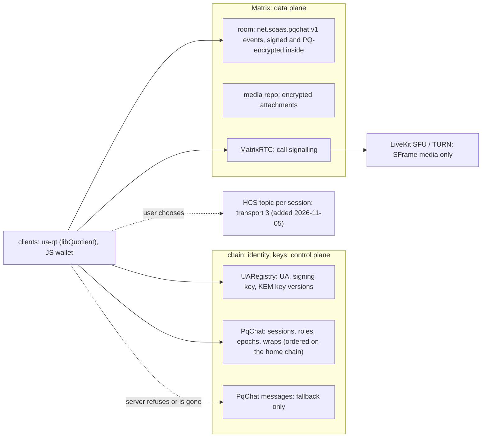

> **Research note — background and rationale only, not normative; the current rules are in docs/ (see decisions.md).**

# PqChat overview: the picture, the recommendation, the owner's decisions (research, 2026-11-04)

Two-page summary of [`pqchat-architecture.md`](pqchat-architecture.md) (the full study, with sources and labels) for
UA-7 ([spec](../superpowers/specs/2026-10-25-ua7-pq-e2e-sessions.md)). Nothing here is decided. Figures are estimates
at ETH $2,261.87 and 0.31 gwei (both 2026-11-03).

> Note (2026-11-05): the owner has since added a Hedera Consensus Service topic as the third transport, between Matrix
> and the chain (spec §7.3, D14; [CTR-CHAT-01](../decisions.md#CTR-CHAT-01)). The picture shows it; the rest of this note
> is as written on 2026-11-04. The same day (D15) a session lists its stores (Matrix, HCS, chains through
> `storeMessage`) inside `sealedInfo`, every message goes to each, and Matrix became optional (spec P27–P29). Also the same
> day (D16), libp2p carries call signalling peer to peer, rendezvous from the epoch key, no stored messages (spec P30); and (D17) Waku became a message store with
> retention by its operators, not durable (spec P31).

## The picture

The UA-7 spec mixes four layers. **Identity** and the **KEM key directory** are built and fit. The **control plane**
(sessions, members, epochs) has no ordering authority, no roles and no consent. The **data plane** has two candidates
(Matrix, chain) and no rule for choosing.

## Recommendation

1. **Primary: Matrix carries messages, attachments and call signalling; the chain holds identity, KEM keys and the
   control plane.** Fallback: the same signed message record posted on chain (C6b) when a server refuses, or when a
   message must stay on chain. Peer to peer only for 1:1 calls; the node only relays `PqChat` writes.
2. **Fix the control plane:** `epoch = parent + 1`, one child per parent, first landed on the session's home chain
   wins; admins change membership. Today a removed member can undo its removal by posting a higher epoch or grinding a
   smaller `epochId`.
3. **Fix authentication over Matrix:** every message carries the author's PQ signature inside the ciphertext. Today any
   member can forge any other member's Matrix messages (all `k_send` derive from the shared `K`).
4. **Be honest about forward secrecy:** wraps sit on chain forever under a long-term, unrevocable KEM key, so FS and PCS
   last only as long as a KEM key version. Rotate KEM keys and delete old secrets, plus a per-sender hash ratchet.
5. **Calls:** WebRTC for 1:1, MatrixRTC on a LiveKit SFU for groups, media end to end by SFrame with keys from
   `K_epoch ‖ callSecret`, `callSecret` KEM-wrapped per participant in a Matrix event (no gas), rotated on every join or
   leave.

## Cost at a glance [estimate]

| | Ethereum, 0.31 gwei | at 5 gwei | layer 2 (0.005 gwei) | Matrix |
|---|---|---|---|---|
| 2-member session (FN-DSA-512) | 8.1 M gas, $5.7 | $91 | $0.09 | — |
| 20-member session or rekey | 55–58 M gas, $38–41 (≈ a 60 M block) | $620–660 | $0.6 | — |
| 1 KiB message | 2.5–13 M gas, $1.7–9.2 | $28–148 | $0.03–0.15 | 0 gas |

## Decisions for the owner

Each: the question, the options, the recommendation.

1. **Where do messages travel?** (a) chain only; (b) Matrix, chain for keys and control; (c) peer to peer; (d) the node
   stores or gossips them. **Recommend (b), with (a) as fallback.**
2. **What is always on chain?** (i) control plane only; (ii) control plane and every message; (iii) control plane always,
   messages per session or per message by choice. **Recommend (iii)** (owner answer 6 stands: messages may go on chain).
3. **Who orders epochs?** (i) today's rule, highest epoch then smallest id (a removed member wins); (ii) `epoch = parent
   + 1` and first landed on a home chain named in the session; (iii) client fork resolution, DMLS-style. **Recommend
   (ii).**
4. **Who may change membership?** (i) any member (today); (ii) admins listed in the session, anyone may leave, any member
   may rekey with the same members; (iii) a policy struct per session. **Recommend (ii).**
5. **Does a member consent?** (i) listing is membership (today); (ii) an on-chain acceptance before later epochs wrap to
   it; (iii) acceptance in clients only. **Recommend (iii) now**; the public link stays until C10.
6. **Forward secrecy or chain-recoverable history?** (A) history from chain with the long-term KEM key (today, no FS);
   (B) KEM key rotation with deletion of old secrets plus a per-sender ratchet, history by explicit backup; (C) an
   off-chain ratchet (triple ratchet 1:1, MLS groups), chain only for identity and first contact. **Recommend (B) now,
   (C) for 1:1 later.**
7. **How are Matrix messages authenticated?** (i) a PQ signature inside every message, the same bytes as the chain
   record (no deniability, FN-DSA-512 +666 B); (ii) MAC only (deniable, insiders can forge). **Recommend (i).**
8. **How does an `msig` join?** (i) its own KEM key, secret shared by its operators; (ii) expanded into its accepted
   member UAs, two levels; (iii) refused. **Recommend (ii)**; messages always written by a member UA.
9. **Devices?** (i) one shared KEM key and signing key, with a device id in every derivation (now); (ii) per-device KEM
   keys now; (iii) device linking off chain. **Recommend (i) + (iii) now, (ii) when needed.**
10. **How much metadata to hide?** (i) public membership (today); (ii) the C10 unlinkable mode on chain; (iii) minimum
    hygiene: no Matrix room id on chain, padding buckets, relayer submission, receipts and typing encrypted.
    **Recommend (iii) now, (ii) later for on-chain traffic.**
11. **Signature bytes of an on-chain message:** (i) in state (spec C6b); (ii) hash in state, bytes in the event, as the
    owner ruled for `msig` signatures on 2026-11-03. Ciphertext stays in state either way. **Recommend (ii)**: saves
    1.0–5.0 M gas per message.
12. **Calls: transport.** (i) WebRTC 1:1 + MatrixRTC / LiveKit SFU for groups; (ii) the node as TURN / SFU (it becomes a
    media relay: bandwidth, IPs, its own module spec); (iii) no calls. **Recommend (i).**
13. **Calls: media keys.** (i) derived from `K_epoch` only (every session member can join the media); (ii)
    `K_epoch ‖ callSecret`, `callSecret` wrapped per participant off chain, rotated on join or leave; (iii) MatrixRTC's
    own classical Olm keys. **Recommend (ii)** for groups, (i) for 1:1.

## Not decisions: the spec must follow later rules

Typed EIP-712 records with explicit parameters under a portable domain (CTR-MTX-28/29, CTR-UA-07 typed structs); a
wrap as named fields (`kemCt`, `sealedKey`); only PQ kinds hold a KEM key, so a secp256k1 UA cannot be a member, and
ML-DSA must use the cached key, a precompile or FN-DSA-512; the 1,601-byte scheme-tagged key; no block-limit
assumption (chunked wraps); `PqChat` rows in the node's call table. Details: the study §9.
