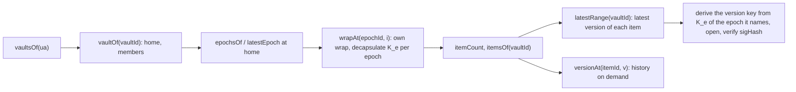
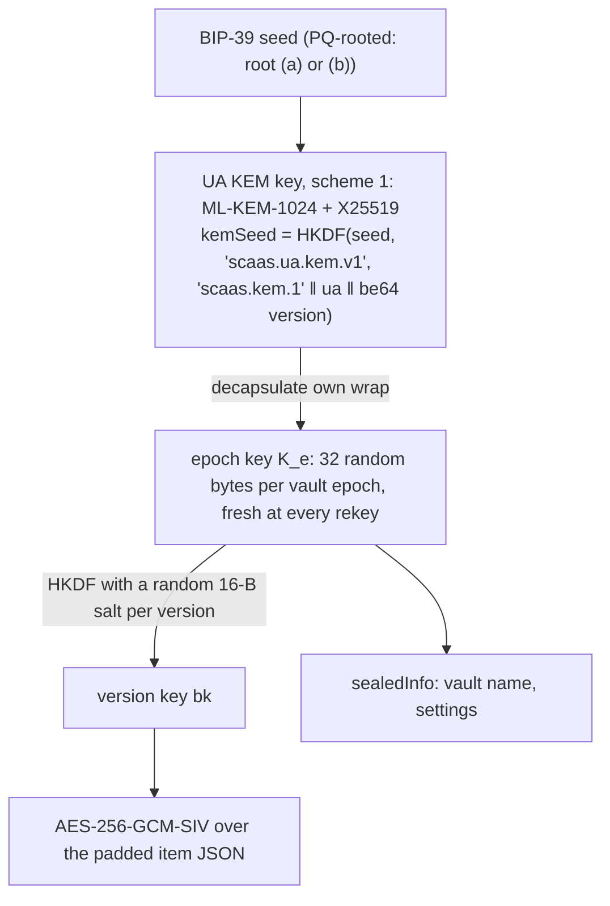

> **Research note — background and rationale only, not normative; the current rules are in docs/ (see decisions.md).**

# PqVault: post-quantum notes and passwords stored on chain, in the style of PqChat

Research of 2026-11-17 for the owner. Nothing here is built, specified or decided; every design below is a proposal and
**UNAUDITED**. Tags: **[F]** fact, with its source (a standard, or a repo `file:line` at `d823d61f0`); **[I]** inference;
**[E]** estimate. Gas figures are paper estimates on the PqChat measurements, not measurements.

**Note (2026-11-17, after this research).** The owner's rulings N1 and N2 change two of §11's decisions; the spec's
revision 4 carries them: decision V2 (`PURPOSE_PQVAULT` in the registry's closed list) is replaced by an open portable app
namespace in the registry, with PqVault on both paths, portable and chain-bound; decision V11 (an SDK module `pqvault`) is
replaced by `pqvault-core` as an app core above `scaas-sdk`. See the spec `docs/superpowers/specs/2026-11-17-pqvault.md`
§3, §4.1, §5.15, §7 and `decisions.md` CTR-UA-45, CTR-PQV-16, CLI-PQV-01. The text below is kept as written.

**Contents**

0. [Summary](#0-summary)
1. [The idea and its place](#1-the-idea-and-its-place)
2. [What a password manager needs, mapped to PqChat](#2-what-a-password-manager-needs-mapped-to-pqchat)
3. [Design options](#3-design-options)
4. [Option B in detail](#4-option-b-in-detail)
5. [Cryptography](#5-cryptography)
6. [What a public chain shows, and what cannot be had](#6-what-a-public-chain-shows-and-what-cannot-be-had)
7. [Threat model and the repository's rules](#7-threat-model-and-the-repositorys-rules)
8. [Gas and storage](#8-gas-and-storage)
9. [Prior art](#9-prior-art)
10. [Where it sits in the stack](#10-where-it-sits-in-the-stack)
11. [Open decisions for the owner](#11-open-decisions-for-the-owner)
12. [Effort](#12-effort)
13. [Sources](#13-sources)

## 0. Summary

- **Recommendation: option B**, a new factory contract `PqVault` that reuses PqChat's record, wrap and epoch rules
  (vault = PqChat-style group with epochs and KEM wraps, members ≥ 1) and adds an item model taken from PqChat topics
  (item id, append-only versions, `version == count + 1`, latest version readable from state, state-only recovery). PqChat
  itself cannot hold a one-person vault: `createSession` needs at least 2 members [F `PqChat.sol:120`,
  `docs/contracts/pqchat.md:222`], and it keeps no latest version per item [I].
- **Blocking fact for any new contract:** the registry's portable purposes are a closed set (`PURPOSE_KEM`,
  `PURPOSE_PQZ_KEY`, `PURPOSE_PQCHAT`, …), and "a new portable purpose waits for the next registry generation"
  [F `UARegistryCoreLib.sol:685-690`, `docs/contracts/accounts.md:1598-1600`]. Either `PURPOSE_PQVAULT` goes into the
  registry **before the EVM freeze**, or PqVault signs under `PURPOSE_PQCHAT` with its own EIP-712 domain (decision V2).
- **Gas [E]** (EIP-8037 1,530 state gas per byte, 97,920 per new slot, 183,600 per new account): a password item (256-B
  bucket, 288-B ciphertext field) costs **≈ 1.46 M state gas new, 1.17 M per edit**, total with the signature check
  **≈ 3.9 / 7.4 / 1.8 M** (FN-DSA-512 / ML-DSA-65 cached / EIP-8355 precompile); a 4 KiB note **≈ 7.3 M state, ≈ 10.0 /
  13.5 / 7.9 M total**. At 0.31 gwei on Ethereum ($0.70 per M gas) a password item is $1.3–5.2; on a layer 2 at 0.005 gwei
  $0.02–0.08. Storing the ciphertext in plain slots costs about twice the state gas of SSTORE2 above ~120 B.
- **Top risks** [I]: (1) everything is public forever: one seed compromise, or a future break of ML-KEM-1024 **and**
  X25519, opens every version ever written; (2) the sharing graph, item counts, edit times and sizes are public metadata;
  (3) no deletion and no real revocation: a removed member keeps what it could read; (4) cost makes a 500-item import
  ≈ 1.95 G gas (FN-DSA-512, one record each) [E]; (5) the purpose and the code-sharing question must be settled before
  the EVM freeze, or PqVault waits for the next registry generation.
- **Owner decisions** (section 11): V1 option, V2 purpose, V3 shared code with PqChat, V4 write rights, V5 revocation
  semantics, V6 batch import, V7 attachments, V8 pseudonymous vault UA, V9 extra vault passphrase, V10 factory class,
  V11 SDK module name, V12 timing against the freeze.

## 1. The idea and its place

The owner (2026-11-17): "pqvault là một kiểu tương tự pq topics, lưu dữ liệu (notes, password) trên chain" [pqvault is a
kind of thing like the PQ topics, storing data (notes, passwords) on chain]. A future product of the SCaaS stack:
contract → `pqvault-core` crate (separate, like `pqchat-core`) → a `scaas-sdk` module → the apps, offered only in
scaas-app's `scaas` build (it needs a chain and `ua-rs`, [F `docs/decisions.md:9758-9761`, the CLI-UAL-01 Change of
2026-11-17]). Research now; build later.

Read for this note: PqChat [F `smartcontracts/evm/src/pqchat/{IPqChat,PqChatTypes,PqChatCore,PqChat,PqChatTopics}.sol`,
`docs/contracts/pqchat.md`, BUILT on `ua-mtx-merge`, UNAUDITED], the UA-7 spec
(`docs/superpowers/specs/2026-10-25-ua7-pq-e2e-sessions.md`), the topics spec
(`docs/superpowers/specs/2026-11-07-pqchat-public-topics.md`), `ua-rs` `src/wallet/{kem,seal,aead,derive,vault}.rs`, and
the rules in `AGENTS.md`, ARCH-POS-13 and ARCH-POS-15.

## 2. What a password manager needs, mapped to PqChat

| Need | What mature managers do [I, section 9] | PqChat primitive that fits | Gap |
|---|---|---|---|
| **Items** (login, secure note, card, identity, SSH key) | typed records, encrypted fields | a signed typed record kept in full in state (CTR-CHAT-05, [F `pqchat.md:188-210`]) | an item type set; it lives in the plaintext JSON (like UA-7 P49 contents [F UA-7 spec §6.4.1]) |
| **Fields** (username, password, URL list, notes, custom fields, TOTP seed) | per-field or whole-item encryption | the whole item as one padded plaintext | none: whole-item encryption is simpler and hides field shapes [I] |
| **Folders / collections** | per-vault or per-collection key | a session = a key group with epochs and wraps (CTR-CHAT-06..10) | members ≥ 1 for a personal folder (PqChat needs 2 at creation) |
| **Edit history** | revisions kept a while | topic edits: `version == count + 1`, every version kept, `versionAt` (CTR-CHAT-16, [F `pqchat.md:491-496`]) | an item edit by any writer, not only the original author |
| **Concurrent edits from two devices** | server merges or last-writer-wins | `seq`/`version == stored + 1` refuses the loser [F `pqchat.md:179-180`] | none: the refusal is the conflict signal; the client merges and retries [I] |
| **Sharing with people** | vault key wrapped to each member's public key | a wrap per member to the UA KEM key (CTR-CHAT-07, UA-7 §6.2) | none |
| **Sharing with own devices** | device keys, or the same account key | every device of a UA holds the same seed-derived KEM key [F `kem.rs:6-7`]; linking by `LinkSession` (`scaas/link/v1`, [F `seal.rs:71-73`]) | none (per-device KEM keys stay research, UA-7 §13 [F]) |
| **Revocation** | remove member; ideally rotate the key | `remove` + a new epoch with a fresh key (CTR-CHAT-20, CTR-CHAT-09) | old versions stay readable to the removed member (section 6) |
| **Search** | local index after decryption | none on chain | client side only; no searchable encryption on chain (it leaks) [I] |
| **Attachments** | encrypted blobs off the main record | UA-7 `file` content: key and hashes inside the message, the file off chain [F UA-7 spec §6.4.1 `file`] | decision V7 |
| **TOTP secrets** | a field of the login item, or a separate vault | a field | policy: keeping TOTP seeds apart from passwords keeps one leak from giving both factors [I] |
| **Autofill** | OS and browser integration | none: a platform matter | Android `AutofillService`, iOS Credential Provider Extension (AuthenticationServices), a browser WebExtension with a native-messaging host; desktop OSes have no common autofill API [I, platform docs by name, not re-checked] |
| **Passkeys** | many managers now sync WebAuthn credentials | none | storing passkey private keys is a credential-provider integration per platform; out of a first version [I] |
| **Recovery on a new device** | account login + key | state-only recovery: `sessionsOf`, `epochsOf`, `wrapAt`, then the records (CTR-CHAT-14, [F `pqchat.md:412-440`]) | a `vaultsOf(ua)` and an items index per vault |
| **Delete** | delete, trash, purge | nothing is removed; edits are new records [F `pqchat.md:58`] | a tombstone version; the UI says the bytes stay (section 6) |

## 3. Design options

### 3.1 (A1) Reuse PqChat sessions and `postMessage`

A vault is a session, an item is a message whose plaintext is an item JSON, an edit is a later message naming the first
one's `messageId` (as UA-7's `edit` content, [F UA-7 spec §6.4.1]). No contract work.

- For: built today, gas known (`postMessage` 1,040-B ciphertext 153,744 regular + 2,536,740 state warm [F
  `pqchat.md:590`]); recovery views exist.
- Against [F/I]: `createSession` refuses fewer than 2 members [F `PqChat.sol:120`], so a personal vault needs a second UA
  or a create-then-rekey-to-one detour (rekey allows 1 [F `pqchat.md:284`]); no latest version per item in state: a
  device replays the whole message list; no conflict check between devices (two "edits" both land); a new member reads
  only epochs it is wrapped into, so sharing an existing folder means re-posting every item under the new epoch; vaults
  would show in `sessionsOf` beside chats; the `PURPOSE_PQCHAT` domain `DS_C` is shared with chat records (only the
  content type differs) [I].

### 3.2 (A2) Reuse PqChat `storeMessage` only

Each item version is a sealed envelope stored under an 8-byte hint derived from the vault key; the signature stays
inside the envelope, in state [F `pqchat.md:391-406`, UA-7 P29].

- For: no contract work; ciphertext in state; no verifier gas on chain (the client checks the signature), so with
  FN-DSA-512 it is the cheapest in total gas (section 8).
- Against: anyone may append to any hint (spam pays its gas, clients filter [F `pqchat.md:400-401`]); no rights, no
  version order, no latest view: all checks are client side; the hint links every item of a vault on chain and across
  chains [F `pqchat.md:405-406`]; the signature's bytes in state cost 1–4 KB per version (section 8).

### 3.3 (B) A new `PqVault` contract on PqChat's rules, with an item model like topics

A factory kind of its own (decision V10). The group part is PqChat's, unchanged in meaning: a vault record is epoch 0
with admins, members (≥ 1), wrap hashes and an encrypted `sealedInfo` (vault name, icon, settings); `rekey`, `addWraps`,
`leave`, `remove`, the home-instance slot and nonce bitmaps as CTR-CHAT-04..10 and CTR-CHAT-20. The item part follows
topics: `createItem` and `editItem` records, every version kept, `version == count + 1`, the latest version read from
state, paged lists per vault and per UA, a bulk read. Detail in section 4.

- For: a one-person vault; on-chain conflict detection; a revoked member is refused at write; a new device reads the
  latest version of each item directly; vault traffic separate from chat; one rule set the auditors already read.
- Against: a new contract (≈ 20–28 KB runtime [E], against PqChat's 27,825 B [F `pqchat.md:577`]), its tests, vectors,
  node call-table rows and an audit; the portable purpose (V2); code shared with PqChat (V3).

### 3.4 (C1) PqChat for the keys, a small item contract for the items

Items live in a thin contract that reads membership from a `PqChat` instance by an external view.

- Against [I]: the 2-member minimum stays; coupling to one immutable PqChat release; a vault is still a chat session in
  `sessionsOf`; cross-contract reads on every write. No gain over B except a smaller contract.

### 3.5 (C2) Snapshot plus log, or an off-chain body with an on-chain hash

- Snapshot: the whole vault re-encrypted as one chained SSTORE2 blob from time to time. A 500-item vault is ≈ 140 KB, ≈
  215 M state gas per snapshot, over a 60 M block [E]: rejected.
- Off-chain body, on-chain pointer and hash: contradicts the owner's "stored on chain" and the repository's practice of
  ciphertext in state (CTR-CHAT-05; the never-lose-ciphertext rule is written for PQZ and Zether, PqChat follows it [F
  `pqchat.md:209-210`]); kept only for attachments (V7).

### 3.6 Comparison and recommendation

| | A1 `postMessage` | A2 `storeMessage` | **B `PqVault`** | C1 split |
|---|---|---|---|---|
| Contract work | none | none | new contract | small contract |
| One-person vault | no (≥ 2 at create) | yes | **yes** | no |
| Latest version in state | no | no | **yes** | yes |
| Conflict check on chain | no | no | **yes** | yes |
| Write rights on chain | member of epoch | none | **member of current epoch** | member, via PqChat |
| Spam into a vault | members only | anyone | **members only** | members only |
| Password item total gas, FN-DSA-512 [E] | ≈ 3.8 M | ≈ 3.2 M | ≈ 3.9 M | ≈ 3.9 M + view |
| Separate from chat | no | no | **yes** | no |

**Recommended: B** [I]. A2 is cheaper only without a precompile and gives up every on-chain check; A1 and C1 fail the
one-person vault. B is "PqChat topics, but private": the owner's framing.

## 4. Option B in detail

A sketch for a later spec, not a rule. Names follow PqChat (`PqChatSession` → `PqVault`, and so on).

**Domain and purpose.** `DS_V = keccak256(abi.encode(keccak256("EIP712Domain(string name,string version)"),
keccak256("SCaaS PqVault"), keccak256("1")))`, portable like `DS_C` (no chain id, no address: a record is the same
bytes in every instance, so replicas work) [F pattern `pqchat.md:121-124`]. Purpose `PURPOSE_PQVAULT =
keccak256("scaas.ua.purpose.pqvault.v1")` if the registry adds it, else `PURPOSE_PQCHAT` (V2).

**Records** (typed EIP-712, every field explicit, no fee, deadline or submitter, as CTR-CHAT-19):

| Struct | Fields (proposal) | Signed by |
|---|---|---|
| `PqVault` | `creator, nonce, homeChain, homeVaultContract, admins[], members: MemberKey[], wrapHashes[], sealedInfo` | `creator` |
| `PqVaultEpoch` | `vaultId, author, nonce, epoch, parentEpochId, admins[], members[], wrapHashes[], sealedInfo` | `author` |
| `PqVaultLeave`, `PqVaultRemove` | as `PqChatLeave`, `PqChatRemove` | member / admin |
| `PqVaultItem` | `vaultId, epochId, author, nonce, ciphertext` | `author` |
| `PqVaultEdit` | `itemId, epochId, author, nonce, version, ciphertext` | `author` |
| `PqVaultBatch` (V6) | `vaultId, epochId, author, nonce, items: PqVaultItem[]` | `author` |

`vaultId = keccak256(abi.encode(keccak256("scaas/pqvault/v1/vault"), creator, nonce))`, `itemId =
keccak256(abi.encode(keccak256("scaas/pqvault/v1/item"), vaultId, author, nonce))` [I, after `pqchat.md:161-173`].

**Write checks** (as `postMessage`, [F `PqChat.sol:256-276`]): the epoch is stored for the vault and complete; at home
it has no complete child (`EpochTaken`), so a removed member's write under the old epoch is refused; the author is a
member of that epoch (V4); signature, then nonce; `editItem` also `version == count + 1` (`PqVaultVersion(expected,
got)`), and the item belongs to the same vault. The contract never reads the ciphertext.

**State and views** (all append-only): `vaultsOf(ua, offset, limit)` (one entry per member at create and per member a
rekey adds, as `sessionsOf`), `epochsOf`, `latestEpoch`, `wrapAt`, `leftIn`, `removedIn`; `itemCount(vaultId)`,
`itemsOf(vaultId, offset, limit)`, `itemOf(itemId)` (vault, first record, `versionCount`), `versionAt(itemId, v)`,
`latestRange(vaultId, offset, limit)` returning the latest record of each item, clamped like `storedRange` (16 blobs) [F
pattern `pqchat.md:401-404`]. Storage per version: one SSTORE2 blob `abi.encode(record, sigHash)`, chained when larger
than the chain's code-size limit, through `_put`/`_get` [F `PqChatCore.sol:135-159`].

**Relaying.** Every signed write relayable by anyone with a fee of 0 too; `addWraps` unsigned, the node's lane policy
decides whether it pays for it [F pattern `pqchat.md:557-569`].

## 5. Cryptography

### 5.1 Key hierarchy

- **UA KEM key** [F `kem.rs:6-8`]: derived from the seed per `(ua, version)`; versions are write-once and never revoked
  in the registry [F `accounts.md:441`, CTR-UA-32]. Every device of the UA derives the same key.
- **Epoch key `K_e`**: random, never derived from the previous one (as PqChat, [F `pqchat.md:346-347`]); wrapped to each
  member as UA-7 §6.2 with the label changed to `"scaas/pqvault/v1/wrap"`: `kek = HKDF(ss, info = label ‖ vaultId ‖
  epochId ‖ member ‖ keyId ‖ 0x01 ‖ kemPkHash)`, `sealedKey = AES-256-GCM(kek, 0^96, K_e, aad)` [F UA-7 spec §6.2 (line
  440)]. A wrap is 1,688 B packed in state [F `pqchat.md:199-201`].
- **Per-folder key, per-version body key** [I]. A per-item random key wrapped under `K_e` buys moving an item without
  re-encrypting it and sharing a single item; it costs a 48-B wrap per item and does not help revocation, because a
  removed member already knew the old item keys. Recommended: one key per vault epoch, and a body key derived per
  version: `bk = HKDF-SHA-256(ikm = K_e, salt = r, info = "scaas/pqvault/v1/item" ‖ vaultId ‖ epochId ‖ itemId ‖
  be32(version) ‖ author, L = 32)` with `r` 16 random bytes stored before the ciphertext. Sharing one item = moving or
  copying it into a shared vault.
- **AEAD**: AES-256-GCM-SIV (`aead_seal`, `Alg::Aes256GcmSiv`, [F `aead.rs:14-30`]), nonce = the first 12 bytes of
  `HKDF(K_e, salt = r, info = "scaas/pqvault/v1/nonce" ‖ …)`. Two devices racing on the same `(itemId, version)` both
  broadcast a ciphertext (one lands; the other stays in the mempool record); the random `r` makes their keys differ, and
  GCM-SIV keeps a repeated nonce from turning into a key-stream reuse [I; UA-7 keeps GCM-SIV for the same reason, F
  §6.4].
- **AAD**: `abi.encode(vaultId, epochId, itemId, version, author, homeChain, homeVaultContract)`. Binding the home
  (chain uid + contract) instead of the instance keeps replicas byte-identical while a ciphertext cannot be replayed as
  another vault's, item's or version's [I]. Binding the instance's own chain id and address, as the brief suggests, would
  forbid replicas; the vault id already includes the creator and nonce and the record names the home, so nothing is lost
  [I].
- **Padding**: UA-7's buckets, 256, 1,024, 4,096, 16,384 B, then multiples of 16,384 B, length prefix then zeros [F UA-7
  spec §6.5 (line 555)]. A typical login item (title, username, password, one or two URLs, short note) fits 256 B; a
  "4 KiB" note fits the 4,096 bucket only up to about 4,090 B with the prefix, past that it is the 16,384 bucket at four
  times the cost [I].
- **Rotation**: a rekey makes `K_e'`; new versions are written under the newest epoch (the contract refuses the old one
  at home); old versions stay under their own epochs and stay readable to members that still hold the old wraps. No item
  is re-encrypted on a rotation (V5).
- **Signatures**: every record carries a portable `UASig` (FN-DSA, ML-DSA, or a classical kind). A signature does not
  protect confidentiality; a later forgery of a classical signature cannot decrypt anything [I].

### 5.2 Recovery and multi-device

- A new device with the seed: derive the KEM key, then section 4's flow from state alone; no events, no local list (as
  CTR-CHAT-14). Reads go through an RPC list (ARCH-POS-15, [F `decisions.md:285-300`]): records are signed, so a bad node
  cannot forge an item, but it can hide the newest version or a revocation; the client keeps the highest `versionCount`
  seen per item and offers the agreement option [I].
- Linking a device: the seed moves inside a link container (`scaas/link/v1`, [F `seal.rs:73`]); the device's local cache
  sits in the seed vault's protection (scrypt pin or passkey PRF, [F `vault.rs:4-8`]).
- An `msig` UA has no KEM key [F `kem.rs:12-13`]: a vault of an `msig` wraps to its accepted members, as PqChat.

## 6. What a public chain shows, and what cannot be had

| Observer | Sees [I, after UA-7 P20, F §9 line 806] |
|---|---|
| Anyone, forever | vault ids, creators, admins, member UAs and their KEM versions: **the sharing graph**; every epoch and its time (a revocation is visible as "a rekey that dropped Bob on day X"); item count per vault; version count per item and edit times (password rotation habits); each version's size bucket; the author UA of every version; the submitter account |
| RPC providers | the reader's IP and which vault it reads (state-only recovery reads everything at once) |
| Relayers | the IP of who submits |

- **Mitigations** [I]: buckets; submission through a relayer; titles, URLs, usernames, item type and folder names only
  inside ciphertext or `sealedInfo` (the LastPass case in section 9 shows what clear URLs leak); a personal vault under
  a pseudonymous per-vault UA derived from the seed (V8); batched writes hide single edit times; reading through several
  RPC nodes. Hiding the member set of a shared vault needs the unlinkable mode PqChat left as research [F UA-7 spec §13].
- **Harvest now, decrypt later.** The wrap is ML-KEM-1024 + X25519 under a combiner, the body AES-256: both must fall for
  a ciphertext to open [F `kem.rs:8`, `accounts.md:441`]. A seed set rooted in an EOA signature or a raw classical key is
  classical-strength plus a passphrase, and its ciphertexts stay in state for ever [F
  `docs/research/sdk-keys-and-derivation.md:376-392`]: PqVault should refuse, or warn hard on, a classical-rooted set
  [I].
- **No deletion.** State and history are permanent; a delete is a tombstone version and the UI says the bytes stay [I,
  as UA-7 P16].
- **Revocation is forward only.** A removed member that once held `K_e` can decrypt every version written under that
  epoch, from chain state, at any later time. The only remedy for a shared password is to change it at the service;
  the client should list the items the removed member could read [I].
- **Seed compromise exposes all history.** Every KEM version derives from the seed [F `kem.rs:6`], so a new KEM version
  does not protect old wraps; only a new seed (new UA) and re-writing what is still needed does. A lost device that held
  the seed is a seed compromise [I].
- **No forward secrecy** for stored data, by nature: the data must stay readable for recovery [I].

## 7. Threat model and the repository's rules

| Rule | How PqVault meets it [I unless cited] |
|---|---|
| Never lose ciphertext | every version in an SSTORE2 blob in state; no hash-only or event-only form (CTR-CHAT-05 [F `pqchat.md:209-210`]); EIP-4444 lets nodes drop old history, so calldata and logs are not storage [F EIP-4444] |
| Explicit parameters, typed EIP-712, one entry point per operation | the records of section 4, `ciphertext` the one `bytes` crypto object; `createItem`, `editItem`, and a separate `createItems` if V6 |
| Every state-changing write relayable, fee 0 too | no fee, deadline or submitter in a record; `msg.sender` never read (as CTR-CHAT-19) |
| No EIP-7702 | an EOA signs with its own key; nothing delegates |
| No assumptions about a chain | the chain's code-size limit from `ChainEnv`, at least 24,576 B [F `PqChatCore.sol:17-18,101-106`]; no gas price 0; a client chunks to its chain's limits |
| One rule on every chain | the same records, ids and checks per family, each in a `pqvault-<family>` round |
| Contracts immutable, versions in the factory catalogue | a factory class and kind of its own (V10) |
| Size gate (64 KiB ceiling), EIP-8037, EIP-7825 | ≈ 20–28 KB runtime [E]; every write far under 2^24 regular gas; a batch sized so regular + state fit the block |
| ARCH-POS-13, no decryption oracle | KEM decapsulation and the one-shot AEAD keyed by it are outside the rule [F `decisions.md:273`]; PqVault still follows UA-7's hygiene [F UA-7 spec line 513]: a client sends nothing back that depends on whether a version written by another member opened or parsed (no error write, no receipt, no auto-repair); the SDK offers no "decrypt these bytes" entry, only "open the item at this chain location"; no node or service decrypts for anyone; a vault never holds a PQZ or Zether key in a form any service applies |
| ARCH-POS-15, RPC lists | reads by failover by default, the agreement option offered; rollback detection by the highest version seen |
| The node is open | relaying and indexing are generic rows; the node never holds vault keys |

Further threats [I]:

- **A malicious member of a shared vault** can write items (for example a credential for a real bank domain under its own
  account, so autofill logs the victim into the attacker's account), flood versions (gas at its cost), or keep a copy.
  Clients show the author of each version and prefer own items for autofill; admins remove members.
- **A malicious admin** can add a member silently: clients show membership changes per epoch before writing new secrets.
- **Phishing through autofill** is the platform's matter (origin matching), as for every manager.
- **Concentration**: storing other wallets' seed phrases in PqVault puts them behind one seed; the UI should say so.

## 8. Gas and storage

### 8.1 Basis

- EIP-8037 as used in the repo: **1,530 state gas per byte** of code or state, **97,920 per new slot** (64 × 1,530),
  **183,600 per new account** [F `docs/superpowers/specs/2026-11-07-pqchat-public-topics.md:201`]. Check: `storeMessage`
  of a 2,400-B envelope, warm, = 97,920 + 183,600 + 2,529 × 1,530 = 4,150,890, the measured row exactly [F
  `pqchat.md:592`].
- Signature check, regular gas: FN-DSA-512 ≈ 2.3 M, ML-DSA-65 on the cached key ≈ 5.8 M, an EIP-8355 precompile ≈ 0.2 M
  [F `pqchat.md:581-582`].
- Regular gas before the verifier: `postMessage` with 1,040 B of ciphertext 153,744 [F `pqchat.md:590`], and ≈ 64 gas
  per extra calldata byte (`storeMessage` 2,400 B → 5,100 B: 177,048 → 351,128 [F `pqchat.md:592`]).
- Prices: ETH $2,261.87, $0.70 per M gas at 0.31 gwei, $0.011 per M on a layer 2 at 0.005 gwei [F topics spec line 201-202].
  The SCaaS testnet's gas is a test token; nothing here assumes a price of 0.
- Sizes [E]: a version blob is `abi.encode(record, sigHash)` ≈ 290 B of header plus the ciphertext field. A password
  item: 256-B bucket + 16-B salt + 16-B tag = **288 B**, blob ≈ 578 B. A 4 KiB note: 4,096 + 32 = **4,128 B**, blob ≈
  4,418 B.

### 8.2 Per item, by storage method [E]

| Method | Password, new | Password, edit | 4 KiB note, new | Allowed? |
|---|---:|---:|---:|---|
| **B, SSTORE2 blob** + 3 index slots (new) / 1 (edit) | **1.46 M state** + 0.15 M regular | **1.17 M** + 0.15 M | **7.33 M** + 0.35 M | yes |
| B, plain slots (`SSTORE`, 18 / 138 words + index) | ≈ 2.06 M + regular per slot | ≈ 1.76 M | ≈ 13.8 M | yes, but ≈ 2× above ~120 B (a slot is 64 state bytes for 32 data bytes; a blob pays 183,600 once) |
| A1, PqChat `postMessage` (418 B header) | ≈ 1.36 M + 0.15 M | same | ≈ 7.24 M + 0.35 M | yes |
| A2, PqChat `storeMessage`, signature in the envelope, FN-DSA-512 / ML-DSA-65 | ≈ 3.02 / 7.14 M + 0.13 / 0.30 M, **no verifier** | same | ≈ 8.90 / 13.0 M + 0.37 / 0.54 M | yes |
| Calldata + event only | 0 state, ≈ 0.1 M regular | | 0 state, ≈ 0.35 M | **no**: ciphertext not in state |
| Hash in a slot, bytes in calldata or a log | ≈ 0.1 M state | | ≈ 0.1 M | **no**: same |

Totals for **B**, regular + state + verifier [E]:

| Write | FN-DSA-512 | ML-DSA-65 cached | precompile | Ethereum 0.31 gwei | layer 2 0.005 gwei |
|---|---:|---:|---:|---|---|
| password item, new | 3.9 M | 7.4 M | 1.8 M | $2.7 / 5.2 / 1.3 | $0.04 / 0.08 / 0.02 |
| password item, edit | 3.6 M | 7.1 M | 1.5 M | $2.5 / 5.0 / 1.1 | $0.04 / 0.08 / 0.02 |
| 4 KiB note, new | 10.0 M | 13.5 M | 7.9 M | $7.0 / 9.5 / 5.5 | $0.11 / 0.15 / 0.09 |
| personal vault, 1 member and its wrap (from `createSession` 2 members, 1 wrap: 293,223 + 5,010,750 [F `pqchat.md:587`]) | ≈ 7.5 M | ≈ 11 M | ≈ 5.4 M | $5.3 / 7.7 / 3.8 | $0.08 / 0.12 / 0.06 |
| share with one person (rekey to 2, both wraps: 366,797 + 7,740,270 [F `pqchat.md:588`]) | ≈ 10.4 M | ≈ 13.9 M | ≈ 8.3 M | $7.3 / 9.7 / 5.8 | $0.11 / 0.15 / 0.09 |
| each further member's wrap (`addWraps`: 144,280 + 2,865,690 [F `pqchat.md:587`]) | ≈ 3.0 M, unsigned | | | $2.1 | $0.03 |

- **Import** of 500 password items, one signed record each: ≈ 1.95 G gas with FN-DSA-512 (L2 ≈ $21, Ethereum ≈ $1,365),
  ≈ 0.9 G with a precompile. With a batch entry (V6), the verifier once per transaction and ≈ 36 items per 60 M
  transaction (EIP-8037: regular + state within the block), ≈ 0.8 G (L2 ≈ $9) [E].
- **Reads** are `eth_call`: free of gas, bounded by the provider's call gas cap; a 16-blob page of password items is
  ≈ 9 KB [E].
- **EIP-7825**: every write above stays far under 2^24 regular gas. ML-DSA verifies on the cached expanded key or a
  precompile; an uncached verification does not fit (`mldsa87` uncached 32.55 M, over 2^24 [F `accounts.md:1048`,
  `accounts.md:1583`]), so the cache is a precondition for ML-DSA authors.
- **Attachments**: 1 MiB on chain ≈ 1.6 G state gas [F UA-7 spec §6.5], about 38 KB per 60 M transaction [F topics spec
  line 140]; on-chain attachments make sense only for small files (keys, recovery codes) (V7).

### 8.3 Other families [E, high level]

| Family | Storage model | Password version (~450 B compact) | 4 KiB note (~4,300 B) | Notes |
|---|---|---|---|---|
| Solana | rent-exempt deposit, 5,080 lamports per byte incl. a 128-B header, never expires [F `docs/networks/solana.md:154-155`] | ≈ 0.0029 SOL | ≈ 0.022 SOL | a v1 transaction ≤ 4,096 B [F `solana.md:177`]: a note plus a PQ signature needs chunked writes and a signed commit; closing an account would return the deposit but delete the ciphertext, so never close |
| NEAR | storage staking, 10^19 yocto per byte [F `docs/networks/near.md:48`] | ≈ 0.0045 NEAR | ≈ 0.043 NEAR | locked for good (no record deleted, [F `near.md:54`]); NEAR's per-record and async model, not Algorand's |
| Algorand | box MBR 2,500 + 400 µALGO per name and value byte [F `docs/networks/algorand.md:96`]; a box ≤ 32,768 B, 2,048 B of I/O per box reference [F `docs/research/near-algorand.md:334`]; app args 2,048 B [F `algorand.md:63`] | ≈ 0.195 ALGO | ≈ 1.74 ALGO | a note spans several app calls in one atomic group |
| Soroban | persistent entries with a TTL; an archived entry is restored by `RestoreFootprintOp` with a restore fee [F `docs/networks/soroban.md:197-201`]; an entry ≤ 65,536 B [F `soroban.md:303-304`] | rent, not computed here | rent | archival means recovery from state may first pay a restore: the ciphertext is not lost, but reading it costs; a spec must say who pays [I] |
| Move (Aptos, Sui), TON, Cosmos | per-byte storage fee or refundable deposit (Aptos, Sui), continuous storage rent with freezing (TON), per-byte gas (Cosmos SDK) [I, not checked] | — | — | TON's rent can freeze an unpaid account: a "never lose ciphertext" risk to settle in that round [I] |

## 9. Prior art

Vendor designs as published; not re-checked 2026-11-17, so read every row as [I] until verified.

| System | Model | How it handles the issues here |
|---|---|---|
| Bitwarden (security whitepaper) | client-side encryption; a user symmetric key under a key from the master password (PBKDF2 or Argon2id); organisations share an org key encrypted to each member's RSA public key; collections; item revision dates | sharing = wrap the org key; removing a member does not by itself re-encrypt existing items (key rotation is a separate step); metadata kept server-side |
| 1Password (security design white paper) | a vault key per vault, wrapped to each member's public key; account password + Secret Key (two-secret key derivation); items under the vault key | per-vault key = per-folder key; the paper states a removed member may keep what was cached; server learns access patterns, not contents |
| KeePass / KeePassXC (KDBX 4) | one encrypted file (AES-256 or ChaCha20, Argon2), history entries inside, synced by any file store | no sharing model; one file hides counts and per-item edits, at the cost of re-writing all on every change (this note's C2) |
| `pass` (password-store) | one GPG file per entry, kept in git | file names (sites) are clear metadata: the leak section 6 avoids |
| Passbolt | OpenPGP: each secret encrypted separately to every user who has access | per-item per-recipient encryption; sharing to N people writes N ciphertexts |
| LastPass, 2022 incident (vendor notice, December 2022) | encrypted vault backups taken | URLs were not encrypted, so the attacker learned which sites each user had; old accounts with low PBKDF2 counts were open to offline guessing: harvest-now on stolen ciphertext, in miniature |
| Apple Passwords / iCloud Keychain | end to end per device, shared groups | device-bound keys; Apple-run sync |
| Lit Protocol | threshold network releases decryption keys when on-chain conditions hold | trust in a node quorum; a release service close to what ARCH-POS-13 forbids for PQZ and Zether keys |
| Oasis Sapphire, Secret Network | confidential contract state inside TEEs | trusts the enclave vendor; encrypted state readable by the TEE |
| Blockstack / Stacks Gaia, Arweave | user-chosen or permanent storage of encrypted app data, chain for identity | data off the contract; permanence on Arweave mirrors "no deletion" |

No widely used password manager keeps its items in public contract state, to this note's knowledge [I]: the usual
choice is a server or a file, with the chain at most for identity. PqVault's distinct points are PQ wraps on chain,
state-only recovery and relayer neutrality; its distinct costs are gas and public metadata.

## 10. Where it sits in the stack

- **Contract**: `smartcontracts/evm/src/pqvault/` (EVM first), a factory kind; other families in `pqvault-<family>`
  rounds after PqChat's own rounds [I].
- **`pqvault-core`** (Rust, separate crate like `pqchat-core`): the item schema (canonical JSON, types, bounds), padding,
  the key schedule of section 5, record building, recovery from state, merge on a version conflict, the local encrypted
  index for search. It signs nothing itself: every record goes through `ua-rs` (CLI-UAL-01 from `scaas-sdk` down, [F
  `decisions.md:9758-9761`]).
- **`ua-rs`**: the typed records and their vectors under `smartcontracts/vectors/pqvault/`, the new purpose (V2), the
  wrap label; the KEM and AEAD are already there [F `kem.rs`, `aead.rs`].
- **`scaas-sdk` module**: `vault` already names the seed vault ("the `vault` holds several independent seeds" [F
  `docs/research/sdk-keys-and-derivation.md:18-21`]). Proposals (V11): **`pqvault`** (recommended: one name from
  contract to app, the `pq` prefix keeps it apart from `vault`), `locker`, or `secrets`.
- **Node**: call-table rows and job shapes as PqChat's (`docs/node/job-api.md`), an instance check by factory class; no
  vault-specific guarantee outside the node's spec.
- **Apps**: scaas-app's `scaas` build only (the default build has no chain), the scaas-tui terminal UI; autofill as
  per-platform extensions over `pqvault-core` (Android, iOS, browser), each its own piece of work.

## 11. Open decisions for the owner

| Id | Question | Options | Recommendation [I] |
|---|---|---|---|
| V1 | Which design | A1 `postMessage`; A2 `storeMessage`; **B** new `PqVault`; C1 split | **B** (section 3.6) |
| V2 | Signature purpose | (a) add `PURPOSE_PQVAULT` to the registry's closed portable set before the EVM freeze; (b) sign under `PURPOSE_PQCHAT` with domain `DS_V`; (c) wait for the next registry generation | **(a)**: a constant and one comparison in `_portablePurpose`; (b) is safe by domain separation but blurs what the purpose tag means |
| V3 | Code shared with PqChat | (a) extract PqChat's group, wrap, epoch and blob code into a shared base both contracts use, PqChat's layout, typehash and gas pins proving it unchanged; (b) copy into `PqVaultCore` | **(a)** if done before the freeze; else (b), and unify at PqChat's next version |
| V4 | Write rights in a shared vault | (a) every member of the current epoch writes; (b) admins, writers, read-only members | **(a)** first; a read-only role later if asked (read access is cryptographic, write rights only are the contract's) |
| V5 | Revocation | (a) rekey only, old versions stay under their epochs; (b) also re-encrypt every live item under the new epoch | **(a)**: (b) costs a full re-write and protects nothing the removed member could not already read; the client lists affected passwords to change |
| V6 | Batch import | (a) one signed record per item; (b) a `createItems` entry with one signature over a list of items | **(b)** as its own entry point: ≈ 2× cheaper for imports |
| V7 | Attachments | (a) off chain as UA-7's `file` (key and hashes in the item); (b) on chain in chained blobs up to a bound (for example 16 KiB); (c) both | **(c)**: small secrets on chain, files off chain |
| V8 | Pseudonymous vault UA | (a) vaults under the user's main UA; (b) a personal vault under a per-vault UA derived from the seed | **(b)** for personal vaults by default, (a) for shared ones (the members' KEM keys are public anyway) |
| V9 | A second factor beyond the seed | (a) none; (b) a vault passphrase mixed into the wraps | **(a)** in a first version; (b) adds offline guessing exposure on chain if the seed leaks, and a forgotten passphrase loses the vault |
| V10 | Factory placement | (a) a new generic class; (b) class 3, kind 1 beside PqChat | **(a)**: clients take a class 3 instance as a `PqChat` [F `pqchat.md:110-111`] |
| V11 | SDK module name | `pqvault`, `locker`, `secrets` | **`pqvault`** |
| V12 | When | (a) before the EVM freeze, in the audit scope; (b) after, as a new catalogue entry with its own AI audit round | V2 (a) and V3 (a) need (a) for the registry and shared code; the contract itself can follow (b) |

## 12. Effort

Agent-weeks, each with its reviews (Fable and Codex on the crypto spec), [E]:

| Piece | Effort |
|---|---|
| Spec (records, key schedule, recovery, metadata), reviews, owner rulings | 1–1.5 |
| EVM contract, tests, mutants, layout and typehash pins, gas rows, deploy script, factory registration | 2–3 |
| Vectors (clientkeys reference writer) and `ua-rs` records | 1 |
| `pqvault-core` (schema, padding, key schedule, recovery, merge, local index) | 2–3 |
| Node call-table rows and policy | 0.5–1 |
| `scaas-sdk` module and bindings | 1 |
| scaas-app screens (`scaas` build), scaas-tui | 2–4 |
| Autofill, per platform (Android, iOS, browser) | 1–3 each |
| Each other family (`pqvault-<family>`) | 2–4 each |

EVM end to end without autofill and without other families: **≈ 10–15 agent-weeks** [E].

## 13. Sources

Repository (at `d823d61f0`, branch `scaas-sdk`): `smartcontracts/evm/src/pqchat/PqChat.sol`, `PqChatCore.sol`,
`smartcontracts/evm/src/common/SSTORE2.sol`, `smartcontracts/evm/src/ua/UARegistryCoreLib.sol`,
`clients/ua-rs/src/wallet/{kem,seal,aead,derive,vault}.rs`, `docs/contracts/pqchat.md`, `docs/contracts/accounts.md`,
`docs/contracts/pq-zero-knowledge.md` (CTR-PQZ-35: SSTORE2 for PQZ proofs dropped, NONE or LOG only, line 1658-1665),
`docs/decisions.md` (ARCH-POS-13, ARCH-POS-15, CLI-UAL-01), `docs/superpowers/specs/2026-10-25-ua7-pq-e2e-sessions.md`,
`docs/superpowers/specs/2026-11-07-pqchat-public-topics.md`, `docs/research/sdk-keys-and-derivation.md`,
`docs/networks/{solana,near,algorand,soroban}.md`, `docs/research/near-algorand.md`.

Standards: EIP-712 (typed data), EIP-170 (code size), EIP-4444 (history expiry), EIP-7825 (2^24 transaction gas cap),
EIP-8037 (state gas), EIP-8355 (PQ signature precompile, as the repo cites it), FIPS 203 (ML-KEM), RFC 5869 (HKDF),
RFC 8452 (AES-GCM-SIV).

Prior art (unverified here): Bitwarden security whitepaper; 1Password security design white paper; KeePass KDBX 4
format; the `pass` documentation; Passbolt documentation; LastPass incident notice of December 2022; Apple platform
security guide; Lit Protocol, Oasis Sapphire, Secret Network and Stacks Gaia documentation.
