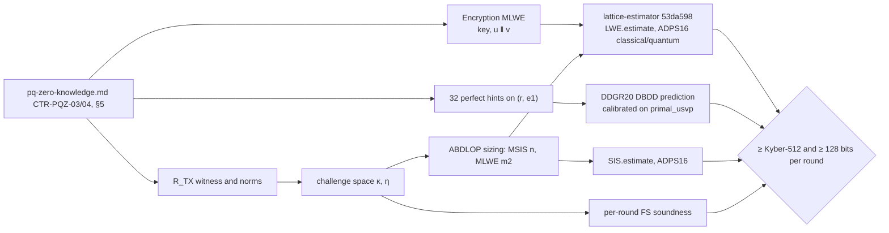

> **Research note — background and rationale only, not normative; the current rules are in docs/ (see decisions.md).**

# PQ Zether parameters: the E-S0 spike (P6b)

Written 2026-10-13 for P6b of the P6 roadmap (`docs/superpowers/plans/2026-10-12-p6-roadmap.md`): lattice-estimator
`53da598` under `RC.ADPS16` (classical and quantum) on the encryption MLWE instances, on the proof's MSIS/MLWE
instances and on Kyber-512; DDGR20 perfect hints on the shared `(r, e1)`; the soundness of every Fiat–Shamir round.
Gate: every instance ≥ Kyber-512 under both models, every round ≥ 128 bits. Nothing here changes a rule; the
parameters are those of `docs/contracts/pq-zero-knowledge.md` (CTR-PQZ-03, CTR-PQZ-04, §5). The recorded run is
`pqz-core/pqzl/params/estimator.txt` (script `e_s0.py`, rerun with `run.sh`, see that directory's README).

**[unverified]** marks a constant taken from a paper as recalled, not re-read for this note: the spike had no network
access beyond the Sage image and the lattice-estimator clone, so LNP22 / LaZer / Lether / LS18 were not fetched.
**[inference]** marks a conclusion drawn here.

## 1. Result

**Gate met.** Every instance costs more than Kyber-512 under both models, and every Fiat–Shamir round is at least
128-bit sound. Nothing needs an owner ruling (no CTR-PQZ-03/04 split-randomness fallback).

| Instance | Classical (best attack) | Quantum (best attack) | uSVP β |
|---|---|---|---|
| Kyber-512 (reference) | 115.5 (dual hybrid); uSVP 118.6 | 106.3 (dual hybrid); uSVP 107.6 | 406 |
| PQZ key `pk = A·s + e` (n = 2048, q = 2^42 − 215, CBD(1)/CBD(20)) | 136.1 (dual hybrid); uSVP 139.0 | 124.3 (dual hybrid); uSVP 126.1 | 476 |
| PQZ encryption `(u, v_t, v_f, v_a)` (m = 2048 + 48) | 136.1 (dual hybrid) | 124.3 (dual hybrid) | 476 |
| PQZ encryption, 32 hints as n − 32 (CTR-PQZ-04's approximation) | 133.5 (dual hybrid) | 121.6 (dual hybrid) | 466 |
| DDGR20 worst direction: 32 maximal-norm mixed hints | 135.5 (uSVP) | 123.0 (uSVP) | 464 |
| Proof ABDLOP MLWE (hiding), rank 33 × 33 rows, CBD(1) | 132.7 (dual hybrid) | 121.1 (dual hybrid) | 464 |
| Proof ABDLOP MSIS (binding), n = 24, ℓ2 bound 2^36.82 | 132.6 (lattice) | 120.3 (lattice) | 454 |

Log2 of the estimator's `rop`. The two proof rows are a sizing, not a check of fixed parameters: the spec leaves the
ABDLOP ranks to LaZer's codegen, so §4 derives the smallest ranks that reach β ≥ 450 (CTR-PQZ-03's block-size target)
and P6d must use at least those.

| Fiat–Shamir round | Error | Bits |
|---|---|---|
| R1 JL projection, `R ← Bin^{256×N}` | < 2^-128 (lemma); unit-vector case exactly 2^-128.99 | 128.0 |
| R2 `Z_q` amortization, λ = 4 repetitions | q^-4 | 168.0 |
| R3 `R_q` aggregation of the quadratic relations | q^-(d/l) = q^-16 | 672.0 |
| R4 final challenge, κ = 8, η = 137 | 2/\|C\|, \|C\| = 2^130.78 | 129.8 |

**Constraints for P6d** [inference]: challenge coefficients κ ≥ 8 (κ = 7 gives 124 bits); Z_q repetitions λ ≥ 4
(λ = 3 gives 126.0 bits, because q is just below 2^42); MSIS rank n ≥ 24 and randomness length m2 ≥ 66 under the
conservative choices of §4 (bimodal rejection lowers both).

## 2. What ran

| Item | Value |
|---|---|
| Estimator | lattice-estimator `53da5982597709ba0fdf94ea37a84d822310fd84` (main, 2026-08-19) |
| Sage | container `sagemath/sagemath:10.7` @ `sha256:4f5589eb6c565949a006f8665de2876b8414410daf5ac554f4434a15d4f3d528`, `--network none` |
| Cost models | `RC.ADPS16` (`0.292β`) and `ADPS16(mode="quantum")` (`0.265β`); shape model GSA (the estimator default) |
| LWE | `LWE.estimate(p, red_cost_model=…, deny_list=("arora-gb", "bkw", "bdd_mitm_hybrid"), jobs=4)`; Kyber-512 and the PQZ key instance (classical) also run `bdd_mitm_hybrid` |
| SIS | `SIS.estimate(p, red_cost_model=…)` (ℓ2, bound below q: the lattice attack only) |
| Sizing search | `LWE.primal_usvp` (GSA) and `SIS.lattice`, then the full estimates on the result |

`arora-gb` and `bkw` are far from competitive on these instances. `bdd_mitm_hybrid` targets sparse secrets (CBD(1) has
weight ≈ n/2, the spec already rules hybrid MITM out) and takes ≈ 30 min per n = 2048 run, so it runs once on the PQZ
key (classical) as the record. Kyber-512 runs every attack except `arora-gb` and `bkw`, so its reference number is the
full minimum (the dual hybrid of MATZOV at 115.5 / 106.3, lower than its uSVP 118.6 / 107.6). Comparing best attack
to best attack is the stricter reading of "every attack costs ≥ Kyber-512's".

## 3. Encryption and the shared randomness

The script reproduces the spec's scratch numbers exactly under the estimator: β = 476 (139.0 / 126.1) for n = 2048,
q = 2^42 − 215, and β = 466 (136.1 / 123.5) for n = 2016. The best attack on the PQZ instances is the dual hybrid
(MATZOV), a few bits under uSVP, as it is for Kyber-512; the margin over Kyber-512 holds in both models.

The encryption instance has m = 2048 + 48: once `pk` is replaced by uniform (the key instance), `u` and the three
16-coefficient `v` rows are LWE samples in the same `r` with CBD(20) errors. The extra 48 samples change nothing
(the attacks use fewer than 2048).

**Hints (DDGR20).** The leaky-LWE-Estimator is a separate repository, not part of lattice-estimator `53da598`, so
`e_s0.py` implements its predictive update for perfect hints (the "lightweight" DBDD model): a hint
`⟨v, (r, e1)⟩ = ℓ` removes one dimension and adds `½ ln(vᵀΣv)` to the normalized log-volume, `Σ = diag(½, 10)`;
β is the least block size meeting the ADPS16 uSVP condition on the isotropic lattice, minimized over the number of
samples. Without hints it gives β = 406 on Kyber-512 and β = 476 on PQZ, the estimator's `primal_usvp` values.

| 32 perfect hints | β | Core-SVP |
|---|---|---|
| unit vectors on `r` (= the spec's n − 32 approximation) | 466 | 136.1 / 123.5 |
| unit vectors on `e1` | 466 | 136.1 / 123.5 |
| 16 on `r`, 16 on `e1` | 466 | 136.1 / 123.5 |
| maximal-norm mixed forms `eᵀr − sᵀe1`, `‖e‖ = 164`, `‖s‖ = 36` | **464** | **135.5 / 123.0** |

**The worst direction is the mixed form, not a unit vector** [inference]. A larger normalized volume makes the
attack easier, so the most damaging hint has the largest `vᵀΣv` (it carries the most information: a unit hint on `r`
reveals a ternary value, a maximal mixed form a value of variance 26,408). For k hints with integer matrix `W`, the
volume term is `½ ln det(WΣWᵀ) ≤ ½ Σ ln(wᵢᵀΣwᵢ)` (Hadamard), and a registered key bounds every form by
`V_max = ½·164² + 10·36² = 26,408`; so 32 orthogonal maximal-norm forms bound every choice of 32 perfect hints in this
model. Even that case stays 58 β-units above Kyber-512 and above 450. The DBDD numbers are uSVP only; under the
estimator the best attack on the n − 32 instance is the dual hybrid at 133.5 / 121.6, and taking off the further
2 β-units of the worst direction leaves ≈ 133 / 121 [inference], still 17 / 15 bits above Kyber-512's 115.5 / 106.3. The spec's text ("unit vectors … and maximal-norm
mixed forms") listed the right cases; its 466 is the unit-vector case and is 2 β-units optimistic. The hints are in
fact approximate (`+ e2_t[i]`, CBD(20)); treating them as perfect is conservative. Primitive hints are assumed, as in
DDGR20's prediction.

## 4. Proof instances (LNP22 / LaZer ABDLOP)

The spec fixes the ring and the relations but not the commitment ranks, the challenge set or the masking widths; those
come from LaZer's codegen in P6d/P6e. The spike derives them from the LNP22 bounds and records each choice.

**Challenge space.** σ₋₁-invariant challenges (`c_{64−i} = −c_i`, `c_32 = 0`), coefficients in `[−κ, κ]`: 32 free
coefficients, `|C| = (2κ + 1)^32` times the share whose operator norm `max_j |c(ζ_j)|` is at most η [unverified: the
σ₋₁-invariant set as LNP22's challenge space]. η is the measured 99 % quantile (2·10^5 samples, fixed seed):

| κ | η | log2 \|C\| | final-round bits |
|---|---|---|---|
| 7 | 121 | 125.01 | 124.0 (miss) |
| **8** | **137** | **130.78** | **129.8** |
| 9 | 154 | 135.92 | 134.9 |

κ = 8 is the smallest that passes; `‖c − c'‖∞ ≤ 16` is far inside the LS18 Cor. 1.2 bound `q^{1/4}/2 ≈ 724`, so
differences of challenges are invertible in `R_q` (the reason for `q ≡ 9 mod 16`).

**Witness of `R_TX`.** `s1` = `s_f, e_f, r, e1` (32 polynomials each), `e2_t, e2_f, e2_a` (1 each), the 917 binary digits
of the integer rows (15 polynomials) and the slack bits of seven exact ℓ2 proofs (2 polynomials): m1 = 148, ‖s1‖ ≤ α =
√(2·36² + 2·164² + 3·64² + 917 + 112) = 264.0. The other relations are smaller, so ranks sized for `R_TX` cover them.

**Bounds** [unverified: LNP22's constants as recalled]. Rejection Rej0 with `𝔰 = γ·η·‖·‖`, γ = 11 (≈ 3.4 expected
tries per masked vector at 2^-128 statistical distance); randomness `s2` ternary (ν = 1), scored as CBD(1), which has
the smaller variance and so is the conservative choice; `t_B` rows = 256/d + λ + 1 = 9. Binding is
MSIS_{n, m1+m2} at `B = 8η·√(B1² + B2²)`, `B1 = 2𝔰1√(2·m1·d)`, `B2 = 2𝔰2√(2·m2·d)`; hiding is MLWE with secret rank
`m2 − n − 9` and `n + 9` rows.

**Sizing.** For each MSIS rank n the script takes the smallest MLWE rank with β ≥ 450, then checks MSIS: the first n
that passes is **n = 24, m2 = 66** (MLWE rank 33 × 33 rows), `B ≈ 2^36.82` against `q ≈ 2^42`. Full estimates: MLWE
132.7 / 121.1 (dual hybrid; uSVP β = 464); MSIS 132.6 / 120.3 (β = 454). The commitment `t_A` is 8 KB; a rough size [inference] of `z1` (148 × 64
coefficients of ≈ 21 bits) and `z2` (66 × 64 of ≈ 19 bits) plus `t_A`, `t_B` is ≈ 46 KB, inside the spec's 30–50 KB
estimate and the 96 KB kill line. A bimodal rejection (as LaZer may use) shrinks 𝔰 and thereby B and n.

## 5. Exactness of the norm proofs

| Check | Value | Holds |
|---|---|---|
| JL-extracted bound `b' = 2√512·𝔰3/√30`, `𝔰3 = γ√337·α` | 2^18.75 | — |
| exact ℓ2 (no wrap): `b'² + β_e² < q` | 2^37.50 < 2^42 | yes |
| modular JL condition `41·N·b' < q` [unverified: the constant 41] | 2^37.32 < 2^42 | yes |
| binary rows: largest reconstructed integer `e_T + 2^24 < 2^25` | ≪ q | yes |
| row 7 (digit carry): every term `< 2^15` | ≪ q | yes |

Every norm the spec calls exact is exact under these choices: no extraction slack γ > 1 enters CTR-PQZ-03's noise
budget, so `K_MAX` and the 4.1× soundness margin stand. The script also rechecks the spec's arithmetic: q prime,
`q mod 16 = 9`, `Δ = ⌊q/2^16⌋`, `B_FRESH = 11,872`, `K_MAX·B_FRESH < 2^24 < Δ/2`.

## 6. Fiat–Shamir, round by round

The spec (§5, T10) requires each challenge round to be 128-bit sound on its own, because a prover can grind every round
separately. The four LNP22 rounds are in §1's table. R1's 2^-128 is the JL lemma's bound for every vector; the
unit-vector case, computed exactly (`Pr[Bin(256, ½) < 30]`), is 2^-128.99. R2 is the tight one for this q: one
repetition is 1/q ≈ 2^-42, so three give 2^-126.0 and LaZer's codegen must be held to λ ≥ 4. R4 needs κ ≥ 8 (§4).
Quantum-random-oracle soundness of multi-round Fiat–Shamir with aborts stays the stated assumption of T10.

## 7. Open for P6d

- Check the [unverified] constants against LNP22 / LaZer at the pinned `3330e48`: the challenge set and η, the Rej0/Rej1
  widths, the binding factor `8η`, the `t_B` row count, the modular JL condition; rerun `e_s0.py` with LaZer's values
  (the gate must still hold) and record the codegen's ranks next to n = 24, m2 = 66.
- Lether's parameter choices were not compared (no access); the note's numbers stand on the spec and the estimator.
- `estimator.txt` is reproducible with `run.sh` (one container, ≈ 1 h on 4 cores); CI can diff it.
