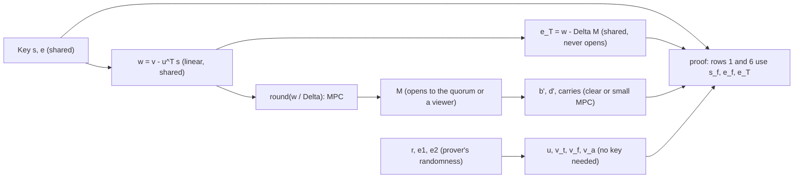
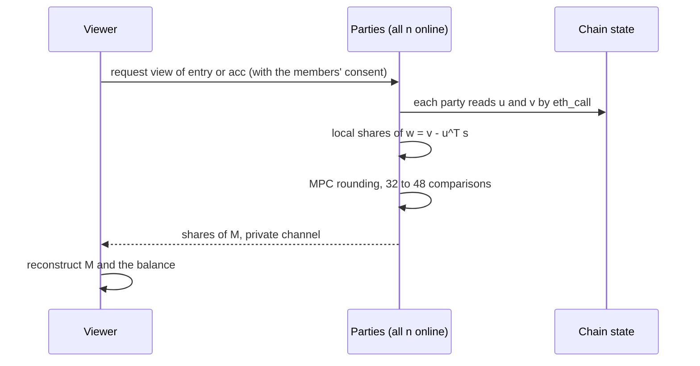
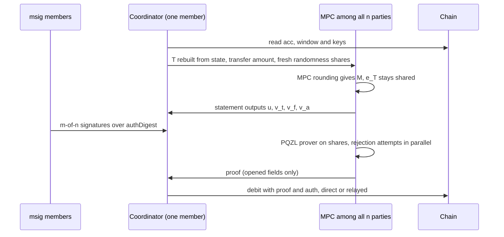
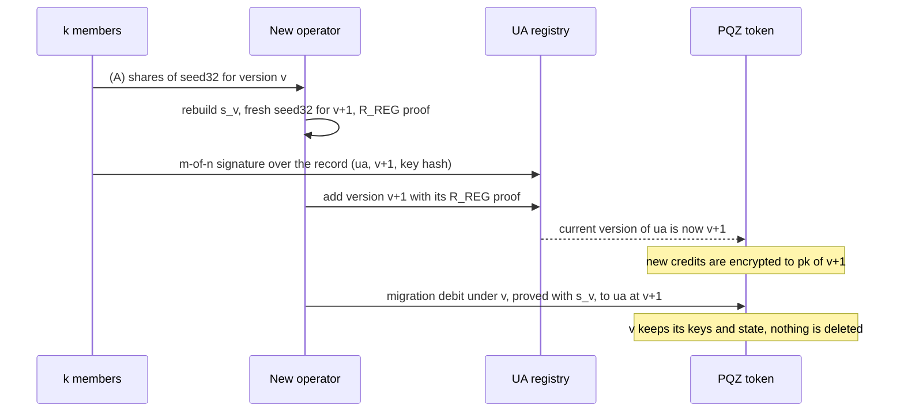

> **Research note — background and rationale only, not normative; the current rules are in docs/ (see decisions.md).**

> Vietnamese version: [pqz-threshold-decrypt-prove.vi.md](pqz-threshold-decrypt-prove.vi.md). This English file is the
> reference version.

# PQZ threshold decryption and threshold proving for an `msig`-held account: a deep dive (2026-11)

Written 2026-11-06 at the owner's request. This is the deep dive behind §4.2, §4.3 and §6 of the survey
[pq-mpc-threshold.md](pq-mpc-threshold.md), which covers MPC and threshold cryptography across SCaaS. This note is
**PQZ only**: classical Zether is a separate system and is not discussed. Research only: nothing here is a rule, and
everything cryptographic in SCaaS, including every construction below, is **UNAUDITED**. Nothing was measured for this
note. The numbers are paper arithmetic from the parameter files, plus measurements the repository already records, each
marked as such.

**The question.** Today an `msig` that holds a PQZ account depends on one **operator**, who holds the PQZ key
(`seed32` → MLWE secret `s`). The operator sees the balance and is the only party that can prove a spend
([CTR-PQZ-12](../contracts/pq-zero-knowledge.md#CTR-PQZ-12)). How far can we get toward:

- **(C) threshold decryption:** no single party can read the balance; t-of-n parties jointly decrypt `acc` and credits,
  for viewing and for building the next statement;
- **(D) threshold proving:** no single party holds the key; t-of-n parties jointly produce the spend proof, in PQZL
  (the LNP22 lattice proof) and in PQZH (Ligero).

**Owner rulings taken as given, not reopened** (owner 2026-11-06, survey §6): **(A)** a k-of-n backup of the PQZ
`seed32` will be built (ua-rs-sign T16a); **(B)** PQZ key rotation for `msig` holders is rejected. **Owner direction, the
same day:** if threshold works, the `msig`'s PQZ key may gain versions or be rotated, old versions never deleted; and
rotation does not depend on C/D alone, because (A) already lets the group rebuild the old key without the old operator.
§7 analyses both paths. It records that **(B)'s objection is resolved by (A)**; (B) is not marked approved, and its
scheduling is the owner's.

**Evidence tags** (as in the survey): [repo] read from this repository; [paper] peer-reviewed; [to appear] accepted, not
yet published; [preprint] ePrint or arXiv, not peer-reviewed; [vendor] a company's or press claim; [inference] our
reasoning; [estimate] our paper arithmetic; [unverified] could not be checked. Sources: §11.

## 1. At a glance

| Item | Result | Evidence | Contract, `proofSystemId`, vectors | Recommendation |
|---|---|---|---|---|
| Secret surface | Decryption is linear in `s` up to one rounding per coefficient; statement building needs `s` only through the digit sums `M`; the proof witness holds `s_f`, `e_f` and the noise `e_T` (§3) | [repo] [inference] | — | — |
| Noise must never open | An insider who sees the exact noise of 288 crafted credits (at `n2304-kmax4096`) recovers the key by linear algebra (§3.3) | [estimate] | — | every design keeps `v − uᵀs` and `e_T` secret-shared |
| (C) by noise flooding (uniform) | Does not fit any set: one decryption at 2^-40 needs per-party smudging of 2^56.5–2^57.0, above `q` itself; a fitting `q` is 2^74.5–2^158 (§4.2) | [estimate] | new set, new keys, new id: incompatible with every existing ciphertext | no |
| (C) by Gaussian flooding (Rényi) | Fits fresh ciphertexts only, up to 2^9.5–2^21.7 decryptions per key; never an accumulated balance; open proof questions (§4.4) | [estimate] [preprint] | none | research only |
| (C) by MPC rounding | Removes the noise instead of hiding it: 16 roundings per ciphertext, 32–48 secure comparisons; works on every existing ciphertext at every set (§4.4) | [paper] [inference] | **none** | **prototype first (C1)** |
| (D) PQZL, exact MPC of today's prover | Feasible in principle; Gaussian masks and rejection sampling inside MPC dominate; output is an ordinary PQZL proof (§5.2) | [inference] [estimate] | **none** if the mask distribution and rejection rule are kept | research spike, then prototype |
| (D) PQZL, local Gaussian shares | Cheap, but each party knows part of the mask: a leak to insiders that no published proof covers (§5.2) | [inference] | none | research only |
| (D) PQZH (Ligero) | Linear except Keccak Merkle leaves: about 1.2·10^10 AND gates per `R_TX` proof at `n2304-kmax4096`; and an `msig` cannot hold a PQZH value token (§5.3) | [repo] [estimate] | none | not pursued |
| Hybrid: threshold decryption, one prover with the key | The prover can still decrypt everything: no confidentiality gain against it (§6) | [inference] | none | no |
| Hybrid: TEE prover | Single-prover cost; confidentiality rests on the TEE vendor and on no physical access (§6) | [vendor] [inference] | none | optional, stated as a trust assumption |
| Hybrid: per-member view keys | No per-viewer copy exists for incoming credits; the auditor copy is one per token; the operator can give members **verifiable** views with `R_DR` proofs (§6) | [repo] [inference] | none | operator-attested views as an interim |
| Hybrid: split balance | n accounts, n operators: each sees its part only; costs n times the keeping (§6) | [inference] | none | allowed as client practice |
| Rotation after (A) reconstruction, as a new UA | Works today: rebuild the old `seed32`, new operator, new `msig` UA with a fresh key, confidential transfer proved under the old key; the cost is a new identity (§7.1) | [repo] [inference] | none | the near-term recovery procedure |
| Versioned PQZ keys under one UA (path (A), later C/D) | `pqzKeyAt(ua, version)`, a current pointer, `R_REG` and `keyOwner` per version; per-version account state in the token; no version enters the statement, so the proof layer is untouched (§7.3) | [inference] | a new registry generation and new PQZ token releases; **same `proofSystemId`**, no new pqz-core vectors | spec now; placement is the owner's (§7.5) |
| **Verdict (C)** | **Feasible now by MPC rounding**, off chain, no contract or parameter change; flooding is out | | | build a prototype |
| **Verdict (D)** | **Research**: PQZL possible without verifier change but costly and unproven against insiders; PQZH not needed | | | research spike only |

## 2. Setting

### 2.1 Roles

- **Operator** (today): derives `seed32` in its key worker, holds `s`, decrypts, builds statements and proofs
  ([CTR-PQZ-13](../contracts/pq-zero-knowledge.md#CTR-PQZ-13)). Spending also needs the `msig` m-of-n signature over
  `authDigest` ([CTR-PQZ-12](../contracts/pq-zero-knowledge.md#CTR-PQZ-12)), so the operator can read but cannot spend
  alone [repo].
- **Parties** (this note): the n key holders of a threshold design, naturally the `msig` members. **Quorum**: the t
  parties that take part in one decryption or one proof.
- **"No single party can read the balance"** is read here as: a decryption needs t consenting parties, and its output
  goes to those parties or to one designated party (§4.6). It does not mean that nobody ever learns the balance.

### 2.2 Shamir over `F_q` and who must be online

Every set's `q` is prime, so `s` (and `e`) can be Shamir-shared over `F_q` directly: share `s_j` is a vector of 2·n field
elements, about 37 KB per party at `n2304-kmax4096` [inference]. Partial decryption is linear and needs t shares. Any
multiplication (comparisons, rejection tests, products in a proof) needs an **honest majority among the online parties**:
with degree `d = ⌊(n − 1)/2⌋`, reconstruction needs `d + 1` (= majority) and a multiplication needs `2d + 1` online
parties [estimate, standard Shamir counting]:

| n | Shamir degree d | Tolerated colluders | Reconstruct (t) | Online for a multiplication |
|---|---|---|---|---|
| 3 | 1 | 1 | 2 | 3 |
| 5 | 2 | 2 | 3 | 5 |
| 7 | 3 | 3 | 4 | 7 |

So for t = majority, honest-majority MPC needs **all n online** whenever it multiplies. The alternative is
dishonest-majority MPC among only t online parties (security with abort, preprocessing by OT or homomorphic encryption,
far more expensive). For (C) the circuit is tiny, so either works; for (D) honest majority is the realistic choice
[inference].

### 2.3 The four parameter sets

From `pqz-core/params/sets/<set>/set.json` and [§4.3 noise](../contracts/pq-zero-knowledge.md#noise) [repo]. `Dec`
rounds `w_i = centre(v[i] − (uᵀs)[i])` to `M_i = round(w_i / Δ)`; it is correct while the noise stays below `Δ/2`. Fresh
noise is `B_FRESH = 2·β_e·β_s + β_2` for one ciphertext; the reachable worst case of a sum is `(K_MAX − 1)·B_FRESH` (the
plain term has noise 0); `E` is the range the debit proof shows for `e_T`.

| Set | `q` | `Δ` | `q/Δ` | `B_FRESH` | `K_MAX` | Worst sum `(K_MAX − 1)·B_FRESH` | `E` | `Δ/2` over noise: fresh / sum |
|---|---|---|---|---|---|---|---|---|
| `n2048-kmax1024` (not recommended) | 4,398,046,510,889 ≈ 2^42.00 | 67,108,863 ≈ 2^26.00 | 2^16 | 11,872 ≈ 2^13.54 | 1,024 | 12,145,056 ≈ 2^23.53 | 2^24 | 2,826 / 2.76 |
| `n2304-kmax4096` (default) | 61,275,424,977,257 ≈ 2^45.80 | 233,747,196 ≈ 2^27.80 | 2^18 | 13,212 ≈ 2^13.69 | 4,096 | 54,103,140 ≈ 2^25.69 | 2^26 | 8,846 / 2.16 |
| `n2560-kmax16384` | 1,125,899,864,532,089 ≈ 2^50.00 | 1,073,741,783 ≈ 2^30.00 | 2^20 | 14,624 ≈ 2^13.84 | 16,384 | 239,584,992 ≈ 2^27.84 | 2^28 | 36,712 / 2.24 |
| `n2816-kmax65536` | 18,014,398,509,481,657 ≈ 2^54.00 | 4,294,967,295 ≈ 2^32.00 | 2^22 | 15,940 ≈ 2^13.96 | 65,536 | 1,044,627,900 ≈ 2^29.96 | 2^30 | 134,723 / 2.06 |

The last column is the whole story of flooding: the room between the noise and `Δ/2` is a factor 2^11–2^17 for one
fresh ciphertext and about 2 for an accumulated balance.

## 3. The secret surface

### 3.1 What depends on `s`

| Step | Values | Depends on `s`? | Who needs it |
|---|---|---|---|
| Key | `s`, `e` with `pk = A·s + e` | is the secret | shared once (dealer or DKG, §4.7) |
| Decryption of a ciphertext `(u, v)` | `w_i = v[i] − (uᵀs)[i]`, `i < 16` | **linear** in `s` | the quorum, as shares |
| Rounding | `M_i = round(w_i / Δ)` | non-linear in `w` | the viewer or the prover |
| Noise | `e_i = w_i − Δ·M_i` | linear in `s` once `M` is known | nobody in clear (§3.3); the prover needs it as `e_T` |
| Balance | `Σ M_i·16^i` over the integers (up to `MAX_TOTAL_SHIELDED` = 2^62, above `q`, so not computed in `F_q`) | through `M` only | the viewer |
| Debit total | `T = acc ± Σ window + Trivial(shieldIn)` | **no**: built by the contract from state ([§7.4](../contracts/pq-zero-knowledge.md#transfer)) | public |
| Outputs | `u = Aᵀr + e1`, `v_t`, `v_f = pk_fᵀr + e2_f + Δ·d′`, `v_a` | **no**: public keys and the prover's randomness `r, e1, e2` | the statement builder |
| New balance digits | `d′` with `Σ M_i 16^i = b′ + v + fee` (row 7) | through `M` only | the prover |
| PQZL / PQZH witness | `s_f, e_f, r, e1, e2_*, d, d′, M, c, e_T` (`R_TX`, [CTR-PQZ-26](../contracts/pq-zero-knowledge.md#CTR-PQZ-26)) | `s_f, e_f, e_T` are key-dependent; `M` balance-dependent; the rest is the prover's choice | the prover |

So: the re-encryption of the new balance needs no key at all; the key enters a spend only through **decrypting `T`**
(`M` and `e_T`) and through rows 1 and 6 of the relation (`pk_f = A·s_f + e_f`, `v_T − u_Tᵀs_f = Δ·M + e_T`) [repo].

### 3.2 Linear and non-linear steps

| Step | Kind | Under Shamir sharing |
|---|---|---|
| `uᵀs`, `w = v − uᵀs`, `e_T = w − Δ·M` | linear | local, free |
| `round(w/Δ)` | non-linear (truncation by a public constant) | secure comparisons (§4.4) |
| Base-16 digit decoding, carries `c_i`, `d′` | non-linear over the integers | clear if the quorum may see `M` (§4.6), else a small adder circuit |
| Bit decomposition of `e_T` (27 bits × 16 at `n2304-kmax4096`) for the range proofs | non-linear | 16 bit-decompositions per proof |
| Key generation (`SHAKE256` → CBD → norm rejection) | non-linear | dealer, or a one-time MPC (§4.7) |
| PQZL commitment `tA = A1·s1 + A2′·s21 + s22`, then `power2round` | linear, then a rounding | linear part local; the rounding on a value that may open inside the quorum (§5.2) |
| PQZL masks `y1, y2, y3, y4` (discrete Gaussians) | sampling, independent of `s` | the hardest part (§5.2) |
| PQZL JL projection `R·s3`, signs `β3, β4` | linear in `s` (public `R`); one product with a secret sign | local; 512 multiplications |
| PQZL rejection sampling (`z1`, `z2`, `z3`, `z4`) | non-linear in `⟨z, c·s⟩` and `‖c·s‖²` | fixed-point comparison per attempt; the verdict opens |
| PQZL garbage terms `h`, `t`, `v` | quadratic in `s` and `y` | local degree-2 products, opened with a re-randomisation |
| PQZL `HighBits(w)` and the hint | non-linear on mask-dependent values | local after `w` opens inside the quorum (§5.2) |
| Fiat–Shamir (`SHAKE128` chain for PQZL, Keccak chain for PQZH) | non-linear | **public inputs only**: computed in clear ([transcript](../contracts/pq-zero-knowledge.md#transcript)) |
| Hedged prover randomness (`SHAKE(secret ‖ statement ‖ rnd32)`, [CTR-PQZ-19](../contracts/pq-zero-knowledge.md#CTR-PQZ-19)) | non-linear in the witness | replaced by joint randomness (§5.5) |
| PQZH Reed–Solomon encoding, linear test `q`, proximity test `w` | linear | local |
| PQZH quadratic test `h` | degree 2 | local products, opened |
| PQZH Merkle leaves `keccak(salt ‖ column)` | non-linear on secret columns | Keccak inside MPC (§5.3) |
| PQZH grinding, query indices, column openings | public / opening of shares | clear |

### 3.3 Why the noise must never open, not even inside the quorum

A sender knows its own `r, e1, e2`. For a credit to the account the decryption noise is, per coefficient,
`h_i = (eᵀr − sᵀe1)[i] + e2[i]` ([CTR-PQZ-04](../contracts/pq-zero-knowledge.md#CTR-PQZ-04)), an **exact integer linear
equation** in the 2·n unknowns `(s, e)` with coefficients the sender chose. Anyone who sees `w` (or a partial decryption
without protection) and also crafted the credit gets 16 such equations per credit [inference]. After `⌈2n/16⌉` credits
the system is square and plain Gaussian elimination over the rationals returns the key [estimate]:

| Set | n | Crafted credits to recover `(s, e)` |
|---|---|---|
| `n2048-kmax1024` | 2,048 | 256 |
| `n2304-kmax4096` | 2,304 | 288 |
| `n2560-kmax16384` | 2,560 | 320 |
| `n2816-kmax65536` | 2,816 | 352 |

Credits are never refused and a zero-amount credit is legal ([CTR-PQZ-06](../contracts/pq-zero-knowledge.md#CTR-PQZ-06)),
so this costs an insider a few hundred cheap transfers. The same holds for the account's own debits whenever one party
knows their randomness. Even noisy versions (rounded or partly hidden noise) fall to least squares: integer LWE without
modular reduction is easy ([Bootle et al., ePrint 2018/822](https://eprint.iacr.org/2018/822), ASIACRYPT 2018) [paper].
Today this is harmless because the operator already holds `s`; in any threshold design it is the first thing to get right.
**Consequence:** `w`, the noise and `e_T` stay secret-shared from start to end; only `M` (and the finished proof) may
open. This is the PQZ form of the IND-CPA^D concern the spec already cites
([Li–Micciancio, ePrint 2020/1533](https://eprint.iacr.org/2020/1533)) [paper], and of [CTR-PQZ-14](../contracts/pq-zero-knowledge.md#CTR-PQZ-14)'s
"noise never leaves the device".

## 4. (C) Threshold decryption

### 4.1 Construction

1. **Setup.** `s` (and `e`, for later proving) is Shamir-shared over `F_q` (§4.7 for who generates it).
2. **Partial.** Each party reads the ciphertext **from contract state** (`pqzAcc`, `pqzPendingCt`, `pqzEntryBlob`,
   [§7.8](../contracts/pq-zero-knowledge.md#78-events-and-indexing)) and computes its share of `w_i = v[i] − (uᵀs)[i]`
   for `i < 16`. Lagrange coefficients are field elements; since nothing short has to come out of the combination,
   they cause no blow-up [inference].
3. **Finish.** One of three ways: (a) each party publishes its partial plus flooding noise and a combiner rounds;
   (b) the same with smaller Gaussian noise justified by Rényi divergence; (c) the parties round inside MPC and open only
   `M`. Sections 4.2–4.4 show that only (c) fits.

### 4.2 Noise budget for flooding, at all four sets

**Model** [estimate]. A party's partial must hide the ciphertext noise `x`, `|x| ≤ B`, behind uniform noise in
`[−B_sm, B_sm]`. Per coefficient the statistical distance is `|x|/(2B_sm + 1)`; over `16·Q` coefficients (Q decryptions
under one key that an adversary sees) a hybrid argument gives `SD ≤ 16·Q·B/(2·B_sm)`, so `B_sm = 16·Q·B·2^κ/2` for
`SD ≤ 2^-κ`. Correctness is deterministic: `B + t·B_sm < Δ/2` with t smudged partials (t = 2, 3, 4 for n = 3, 5, 7). A
set that fits keeps `q/Δ` and so needs `q ≥ 2·(B + t·B_sm)·(q/Δ)`. `B = B_FRESH` for one credit, auditor copy or fresh
`v_f`; `B = (K_MAX − 1)·B_FRESH` for an accumulated `acc`. (The survey's table drops the factor 1/2 in the SD bound and is
one bit more conservative; the conclusions are the same.)

**Per-party smudging `B_sm`** (independent of t), against today's `q`:

| Set | `q` | fresh, κ 40, Q 1 | fresh, κ 40, Q 2^20 | fresh, κ 80, Q 2^20 | sum, κ 40, Q 1 | sum, κ 80, Q 2^20 |
|---|---|---|---|---|---|---|
| `n2048-kmax1024` | 2^42.0 | 2^56.5 | 2^76.5 | 2^116.5 | 2^66.5 | 2^126.5 |
| `n2304-kmax4096` | 2^45.8 | 2^56.7 | 2^76.7 | 2^116.7 | 2^68.7 | 2^128.7 |
| `n2560-kmax16384` | 2^50.0 | 2^56.8 | 2^76.8 | 2^116.8 | 2^70.8 | 2^130.8 |
| `n2816-kmax65536` | 2^54.0 | 2^57.0 | 2^77.0 | 2^117.0 | 2^73.0 | 2^133.0 |

Every entry is above `q` itself: no `Δ` inside today's `q` can absorb it.

**`q` that would fit** (`q/Δ` kept), for t = 2 / 3 / 4 (n = 3 / 5 / 7):

| Set | fresh, κ 40, Q 1 | fresh, κ 40, Q 2^20 | fresh, κ 80, Q 1 | fresh, κ 80, Q 2^20 | sum, κ 40, Q 1 | sum, κ 80, Q 2^20 |
|---|---|---|---|---|---|---|
| `n2048-kmax1024` | 2^74.5 / 75.1 / 75.5 | 2^94.5 / 95.1 / 95.5 | 2^114.5 / 115.1 / 115.5 | 2^134.5 / 135.1 / 135.5 | 2^84.5 / 85.1 / 85.5 | 2^144.5 / 145.1 / 145.5 |
| `n2304-kmax4096` | 2^76.7 / 77.3 / 77.7 | 2^96.7 / 97.3 / 97.7 | 2^116.7 / 117.3 / 117.7 | 2^136.7 / 137.3 / 137.7 | 2^88.7 / 89.3 / 89.7 | 2^148.7 / 149.3 / 149.7 |
| `n2560-kmax16384` | 2^78.8 / 79.4 / 79.8 | 2^98.8 / 99.4 / 99.8 | 2^118.8 / 119.4 / 119.8 | 2^138.8 / 139.4 / 139.8 | 2^92.8 / 93.4 / 93.8 | 2^152.8 / 153.4 / 153.8 |
| `n2816-kmax65536` | 2^81.0 / 81.5 / 82.0 | 2^101.0 / 101.5 / 102.0 | 2^121.0 / 121.5 / 122.0 | 2^141.0 / 141.5 / 142.0 | 2^97.0 / 97.5 / 98.0 | 2^157.0 / 157.5 / 158.0 |

**The best that fits today** (Q = 1, all of the headroom spent on smudging, `B_sm = (Δ/2 − B)/t`):

| Set | fresh: SD at t = 2 / 3 / 4 | sum: SD |
|---|---|---|
| `n2048-kmax1024` | 2^-7.5 / 2^-6.9 / 2^-6.5 | above 1: no hiding |
| `n2304-kmax4096` | 2^-9.1 / 2^-8.5 / 2^-8.1 | above 1: no hiding |
| `n2560-kmax16384` | 2^-11.2 / 2^-10.6 / 2^-10.2 | above 1: no hiding |
| `n2816-kmax65536` | 2^-13.0 / 2^-12.5 / 2^-12.0 | above 1: no hiding |

**Result.** Statistical flooding does not fit at any set, for any n in {3, 5, 7}, at 2^-40 or 2^-80, even for a single
decryption. The gap is 27–104 bits.

### 4.3 The minimum change for flooding, and why decryption-time tricks do not help

- **A larger modulus at decryption time does not help.** Lifting `(u, v)` to `Q′ = P·q` by multiplying by `P` is exact
  (`P·v − P·uᵀs ≡ P·(Δ·M + e) mod Pq`) but scales the noise and `Δ` alike: the ratio `Δ/(2B)` and the thing to hide
  (now `P·e`) scale together. Switching down to a smaller modulus only adds rounding noise. A fresh re-encryption under a
  larger-modulus key is what TFHE-based systems do by bootstrapping before flooding
  ([Noah's Ark, ePrint 2023/815](https://eprint.iacr.org/2023/815), WAHC 2023) [paper]; PQZ is additive-only and has no
  bootstrapping key, and a threshold key switch would itself need flooding or MPC [inference].
- **Fewer digits or a smaller `K_MAX`** buy at most a few bits: 16 coefficients instead of 1 is 4 bits of the SD sum, and
  shrinking `q/Δ` from 2^18 to 2^6 (digit sums below 16, i.e. no accumulation at all) would be 12 bits. The gap is 27 bits
  or more [estimate].
- **A larger `q`** is the only lever: 2^75–2^158 against today's 2^42–2^54. That needs a new set: MLWE hardness at fixed
  error falls as `q` grows, so `n` grows with it (the survey estimates n ≈ 4,000–7,000 for β ≥ 450, not run through the
  estimator); keys, ciphertexts, proofs and gas grow; a new `proofSystemId`, new vectors and the full gate follow; and the
  cores assume `PQZ_LOG2Q ≤ 55` (`pqzl/src/pqz_sv.c`, `_Static_assert`), so it is a core rewrite, not a parameter edit [repo].
- **Compatibility:** none. Existing ciphertexts keep their noise-to-`Δ` ratio, so flooding can never decrypt them safely;
  every account would need a new key under the new set and a transfer to it [inference]. Any such change is the owner's;
  this note does not propose one.

### 4.4 Alternatives that avoid flooding

**MPC rounding (recommended).** The parties hold shares of `w_i` and compute `M_i = round(w_i/Δ)` inside MPC, opening only
`M_i`. Because every on-chain ciphertext has proven worst-case noise below `Δ/2`, `M` is exact and is a function of the
plaintext alone, so opening it leaks nothing about `s` [inference]. A standard way [inference]:

1. Preprocess a random `[r]` with `r = r_hi·Δ + r_lo`, `0 ≤ r_lo < Δ`, together with shared bits of `r_lo` and of `r`.
2. Open `c = w + ⌊Δ/2⌋ + r mod q` (uniform, so it hides `w`).
3. `M = ⌊c/Δ⌋ − r_hi − [c mod Δ < r_lo]` when `w + ⌊Δ/2⌋ + r` did not wrap mod `q`; the wrap bit is `[c < r]`, and the
   wrapped case uses `c + q` in place of `c` (both candidates computed, one selected).

That is two to three bitwise comparisons (about 46 and 28 bits) per coefficient, 32–48 per ciphertext, a constant number of rounds
(about 10–15 with logarithmic-depth comparison) and a few tens of KB per party [estimate]. Published protocols do exactly
this for threshold FHE: Zyskind–Zarchy–Leibovich–Peikert, UC-secure, with abort against a dishonest majority or with
guaranteed output for an honest majority ([ePrint 2025/1781](https://eprint.iacr.org/2025/1781), ACM CCS 2025) [paper];
Ajax, "mask-then-open" with random double sharings over two rings, honest majority, 0.9 ms per decryption for n = 3 on
1 Gbps / 1 ms ([USENIX Security 2026](https://www.usenix.org/conference/usenixsecurity26/presentation/hu-zhenkai))
[to appear]; and Damgård–Kolby–Orlandi–Pawlak, a modulus conversion `q → t` without bit decomposition, constant rounds,
malicious UC security ([ePrint 2026/1058](https://eprint.iacr.org/2026/1058)) [preprint], which fits BFV-style decryption
like PQZ's. Building blocks: edaBits ([ePrint 2020/338](https://eprint.iacr.org/2020/338), CRYPTO 2020) [paper] and Rabbit
comparison ([ePrint 2021/119](https://eprint.iacr.org/2021/119), FC 2021) [paper]. PQZ is a lighter case than threshold
ML-KEM, which must also run the FO re-encryption and hashes in MPC (145–290 rounds,
[ePrint 2026/2220](https://eprint.iacr.org/2026/2220)) [preprint]: PQZ decryption has no hash.

One detail: `Δ = ⌊q/2^b⌋` is not `q/2^b`, so BFV's `round(2^b·w/q)` and PQZ's `round(w/Δ)` differ by at most
`M·2^b·(q/2^b − Δ)/q ≈ 2^-12` of a unit at `n2304-kmax4096`; under the proven noise bound both give the same `M`. A
prototype must match `pqz_dec` on the frozen vectors anyway [inference].

**Gaussian flooding analysed by Rényi divergence.** With Gaussian noise of width `σ = B·√(16·Q)` the Rényi divergence of
order 2 over `16·Q` coefficients stays ≤ e; correctness with a 13σ tail per coefficient (≈ 2^-125) gives the largest Q
per key [estimate]:

| Set | fresh, t = 2 / 3 / 4 | sum |
|---|---|---|
| `n2048-kmax1024` | 2^10.5 / 2^9.9 / 2^9.5 | does not fit (Q < 1) |
| `n2304-kmax4096` | 2^13.8 / 2^13.2 / 2^12.8 | does not fit |
| `n2560-kmax16384` | 2^17.9 / 2^17.3 / 2^16.9 | does not fit |
| `n2816-kmax65536` | 2^21.7 / 2^21.1 / 2^20.7 | does not fit |

It fits single credits for a while but never an accumulated balance, and four caveats keep it research: (1) Rényi
arguments give one-wayness or need extra structure for indistinguishability (Boudgoust–Scholl,
[ePrint 2023/016](https://eprint.iacr.org/2023/016), ASIACRYPT 2023) [paper], and that construction was attacked by
Passelègue–Stehlé ([ePrint 2024/1984](https://eprint.iacr.org/2024/1984), ASIACRYPT 2024) [paper]; (2) the follow-up that
strengthened the Rényi framework, Boudgoust–Costache ([ePrint 2025/735](https://eprint.iacr.org/2025/735)), is marked
**withdrawn** [preprint]; (3) the simulation-secure polynomial-modulus result of Micciancio–Suhl
([ePrint 2023/1728](https://eprint.iacr.org/2023/1728), IACR CiC 2024) [paper] needs the ciphertext noise itself to be
Gaussian, while a PQZ sender may choose its noise anywhere inside the proven norm bounds [inference]; (4) partials still
need robustness (§4.5), which MPC rounding gets from the MPC.

**Rounding-free decryption-time alternatives** (key switching to a fresh threshold key, proxy re-encryption) all contain
a decryption of the same ciphertext and inherit the same noise problem [inference].

### 4.5 Robustness

- **MPC rounding.** Robustness is the MPC's: honest majority with all n online gives security with abort by share
  consistency, and guaranteed output with the protocols above [paper]. A malicious party in a semi-honest protocol could
  bias `M` for viewing; for proving, a wrong `M` only yields a proof that the verifier rejects [inference].
- **Verifiable partials (flooding route).** A party would prove `p_j = λ_j·(uᵀs_j) + y_j` with `‖y_j‖∞ ≤ B_sm` and `s_j`
  bound to a public commitment. Shamir shares over `F_q` are uniform, not short, so an LNP22-style proof of a short
  witness does not apply directly; short-share schemes (`{0,1}`-LSSS in
  [Boneh et al., ePrint 2017/956](https://eprint.iacr.org/2017/956), CRYPTO 2018 [paper], or replicated sharing as in the
  threshold ML-DSA work, §5.2) would allow an `R_DR`-like proof of about 30 KB per partial [inference]. Moot while
  flooding does not fit.
- **MAC-based.** SPDZ-style information-theoretic MACs give security with abort for a dishonest majority; with an honest
  majority the degree-`d` consistency check suffices [paper, via the protocols above].

### 4.6 Who learns the balance

- **Designated output.** Every party sends its share of `M` to one viewer over a private channel; nobody else learns
  anything. Cheapest and strictest [inference].
- **Quorum output.** `M` opens to the t participants. Members who authorize spends learn amounts anyway, so for an
  `msig` this is the natural mode for building statements [inference].
- **Never derive the account's encryption randomness from a key every member holds.** `v_f` is decryptable by whoever
  knows its `r`. If `r` came from a key all members hold (as `seed_enc` comes from `pqzKeySeed` today,
  [CTR-PQZ-19](../contracts/pq-zero-knowledge.md#CTR-PQZ-19)), any single member could re-derive `r` from the salt in the
  op blob and read every post-debit balance without the quorum. For a threshold account `r` must be fresh per debit and
  kept by the quorum (shared, or sealed to it) for a later `SENDER_S` opening; the memo keystream of
  [CTR-PQZ-23](../contracts/pq-zero-knowledge.md#CTR-PQZ-23) has the same issue. Both are client rules: open question Q4
  (§9) [inference].

### 4.7 Contract impact, key setup and operating rules

- **Contracts:** none. Decryption reads views that exist; nothing is written [repo].
- **Decrypt only state.** The service refuses caller-supplied ciphertexts and rebuilds every sum from state itself: a
  crafted `(u, v)` with noise outside the proven range turns rounding into a key-recovery oracle (the survey's
  `ChainWitness` twin) [inference].
- **Key setup.** Two options [inference]:
  - **Dealer** (practical): a party generates a **fresh random** `seed32` (not derived from any member's BIP-39 seed: a
    wallet-derived seed can always be derived again), computes `s, e, pk` and the `R_REG` proof, deals Shamir shares of
    `(s, e)` to the parties and (A)'s k-of-n shares of `seed32` as the break-glass backup, then deletes everything.
    Trust: the dealer's deletion. Deviates from the derivation rule of
    [CTR-PQZ-13](../contracts/pq-zero-knowledge.md#CTR-PQZ-13) for `msig` holders (Q2).
  - **DKG:** joint random bits → CBD shares → norm check `‖s‖ ≤ β_s` by a secure comparison → `pk` opens → `R_REG` by a
    threshold prover (§5). A sum of independently chosen short shares would fail `R_REG`'s norm bound, so the DKG must
    sample the exact distribution in MPC [inference]. There is then no `seed32`, so (A) has nothing to back up; the shares
    are the backup.
- **Existing accounts cannot become operator-free.** The operator's key is derived from its wallet and can be derived
  again; PQZ keys do not rotate ([CTR-UA-13](../contracts/accounts.md#CTR-UA-13), (B) rejected). A threshold account is a
  new `msig` UA with a fresh key, funded by a confidential transfer the old operator proves [repo] [inference].

## 5. (D) Threshold proving

### 5.1 Which proofs an `msig` account needs

| Proof | System an `msig` uses | Needs `s`? | Threshold needed? |
|---|---|---|---|
| Debits `R_TX`, `R_TX0`, `R_TXM`, `R_BURN` (refresh too) | **PQZL only**: a PQZH value token exists only at `n2048-kmax1024` and refuses `msig` holders (`PqzhHolderKind`, owner 2026-10-27, C0-2) | yes: rows 1 and 6 | **yes**: the core of (D) |
| Registration `R_REG` | the registry's verifier | yes | no with a dealer (proved before sharing); yes with a DKG |
| Receiver / auditor opening `R_DR` | PQZL or PQZH (PQZH at `n2304-kmax4096` and `n2560-kmax16384` is registration and disclosure only) | yes | yes, if openings are wanted |
| Sender opening `R_DS` | either | **no**: witness `r, e1, e2_t` | no: needs only the stored randomness (§4.6) |

Source: [§7](../contracts/pq-zero-knowledge.md#71-state-per-ua-token), [CTR-PQZ-12](../contracts/pq-zero-knowledge.md#CTR-PQZ-12),
`docs/decisions.md` (C0-2, 2026-10-27) [repo]. So (D) is mainly a **PQZL** question.

### 5.2 PQZL (LNP22 through the LaZer fork)

**What the prover does** (`pqzl/rust/src/proof/{abdlop,tbox,quad}.rs`) [repo], with `R_TX` sizes at `n2304-kmax4096`
from `pqz_tx_params.h`: `s1` = 170 polynomials (163 witness + 7 norm slacks), `s2` = 70, `kmsis` = 22, `d` = 64;
`σ1 ≈ 406,323 ≈ 2^18.6`, `σ2 ≈ 6,349 ≈ 2^12.6`; challenge coefficients in `[−8, 8]`, `η = 140`; `M1 ≈ 3.59`, `M2 ≈ 2.97`.

| # | Step | Secret inputs | Treatment under sharing | Cost class |
|---|---|---|---|---|
| 1 | ABDLOP commit `tA2 = A1·s1 + A2′·s21 + s22`, `power2round` → `tA1` | `s1`, commitment randomness `s2` (jointly sampled ternary) | linear; `tA2` may open **inside the quorum**: it is the uncompressed commitment that original LNP22 sends, hiding under MLWE because no party knows `s2` | local + 1 opening |
| 2 | `z3`/`z4` loop: masks `y3`, `y4` (256 coefficients each, Gaussian), commitments `ty3`, `ty4`, `tβ`, JL matrix `R` from the hash, `z = y + β·R·s` | `s3 = Es·s1`, `s4 = Ds·s1`, secret signs β | linear; β is a shared bit (512 products); bimodal rejection in MPC | small, about 2 attempts |
| 3 | `tg`, garbage `h_i = g_i + evaluation of the quadratic forms at s` | `s` (degree 2) | local degree-2 shares, opened with a fresh zero-sharing | 1 opening |
| 4 | Quad loop: masks `y1` (10,880 Gaussians), `y2` (4,480); `w = A1·y1 + A2′·y21 + y22`; `w1 = HighBits(w)`; `t`, `v`; challenge `c`; `z = y + c·s`; rejection for `z1` (standard), `z2` (Rej1 with a sign test) | `s1`, `s2`, `y` | `w` may open inside the quorum (it already has the `A·y + e_w` shape, below); `t`, `v` degree 2, opened; `z` linear; rejection in MPC; verdict opens; on accept `z1`, `z21` and the hint open | about 18 attempts sequentially |
| 5 | Fiat–Shamir hashes | none (public messages) | clear | free |

**The obstacle is the same as threshold ML-DSA: rejection sampling** — with one more difficulty: LNP22's masks are
discrete **Gaussians** of large width, ML-DSA's are uniform. How the threshold-signature literature handles rejection:

| Work | How it handles rejection | Output | Parties, model | Evidence |
|---|---|---|---|---|
| Quorus (Bienstock, de Castro, Escudero, Polychroniadou, Takahashi) | Honest-majority Shamir over `q`; masks and the decomposition of `w` via edaBits; rejection by Rabbit comparisons and a batched OR; **reveals `w1` and the challenge even for rejected attempts**, after a tweak that adds a small error `e_w` to `Ay` so that rejected transcripts are simulatable (scHVZK, UF-CMA⊥); hashes run in clear; parallel attempts cut expected rejection iterations from 5.09 to 1.20 with 8 in parallel; about 100 KB per party per rejection round | standard FIPS 204 | any n, honest majority, UC | [ePrint 2025/1163](https://eprint.iacr.org/2025/1163) [to appear, USENIX Security 2026] |
| Efficient Threshold ML-DSA (Celi, del Pino, Espitau, Niot, Prest) | short (replicated) secret sharing and "optimized rejection sampling", local rejection on each share; about 1 MB per party | ML-DSA-compatible | up to 6 parties, dishonest majority, game-based | [ePrint 2026/013](https://eprint.iacr.org/2026/013) [to appear, USENIX Security 2026], superseding [ePrint 2025/1166](https://eprint.iacr.org/2025/1166) (withdrawn) |
| Masked Lagrange reconstruction (Kao) | Shamir nonce DKG, pairwise-cancelling PRF masks hide the large Lagrange coefficients; profiles TEE-assisted, full MPC, 2PC for the `r0` check; key privacy of the aggregate signature stated as open | FIPS 204 | arbitrary T, preprint, single author | [arXiv 2601.20917](https://arxiv.org/abs/2601.20917) [preprint] |
| Threshold Raccoon (del Pino, Katsumata, Maller, Mouhartem, Prest, Saarinen) | **no rejection**: Raccoon is built for it; one-time additive masks; 13 KiB signatures, 40 KiB per user, up to 1024 signers | own format | 3 rounds | [ePrint 2024/184](https://eprint.iacr.org/2024/184), EUROCRYPT 2024 [paper] |
| Ringtail (Boschini, Kaviani, Lai, Malavolta, Takahashi, Tibouchi) | no rejection; standard LWE; 1 offline + 1 online round; 13.4 KB signatures at t = 1024 | own format | 2 rounds | [ePrint 2024/1113](https://eprint.iacr.org/2024/1113), IEEE S&P 2025 [paper] |
| Damgård–Orlandi–Takahashi–Tibouchi | homomorphic trapdoor commitments hide the first messages of aborted attempts | Dilithium-G variant | n-of-n | [ePrint 2020/1110](https://eprint.iacr.org/2020/1110), PKC 2021 / JoC 2022 [paper] |

**What carries over to LNP22** [inference]:

- **Revealing rejected `w`.** Quorus had to add `e_w` to ML-DSA so that a rejected `w` looks pseudorandom (the
  [Devevey et al., ePrint 2023/245](https://eprint.iacr.org/2023/245), CRYPTO 2023 [paper] argument). LNP22's mask
  commitment **already** has that shape: `w = A1·y1 + A2′·y21 + y22`, with `y22` the error part. Revealing `w` (and the
  hiding commitments `t`, `v`, `ty3`, `ty4`, `tβ`, `tg`) of rejected attempts to the quorum is therefore plausibly safe,
  but no published proof covers LaZer's composite protocol: research.
- **Hashes in clear.** Every Fiat–Shamir input in PQZL is a public message, so no SHAKE runs in MPC. The only secret hash
  is the hedged-randomness derivation, which a multiparty prover replaces by joint randomness (§5.5).
- **Gaussian masks: two options.**
  - *Exact:* sample `y` jointly inside MPC so that no coalition knows any part of it. MPC discrete-Gaussian sampling
    exists ([Wei et al., CCS 2023](https://doi.org/10.1145/3576915.3616641)) [paper], but per-sample costs at LNP22's widths
    are not published [unverified]. Assume 10^4–10^5 AND gates per sample [estimate, assumption]: about 2.8·10^5 samples per
    `R_TX` proof (18 quad attempts × 15,360) gives 2.8·10^9–2.8·10^10 AND gates, 0.3–3.2 GiB per party [estimate].
  - *Local shares:* each party samples `D_{σ/√t}` and the shares are summed; by the convolution of discrete Gaussians the
    sum is statistically close to `D_σ` (σ is far above smoothing), so the verifier sees the right distribution [inference].
    But the colluders know their own part of `y`, so for them `c·s1` is masked by one honest share only, of width
    `σ1/√t` = 7.4 / 6.1 / 5.3 times the worst `η·α = 38,610` at t = 2 / 3 / 4 [estimate], and the rejection rule was
    calibrated for the whole `y`. That leaks to insiders, a Hint-MLWE-like situation
    ([Kim–Lee–Seo–Song, ePrint 2023/623](https://eprint.iacr.org/2023/623), CRYPTO 2023) [paper] with no proof for this
    protocol: research.
  - *Each party samples full σ:* the sum has width `σ·√t`; the verifier's `‖z1‖ ≤ 1.55·σ1·√(2·m1·d)` then fails for
    t ≥ 3 (√3 > 1.55). Not compatible [repo] [inference].
- **Rejection tests in MPC.** `⟨z1, c·s1⟩` and `‖c·s1‖²` are degree 2 (local plus one resharing); the acceptance test
  `u < exp((‖v‖² − 2⟨z, v⟩)/(2σ²))/M` runs in fixed point (pqz-core already uses an integer `exp` approximation,
  `rand/fixexp.rs`), or as a product of Bernoulli trials over the bits of the exponent: about 10^3–10^4 multiplications and
  30–60 rounds per attempt [estimate]. Only the verdict opens.

**Verifier compatibility.** If the masks are exactly `D_σ`, the rejection rules are LaZer's, and every opened value is a
proof field, the output **is** a PQZL proof with the honest prover's distribution: the existing verifier, precompile
and `proofSystemId` accept it unchanged and no new vectors are needed [inference]. Any change to σ, to `M`, to the
mask distribution or to the bounds would change what honest proofs look like but not the verifier; a change to the
bounds or the transcript is a new `proofSystemId` with new vectors and the full gate
([CTR-PQZ-09](../contracts/pq-zero-knowledge.md#CTR-PQZ-09)) [repo].

### 5.3 PQZH (Ligero)

**What the prover does** (`pqzh/ligero/src/ligero.rs`, `cs.rs`) [repo]: witness rows (values, squares, bit rows; `R_TX`
m = 124 at `n2304-kmax4096`), 12 uniform blinding rows, Reed–Solomon encoding on a coset (n = 45,752 at
`n2304-kmax4096`, 32,756 at `n2048-kmax1024`), one Merkle tree over salted columns, proximity, linear and quadratic test
polynomials `w`, `q`, `h`, 16-bit grinding, t = 120–122 column openings.

| Step | Under sharing | Cost |
|---|---|---|
| Witness rows: the key's values, squares and bits | static per key: the dealer shares them once (about 46,000 field elements) | free per proof |
| Witness rows: `e_T` bits | 16 bit-decompositions per proof | small |
| RS encoding (FFT) | linear: local | as one prover, per party |
| Blinding rows `u_0`, `u_lin`, `u_quad`, padding, salts | jointly uniform: exactly the honest distribution | free |
| Leaves `keccak(salt ‖ column)` | **Keccak in MPC** on every column (the blinding rows are the last rows and secret, so every leaf's last blocks are secret) | the whole cost |
| Proximity `w`, linear `q` | linear: local, open | 1 opening |
| Quadratic `h` | pointwise products on `H_N2`: local degree 2, re-randomised, open | 1 opening |
| Grinding, queries, openings | public; columns open from shares | 1 opening |

**Keccak cost** [estimate]: a leaf is `32 + (m + 12)·6` bytes; Keccak-256 absorbs 136 bytes per permutation; one
Keccak-f[1600] has 24 × 1,600 = 38,400 AND gates; arithmetic-to-binary conversion of each entry is assumed at about 150
AND gates.

| Set | Relation (m) | Leaf | Permutations per leaf | Keccak-f per proof | AND gates incl. A2B | At 1 bit per AND per party |
|---|---|---|---|---|---|---|
| `n2048-kmax1024` | `R_REG` / `R_DS` / `R_DR` (63) | 482 B | 4 | 131,024 | 5.4·10^9 | 0.63 GiB |
| `n2048-kmax1024` | `R_TX` (124–125) | 848–854 B | 7 | 229,292 | 9.5·10^9 | 1.10 GiB |
| `n2304-kmax4096` | `R_REG` / `R_DS` / `R_DR` (63) | 482 B | 4 | 183,008 | 7.5·10^9 | 0.88 GiB |
| `n2304-kmax4096` | `R_TX` (124) | 848 B | 7 | 320,264 | 1.3·10^10 | 1.54 GiB |

Semi-honest three-party computation reaches about 7·10^9 AND gates per second on three 20-core servers on 10 Gbps, and
about 10^9 with malicious security ([Araki et al., ePrint 2016/768](https://eprint.iacr.org/2016/768), CCS 2016; JoC)
[paper]: so 2–13 s of compute and network per `R_TX` proof on such a LAN, about 170–220 rounds (24 χ layers × 7 sponge
blocks, plus the conversion), and 1–1.5 GiB of traffic per party [estimate], against 0.65 s for one native prover
(`R_TX`, `n2048-kmax1024` preset, measured 2026-10-14, `pqz-core/README.md` §5.2) [repo].

**Is "compute on shares, reveal only what the verifier sees" sound and zero-knowledge?** Soundness: yes, unconditionally,
because the verifier is unchanged; a cheating MPC cannot make a false statement verify [inference]. Zero knowledge
toward the verifier: yes, because every prover random value in Ligero is uniform (padding, blinding rows, salts), and a
sum of uniform shares is exactly uniform; the proof bytes have the single prover's distribution [inference]. Toward the
parties: they additionally see every leaf digest, which are random-oracle outputs of columns with secret salts, so they
learn nothing new [inference]. The catch is cost, not security. The cheap alternative, one Merkle tree per party's
share, multiplies the proof and the verifier work by n and changes the verifier, so it is a new `proofSystemId`
(Ozdemir–Boneh make the same point for Fractal, §5.4) [paper].

**Verdict.** Feasible and verifier-compatible, but heavy, and not needed: an `msig` cannot hold a PQZH value token, so
PQZH threshold proving would only serve threshold `R_DR` openings at the sets where PQZH is registration and disclosure
only. Not pursued.

### 5.4 Collaborative-proving literature

| Work | Proof systems | What it does | Fit for PQZL / PQZH | Evidence |
|---|---|---|---|---|
| Ozdemir–Boneh, collaborative zk-SNARKs | Groth16, Plonk, Marlin (built); Fractal (discussed) | N provers hold parts of the witness and run the prover in MPC; malicious minority at about single-prover runtime over 3 Gb/s; Fractal's Merkle trees are "extremely expensive" in MPC, the alternative is N commitments and a proof N times larger | the general lesson holds (algebra cheap, hashing expensive); no lattice system | [ePrint 2021/1530](https://eprint.iacr.org/2021/1530), USENIX Security 2022 [paper] |
| zkSaaS (Garg, Goel, Jain, Policharla, Sekar) | Groth16, Plonk | packed secret sharing over many servers; about 22× faster with 128 parties | pairing-based: no | [ePrint 2023/905](https://eprint.iacr.org/2023/905), USENIX Security 2023 [paper] |
| EOS (Chiesa, Lehmkuhl, Mishra, Zhang) | Marlin-type | private delegation to workers, one honest worker suffices; a flaw later fixed by DFS | no | [USENIX Security 2023](https://www.usenix.org/conference/usenixsecurity23/presentation/chiesa) [paper] |
| Scalable collaborative zk-SNARK (Liu, Zhou, Wang, Zhang, Yang) | Libra; HyperPlonk in the extended version | fully distributed proving, malicious variant; 2^23 gates in 2.5 s on 128 machines | sumcheck-based: no | [ePrint 2024/143](https://eprint.iacr.org/2024/143), [ePrint 2024/940](https://eprint.iacr.org/2024/940) (USENIX Security 2025) [preprint] [paper] |
| DFS (Hu, Mishra, Wang, Xie, Yang, Yu, Zhang) | its own delegation-friendly zkSNARK | co-designs the proof system with the MPC; under 500 KB of communication at 2^24 constraints | a new system: would be a new `proofSystemId` | [USENIX Security 2025](https://www.usenix.org/conference/usenixsecurity25/presentation/hu-yuncong) [paper] |
| Malicious security in collaborative zk-SNARKs | Groth16 | the extended witness must be validated before collaborative proving | the same caution for `e_T` bits and digit rows | [ePrint 2025/1026](https://eprint.iacr.org/2025/1026) [preprint] |
| Collaborative Ligero, Brakedown, FRI, or lattice proofs | — | none found | — | [unverified] (searched 2026-11-06) |

**Assessment.** The published collaborative provers target algebraic SNARKs whose commitments are linear (pairings,
multilinear sumcheck). None treats a hash-committed code-based proof or a lattice proof with rejection sampling; the
closest relevant results are the threshold ML-DSA protocols of §5.2, which solve the rejection-sampling half of PQZL's
problem for uniform masks.

### 5.5 Cost summary, verifier compatibility and two prover rules

**Rough cost per `R_TX` proof** [estimate; assumptions: three parties, honest majority, LAN, sizes of §5.2 and §5.3,
nothing measured]:

| Variant | Rounds | Traffic per party | Compute per party | vs one prover (≈ 0.5–1 s native, [repo]) |
|---|---|---|---|---|
| PQZL, exact Gaussians, sequential attempts | about 1,000 | 0.3–3.2 GiB | single-prover linear algebra plus the Gaussian circuits | 10–100× slower; WAN latency dominated by rounds |
| PQZL, exact Gaussians, 8 attempts in parallel (Quorus style) | about 150–250 | about 1.5× the above | as above | about 10–50×; about 10 s of round trips at 50 ms |
| PQZL, local Gaussian shares | about 150–250 | a few MB | about one prover | 2–5×, but leaks to insiders (research) |
| PQZH (`R_TX`) | about 170–220 | 1.0–1.5 GiB | one prover plus 1.3·10^10 AND gates | 10–50× |

**Verifier, `proofSystemId`, vectors.** For PQZL with exact Gaussians and for PQZH: the precompile, the token, the
`proofSystemId` and the vectors stay as they are [inference]. A multiparty prover cannot reproduce the frozen proof bytes,
because those come from the single prover's hedged randomness; its test is "every output verifies under `pqz_verify`,
`pqz_verify_fast` and the precompile" plus distribution tests, not byte equality. The bump rule of
[CTR-PQZ-09](../contracts/pq-zero-knowledge.md#CTR-PQZ-09) concerns what the verifier accepts, so a second prover with
joint randomness needs no new id (Q6) [inference].

**Two prover rules a multiparty prover cannot follow as written** [repo]: (1) the hedged masks
`SHAKE128("SCAAS-PQZ-PROVER-RND-V2" ‖ rnd32 ‖ wh ‖ hash0)` with `wh` a hash of the witness
([CTR-PQZ-19](../contracts/pq-zero-knowledge.md#CTR-PQZ-19)): replaced by contributions from every party's CSPRNG (sound if
one party is honest); (2) `seed_enc` and the memo keystream derived from `pqzKeySeed` (§4.6). Both need an owner ruling
before a build (Q4, Q6).

**Latency and the inline window.** A debit is proved against `p`; a bystander can force a re-prove of any debit still in
flight about 22 blocks after its entries were made (the accepted residual of
[CTR-PQZ-08](../contracts/pq-zero-knowledge.md#CTR-PQZ-08), C0-6) [repo]. A multiparty prover must stay well under that,
about 110 s at 5 s blocks, or it can be starved by a sustained flood (liveness only) [inference].

## 6. Hybrid and alternative designs

| Design | What it protects | Trust and security | Cost | Contract impact |
|---|---|---|---|---|
| H1. Threshold decryption, one prover still holds the key | viewing without the operator online | the prover decrypts anything: **no confidentiality gain** against it | (C)'s cost | none |
| H2. Key shares provisioned into a TEE that decrypts and proves | the key and balance from every member and from the host software | the TEE vendor's attestation keys and the hardware: TEE.Fail extracted keys from SGX, TDX and SEV-SNP with a DDR5 bus interposer under 1,000 USD, and both vendors call physical attacks out of scope ([BleepingComputer, 2025-10-28](https://bleepingcomputer.com/news/security/teefail-attack-breaks-confidential-computing-on-intel-amd-nvidia-cpus)) [vendor] | one prover's | none |
| H3. View keys per member | members see the balance without the operator | not available as such: credits are encrypted to the account key only; the auditor copy is one per token and sees every account ([CTR-PQZ-24](../contracts/pq-zero-knowledge.md#CTR-PQZ-24)) | — | would need protocol changes |
| H3′. Operator-attested verifiable views | members get the balance with proof, without trusting the operator's word | the operator still sees everything; members verify `R_DR` proofs off chain: one for the latest fresh `v_f`, one per later credit (`verifyTransferAmount` already exists for legs, [CTR-PQZ-14](../contracts/pq-zero-knowledge.md#CTR-PQZ-14)) | about 31 KB and one `R_DR` prove per item | none |
| H4. Split the balance over n accounts with n operators | no single operator sees the total | each operator sees its part and its flows; spends above one part need several debits; (A) per account | n× registration, keeping, rollovers | none: n `msig` UAs need distinct structures (e.g. distinct weights), since the id hashes threshold, members and weights ([accounts.md](../contracts/accounts.md#CTR-UA-07)) |
| H5. (A) plus (C) | the break-glass key and threshold viewing | (A)'s k shares rebuild `seed32`; normal viewing needs t parties | (C) plus (A) | none |

Notes [inference]:

- **H1** is only useful as liveness for viewing (members can view while the operator is away). Its confidentiality
  is H5's without (A).
- **H2** is honest as a stated trust assumption: confidentiality and liveness move to the enclave and its vendor. The
  masked-Lagrange preprint lists a TEE-assisted profile for the same reason (§5.2).
- **H3′** uses the disclosure relation as it is: `R_DR` proves "`pk = A·s + e` and `v − uᵀs = Δ·digits(amount) + e′`".
  It applies to any fresh ciphertext such as `v_f` with the debit's `u_0`, verified off chain with `pqz-ffi`; an
  accumulated `acc` has digit sums above 15 and cannot be opened this way, so the view is the last `v_f` plus the credits
  since. Cheap interim before (C).
- **H4** is a client practice; it needs nothing from contracts.

## 7. Versioned, rotatable PQZ keys for an `msig` holder

Owner direction, 2026-11-06: if threshold works, the `msig`'s PQZ key may gain versions or be rotated, and old versions
are never deleted. Owner correction, the same day: rotation does not depend on C/D alone. With (A), k members rebuild the
old `seed32` and appoint a new operator, so the old operator's cooperation is not needed. Two paths follow: **(A) +
rotation**, near term, and **C/D + rotation**, later. Research only, UNAUDITED, PQZ only.

**Ruling (B).** (B) was rejected because migrating a balance needs a proof under the old key, which a non-cooperating
operator can withhold (survey §6). With (A) the group rebuilds that key without the operator and proves the migration
itself. **(B)'s objection is resolved by (A).** This note does not mark (B) approved; scheduling is the owner's.

### 7.1 What already works without a contract change: rotation as a new UA

[CTR-UA-13](../contracts/accounts.md#CTR-UA-13) defines rotation as "a new UA + moving the funds". With (A) that becomes
possible without the old operator [inference]:

1. k members rebuild `seed32_v`; the reconstructor becomes the new operator.
2. It registers a **new `msig` UA** with a fresh PQZ key and its `R_REG`. An `msig` id is `keccak256(TAG(msig) ‖ keyData)`
   over the threshold, the members and their weights ([accounts.md](../contracts/accounts.md#CTR-UA-07)), so the same
   members and weights give the same id: the new structure must differ, for example through other weights or another
   single-key UA of one member [repo] [inference].
3. It moves the whole balance by a confidential transfer, proved under `s_v` and authorized by the old `msig`'s m-of-n.

The cost is a new identity. Counterparties, the public UA-ledger balance, governance roles and mandates that name the old
UA must move, and the old UA keeps receiving credits from senders who still use it; each such credit is readable by the
old operator and must be drained again under the old key [inference]. Versioning keeps one UA id, and new credits go to
the new key automatically: that is its whole value.

### 7.2 Path (A) + rotation (near term)

**Why rotate after reconstruction at all.** After (A) the old operator still knows `s_v`. It cannot spend, because every
spend needs the `msig`'s m-of-n ([CTR-PQZ-12](../contracts/pq-zero-knowledge.md#CTR-PQZ-12)). It can still read everything
encrypted under version v, which, without rotation, includes **every future credit and every future balance** of the
account. Rotation to v+1 stops that: new credits and the migrated balance are encrypted to `pk_{v+1}` [inference].

| Who | Before rotation | After rotation to v+1 |
|---|---|---|
| Old operator | every credit and balance, past and future | the history under v up to the switch, including the balance at the migration debit (it decrypts `T_v`) and any leftover under v; nothing under v+1 |
| Reconstructor (new operator) | — | versions v and v+1 |
| k members together | v, through (A)'s shares | v and v+1, through each version's (A) shares |
| Everyone else | nothing | nothing; the registry event and the self-transfer show that a rotation happened |

**The flow with versioned keys** (§7.3; until they exist, the same steps with a new UA, §7.1) [inference]:

1. **Reconstruct.** k members combine their (A) shares of `seed32_v`; the reconstructor is the new operator.
2. **Register version v+1.** A fresh `seed32_{v+1}`, `pk_{v+1}` and its `R_REG` proof; the record is signed by the
   `msig`'s m-of-n; the new version becomes current only once it is proven, because tokens accept only proven keys
   ([CTR-PQZ-13](../contracts/pq-zero-knowledge.md#CTR-PQZ-13)). New (A) shares of `seed32_{v+1}` go to the members; v's
   shares are kept.
3. **New credits go to v+1.** The token puts the key of the version that is current when a credit executes into that
   credit's statement; a sender that proved against `pk_v` just before the switch gets `ProofRejected` and re-proves
   (liveness only).
4. **Migrate.** One or more debits under v, proved with `s_v`: they absorb v's pending queue (inline window and
   rollovers; no new entries arrive under v) and transfer the balance to the same UA at v+1.
5. **Old versions stay.** Keys, records, account state and (A) shares of v are never deleted; anything left under v
   stays spendable with `s_v`.

### 7.3 The minimal versioned model

The UA KEM key is the template: its records are `(ua, version, kemPk)`, signed by the UA, written once, in any order,
never overwritten, with `kemKeyOf(ua)` the highest version and `kemKeyAt(ua, version)` any stored one
([CTR-UA-32](../contracts/accounts.md#CTR-UA-32)); ua-rs derives one KEM key per version (`WalletHandle::kem_key(version)`
on branch `ua-rs-sign`) [repo]. A PQZ key differs in two ways: each version needs its own `R_REG` proof, and credits need
one unambiguous current version.

**Registry** [inference]:

| Item | Today ([CTR-UA-16](../contracts/accounts.md#CTR-UA-16)) | Versioned model |
|---|---|---|
| Storage | one PQZ key pointer per record, written once (`UAPqzKeySet`) | `pqzKeyAt(ua, version)` → pointer and `proven`; version 0 is today's key |
| Current | the only key | `pqzKeyOf(ua)` → the highest **proven** version and its number |
| Adding | `register` or `setPqzKey` once | `addPqzKeyVersion(ua, version, pqzKey, pqzPopHash, sig)`, with `version` = latest + 1 (not KEM's any order: a lower version would never be current) |
| Consent | the signer's `UASig` over `UAPqzKeyRecord{ua, pqzKeyHash, pqzPopHash}` | the same record with a `version` field (a new typehash, pinned), signed by the `msig`'s m-of-n |
| `R_REG` | `storePqzPop(ua, pop)` over `pqzKeyDigest(ua, pqzKeyHash)` | per version; the digest gains `version`. Only the 32-byte message's pre-image changes, so the relation and `proofSystemId` do not ([§7.2](../contracts/pq-zero-knowledge.md#72-register-the-ua-registry)) |
| Uniqueness | `keyOwner` on the group `pqz-mlwe` | per version: no key is ever reused by another UA or another version (`UAKeyInUse`) |
| Holder rule, C0-5 bound | at registration | unchanged: the authorization does not change with the key |
| Deletion | none | none: every version stays readable |
| Portability | the record and `R_REG` are chain-independent | the same: version v names the same key on every chain |
| Events | `UARegistered`, `UAPqzKeyAdded` | `UAPqzKeyAdded(ua, version, pointer)` |

**Token** [inference]:

| Item | Today ([§7](../contracts/pq-zero-knowledge.md#71-state-per-ua-token)) | Versioned model |
|---|---|---|
| Account state | one per `(ua, token)` | one per `(ua, version, token)`: `acc`, queue, `rolled`, `floor`, `cleared`, the `acc` words; `sendCounter` stays per UA so that `entryRef` keeps its formula and stays unique |
| Credits, shields, op 7 legs | to the UA's key | to `(ua, current)`, the version read from the registry when the credit executes |
| Debits | implicit key | an explicit `keyVersion` parameter; the statement carries `pk_{keyVersion}` and that version's `T` |
| Migration | `from ≠ to` (`SelfTransfer`) | a named entry, or op 1 with `from = to` allowed when the versions differ; the `R_TX` / `R_TX0` relation is unchanged (`pk_f = pk_v`, `pk_t = pk_{v+1}`) |
| Rollover | `mtxRollOver(ua, n)` | `mtxRollOver(ua, version, n)`, so old queues can drain |
| Disclosure | `pk` from the registry | `pk` of the credit's version: a view parameter, or the version stored with the leg. A wrong version only makes the opening fail: decrypting with another version's key leaves noise far outside `[−E, E)` [inference] |
| Authorization | `PqzAuth` binds `bodyHash`, which covers the `pk` bytes | the same binding; an explicit `keyVersion` field in `PqzAuth` follows the explicit-parameter rule (a token-level typehash change; the auth-digest vectors are regenerated, the proof vectors are not) |
| Decoys | drawn from the `0x0142` holder list | unchanged: one list entry per UA, a decoy leg lands on the current version; no credit can target an old version, so old versions add no new signal |

**Statement and transcript.** The statement body already carries the full public keys (`pk_f ‖ pk_t ‖ pk_a ‖ T ‖ out`,
[statement](../contracts/pq-zero-knowledge.md#77-statement-layout)). In this model the version only decides **which**
key bytes and which `T` the contract writes there, so the relation, the layout and the transcript are unchanged: **same
`proofSystemId`, no new pqz-core vectors, no full gate** [inference]. If a version word were put into the statement header
or the transcript instead, that would be a layout change: a new `proofSystemId`, new vectors in every client and the full
gate ([CTR-PQZ-09](../contracts/pq-zero-knowledge.md#CTR-PQZ-09)). Not recommended.

**Auditor.** A migration is a transfer: under `FULL` the auditor gets a copy of the migrated amount; it already rebuilds
balances by bookkeeping, so it learns nothing new ([CTR-PQZ-24](../contracts/pq-zero-knowledge.md#CTR-PQZ-24)) [inference].

### 7.4 Path C/D + rotation (later): proactive refresh or a new key

With the key shared among the parties (§4.7), most events need **no new key**:

- **Proactive refresh** renews the shares without changing the secret, so what an adversary learned in one period is
  useless after renewal ([Herzberg, Jarecki, Krawczyk, Yung, CRYPTO 1995](https://doi.org/10.1007/3-540-44750-4_27))
  [paper]. For Shamir over `F_q` it is adding a fresh sharing of zero [inference].
- **Resharing to a new committee**, with a new threshold if wanted: CHURP
  ([Maram et al., ePrint 2019/017](https://eprint.iacr.org/2019/017), CCS 2019) [paper]. For PQZ each old party Shamir-shares
  its share to the new committee, which combines with Lagrange coefficients [inference]. `pk` is unchanged, so nothing
  happens on chain.

| Event | Refresh or reshare enough? | New version needed? |
|---|---|---|
| One device or share lost or suspected (fewer than t exposed) | yes | no |
| A share holder replaced, `msig` membership unchanged | yes, as long as fewer than t shares of the old period can ever be combined (the others deleted theirs) | no |
| t or more shares of one period exposed, or the whole key exposed (a dealer that kept it, a TEE breach, an (A) reconstruction, a former operator) | no: they decrypt everything under that key, future credits included | **yes**, then migration |
| `msig` membership (the authorizers) changes | — | the id holds the members: a new UA anyway ([CTR-UA-13](../contracts/accounts.md#CTR-UA-13)) |

Under C/D, a rotation needs a new key generated without a single holder (a DKG with exact CBD sampling in MPC and a
threshold `R_REG`, or a dealer who deletes, §4.7) and a migration debit proved under v **by the quorum**: that is (D). With
(C) alone, an operator still proves, and rotation is path (A) [inference].

### 7.5 Contract impact and placement

- **Nothing deployed is upgraded.** The model needs a new registry generation and new PQZ token releases in the factory
  catalogue; tokens already deployed keep the one-key semantics of their registry. Every chain is test-only today, so no
  migration of existing balances is needed [repo].
- **One generation per chain enables `0x0142`** ([§7.2](../contracts/pq-zero-knowledge.md#72-register-the-ua-registry),
  step 1): a later generation cannot take PQZ keys over on a chain where an earlier one enabled them. So versioned keys
  must ship in the generation that first enables `0x0142` on a chain, at the latest the one deployed on mainnet 22776
  (owner only), or that rule must change [repo] [inference].
- **Round 3c** (the next registry generation, with `PqChat`; plan `2026-11-04-ua-mtx-merge.md`) already carries
  `requirePortable`, "an `msig` has no KEM key" and the `UARegistryLib` ↔ `UARegistry` rebalance [repo]. Its pressure:
  `UARegistryLib` is 36,192 B (`size-baseline.json`) and asked 60.83 M gas to deploy, so a 60 M public chain refuses it
  (`smartcontracts/evm/runs/2026-11-04-ua-mtx-merge-deploy-gas.txt`) [repo]. Versioned PQZ keys add a mapping, an entry,
  a typed digest and an event: about 1.5–3 KB [estimate], about +2.3–4.6 M of deploy-gate need at the formula's 1,530 gas
  per byte ([evm.md](../networks/evm.md)) [estimate]. On the token side, per-version state touches `PqzCore` and its
  libraries, whose storage layout is pinned (`test/v2/layout/`), and `WrappedPqzToken` is already above 64 KiB [repo].
- **Node and clients.** Changed entry points (`keyVersion` on debits, `mtxRollOver(ua, version, n)`, the migration entry)
  change the node's allow-lists (`typed.rs`, `guard.rs`) per kind and both directions; ua-rs and clientkeys gain the
  version in records and statements; typed-record vectors are regenerated [repo] [inference].
- **Families.** One rule on every chain: wherever a family's registry carries PQZ keys it carries versions the same way;
  today PQZ runs only where its precompile exists ([CTR-PQZ-01](../contracts/pq-zero-knowledge.md#CTR-PQZ-01)) [repo].

**Recommendation.** (1) **Now, no contract change:** document the client procedure "(A) reconstruct → rotate as a new UA"
(§7.1) as the recovery path for a lost, refusing or compromised operator; it needs only (A). (2) **Spec the versioned model
now** as a short design (registry record and current pointer, per-version token state, migration entry, no version in the
statement), so the decision can be taken with numbers. (3) **Placement:** 3c only if the rebalance leaves room in
`UARegistryLib` and its deploy gas; otherwise the next generation, but in any case before the generation that enables
`0x0142` on mainnet 22776. (4) Under C/D, prefer proactive refresh and resharing; use a new version only after an exposure
of t or more shares or of the whole key.

## 8. Verdicts and roadmap

### 8.1 Verdict (C)

**Feasible now, by MPC rounding, off chain, with no contract change, no parameter change and full compatibility with
existing ciphertexts.** Flooding is out at every set; Rényi-style flooding is research and never covers balances.
Requirements: shares dealt from a fresh key (or a DKG), decryption of chain state only, honest majority with all n
online (or a small dishonest-majority circuit), and a rule for who receives `M`.

### 8.2 Verdict (D)

**Research.** PQZL threshold proving can in principle produce ordinary proofs that today's verifier accepts (same
`proofSystemId`, no new vectors), but it needs MPC discrete-Gaussian sampling at LNP22's widths and rejection sampling in
MPC, with costs 10–100× one prover and no security proof for revealing rejected attempts in LaZer's protocol. The cheap
variant (local Gaussian shares) leaks to insiders without a proof. PQZH is feasible and verifier-compatible but
unnecessary for `msig` holders.

**Rotation (§7).** With (A), rotating away from a lost, refusing or compromised operator works today as a new UA, with no
contract change. Versioned keys under one UA need a registry generation and new token releases but leave the proof
layer untouched; under C/D, proactive refresh covers most events and a new version is needed only after an exposure of
t or more shares or of the whole key.

### 8.3 Roadmap

| Step | What | Class | Agent-days (off-chain prototype) [estimate] | Depends on |
|---|---|---|---|---|
| H3′ | operator-attested views: `R_DR` proofs over `v_f` and credits, verified by members off chain | build now | 1–2 | none |
| C1 | simulated (one process) Shamir sharing over `F_q`, local partials, MPC rounding; equality with `pqz_dec` on the frozen vectors at all four sets; refusal of non-state ciphertexts; designated output | build now | 3–5 | none |
| C2 | dealer tool: fresh `seed32` → `s, e, pk`, `R_REG`, Shamir shares of `(s, e)`, (A) shares of `seed32` | build now, after an owner ruling (Q2) | 2–3 | ua-rs-sign T16a (A) |
| C3 | networked, malicious-secure (honest majority) service with preprocessing (edaBits or modulus conversion) | build after C1 | 10–15 | C1 |
| D1 | research spike: LaZer prover as an MPC dataflow; proof sketch for revealing rejected `w`, `t`, `v`; Gaussian-sampling choice; leakage of local shares | research | 10–15 (paper work) | C1 |
| D2 | simulated MPC PQZL prover whose proofs the existing verifier accepts | research prototype | 20–30 | D1 |
| D3 | networked malicious PQZL prover | build only if D1 and D2 succeed | 40–60, plus external review | D2 |
| R0 | client procedure "(A) reconstruct → rotate as a new UA" (§7.1), with tests on a local chain | build now, after (A) | 1–2 | ua-rs-sign T16a (A) |
| R1 | short design of versioned PQZ keys: registry record and current pointer, per-version token state, migration entry (§7.3) | spec now | 2–3 | owner ruling on placement (Q9) |
| R2 | registry generation and token releases with versions, node allow-lists, ua-rs and clientkeys, vectors | build in the chosen generation | 15–25 (contracts, node and clients together) | R1 |
| — | flooding with a larger `q` | parameter change (owner's call) | not estimated | not recommended |
| — | PQZH threshold prover | not pursued | 10–15 if ever wanted | — |

## 9. Open questions for the owner

1. **Q1. Output of a decryption: the quorum or a designated viewer?** Recommendation: quorum output when a spend is
   being built (the members approve the amounts anyway), designated output for viewing; the service decides per request
   with the members' consent.
2. **Q2. Key generation for a threshold `msig` holder.** CTR-PQZ-13 derives `seed32` from a wallet's BIP-39 seed; a
   threshold account needs a **fresh random** `seed32`, dealt once and deleted, with (A)'s backup. Recommendation: allow it
   for `msig` holders, dealer first, DKG later.
3. **Q3. Existing `msig` accounts.** They cannot become operator-free (the operator can derive the key again; no rotation,
   (B)). Recommendation: confirm that threshold applies to new accounts only, with migration by a confidential transfer.
4. **Q4. Encryption randomness and memo for threshold accounts.** CTR-PQZ-19 and CTR-PQZ-23 derive `seed_enc` and the
   memo keystream from `pqzKeySeed`; deriving them from any key one member holds lets that member read every post-debit
   balance. Recommendation: fresh randomness per debit, kept by the quorum for `SENDER_S`; no memo, or a memo key held
   jointly.
5. **Q5. Trust model.** Recommendation: honest majority with n ∈ {3, 5, 7} and all n online for MPC steps; t = majority.
   A dishonest-majority variant only for (C), if members cannot all be online.
6. **Q6. A second PQZL prover under the same `proofSystemId`.** Its proofs cannot match the frozen bytes (joint instead of
   hedged randomness). Recommendation: allowed without a bump, recorded in decisions.md when built, tested by verification
   and distribution, not by byte equality.
7. **Q7. Scope.** Recommendation: build H3′ and C1 now; D1 as a research spike after C1; R0 once (A) exists; no flooding
   parameter set; no PQZH threshold prover.
8. **Q8. TEE option (H2).** Recommendation: not the default; acceptable only as a stated, opt-in trust assumption.
9. **Q9. Placement of versioned PQZ keys.** Round 3c or a later registry generation? Recommendation: decide with the 3c
   rebalance numbers (`UARegistryLib` 36,192 B, 60.83 M deploy gas today); 3c only if it fits, and in any case before the
   generation that enables `0x0142` on mainnet 22776, since only one generation per chain can enable it.
10. **Q10. Spec now?** Recommendation: yes, a short design (R1) now; no build before (A) exists.
11. **Q11. Interim rotation.** Until versions exist, is "(A) reconstruct → rotate as a new UA" the sanctioned procedure?
    Recommendation: yes; it needs no contract change.
12. **Q12. k / n defaults.** Recommendation, as the survey: k = the `msig` threshold, n = its accepted members; each new
    version gets fresh (A) shares, and the shares of old versions are kept, never deleted.
13. **Q13. Version rules.** Recommendation: versions strictly sequential (latest + 1), current = the highest proven version,
    a debit names its version explicitly, and no version word enters the statement or the transcript (same
    `proofSystemId`).

## 10. Method

- Read: [pq-zero-knowledge.md](../contracts/pq-zero-knowledge.md) §1–§8 in full and the cited parts of the rest; `pqz-core/params/sets/*/set.toml`, `set.json`
  and `SET.md`; the generated `pqz_tx_params.h`; the PQZL Rust prover (`proof/abdlop.rs`, `tbox.rs`, `quad.rs`); the PQZH
  prover and constraint system (`ligero.rs`, `cs.rs`); `pqz-core/README.md` §5 (recorded prove times);
  [decisions.md](../decisions.md) (C0-2, C0-5, PQZH per-transaction cap); the survey. For §7:
  [accounts.md](../contracts/accounts.md) CTR-UA-13, CTR-UA-16, CTR-UA-32; [evm.md](../networks/evm.md) (deploy sizes);
  `smartcontracts/evm/size-baseline.json`; `smartcontracts/evm/runs/2026-11-04-ua-mtx-merge-deploy-gas.txt`; plan
  `docs/superpowers/plans/2026-11-04-ua-mtx-merge.md`; on branch `ua-rs-sign`, `clients/ua-rs/src/wallet/kem.rs`
  (`kem_key(version)`) and plan `2026-11-05-ua-rs-sign.md` (MD-11).
- Arithmetic: two short Python scripts in a private scratchpad (not committed). The first reads the four `set.json` files,
  asserts `B_FRESH = 2·β_e·β_s + β_2`, `(K_MAX − 1)·B_FRESH < E < Δ/2`, `Δ = ⌊q/2^18⌋` at `n2304-kmax4096` and
  `4,095 · 13,212 = 54,103,140`, and prints §2.3, §3.3 and §4.2–4.4. The second prints §5.2 and §5.3 (Keccak counts,
  mask counts) and asserts the permutation counts of a 848-byte and a 482-byte leaf. No timing or gas was measured.
- Literature: searched and read on 2026-11-06; PDFs of Quorus and Ozdemir–Boneh read in full text for the passages cited.

## 11. Sources

Repository [repo]: [pq-zero-knowledge.md](../contracts/pq-zero-knowledge.md) (§4.1–4.3, §6, §7, §8, CTR-PQZ-03 to -26);
[accounts.md](../contracts/accounts.md) (CTR-UA-07, -13, -16, -32); [evm.md](../networks/evm.md); [decisions.md](../decisions.md) (2026-10-27 C0-2, C0-5);
`pqz-core/params/sets/<set>/{set.toml, set.json, SET.md, PQZH.md, pqz_tx_params.h}`; `pqz-core/pqzl/rust/src/proof/`;
`pqz-core/pqzh/ligero/src/`; `pqz-core/pqzl/src/pqz_sv.c`; `pqz-core/README.md`; the survey
[pq-mpc-threshold.md](pq-mpc-threshold.md).

Threshold decryption:

- Boneh, Gennaro, Goldfeder, Jain, Kim, Rasmussen, Sahai, *Threshold cryptosystems from threshold FHE*, CRYPTO 2018 —
  https://eprint.iacr.org/2017/956 [paper]
- Li, Micciancio, *On the security of homomorphic encryption on approximate numbers* — https://eprint.iacr.org/2020/1533 [paper]
- Mouchet, Bertrand, Hubaux, *An efficient threshold access-structure for RLWE-based multiparty HE*, JoC 2023 —
  https://eprint.iacr.org/2022/780 [paper]
- Dahl et al., *Noah's Ark: efficient threshold-FHE using noise flooding*, WAHC 2023 — https://eprint.iacr.org/2023/815 [paper]
- Boudgoust, Scholl, *Simple threshold (fully homomorphic) encryption from LWE with polynomial modulus*, ASIACRYPT 2023 —
  https://eprint.iacr.org/2023/016 [paper]
- Passelègue, Stehlé, *Low communication threshold FHE*, ASIACRYPT 2024 — https://eprint.iacr.org/2024/1984 [paper]
- Boudgoust, Costache, *Improved Rényi arguments for lattice-based threshold encryption* — https://eprint.iacr.org/2025/735
  [preprint, withdrawn]
- Micciancio, Suhl, *Simulation-secure threshold PKE from LWE with polynomial modulus*, IACR CiC 2024 —
  https://eprint.iacr.org/2023/1728 [paper]
- Zyskind, Zarchy, Leibovich, Peikert, *High-throughput UC threshold FHE decryption*, ACM CCS 2025 —
  https://eprint.iacr.org/2025/1781 [paper]
- Hu, Liang, Wang, Xie, Yang, Yu, Zhang, *Ajax: fast threshold FHE without noise flooding*, USENIX Security 2026 —
  https://www.usenix.org/conference/usenixsecurity26/presentation/hu-zhenkai [to appear]
- Damgård, Kolby, Orlandi, Pawlak, *Efficient MPC-based modulus conversion for threshold FHE decryption* —
  https://eprint.iacr.org/2026/1058 [preprint]
- Cong, Cozzo, Maram, Smart, *Gladius: LWR-based hybrid PKE with distributed decryption*, ASIACRYPT 2021 —
  https://eprint.iacr.org/2021/096 [paper]
- Ta, Liu, Chau, Wang, *Threshold KEMs via MPC: ML-KEM compatibility and optimization* — https://eprint.iacr.org/2026/2220
  [preprint]
- Bootle, Delaplace, Espitau, Fouque, Tibouchi, *LWE without modular reduction*, ASIACRYPT 2018 —
  https://eprint.iacr.org/2018/822 [paper]

Threshold signatures and rejection sampling:

- Bienstock, de Castro, Escudero, Polychroniadou, Takahashi, *Quorus*, USENIX Security 2026 — https://eprint.iacr.org/2025/1163
  [to appear; full text read]
- Celi, del Pino, Espitau, Niot, Prest, *Efficient threshold ML-DSA*, USENIX Security 2026 — https://eprint.iacr.org/2026/013
  [to appear]; earlier https://eprint.iacr.org/2025/1166 [withdrawn]
- Kao, *FIPS 204-compatible threshold ML-DSA via masked Lagrange reconstruction* — https://arxiv.org/abs/2601.20917 [preprint]
- del Pino, Katsumata, Maller, Mouhartem, Prest, Saarinen, *Threshold Raccoon*, EUROCRYPT 2024 —
  https://eprint.iacr.org/2024/184 [paper]
- Boschini, Kaviani, Lai, Malavolta, Takahashi, Tibouchi, *Ringtail*, IEEE S&P 2025 — https://eprint.iacr.org/2024/1113 [paper]
- Damgård, Orlandi, Takahashi, Tibouchi, *Two-round n-out-of-n and multi-signatures and trapdoor commitment from lattices*,
  PKC 2021 / JoC 2022 — https://eprint.iacr.org/2020/1110 [paper]
- Devevey, Fallahpour, Passelègue, Stehlé, Xagawa, *A detailed analysis of Fiat-Shamir with aborts*, CRYPTO 2023 —
  https://eprint.iacr.org/2023/245 [paper]
- Kim, Lee, Seo, Song, *Toward practical lattice-based proof of knowledge from Hint-MLWE*, CRYPTO 2023 —
  https://eprint.iacr.org/2023/623 [paper]
- Lyubashevsky, Nguyen, Plançon, *Lattice-based zero-knowledge proofs and applications* (LNP22), CRYPTO 2022 —
  https://eprint.iacr.org/2022/284 [paper]

MPC building blocks:

- Araki, Furukawa, Lindell, Nof, Ohara, *High-throughput semi-honest secure three-party computation with an honest majority*,
  CCS 2016 — https://eprint.iacr.org/2016/768 [paper]
- Escudero, Ghosh, Keller, Rachuri, Scholl, *Improved primitives for MPC over mixed arithmetic-binary circuits* (edaBits),
  CRYPTO 2020 — https://eprint.iacr.org/2020/338 [paper]
- Makri, Rotaru, Vercauteren, Wagh, *Rabbit: efficient comparison for secure multi-party computation*, FC 2021 —
  https://eprint.iacr.org/2021/119 [paper]
- Wei, Yu, Fan, Chen, Wang, *Securely sampling discrete Gaussian noise for multi-party differential privacy*, CCS 2023 —
  https://doi.org/10.1145/3576915.3616641 [paper; per-sample cost at LNP22 widths unverified]

Collaborative proving:

- Ozdemir, Boneh, *Experimenting with collaborative zk-SNARKs*, USENIX Security 2022 — https://eprint.iacr.org/2021/1530
  [paper; full text read]
- Garg, Goel, Jain, Policharla, Sekar, *zkSaaS*, USENIX Security 2023 — https://eprint.iacr.org/2023/905 [paper]
- Chiesa, Lehmkuhl, Mishra, Zhang, *EOS*, USENIX Security 2023 —
  https://www.usenix.org/conference/usenixsecurity23/presentation/chiesa [paper]
- Liu, Zhou, Wang, Zhang, Yang, *Scalable collaborative zk-SNARK* — https://eprint.iacr.org/2024/143 [preprint];
  extended version https://eprint.iacr.org/2024/940 (USENIX Security 2025) [paper]
- Hu, Mishra, Wang, Xie, Yang, Yu, Zhang, *DFS*, USENIX Security 2025 —
  https://www.usenix.org/conference/usenixsecurity25/presentation/hu-yuncong [paper]
- *Malicious security in collaborative zk-SNARKs: more than meets the eye* — https://eprint.iacr.org/2025/1026 [preprint]
- Ames, Hazay, Ishai, Venkitasubramaniam, *Ligero*, CCS 2017 / DCC 2023 — https://eprint.iacr.org/2022/1608 [paper]

Proactive secret sharing (§7.4):

- Herzberg, Jarecki, Krawczyk, Yung, *Proactive secret sharing or: how to cope with perpetual leakage*, CRYPTO 1995 —
  https://doi.org/10.1007/3-540-44750-4_27 [paper; abstract-level, full text not read]
- Maram, Zhang, Wang, Low, Zhang, Juels, Song, *CHURP: dynamic-committee proactive secret sharing*, CCS 2019 —
  https://eprint.iacr.org/2019/017 [paper]

TEE:

- TEE.Fail coverage, BleepingComputer 2025-10-28 —
  https://bleepingcomputer.com/news/security/teefail-attack-breaks-confidential-computing-on-intel-amd-nvidia-cpus [vendor/news]
