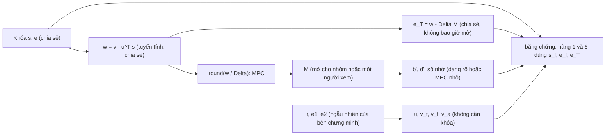
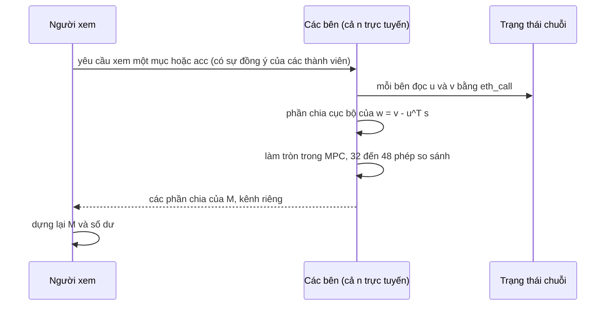
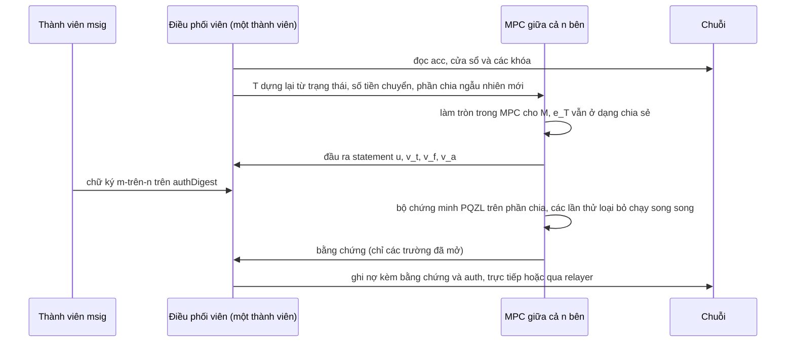
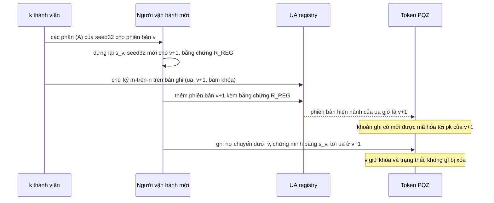

> **Research note — background and rationale only, not normative; the current rules are in docs/ (see decisions.md).**

> **Ghi chú nghiên cứu — chỉ là bối cảnh và lý do, không mang tính quy phạm; các quy tắc hiện hành nằm trong docs/ (xem decisions.md).**

> Bản tiếng Việt là bản phụ, theo phán quyết của chủ dự án (owner, 2026-11-06), ngoại lệ đối với quy tắc "docs bằng tiếng
> Anh" của AGENTS.md. Bản tham chiếu là bản tiếng Anh: [pqz-threshold-decrypt-prove.md](pqz-threshold-decrypt-prove.md);
> khi hai bản khác nhau, bản tiếng Anh được ưu tiên.

# Giải mã ngưỡng và chứng minh ngưỡng PQZ cho tài khoản do `msig` nắm giữ: phân tích chuyên sâu (2026-11)

Viết ngày 2026-11-06 theo yêu cầu của chủ dự án. Đây là phần phân tích chuyên sâu đứng sau §4.2, §4.3 và §6 của bản khảo
sát [pq-mpc-threshold.md](pq-mpc-threshold.md), bản bao quát MPC và mật mã ngưỡng trên toàn SCaaS. Ghi chú này **chỉ nói về
PQZ**: Zether cổ điển là một hệ thống riêng và không được bàn ở đây. Chỉ là nghiên cứu: không có gì ở đây là quy tắc, và mọi
thứ mật mã trong SCaaS, kể cả mọi cấu trúc dưới đây, đều **UNAUDITED** (chưa được kiểm toán). Không có phép đo nào được thực
hiện cho ghi chú này. Các con số là tính toán trên giấy từ các tệp tham số, cộng với các phép đo mà kho mã đã ghi lại, mỗi
chỗ đều được đánh dấu.

**Câu hỏi.** Hiện nay một `msig` nắm giữ tài khoản PQZ phụ thuộc vào một **người vận hành** (operator), người giữ khóa PQZ
(`seed32` → bí mật MLWE `s`). Người vận hành thấy số dư và là bên duy nhất có thể chứng minh một khoản chi
([CTR-PQZ-12](../contracts/pq-zero-knowledge.md#CTR-PQZ-12)). Ta có thể đi được bao xa tới:

- **(C) giải mã ngưỡng:** không một bên nào tự đọc được số dư; t-trên-n bên cùng giải mã `acc` và các khoản ghi có, để xem
  và để dựng statement tiếp theo;
- **(D) chứng minh ngưỡng:** không một bên nào giữ khóa; t-trên-n bên cùng tạo bằng chứng chi tiêu, cho PQZL (bằng chứng
  lưới kiểu LNP22) và cho PQZH (Ligero).

**Các phán quyết của chủ dự án được giữ nguyên, không mở lại** (owner 2026-11-06, khảo sát §6): **(A)** bản sao lưu k-trên-n
của `seed32` PQZ sẽ được xây dựng (ua-rs-sign T16a); **(B)** việc xoay khóa PQZ cho chủ sở hữu `msig` bị bác. **Chỉ đạo của
chủ dự án cùng ngày:** nếu ngưỡng khả thi, khóa PQZ của `msig` có thể có nhiều phiên bản hoặc được xoay, phiên bản cũ không
bao giờ bị xóa; và việc xoay không chỉ phụ thuộc vào C/D, vì (A) đã cho phép nhóm dựng lại khóa cũ mà không cần người vận
hành cũ. §7 phân tích cả hai con đường. Ghi chú ghi nhận rằng **phản đối của (B) được (A) giải quyết**; (B) không được đánh
dấu là chấp thuận, và việc xếp lịch thuộc về chủ dự án.

**Nhãn bằng chứng** (như trong khảo sát): [repo] đọc từ kho mã này; [paper] đã bình duyệt; [to appear] đã được nhận, chưa
xuất bản; [preprint] ePrint hoặc arXiv, chưa bình duyệt; [vendor] tuyên bố của công ty hoặc báo chí; [inference] suy luận
của chúng tôi; [estimate] tính toán trên giấy của chúng tôi; [unverified] không kiểm chứng được. Nguồn: §11.

## 1. Tóm tắt

| Mục | Kết quả | Bằng chứng | Hợp đồng, `proofSystemId`, vectors | Khuyến nghị |
|---|---|---|---|---|
| Bề mặt bí mật | Giải mã tuyến tính theo `s` trừ một phép làm tròn mỗi hệ số; dựng statement chỉ cần `s` qua các tổng chữ số `M`; witness của bằng chứng chứa `s_f`, `e_f` và nhiễu `e_T` (§3) | [repo] [inference] | — | — |
| Nhiễu không bao giờ được mở | Một người trong nhóm thấy nhiễu chính xác của 288 khoản ghi có tự tạo (ở `n2304-kmax4096`) khôi phục được khóa bằng đại số tuyến tính (§3.3) | [estimate] | — | mọi thiết kế giữ `v − uᵀs` và `e_T` ở dạng chia sẻ bí mật |
| (C) bằng làm ngập nhiễu (đều) | Không vừa với bộ tham số nào: một lần giải mã ở 2^-40 cần nhiễu làm mờ mỗi bên 2^56.5–2^57.0, lớn hơn chính `q`; `q` vừa phải là 2^74.5–2^158 (§4.2) | [estimate] | bộ tham số mới, khóa mới, id mới: không tương thích với mọi bản mã hiện có | không |
| (C) bằng làm ngập Gauss (Rényi) | Chỉ vừa với bản mã mới, tối đa 2^9.5–2^21.7 lần giải mã mỗi khóa; không bao giờ vừa với số dư tích lũy; còn câu hỏi chứng minh (§4.4) | [estimate] [preprint] | không | chỉ nghiên cứu |
| (C) bằng làm tròn trong MPC | Loại bỏ nhiễu thay vì che nó: 16 phép làm tròn mỗi bản mã, 32–48 phép so sánh bảo mật; dùng được cho mọi bản mã hiện có ở mọi bộ tham số (§4.4) | [paper] [inference] | **không** | **làm nguyên mẫu trước (C1)** |
| (D) PQZL, MPC chính xác của bộ chứng minh hiện tại | Khả thi về nguyên tắc; mặt nạ Gauss và lấy mẫu loại bỏ trong MPC chiếm phần lớn chi phí; đầu ra là một bằng chứng PQZL bình thường (§5.2) | [inference] [estimate] | **không**, nếu giữ phân phối mặt nạ và quy tắc loại bỏ | khảo sát nghiên cứu, rồi nguyên mẫu |
| (D) PQZL, phần Gauss cục bộ | Rẻ, nhưng mỗi bên biết một phần mặt nạ: rò rỉ cho người trong nhóm mà chưa có chứng minh công bố nào bao quát (§5.2) | [inference] | không | chỉ nghiên cứu |
| (D) PQZH (Ligero) | Tuyến tính trừ các lá Merkle Keccak: khoảng 1.2·10^10 cổng AND mỗi bằng chứng `R_TX` ở `n2304-kmax4096`; và `msig` không thể giữ token giá trị PQZH (§5.3) | [repo] [estimate] | không | không theo đuổi |
| Kết hợp: giải mã ngưỡng, một bên chứng minh giữ khóa | Bên chứng minh vẫn giải mã được mọi thứ: không có lợi về bảo mật đối với bên đó (§6) | [inference] | không | không |
| Kết hợp: bộ chứng minh trong TEE | Chi phí như một bên chứng minh; bảo mật dựa vào nhà cung cấp TEE và việc không ai tiếp cận vật lý (§6) | [vendor] [inference] | không | tùy chọn, nêu rõ là giả định tin cậy |
| Kết hợp: khóa xem riêng cho từng thành viên | Không có bản sao cho từng người xem đối với khoản ghi có đến; bản sao cho auditor chỉ có một mỗi token; người vận hành có thể cho thành viên cách xem **kiểm chứng được** bằng bằng chứng `R_DR` (§6) | [repo] [inference] | không | cách xem có chứng thực của người vận hành, dùng tạm |
| Kết hợp: chia số dư | n tài khoản, n người vận hành: mỗi người chỉ thấy phần của mình; tốn gấp n lần công giữ (§6) | [inference] | không | cho phép như thực hành phía client |
| Xoay sau khi dựng lại bằng (A), dưới dạng UA mới | Dùng được ngay: dựng lại `seed32` cũ, người vận hành mới, UA `msig` mới với khóa mới, chuyển khoản bí mật được chứng minh bằng khóa cũ; cái giá là một danh tính mới (§7.1) | [repo] [inference] | không | quy trình khôi phục trước mắt |
| Khóa PQZ có phiên bản dưới một UA (con đường (A), sau đó C/D) | `pqzKeyAt(ua, version)`, một con trỏ phiên bản hiện hành, `R_REG` và `keyOwner` theo từng phiên bản; trạng thái tài khoản theo phiên bản trong token; không có phiên bản nào đi vào statement, nên tầng bằng chứng không đổi (§7.3) | [inference] | một thế hệ registry mới và các bản phát hành token PQZ mới; **cùng `proofSystemId`**, không có vectors pqz-core mới | đặc tả ngay; vị trí do chủ dự án quyết (§7.5) |
| **Kết luận (C)** | **Khả thi ngay bằng làm tròn trong MPC**, ngoài chuỗi, không đổi hợp đồng hay tham số; làm ngập nhiễu bị loại | | | làm nguyên mẫu |
| **Kết luận (D)** | **Nghiên cứu**: PQZL khả thi mà không đổi bên kiểm tra nhưng tốn kém và chưa được chứng minh an toàn trước người trong nhóm; không cần PQZH | | | chỉ khảo sát nghiên cứu |

## 2. Bối cảnh

### 2.1 Vai trò

- **Người vận hành** (hiện nay): suy ra `seed32` trong key worker của mình, giữ `s`, giải mã, dựng statement và bằng chứng
  ([CTR-PQZ-13](../contracts/pq-zero-knowledge.md#CTR-PQZ-13)). Chi tiêu còn cần chữ ký m-trên-n của `msig` trên
  `authDigest` ([CTR-PQZ-12](../contracts/pq-zero-knowledge.md#CTR-PQZ-12)), nên người vận hành đọc được nhưng không tự chi
  được [repo].
- **Các bên** (trong ghi chú này): n người giữ phần khóa của một thiết kế ngưỡng, tự nhiên là các thành viên `msig`. **Nhóm
  đủ ngưỡng** (quorum): t bên tham gia một lần giải mã hoặc một bằng chứng.
- **"Không một bên nào tự đọc được số dư"** được hiểu ở đây là: một lần giải mã cần t bên đồng ý, và kết quả đến các bên đó
  hoặc đến một bên được chỉ định (§4.6). Nó không có nghĩa là không ai bao giờ biết số dư.

### 2.2 Shamir trên `F_q` và ai phải trực tuyến

Mọi bộ tham số đều có `q` nguyên tố, nên `s` (và `e`) có thể chia sẻ Shamir trực tiếp trên `F_q`: phần `s_j` là một vectơ
2·n phần tử trường, khoảng 37 KB mỗi bên ở `n2304-kmax4096` [inference]. Giải mã từng phần là tuyến tính và cần t phần. Mọi
phép nhân (so sánh, kiểm tra loại bỏ, tích trong bằng chứng) cần **đa số trung thực trong số các bên trực tuyến**: với bậc
`d = ⌊(n − 1)/2⌋`, dựng lại cần `d + 1` (= đa số) và một phép nhân cần `2d + 1` bên trực tuyến [estimate, cách đếm Shamir
chuẩn]:

| n | Bậc Shamir d | Số bên thông đồng chịu được | Dựng lại (t) | Trực tuyến cho một phép nhân |
|---|---|---|---|---|
| 3 | 1 | 1 | 2 | 3 |
| 5 | 2 | 2 | 3 | 5 |
| 7 | 3 | 3 | 4 | 7 |

Vậy với t = đa số, MPC đa số trung thực cần **cả n bên trực tuyến** mỗi khi nhân. Lựa chọn còn lại là MPC đa số không trung
thực giữa chỉ t bên trực tuyến (an toàn có hủy bỏ, tiền xử lý bằng OT hoặc mã hóa đồng cấu, đắt hơn nhiều). Với (C) mạch rất
nhỏ nên cả hai đều được; với (D) đa số trung thực là lựa chọn thực tế [inference].

### 2.3 Bốn bộ tham số

Từ `pqz-core/params/sets/<set>/set.json` và [§4.3 nhiễu](../contracts/pq-zero-knowledge.md#noise) [repo]. `Dec` làm tròn
`w_i = centre(v[i] − (uᵀs)[i])` thành `M_i = round(w_i / Δ)`; kết quả đúng khi nhiễu nhỏ hơn `Δ/2`. Nhiễu của một bản mã mới
là `B_FRESH = 2·β_e·β_s + β_2`; trường hợp xấu nhất đạt được của một tổng là `(K_MAX − 1)·B_FRESH` (số hạng công khai có
nhiễu 0); `E` là khoảng mà bằng chứng ghi nợ chứng minh cho `e_T`.

| Bộ | `q` | `Δ` | `q/Δ` | `B_FRESH` | `K_MAX` | Tổng xấu nhất `(K_MAX − 1)·B_FRESH` | `E` | `Δ/2` chia nhiễu: mới / tổng |
|---|---|---|---|---|---|---|---|---|
| `n2048-kmax1024` (không khuyến nghị) | 4,398,046,510,889 ≈ 2^42.00 | 67,108,863 ≈ 2^26.00 | 2^16 | 11,872 ≈ 2^13.54 | 1,024 | 12,145,056 ≈ 2^23.53 | 2^24 | 2,826 / 2.76 |
| `n2304-kmax4096` (mặc định) | 61,275,424,977,257 ≈ 2^45.80 | 233,747,196 ≈ 2^27.80 | 2^18 | 13,212 ≈ 2^13.69 | 4,096 | 54,103,140 ≈ 2^25.69 | 2^26 | 8,846 / 2.16 |
| `n2560-kmax16384` | 1,125,899,864,532,089 ≈ 2^50.00 | 1,073,741,783 ≈ 2^30.00 | 2^20 | 14,624 ≈ 2^13.84 | 16,384 | 239,584,992 ≈ 2^27.84 | 2^28 | 36,712 / 2.24 |
| `n2816-kmax65536` | 18,014,398,509,481,657 ≈ 2^54.00 | 4,294,967,295 ≈ 2^32.00 | 2^22 | 15,940 ≈ 2^13.96 | 65,536 | 1,044,627,900 ≈ 2^29.96 | 2^30 | 134,723 / 2.06 |

Cột cuối kể trọn câu chuyện của làm ngập nhiễu: khoảng trống giữa nhiễu và `Δ/2` là hệ số 2^11–2^17 cho một bản mã mới và
khoảng 2 cho một số dư tích lũy.

## 3. Bề mặt bí mật

### 3.1 Những gì phụ thuộc vào `s`

| Bước | Giá trị | Phụ thuộc `s`? | Ai cần |
|---|---|---|---|
| Khóa | `s`, `e` với `pk = A·s + e` | chính là bí mật | chia sẻ một lần (người chia khóa hoặc DKG, §4.7) |
| Giải mã bản mã `(u, v)` | `w_i = v[i] − (uᵀs)[i]`, `i < 16` | **tuyến tính** theo `s` | nhóm đủ ngưỡng, dưới dạng phần chia |
| Làm tròn | `M_i = round(w_i / Δ)` | phi tuyến theo `w` | người xem hoặc bên chứng minh |
| Nhiễu | `e_i = w_i − Δ·M_i` | tuyến tính theo `s` khi đã biết `M` | không ai thấy dạng rõ (§3.3); bên chứng minh cần nó dưới dạng `e_T` |
| Số dư | `Σ M_i·16^i` trên số nguyên (tới `MAX_TOTAL_SHIELDED` = 2^62, lớn hơn `q`, nên không tính trong `F_q`) | chỉ qua `M` | người xem |
| Tổng ghi nợ | `T = acc ± Σ window + Trivial(shieldIn)` | **không**: hợp đồng dựng từ trạng thái ([§7.4](../contracts/pq-zero-knowledge.md#transfer)) | công khai |
| Đầu ra | `u = Aᵀr + e1`, `v_t`, `v_f = pk_fᵀr + e2_f + Δ·d′`, `v_a` | **không**: khóa công khai và ngẫu nhiên của bên chứng minh `r, e1, e2` | bên dựng statement |
| Chữ số của số dư mới | `d′` với `Σ M_i 16^i = b′ + v + fee` (hàng 7) | chỉ qua `M` | bên chứng minh |
| Witness PQZL / PQZH | `s_f, e_f, r, e1, e2_*, d, d′, M, c, e_T` (`R_TX`, [CTR-PQZ-26](../contracts/pq-zero-knowledge.md#CTR-PQZ-26)) | `s_f, e_f, e_T` phụ thuộc khóa; `M` phụ thuộc số dư; phần còn lại do bên chứng minh chọn | bên chứng minh |

Vậy: việc mã hóa lại số dư mới không cần khóa; khóa chỉ đi vào một khoản chi qua **việc giải mã `T`** (`M` và `e_T`) và qua
hàng 1 và 6 của quan hệ (`pk_f = A·s_f + e_f`, `v_T − u_Tᵀs_f = Δ·M + e_T`) [repo].

### 3.2 Bước tuyến tính và phi tuyến

| Bước | Loại | Khi chia sẻ Shamir |
|---|---|---|
| `uᵀs`, `w = v − uᵀs`, `e_T = w − Δ·M` | tuyến tính | cục bộ, miễn phí |
| `round(w/Δ)` | phi tuyến (cắt bởi một hằng số công khai) | so sánh bảo mật (§4.4) |
| Giải mã chữ số cơ số 16, số nhớ `c_i`, `d′` | phi tuyến trên số nguyên | dạng rõ nếu nhóm được thấy `M` (§4.6), nếu không thì một mạch cộng nhỏ |
| Tách bit của `e_T` (27 bit × 16 ở `n2304-kmax4096`) cho các bằng chứng khoảng | phi tuyến | 16 phép tách bit mỗi bằng chứng |
| Sinh khóa (`SHAKE256` → CBD → loại theo chuẩn) | phi tuyến | người chia khóa, hoặc một MPC chạy một lần (§4.7) |
| Cam kết PQZL `tA = A1·s1 + A2′·s21 + s22`, rồi `power2round` | tuyến tính, rồi làm tròn | phần tuyến tính cục bộ; làm tròn trên một giá trị có thể mở trong nhóm (§5.2) |
| Mặt nạ PQZL `y1, y2, y3, y4` (Gauss rời rạc) | lấy mẫu, độc lập với `s` | phần khó nhất (§5.2) |
| Chiếu JL `R·s3`, dấu `β3, β4` của PQZL | tuyến tính theo `s` (`R` công khai); một tích với dấu bí mật | cục bộ; 512 phép nhân |
| Lấy mẫu loại bỏ PQZL (`z1`, `z2`, `z3`, `z4`) | phi tuyến theo `⟨z, c·s⟩` và `‖c·s‖²` | so sánh dấu phẩy cố định mỗi lần thử; mở kết luận |
| Số hạng rác PQZL `h`, `t`, `v` | bậc hai theo `s` và `y` | tích bậc 2 cục bộ, mở kèm ngẫu nhiên hóa lại |
| `HighBits(w)` và hint của PQZL | phi tuyến trên giá trị phụ thuộc mặt nạ | cục bộ sau khi `w` được mở trong nhóm (§5.2) |
| Fiat–Shamir (chuỗi `SHAKE128` cho PQZL, chuỗi Keccak cho PQZH) | phi tuyến | **chỉ có đầu vào công khai**: tính dạng rõ ([transcript](../contracts/pq-zero-knowledge.md#transcript)) |
| Ngẫu nhiên có rào chắn của bên chứng minh (`SHAKE(secret ‖ statement ‖ rnd32)`, [CTR-PQZ-19](../contracts/pq-zero-knowledge.md#CTR-PQZ-19)) | phi tuyến theo witness | thay bằng ngẫu nhiên chung (§5.5) |
| Mã hóa Reed–Solomon, kiểm tra tuyến tính `q`, kiểm tra lân cận `w` của PQZH | tuyến tính | cục bộ |
| Kiểm tra bậc hai `h` của PQZH | bậc 2 | tích cục bộ, mở |
| Lá Merkle `keccak(salt ‖ column)` của PQZH | phi tuyến trên cột bí mật | Keccak trong MPC (§5.3) |
| Grinding, chỉ số truy vấn, mở cột của PQZH | công khai / mở phần chia | dạng rõ |

### 3.3 Vì sao nhiễu không bao giờ được mở, kể cả trong nhóm

Người gửi biết `r, e1, e2` của chính mình. Với một khoản ghi có vào tài khoản, nhiễu giải mã trên mỗi hệ số là
`h_i = (eᵀr − sᵀe1)[i] + e2[i]` ([CTR-PQZ-04](../contracts/pq-zero-knowledge.md#CTR-PQZ-04)), một **phương trình tuyến tính
nguyên chính xác** theo 2·n ẩn `(s, e)` với hệ số do người gửi chọn. Bất kỳ ai thấy `w` (hoặc một phần giải mã không được
bảo vệ) và cũng là người tạo khoản ghi có thì có 16 phương trình như vậy mỗi khoản [inference]. Sau `⌈2n/16⌉` khoản, hệ
phương trình vuông và phép khử Gauss thông thường trên số hữu tỉ trả lại khóa [estimate]:

| Bộ | n | Số khoản ghi có tự tạo để khôi phục `(s, e)` |
|---|---|---|
| `n2048-kmax1024` | 2,048 | 256 |
| `n2304-kmax4096` | 2,304 | 288 |
| `n2560-kmax16384` | 2,560 | 320 |
| `n2816-kmax65536` | 2,816 | 352 |

Khoản ghi có không bao giờ bị từ chối và khoản ghi có số tiền 0 là hợp lệ
([CTR-PQZ-06](../contracts/pq-zero-knowledge.md#CTR-PQZ-06)), nên việc này chỉ tốn của một người trong nhóm vài trăm giao
dịch rẻ. Điều tương tự đúng với các khoản ghi nợ của chính tài khoản khi một bên biết ngẫu nhiên của chúng. Ngay cả bản có
nhiễu (nhiễu bị làm tròn hoặc che một phần) cũng bị phá bằng bình phương tối thiểu: LWE nguyên không có rút gọn modulo là
bài toán dễ ([Bootle et al., ePrint 2018/822](https://eprint.iacr.org/2018/822), ASIACRYPT 2018) [paper]. Hôm nay điều này
vô hại vì người vận hành đã giữ `s`; trong mọi thiết kế ngưỡng, đây là điều đầu tiên phải làm đúng. **Hệ quả:** `w`, nhiễu và
`e_T` ở dạng chia sẻ bí mật từ đầu đến cuối; chỉ `M` (và bằng chứng hoàn chỉnh) được mở. Đây là dạng PQZ của mối lo
IND-CPA^D mà đặc tả đã trích ([Li–Micciancio, ePrint 2020/1533](https://eprint.iacr.org/2020/1533)) [paper], và của câu
"nhiễu không bao giờ rời thiết bị" trong [CTR-PQZ-14](../contracts/pq-zero-knowledge.md#CTR-PQZ-14).

## 4. (C) Giải mã ngưỡng

### 4.1 Cấu trúc

1. **Thiết lập.** `s` (và `e`, cho việc chứng minh về sau) được chia sẻ Shamir trên `F_q` (§4.7 về việc ai sinh ra nó).
2. **Từng phần.** Mỗi bên đọc bản mã **từ trạng thái hợp đồng** (`pqzAcc`, `pqzPendingCt`, `pqzEntryBlob`,
   [§7.8](../contracts/pq-zero-knowledge.md#78-events-and-indexing)) và tính phần của mình của `w_i = v[i] − (uᵀs)[i]`
   với `i < 16`. Hệ số Lagrange là phần tử trường; vì không cần thứ gì ngắn đi ra từ phép kết hợp, chúng không gây phình
   [inference].
3. **Hoàn tất.** Một trong ba cách: (a) mỗi bên công bố phần của mình cộng nhiễu làm ngập và một bên tổng hợp làm tròn;
   (b) như vậy nhưng với nhiễu Gauss nhỏ hơn được biện minh bằng phân kỳ Rényi; (c) các bên làm tròn trong MPC và chỉ mở
   `M`. Các mục 4.2–4.4 cho thấy chỉ (c) vừa.

### 4.2 Ngân sách nhiễu cho làm ngập, ở cả bốn bộ tham số

**Mô hình** [estimate]. Phần của một bên phải che nhiễu bản mã `x`, `|x| ≤ B`, sau nhiễu đều trong `[−B_sm, B_sm]`. Trên mỗi
hệ số khoảng cách thống kê là `|x|/(2B_sm + 1)`; trên `16·Q` hệ số (Q lần giải mã dưới một khóa mà kẻ tấn công thấy) lập
luận lai cho `SD ≤ 16·Q·B/(2·B_sm)`, nên `B_sm = 16·Q·B·2^κ/2` để `SD ≤ 2^-κ`. Tính đúng là tất định: `B + t·B_sm < Δ/2` với
t phần đã làm mờ (t = 2, 3, 4 với n = 3, 5, 7). Một bộ tham số vừa giữ `q/Δ` nên cần `q ≥ 2·(B + t·B_sm)·(q/Δ)`. `B = B_FRESH`
cho một khoản ghi có, một bản sao auditor hoặc một `v_f` mới; `B = (K_MAX − 1)·B_FRESH` cho một `acc` tích lũy. (Bảng của khảo
sát bỏ hệ số 1/2 trong cận SD nên thận trọng hơn một bit; kết luận như nhau.)

**Nhiễu làm mờ mỗi bên `B_sm`** (không phụ thuộc t), so với `q` hiện tại:

| Bộ | `q` | mới, κ 40, Q 1 | mới, κ 40, Q 2^20 | mới, κ 80, Q 2^20 | tổng, κ 40, Q 1 | tổng, κ 80, Q 2^20 |
|---|---|---|---|---|---|---|
| `n2048-kmax1024` | 2^42.0 | 2^56.5 | 2^76.5 | 2^116.5 | 2^66.5 | 2^126.5 |
| `n2304-kmax4096` | 2^45.8 | 2^56.7 | 2^76.7 | 2^116.7 | 2^68.7 | 2^128.7 |
| `n2560-kmax16384` | 2^50.0 | 2^56.8 | 2^76.8 | 2^116.8 | 2^70.8 | 2^130.8 |
| `n2816-kmax65536` | 2^54.0 | 2^57.0 | 2^77.0 | 2^117.0 | 2^73.0 | 2^133.0 |

Mọi ô đều lớn hơn chính `q`: không `Δ` nào bên trong `q` hiện tại hấp thụ được.

**`q` sẽ vừa** (giữ `q/Δ`), với t = 2 / 3 / 4 (n = 3 / 5 / 7):

| Bộ | mới, κ 40, Q 1 | mới, κ 40, Q 2^20 | mới, κ 80, Q 1 | mới, κ 80, Q 2^20 | tổng, κ 40, Q 1 | tổng, κ 80, Q 2^20 |
|---|---|---|---|---|---|---|
| `n2048-kmax1024` | 2^74.5 / 75.1 / 75.5 | 2^94.5 / 95.1 / 95.5 | 2^114.5 / 115.1 / 115.5 | 2^134.5 / 135.1 / 135.5 | 2^84.5 / 85.1 / 85.5 | 2^144.5 / 145.1 / 145.5 |
| `n2304-kmax4096` | 2^76.7 / 77.3 / 77.7 | 2^96.7 / 97.3 / 97.7 | 2^116.7 / 117.3 / 117.7 | 2^136.7 / 137.3 / 137.7 | 2^88.7 / 89.3 / 89.7 | 2^148.7 / 149.3 / 149.7 |
| `n2560-kmax16384` | 2^78.8 / 79.4 / 79.8 | 2^98.8 / 99.4 / 99.8 | 2^118.8 / 119.4 / 119.8 | 2^138.8 / 139.4 / 139.8 | 2^92.8 / 93.4 / 93.8 | 2^152.8 / 153.4 / 153.8 |
| `n2816-kmax65536` | 2^81.0 / 81.5 / 82.0 | 2^101.0 / 101.5 / 102.0 | 2^121.0 / 121.5 / 122.0 | 2^141.0 / 141.5 / 142.0 | 2^97.0 / 97.5 / 98.0 | 2^157.0 / 157.5 / 158.0 |

**Mức tốt nhất vừa được hôm nay** (Q = 1, toàn bộ khoảng trống dùng cho làm mờ, `B_sm = (Δ/2 − B)/t`):

| Bộ | mới: SD ở t = 2 / 3 / 4 | tổng: SD |
|---|---|---|
| `n2048-kmax1024` | 2^-7.5 / 2^-6.9 / 2^-6.5 | lớn hơn 1: không che được |
| `n2304-kmax4096` | 2^-9.1 / 2^-8.5 / 2^-8.1 | lớn hơn 1: không che được |
| `n2560-kmax16384` | 2^-11.2 / 2^-10.6 / 2^-10.2 | lớn hơn 1: không che được |
| `n2816-kmax65536` | 2^-13.0 / 2^-12.5 / 2^-12.0 | lớn hơn 1: không che được |

**Kết quả.** Làm ngập thống kê không vừa ở bộ tham số nào, với bất kỳ n trong {3, 5, 7}, ở 2^-40 hay 2^-80, kể cả cho một
lần giải mã. Khoảng cách là 27–104 bit.

### 4.3 Thay đổi tối thiểu cho làm ngập, và vì sao mẹo lúc giải mã không giúp được

- **Modulus lớn hơn lúc giải mã không giúp.** Nâng `(u, v)` lên `Q′ = P·q` bằng cách nhân với `P` là chính xác
  (`P·v − P·uᵀs ≡ P·(Δ·M + e) mod Pq`) nhưng phóng nhiễu và `Δ` như nhau: tỉ số `Δ/(2B)` và thứ cần che (giờ là `P·e`) cùng
  tăng. Chuyển xuống modulus nhỏ hơn chỉ thêm nhiễu làm tròn. Mã hóa lại mới dưới một khóa modulus lớn hơn là điều các hệ
  dựa trên TFHE làm bằng bootstrapping trước khi làm ngập
  ([Noah's Ark, ePrint 2023/815](https://eprint.iacr.org/2023/815), WAHC 2023) [paper]; PQZ chỉ có phép cộng và không có
  khóa bootstrapping, và một phép chuyển khóa ngưỡng tự nó cũng cần làm ngập hoặc MPC [inference].
- **Ít chữ số hơn hoặc `K_MAX` nhỏ hơn** chỉ mua được vài bit: 16 hệ số thay vì 1 là 4 bit của tổng SD, và thu `q/Δ` từ 2^18
  xuống 2^6 (tổng chữ số dưới 16, tức là không tích lũy gì) là 12 bit. Khoảng cách là từ 27 bit trở lên [estimate].
- **`q` lớn hơn** là đòn bẩy duy nhất: 2^75–2^158 so với 2^42–2^54 hiện nay. Việc đó cần một bộ tham số mới: độ khó MLWE ở
  lỗi cố định giảm khi `q` tăng, nên `n` tăng theo (khảo sát ước n ≈ 4,000–7,000 cho β ≥ 450, chưa chạy qua estimator);
  khóa, bản mã, bằng chứng và gas đều tăng; kéo theo `proofSystemId` mới, vectors mới và full gate; và các lõi giả định
  `PQZ_LOG2Q ≤ 55` (`pqzl/src/pqz_sv.c`, `_Static_assert`), nên đó là viết lại lõi, không phải sửa tham số [repo].
- **Tương thích:** không có. Bản mã hiện có giữ nguyên tỉ số nhiễu trên `Δ`, nên làm ngập không bao giờ giải mã chúng an
  toàn được; mọi tài khoản sẽ cần một khóa mới dưới bộ tham số mới và một lần chuyển sang đó [inference]. Mọi thay đổi như
  vậy thuộc quyền chủ dự án; ghi chú này không đề xuất.

### 4.4 Các lựa chọn tránh làm ngập

**Làm tròn trong MPC (khuyến nghị).** Các bên giữ phần chia của `w_i` và tính `M_i = round(w_i/Δ)` trong MPC, chỉ mở `M_i`.
Vì mọi bản mã trên chuỗi có nhiễu xấu nhất đã chứng minh nhỏ hơn `Δ/2`, `M` là chính xác và chỉ là hàm của bản rõ, nên mở nó
không lộ gì về `s` [inference]. Một cách chuẩn [inference]:

1. Tiền xử lý một `[r]` ngẫu nhiên với `r = r_hi·Δ + r_lo`, `0 ≤ r_lo < Δ`, cùng các bit chia sẻ của `r_lo` và của `r`.
2. Mở `c = w + ⌊Δ/2⌋ + r mod q` (phân phối đều, nên che được `w`).
3. `M = ⌊c/Δ⌋ − r_hi − [c mod Δ < r_lo]` khi `w + ⌊Δ/2⌋ + r` không tràn modulo `q`; bit tràn là `[c < r]`, và trường hợp
   tràn dùng `c + q` thay cho `c` (tính cả hai ứng viên, chọn một).

Đó là hai đến ba phép so sánh theo bit (khoảng 46 và 28 bit) mỗi hệ số, 32–48 mỗi bản mã, số vòng hằng (khoảng 10–15 với
phép so sánh độ sâu logarit) và vài chục KB mỗi bên [estimate]. Các giao thức đã công bố làm đúng việc này cho FHE ngưỡng:
Zyskind–Zarchy–Leibovich–Peikert, an toàn UC, có hủy bỏ khi đa số không trung thực hoặc bảo đảm có kết quả khi đa số trung
thực ([ePrint 2025/1781](https://eprint.iacr.org/2025/1781), ACM CCS 2025) [paper]; Ajax, "che rồi mở" với các cặp chia sẻ
ngẫu nhiên trên hai vành, đa số trung thực, 0.9 ms mỗi lần giải mã với n = 3 ở 1 Gbps / 1 ms
([USENIX Security 2026](https://www.usenix.org/conference/usenixsecurity26/presentation/hu-zhenkai)) [to appear]; và
Damgård–Kolby–Orlandi–Pawlak, chuyển modulus `q → t` không cần tách bit, số vòng hằng, an toàn UC trước kẻ ác ý
([ePrint 2026/1058](https://eprint.iacr.org/2026/1058)) [preprint], hợp với kiểu giải mã BFV như của PQZ. Khối xây dựng:
edaBits ([ePrint 2020/338](https://eprint.iacr.org/2020/338), CRYPTO 2020) [paper] và phép so sánh Rabbit
([ePrint 2021/119](https://eprint.iacr.org/2021/119), FC 2021) [paper]. PQZ là trường hợp nhẹ hơn ML-KEM ngưỡng, vốn còn
phải chạy phép mã hóa lại FO và các hàm băm trong MPC (145–290 vòng, [ePrint 2026/2220](https://eprint.iacr.org/2026/2220))
[preprint]: giải mã PQZ không có hàm băm.

Một chi tiết: `Δ = ⌊q/2^b⌋` không phải `q/2^b`, nên `round(2^b·w/q)` của BFV và `round(w/Δ)` của PQZ khác nhau nhiều nhất
`M·2^b·(q/2^b − Δ)/q ≈ 2^-12` của một đơn vị ở `n2304-kmax4096`; dưới cận nhiễu đã chứng minh cả hai cho cùng `M`. Dù sao
nguyên mẫu cũng phải khớp `pqz_dec` trên các vectors đã đóng băng [inference].

**Làm ngập Gauss phân tích bằng phân kỳ Rényi.** Với nhiễu Gauss độ rộng `σ = B·√(16·Q)`, phân kỳ Rényi bậc 2 trên `16·Q`
hệ số giữ ≤ e; tính đúng với đuôi 13σ mỗi hệ số (≈ 2^-125) cho Q lớn nhất mỗi khóa [estimate]:

| Bộ | mới, t = 2 / 3 / 4 | tổng |
|---|---|---|
| `n2048-kmax1024` | 2^10.5 / 2^9.9 / 2^9.5 | không vừa (Q < 1) |
| `n2304-kmax4096` | 2^13.8 / 2^13.2 / 2^12.8 | không vừa |
| `n2560-kmax16384` | 2^17.9 / 2^17.3 / 2^16.9 | không vừa |
| `n2816-kmax65536` | 2^21.7 / 2^21.1 / 2^20.7 | không vừa |

Nó vừa với từng khoản ghi có trong một thời gian nhưng không bao giờ với số dư tích lũy, và bốn lưu ý giữ nó ở mức nghiên
cứu: (1) lập luận Rényi cho tính một chiều hoặc cần thêm cấu trúc để có tính không phân biệt (Boudgoust–Scholl,
[ePrint 2023/016](https://eprint.iacr.org/2023/016), ASIACRYPT 2023) [paper], và cấu trúc đó đã bị Passelègue–Stehlé tấn công
([ePrint 2024/1984](https://eprint.iacr.org/2024/1984), ASIACRYPT 2024) [paper]; (2) công trình tiếp nối củng cố khung Rényi,
Boudgoust–Costache ([ePrint 2025/735](https://eprint.iacr.org/2025/735)), đã bị đánh dấu **rút lại** [preprint]; (3) kết quả
an toàn mô phỏng với modulus đa thức của Micciancio–Suhl ([ePrint 2023/1728](https://eprint.iacr.org/2023/1728), IACR CiC
2024) [paper] cần chính nhiễu bản mã là Gauss, trong khi người gửi PQZ có thể chọn nhiễu ở bất kỳ đâu trong cận chuẩn đã
chứng minh [inference]; (4) các phần vẫn cần tính bền vững (§4.5), điều mà làm tròn trong MPC có sẵn từ MPC.

**Các lựa chọn lúc giải mã không qua làm tròn** (chuyển khóa sang một khóa ngưỡng mới, mã hóa lại qua proxy) đều chứa một lần
giải mã chính bản mã đó và thừa hưởng cùng vấn đề nhiễu [inference].

### 4.5 Tính bền vững

- **Làm tròn trong MPC.** Tính bền vững là của MPC: đa số trung thực với cả n bên trực tuyến cho an toàn có hủy bỏ nhờ kiểm
  tra tính nhất quán của phần chia, và bảo đảm có kết quả với các giao thức ở trên [paper]. Một bên ác ý trong giao thức
  nửa trung thực có thể làm lệch `M` khi xem; khi chứng minh, `M` sai chỉ tạo ra bằng chứng bị bên kiểm tra từ chối
  [inference].
- **Phần giải mã kiểm chứng được (con đường làm ngập).** Một bên sẽ chứng minh `p_j = λ_j·(uᵀs_j) + y_j` với
  `‖y_j‖∞ ≤ B_sm` và `s_j` gắn với một cam kết công khai. Phần chia Shamir trên `F_q` là đều, không ngắn, nên bằng chứng
  kiểu LNP22 cho witness ngắn không áp dụng trực tiếp; các lược đồ phần chia ngắn (`{0,1}`-LSSS trong
  [Boneh et al., ePrint 2017/956](https://eprint.iacr.org/2017/956), CRYPTO 2018 [paper], hoặc chia sẻ sao chép như trong các
  công trình ML-DSA ngưỡng, §5.2) sẽ cho phép một bằng chứng kiểu `R_DR` khoảng 30 KB mỗi phần [inference]. Không còn ý nghĩa
  khi làm ngập không vừa.
- **Dựa trên MAC.** MAC lý thuyết thông tin kiểu SPDZ cho an toàn có hủy bỏ khi đa số không trung thực; khi đa số trung thực,
  kiểm tra nhất quán bậc `d` là đủ [paper, qua các giao thức ở trên].

### 4.6 Ai biết số dư

- **Kết quả cho người được chỉ định.** Mỗi bên gửi phần chia `M` của mình cho một người xem qua kênh riêng; không ai khác
  biết gì. Rẻ nhất và chặt nhất [inference].
- **Kết quả cho cả nhóm.** `M` được mở cho t bên tham gia. Các thành viên ký chấp thuận chi tiêu vốn đã biết số tiền, nên với
  một `msig` đây là chế độ tự nhiên khi dựng statement [inference].
- **Không bao giờ suy ra ngẫu nhiên mã hóa của tài khoản từ một khóa mà mọi thành viên đều giữ.** Ai biết `r` của `v_f` thì
  giải mã được `v_f`. Nếu `r` đến từ một khóa mọi thành viên đều giữ (như `seed_enc` đến từ `pqzKeySeed` hiện nay,
  [CTR-PQZ-19](../contracts/pq-zero-knowledge.md#CTR-PQZ-19)), bất kỳ một thành viên nào cũng có thể suy lại `r` từ salt trong
  op blob và đọc mọi số dư sau ghi nợ mà không cần nhóm. Với một tài khoản ngưỡng, `r` phải mới cho mỗi lần ghi nợ và được
  nhóm giữ (chia sẻ, hoặc niêm phong cho nhóm) cho lần mở `SENDER_S` về sau; dòng khóa memo của
  [CTR-PQZ-23](../contracts/pq-zero-knowledge.md#CTR-PQZ-23) có cùng vấn đề. Cả hai là quy tắc phía client: câu hỏi mở Q4
  (§9) [inference].

### 4.7 Tác động lên hợp đồng, thiết lập khóa và quy tắc vận hành

- **Hợp đồng:** không có. Giải mã đọc các view đã có; không ghi gì [repo].
- **Chỉ giải mã trạng thái.** Dịch vụ từ chối bản mã do người gọi đưa vào và tự dựng lại mọi tổng từ trạng thái: một `(u, v)`
  được tạo có nhiễu ngoài khoảng đã chứng minh biến phép làm tròn thành một oracle khôi phục khóa (bản sao `ChainWitness`
  của khảo sát) [inference].
- **Thiết lập khóa.** Hai lựa chọn [inference]:
  - **Người chia khóa** (thực tế): một bên sinh một `seed32` **ngẫu nhiên mới** (không suy ra từ hạt BIP-39 của bất kỳ thành
    viên nào: một hạt suy từ ví thì luôn suy lại được), tính `s, e, pk` và bằng chứng `R_REG`, chia các phần Shamir của
    `(s, e)` cho các bên và các phần k-trên-n của `seed32` theo (A) làm bản sao lưu khẩn cấp, rồi xóa mọi thứ. Tin cậy: việc
    xóa của người chia khóa. Khác với quy tắc suy khóa của [CTR-PQZ-13](../contracts/pq-zero-knowledge.md#CTR-PQZ-13) cho chủ
    sở hữu `msig` (Q2).
  - **DKG:** bit ngẫu nhiên chung → phần chia CBD → kiểm tra chuẩn `‖s‖ ≤ β_s` bằng so sánh bảo mật → mở `pk` → `R_REG` bằng
    một bộ chứng minh ngưỡng (§5). Tổng các phần ngắn được chọn độc lập sẽ trượt cận chuẩn của `R_REG`, nên DKG phải lấy mẫu
    đúng phân phối trong MPC [inference]. Khi đó không có `seed32`, nên (A) không có gì để sao lưu; chính các phần chia là bản
    sao lưu.
- **Tài khoản hiện có không thể thoát khỏi người vận hành.** Khóa của người vận hành suy từ ví của họ và có thể suy lại; khóa
  PQZ không xoay ([CTR-UA-13](../contracts/accounts.md#CTR-UA-13), (B) bị bác). Một tài khoản ngưỡng là một UA `msig` mới với
  khóa mới, được nạp tiền bằng một chuyển khoản bí mật do người vận hành cũ chứng minh [repo] [inference].

## 5. (D) Chứng minh ngưỡng

### 5.1 Tài khoản `msig` cần những bằng chứng nào

| Bằng chứng | Hệ thống `msig` dùng | Cần `s`? | Cần ngưỡng? |
|---|---|---|---|
| Ghi nợ `R_TX`, `R_TX0`, `R_TXM`, `R_BURN` (cả refresh) | **chỉ PQZL**: token giá trị PQZH chỉ có ở `n2048-kmax1024` và từ chối chủ sở hữu `msig` (`PqzhHolderKind`, owner 2026-10-27, C0-2) | có: hàng 1 và 6 | **có**: lõi của (D) |
| Đăng ký `R_REG` | bên kiểm tra của registry | có | không nếu có người chia khóa (chứng minh trước khi chia); có nếu dùng DKG |
| Mở cho người nhận / auditor `R_DR` | PQZL hoặc PQZH (PQZH ở `n2304-kmax4096` và `n2560-kmax16384` chỉ dùng cho đăng ký và công bố) | có | có, nếu muốn mở |
| Mở cho người gửi `R_DS` | cả hai | **không**: witness `r, e1, e2_t` | không: chỉ cần ngẫu nhiên đã lưu (§4.6) |

Nguồn: [§7](../contracts/pq-zero-knowledge.md#71-state-per-ua-token), [CTR-PQZ-12](../contracts/pq-zero-knowledge.md#CTR-PQZ-12),
`docs/decisions.md` (C0-2, 2026-10-27) [repo]. Vậy (D) chủ yếu là câu hỏi về **PQZL**.

### 5.2 PQZL (LNP22 qua bản fork LaZer)

**Bộ chứng minh làm gì** (`pqzl/rust/src/proof/{abdlop,tbox,quad}.rs`) [repo], với kích thước `R_TX` ở `n2304-kmax4096` từ
`pqz_tx_params.h`: `s1` = 170 đa thức (163 witness + 7 phần bù chuẩn), `s2` = 70, `kmsis` = 22, `d` = 64;
`σ1 ≈ 406,323 ≈ 2^18.6`, `σ2 ≈ 6,349 ≈ 2^12.6`; hệ số challenge trong `[−8, 8]`, `η = 140`; `M1 ≈ 3.59`, `M2 ≈ 2.97`.

| # | Bước | Đầu vào bí mật | Cách xử lý khi chia sẻ | Loại chi phí |
|---|---|---|---|---|
| 1 | Cam kết ABDLOP `tA2 = A1·s1 + A2′·s21 + s22`, `power2round` → `tA1` | `s1`, ngẫu nhiên cam kết `s2` (tam phân, lấy mẫu chung) | tuyến tính; `tA2` có thể mở **trong nhóm**: đó là cam kết không nén mà LNP22 gốc gửi đi, che giấu dưới MLWE vì không bên nào biết `s2` | cục bộ + 1 lần mở |
| 2 | Vòng `z3`/`z4`: mặt nạ `y3`, `y4` (mỗi cái 256 hệ số, Gauss), cam kết `ty3`, `ty4`, `tβ`, ma trận JL `R` từ hàm băm, `z = y + β·R·s` | `s3 = Es·s1`, `s4 = Ds·s1`, dấu bí mật β | tuyến tính; β là một bit chia sẻ (512 tích); loại bỏ hai mode trong MPC | nhỏ, khoảng 2 lần thử |
| 3 | `tg`, rác `h_i = g_i + giá trị của các dạng bậc hai tại s` | `s` (bậc 2) | phần chia bậc 2 cục bộ, mở kèm một phần chia mới của số 0 | 1 lần mở |
| 4 | Vòng quad: mặt nạ `y1` (10,880 mẫu Gauss), `y2` (4,480); `w = A1·y1 + A2′·y21 + y22`; `w1 = HighBits(w)`; `t`, `v`; challenge `c`; `z = y + c·s`; loại bỏ cho `z1` (chuẩn), `z2` (Rej1 có kiểm tra dấu) | `s1`, `s2`, `y` | `w` có thể mở trong nhóm (nó đã có dạng `A·y + e_w`, xem dưới); `t`, `v` bậc 2, mở; `z` tuyến tính; loại bỏ trong MPC; mở kết luận; nếu chấp nhận thì mở `z1`, `z21` và hint | khoảng 18 lần thử nếu tuần tự |
| 5 | Các hàm băm Fiat–Shamir | không (thông điệp công khai) | dạng rõ | miễn phí |

**Trở ngại giống như ML-DSA ngưỡng: lấy mẫu loại bỏ** — thêm một khó khăn: mặt nạ của LNP22 là **Gauss** rời rạc với độ rộng
lớn, còn của ML-DSA là phân phối đều. Cách các công trình chữ ký ngưỡng xử lý việc loại bỏ:

| Công trình | Cách xử lý loại bỏ | Đầu ra | Số bên, mô hình | Bằng chứng |
|---|---|---|---|---|
| Quorus (Bienstock, de Castro, Escudero, Polychroniadou, Takahashi) | Shamir đa số trung thực trên `q`; mặt nạ và phép tách `w` qua edaBits; loại bỏ bằng phép so sánh Rabbit và một phép OR gộp; **mở `w1` và challenge kể cả cho lần thử bị loại**, sau một chỉnh sửa thêm lỗi nhỏ `e_w` vào `Ay` để các transcript bị loại mô phỏng được (scHVZK, UF-CMA⊥); hàm băm chạy dạng rõ; thử song song giảm số vòng loại bỏ kỳ vọng từ 5.09 xuống 1.20 với 8 lần song song; khoảng 100 KB mỗi bên mỗi vòng loại bỏ | FIPS 204 chuẩn | n bất kỳ, đa số trung thực, UC | [ePrint 2025/1163](https://eprint.iacr.org/2025/1163) [to appear, USENIX Security 2026] |
| Efficient Threshold ML-DSA (Celi, del Pino, Espitau, Niot, Prest) | chia sẻ bí mật ngắn (sao chép) và "lấy mẫu loại bỏ tối ưu", loại bỏ cục bộ trên từng phần; khoảng 1 MB mỗi bên | tương thích ML-DSA | tới 6 bên, đa số không trung thực, dựa trên trò chơi | [ePrint 2026/013](https://eprint.iacr.org/2026/013) [to appear, USENIX Security 2026], thay cho [ePrint 2025/1166](https://eprint.iacr.org/2025/1166) (đã rút) |
| Dựng lại Lagrange có che (Kao) | DKG Shamir cho nonce, mặt nạ PRF triệt tiêu theo cặp che hệ số Lagrange lớn; các cấu hình có TEE hỗ trợ, MPC đầy đủ, 2PC cho kiểm tra `r0`; tính riêng tư của khóa trong chữ ký tổng hợp được nêu là câu hỏi mở | FIPS 204 | T bất kỳ, bản preprint, một tác giả | [arXiv 2601.20917](https://arxiv.org/abs/2601.20917) [preprint] |
| Threshold Raccoon (del Pino, Katsumata, Maller, Mouhartem, Prest, Saarinen) | **không loại bỏ**: Raccoon được thiết kế cho điều đó; mặt nạ cộng dùng một lần; chữ ký 13 KiB, 40 KiB mỗi người dùng, tới 1024 người ký | định dạng riêng | 3 vòng | [ePrint 2024/184](https://eprint.iacr.org/2024/184), EUROCRYPT 2024 [paper] |
| Ringtail (Boschini, Kaviani, Lai, Malavolta, Takahashi, Tibouchi) | không loại bỏ; LWE chuẩn; 1 vòng ngoại tuyến + 1 vòng trực tuyến; chữ ký 13.4 KB ở t = 1024 | định dạng riêng | 2 vòng | [ePrint 2024/1113](https://eprint.iacr.org/2024/1113), IEEE S&P 2025 [paper] |
| Damgård–Orlandi–Takahashi–Tibouchi | cam kết đồng cấu có cửa sập che thông điệp đầu của các lần thử bị hủy | biến thể Dilithium-G | n-trên-n | [ePrint 2020/1110](https://eprint.iacr.org/2020/1110), PKC 2021 / JoC 2022 [paper] |

**Những gì áp dụng được cho LNP22** [inference]:

- **Mở `w` của lần thử bị loại.** Quorus phải thêm `e_w` vào ML-DSA để `w` bị loại trông giả ngẫu nhiên (lập luận của
  [Devevey et al., ePrint 2023/245](https://eprint.iacr.org/2023/245), CRYPTO 2023 [paper]). Cam kết mặt nạ của LNP22 **đã**
  có dạng đó: `w = A1·y1 + A2′·y21 + y22`, với `y22` là phần lỗi. Vì vậy mở `w` (và các cam kết che giấu `t`, `v`, `ty3`,
  `ty4`, `tβ`, `tg`) của các lần thử bị loại cho nhóm có lẽ là an toàn, nhưng chưa có chứng minh công bố nào bao quát giao
  thức ghép của LaZer: còn là nghiên cứu.
- **Hàm băm dạng rõ.** Mọi đầu vào Fiat–Shamir trong PQZL là thông điệp công khai, nên không có SHAKE nào chạy trong MPC.
  Hàm băm bí mật duy nhất là phép suy ngẫu nhiên có rào chắn, được bộ chứng minh đa bên thay bằng ngẫu nhiên chung (§5.5).
- **Mặt nạ Gauss: hai lựa chọn.**
  - *Chính xác:* lấy mẫu `y` chung trong MPC sao cho không liên minh nào biết phần nào của nó. Lấy mẫu Gauss rời rạc trong
    MPC đã có ([Wei et al., CCS 2023](https://doi.org/10.1145/3576915.3616641)) [paper], nhưng chi phí mỗi mẫu ở độ rộng của
    LNP22 chưa được công bố [unverified]. Giả định 10^4–10^5 cổng AND mỗi mẫu [estimate, giả định]: khoảng 2.8·10^5 mẫu mỗi
    bằng chứng `R_TX` (18 lần thử quad × 15,360) cho 2.8·10^9–2.8·10^10 cổng AND, 0.3–3.2 GiB mỗi bên [estimate].
  - *Phần cục bộ:* mỗi bên lấy mẫu `D_{σ/√t}` rồi cộng các phần; theo tích chập của các phân phối Gauss rời rạc, tổng gần
    thống kê với `D_σ` (σ lớn hơn nhiều so với tham số làm trơn), nên bên kiểm tra thấy đúng phân phối [inference]. Nhưng
    các bên thông đồng biết phần `y` của chính mình, nên với họ `c·s1` chỉ được che bởi một phần trung thực có độ rộng
    `σ1/√t` = 7.4 / 6.1 / 5.3 lần giá trị xấu nhất `η·α = 38,610` ở t = 2 / 3 / 4 [estimate], và quy tắc loại bỏ được hiệu
    chỉnh cho cả `y`. Điều đó rò rỉ cho người trong nhóm, một tình huống giống Hint-MLWE
    ([Kim–Lee–Seo–Song, ePrint 2023/623](https://eprint.iacr.org/2023/623), CRYPTO 2023) [paper] mà chưa có chứng minh cho
    giao thức này: còn là nghiên cứu.
  - *Mỗi bên lấy mẫu đủ σ:* tổng có độ rộng `σ·√t`; điều kiện `‖z1‖ ≤ 1.55·σ1·√(2·m1·d)` của bên kiểm tra khi đó trượt với
    t ≥ 3 (√3 > 1.55). Không tương thích [repo] [inference].
- **Kiểm tra loại bỏ trong MPC.** `⟨z1, c·s1⟩` và `‖c·s1‖²` là bậc 2 (cục bộ cộng một lần chia lại); phép kiểm tra chấp nhận
  `u < exp((‖v‖² − 2⟨z, v⟩)/(2σ²))/M` chạy ở dấu phẩy cố định (pqz-core đã dùng một xấp xỉ `exp` nguyên, `rand/fixexp.rs`),
  hoặc như tích các phép thử Bernoulli theo các bit của số mũ: khoảng 10^3–10^4 phép nhân và 30–60 vòng mỗi lần thử
  [estimate]. Chỉ mở kết luận.

**Tương thích với bên kiểm tra.** Nếu mặt nạ đúng là `D_σ`, các quy tắc loại bỏ là của LaZer, và mọi giá trị được mở đều là
trường của bằng chứng, thì đầu ra **là** một bằng chứng PQZL với phân phối của bên chứng minh trung thực: bên kiểm tra,
precompile và `proofSystemId` hiện có chấp nhận nó không đổi và không cần vectors mới [inference]. Mọi thay đổi về σ, về `M`,
về phân phối mặt nạ hay về các cận sẽ làm đổi dạng của bằng chứng trung thực nhưng không đổi bên kiểm tra; thay đổi cận hay
transcript là một `proofSystemId` mới với vectors mới và full gate ([CTR-PQZ-09](../contracts/pq-zero-knowledge.md#CTR-PQZ-09))
[repo].

### 5.3 PQZH (Ligero)

**Bộ chứng minh làm gì** (`pqzh/ligero/src/ligero.rs`, `cs.rs`) [repo]: các hàng witness (giá trị, bình phương, hàng bit;
`R_TX` m = 124 ở `n2304-kmax4096`), 12 hàng làm mù đều, mã hóa Reed–Solomon trên một coset (n = 45,752 ở `n2304-kmax4096`,
32,756 ở `n2048-kmax1024`), một cây Merkle trên các cột có salt, các đa thức kiểm tra lân cận, tuyến tính và bậc hai `w`, `q`,
`h`, grinding 16 bit, mở t = 120–122 cột.

| Bước | Khi chia sẻ | Chi phí |
|---|---|---|
| Hàng witness: giá trị, bình phương và bit của khóa | cố định theo khóa: người chia khóa chia một lần (khoảng 46,000 phần tử trường) | miễn phí mỗi bằng chứng |
| Hàng witness: bit của `e_T` | 16 phép tách bit mỗi bằng chứng | nhỏ |
| Mã hóa RS (FFT) | tuyến tính: cục bộ | như một bên chứng minh, mỗi bên |
| Hàng làm mù `u_0`, `u_lin`, `u_quad`, phần đệm, salt | đều chung: đúng phân phối trung thực | miễn phí |
| Lá `keccak(salt ‖ column)` | **Keccak trong MPC** trên mọi cột (hàng làm mù là các hàng cuối và bí mật, nên các khối cuối của mọi lá đều bí mật) | toàn bộ chi phí |
| Lân cận `w`, tuyến tính `q` | tuyến tính: cục bộ, mở | 1 lần mở |
| Bậc hai `h` | tích theo điểm trên `H_N2`: bậc 2 cục bộ, ngẫu nhiên hóa lại, mở | 1 lần mở |
| Grinding, truy vấn, mở cột | công khai; cột được mở từ phần chia | 1 lần mở |

**Chi phí Keccak** [estimate]: một lá dài `32 + (m + 12)·6` byte; Keccak-256 hấp thụ 136 byte mỗi hoán vị; một Keccak-f[1600]
có 24 × 1,600 = 38,400 cổng AND; chuyển từ số học sang nhị phân cho mỗi phần tử được giả định khoảng 150 cổng AND.

| Bộ | Quan hệ (m) | Lá | Hoán vị mỗi lá | Keccak-f mỗi bằng chứng | Cổng AND kể cả A2B | Ở 1 bit mỗi AND mỗi bên |
|---|---|---|---|---|---|---|
| `n2048-kmax1024` | `R_REG` / `R_DS` / `R_DR` (63) | 482 B | 4 | 131,024 | 5.4·10^9 | 0.63 GiB |
| `n2048-kmax1024` | `R_TX` (124–125) | 848–854 B | 7 | 229,292 | 9.5·10^9 | 1.10 GiB |
| `n2304-kmax4096` | `R_REG` / `R_DS` / `R_DR` (63) | 482 B | 4 | 183,008 | 7.5·10^9 | 0.88 GiB |
| `n2304-kmax4096` | `R_TX` (124) | 848 B | 7 | 320,264 | 1.3·10^10 | 1.54 GiB |

Tính toán ba bên nửa trung thực đạt khoảng 7·10^9 cổng AND mỗi giây trên ba máy chủ 20 nhân nối 10 Gbps, và khoảng 10^9 với
an toàn trước kẻ ác ý ([Araki et al., ePrint 2016/768](https://eprint.iacr.org/2016/768), CCS 2016; JoC) [paper]: vậy 2–13 s
tính toán và mạng cho mỗi bằng chứng `R_TX` trên mạng LAN như vậy, khoảng 170–220 vòng (24 lớp χ × 7 khối sponge, cộng phép
chuyển), và 1–1.5 GiB lưu lượng mỗi bên [estimate], so với 0.65 s cho một bên chứng minh native (`R_TX`, preset của
`n2048-kmax1024`, đo ngày 2026-10-14, `pqz-core/README.md` §5.2) [repo].

**"Tính trên phần chia, chỉ mở những gì bên kiểm tra thấy" có đúng đắn và không tiết lộ tri thức không?** Tính đúng đắn: có,
vô điều kiện, vì bên kiểm tra không đổi; một MPC gian lận không thể làm một mệnh đề sai được chấp nhận [inference]. Không
tiết lộ tri thức đối với bên kiểm tra: có, vì mọi giá trị ngẫu nhiên của bên chứng minh trong Ligero là đều (phần đệm, hàng
làm mù, salt), và tổng các phần chia đều là đều chính xác; byte bằng chứng có phân phối của một bên chứng minh đơn lẻ
[inference]. Đối với các bên: họ thấy thêm mọi digest lá, vốn là đầu ra random-oracle của các cột với salt bí mật, nên họ không
biết thêm gì [inference]. Vướng mắc nằm ở chi phí, không phải an toàn. Lựa chọn rẻ, mỗi bên một cây Merkle cho phần chia của
mình, nhân bằng chứng và công việc của bên kiểm tra lên n lần và thay đổi bên kiểm tra, nên là một `proofSystemId` mới
(Ozdemir–Boneh nêu cùng ý cho Fractal, §5.4) [paper].

**Kết luận.** Khả thi và tương thích với bên kiểm tra, nhưng nặng, và không cần: `msig` không thể giữ token giá trị PQZH, nên
chứng minh ngưỡng PQZH chỉ phục vụ việc mở `R_DR` ngưỡng ở các bộ tham số mà PQZH chỉ dùng cho đăng ký và công bố. Không
theo đuổi.

### 5.4 Các công trình về chứng minh cộng tác

| Công trình | Hệ thống bằng chứng | Nội dung | Phù hợp với PQZL / PQZH | Bằng chứng |
|---|---|---|---|---|
| Ozdemir–Boneh, collaborative zk-SNARKs | Groth16, Plonk, Marlin (đã xây); Fractal (bàn luận) | N bên chứng minh giữ các phần của witness và chạy bộ chứng minh trong MPC; thiểu số ác ý với thời gian xấp xỉ một bên chứng minh qua 3 Gb/s; cây Merkle của Fractal "cực kỳ đắt" trong MPC, lựa chọn thay thế là N cam kết và bằng chứng lớn gấp N | bài học chung đúng (đại số rẻ, băm đắt); không có hệ lưới | [ePrint 2021/1530](https://eprint.iacr.org/2021/1530), USENIX Security 2022 [paper] |
| zkSaaS (Garg, Goel, Jain, Policharla, Sekar) | Groth16, Plonk | chia sẻ bí mật đóng gói trên nhiều máy chủ; nhanh hơn khoảng 22× với 128 bên | dựa trên pairing: không | [ePrint 2023/905](https://eprint.iacr.org/2023/905), USENIX Security 2023 [paper] |
| EOS (Chiesa, Lehmkuhl, Mishra, Zhang) | kiểu Marlin | ủy thác riêng tư cho các worker, chỉ cần một worker trung thực; một lỗi về sau được DFS sửa | không | [USENIX Security 2023](https://www.usenix.org/conference/usenixsecurity23/presentation/chiesa) [paper] |
| Scalable collaborative zk-SNARK (Liu, Zhou, Wang, Zhang, Yang) | Libra; HyperPlonk trong bản mở rộng | chứng minh phân tán hoàn toàn, có biến thể chống ác ý; 2^23 cổng trong 2.5 s trên 128 máy | dựa trên sumcheck: không | [ePrint 2024/143](https://eprint.iacr.org/2024/143), [ePrint 2024/940](https://eprint.iacr.org/2024/940) (USENIX Security 2025) [preprint] [paper] |
| DFS (Hu, Mishra, Wang, Xie, Yang, Yu, Zhang) | zkSNARK thân thiện ủy thác của riêng họ | đồng thiết kế hệ thống bằng chứng với MPC; dưới 500 KB truyền thông ở 2^24 ràng buộc | một hệ mới: sẽ là `proofSystemId` mới | [USENIX Security 2025](https://www.usenix.org/conference/usenixsecurity25/presentation/hu-yuncong) [paper] |
| Malicious security in collaborative zk-SNARKs | Groth16 | witness mở rộng phải được kiểm tra trước khi chứng minh cộng tác | cùng sự thận trọng cho bit `e_T` và hàng chữ số | [ePrint 2025/1026](https://eprint.iacr.org/2025/1026) [preprint] |
| Ligero, Brakedown, FRI cộng tác, hoặc bằng chứng lưới | — | không tìm thấy | — | [unverified] (tìm ngày 2026-11-06) |

**Đánh giá.** Các bộ chứng minh cộng tác đã công bố nhắm tới SNARK đại số có cam kết tuyến tính (pairing, sumcheck đa tuyến).
Không công trình nào xử lý bằng chứng dựa trên mã có cam kết băm hay bằng chứng lưới có lấy mẫu loại bỏ; kết quả liên quan
gần nhất là các giao thức ML-DSA ngưỡng ở §5.2, giải quyết nửa bài toán lấy mẫu loại bỏ của PQZL cho mặt nạ đều.

### 5.5 Tóm tắt chi phí, tương thích với bên kiểm tra và hai quy tắc của bên chứng minh

**Chi phí thô mỗi bằng chứng `R_TX`** [estimate; giả định: ba bên, đa số trung thực, LAN, kích thước ở §5.2 và §5.3, không đo
gì]:

| Biến thể | Số vòng | Lưu lượng mỗi bên | Tính toán mỗi bên | So với một bên chứng minh (≈ 0.5–1 s native, [repo]) |
|---|---|---|---|---|
| PQZL, Gauss chính xác, thử tuần tự | khoảng 1,000 | 0.3–3.2 GiB | đại số tuyến tính như một bên chứng minh cộng các mạch Gauss | chậm hơn 10–100×; độ trễ WAN do số vòng chi phối |
| PQZL, Gauss chính xác, 8 lần thử song song (kiểu Quorus) | khoảng 150–250 | khoảng 1.5× ở trên | như trên | khoảng 10–50×; khoảng 10 s đi về ở 50 ms |
| PQZL, phần Gauss cục bộ | khoảng 150–250 | vài MB | khoảng một bên chứng minh | 2–5×, nhưng rò rỉ cho người trong nhóm (nghiên cứu) |
| PQZH (`R_TX`) | khoảng 170–220 | 1.0–1.5 GiB | một bên chứng minh cộng 1.3·10^10 cổng AND | 10–50× |

**Bên kiểm tra, `proofSystemId`, vectors.** Với PQZL dùng Gauss chính xác và với PQZH: precompile, token, `proofSystemId` và
vectors giữ nguyên [inference]. Một bộ chứng minh đa bên không thể tái tạo byte bằng chứng đã đóng băng, vì chúng đến từ ngẫu
nhiên có rào chắn của một bên chứng minh đơn lẻ; phép kiểm tra của nó là "mọi đầu ra đều được `pqz_verify`, `pqz_verify_fast`
và precompile chấp nhận" cộng các kiểm tra phân phối, không phải bằng nhau từng byte. Quy tắc tăng id của
[CTR-PQZ-09](../contracts/pq-zero-knowledge.md#CTR-PQZ-09) liên quan đến những gì bên kiểm tra chấp nhận, nên một bộ chứng
minh thứ hai dùng ngẫu nhiên chung không cần id mới (Q6) [inference].

**Hai quy tắc của bên chứng minh mà bộ chứng minh đa bên không theo được đúng như viết** [repo]: (1) mặt nạ có rào chắn
`SHAKE128("SCAAS-PQZ-PROVER-RND-V2" ‖ rnd32 ‖ wh ‖ hash0)` với `wh` là băm của witness
([CTR-PQZ-19](../contracts/pq-zero-knowledge.md#CTR-PQZ-19)): thay bằng đóng góp từ CSPRNG của mọi bên (đúng đắn nếu có một bên
trung thực); (2) `seed_enc` và dòng khóa memo suy từ `pqzKeySeed` (§4.6). Cả hai cần phán quyết của chủ dự án trước khi xây
(Q4, Q6).

**Độ trễ và cửa sổ inline.** Một khoản ghi nợ được chứng minh theo `p`; một người ngoài có thể buộc chứng minh lại bất kỳ
khoản ghi nợ nào còn đang bay khoảng 22 khối sau khi các mục của nó được tạo (phần dư đã chấp nhận của
[CTR-PQZ-08](../contracts/pq-zero-knowledge.md#CTR-PQZ-08), C0-6) [repo]. Bộ chứng minh đa bên phải nhanh hơn thế nhiều,
khoảng 110 s ở khối 5 s, nếu không nó có thể bị bỏ đói bởi một đợt tràn kéo dài (chỉ ảnh hưởng tính sẵn sàng) [inference].

## 6. Thiết kế kết hợp và thay thế

| Thiết kế | Bảo vệ gì | Tin cậy và an toàn | Chi phí | Tác động lên hợp đồng |
|---|---|---|---|---|
| H1. Giải mã ngưỡng, một bên chứng minh vẫn giữ khóa | xem được khi người vận hành không trực tuyến | bên chứng minh giải mã được mọi thứ: **không có lợi về bảo mật** đối với bên đó | chi phí của (C) | không |
| H2. Phần khóa được nạp vào một TEE giải mã và chứng minh | khóa và số dư trước mọi thành viên và phần mềm máy chủ | khóa chứng thực của nhà cung cấp TEE và phần cứng: TEE.Fail đã trích khóa từ SGX, TDX và SEV-SNP bằng thiết bị chen trên bus DDR5 giá dưới 1,000 USD, và cả hai nhà cung cấp coi tấn công vật lý là ngoài phạm vi ([BleepingComputer, 2025-10-28](https://bleepingcomputer.com/news/security/teefail-attack-breaks-confidential-computing-on-intel-amd-nvidia-cpus)) [vendor] | như một bên chứng minh | không |
| H3. Khóa xem cho từng thành viên | thành viên thấy số dư mà không cần người vận hành | không có sẵn: khoản ghi có chỉ được mã hóa tới khóa tài khoản; bản sao auditor chỉ có một mỗi token và thấy mọi tài khoản ([CTR-PQZ-24](../contracts/pq-zero-knowledge.md#CTR-PQZ-24)) | — | cần thay đổi giao thức |
| H3′. Cách xem kiểm chứng được có chứng thực của người vận hành | thành viên nhận số dư kèm bằng chứng, không phải tin lời người vận hành | người vận hành vẫn thấy mọi thứ; thành viên kiểm tra bằng chứng `R_DR` ngoài chuỗi: một cho `v_f` mới nhất, một cho mỗi khoản ghi có sau đó (`verifyTransferAmount` đã có cho các leg, [CTR-PQZ-14](../contracts/pq-zero-knowledge.md#CTR-PQZ-14)) | khoảng 31 KB và một lần chứng minh `R_DR` mỗi mục | không |
| H4. Chia số dư cho n tài khoản với n người vận hành | không người vận hành nào thấy tổng | mỗi người thấy phần của mình và dòng tiền của nó; chi vượt một phần cần nhiều khoản ghi nợ; (A) cho mỗi tài khoản | gấp n lần đăng ký, giữ, rollover | không: n UA `msig` cần cấu trúc khác nhau (ví dụ trọng số khác nhau), vì id băm ngưỡng, thành viên và trọng số ([accounts.md](../contracts/accounts.md#CTR-UA-07)) |
| H5. (A) cộng (C) | khóa khẩn cấp và xem theo ngưỡng | k phần của (A) dựng lại `seed32`; xem thông thường cần t bên | (C) cộng (A) | không |

Ghi chú [inference]:

- **H1** chỉ hữu ích cho tính sẵn sàng khi xem (thành viên xem được khi người vận hành vắng mặt). Tính bảo mật của nó là
  của H5 nhưng không có (A).
- **H2** trung thực khi nêu rõ là giả định tin cậy: bảo mật và tính sẵn sàng chuyển sang enclave và nhà cung cấp của nó. Bản
  preprint dựng lại Lagrange có che cũng liệt kê một cấu hình có TEE hỗ trợ vì cùng lý do (§5.2).
- **H3′** dùng quan hệ công bố như hiện có: `R_DR` chứng minh "`pk = A·s + e` và `v − uᵀs = Δ·digits(amount) + e′`". Nó áp
  dụng cho mọi bản mã mới như `v_f` với `u_0` của khoản ghi nợ, kiểm tra ngoài chuỗi bằng `pqz-ffi`; một `acc` tích lũy có
  tổng chữ số lớn hơn 15 nên không mở được theo cách này, vì vậy cách xem là `v_f` gần nhất cộng các khoản ghi có sau đó.
  Phương án tạm rẻ trước (C).
- **H4** là thực hành phía client; không cần gì từ hợp đồng.

## 7. Khóa PQZ có phiên bản, xoay được, cho chủ sở hữu `msig`

Chỉ đạo của chủ dự án, 2026-11-06: nếu ngưỡng khả thi, khóa PQZ của `msig` có thể có nhiều phiên bản hoặc được xoay, và phiên
bản cũ không bao giờ bị xóa. Đính chính của chủ dự án cùng ngày: việc xoay không chỉ phụ thuộc vào C/D. Với (A), k thành viên
dựng lại `seed32` cũ và chỉ định một người vận hành mới, nên không cần người vận hành cũ hợp tác. Từ đó có hai con đường:
**(A) + xoay**, trước mắt, và **C/D + xoay**, về sau. Chỉ là nghiên cứu, UNAUDITED, chỉ PQZ.

**Phán quyết (B).** (B) bị bác vì việc chuyển số dư cần một bằng chứng dưới khóa cũ, mà một người vận hành không hợp tác có
thể giữ lại (khảo sát §6). Với (A), nhóm dựng lại khóa đó mà không cần người vận hành và tự chứng minh việc chuyển. **Phản
đối của (B) được (A) giải quyết.** Ghi chú này không đánh dấu (B) là chấp thuận; việc xếp lịch thuộc về chủ dự án.

### 7.1 Những gì đã dùng được mà không đổi hợp đồng: xoay bằng một UA mới

[CTR-UA-13](../contracts/accounts.md#CTR-UA-13) định nghĩa xoay là "một UA mới + chuyển tiền". Với (A) việc đó làm được mà
không cần người vận hành cũ [inference]:

1. k thành viên dựng lại `seed32_v`; người dựng lại trở thành người vận hành mới.
2. Người đó đăng ký một **UA `msig` mới** với khóa PQZ mới và `R_REG` của nó. Id của `msig` là `keccak256(TAG(msig) ‖ keyData)`
   trên ngưỡng, các thành viên và trọng số của họ ([accounts.md](../contracts/accounts.md#CTR-UA-07)), nên cùng thành viên và
   trọng số cho cùng id: cấu trúc mới phải khác, ví dụ qua trọng số khác hoặc một UA khóa đơn khác của một thành viên [repo]
   [inference].
3. Người đó chuyển toàn bộ số dư bằng một chuyển khoản bí mật, chứng minh dưới `s_v` và được ủy quyền bởi m-trên-n của `msig`
   cũ.

Cái giá là một danh tính mới. Các đối tác, số dư công khai trên sổ UA, vai trò quản trị và các ủy nhiệm nêu tên UA cũ phải
chuyển, và UA cũ vẫn nhận khoản ghi có từ những người gửi còn dùng nó; mỗi khoản như vậy người vận hành cũ đọc được và phải
được rút lại dưới khóa cũ [inference]. Phiên bản hóa giữ một id UA, và khoản ghi có mới tự động đi tới khóa mới: đó là toàn bộ
giá trị của nó.

### 7.2 Con đường (A) + xoay (trước mắt)

**Vì sao vẫn cần xoay sau khi dựng lại.** Sau (A), người vận hành cũ vẫn biết `s_v`. Họ không thể chi, vì mọi khoản chi cần
m-trên-n của `msig` ([CTR-PQZ-12](../contracts/pq-zero-knowledge.md#CTR-PQZ-12)). Họ vẫn đọc được mọi thứ mã hóa dưới phiên bản
v, mà nếu không xoay thì bao gồm **mọi khoản ghi có và mọi số dư trong tương lai** của tài khoản. Xoay sang v+1 chặn điều đó:
khoản ghi có mới và số dư đã chuyển được mã hóa tới `pk_{v+1}` [inference].

| Ai | Trước khi xoay | Sau khi xoay sang v+1 |
|---|---|---|
| Người vận hành cũ | mọi khoản ghi có và số dư, quá khứ và tương lai | lịch sử dưới v tới lúc chuyển, kể cả số dư tại khoản ghi nợ chuyển (họ giải mã được `T_v`) và phần còn lại dưới v; không gì dưới v+1 |
| Người dựng lại (người vận hành mới) | — | phiên bản v và v+1 |
| k thành viên cùng nhau | v, qua các phần của (A) | v và v+1, qua các phần (A) của từng phiên bản |
| Mọi người khác | không gì | không gì; sự kiện của registry và chuyển khoản cho chính mình cho thấy đã có một lần xoay |

**Luồng với khóa có phiên bản** (§7.3; khi chưa có, cùng các bước với một UA mới, §7.1) [inference]:

1. **Dựng lại.** k thành viên kết hợp các phần (A) của `seed32_v`; người dựng lại là người vận hành mới.
2. **Đăng ký phiên bản v+1.** Một `seed32_{v+1}` mới, `pk_{v+1}` và bằng chứng `R_REG` của nó; bản ghi được ký bởi m-trên-n của
   `msig`; phiên bản mới chỉ trở thành hiện hành khi đã được chứng minh, vì token chỉ nhận khóa đã chứng minh
   ([CTR-PQZ-13](../contracts/pq-zero-knowledge.md#CTR-PQZ-13)). Các phần (A) mới của `seed32_{v+1}` đến các thành viên; các
   phần của v được giữ lại.
3. **Khoản ghi có mới đi tới v+1.** Token đặt khóa của phiên bản hiện hành tại thời điểm khoản ghi có thực thi vào statement
   của khoản đó; người gửi đã chứng minh theo `pk_v` ngay trước khi chuyển sẽ nhận `ProofRejected` và chứng minh lại (chỉ ảnh
   hưởng tính sẵn sàng).
4. **Chuyển.** Một hoặc nhiều khoản ghi nợ dưới v, chứng minh bằng `s_v`: chúng hấp thụ hàng đợi của v (cửa sổ inline và
   rollover; không có mục mới nào đến dưới v) và chuyển số dư sang chính UA đó ở v+1.
5. **Phiên bản cũ ở lại.** Khóa, bản ghi, trạng thái tài khoản và các phần (A) của v không bao giờ bị xóa; phần còn lại dưới v
   vẫn chi được bằng `s_v`.

### 7.3 Mô hình phiên bản tối thiểu

Khóa KEM của UA là khuôn mẫu: bản ghi của nó là `(ua, version, kemPk)`, do UA ký, ghi một lần, theo thứ tự bất kỳ, không bao
giờ bị ghi đè, với `kemKeyOf(ua)` là phiên bản cao nhất và `kemKeyAt(ua, version)` là bất kỳ phiên bản đã lưu nào
([CTR-UA-32](../contracts/accounts.md#CTR-UA-32)); ua-rs suy một khóa KEM cho mỗi phiên bản (`WalletHandle::kem_key(version)`
trên nhánh `ua-rs-sign`) [repo]. Khóa PQZ khác ở hai điểm: mỗi phiên bản cần bằng chứng `R_REG` riêng, và khoản ghi có cần một
phiên bản hiện hành không mơ hồ.

**Registry** [inference]:

| Mục | Hiện nay ([CTR-UA-16](../contracts/accounts.md#CTR-UA-16)) | Mô hình có phiên bản |
|---|---|---|
| Lưu trữ | một con trỏ khóa PQZ mỗi bản ghi, ghi một lần (`UAPqzKeySet`) | `pqzKeyAt(ua, version)` → con trỏ và `proven`; phiên bản 0 là khóa hiện nay |
| Hiện hành | khóa duy nhất | `pqzKeyOf(ua)` → phiên bản **đã chứng minh** cao nhất và số của nó |
| Thêm | `register` hoặc `setPqzKey` một lần | `addPqzKeyVersion(ua, version, pqzKey, pqzPopHash, sig)`, với `version` = mới nhất + 1 (không theo thứ tự bất kỳ như KEM: một phiên bản thấp hơn sẽ không bao giờ là hiện hành) |
| Sự đồng ý | `UASig` của bên ký trên `UAPqzKeyRecord{ua, pqzKeyHash, pqzPopHash}` | cùng bản ghi thêm trường `version` (typehash mới, được ghim), ký bởi m-trên-n của `msig` |
| `R_REG` | `storePqzPop(ua, pop)` trên `pqzKeyDigest(ua, pqzKeyHash)` | theo từng phiên bản; digest thêm `version`. Chỉ tiền ảnh của thông điệp 32 byte thay đổi, nên quan hệ và `proofSystemId` không đổi ([§7.2](../contracts/pq-zero-knowledge.md#72-register-the-ua-registry)) |
| Tính duy nhất | `keyOwner` trên nhóm `pqz-mlwe` | theo từng phiên bản: không khóa nào được dùng lại bởi UA khác hay phiên bản khác (`UAKeyInUse`) |
| Quy tắc chủ sở hữu, cận C0-5 | khi đăng ký | không đổi: việc ủy quyền không thay đổi theo khóa |
| Xóa | không | không: mọi phiên bản vẫn đọc được |
| Tính di động | bản ghi và `R_REG` không phụ thuộc chuỗi | như vậy: phiên bản v chỉ cùng một khóa trên mọi chuỗi |
| Sự kiện | `UARegistered`, `UAPqzKeyAdded` | `UAPqzKeyAdded(ua, version, pointer)` |

**Token** [inference]:

| Mục | Hiện nay ([§7](../contracts/pq-zero-knowledge.md#71-state-per-ua-token)) | Mô hình có phiên bản |
|---|---|---|
| Trạng thái tài khoản | một cho mỗi `(ua, token)` | một cho mỗi `(ua, version, token)`: `acc`, hàng đợi, `rolled`, `floor`, `cleared`, các từ của `acc`; `sendCounter` giữ theo UA để `entryRef` giữ công thức và vẫn duy nhất |
| Ghi có, shield, các leg op 7 | tới khóa của UA | tới `(ua, current)`, phiên bản đọc từ registry khi khoản ghi có thực thi |
| Ghi nợ | khóa ngầm định | một tham số tường minh `keyVersion`; statement mang `pk_{keyVersion}` và `T` của phiên bản đó |
| Chuyển | `from ≠ to` (`SelfTransfer`) | một entry có tên, hoặc op 1 cho phép `from = to` khi phiên bản khác nhau; quan hệ `R_TX` / `R_TX0` không đổi (`pk_f = pk_v`, `pk_t = pk_{v+1}`) |
| Rollover | `mtxRollOver(ua, n)` | `mtxRollOver(ua, version, n)`, để hàng đợi cũ rút hết được |
| Công bố | `pk` từ registry | `pk` của phiên bản của khoản ghi có: một tham số của view, hoặc phiên bản được lưu cùng leg. Phiên bản sai chỉ làm việc mở thất bại: giải mã bằng khóa của phiên bản khác để lại nhiễu nằm xa ngoài `[−E, E)` [inference] |
| Ủy quyền | `PqzAuth` ràng buộc `bodyHash`, vốn bao phủ các byte `pk` | cùng ràng buộc đó; một trường tường minh `keyVersion` trong `PqzAuth` theo quy tắc tham số tường minh (thay đổi typehash ở mức token; vectors auth-digest được sinh lại, vectors bằng chứng thì không) |
| Mồi nhử (decoy) | lấy từ danh sách chủ sở hữu `0x0142` | không đổi: mỗi UA một mục trong danh sách, một leg mồi nhử rơi vào phiên bản hiện hành; không khoản ghi có nào nhắm tới phiên bản cũ, nên phiên bản cũ không thêm tín hiệu mới |

**Statement và transcript.** Thân statement đã mang đầy đủ các khóa công khai (`pk_f ‖ pk_t ‖ pk_a ‖ T ‖ out`,
[statement](../contracts/pq-zero-knowledge.md#77-statement-layout)). Trong mô hình này, phiên bản chỉ quyết định **byte khóa
nào** và `T` nào hợp đồng ghi vào đó, nên quan hệ, bố cục và transcript không đổi: **cùng `proofSystemId`, không có vectors
pqz-core mới, không cần full gate** [inference]. Nếu thay vào đó một từ phiên bản được đưa vào header của statement hay vào
transcript, đó là thay đổi bố cục: một `proofSystemId` mới, vectors mới ở mọi client và full gate
([CTR-PQZ-09](../contracts/pq-zero-knowledge.md#CTR-PQZ-09)). Không khuyến nghị.

**Auditor.** Việc chuyển là một chuyển khoản: dưới `FULL` auditor nhận một bản sao của số tiền chuyển; auditor vốn đã dựng lại
số dư bằng sổ sách, nên không biết thêm gì ([CTR-PQZ-24](../contracts/pq-zero-knowledge.md#CTR-PQZ-24)) [inference].

### 7.4 Con đường C/D + xoay (về sau): làm mới chủ động hay khóa mới

Khi khóa được chia giữa các bên (§4.7), phần lớn sự kiện **không cần khóa mới**:

- **Làm mới chủ động** (proactive refresh) làm mới các phần chia mà không đổi bí mật, nên những gì kẻ tấn công biết trong một
  giai đoạn trở nên vô dụng sau khi làm mới
  ([Herzberg, Jarecki, Krawczyk, Yung, CRYPTO 1995](https://doi.org/10.1007/3-540-44750-4_27)) [paper]. Với Shamir trên `F_q`,
  đó là cộng thêm một phần chia mới của số 0 [inference].
- **Chia lại cho một ủy ban mới**, kèm ngưỡng mới nếu muốn: CHURP
  ([Maram et al., ePrint 2019/017](https://eprint.iacr.org/2019/017), CCS 2019) [paper]. Với PQZ, mỗi bên cũ chia Shamir phần
  của mình cho ủy ban mới, ủy ban mới kết hợp bằng hệ số Lagrange [inference]. `pk` không đổi, nên không có gì xảy ra trên
  chuỗi.

| Sự kiện | Làm mới hay chia lại đủ? | Cần phiên bản mới? |
|---|---|---|
| Mất hoặc nghi ngờ một thiết bị hay một phần (lộ ít hơn t phần) | có | không |
| Thay một người giữ phần, thành viên `msig` không đổi | có, miễn là không bao giờ kết hợp được t phần của giai đoạn cũ (các bên khác đã xóa phần của mình) | không |
| Lộ từ t phần trở lên của một giai đoạn, hoặc lộ cả khóa (người chia khóa đã giữ lại, TEE bị xâm nhập, một lần dựng lại bằng (A), một người vận hành cũ) | không: họ giải mã được mọi thứ dưới khóa đó, kể cả khoản ghi có tương lai | **có**, rồi chuyển số dư |
| Thành viên `msig` (những người ủy quyền) thay đổi | — | id chứa các thành viên: dù sao cũng là một UA mới ([CTR-UA-13](../contracts/accounts.md#CTR-UA-13)) |

Dưới C/D, một lần xoay cần một khóa mới được sinh ra mà không bên nào giữ trọn (DKG lấy mẫu CBD chính xác trong MPC và `R_REG`
ngưỡng, hoặc người chia khóa có xóa, §4.7) và một khoản ghi nợ chuyển được chứng minh dưới v **bởi nhóm**: đó là (D). Chỉ với
(C), vẫn có một người vận hành chứng minh, và việc xoay là con đường (A) [inference].

### 7.5 Tác động lên hợp đồng và vị trí

- **Không nâng cấp thứ gì đã triển khai.** Mô hình cần một thế hệ registry mới và các bản phát hành token PQZ mới trong danh
  mục của factory; các token đã triển khai giữ ngữ nghĩa một khóa của registry của chúng. Mọi chuỗi hiện chỉ dùng thử nghiệm,
  nên không cần chuyển số dư hiện có [repo].
- **Mỗi chuỗi chỉ một thế hệ bật `0x0142`** ([§7.2](../contracts/pq-zero-knowledge.md#72-register-the-ua-registry), bước 1):
  một thế hệ sau không thể tiếp quản khóa PQZ trên chuỗi mà thế hệ trước đã bật. Vì vậy khóa có phiên bản phải đi cùng thế hệ
  đầu tiên bật `0x0142` trên một chuỗi, muộn nhất là thế hệ triển khai trên mainnet 22776 (chỉ chủ dự án), nếu không thì quy
  tắc đó phải đổi [repo] [inference].
- **Vòng 3c** (thế hệ registry tiếp theo, cùng `PqChat`; kế hoạch `2026-11-04-ua-mtx-merge.md`) đã mang `requirePortable`,
  "`msig` không có khóa KEM" và việc cân bằng lại `UARegistryLib` ↔ `UARegistry` [repo]. Áp lực của nó: `UARegistryLib` là
  36,192 B (`size-baseline.json`) và cần 60.83 M gas để triển khai, nên một chuỗi công khai 60 M từ chối nó
  (`smartcontracts/evm/runs/2026-11-04-ua-mtx-merge-deploy-gas.txt`) [repo]. Khóa PQZ có phiên bản thêm một mapping, một entry,
  một digest có kiểu và một sự kiện: khoảng 1.5–3 KB [estimate], khoảng +2.3–4.6 M nhu cầu cổng triển khai theo hệ số 1,530 gas
  mỗi byte của công thức ([evm.md](../networks/evm.md)) [estimate]. Phía token, trạng thái theo phiên bản chạm tới `PqzCore` và
  các thư viện của nó, vốn có bố cục lưu trữ được ghim (`test/v2/layout/`), và `WrappedPqzToken` đã vượt 64 KiB [repo].
- **Node và client.** Các entry thay đổi (`keyVersion` trên ghi nợ, `mtxRollOver(ua, version, n)`, entry chuyển) làm thay đổi
  danh sách cho phép của node (`typed.rs`, `guard.rs`) theo từng loại và cả hai chiều; ua-rs và clientkeys thêm phiên bản vào
  bản ghi và statement; vectors của bản ghi có kiểu được sinh lại [repo] [inference].
- **Các họ chuỗi.** Một quy tắc trên mọi chuỗi: họ nào có registry mang khóa PQZ thì mang phiên bản theo cùng cách; hiện PQZ chỉ
  chạy nơi có precompile của nó ([CTR-PQZ-01](../contracts/pq-zero-knowledge.md#CTR-PQZ-01)) [repo].

**Khuyến nghị.** (1) **Ngay bây giờ, không đổi hợp đồng:** ghi tài liệu quy trình client "(A) dựng lại → xoay bằng một UA mới"
(§7.1) làm đường khôi phục khi người vận hành mất, từ chối hoặc bị xâm nhập; nó chỉ cần (A). (2) **Đặc tả mô hình có phiên bản
ngay** dưới dạng một thiết kế ngắn (bản ghi registry và con trỏ hiện hành, trạng thái token theo phiên bản, entry chuyển, không
có phiên bản trong statement), để quyết định được đưa ra với số liệu. (3) **Vị trí:** 3c chỉ khi việc cân bằng lại còn chỗ trong
`UARegistryLib` và gas triển khai của nó; nếu không thì thế hệ kế tiếp, nhưng trong mọi trường hợp phải trước thế hệ bật
`0x0142` trên mainnet 22776. (4) Dưới C/D, ưu tiên làm mới chủ động và chia lại; chỉ dùng phiên bản mới sau khi lộ từ t phần trở
lên hoặc lộ cả khóa.

## 8. Kết luận và lộ trình

### 8.1 Kết luận (C)

**Khả thi ngay, bằng làm tròn trong MPC, ngoài chuỗi, không đổi hợp đồng, không đổi tham số và tương thích hoàn toàn với bản
mã hiện có.** Làm ngập nhiễu bị loại ở mọi bộ tham số; làm ngập kiểu Rényi là nghiên cứu và không bao giờ bao phủ số dư. Yêu
cầu: phần chia từ một khóa mới (hoặc DKG), chỉ giải mã trạng thái chuỗi, đa số trung thực với cả n bên trực tuyến (hoặc một
mạch nhỏ đa số không trung thực), và một quy tắc ai nhận `M`.

### 8.2 Kết luận (D)

**Nghiên cứu.** Về nguyên tắc, chứng minh ngưỡng PQZL có thể tạo ra bằng chứng bình thường mà bên kiểm tra hiện nay chấp nhận
(cùng `proofSystemId`, không có vectors mới), nhưng nó cần lấy mẫu Gauss rời rạc trong MPC ở độ rộng của LNP22 và lấy mẫu loại
bỏ trong MPC, với chi phí gấp 10–100 lần một bên chứng minh và chưa có chứng minh an toàn cho việc mở các lần thử bị loại trong
giao thức của LaZer. Biến thể rẻ (phần Gauss cục bộ) rò rỉ cho người trong nhóm mà chưa có chứng minh. PQZH khả thi và tương
thích với bên kiểm tra nhưng không cần cho chủ sở hữu `msig`.

**Xoay (§7).** Với (A), việc xoay khỏi một người vận hành mất, từ chối hoặc bị xâm nhập làm được ngay dưới dạng một UA mới, không
đổi hợp đồng. Khóa có phiên bản dưới một UA cần một thế hệ registry và các bản phát hành token mới nhưng không chạm tới tầng bằng
chứng; dưới C/D, làm mới chủ động bao phủ phần lớn sự kiện và chỉ cần phiên bản mới sau khi lộ từ t phần trở lên hoặc lộ cả khóa.

### 8.3 Lộ trình

| Bước | Nội dung | Loại | Ngày-agent (nguyên mẫu ngoài chuỗi) [estimate] | Phụ thuộc |
|---|---|---|---|---|
| H3′ | cách xem có chứng thực của người vận hành: bằng chứng `R_DR` trên `v_f` và các khoản ghi có, thành viên kiểm tra ngoài chuỗi | xây ngay | 1–2 | không |
| C1 | chia sẻ Shamir trên `F_q` mô phỏng (một tiến trình), phần cục bộ, làm tròn trong MPC; bằng với `pqz_dec` trên các vectors đóng băng ở cả bốn bộ; từ chối bản mã không đến từ trạng thái; kết quả cho người được chỉ định | xây ngay | 3–5 | không |
| C2 | công cụ người chia khóa: `seed32` mới → `s, e, pk`, `R_REG`, phần Shamir của `(s, e)`, phần (A) của `seed32` | xây ngay, sau phán quyết của chủ dự án (Q2) | 2–3 | ua-rs-sign T16a (A) |
| C3 | dịch vụ nối mạng, an toàn trước kẻ ác ý (đa số trung thực), có tiền xử lý (edaBits hoặc chuyển modulus) | xây sau C1 | 10–15 | C1 |
| D1 | khảo sát nghiên cứu: bộ chứng minh LaZer dưới dạng luồng dữ liệu MPC; phác thảo chứng minh cho việc mở `w`, `t`, `v` bị loại; chọn cách lấy mẫu Gauss; rò rỉ của phần cục bộ | nghiên cứu | 10–15 (việc trên giấy) | C1 |
| D2 | bộ chứng minh PQZL MPC mô phỏng mà bằng chứng được bên kiểm tra hiện có chấp nhận | nguyên mẫu nghiên cứu | 20–30 | D1 |
| D3 | bộ chứng minh PQZL nối mạng, an toàn trước kẻ ác ý | chỉ xây nếu D1 và D2 thành công | 40–60, cộng rà soát bên ngoài | D2 |
| R0 | quy trình client "(A) dựng lại → xoay bằng một UA mới" (§7.1), có kiểm thử trên chuỗi cục bộ | xây ngay, sau (A) | 1–2 | ua-rs-sign T16a (A) |
| R1 | thiết kế ngắn cho khóa PQZ có phiên bản: bản ghi registry và con trỏ hiện hành, trạng thái token theo phiên bản, entry chuyển (§7.3) | đặc tả ngay | 2–3 | phán quyết của chủ dự án về vị trí (Q9) |
| R2 | thế hệ registry và bản phát hành token có phiên bản, danh sách cho phép của node, ua-rs và clientkeys, vectors | xây trong thế hệ được chọn | 15–25 (hợp đồng, node và client cộng lại) | R1 |
| — | làm ngập với `q` lớn hơn | thay đổi tham số (chủ dự án quyết) | không ước tính | không khuyến nghị |
| — | bộ chứng minh ngưỡng PQZH | không theo đuổi | 10–15 nếu có lúc cần | — |

## 9. Câu hỏi mở cho chủ dự án

1. **Q1. Kết quả giải mã cho cả nhóm hay cho một người xem được chỉ định?** Khuyến nghị: cho cả nhóm khi đang dựng một khoản chi
   (các thành viên vốn duyệt số tiền), cho người được chỉ định khi xem; dịch vụ quyết định theo từng yêu cầu với sự đồng ý của
   các thành viên.
2. **Q2. Sinh khóa cho chủ sở hữu `msig` theo ngưỡng.** CTR-PQZ-13 suy `seed32` từ hạt BIP-39 của một ví; tài khoản ngưỡng cần
   một `seed32` **ngẫu nhiên mới**, chia một lần rồi xóa, kèm bản sao lưu của (A). Khuyến nghị: cho phép với chủ sở hữu `msig`,
   trước tiên dùng người chia khóa, DKG về sau.
3. **Q3. Tài khoản `msig` hiện có.** Chúng không thể thoát khỏi người vận hành (người vận hành suy lại được khóa; không xoay, (B)).
   Khuyến nghị: xác nhận rằng ngưỡng chỉ áp dụng cho tài khoản mới, chuyển sang bằng một chuyển khoản bí mật.
4. **Q4. Ngẫu nhiên mã hóa và memo cho tài khoản ngưỡng.** CTR-PQZ-19 và CTR-PQZ-23 suy `seed_enc` và dòng khóa memo từ
   `pqzKeySeed`; suy chúng từ bất kỳ khóa nào một thành viên giữ sẽ cho thành viên đó đọc mọi số dư sau ghi nợ. Khuyến nghị: ngẫu
   nhiên mới cho mỗi khoản ghi nợ, được nhóm giữ cho `SENDER_S`; không dùng memo, hoặc một khóa memo giữ chung.
5. **Q5. Mô hình tin cậy.** Khuyến nghị: đa số trung thực với n ∈ {3, 5, 7} và cả n bên trực tuyến cho các bước MPC; t = đa số.
   Biến thể đa số không trung thực chỉ cho (C), nếu các thành viên không thể cùng trực tuyến.
6. **Q6. Bộ chứng minh PQZL thứ hai dưới cùng `proofSystemId`.** Bằng chứng của nó không thể khớp các byte đã đóng băng (ngẫu
   nhiên chung thay vì có rào chắn). Khuyến nghị: cho phép mà không tăng id, ghi vào decisions.md khi xây, kiểm thử bằng xác minh
   và phân phối, không bằng so khớp từng byte.
7. **Q7. Phạm vi.** Khuyến nghị: xây H3′ và C1 ngay; D1 là khảo sát nghiên cứu sau C1; R0 khi đã có (A); không có bộ tham số
   làm ngập; không có bộ chứng minh ngưỡng PQZH.
8. **Q8. Lựa chọn TEE (H2).** Khuyến nghị: không mặc định; chỉ chấp nhận như một giả định tin cậy được nêu rõ và tự nguyện chọn.
9. **Q9. Vị trí của khóa PQZ có phiên bản.** Vòng 3c hay một thế hệ registry sau? Khuyến nghị: quyết theo số liệu cân bằng lại của
   3c (`UARegistryLib` 36,192 B, gas triển khai 60.83 M hiện nay); chỉ 3c nếu vừa, và trong mọi trường hợp trước thế hệ bật
   `0x0142` trên mainnet 22776, vì mỗi chuỗi chỉ một thế hệ được bật nó.
10. **Q10. Đặc tả ngay?** Khuyến nghị: có, một thiết kế ngắn (R1) ngay; không xây trước khi có (A).
11. **Q11. Xoay tạm thời.** Trong khi chưa có phiên bản, "(A) dựng lại → xoay bằng một UA mới" có phải là quy trình được chấp
    thuận? Khuyến nghị: có; nó không cần đổi hợp đồng.
12. **Q12. Giá trị mặc định k / n.** Khuyến nghị, như khảo sát: k = ngưỡng của `msig`, n = các thành viên đã chấp nhận của nó; mỗi
    phiên bản mới nhận các phần (A) mới, và phần của phiên bản cũ được giữ, không bao giờ xóa.
13. **Q13. Quy tắc phiên bản.** Khuyến nghị: phiên bản tăng tuần tự nghiêm ngặt (mới nhất + 1), hiện hành = phiên bản đã chứng
    minh cao nhất, khoản ghi nợ nêu phiên bản tường minh, và không có từ phiên bản nào đi vào statement hay transcript (cùng
    `proofSystemId`).

## 10. Phương pháp

- Đã đọc: [pq-zero-knowledge.md](../contracts/pq-zero-knowledge.md) §1–§8 toàn bộ và các phần được trích của phần còn lại;
  `pqz-core/params/sets/*/set.toml`, `set.json` và `SET.md`; `pqz_tx_params.h` được sinh ra; bộ chứng minh PQZL bằng Rust
  (`proof/abdlop.rs`, `tbox.rs`, `quad.rs`); bộ chứng minh và hệ ràng buộc PQZH (`ligero.rs`, `cs.rs`); `pqz-core/README.md`
  §5 (thời gian chứng minh đã ghi); [decisions.md](../decisions.md) (C0-2, C0-5, giới hạn mỗi giao dịch của PQZH); bản khảo sát.
  Cho §7: [accounts.md](../contracts/accounts.md) CTR-UA-13, CTR-UA-16, CTR-UA-32; [evm.md](../networks/evm.md) (kích thước
  triển khai); `smartcontracts/evm/size-baseline.json`; `smartcontracts/evm/runs/2026-11-04-ua-mtx-merge-deploy-gas.txt`; kế
  hoạch `docs/superpowers/plans/2026-11-04-ua-mtx-merge.md`; trên nhánh `ua-rs-sign`, `clients/ua-rs/src/wallet/kem.rs`
  (`kem_key(version)`) và kế hoạch `2026-11-05-ua-rs-sign.md` (MD-11).
- Tính toán: hai script Python ngắn trong một scratchpad riêng (không commit). Script thứ nhất đọc bốn tệp `set.json`, khẳng định
  `B_FRESH = 2·β_e·β_s + β_2`, `(K_MAX − 1)·B_FRESH < E < Δ/2`, `Δ = ⌊q/2^18⌋` ở `n2304-kmax4096` và
  `4,095 · 13,212 = 54,103,140`, và in ra §2.3, §3.3 và §4.2–4.4. Script thứ hai in ra §5.2 và §5.3 (số Keccak, số mặt nạ) và
  khẳng định số hoán vị của một lá 848 byte và một lá 482 byte. Không đo thời gian hay gas.
- Tài liệu: tìm và đọc ngày 2026-11-06; đã đọc toàn văn PDF của Quorus và Ozdemir–Boneh cho các đoạn được trích.

## 11. Nguồn

Danh sách nguồn giữ nguyên như bản tiếng Anh [pqz-threshold-decrypt-prove.md](pqz-threshold-decrypt-prove.md) §11; dưới đây là
bản sao, nhãn giữ nguyên.

Kho mã [repo]: [pq-zero-knowledge.md](../contracts/pq-zero-knowledge.md) (§4.1–4.3, §6, §7, §8, CTR-PQZ-03 tới -26);
[accounts.md](../contracts/accounts.md) (CTR-UA-07, -13, -16, -32); [evm.md](../networks/evm.md); [decisions.md](../decisions.md)
(2026-10-27 C0-2, C0-5); `pqz-core/params/sets/<set>/{set.toml, set.json, SET.md, PQZH.md, pqz_tx_params.h}`;
`pqz-core/pqzl/rust/src/proof/`; `pqz-core/pqzh/ligero/src/`; `pqz-core/pqzl/src/pqz_sv.c`; `pqz-core/README.md`; bản khảo sát
[pq-mpc-threshold.md](pq-mpc-threshold.md).

Giải mã ngưỡng:

- Boneh, Gennaro, Goldfeder, Jain, Kim, Rasmussen, Sahai, *Threshold cryptosystems from threshold FHE*, CRYPTO 2018 —
  https://eprint.iacr.org/2017/956 [paper]
- Li, Micciancio, *On the security of homomorphic encryption on approximate numbers* — https://eprint.iacr.org/2020/1533 [paper]
- Mouchet, Bertrand, Hubaux, *An efficient threshold access-structure for RLWE-based multiparty HE*, JoC 2023 —
  https://eprint.iacr.org/2022/780 [paper]
- Dahl et al., *Noah's Ark: efficient threshold-FHE using noise flooding*, WAHC 2023 — https://eprint.iacr.org/2023/815 [paper]
- Boudgoust, Scholl, *Simple threshold (fully homomorphic) encryption from LWE with polynomial modulus*, ASIACRYPT 2023 —
  https://eprint.iacr.org/2023/016 [paper]
- Passelègue, Stehlé, *Low communication threshold FHE*, ASIACRYPT 2024 — https://eprint.iacr.org/2024/1984 [paper]
- Boudgoust, Costache, *Improved Rényi arguments for lattice-based threshold encryption* — https://eprint.iacr.org/2025/735
  [preprint, đã rút]
- Micciancio, Suhl, *Simulation-secure threshold PKE from LWE with polynomial modulus*, IACR CiC 2024 —
  https://eprint.iacr.org/2023/1728 [paper]
- Zyskind, Zarchy, Leibovich, Peikert, *High-throughput UC threshold FHE decryption*, ACM CCS 2025 —
  https://eprint.iacr.org/2025/1781 [paper]
- Hu, Liang, Wang, Xie, Yang, Yu, Zhang, *Ajax: fast threshold FHE without noise flooding*, USENIX Security 2026 —
  https://www.usenix.org/conference/usenixsecurity26/presentation/hu-zhenkai [to appear]
- Damgård, Kolby, Orlandi, Pawlak, *Efficient MPC-based modulus conversion for threshold FHE decryption* —
  https://eprint.iacr.org/2026/1058 [preprint]
- Cong, Cozzo, Maram, Smart, *Gladius: LWR-based hybrid PKE with distributed decryption*, ASIACRYPT 2021 —
  https://eprint.iacr.org/2021/096 [paper]
- Ta, Liu, Chau, Wang, *Threshold KEMs via MPC: ML-KEM compatibility and optimization* — https://eprint.iacr.org/2026/2220
  [preprint]
- Bootle, Delaplace, Espitau, Fouque, Tibouchi, *LWE without modular reduction*, ASIACRYPT 2018 —
  https://eprint.iacr.org/2018/822 [paper]

Chữ ký ngưỡng và lấy mẫu loại bỏ:

- Bienstock, de Castro, Escudero, Polychroniadou, Takahashi, *Quorus*, USENIX Security 2026 — https://eprint.iacr.org/2025/1163
  [to appear; đã đọc toàn văn]
- Celi, del Pino, Espitau, Niot, Prest, *Efficient threshold ML-DSA*, USENIX Security 2026 — https://eprint.iacr.org/2026/013
  [to appear]; bản trước https://eprint.iacr.org/2025/1166 [đã rút]
- Kao, *FIPS 204-compatible threshold ML-DSA via masked Lagrange reconstruction* — https://arxiv.org/abs/2601.20917 [preprint]
- del Pino, Katsumata, Maller, Mouhartem, Prest, Saarinen, *Threshold Raccoon*, EUROCRYPT 2024 —
  https://eprint.iacr.org/2024/184 [paper]
- Boschini, Kaviani, Lai, Malavolta, Takahashi, Tibouchi, *Ringtail*, IEEE S&P 2025 — https://eprint.iacr.org/2024/1113 [paper]
- Damgård, Orlandi, Takahashi, Tibouchi, *Two-round n-out-of-n and multi-signatures and trapdoor commitment from lattices*,
  PKC 2021 / JoC 2022 — https://eprint.iacr.org/2020/1110 [paper]
- Devevey, Fallahpour, Passelègue, Stehlé, Xagawa, *A detailed analysis of Fiat-Shamir with aborts*, CRYPTO 2023 —
  https://eprint.iacr.org/2023/245 [paper]
- Kim, Lee, Seo, Song, *Toward practical lattice-based proof of knowledge from Hint-MLWE*, CRYPTO 2023 —
  https://eprint.iacr.org/2023/623 [paper]
- Lyubashevsky, Nguyen, Plançon, *Lattice-based zero-knowledge proofs and applications* (LNP22), CRYPTO 2022 —
  https://eprint.iacr.org/2022/284 [paper]

Khối xây dựng MPC:

- Araki, Furukawa, Lindell, Nof, Ohara, *High-throughput semi-honest secure three-party computation with an honest majority*,
  CCS 2016 — https://eprint.iacr.org/2016/768 [paper]
- Escudero, Ghosh, Keller, Rachuri, Scholl, *Improved primitives for MPC over mixed arithmetic-binary circuits* (edaBits),
  CRYPTO 2020 — https://eprint.iacr.org/2020/338 [paper]
- Makri, Rotaru, Vercauteren, Wagh, *Rabbit: efficient comparison for secure multi-party computation*, FC 2021 —
  https://eprint.iacr.org/2021/119 [paper]
- Wei, Yu, Fan, Chen, Wang, *Securely sampling discrete Gaussian noise for multi-party differential privacy*, CCS 2023 —
  https://doi.org/10.1145/3576915.3616641 [paper; chi phí mỗi mẫu ở độ rộng LNP22 chưa kiểm chứng]

Chứng minh cộng tác:

- Ozdemir, Boneh, *Experimenting with collaborative zk-SNARKs*, USENIX Security 2022 — https://eprint.iacr.org/2021/1530
  [paper; đã đọc toàn văn]
- Garg, Goel, Jain, Policharla, Sekar, *zkSaaS*, USENIX Security 2023 — https://eprint.iacr.org/2023/905 [paper]
- Chiesa, Lehmkuhl, Mishra, Zhang, *EOS*, USENIX Security 2023 —
  https://www.usenix.org/conference/usenixsecurity23/presentation/chiesa [paper]
- Liu, Zhou, Wang, Zhang, Yang, *Scalable collaborative zk-SNARK* — https://eprint.iacr.org/2024/143 [preprint];
  bản mở rộng https://eprint.iacr.org/2024/940 (USENIX Security 2025) [paper]
- Hu, Mishra, Wang, Xie, Yang, Yu, Zhang, *DFS*, USENIX Security 2025 —
  https://www.usenix.org/conference/usenixsecurity25/presentation/hu-yuncong [paper]
- *Malicious security in collaborative zk-SNARKs: more than meets the eye* — https://eprint.iacr.org/2025/1026 [preprint]
- Ames, Hazay, Ishai, Venkitasubramaniam, *Ligero*, CCS 2017 / DCC 2023 — https://eprint.iacr.org/2022/1608 [paper]

Chia sẻ bí mật chủ động (§7.4):

- Herzberg, Jarecki, Krawczyk, Yung, *Proactive secret sharing or: how to cope with perpetual leakage*, CRYPTO 1995 —
  https://doi.org/10.1007/3-540-44750-4_27 [paper; mức tóm tắt, chưa đọc toàn văn]
- Maram, Zhang, Wang, Low, Zhang, Juels, Song, *CHURP: dynamic-committee proactive secret sharing*, CCS 2019 —
  https://eprint.iacr.org/2019/017 [paper]

TEE:

- Bài đưa tin về TEE.Fail, BleepingComputer 2025-10-28 —
  https://bleepingcomputer.com/news/security/teefail-attack-breaks-confidential-computing-on-intel-amd-nvidia-cpus [vendor/news]
