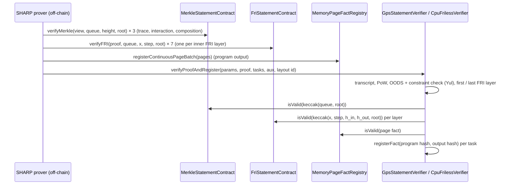

> **Research note — background and rationale only, not normative; the current rules are in docs/ (see decisions.md).**

# The StarkWare Ethereum STARK verifier and what PQZH can take from it

Written 2026-10-14 for the owner's request: "Starknet has a STARK verifier smart contract in Solidity — check what
is special about it." Context: a PQZH proof does not verify in one Ethereum transaction under the EIP-7825 cap of
16,777,216 gas. Ligero proven `R_TX` measured 534.6 M gas per transaction, ≈ 124 M at the opcode floor
(`pqzh-ligero.md` §11). FRI + ZK Goldilocks⁵ `R_TX` is 25.1 M conjectured / 38.2 M proven as written, 12.5 / 21.4 M at
the floor, where the EIP-7623 calldata floor binds (`pqzh-solidity-verifier.md` §1, §8). Owner rule: if PQZH fits a
chain without the precompile, it is used there. Branch `pqzh-starkex-study`. **No decision is recorded here.**

**[source]** marks a fact read from a repository file, a document or a chain explorer (§9). **[measured]** marks a number read
from mainnet transaction receipts (§2.2; script `pqz-core/pqzh/stark-backup/sol/starkex_split.py`, output
`starkex_split.txt`). **[estimate]** marks a number from that script's split model or from the earlier notes' gas
models. **[inference]** marks a conclusion drawn here.

## 1. Result

**What is special about the StarkWare verifier.** It does not fit one STARK verification into one transaction. It
splits the verification into many transactions, each proving a small, self-contained true statement. Each piece
records a hash ("fact") in a registry contract, and a final transaction checks the facts by hash. Three other choices
make it cheap:
- Its field is a 252-bit prime, so every field multiplication is a single `mulmod`.
- Merkle digests are Keccak-256 masked to 160 bits.
- The constraint and out-of-domain evaluation is generated Yul.

It is also neither ZK nor 128-bit. The deployed parameters claim **96 bits under the ethSTARK conjecture**: 11
queries × log₂ blowup 6 + 30 grinding bits. The 160-bit digests cap collision resistance at **80 bits**. The proofs
are not zero-knowledge. [source, §3]

**Measured on mainnet (one SHARP proof, 2026-10-14):** 12 transactions over 3 blocks: 3 × `verifyMerkle`,
7 × `verifyFRI`, 1 × `registerContinuousPageBatch` and 1 × `verifyProofAndRegister`. Together they used **7,233,648
gas and 145,136 B of calldata**, about **$1.82 at 0.1 gwei** (the base fee that day was ≈ 0.066 gwei). **Every Merkle
and FRI transaction paid exactly the EIP-7623 calldata floor**: the split pieces are calldata-bound. The main
transaction used 3.06 M gas for 23 KB. [measured, §2.2]

**What PQZH can take from it** [estimate, `starkex_split.txt`; inference]:

| Technique | Applied to PQZH | Fits without precompile? | Security cost for PQZH |
|---|---|---|---|
| **Multi-tx split + fact registry** | **FRI + ZK, Goldilocks⁵, proven 128, `R_TX`** (506 KB): 2 txs, 21.1 M total with a floor-class verifier; 3 txs, 38.4 M as written. Through the public mempool (≤ 128 KB per tx): 4 txs, 21.4 / 38.5 M. | **yes** | none: facts are true statements; soundness and ZK unchanged |
| same | Ligero proven `R_TX` as built | **no** in practice: every piece needs ≈ 418 KB of per-proof shared vectors again. 19 txs / 319 M at the floor, and only by private submission | none |
| same | Ligero with a protocol variant (the prover sends R_i(η_j), §11.4 of `pqzh-ligero.md`) | yes, poorly: 5–10 txs, 70–136 M | none, if the variant's soundness is proven |
| 160-bit Merkle digests | saves ≈ 28 % of calldata per digest | — | **unacceptable**: 80-bit collision resistance, ≈ 53-bit quantum (BHT) |
| Stark252 field (one `mulmod` per multiply) | cheap verifier arithmetic, but base-field openings grow 8 → 32 B | no gain under EIP-7623 | needs a new ZK prover; the mod-q relation is emulated |
| Recursion / aggregation (SHARP model) | one outer proof per batch of PQZ transactions; ≈ 20 M/N of verification per transaction plus its own ≈ 1.2 M of non-proof calldata | yes, amortised | prover service (liveness, censorship, ordering); batch latency; the outer proof need not be ZK |
| Blobs (EIP-4844) for proof data | a contract reads blob data only through KZG point evaluation: 50,000 gas per 31-byte element | **no** | KZG is not post-quantum |

**Bottom line** [inference]: **one technique, the multi-transaction split with a fact registry, makes PQZH usable on
an EVM chain without the precompile, and only with the FRI + ZK STARK, not Ligero.**

For proven + ZK `R_TX` (the owner's regime) the cost is ≈ 21.4 M gas in 4 transactions with a tuned verifier,
≈ 38.5 M as the test code stands. That is $5.4 / $54 / $538 at 0.1 / 1 / 10 gwei for the tuned verifier
(ETH = $2,515). A transfer through the precompile costs ≈ 10.2 M, set by its own proof's calldata floor, so this is
≈ 2.1× (tuned) to 3.8× (as written) of the precompile path. Security is unchanged: proven 128 bits, ZK and 256-bit
Keccak are all kept.

Building it means:
- a second `proofSystemId` (the EVM variant of `pqzh-solidity-verifier.md` §6, which a client proves with the
  FRI + ZK prover: 20.4 s and 2.8 GB measured for `R_TX` at blowup 16);
- three statement contracts: Plonky3 MMCS Merkle openings, FRI layers with roll-in, and the main verifier;
- a client that sends 2–4 ordered transactions per operation.

Recursion is the only route below the precompile path (≈ 1.4 M per transfer at N = 100). It is a different
product, with a prover service and batch latency.

## 2. Architecture: how verification is split

### 2.1 The contracts [source]

`starkware-libs/starkex-contracts`, `evm-verifier/solidity/contracts/`, HEAD `f3b2506` (2025-07-01). The verifier
directory was last changed in `75f31b9` (2023-05-01, StarkEx v5). The README lists the contracts:

| Contract | Role | Key code |
|---|---|---|
| `GpsStatementVerifier` | entry point: `verifyProofAndRegister(proofParams, proof, taskMetadata, cairoAuxInput, cairoVerifierId)`; checks that the proven program is the bootloader, then registers one fact per task (program hash, output hash) | `gps/GpsStatementVerifier.sol:71, 138` |
| `CpuFrilessVerifier` (per Cairo layout) | the STARK verifier: transcript, OODS, constraint check, first FRI layer; its `verifyMerkle` and `friVerifyLayers` are overridden to **look facts up** instead of verifying | `cpu/CpuFrilessVerifier.sol` |
| `MerkleStatementContract` | `verifyMerkle(merkleView, initialMerkleQueue, height, expectedRoot)`: verifies a batch Merkle decommitment and registers `keccak(queue (index, leaf)…, root)` | `MerkleStatementContract.sol:15` |
| `FriStatementContract` | `verifyFRI(proof, friQueue, evaluationPoint, friStepSize, expectedRoot)`: folds one FRI layer (step ≤ 4, i.e. arity ≤ 16), checks the layer's Merkle decommitment, registers `keccak(evalPoint, stepSize, keccak(queue_in), keccak(queue_out), root)` | `FriStatementContract.sol:23`; `FriTransform.sol` `FRI_MAX_STEP_SIZE = 4` |
| `MemoryPageFactRegistry` | registers a public-memory page: `(pageType, prime, n, z, α, Π(z − (addrᵢ + α·valᵢ)), memoryHash, addr)`; the main verifier checks the page facts with its own z, α | `cpu/MemoryPageFactRegistry.sol`; `cpu/CpuVerifier.sol:279–341` |
| `FactRegistry` | `mapping(bytes32 ⇒ bool)`; `registerFact`, `isValid` | `components/FactRegistry.sol:27` |
| `CpuConstraintPoly`, `CpuOods` | **auto-generated** Yul in a `fallback()` that reads the context from calldata | `cpu/layout*/CpuConstraintPoly.sol`, `CpuOods.sol` (2.7–6.5 k lines each) |
| `PedersenHashPoints{X,Y}Column`, `EcdsaPoints{X,Y}Column` | periodic columns as contracts: `compute(x)` evaluates the column's interpolant by Horner (512 / 256 coefficients) | `cpu/periodic_columns/` |

**Why the split is sound** [inference from the code]: every fact is a *context-free true statement*. One kind says
"these leaves at these indices lie under root R". The other says "folding queue Q_in at point x with step s gives
Q_out, consistent with the layer committed at R". A fact does not depend on Fiat–Shamir, so anyone may register it
at any time. The main transaction derives every challenge from its own transcript, recomputes the queue hashes it
expects, and accepts only if the facts for exactly those values exist. A false fact cannot be registered. A true
fact about other values does not help. The FRI layers are chained by the queue hashes: the main transaction reads
each intermediate `keccak(queue_out)` from the proof and checks them in sequence. It computes the first layer from
its own decommitments and the last layer from the final polynomial (`FriStatementVerifier.sol:76`).



### 2.2 One proof on mainnet [measured]

Sender `0x159eb691…B06c` (SHARP), 2026-10-14, blocks 26,189,667–26,189,669 (≈ 24 s). Receipts read with
`eth_getTransactionReceipt` (`starkex_split.py --fetch`). The proof parameters were decoded from the main transaction's
calldata: `cairoVerifierId` 7, nQueries 11, log₂ blowup 6, proof of work 30 bits, FRI last layer 2⁶, 8 FRI steps
(0, 3 × 6, 2).

| Transaction(s) | Method | gasUsed | Calldata | At the EIP-7623 floor? |
|---|---|---|---|---|
| 3 | `verifyMerkle` (11 queries, height 32, 307-word view) | 320,720 each | 10,724 B each | **yes** |
| 7 | `verifyFRI` (34-word queue, step 3) | 179,480 – 408,260 (Σ 2,170,820) | 5,156 – 12,548 B | **yes** |
| 1 | `registerContinuousPageBatch` (28 pages) | 1,044,686 | 24,964 B | no (floor 631,180) |
| 1 | `verifyProofAndRegister` | 3,055,832 | 23,396 B | no (floor 751,970) |
| **12** | | **7,233,648** | **145,136 B** | |

- Every Merkle and FRI statement transaction costs exactly 21,000 + 10 × tokens. Its execution is under 6 gas per
  token, so the calldata floor sets the price. The split hands each statement the calldata it needs, and that is
  what is paid for.
- **No transaction comes near the 16.78 M cap.** The largest piece is 3.06 M. A proof costs ≈ 7.2 M in total, about
  $1.82 at 0.1 gwei and $18 at 1 gwei. The roots in the calldata are 20 bytes followed by 12 zero bytes (160-bit
  masked).
- Cadence: 25 `verifyProofAndRegister` calls in ≈ 31 h, one every ≈ 1.3 h (≈ 19 per day). On-chain verification is
  therefore ≈ 140 M gas per day [measured, Etherscan listing of `0x47312450…Db60`].

### 2.3 What Starknet runs today (2025–2026) [source]

- **Stwo / S-two for the leaves, Stone for the root.** L2BEAT says Starknet's tasks are proved and aggregated through
  SHARP "using Stwo for proving tasks and Stone for the roots of the recursive tree". The SHARP verifier "verifies a
  STARK proof of the exact Cairo bootloader stored onchain". Starknet switched its state-transition proving to Stwo on
  2025-10-19 (SHARPVerifierCallProxy upgrade). The proxy was upgraded again on 2025-12-08, 2026-02-01, 2026-04-29,
  2026-06-21 and 2026-07-12.
- **The Ethereum verifier is still the Stone-family `CpuFrilessVerifier`.** L2BEAT lists eight `CpuVerifier*_2026_13`
  layouts. `CpuVerifierRecursive_2026_13` at `0x2867A450…9B6B` is a `CpuFrilessVerifier` (solc 0.6.12) with
  constructor arguments `numSecurityBits_ = 96` and `minProofOfWorkBits_ = 30`. It uses MerkleStatementContract
  `0x32a91Ff6…FdAd`, FriStatementContract `0x30EfaAA9…d400` and MemoryPageFactRegistry `0xe583BcDE…C460`.
- **Planned:** StarkWare's blog of 2026-03-31 says SHARP "will soon incorporate circuit-based recursive proving, and
  the L1 verifier (solidity) will be changed to verify a S-two circuit proof". No such verifier is listed as live on
  2026-10-14. S-two is a Circle STARK over M31; a Solidity verifier for it would face the same small-field
  extension arithmetic as our Goldilocks⁵ verifier [inference].
- **Integrity** (Herodotus) verifies Stone proofs in Cairo 1 on Starknet. It also splits proofs across transactions
  ("split contracts and split proofs" in the zkSecurity audit of 2024-09) [source]. Its rationale is Starknet's
  per-transaction limits, the same constraint as ours.

## 3. Field, hashing, transcript, soundness, ZK [source]

| Item | StarkWare EVM verifier | PQZH (`pqzh-solidity-verifier.md`, `pqzh-ligero.md`) |
|---|---|---|
| Field | Stark252: p = 2²⁵¹ + 17·2¹⁹² + 1 (`PrimeFieldElement0.sol:5`), no extension field | Goldilocks⁵ (FRI) / F_q, q = 2⁴² − 215, challenges in F_q⁴ (Ligero) |
| Multiply | **one `mulmod`** (8 gas), values in Montgomery form only where convenient (`FriStatementVerifier.sol` multiplies by `K_MONTGOMERY_R` once) | Fp5 product 788 gas as written, ≈ 250 at the floor; F_q⁴ product 598 |
| Lazy reduction | `add` without reduction between `mulmod`s (p < 2²⁵², so sums of a few elements fit in 256 bits); Horner batched 7 steps per assignment (`PedersenHashPointsXColumn.sol:21`) | the Ligero verifier packs lanes and reduces lazily (§11.2) |
| Inversion / powers | MODEXP precompile `0x05` (`CpuConstraintPoly.sol:137`), batched inverses in `CpuOods` | addition chain (4,668 gas) / batch inversion |
| Merkle digest | **Keccak-256 masked to 160 bits** (`MerkleVerifier.sol:8, 107`, comment "masked to 160bit … to save gas costs"); Stone's default `commitment_hash` is `keccak256_masked160_msb` (stone-prover `verifier_main_helper_impl.cc:56–58`) | Keccak-256, 256 bits |
| Transcript | Keccak-256 hash chain ("PRNG"), proof of work `keccak(keccak(0x0123456789abcded ‖ digest ‖ bits) ‖ nonce) < 2^(256 − bits)` (`VerifierChannel.sol:206`) | Keccak-256 chained state, 16–24 grinding bits |
| Parameters (deployed) | 11 queries, blowup 64, 30 PoW bits; check `nQueries · log₂ blowup + powBits ≥ numSecurityBits` (`StarkVerifier.sol:149`), `powBits < numSecurityBits` (:114), `MAX_N_QUERIES = 48` | 42 queries at blowup 32 (FRI, proven); t = 121 columns (Ligero, proven) |
| Claimed soundness | **96 bits, conjectured** (ethSTARK conjecture: queries × log₂ blowup + PoW) | **128 bits, proven** (owner decision 2026-10-14) |
| Effective conjectured | **80 bits**: the ethSTARK README takes the minimum of the query term, the hash collision resistance and the field term. 160-bit digests give 80 [inference from ethSTARK §7 applied to the deployed hash] | 128 |
| Proven (FRI, rough) | ≈ 41 bits by unique decoding (≈ 1 bit per query at ρ = 1/64, + 30 PoW), ≈ 63 bits by the Johnson bound (≈ 3 bits per query + 30) [estimate, standard FRI bounds] | 128 |
| Zero knowledge | **no**: ethSTARK README "proofs … are not zero-knowledge"; Stone has no hiding option in its parameters (no ZK masking found in `src/starkware/stark`) | **required** |

StarkWare's own article (2023-10-04) takes a hash output of twice the target security, 192 bits for 96 [source]. The
deployed verifier uses 160 bits. Starknet needs no ZK, because its state diffs are public.

## 4. Constraint evaluation: why the main transaction is only 3 M [source]

- **Generated Yul per layout.** `CpuConstraintPoly` (935 `mulmod`s in layout 6) evaluates every AIR constraint at
  the out-of-domain point. It works from a fixed memory map: inputs at `[0x0, 0x2800)`, then named intermediate
  values, then `expmods` for the domain polynomials. `CpuOods` (1,010 `mulmod`s) builds the DEEP quotients for every
  query with one batched inversion per chunk of `2 + N_ROWS_IN_MASK` items. There are no Solidity structs, loops or
  bounds checks in the hot code. This is the "hand-scheduled floor" style that `pqzh-solidity-verifier.md` §5.3
  estimates and that the PQZH test code is 4–7× above.
- **Periodic columns as separate contracts.** The Pedersen and ECDSA constant-point tables are periodic columns.
  Each is a contract whose `compute(x)` evaluates the column's interpolating polynomial by Horner: 512 or 256
  coefficients embedded as constants, ≈ 10 gas per coefficient. **It is evaluated once, at the OODS point, never per
  query**, so a periodic column costs O(period) `mulmod`s once. PQZH rejected full-height periodic columns because a
  2¹⁵-period column in Goldilocks⁵ would cost ≈ 400 k extension operations (`pqzh-solidity-verifier.md` §6). In
  Stark252 the same work would be ≈ 400 k × ≈ 10 gas = 4 M, borderline but possible [inference]. The field makes
  the difference.
- **Contract size.** Splitting into `CpuConstraintPoly`, `CpuOods`, the periodic-column contracts and the verifier
  keeps each under EIP-170 (24 KB), at the cost of `staticcall`s with calldata copies.
- **Statement as public memory, not periodic columns.** The program output enters as memory pages. The page fact
  (a product over (address, value) pairs at the verifier's z, α) is registered in a separate transaction, and the
  main transaction only checks its hash. This is the LogUp/permutation "public memory" approach that
  `pqzh-solidity-verifier.md` §7 found 10× dearer than a Horner fingerprint in Fp2. In Stark252 it costs one
  `mulmod` + `addmod` per pair.

## 5. Recursion and amortisation [source; estimate]

- One Ethereum proof verifies the root of a recursive tree. Stwo proves each Starknet block's execution; Cairo
  verifiers of those proofs are proved again until one Stone proof of the bootloader remains, and the bootloader
  registers one fact per task. Facts consumed by Starknet's core contract `updateStateKzgDA` connect the state
  update to the proven program output. The data itself goes in blobs.
- **Per-L2-transaction verification cost:** ≈ 19 proofs per day × 7.2 M ≈ 140 M gas per day [measured]. Starknet
  ran 6.93 user operations per second on L2BEAT that day, ≈ 599 k per day [source]. That gives **≤ 234 gas per
  user operation, ≈ $0.00006 at 0.1 gwei** [estimate; an upper bound, as SHARP also proves other customers' tasks].
  Amortisation is the point: the per-proof cost is fixed and almost independent of how many L2 transactions the
  batch carries.
- Latency: a proof every ≈ 1.3 h, i.e. minutes to hours from L2 transaction to L1 finality. Starknet's
  pre-confirmations hide it.

## 6. Applicability to PQZH

### 6.1 (a) The multi-transaction split with a fact registry [estimate, `starkex_split.txt`]

Model: the verification's execution E and calldata T (in tokens) are cut into k balanced pieces. Every piece repeats
its shared data and registers one fact (≈ 25 k gas). Each piece pays 21,000 + max(4 T/k + E/k, 10 T/k) and must stay
≤ 16,777,216 gas. To use the public mempool, each piece must also be ≤ 128 KB (geth `txMaxSize = 4 * txSlotSize`,
`core/txpool/legacypool/legacypool.go:56`) [source]. Divisibility is assumed perfect, which the structure of FRI
nearly gives (one piece per tree or layer). Prices use ETH = $2,515.

**FRI + ZK, Goldilocks⁵ (`R_TX`, EVM layout, blowup 32, arity 8):**

| Regime | Proof | Verifier | Txs (cap only / ≤ 128 KB) | Total gas | $ at 0.1 / 1 / 10 gwei |
|---|---|---|---|---|---|
| proven + ZK (owner's) | 506 KB | as written (29.3 M) | 3 / 4 | 38.4 / 38.5 M | 10 / 97 / 969 |
| proven + ZK | 506 KB | floor (6.2 M) | 2 / 4 | 21.1 / 21.4 M | 5 / 54 / 538 |
| proven + ZK | 506 KB | 2× floor (planning value) | 2 / 4 | 21.3 / 21.6 M | 5 / 54 / 543 |
| conjectured + ZK | 282 KB | as written (19.8 M) | 2 / 3 | 25.2 / 25.4 M | 6 / 64 / 639 |
| conjectured + ZK | 282 KB | 2× floor | 1 / 3 | 13.6 / 14.0 M | 3 / 35 / 352 |

- **The FRI structure splits exactly as StarkWare's does.** There is one Merkle-statement piece per committed tree
  (trace, preprocessed, quotient, the ZK randomisation tree) and one FRI-statement piece per layer, plus the main
  piece: transcript, Horner fingerprint, DEEP and the constraint check at the OOD point. Plonky3 differs in two
  places. Its Merkle trees are mixed-height (MMCS), so the Merkle statement checks `verify_batch` openings. Its FRI
  rolls shorter inputs in at each layer, so the FRI fact must also cover the rolled-in reduced openings. Both are
  hash-chained the same way [inference].
- **Under EIP-7623 the split costs almost nothing.** The total stays at the calldata floor of the whole proof
  (≈ 21.4 M for proven + ZK), because a floor-class verifier's execution is covered by the 6 gas per token the floor
  already charges. As written, the test code's 29.3 M of execution is not covered (38.4 M in total).
- **Latency** [inference]: a client sends k transactions with consecutive nonces. They can all land in one block
  (4 × 5.4 M fits a 60 M block; mainnet's limit on 2026-10-14 was 60,000,000) but need not. Expect 1–3 blocks, as
  SHARP's 3. The facts persist (22.1 k each), so a main transaction that reverts can be retried without re-sending
  the facts. A state race, such as the balance ciphertext changing under the proof, still wastes the fact
  transactions' gas.
- **Against the precompile path.** A transfer that calls the precompile is also bound by the EIP-7623 floor: the
  Ligero proof's 9.0 M (`pqzh-ligero.md` §11.1) plus the transfer's other 119 k tokens gives ≈ 10.2 M. The
  precompile's own price is ≈ 1.3 M (10.5 ms p99 × ≈ 0.12 M gas/ms, CTR-PQZ-11 in pq-zero-knowledge.md §9.3) and fits under
  the floor. The tuned FRI + ZK split is therefore ≈ 2.1× the precompile transaction, and the test-level code is
  ≈ 3.8× [estimate].

**Ligero (proven `R_TX`, 231,950 B):** splitting the per-column checks looks natural, since the 121 opened columns
are independent. **It does not work as built.** Every column check needs two sets of per-proof shared vectors:
- the linear test's combination vectors (19 own vectors × ℓ = 695 values in F_q⁴, ≈ 317 KB);
- the three test polynomials w, q, h (4,204 F_q⁴ coefficients, ≈ 101 KB).

A piece must either re-send them, ≈ 418 KB and ≈ 16.2 M of calldata floor (the cap on its own), or recompute them
(the statement pass: 98.8 M as written, 15.6 M at the floor, plus the 83 KB statement). Re-sending fits only with
19 pieces of 16.8 M (319 M) at the floor, or 55 pieces (921 M) as written, and never through the public mempool.
Storage is no way round: 14.7 k words × 22.1 k ≈ 325 M to write. Transient storage does not survive the
transaction.

The protocol variant of `pqzh-ligero.md` §11.4 has the prover send R_i(η_j) per column and replaces the per-column
witness-sized term by one batched tensor check. That shrinks the shared data to w, q, h. It splits into 5 txs /
70 M at the floor and 8–10 txs / 132–136 M at 2× the floor, i.e. $18–34 at 0.1 gwei and $176–341 at 1 gwei.
That is 3–6× the FRI + ZK split, and the variant needs its own soundness argument. **Ligero's verifier is linear in
the circuit per opened column, which is the opposite of what a split needs:** small pieces with little shared
context [inference].

### 6.2 (b) 160-bit Merkle digests: not acceptable for PQZH [inference]

- **Classical:** a 160-bit digest has 80-bit generic collision resistance. In the BCS compilation the soundness error
  contains a term ≈ Q²/2¹⁶⁰ for Q hash evaluations, so 128-bit soundness needs ≥ 256-bit digests. StarkWare's
  own article says the same ("double the desired security"). A collision lets the prover equivocate on a Merkle
  subtree after seeing the queries: it builds two candidate subtrees and searches for a claw in ≈ 2⁸⁰ work. For
  scale, 2⁸⁰ Keccak-sized hashes is the order of an hour of the Bitcoin network's SHA-256 rate (≈ 2⁶⁹ per second)
  [estimate]. That is a real budget for a well-funded attacker against a token that holds value.
- **Post-quantum:** the BHT quantum collision bound for 160 bits is ≈ 2⁵³. PQZH exists for post-quantum security.
- **What it saves:** a masked digest in a 32-byte word costs 20 × 4 + 12 × 1 = 92 EIP-7623 tokens instead of 128,
  −28 % per digest. If digests are half of a FRI proof's bytes, the proof is −14 % [estimate]. Proven + ZK `R_TX` at
  21.4 M would drop to ≈ 18.6 M: still over one transaction's cap, and the split makes it unnecessary. **Keep
  256-bit Keccak.**

### 6.3 (c) A Stark252-field STARK for PQZH [inference]

- **Emulating mod-q is cheap in rows.** All products in the relation stay below ≈ 2⁹⁵ (a 2048-term inner product of
  42-bit values), far under 2²⁵¹. Each ring row can therefore be computed exactly over the integers in the big field
  and reduced once per output coefficient with one quotient witness and its range check (≈ 12 k extra witnesses for
  `R_TX`). That is modest, not a blow-up.
- **But the proof grows where it hurts.** Base-field openings grow from 8 to 32 bytes. At 42 queries and ≈ 201
  opened values per query, the trace openings alone go from ≈ 68 KB to ≈ 270 KB, ≈ +7.8 M of EIP-7623 calldata.
  FRI-layer values stay about the same (32 B against Fp5's 40 B). The verifier gets far cheaper (a multiply is 8 gas
  instead of ≈ 250–788), but under EIP-7623 the binding cost is calldata, so Stark252 loses on net. StarkWare chose
  Stark252 in 2020, when calldata was 16 gas per byte with no floor and execution was the larger term.
- **No prover to reuse:** Stone and ethSTARK are not ZK; a ZK Stark252 prover would be a new build. The same
  conclusion holds for periodic columns (§4): cheap in Stark252, but not worth the calldata.

### 6.4 (d) Recursion: wrap PQZH proofs in one outer STARK per batch [inference; estimate]

- **Shape:** clients send PQZH proofs (ZK, 128-bit proven) to an aggregator. The aggregator proves "I verified these
  N proofs against these N statements and the state transition is their application". It posts one outer proof per
  batch, verified on L1 by a StarkEx-style split verifier, or posts a fact to a registry like SHARP's.
- **ZK is not needed in the outer layer:** the inner proofs are already ZK and the statements are public on chain
  anyway. A non-ZK outer prover (Stone-like) leaks nothing new. This is the one place where a non-ZK StarkWare-style
  prover fits PQZH.
- **Cost:** an outer proof at proven 128 bits with 256-bit digests needs ≈ 33 queries at blowup 64, against SHARP's
  11. That is ≈ 3× SHARP's 7.2 M, ≈ 20 M per batch [estimate]. The verification share per PQZ transaction is
  ≈ 20 M/N: 0.2 M at N = 100. The transfer's own non-proof calldata remains (≈ 119 k tokens: ciphertexts and envelope,
  pq-zero-knowledge.md §9.3): ≈ 1.2 M at the floor, or ≈ 30 KB of blob (§6.5). Per transfer that comes to ≈ 1.4 M with
  calldata, against 21.4 M split and ≈ 10.2 M through the precompile.
- **What changes for a privacy token:**
  - **Latency:** batch interval plus outer proving time (minutes), instead of one block.
  - **A prover service:** it can censor or delay but not steal, since validity is proven. Its liveness becomes a
    dependency, so the design needs a forced-inclusion or escape path.
  - **Ordering:** a Zether proof is made against the current balance ciphertext, so two transfers from one account
    in a batch make the second stale. Zether's epoch / pending-balance rules have to hold inside the batch.
  - **Build size:** in-circuit verification of a Keccak-based PQZH proof is expensive. A recursion-friendly inner
    proof system (Poseidon2 Merkle and transcript) is a different `proofSystemId`, with its own PQ-security review
    of the hash.
  - **Trust:** using SHARP itself (checking `isValid(fact)` of a Cairo PQZH-batch verifier through a SHARP access
    provider) avoids building an L1 verifier. It inherits SHARP's 96-bit conjectured / 80-bit-digest soundness and
    StarkWare's upgradeable verifier proxy (six upgrades since 2025-10). That conflicts with the owner's proven
    128 bits.

### 6.5 (e) Calldata, blobs and the mempool [source; inference]

- **EIP-7623 decides.** SHARP's ten statement transactions pay exactly the floor (§2.2). Any PQZH split pays at
  least 10 gas per token of proof, ≈ 39 gas per proof byte. Proof bytes, not verifier code, set the minimum: 21.4 M
  for proven + ZK FRI, 9.0 M for proven Ligero (which then cannot carry its execution).
- **Blobs cannot carry the proof.** A contract sees only `BLOBHASH` (the versioned hash) and the point-evaluation
  precompile `0x0a` (50,000 gas: it verifies a KZG opening of the blob polynomial at one point). Reading proof
  element i means opening the blob polynomial at ω^i: 50,000 gas per 31-byte element, against ≈ 1,240 gas for 31
  bytes of calldata at the floor, **≈ 40× dearer**. A verifier reads thousands of elements (≈ 16 k words for proven
  + ZK `R_TX`), so this is not feasible. Blobs work for data *availability* (a rollup's state diff, §6.4's
  ciphertexts) through a proof of equivalence, not for verification input. KZG binding rests on pairings
  (BLS12-381) and is **not post-quantum**: a quantum attacker could open the commitment to other data. Blob data is
  also pruned after ≈ 18 days.
- **The public mempool caps a transaction at 128 KB** (geth). A one-transaction PQZH proof (230–506 KB) could
  not propagate at all; it would need direct submission to builders. The split has to respect 128 KB per piece,
  which raises proven + ZK FRI from 2 to 4 transactions at the same total.

## 7. Bottom line and what it would take

| Route | Fits a chain without the precompile | Gas per `R_TX` op (txs) | $ at 0.1 / 1 / 10 gwei | Security against the owner's choices | Build |
|---|---|---|---|---|---|
| **FRI + ZK (Goldilocks⁵, proven 128), StarkEx-style split, tuned Yul verifier** | **yes** | **≈ 21.4 M (4)** | **5 / 54 / 538** | **unchanged**: proven 128, ZK, 256-bit Keccak | EVM-variant `proofSystemId` (`pqzh-solidity-verifier.md` §6); Merkle-statement (MMCS) and FRI-statement (roll-in) contracts and a fact registry; a main verifier in generated or hand-scheduled Yul; client-side multi-transaction submission; fixtures and mutation tests as for Ligero §11.2 |
| same, test-level Solidity | yes | ≈ 38.5 M (4) | 10 / 97 / 969 | unchanged | less tuning |
| Ligero, split | no as built; yes with the R_i(η_j) variant | 70–136 M (5–10) | 18–34 / 176–341 / 1,761–3,415 | needs a soundness argument for the variant | variant + split; not recommended |
| Recursion (PQZ rollup / aggregator) | yes | ≈ 1.4 M with calldata, less with blobs, at N = 100 | ≈ 0.4 / 3.5 / 35 | inner proven 128 + ZK kept; outer proven 128 achievable; blobs add a non-PQ DA dependency | months: recursion-friendly inner proof, outer prover, aggregator, escape hatch |
| SHARP facts (Cairo PQZH-batch verifier) | yes | ≈ 0 own L1 gas beyond statements | — | **no**: 96-bit conjectured / 80-bit digests, StarkWare-upgradeable | Cairo verifier of PQZH; a SHARP access provider |
| 160-bit digests, Stark252, blobs-as-proof-input | — | — | — | rejected (§6.2, §6.3, §6.5) | — |

Security flags against the owner's choices (proven 128, ZK required) [inference]:
- The StarkWare verifier as deployed meets neither: 96 bits conjectured, ≈ 80 bits through its 160-bit digests,
  and no ZK.
- Only its **architecture** (split + facts) transfers, and that transfer is security-neutral.
- Nothing in this note changes PQZH-Ligero's need for the precompile on chains that have it.

## 7a. Owner decision (2026-10-14)

After this study the owner decided **not to build PQZH for chains without the precompile** (the split FRI + ZK
verifier of §7 is not pursued); PQZH runs only where the PQZ precompile exists (SCaaS testnet / 22776). Status: closed, no
work planned (TODO.md, `3e2675b`). Summary across all PQZH backends: `pqzh-backend-comparison.md`.

## 8. Files and rerun

- `pqz-core/pqzh/stark-backup/sol/starkex_split.py`: recorded receipts of the SHARP proof (§2.2), the split model (§6.1),
  `--selftest` (asserts that the ten statement transactions pay exactly the floor and the two others do not; that
  the model reproduces the single-transaction 21.4 M of proven + ZK; that the 128 KB limit binds), `--fetch` (re-reads
  receipts over a public RPC).
- `pqz-core/pqzh/stark-backup/sol/starkex_split.txt`: its output.

```sh
python3 pqz-core/pqzh/stark-backup/sol/starkex_split.py --selftest
python3 pqz-core/pqzh/stark-backup/sol/starkex_split.py > pqz-core/pqzh/stark-backup/sol/starkex_split.txt
python3 pqz-core/pqzh/stark-backup/sol/starkex_split.py --fetch 0xe548d9a38319c283f50b3879de776303a8b4a64004924391445b64d3d73b1f38
```

Public repositories were cloned as data only (no builds): `starkex-contracts` `f3b2506`, `stone-prover` `1414a54`,
`ethSTARK` `0eb683b`.

## 9. Sources

- starkware-libs/starkex-contracts @ `f3b250690c5d927a6e398e9c1735d9193a643034`, `evm-verifier/solidity/contracts/`:
  [MerkleVerifier.sol](https://github.com/starkware-libs/starkex-contracts/blob/f3b250690c5d927a6e398e9c1735d9193a643034/evm-verifier/solidity/contracts/MerkleVerifier.sol),
  [MerkleStatementContract.sol](https://github.com/starkware-libs/starkex-contracts/blob/f3b250690c5d927a6e398e9c1735d9193a643034/evm-verifier/solidity/contracts/MerkleStatementContract.sol),
  [MerkleStatementVerifier.sol](https://github.com/starkware-libs/starkex-contracts/blob/f3b250690c5d927a6e398e9c1735d9193a643034/evm-verifier/solidity/contracts/MerkleStatementVerifier.sol),
  [FriStatementContract.sol](https://github.com/starkware-libs/starkex-contracts/blob/f3b250690c5d927a6e398e9c1735d9193a643034/evm-verifier/solidity/contracts/FriStatementContract.sol),
  [FriStatementVerifier.sol](https://github.com/starkware-libs/starkex-contracts/blob/f3b250690c5d927a6e398e9c1735d9193a643034/evm-verifier/solidity/contracts/FriStatementVerifier.sol),
  [StarkVerifier.sol](https://github.com/starkware-libs/starkex-contracts/blob/f3b250690c5d927a6e398e9c1735d9193a643034/evm-verifier/solidity/contracts/StarkVerifier.sol),
  [VerifierChannel.sol](https://github.com/starkware-libs/starkex-contracts/blob/f3b250690c5d927a6e398e9c1735d9193a643034/evm-verifier/solidity/contracts/VerifierChannel.sol),
  [PrimeFieldElement0.sol](https://github.com/starkware-libs/starkex-contracts/blob/f3b250690c5d927a6e398e9c1735d9193a643034/evm-verifier/solidity/contracts/PrimeFieldElement0.sol),
  [components/FactRegistry.sol](https://github.com/starkware-libs/starkex-contracts/blob/f3b250690c5d927a6e398e9c1735d9193a643034/evm-verifier/solidity/contracts/components/FactRegistry.sol),
  [cpu/MemoryPageFactRegistry.sol](https://github.com/starkware-libs/starkex-contracts/blob/f3b250690c5d927a6e398e9c1735d9193a643034/evm-verifier/solidity/contracts/cpu/MemoryPageFactRegistry.sol),
  [cpu/CpuVerifier.sol](https://github.com/starkware-libs/starkex-contracts/blob/f3b250690c5d927a6e398e9c1735d9193a643034/evm-verifier/solidity/contracts/cpu/CpuVerifier.sol),
  [cpu/CpuFrilessVerifier.sol](https://github.com/starkware-libs/starkex-contracts/blob/f3b250690c5d927a6e398e9c1735d9193a643034/evm-verifier/solidity/contracts/cpu/CpuFrilessVerifier.sol),
  [cpu/layout6/CpuConstraintPoly.sol](https://github.com/starkware-libs/starkex-contracts/blob/f3b250690c5d927a6e398e9c1735d9193a643034/evm-verifier/solidity/contracts/cpu/layout6/CpuConstraintPoly.sol),
  [cpu/layout6/CpuOods.sol](https://github.com/starkware-libs/starkex-contracts/blob/f3b250690c5d927a6e398e9c1735d9193a643034/evm-verifier/solidity/contracts/cpu/layout6/CpuOods.sol),
  [cpu/periodic_columns/PedersenHashPointsXColumn.sol](https://github.com/starkware-libs/starkex-contracts/blob/f3b250690c5d927a6e398e9c1735d9193a643034/evm-verifier/solidity/contracts/cpu/periodic_columns/PedersenHashPointsXColumn.sol),
  [gps/GpsStatementVerifier.sol](https://github.com/starkware-libs/starkex-contracts/blob/f3b250690c5d927a6e398e9c1735d9193a643034/evm-verifier/solidity/contracts/gps/GpsStatementVerifier.sol),
  [README.md](https://github.com/starkware-libs/starkex-contracts/blob/f3b250690c5d927a6e398e9c1735d9193a643034/evm-verifier/README.md).
- starkware-libs/stone-prover @ `1414a545e4fb38a85391289abe91dd4467d268e1`:
  [verifier_main_helper_impl.cc](https://github.com/starkware-libs/stone-prover/blob/1414a545e4fb38a85391289abe91dd4467d268e1/src/starkware/main/verifier_main_helper_impl.cc)
  (default `keccak256_masked160_msb`),
  [e2e_test/CairoZero/cpu_air_params.json](https://github.com/starkware-libs/stone-prover/blob/1414a545e4fb38a85391289abe91dd4467d268e1/e2e_test/CairoZero/cpu_air_params.json).
- starkware-libs/ethSTARK @ `0eb683bfdc9b4f85cc5254403ca032868db414f7`,
  [README.md](https://github.com/starkware-libs/ethSTARK/blob/0eb683bfdc9b4f85cc5254403ca032868db414f7/README.md)
  §2 (not ZK, up to 80 bits) and §7 (conjectured security = min of query term, hash collision resistance, field term).
- StarkWare, "Safe and Sound — A Deep Dive into STARK Security", 2023-10-04,
  <https://www.starknet.io/blog/safe-and-sound-a-deep-dive-into-stark-security/> (96-bit target, hash length twice
  the security).
- StarkWare, "Minutes to seconds: efficiency gains with recursive circuit proving", 2026-03-31,
  <https://starkware.co/blog/minutes-to-seconds-efficiency-gains-with-recursive-circuit-proving/> (planned S-two
  circuit-proof Solidity verifier).
- L2BEAT, Starknet, <https://l2beat.com/scaling/projects/starknet> (read 2026-10-14: Stwo switch 2025-10-19,
  "Stwo for proving tasks and Stone for the roots of the recursive tree", verifier list `*_2026_13`, proxy upgrades,
  6.93 UOPS).
- Herodotus Integrity: <https://docs.herodotus.dev/herodotus-docs/scaling-solutions/integrity-verifier>; zkSecurity
  audit (2024-09) <https://reports.zksecurity.xyz/reports/starknet-integrity>.
- Etherscan (read 2026-10-14): SHARP Verifier `0x47312450B3Ac8b5b8e247a6bB6d523e7605bDb60`; sender
  `0x159eb6910E36AB09dF3798f174b9DB00f327B06c`; CpuFrilessVerifier `0x2867A4509B0969531641A42a3D4A9B0A07109B6B`
  (constructor arguments 96 / 30); MerkleStatementContract `0x32a91Ff604AB2aDCd832e91D68b2f3f25358FdAd`;
  FriStatementContract `0x30EfaAA99f8eFe310D9FdC83072e2a04c093d400`; MemoryPageFactRegistry
  `0xe583BcDE0160b637330b27a3ea1F3c02ba2eC460`. Transactions (block 26,189,667–669):
  main [0xe548d9a3…1f38](https://etherscan.io/tx/0xe548d9a38319c283f50b3879de776303a8b4a64004924391445b64d3d73b1f38)
  (3,055,832 gas), memory pages
  [0xb04c1fa8…8c01](https://etherscan.io/tx/0xb04c1fa811740e6522ef7a864070773a0168e6b929dcfd5b533c250025c88c01)
  (1,044,686), Merkle
  [0x3dee0aac…75bc](https://etherscan.io/tx/0x3dee0aac9d7d00850d671051724afd494645f86414822f0d30870a895b9175bc)
  (320,720), FRI
  [0x38b28397…3691](https://etherscan.io/tx/0x38b28397b99fb616a154fcb2fca390386cc18e1b4237b7d2b0583e7e8c603691)
  (408,260); the full list is in `starkex_split.py`.
- go-ethereum @ `9e800218a6c0325b31174abefba03778f7167790`,
  [core/txpool/legacypool/legacypool.go](https://github.com/ethereum/go-ethereum/blob/9e800218a6c0325b31174abefba03778f7167790/core/txpool/legacypool/legacypool.go)
  (`txMaxSize = 4 * txSlotSize // 128KB`).
- EIP-7825 (transaction gas cap 2²⁴), EIP-7623 (calldata floor, 10 gas per token), EIP-4844 (blobs, `BLOBHASH`, point
  evaluation precompile `0x0a`, 50,000 gas), EIP-170 (24,576-byte code size).
- Project notes: `pqzh-solidity-verifier.md` (§1, §3, §5.3, §6, §8), `pqzh-ligero.md` (§1, §11), `pqzh-zk-ext5.md`.
