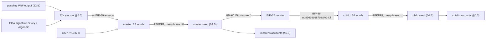
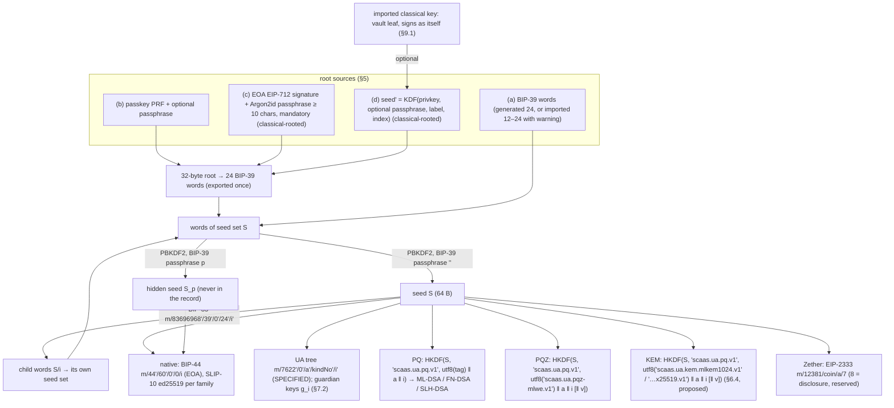
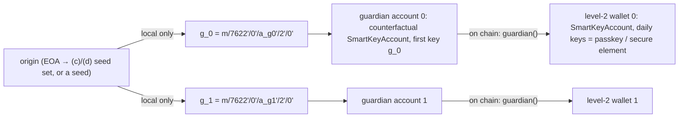

> **Research note — background and rationale only, not normative; the current rules are in docs/ (see decisions.md).**

# `scaas-sdk` keys: root sources, seed derivation trees, passkeys and biometrics

Written 2026-11-11 for the planned `scaas-sdk` (the controller's TODO item for `scaas-sdk`, owner 2026-11-11). Nothing
here is built; nothing here is decided except the owner's own words in §1. Tags: **[F]** a fact (a standard, the repo's
code or docs, cited), **[I]** this note's inference, **[E]** an estimate. No web sources were read; platform facts are
from the author's knowledge and are marked [I] where support moves between releases. Everything cryptographic here is
`UNAUDITED`. Reviewed by Fable (AI) on 2026-11-11 (no P0; its P1, P2 and P3 points are folded in).

**Contents:** 1. Owner requests · 2. What exists today · 3. BIP-39 explained · 4. BIP-85 explained · 5. Root sources ·
6. Derivation tree · 7. Seed sets from an ordinary wallet, and the two-level guardian · 8. Passkey as a seed level ·
9. Key sources besides seeds · 10. Biometrics and the platform traits · 11. Threat model · 12. Standards ·
13. Recommendations · 14. Open decisions.

## 1. Owner requests (2026-11-11)

The SDK context, as the owner set it: `scaas-sdk` has the modules `vault`, `account`, `wallet`, `confidential`, `dex`,
`admin`, and `chat` → `pqchat-core`; it sits on the crates `scaas-rpc` and `ua-rs`; apps get handles, secrets never
leave the SDK; platform APIs are reached through traits each app implements (`Authenticator`, `SecureStore`). The
`vault` holds several independent seeds, each with its own label and passphrase; passkey and hardware keys sit beside
seeds, not derived; signing only through `ua-rs` (the controller's TODO item for `scaas-sdk`).

The owner's words (recorded as given; the analysis that follows is research for the owner to decide):

1. **"From an ordinary wallet (an EOA or a raw private key), with a hash / passphrase, derive a new seed set and so a new
   wallet set: an origin address plus new addresses. Each seed set may take a further passphrase to derive secondary
   seed sets / wallet sets."** The owner is "not fully clear on this yet": explore it (§7.1).
2. **"The origin → new link stays local by default. To allow recovery without making the origin public: two levels.
   Origin → (derived) level-1 key used only as the guardian / recovery key → level-2 wallets whose on-chain guardian is
   that level-1 key. So the chain never shows the origin."** Analyse what still links (§7.2).
3. **"The SDK supports WebAuthn / passkeys / P-256 (Secure Enclave, Android StrongBox, TPM) and biometrics. Is an extra
   seed level from a passkey sound?"** (§8, §10).
4. **Owner rule (2026-11-11), verbatim: "Seeds sinh ra luôn dùng 24 words trở lên."** ("Generated seeds always use 24
   words or more.") Within BIP-39 that means 24 words for every seed the SDK generates (§3.4).
5. **Owner ruling (2026-11-11) on importing 12–21-word phrases, verbatim: "nhận kèm cảnh báo"** ("accept, with a
   warning"). The SDK accepts the import of an existing 12–21-word BIP-39 phrase with a warning: lower entropy than the
   24-word rule, and a suggestion to move funds to a new 24-word seed. A generated seed stays 24 words only (§3.4).
6. The owner asked for BIP-39 and BIP-85 to be explained in full for a reader new to them (§3, §4).
7. **Owner question (2026-11-11), verbatim: "có thể sinh key PQ, rồi sinh KEM có được không?"** ("can we generate the PQ
   key and then generate the KEM key?"): fill the KEM gap (§6.4).
8. **Owner note (2026-11-11), verbatim: "Lưu ý là user có thể import private key cổ điển."** ("Note that the user can
   import a classical private key."): §9.1.
9. **Owner ruling (2026-11-11) on Fable's P1-1** (PQ keys under roots (c) / (d)), verbatim: **"chỉ mạnh ngang passphrase
   => Chấp nhận rủi ro này. Yêu cầu passphrase phải đủ dài (10 ký tự) trong trường hợp này. Hoặc có lựa chọn dùng seed' =
   KDF(privkey, passphrase, nhãn, index)."** ("only as strong as the passphrase ⇒ this risk is accepted. The passphrase
   must be long enough (10 characters) in this case. Or offer the option seed' = KDF(privkey, passphrase, label,
   index).") So: the risk is accepted; (c) and (d) sets may carry PQ, PQZ and KEM keys, marked classical-rooted; the
   derivation passphrase has at least 10 characters; both (c) and (d) are offered (§5.5, §5.7).
10. **Owner ruling (2026-11-11), verbatim: "đồng ý, sửa theo đó"** ("agreed, change it accordingly"), in answer to the
    owner's own remark **"passphrase do SDK sinh => người dùng sẽ không nhớ passphrase. Trong khi dùng cách (d) kia thì có
    thể chỉ cần nhớ privkey."** ("an SDK-generated passphrase ⇒ the user will not remember it. With method (d) the user
    may need to remember only the private key."). So: passphrases are **user-chosen**, never SDK-generated (a strength
    meter may be shown); for (c) the passphrase stays **mandatory, ≥ 10 characters**; for (d) it is **optional** —
    empty ⇒ HKDF from the key alone, non-empty ⇒ ≥ 10 characters and Argon2id then HKDF (§5.5).

## 2. What exists today

| Piece | Where | Status |
|---|---|---|
| BIP-39 24 words, generated or imported on the device; checksum checked; NFKD | `clients/clientkeys/src/seed.js` (`entropyToWords`, `wordsToEntropy`, `seedFromWords(text, passphrase)`) | BUILT [F] |
| BIP-32 secp256k1 (`@scure/bip32`), SLIP-10 ed25519 (hardened only), SLIP-44 native paths per family | `seed.js` `NETWORKS`, `deriveKey`, `slip10Ed25519` | BUILT [F] |
| Show-once backup with a 3-word check (`fresh → revealed → challenged → verified → taken`) | `backup.js` `SeedBackup`; [CLI-SGN-11](../clients/signers-clientkeys.md#CLI-SGN-11) | BUILT [F] |
| Vault: random DEK, AES-256-GCM; passphrase envelope (scrypt `N = 2^17, r = 8, p = 1`) always; PRF envelope (HKDF-SHA256 of the PRF output, info `scaas-clientkeys-vault-v1/prf`) when the passkey offers PRF | `vault.js`; [CLI-SGN-02](../clients/signers-clientkeys.md#CLI-SGN-02), [CLI-SGN-21](../clients/signers-clientkeys.md#CLI-SGN-21) | BUILT [F] |
| Vault v2 under a non-extractable WebCrypto device key | [CLI-SGN-17](../clients/signers-clientkeys.md#CLI-SGN-17) | SPECIFIED [F] |
| Passkeys: ES256 only, discoverable, UV required, random user handle, PRF requested at creation, strict DER → low-s | `webauthn.js`; [CLI-SGN-04](../clients/signers-clientkeys.md#CLI-SGN-04), [CLI-SGN-09](../clients/signers-clientkeys.md#CLI-SGN-09) | BUILT [F] |
| Raw-digest signing refused without opt-in; never a 7702 authorization | `seed.js` `signDigest`; [CLI-SGN-40](../clients/signers-clientkeys.md#CLI-SGN-40) | BUILT [F] |
| PQ keys: `ξ = HKDF-SHA256(ikm = BIP-39 seed, salt = "scaas.ua.pq.v1", info = utf8(kind tag string, e.g. "scaas.ua.mldsa65.v1") ‖ u32 account ‖ u32 index)` → FIPS 204 / Falcon / FIPS 205 keygen. The `info` takes the **UTF-8 tag string**, not `kindTag()` = keccak256 of it: a port that hashes it derives other keys | `pq.js` `pqSeed`, `pqKeygen`; vectors `smartcontracts/vectors/ua/pq_kat.json` (mnemonic, account 0, index 0) | BUILT [F] |
| PQZ key seed: same HKDF, info `utf8("scaas.ua.pqz-mlwe.v1") ‖ u32 account ‖ u32 index [‖ be64 version]` | `pq.js` `pqzKeySeed`; [CTR-PQZ-13](../contracts/pq-zero-knowledge.md#CTR-PQZ-13); `pq_kat.json` `pqzSeeds` | BUILT [F] |
| Zether key: EIP-2333 tree `m/12381/<coin>/<account>/7` (`USE_CONF`); `…/8` is `USE_DISCLOSURE` (reserved) on BLS12-381 | `zether.js` `deriveConfKey`; vectors `clients/clientkeys/test/vectors/r33_keys.json` | BUILT [F] |
| UA tree `m/7622'/0'/<account>'/<kindNo>'/<i>'` (role keys, every derived UA kind) | [CLI-SGN-30](../clients/signers-clientkeys.md#CLI-SGN-30), [CLI-SGN-25](../clients/signers-clientkeys.md#CLI-SGN-25) | SPECIFIED; no `7622'` path in `clientkeys/src` today [F] |
| KEM (chat) key: ML-KEM-1024 + X25519, `kemPk = 0x01 ‖ ek ‖ pkX`; `kemKey(seed64, x25519Secret)` takes both seeds as inputs; no derivation from the BIP-39 seed is fixed | `pqchat.js` `kemKey`, `combine`; [CTR-UA-32](../contracts/accounts.md#CTR-UA-32) | **gap** [F]; filled in §6.4 [I] |
| Guardian recovery: `initiateRecovery(newKey)` by the guardian, 2-day delay, cancellable by a key, adds a key | `SmartKeyAccount.sol`; [CTR-ACC-03](../contracts/accounts.md#CTR-ACC-03) | BUILT (EVM) [F] |

Two facts shape everything below:

- **A derived UA is "single-key, no recovery" by construction** ([CTR-ACC-09](../contracts/accounts.md#CTR-ACC-09)).
  A guardian exists only on `SmartKeyAccount` (EVM option (b)) and the non-EVM account objects; an `msig` UA gets
  "recovery" only from its quorum, without a delay. [F]
- **`initiateRecovery` is a direct call**: `_msgSender() == guardian`, not a relayed `mtx*` entry (`SmartKeyAccount.sol`
  `initiateRecovery`; `MetaTxBase._msgSender`). An EOA guardian therefore needs gas of its own; a contract guardian
  calling through its own `execute` passes (`msg.sender` = the guardian account). [F] This matters for §7.2.

## 3. BIP-39 explained

BIP-39 turns random bits into words a person can write down, and words into a binary seed for key derivation. Every
seed set of the SDK ends in a BIP-39 mnemonic (§5), so this is the base of everything below.

### 3.1 Entropy, checksum, word count

Generation takes `ENT` bits of random entropy, `ENT` ∈ {128, 160, 192, 224, 256}; appends a checksum of `CS = ENT / 32`
bits, the first bits of `SHA-256(entropy)`; and splits the `ENT + CS` bits into 11-bit groups, each an index into a
2048-word list [F, BIP-39]:

| Entropy (bits) | Checksum (bits) | Words | Guessing a missing / wrong word passes the checksum with probability |
|---|---|---|---|
| 128 | 4 | 12 | 1 / 16 |
| 160 | 5 | 15 | 1 / 32 |
| 192 | 6 | 18 | 1 / 64 |
| 224 | 7 | 21 | 1 / 128 |
| 256 | 8 | **24** | 1 / 256 |

(Last column: arithmetic from the checksum length [F].) The checksum catches most typos and swapped words; it is not
a security feature [F]. **24 words is the maximum in BIP-39** [F]: "24 or more" means 24 within the standard; a longer
phrase is not BIP-39 and no BIP-39 wallet would read it. The "25th word" that some wallets offer is not a word: it is the
BIP-39 passphrase (§3.3). Schemes with more words exist outside BIP-39 (SLIP-39 Shamir shares use 33 words for a 256-bit
secret [F]); they are other standards, not longer BIP-39.

### 3.2 Wordlist and normalisation

The English list has 2048 words, sorted, chosen so that the first four letters identify a word and similar words are
avoided [F]. BIP-39 also publishes lists for other languages [F]; the seed is computed from the sentence's text, so the
same entropy written in two languages gives two different seeds [F]. Both the mnemonic and the passphrase are UTF-8,
**NFKD**-normalised before use [F]. `clientkeys` uses the English list only (`seed.js:5`), and `normalizeMnemonic`
(`seed.js:34-36`) applies NFKD, trims, lower-cases and collapses whitespace (lower-casing goes beyond BIP-39 and is
harmless for the English list [I]). Do not confuse it with the **vault** passphrase, which is NFKC-normalised
(`vault.js` `pinKey`): a different secret with a different rule [F].

### 3.3 Seed, and the passphrase

`seed = PBKDF2-HMAC-SHA512(password = mnemonic sentence, salt = "mnemonic" ‖ passphrase, iterations = 2048)`, 512 bits
(64 bytes); the passphrase is the empty string when none is given [F, BIP-39]. The 64-byte seed is the input of the
BIP-32 master key (`HMAC-SHA512(key = "Bitcoin seed", seed)`) [F, BIP-32], of SLIP-10, and in this repo of the PQ, PQZ,
KEM and Zether derivations (§6.3, §6.4). The word list and checksum play no part in the seed computation itself; BIP-39
asks software to check the checksum and warn when it fails [F].

The **passphrase** (marketed as a "25th word") is any string. **Every passphrase yields a different, valid wallet** and
nothing in the words says which one is right [F, BIP-39 calls this plausible deniability]. Consequences:

- **Hidden wallets / deniability**: one set of words, a decoy wallet under the empty passphrase, a real one under a
  secret passphrase [F]. Deniability holds only if the decoy has believable history and nothing records the hidden one:
  not the device, and not the network — node queries for the hidden set in the same session as the decoy's, or UA
  registrations of the hidden set, tie them together [I].
- **A typo silently opens an empty wallet**: no error, no checksum, just other addresses [F]. Mitigation: at creation,
  make the user type the passphrase twice and note the first address (or a short fingerprint) of the result; storing that
  check value on the device trades away deniability, so the user chooses [I].
- **Strength**: the passphrase guards only against someone who already holds the words; at 2048 PBKDF2 rounds guessing
  is cheap, so a weak passphrase protects little [F for the cost being low, I for the advice].

### 3.4 How `clientkeys` uses BIP-39 today, and the 24-word owner rule

`generateEntropy` (`seed.js:39-41`) draws 32 bytes ⇒ 24 words; `entropyToWords` (`:43-45`); `wordsToEntropy`
(`:48-52`) imports **any valid length, 12–24 words**, checksum checked; `seedFromEntropy(entropy, passphrase = '')`
(`:54-56`) and `seedFromWords(text, passphrase = '')` (`:58-60`) through `@scure/bip39`; `deriveKey` feeds the seed to
BIP-32 at `:134` [F]. `SeedBackup.challenge` picks positions out of 24 (`backup.js`) [F]. The passphrase argument
exists, but no caller in `clients/` passes one except the BIP-39 `TREZOR` test vector (`test/seed.test.js:37`): the
BIP-39 passphrase is API-only today [F, by search]. The Rust `zether-prover` is stricter: `seed_from_mnemonic` refuses
any phrase that is not 24 words ("R32: mnemonic must have 24 words", `src/keys.rs:90-96`; test
`tests/r33_keys.rs` `bip39_seed_and_24_word_rule`) [F]. R32 is today's
[CLI-SGN-11](../clients/signers-clientkeys.md#CLI-SGN-11): generate 24 words, import 12–24 [F]. So one 12-word phrase
opens in `clientkeys` and is refused by `zether-prover` (decision 15).

**Owner rule (2026-11-11), verbatim: "Seeds sinh ra luôn dùng 24 words trở lên."** ("Generated seeds always use 24 words
or more.") Read within BIP-39, which stops at 24: **every seed the SDK generates is 24 words** — master seeds, BIP-85
children (the 24-word application, §4.2), and seed sets made from a passkey PRF or an EOA signature or key (a 32-byte
root ⇒ 24 words, §5.5). **24 words is not always 256 bits** [I]: a fresh master has 256 bits; a derived set has **at
most the entropy of its origin**. A (c)/(d) root from an EOA that came from a 12-word phrase is 128 bits written as 24
words; a BIP-85 `24'` child of an imported 12-word master likewise. The letter of the rule holds; "256-bit" does not.

**Owner ruling (2026-11-11), verbatim: "nhận kèm cảnh báo"** ("accept, with a warning"): **the SDK accepts the import
of an existing 12–21-word phrase with a warning** — lower entropy than the 24-word rule (128–224 bits), and a suggestion
to move funds to a new 24-word seed. The warning stays visible on that seed set and is **carried down** to every child
and every set derived from it (the record's `origin.parent` chain, §6.5) [I]. Only `zether-prover`'s stricter refusal
is left to align (decision 15).

## 4. BIP-85 explained

BIP-85 derives many independent secrets — whole new mnemonics, keys, passwords — from one BIP-32 master, so that one
backup covers them all [F, BIP-85].

### 4.1 Mechanism

From the BIP-32 master (`xprv`) derive the private key `k` (32 bytes) at a fully hardened path
`m/83696968'/<app>'/<app-specific…>'/<index>'`; then `entropy = HMAC-SHA512(key = "bip-entropy-from-k", msg = k)`,
64 bytes; the application truncates it to the length it needs [F]. `83696968` is the BIP's own purpose number [F].
Applications that need more than 64 bytes use the BIP-85 DRNG: SHAKE256 seeded with the 64 bytes [F]. Indexes are
hardened, so they run `0 … 2^31 − 1` [F, BIP-32].

### 4.2 Applications

| App | Path | Output [F unless marked] |
|---|---|---|
| BIP-39 mnemonic | `m/83696968'/39'/<language>'/<words>'/<index>'`; language `0'` English (other numbers for the other lists); words `12'`, `15'`, `18'`, `21'`, `24'` | first 16 / 20 / 24 / 28 / 32 bytes as BIP-39 entropy ⇒ a mnemonic. **The SDK uses `24'` only** (owner rule, §3.4) |
| HD-seed WIF | `m/83696968'/2'/<index>'` | first 32 bytes as a private key, WIF-encoded |
| XPRV | `m/83696968'/32'/<index>'` | first 32 bytes the chain code, next 32 the private key: a new BIP-32 root without words |
| HEX | `m/83696968'/128169'/<num_bytes>'/<index>'`, 16–64 bytes | raw bytes |
| Passwords, dice, RSA | further apps (base64 / base85 passwords, dice rolls, RSA via the DRNG) | [I: app numbers and details per the BIP's later revisions; not needed here] |

### 4.3 Properties

- **Child independence**: a child (its entropy, its words, its keys) reveals neither `k`, nor the master, nor any sibling
  — hardened derivation plus HMAC are one-way [F, the BIP's rationale].
- **The parent reveals every child**: whoever has the master words (and passphrase) re-derives all children [F].
- **One backup**: the master backs up every child; the record of which `(app, index)` pairs are in use is a convenience,
  since indexes can be scanned [I].
- **Each child is exportable** as its own 24-word mnemonic, readable by any BIP-39 wallet, which never learns it is a
  child [F]. A child may have its own BIP-39 passphrase and its own BIP-85 children [I].
- **The master passphrase is inside**: BIP-85 starts from the master seed, so the same words under another BIP-39
  passphrase give a wholly different family of children [F, follows from §3.3].
- **Keys under `83696968'` never sign**, and no extended public key covering them leaves the SDK [I]: the children then
  stay hash-hidden behind HMAC, also against a quantum attacker who would otherwise start from a published public key.

### 4.4 Limits

- **A BIP-32 secp256k1 root is required** [F]. A passkey PRF output or an EOA signature is not one; it must first become
  BIP-39 entropy ⇒ words ⇒ seed ⇒ master (§4.5).
- **BIP-85 makes no PQ keys.** In this repo PQ, PQZ and Zether keys come from each seed set's **64-byte BIP-39 seed**
  by `clientkeys`' own derivations (`pq.js` HKDF, `zether.js` EIP-2333; §6.3) [F]. So a child's PQ keys are derived
  from the child's BIP-39 seed, never directly from BIP-85 [I]. (Using the HEX app as a PQ seed would be a second
  scheme next to `pq.js`: rejected [I].)
- **Test vectors**: the BIP publishes a test master and the expected output of each application [F]; reuse them in
  `smartcontracts/vectors/keys/` the way `clients/clientkeys/test/vectors/bip39-trezor.json` reuses BIP-39's (§6.6) [I].

### 4.5 How BIP-39 and BIP-85 combine in the SDK tree [I]



Master words (+ passphrase) → BIP-85 children → per-child accounts, each child a full seed set. The passkey-PRF and
EOA roots plug in **above** the words: their 32-byte output is used as BIP-39 entropy, so it becomes a 24-word
mnemonic, then a seed, then a BIP-32 master like any other. Implications:

1. The 32-byte root and its 24 words are the same secret; the words are the backup, and recovery from them never needs
   the passkey, the EOA or the Argon2id parameters.
2. One code path below the words for every origin; the record (§6.5) keeps the origin type only to allow re-derivation,
   to check that a re-derived root matches (same master fingerprint), and to carry the origin's class and warnings.
3. Feeding the root straight in as a BIP-32 seed (BIP-32 accepts 16–64 bytes [F]) would skip the words and give
   `pq.js` a 32-byte input where every other seed set gives 64 bytes: a second format in every language. Rejected.
4. A BIP-39 passphrase on top of a PRF or EOA root adds a second factor to the words, at the cost of §3.3's typo trap.
5. The words do not raise the origin's entropy or its post-quantum strength (§3.4, §5.7).

## 5. Root sources

A **root** is the secret from which one seed set grows. Whatever the source, the SDK turns it into **32 bytes of
entropy and then BIP-39 words** at once, so every seed set has one portable backup form and one code path below it [I].

### 5.1 (a) BIP-39 words

Random 256-bit entropy, 24 words, seed by PBKDF2 (§3). Portable to every BIP-39 wallet; no phishing of the derivation
itself (only of the words); lost only when the paper and every vault copy are lost. **Recommendation: the default
root.** [I]

### 5.2 (b) Passkey PRF

The WebAuthn L3 `prf` extension evaluates the authenticator's CTAP2 `hmac-secret`: the client hashes each input to
`SHA-256("WebAuthn PRF" ‖ 0x00 ‖ input)` and the authenticator returns `HMAC-SHA-256(CredRandom, salt')`, 32 bytes [F].
CTAP2 keeps **two** secrets per credential, one used when UV was performed and one when not, so the same salt gives
**different outputs with and without UV** [F, CTAP2.1 hmac-secret]: a root must always request `userVerification:
"required"` and refuse an assertion whose UV flag is clear [I]. WebAuthn ECDSA signatures are randomized (nothing in
WebAuthn requires RFC 6979, and platform authenticators use fresh nonces) [I], so a **signature** can never be a seed
source; only the PRF output can. Details and the verdict in §8.

### 5.3 (c) EOA signature

The user's existing wallet signs one fixed EIP-712 message; the signature and an Argon2id-stretched passphrase give the
root (construction in §5.5). Works with any EIP-1193 wallet, hardware wallets included, without the private key ever
entering the SDK. **The seed set is classical-rooted** (§5.7).

- **Determinism check.** Two signatures over one message are equal across wallets only if each derives `k` exactly by
  RFC 6979 (HMAC-SHA256, no extra entropy) [F]; any other deterministic rule is stable within one wallet only. Most
  software wallets and the common hardware wallets use RFC 6979 [I]; a wallet with hedged signatures (RFC 6979 plus
  fresh entropy), an MPC / threshold wallet (threshold ECDSA has no deterministic `k`) [I], or an ERC-1271 contract
  wallet gives a different signature each time or over time. The SDK must: (1) ask for the signature **twice** and
  compare byte for byte; (2) refuse a length other than 65 (a 64-byte EIP-2098 compact form is converted explicitly),
  `r` or `s` out of range, or `ecrecover ≠` the connected address — this already excludes ERC-1271 wallets, whose
  signatures are wrappers that do not recover to the account, while a 7702-delegated EOA still signs with its own key;
  **no RPC call names the origin** (an `eth_getCode` on it would link it to the node that later serves the new wallets);
  (3) normalise to low-s and hash only `r ‖ s` (drop `v`), so a wallet that returns high-s or `v ∈ {0,1}` instead of
  `{27,28}` does not change the root [I]. A pass today does not bind tomorrow's wallet software: the root is
  **materialised as words at creation**, and re-signing is a convenience, never the only recovery [I].
- **Phishing.** Any site that gets the user to sign the same typed data gets the signature. Wallets show the requesting
  origin but do not bind an EIP-712 domain to it [I]. Residual risks the message wording cannot cover [I]: a hardware
  wallet or firmware that **blind-signs** EIP-712 shows only the domain and message hashes; a wallet that still allows
  raw **`eth_sign`** signs the 32-byte EIP-712 digest and returns the identical signature without any typed-data screen;
  wallet logs and support exports may keep past signatures. So **the passphrase is the only control that counts** (§5.5
  floor, owner ruling); the warning text and a domain that cannot double as an operation (no `verifyingContract`, a distinct `name`)
  help only where the wallet shows them.
- **Message.** Chain-free so the root does not depend on the wallet's active chain: domain `{name: "SCaaS key
  derivation", version: "1", salt: keccak256("scaas.sdk.root.eoa-sig.v1")}`, no `chainId` [I: some wallets refuse
  typed data whose `chainId` differs from the active chain; omitting it avoids that, to be tested per wallet]. Type
  `KeyDerivation(string warning,address account,uint32 set)` with `warning = "This signature creates secret keys. Any
  site that obtains it, with your passphrase, controls those keys. Sign it only inside your SCaaS app."` and `set` the
  seed-set index (§7.1). It is never a `UAAuth`, `MetaTransaction` or permit shape, so it authorises nothing on chain
  [I]. It is a new purpose for the EOA key, domain-separated by its typed domain ([CLI-SGN-29](../clients/signers-clientkeys.md#CLI-SGN-29) spirit).
- **Per-wallet test matrix** (before the message is frozen): RFC 6979 deterministic yes / no; accepts the chain-free
  domain yes / no; **shows the warning text yes / no**; allows raw `eth_sign` yes / no; blind-signs EIP-712 yes / no.
- **Recommendation: opt-in; derivation passphrase ≥ 10 characters (§5.5, owner); marked classical-rooted; words
  exported at creation.** [I]

### 5.4 (d) Raw private key

The user types or pastes an EOA private key, or uses a key already held as a standalone signer (§9.1). The owner's
form is `seed' = KDF(privkey, passphrase, label, index)`; its exact construction is in §5.5. HKDF alone is not a password KDF (it has no work factor) [F,
RFC 5869]; the private key carries the entropy and Argon2id guards a passphrase when there is one. Deterministic, wallet-independent,
no signature to phish. Cost: the origin key enters the SDK, which widens its exposure (clipboard, a "paste your key"
phishing habit) [I]. **Recommendation: opt-in behind a warning; passphrase optional (empty, or ≥ 10 characters,
owner); marked classical-rooted (§5.7); the pasted key is wiped unless the user keeps it as a §9.1 entry.** [I]

### 5.5 Shared construction for (b), (c), (d) [I]

```
pw      = Argon2id v0x13 (password = passphrase NFKC, salt = keccak256(tag ‖ originId),
                          m = 64 MiB, t = 3, p = 4, secret = empty, associated data = empty, 32 bytes)  // (c) always; (d), (b) when non-empty
root    = HKDF-SHA256(ikm = originSecret, salt = pw or empty, info = utf8(tag) ‖ u32 set, 32)
words   = BIP-39(root)                                                                  // 24 words, shown once, 3-word check
originSecret: (b) PRF output; (c) r ‖ low-s s; (d) private key.  originId: (b) rpIdHash ‖ credentialId; (c), (d) address
tag:     "scaas.sdk.root.prf.v1" | "scaas.sdk.root.eoa-sig.v1" | "scaas.sdk.root.raw-key.v1"
```

**Root (d) exactly**, the owner's `seed' = KDF(privkey, passphrase, label, index)`, passphrase optional (owner,
§1 item 10) [I; the exact form is decision 18]:

```
label = utf8("scaas.sdk.root.raw-key.v1")
empty passphrase:
  seed' = HKDF-SHA256(ikm = privkey (32 B), salt = SHA-256(label) (a fixed domain constant), info = label ‖ u32 index, 32)
non-empty passphrase (≥ 10 characters):
  pw    = Argon2id v0x13(password = NFKC(passphrase), salt = keccak256(label ‖ address),
                         m = 64 MiB, t = 3, p = 4, secret = empty, associated data = empty, 32 bytes)
  seed' = HKDF-SHA256(ikm = privkey (32 B), salt = pw, info = label ‖ u32 index, 32)
words = BIP-39(seed')        // 24 words; the 64-byte BIP-39 seed of these words is what pq.js, BIP-32, … read
```

**An empty passphrase, plainly (risk accepted by the owner):** the user remembers only the private key; **whoever holds
the private key opens every child wallet** of every `index`, with no second factor; and **against a quantum attacker
there is no extra layer** — recovering the key from its public key is enough. The two forms give different seeds for
the same key (the HKDF salt differs), so the record notes which form a set uses.

Why this order: Argon2id carries the work factor and runs over the only low-entropy input, so every passphrase guess
costs one full Argon2id even for someone who holds the key; HKDF then extracts from the 256-bit key, with the label and
`index` (the owner's `index`, the `set` above) in `info` for domain separation. Alternatives: one Argon2id over
`privkey ‖ passphrase` (same strength, but the key sits in the password slot of a memory-hard function and the label
has nowhere natural to go); HKDF alone with a non-empty passphrase mixed in (no work factor on the passphrase:
rejected). Root (c) is the non-empty form with `ikm = r ‖ low-s s` and its own label; its passphrase is mandatory.

The salt is deterministic (a random salt would make the root unrecoverable) and per origin (no table across users). The
Argon2id parameters — version `0x13`, `m`, `t`, `p`, the empty secret and associated data — are **part of the
derivation** and pinned by the tag: they can never be raised later without changing every key, unlike the vault
envelope ([CLI-SGN-21](../clients/signers-clientkeys.md#CLI-SGN-21)), which re-wraps. The same holds for the passphrase:
a weak one is in the keys for ever.

**Passphrase rule (owner rulings, §1 items 9 and 10): user-chosen, at least 10 characters** — mandatory for (c),
optional for (d) (empty, or ≥ 10). Counted as `vault.js` `checkPassphrase` counts them: Unicode code points after
**NFKC** normalisation (`[...p.normalize('NFKC')].length`), the same normalisation that feeds Argon2id here; a non-empty
passphrase shorter than 10 is refused. The SDK never generates one (the user would not remember it); the UI may show a
strength meter. Guessing cost: with a phished signature (c) or a leaked key (d), one Argon2id per try with a fast oracle
(a derived address or a guardian address among on-chain values); 10 random printable characters are ≈ 65 bits, a
human-chosen 10-character phrase far less, possibly ≈ 2^30, which falls in a few core-years [E].

### 5.6 Comparison

| | (a) words | (b) passkey PRF | (c) EOA signature | (d) raw key |
|---|---|---|---|---|
| Entropy | 256 bit random (imports: 128–256) | 256 bit (`CredRandom`) | ≤ the EOA key's, which is ≤ its own origin's (a 12-word phrase ⇒ 128) | as (c) |
| Strength against a quantum attacker | full (symmetric derivation from random words) | full (symmetric `CredRandom`) [I] | **the passphrase only** once the EOA's public key is known (§5.7) | **the passphrase only**; with an empty passphrase, nothing beyond the classical key (§5.7) |
| Secret enters the SDK | the words | a PRF output per use | a signature | the private key |
| Portability | any BIP-39 wallet | only where the credential exists or syncs, same RP ID, PRF-capable client | any wallet holding the EOA key with RFC 6979, same message | any place with the key |
| Phishing resistance | words only | **strong**: origin-bound credential | **weak** without the passphrase; with it, as strong as the passphrase | key paste is phishable |
| Loss mode | paper + vaults lost | credential deleted, authenticator reset, provider account lost, a move between providers that does not carry the PRF secret [I], RP ID lost | wallet changes `k` behaviour; EOA key lost | EOA key lost |
| Offline guessing of the passphrase needs | — | the PRF output (if a passphrase is used) | a phished signature | the key |
| Recommendation [I] | default | unlock, not root, in v1 (§8) | opt-in, passphrase mandatory ≥ 10 characters, classical-rooted | opt-in, warning, passphrase optional (empty or ≥ 10), classical-rooted |

For (b), (c), (d) the words are exported at creation, so each falls back to (a) after its first use [I].

### 5.7 Quantum attacker and roots (c), (d) [I]

The root of a (c) or (d) seed set is a function of the EOA private key and the passphrase only. The EOA's public key is
public once the EOA has sent one transaction or published one signature [F: ECDSA public-key recovery]. An attacker with
a quantum computer recovers the private key, computes the RFC 6979 signature (c) or uses the key (d), and then needs
only the passphrase: one Argon2id per guess, checked against any on-chain address or `guardian()` value of the set. So
every `mldsa*`, `fndsa*`, `slhdsa128s` key, every PQZ key and every derived KEM key under such a set is
**classical-strength plus a passphrase**. For PQZ and chat this is harvest-now-decrypt-later: ciphertexts stay in
contract state for ever (never lose ciphertext), so the exposure never expires. Roots (a) and (b) do not have this
problem.

**Owner ruling (2026-11-11, §1 item 9): the risk is accepted.** A (c)/(d) seed set may carry PQ kinds, PQZ keys and
KEM keys. It stays **marked "classical-rooted"** in the record (§6.5) and in the UI, and its children inherit the mark.
Both roots are offered: (c) EOA signature + a mandatory passphrase of ≥ 10 characters, and (d)
`seed' = KDF(privkey, passphrase, label, index)` for an imported or held private key, passphrase optional (§5.5). The UI
states the risk plainly when PQ, PQZ or KEM keys are made on such a set: an attacker who recovers the classical key
needs only to guess the passphrase — and with an empty (d) passphrase needs nothing more at all [I]. A user who wants
full PQ strength picks root (a).

## 6. Derivation tree



On a (c)/(d) set every branch exists, PQ, PQZ and KEM included; the set and its children are marked classical-rooted
(owner ruling, §5.7).

### 6.1 BIP-85 child seeds

Mechanism in §4. **Recommendation: secondary seed sets are BIP-85 BIP-39 children (app `39'`, English, 24 words)**
(§7.1); each child is its own seed set with its own record entry, accounts and optional passphrase, and inherits its
parent's class (classical-rooted) and warnings (below 24 words) [I].

### 6.2 The BIP-39 passphrase as hidden wallets

Mechanism in §3.3. The SDK must keep hidden seeds **out of the derivation record** (§6.5), or the record proves they
exist [I]. Recommendation: offer it as the per-set passphrase of the owner's request 1 (the passphrase that opens a
"further" wallet set from the same words), with a strength meter, a confirm-by-retyping step at creation, and the
honest note that it is guessable by whoever has the words [I].

### 6.3 Per-seed accounts by (kind, index)

Exactly as `clientkeys` derives today (the SDK must reproduce these bytes; `ua-rs` signs them [I]):

| Kind | Path / rule | Source |
|---|---|---|
| Native EVM EOA (`evm-eoa`) | `m/44'/60'/0'/0/i`, BIP-32 secp256k1 | `seed.js` `NETWORKS.evm` [F] |
| Native ed25519 families | SLIP-10 hardened, e.g. Stellar `m/44'/148'/i'`, Sui `m/44'/784'/i'/0'/0'`, Aptos `m/44'/637'/i'/0'/0'` | `seed.js` [F] |
| `secp256k1` 0x0108, `ed25519` 0x0102, role keys | `m/7622'/0'/<account>'/<kindNo>'/<i>'`, all hardened | [CLI-SGN-30](../clients/signers-clientkeys.md#CLI-SGN-30) SPECIFIED [F] |
| `mldsa44` 0x0130, `mldsa65` 0x0131, `mldsa87` 0x0134 | `ξ` = HKDF as §2 (`info` = UTF-8 tag string ‖ account ‖ index), 32 B → `KeyGen_internal(ξ)` | `pq.js` [F] |
| `fndsa512` 0x0132, `fndsa1024` 0x0135 | `ξ` 48 B → Falcon keygen, pinned to `@noble/post-quantum` 0.7.1 by vectors | `pq.js` [F] |
| `slhdsa128s` 0x0133 | `ξ` 48 B → `SK.seed ‖ SK.prf ‖ PK.seed` | `pq.js` [F] |
| PQZ key (scheme 0x0142, an attribute) | `pqzKeySeed(seed, account, index, version)` | `pq.js`; [CTR-PQZ-13](../contracts/pq-zero-knowledge.md#CTR-PQZ-13) [F] |
| Zether `zether-bls12381` 0x0141 | EIP-2333 `m/12381/<coin>/<account>/7` (`USE_CONF`); `…/8` is `USE_DISCLOSURE`, reserved | `zether.js` [F] |
| KEM (chat) key, [CTR-UA-32](../contracts/accounts.md#CTR-UA-32) | proposed in §6.4 | gap [F], proposal [I] |
| `webauthn-p256` 0x0100, `p256` 0x0101 | not seed-derived (authenticator / secure element) | §9 |

The Falcon pin is a portability hazard: a Rust signer must reproduce noble 0.7.1's keygen byte for byte or the key is a
different UA [I]. **Per-wallet account index** [I]: every key registered for one wallet (its signing kinds, its PQZ key,
its KEM key, its Zether key) uses that wallet's own `account` value; two wallets never share an `(account, index)` for
any attribute, or the shared attribute links them as surely as a shared guardian (§7.2).

### 6.4 KEM keys from a seed (owner question 7)

**Answer: yes** [I]. ML-KEM key generation is deterministic from its 64-byte seed `(d, z)` (FIPS 203
`ML-KEM.KeyGen_internal(d, z)`) [F], as ML-DSA is from `ξ` (FIPS 204) [F], and X25519 takes any 32-byte string as its
secret (clamped inside the function) [F, RFC 7748]. So "generate the PQ key, then the KEM key" works **as "from the same
seed node, under another label"** — never by reusing ML-DSA key bytes, `ξ`, or any output of one algorithm as the input
of another [I]: cross-algorithm reuse breaks the one-key-one-purpose rule
([CLI-SGN-29](../clients/signers-clientkeys.md#CLI-SGN-29)) and makes one algorithm's leak the other's.

What the repo fixes [F]: the UA-8 KEM key is hybrid, **ML-KEM-1024** `ek` (1,568 B) plus an **X25519** public key
(32 B), `kemPk = 0x01 ‖ ek ‖ pkX` (scheme byte 1; scheme 2 reserved); the shared secret is the X-Wing-style combiner
`ss = SHA3-256(ss_M ‖ ss_X ‖ E ‖ pk_X ‖ "scaas.kem.1")` (`pqchat.js` `combine`; [pqchat-architecture.md](pqchat-architecture.md));
KEM records are signed and versioned per UA ([CTR-UA-32](../contracts/accounts.md#CTR-UA-32)); `kemKey(seed64,
x25519Secret)` takes both secrets as inputs. Note: X-Wing proper fixes ML-KEM-768; this repo uses ML-KEM-1024, so the
label names 1024, not 768.

Proposal, in `pq.js` style [I]:

```
dz      = HKDF-SHA256(ikm = BIP-39 seed, salt = "scaas.ua.pq.v1",
                      info = utf8("scaas.ua.kem.mlkem1024.v1") ‖ u32 account ‖ u32 index [‖ be64 version], 64)
xs      = HKDF-SHA256(ikm = BIP-39 seed, salt = "scaas.ua.pq.v1",
                      info = utf8("scaas.ua.kem.x25519.v1")    ‖ u32 account ‖ u32 index [‖ be64 version], 32)
(ek, dk) = ML-KEM-1024.KeyGen_internal(d = dz[0..32], z = dz[32..64]);   pkX = X25519(xs, 9)
kemPk   = 0x01 ‖ ek ‖ pkX          // = kemKey(dz, xs) of pqchat.js
```

- **Version**: the KEM record's version number; version 0 omits the suffix and every version ≥ 1 appends `be64(v)`,
  as `pqzKeySeed` does, so the map stays injective.
- **Account index**: the account of the UA the key is registered for (§6.3), never shared across wallets.
- **Classical-rooted sets**: derived KEM keys are allowed on a (c)/(d) set (owner ruling, §5.7); the KEM key is then
  only as strong as the passphrase against a quantum attacker, and every past epoch of it is exposed once the
  passphrase falls. The UI says so; a random `dz ‖ xs` kept in the vault stays an option.
- **Trade-off** (UA-7 spec P5: "a deletion means something only if the secret cannot be regenerated"): a derived KEM key
  lets a restored device re-read every epoch from the chain, and a seed leak opens every past epoch of every version.
  A user who wants a deletable version takes a random KEM key for that version.
- **Vectors**: the repo mnemonic, accounts 0 and 1, index 0, versions 0 and 1 → `dz`, `xs`, `keccak256(ek)`, `pkX`,
  `keccak256(kemPk)`; one encaps / decaps round trip through `combine`; a negative row (labels swapped ⇒ another key).
  `@noble/post-quantum` and the Rust crate must agree on the `(d, z)` order (the vector decides).

### 6.5 The local derivation-tree record

One record per seed, **no secret**, sealed under that seed's vault DEK (its structure is itself sensitive) [I]:

```json
{ "v": 1, "seedId": "<random 16 B>", "label": "Main", "fingerprint": "<BIP-32 master fingerprint>",
  "class": "full" | "classical-rooted", "warnings": ["below-24-words"],
  "origin": { "type": "words" | "bip85" | "prf" | "eoa-sig" | "raw-key",
              "parent": "<seedId>", "index": 3, "rpIdHash": "…", "credentialId": "…", "address": "0x…",
              "kdf": "argon2id-v1", "words": 24 },
  "accounts": [ { "kind": 304, "account": 0, "index": 0, "pub": "…", "ua": "0x…", "chains": ["scaas-testnet"] } ],
  "guardianOf": [ { "wallet": "0x…", "guardianAccount": 1073741824 } ] }
```

`class` and `warnings` are inherited from `origin.parent` (§3.4, §5.7). The record is a convenience: if it is lost, the
words plus a gap scan (BIP-44 style, e.g. 20 empty indexes per kind) and the registry rebuild it [I] — a scan whose
queries are themselves a link (§7.2). Hidden seeds (§6.2) never appear. The `origin` of a (c)/(d) seed names the origin
address: that is exactly the link the owner wants kept local (§7.2), so the record never leaves the device unencrypted
and is never sent to a node [I].

### 6.6 Cross-language vectors

Byte formats change everywhere at once (AGENTS.md). Proposed `smartcontracts/vectors/keys/` from one generator in
`clientkeys`, read by `ua-rs` and every `ua-*` [I]: (1) the official BIP-39 (`bip39-trezor.json` exists), SLIP-10 and
BIP-85 test vectors (the BIP-85 ones cover every word count); (2) BIP-85 children of the repo mnemonic for indexes 0–2,
**24 words only**; (3) (c): a fixed private key → typed data → RFC 6979 signature → Argon2id → root → words, plus a
negative row with high-s and `v = 0` that must give the same root, one with a different `set`, and one with a 64-byte
EIP-2098 signature converted explicitly; (4) (d) and (b) with a fixed PRF output; (5) role keys `m/7622'`
(`role_keys.json`, already specified) and the guardian role keys of §7.2; (6) PQ, PQZ and Zether rows reuse
`pq_kat.json` and `r33_keys.json`; (7) KEM rows (§6.4). The Argon2id rows cost seconds per language at the chosen
parameters [E]; one row is enough.

## 7. Seed sets from an ordinary wallet, and the two-level guardian

### 7.1 Request 1: "new seed set from an ordinary wallet" [I]

A concrete reading of the owner's words:

- **Wallet set 0** = the origin address itself (the EOA, unchanged; the SDK holds it as an external signer or an
  imported key, §9.1).
- **Seed set 1** = root (c) or (d) of the origin with passphrase `P1` and `set = 1` → words W1 → seed S1 → its addresses
  (EOA path, UA tree, Zether, PQ, PQZ, KEM; classical-rooted, §5.7). `set = 2, 3, …` with the same
  passphrase gives independent seed sets from one origin.
- **Secondary seed sets** from S1: BIP-85 child `i` (no passphrase; each child exportable as words), or W1 with a
  BIP-39 passphrase `P2` (a hidden set). A child may itself have children: the tree has no fixed depth. Every one of
  them is classical-rooted and carries the origin's entropy ceiling (§3.4).

What it buys: one thing to remember (the origin wallet + passphrase) for many unrelated-looking wallets; each set can be
exported as its own 24 words. What it does not buy: anyone who obtains the origin secret **and** `P1` owns every set;
the passphrase is the only separation between "my EOA leaked" and "everything leaked", and against a quantum attacker it
is the only separation at all [I]. A BIP-85 child keeps the parent safe when only the child is shared; it does not
protect the child when the parent leaks [F].

### 7.2 Request 2: origin → level 1 (guardian) → level 2 wallets



**Defining `g_i`** [I]. An invented "guardian purpose" would be a second scheme next to the UA tree, and a
non-hardened choice would let one leaked extended public key link every sibling. So `g_i` is the role key of guardian
account `i` under the existing tree: `m/7622'/0'/<a_gi>'/2'/0'` (`kindNo` 2 = a `SmartKeyAccount` SECP256K1 key,
[CLI-SGN-30](../clients/signers-clientkeys.md#CLI-SGN-30)), all hardened, where `a_gi` is an account index in a range
reserved for guardian accounts (e.g. `2^30 + i`). For an EOA origin the chain of derivation is origin → (c)/(d) seed
set → that tree. Whether the range or a new `kindNo` marks the role is decision 16.

Where the guardian is: `SmartKeyAccount.guardian` (EVM), the non-EVM account objects; the factory salt is
`keccak256(abi.encode(firstKey, guardian))` ([CTR-ACC-01](../contracts/accounts.md#CTR-ACC-01)) and the guardian is in
`AccountDeployed` [F]. The guardian only adds a key, after 2 days, cancellable by any existing key
([CTR-ACC-03](../contracts/accounts.md#CTR-ACC-03)) [F]. Until a recovery, `g_i` appears on chain only as an address
(a hash), not as a public key; after one recovery the SDK should set a fresh guardian `g_{i'}` [I].

**A guardian matters only for keys that cannot be re-derived** [I]. If the level-2 daily keys are seed keys from the same
origin, the origin already restores them and the guardian adds nothing. The design makes sense when level-2 daily keys
are passkeys or secure-element P-256 keys (lost with a device or a provider account) and the guardian is the
seed-derived path back. That is also where it is weakest: **in the loss scenario no daily key is left to cancel**, so a
leaked `g_i` wins after 2 days (`completeRecovery` adds the attacker's key, which then removes the others). With root
(c), one phished signature plus `P1` yields every `g_i`.

What still links, and the mitigation:

| Link | Why | Mitigation [I] |
|---|---|---|
| One guardian for many wallets | `guardian()` is public state, `GuardianSet` an event, the guardian is in the factory salt and `AccountDeployed`: equal guardians cluster wallets | **one guardian account per wallet** (`g_i`); the record (§6.5) keeps `a_gi` |
| Shared attributes | a KEM, PQZ or Zether key, or a passkey, registered for several wallets from one `(account, index)` or one credential links them as surely as a guardian | every per-wallet key uses that wallet's own account index (§6.3); one passkey per wallet, or accept the link |
| Gas of the guardian | `initiateRecovery` is a direct call, not an `mtx*` (§2): an EOA guardian needs ETH, and its funding transaction links the funder | guardian = a **counterfactual `SmartKeyAccount`** whose first key is `g_i`: predictable address, nothing deployed until recovery; at recovery a relayer deploys it and its relayed `mtxExecute` calls `initiateRecovery`. To be tested |
| Relayer dependence at recovery | the counterfactual path needs a relayer that pays a deploy plus a call **at fee 0** for an account with no funds and no history; the wallet being recovered cannot pay (its keys are lost); a fee in token would bring the funding link back | accept a sponsoring relayer for the interim; the target is a relayed named **`mtxInitiateRecovery`** in a later `SmartKeyAccount` version, signed by `g_i`, so no deploy and no guardian funds are needed (decision 6) |
| Funding of the level-2 wallets | wallets funded from the origin, or from one source, in one window | fund through a confidential path (Zether or PQZ, separately), a relayer fee in token, no direct origin → wallet transfer |
| Timing and amounts | wallets created together, round equal amounts, the same relayer at the same minute | stagger creation and first use; vary amounts; spread relays across nodes (ARCH-POS-15 node list); a node sees request metadata (IP), so a privacy-minded client uses several nodes or a proxy |
| Restore-time discovery | after a device loss the SDK derives every `g_i` and asks an indexer which accounts have that guardian (`AccountDeployed`), or gap-scans: one node sees the whole cluster at once | one guardian per node and spaced queries, or download the factory's `AccountDeployed` logs and filter locally |
| Recovery re-derives level 1 from the origin | needs the origin secret and `P1`; for (c) a fresh signature, so a phisher who gets that signature and `P1` gets every `g_i` | the passphrase floor, ≥ 10 characters (§5.5); the record stays local; the recovery itself reveals `g_i`'s account and the new key, never the origin |
| Recovery event | `RecoveryInitiated` shows which wallet is being recovered and when | accepted; it reveals nothing about the origin |
| Template fingerprint | a wallet whose guardian is an address with no code and no history is a recognisable pattern | accepted: the anonymity set is every user of the template |
| `msig` UA instead of `SmartKeyAccount` | member ids are in the `msig` key data ([CTR-UA-09](../contracts/accounts.md#CTR-UA-09)); a shared member links; a guardian member is a full co-signer with **no delay** | per-wallet members as above; give the guardian member a weight below the threshold |

Net: with one guardian account per wallet, per-wallet account indexes, counterfactual guardians and confidential
funding, the chain shows **a class, not a link**: neither the origin nor a tie between level-2 wallets until a recovery
happens, and a recovery reveals only that one wallet's guardian [I]. Off-chain metadata (relayer logs, RPC providers,
restore-time queries, timing) remains the weak point.

## 8. Passkey as a seed level (request 3)

Proposal: `root = HKDF(PRF(credential, fixed salt), …)` (§5.5), then BIP-85 children under it.

- **Sound as cryptography** [I]: 256-bit `CredRandom`, an HMAC per salt, children by BIP-85; UV required (the two
  CTAP secrets, §5.2); a fixed public salt `SHA-256("scaas.sdk.root.prf.v1")`, distinct from the vault's PRF salt so the
  vault KEK and the root never coincide.
- **Loss and sync.** A deleted credential, an authenticator reset, a lost provider account, a security key that breaks,
  or a move between providers (credential exchange) that does not carry the PRF secret loses or changes the root [I].
  Synced passkeys copy `CredRandom` with the credential, so the root follows the provider's sync and the provider's
  **account recovery becomes seed recovery** [I]. Device-bound credentials (BE = 0) do not sync at all. Hence: **backup
  required**, i.e. the words of §5.5 exported at creation — at which point the passkey is a convenient re-derivation
  path, not the root of trust.
- **PRF support per platform** (moving target, verify per release) [I]: security keys with `hmac-secret` (CTAP2) widely;
  Chromium-based browsers expose `prf` for security keys and Google Password Manager passkeys; Apple platforms expose
  it for iCloud Keychain passkeys from the 2024 releases (iOS 18 / macOS 15) [I]; Windows Hello platform passkeys have
  lagged [I]; third-party password managers vary; hybrid (phone as authenticator for another device) varies; Firefox
  added PRF later than Chromium [I]. Some clients return PRF only at `get`, not at `create` [I]. The SDK must probe and
  fall back to the passphrase, as the vault does (review SEC-17 in `vault.js`).
- **Origin binding as phishing resistance** [F, WebAuthn]: a credential is scoped to its RP ID; a page on another
  domain cannot evaluate its PRF. But **any** code on the RP origin, or a native app associated with the RP domain, can
  evaluate it with any salt — so the RP domain's integrity (XSS, a hostile script, a compromised associated app) is the
  root's integrity [I]. Browsers may also let privileged apps (other browsers) act for any origin [I]. The PRF output
  reaches app code in clear ([CLI-SGN-18](../clients/signers-clientkeys.md#CLI-SGN-18)) and passes through the app's
  `Authenticator` implementation (§10): a script or a hostile implementation running during one evaluation keeps the
  root — one more reason for "unlock, not root".
- **RP ID is part of the root**: `webauthn-p256` key data includes `rpIdHash` (`d = x ‖ y ‖ rpIdHash`) [F], and the PRF
  output is per credential, so changing RP ID loses both the key and the root [I].

**Verdict [I]:** an extra seed level from a passkey is sound only with UV always, a fixed salt, mandatory word export
and a long-lived RP domain. It adds little over today's design (a random seed whose DEK is wrapped by the PRF,
`vault.js`): both need the words; the PRF root only saves moving the vault blob between synced devices. **Default: PRF
as unlock (KEK), not root; a PRF root as an opt-in origin type later** (decision 3).

## 9. Key sources besides seeds

| Source | UA kind / native | Signs | Notes [I unless marked] |
|---|---|---|---|
| Passkey (platform or security key) | `webauthn-p256` 0x0100, `d = x ‖ y ‖ rpIdHash` | assertion with `challenge = base64url(ua_msg)` | [F] kind table; origin-bound; synced or device-bound (BE/BS, [CLI-SGN-16](../clients/signers-clientkeys.md#CLI-SGN-16)); P-256 verify by EIP-7951 / RIP-7212 at `0x100` or a Solidity fallback [F] |
| Raw P-256 in a secure element (Secure Enclave, StrongBox, TPM) | `p256` 0x0101, `d = x ‖ y` | ECDSA-P256-SHA256 over `ua_msg`, low-s | [F] kind table. The element must sign `ua_msg` as a **message** (SHA-256 inside, e.g. the X9.62 SHA-256 message mode); a digest-mode call over the same 32 bytes gives a signature the verifier refuses (it fails closed). Low-s is not enforced by the elements, so the SDK normalises as `derToRS` does. Non-exportable: lost with the device, so it needs a backup member or guardian |
| Imported classical private key | native `evm-eoa` 0x0001 (or a family's native kind), or a native `msig` member | EIP-712 / the family's envelope | §9.1 |
| Hardware wallet | native `evm-eoa` 0x0001 member, EIP-712 `UAAuth` | typed data on its screen | not 0x0108: that kind signs a raw 32-byte `ua_msg` (no prehash), which a hardware wallet does only in blind-signing mode, against [CLI-SGN-40](../clients/signers-clientkeys.md#CLI-SGN-40). No PQ schemes on mainstream devices today. EIP-712 clear signing depends on the device |
| External EIP-1193 / WalletConnect signer | native `evm-eoa` (or `evm-contract` via ERC-1271) | EIP-712 | WalletConnect is a seam ([CLI-SGN-06](../clients/signers-clientkeys.md#CLI-SGN-06)); a 7702 designator signs with its own key only ([CTR-UA-24](../contracts/accounts.md#CTR-UA-24)) |
| Watch-only | any UA id / address | nothing | a handle with no signer; balances, history, decoy lists |

### 9.1 Imported classical private keys (owner note 8) [I]

A user may import an existing secp256k1 or ed25519 private key. In the SDK it is a **standalone vault entry**, a leaf
beside the seeds:

- **No seed, no derivation**: one key, one address, a **classical signer only** — a native account (an EOA, a `G…`, a
  Solana key, …) or a native member of a UA `msig`. It is tagged with its family at import and refused in another
  family, as the seed wallet does today ([CLI-SGN-11](../clients/signers-clientkeys.md#CLI-SGN-11)); it is not re-wrapped
  as a 0x0108 or other derived kind (one key, one purpose, [CLI-SGN-29](../clients/signers-clientkeys.md#CLI-SGN-29)).
  It signs typed data or the family envelope only, never a raw digest or a 7702 authorization
  ([CLI-SGN-40](../clients/signers-clientkeys.md#CLI-SGN-40)).
- **Storage**: encrypted in the vault under its own DEK and label like a seed (passphrase envelope always, PRF and device
  envelopes when available); **never exported in plain form by default** (decision 17).
- **Optional root (d)**: the same key may seed a new set, `seed' = KDF(privkey, passphrase, label, index)` (§5.4,
  §5.5), passphrase optional, with the §5.7 caveat accepted by the owner — PQ, PQZ and KEM keys of that set are only
  as strong as the passphrase against a quantum attacker (with an empty one, as strong as the classical key alone), and
  the set is marked classical-rooted.
- **In the tree**: a leaf with an optional edge to root (d) (§6 diagram); in the record as an entry of type
  `imported-key` with its address, family and `class: "classical"`.
- **Threat model** (§11): the key **may already be exposed** elsewhere — the wallet it came from, clipboard history,
  cloud backups, a screenshot — and the SDK cannot know. A quantum attacker reads it from its public key once it has
  signed anything public. So the SDK shows a lasting "imported key" mark and **prompts to migrate funds** to an account
  of a 24-word seed set; the key itself stays a classical signer (PQ keys come only through a derived set).

### 9.2 Mixing sources in an `msig` UA

Members are typed `(kind, id, weight)`, at most 16; the id commits to the member list, so a new quorum is a new UA
[F, CTR-UA-09 and the kind table]. The PQ point: a quorum without a PQ member is forgeable by a quantum attacker who
breaks every classical member [I]. An example that keeps a PQ key in **every** quorum:

| Member | Kind | Weight |
|---|---|---|
| daily passkey | `webauthn-p256` | 1 |
| device ML-DSA key (seed S of root (a), unlocked by the same passkey's PRF or biometrics) | `mldsa65` | 2 |
| paper ML-DSA key (BIP-85 child of S, words on paper only, [CLI-SGN-25](../clients/signers-clientkeys.md#CLI-SGN-25)) | `mldsa65` | 2 |
| guardian (`g_i`'s account) | `evm-contract` | 1 |

Threshold 3: daily = passkey + device ML-DSA; recovery = paper ML-DSA + guardian or + passkey; no classical-only quorum
reaches 3. The template is PQ-strong only when its ML-DSA members come from a root (a) or (b) set; from a
classical-rooted set they are as strong as that set's passphrase (§5.7). Costs: an ML-DSA verification in every
operation (gas per [mldsa87-evm-gas.md](mldsa87-evm-gas.md) and the registry pins), and two prompts or one prompt that
unlocks both. A cheaper interim: passkey weight 3 alone today and a new UA with the PQ-required quorum when the owner
calls the PQ horizon; that is a migration of funds, not a key rotation.

## 10. Biometrics and the platform traits

Biometrics are a **user-verification gate in front of a key**, never a key or a seed: no biometric template reaches the
app, and nothing is derived from it [F for iOS / Android APIs]. Uses:

- **Keychain / Keystore access control.** iOS: a Keychain item or a Secure Enclave key with `SecAccessControl` flags;
  `.biometryCurrentSet` invalidates the item when the enrolled fingers / faces change, `.biometryAny` survives a change,
  `.userPresence` allows the passcode [F]. Android: Keystore `setUserAuthenticationRequired(true)` with
  `setUserAuthenticationParameters(timeout, AUTH_BIOMETRIC_STRONG | AUTH_DEVICE_CREDENTIAL)` (API 30+),
  `setInvalidatedByBiometricEnrollment(true)` (the default when auth is required), `setIsStrongBoxBacked(true)` (API 28+;
  StrongBox has P-256, AES, HMAC, not secp256k1) [F]; `BiometricPrompt` with a `CryptoObject` binds one authentication
  to one key operation; only Class 3 biometrics unlock Keystore keys [F]. Windows: TPM-backed keys through Windows Hello
  [I]. Desktop Linux has no standard equivalent: passphrase only [I].
- **The passkey UV flag**: biometric or PIN at the authenticator, reported as UV (bit 2) [F]; the SDK requires it on
  every value operation and every PRF evaluation.
- **Per-key policy** [I]: `{ unlock: biometric-current | biometric-any | device-credential | passphrase, perUse | timeout
  s, invalidateOnEnrollmentChange }`. Defaults: value signing and seed unlock `biometric-current`, per use; read-only
  keys (balances; the Zether disclosure key `…/8` once it is used) `biometric-any` with a timeout; watch-only none.
- **Invalidation ⇒ recovery paths.** With `biometric-current` an enrollment change (a new finger, a reset Face ID)
  destroys the OS-protected wrap [F]. The seed survives only through another envelope: the passphrase envelope (always
  present, as in `vault.js`), the PRF envelope, or the words. A secure-element P-256 key does **not** survive: it needs a
  second member or a guardian (§7.2, §9) [I]. The SDK should warn before a user selects a P-256-only account.

Platform traits (sketch, names illustrative) [I]:

```rust
pub trait Authenticator {
    fn create_passkey(&self, rp_id: &str, user_name: &str, exclude: &[CredentialId]) -> Result<PasskeyCreated>; // ES256, UV, PRF asked
    fn get_assertion(&self, rp_id: &str, challenge: [u8; 32], allow: &[CredentialId],
                     prf_salt: Option<[u8; 32]>) -> Result<Assertion>;      // Assertion { auth_data, client_data, der_sig, prf: Option<Secret32> }
    fn p256_generate(&self, policy: &KeyPolicy) -> Result<SeHandle>;       // secure element, non-exportable
    fn p256_sign(&self, key: &SeHandle, ua_msg: [u8; 32], reason: &str) -> Result<DerSig>;
        // MESSAGE mode: the element hashes ua_msg with SHA-256 itself; a digest-mode call fails verification (closed)
}
pub trait SecureStore {
    fn put(&self, label: &str, sealed: &[u8], policy: &KeyPolicy) -> Result<()>;  // only blobs already sealed by the vault
    fn get(&self, label: &str, reason: &str) -> Result<Vec<u8>>;                   // runs the OS prompt; returns the sealed blob
    fn delete(&self, label: &str) -> Result<()>;
}
```

**The trait implementations are inside the trusted computing base** [I]: they are written by each app, and
`Assertion.prf` (a PRF output) passes through them. Rules: `SecureStore` holds **only blobs already sealed by the
vault** (or a wrapping key that is useless without the passphrase or device key), so a wrong or hostile implementation
sees ciphertext; the SDK checks what the platform returns (UV flag, low-s, the `clientDataJSON` challenge and origin,
the SPKI form) and never trusts the trait for policy; `ua-rs` builds every `ua_msg`, so the platform never sees a
free-form digest. The PRF output cannot be hidden from the `Authenticator` implementation: that is accepted for an
unlock KEK and is a reason against a PRF root (§8).

**RP ID.** The passkey RP ID must be a domain the app's operator controls for as long as the keys live: iOS associated
domains (`webcredentials:<domain>` in `apple-app-site-association`), Android Digital Asset Links (`assetlinks.json`
with `delegate_permission/common.get_login_creds`) [F]; WebAuthn L3 Related Origin Requests (`/.well-known/webauthn`)
let other web origins use one RP ID [F]. The SDK is open: the RP ID is per deployment configuration, never a SCaaS
constant baked into the SDK ([CLI-APP-14](../clients/app.md#CLI-APP-14): passkeys stay origin-bound). A passkey made in
one deployment's app does not work in another's (decision 7).

## 11. Threat model

| Threat | Effect | Control [I] |
|---|---|---|
| Quantum attacker on a classical-rooted set — **risk accepted by the owner** (2026-11-11) | an attacker who recovers the classical key (from its public key, once it has signed anything public) needs only to guess the passphrase (nothing, for a (d) set with an empty passphrase); then every PQ, PQZ and KEM key of the set falls, and PQZ / chat ciphertexts in state are readable later | user-chosen passphrase ≥ 10 characters, mandatory for (c), optional for (d) (owner); the set and its children marked classical-rooted in the record and UI; the risk stated when PQ, PQZ or KEM keys are made there; root (a) offered for full PQ strength (§5.7) |
| Phishing of a signature-derived seed (c) | the phisher gets the signature | the passphrase floor (≥ 10 characters) + Argon2id is the only control that counts; residual: blind-signing firmware, raw `eth_sign` returning the same signature, logs keeping old signatures; warning text and a chain-free domain help where shown; per-wallet test matrix (§5.3); words exported so the user can stop using (c) |
| Weak passphrase | offline guessing once the origin secret / signature leaks; for BIP-39 passphrases once the words leak | derivation passphrase **user-chosen, ≥ 10 characters (NFKC code points)**: mandatory for (c), optional for (d) where empty means the key alone guards every child (owner, accepted); a non-empty one shorter than 10 refused; a strength meter; strength meter for BIP-39 hidden-set passphrases |
| KDF parameters | too low ⇒ cheap guessing; too high ⇒ low-memory phones fail (CLI-SGN-21 observed allocation failures at 128 MiB) | derivation: Argon2id version `0x13`, RFC 9106's memory-constrained option `m = 64 MiB, t = 3, p = 4` [F as RFC text], empty secret and associated data, pinned for ever; envelopes: per device, upgradable |
| Secret in memory | dumps, swap, logs, FFI copies | Rust `zeroize` / `secrecy` types, no `Debug` on secrets, `mlock` where allowed, core dumps off; secrets stay in Rust and only handles cross UniFFI / FRB / C ABI / wasm; JS strings (wasm build) cannot be wiped — stated, as [CLI-SGN-11](../clients/signers-clientkeys.md#CLI-SGN-11) does |
| Platform trait implementations | an app's `Authenticator` / `SecureStore` sees PRF outputs and stored blobs | in the TCB; `SecureStore` gets only vault-sealed blobs; the SDK re-checks every platform result (§10) |
| Clipboard and screen capture | words or a pasted key leak at reveal or import | no clipboard for words; clear the clipboard after a key paste; screen-capture protection on reveal screens (Android `FLAG_SECURE`, iOS capture detection) |
| OS / cloud backup of the vault blob | the envelope can be guessed offline from a backup | keychain items "this device only"; exclude the vault from cloud backup; the passphrase envelope's strength is the residual |
| CSPRNG failure at generation | predictable words | OS CSPRNG only (`getrandom`); refuse all-zero and repeated outputs; one health test at start |
| Supply chain | a dependency or a wasm build leaks keys | pinned and audited dependencies, reproducible builds, SRI for the web build; no third-party script in a signing origin |
| Signing UX | blind signatures, 7702 drains | every prompt shows decoded typed fields (the `CLI-SGN-42` builders); no raw digest API out of the SDK; never a 7702 authorization ([CLI-SGN-40](../clients/signers-clientkeys.md#CLI-SGN-40), [CTR-UA-24](../contracts/accounts.md#CTR-UA-24)) |
| Imported classical key | may already be exposed elsewhere; classical only | lasting "imported key" mark; prompt to migrate funds to a 24-word seed set; the key itself stays classical; never exported in plain form by default (§9.1) |
| Backup and restore | lost device | words (shown once, 3-word check, never shown again, [CLI-SGN-20](../clients/signers-clientkeys.md#CLI-SGN-20)); restore = words + gap scan + registry; record optional |
| Restore-time discovery | gap scans and guardian lookups show one node the whole cluster | spaced queries across nodes; local filtering of factory logs (§7.2) |
| Device linking | second device needs the seed | re-enter words (today's rule), or a device-link transfer: QR with an ephemeral hybrid KEM key (ML-KEM-1024 + X25519, as the chat KEM), short authentication string compared on both screens, the vault content sealed to it; never a plain export file (decision 9) |
| Deniability | coercion | BIP-39 passphrase hidden sets, absent from the record and from the vault index; only plausible when the decoy set has real history; node queries in one session and UA registrations can tie hidden and decoy sets; on-chain activity itself is never deniable |
| Compromised RP origin / associated app | PRF roots and passkey signatures | CSP, no third-party scripts, a dedicated signing origin; PRF as unlock not root by default |
| Provider account takeover (synced passkeys) | passkey keys and PRF roots | a second member (seed key) or guardian; BE/BS warnings |
| Guardian key leak | recovery attempt; when every daily key is lost, nothing can cancel and the attacker's key is added after 2 days | per-wallet guardians limit the blast radius; watch `RecoveryInitiated` from a second device; the passphrase floor protects (c)-derived guardians; a fresh guardian after each recovery |
| Lane / node | none on keys | the node never holds subject keys ([NODE-GEN-01](../node/README.md#NODE-GEN-01)); the SDK sends only signed bytes, to a node list ([ARCH-POS-15](../decisions.md#arch-pos-15--every-rpc-consumer-takes-a-list-of-nodes)) |

## 12. Standards cited

| Standard | What it fixes here |
|---|---|
| BIP-32 [F] | HD keys on secp256k1, `"Bitcoin seed"`, hardened `i ≥ 2^31`, master fingerprint, seed 16–64 bytes |
| BIP-39 [F] | words, checksum, NFKD, PBKDF2-HMAC-SHA512 2048 rounds, salt `"mnemonic" ‖ passphrase` |
| BIP-43 / BIP-44 [F] | purpose level; `m/44'/coin'/account'/change/index`; `7622'` is the SCaaS purpose (owner, CLI-SGN-30) |
| BIP-85 [F] | child entropy `HMAC-SHA512("bip-entropy-from-k", k)` at `m/83696968'/…`; BIP-39 application `39'` |
| SLIP-10 [F] | ed25519 (`"ed25519 seed"`, hardened only) and NIST P-256 (`"Nist256p1 seed"`) HD derivation |
| SLIP-44 [F] | coin types (60 EVM, 148 Stellar, 501 Solana, …) |
| WebAuthn Level 3 [F] | RP ID scoping, UV / BE / BS flags, `prf` extension, related origins |
| CTAP2.1 `hmac-secret` [F] | `CredRandom` with / without UV, 32-byte salts, HMAC-SHA-256 |
| RFC 6979 [F] | deterministic ECDSA `k` (HMAC-SHA256 here) |
| RFC 7748 [F] | X25519 (clamping inside the function) |
| RFC 9106 [F] | Argon2id (version `0x13`) and its recommended parameter options |
| RFC 5869 [F] | HKDF |
| EIP-712 [F] | typed data and domains |
| EIP-1193 / EIP-6963 [F] | provider API / discovery |
| EIP-1271 / EIP-2098 [F] | contract-wallet signatures / compact 64-byte signatures |
| EIP-2333 [F] | BLS12-381 tree used by the Zether key |
| EIP-7951 [F] | `P256VERIFY` precompile at `0x100` on Ethereum; RIP-7212 the rollup form at the same address |
| FIPS 203 / 204 / 205 [F] | ML-KEM (`KeyGen_internal(d, z)`), ML-DSA (`KeyGen_internal(ξ)`), SLH-DSA |

## 13. Recommendations (one line each) [I]

0. **24 words for every generated seed** (owner rule): masters, BIP-85 children (`24'`), PRF / EOA roots; entropy ≤ the
   origin's; 12–21-word imports accepted with a warning carried down to children (owner ruling).
1. **Root (a) BIP-39 words** is the default root of every seed set, and the one to pick for full PQ strength.
2. **Root (b) passkey PRF**: unlock (KEK) only in v1; a PRF root later as opt-in, with UV always and word export.
3. **Root (c) EOA signature**: opt-in; user-chosen passphrase, mandatory, ≥ 10 characters; chain-free EIP-712 message; double-sign check; no
   RPC naming the origin; low-s `r ‖ s`; marked classical-rooted; words exported at creation.
4. **Root (d) raw key**: `seed' = KDF(privkey, passphrase, label, index)`, passphrase optional: empty ⇒ HKDF from the
   key with a fixed salt; non-empty (≥ 10) ⇒ Argon2id then HKDF; opt-in behind a warning; classical-rooted (§9.1).
5. **Classical-rooted sets** (owner: risk accepted): PQ, PQZ and KEM keys allowed, the mark and the risk shown in the UI.
6. **Secondary seed sets**: BIP-85 children (exportable words); hidden sets by the BIP-39 passphrase, kept out of the record.
7. **Per-seed accounts**: reproduce `clientkeys` byte for byte (BIP-44, SLIP-10, `7622'` UA tree, PQ/PQZ HKDF over the
   UTF-8 tag, EIP-2333); one account index per wallet for every attribute.
8. **KEM keys**: derived from the seed under their own labels (`scaas.ua.kem.mlkem1024.v1`, `scaas.ua.kem.x25519.v1`),
   versioned like `pqzKeySeed`, never from another algorithm's key bytes.
9. **Derivation record**: no secrets, sealed under the seed's DEK, never sent anywhere; carries class and warnings.
10. **Vectors**: one generator, `smartcontracts/vectors/keys/`, every language reads the same rows, negatives included.
11. **Guardian**: one guardian account per wallet from the `7622'` tree; counterfactual guardian as the interim,
    a relayed `mtxInitiateRecovery` as the target; a fresh guardian after each recovery.
12. **Key sources**: passkey 0x0100 and secure-element P-256 0x0101 (message mode) beside seeds; hardware and EIP-1193
    wallets as native `evm-eoa` members via EIP-712, never 0x0108 blind signing; watch-only handles.
13. **Imported classical keys**: standalone vault leaves, classical signers only, never exported in plain form by
    default, migration prompted.
14. **PQ horizon**: an `msig` where every quorum holds an ML-DSA member, from a root (a)/(b) set for full strength.
15. **Biometrics**: a gate, never a key; `biometryCurrentSet` / Keystore enrollment invalidation for value keys; the
    passphrase envelope and the words are the recovery paths.
16. **Platform traits**: in the TCB; `SecureStore` holds only vault-sealed blobs; the SDK re-checks every result; `ua-rs`
    builds every message.
17. **RP ID**: per deployment configuration, a domain the operator controls long term, with associated domains / assetlinks.
18. **Memory**: secrets live only in Rust behind `zeroize` types; only handles cross the bindings.

## 14. Open decisions for the owner

Each with a recommended default [I]. Recorded rulings (24 words generated; 12–21-word imports accepted with a warning;
the (c)/(d) quantum risk accepted; user-chosen passphrases, mandatory ≥ 10 characters for (c), optional for (d)) are
not repeated here.

1. **Root sources in the first SDK release.** Default: (a) always; both (c) EOA signature + passphrase and (d)
   `seed' = KDF(privkey, passphrase, label, index)` as "derive from an existing wallet" (request 1), opt-in, marked
   classical-rooted, PQ / PQZ / KEM keys allowed; (c) with a mandatory user-chosen passphrase ≥ 10 characters, (d) with
   an optional one (empty, or ≥ 10) (owner rulings); (b) as unlock only.
2. **Secondary seed sets.** Default: BIP-85 child index; an optional BIP-39 passphrase per set for hidden sets.
3. **Passkey seed level.** Default: no PRF root in v1 (PRF wraps the vault DEK as today); revisit with a per-platform
   PRF test matrix.
4. **Argon2id for derivation**, fixed for ever once keys exist. Default: **version `0x13`**, `m = 64 MiB, t = 3, p = 4`
   (RFC 9106 second option), empty secret and associated data, tag `argon2id-v1`, run whenever a passphrase is present
   ((c) always, (d) when non-empty); **passphrase (owner)**: user-chosen, ≥ 10 code points after NFKC, a non-empty
   shorter one refused, never SDK-generated; a later version is a new tag, never a change.
5. **EIP-712 derivation message** (§5.3): name, chain-free domain, `KeyDerivation(warning, account, set)`. Default: as
   written, frozen only after the per-wallet test matrix.
6. **Relayed guardian recovery.** Default: **`mtxInitiateRecovery`** (a relayed named entry signed by the guardian key)
   in the next `SmartKeyAccount` catalogue version **as the target**, since every state-changing call should be
   relayable; the counterfactual guardian `SmartKeyAccount` with a sponsoring relayer **as the interim**, to be tested.
7. **Passkey RP ID.** Default: per deployment, configured in the SDK; no global SCaaS RP ID; Related Origin Requests
   for a deployment's extra web origins.
8. **Biometric invalidation.** Default: `biometryCurrentSet` / `setInvalidatedByBiometricEnrollment(true)` for seed
   unlock and value signing; recovery through the passphrase envelope or words; secure-element-only accounts warned.
9. **Vault export between devices.** The controller's TODO item for `scaas-sdk` says "import / export";
   [CLI-SGN-20](../clients/signers-clientkeys.md#CLI-SGN-20) says no vault export and words never shown again. Default:
   export only as an encrypted device-link transfer with a short authentication string; no plain file; words never
   re-shown.
10. **KEM key from the seed** (owner question 7). Default: derive it as §6.4 (ML-KEM-1024 and X25519 under separate
    labels, version-indexed, per-wallet account) on every seed set, so a restored device reads its chat history; on a
    (c)/(d) set it is allowed and marked classical-rooted (owner ruling); a user who wants a deletable version picks a
    random KEM key for that version.
11. **Hidden sets in the derivation record.** Default: never recorded; the user re-enters the passphrase.
12. **Hardware wallets as UA members.** Default: native `evm-eoa` members signing EIP-712; no 0x0108 key from a hardware
    wallet.
13. **Per-wallet guardians vs one guardian.** Default: per wallet (`g_i`), **with a per-wallet account index for every
    registered attribute** (KEM, PQZ, Zether, signing kinds); the shared form allowed but warned.
14. **PQ-required `msig` template** (§9.2). Default: offered as an account template, not the default account, until the
    owner sets a PQ horizon.
15. **`zether-prover` and imported 12–21-word phrases.** The import itself is ruled (owner 2026-11-11, "nhận kèm cảnh
    báo": accepted with a warning, §3.4); `zether-prover` still refuses every phrase but 24 words (`src/keys.rs`).
    Default: align `zether-prover` with the ruling (accept 12–24 with the same warning), so Rust and JS share one rule
    and an imported seed set gets confidential keys like any other.
16. **Guardian key path.** Default: `g_i = m/7622'/0'/<a_gi>'/2'/0'` with `a_gi` in a reserved guardian account range
    (e.g. `2^30 + i`); the alternative is a new `kindNo` for a guardian role.
17. **Export of an imported classical key.** Default: never in plain form; only inside an encrypted device-link
    transfer (decision 9); the user is pointed to migrating funds instead.
18. **Exact form of root (d)**, the owner's `seed' = KDF(privkey, passphrase, label, index)`, passphrase optional.
    Default: §5.5 — empty: HKDF-SHA256(`ikm = privkey`, `salt = SHA-256(label)`, `info = utf8(label) ‖ u32 index`);
    non-empty (≥ 10): Argon2id `0x13` (pinned parameters) over the NFKC passphrase with an address-bound salt, then the
    same HKDF with `salt` = the Argon2id output; 32 bytes → 24 words. Open: the label string, the fixed salt constant,
    the Argon2id salt input (address vs public key), and whether `index` is the seed-set number.
