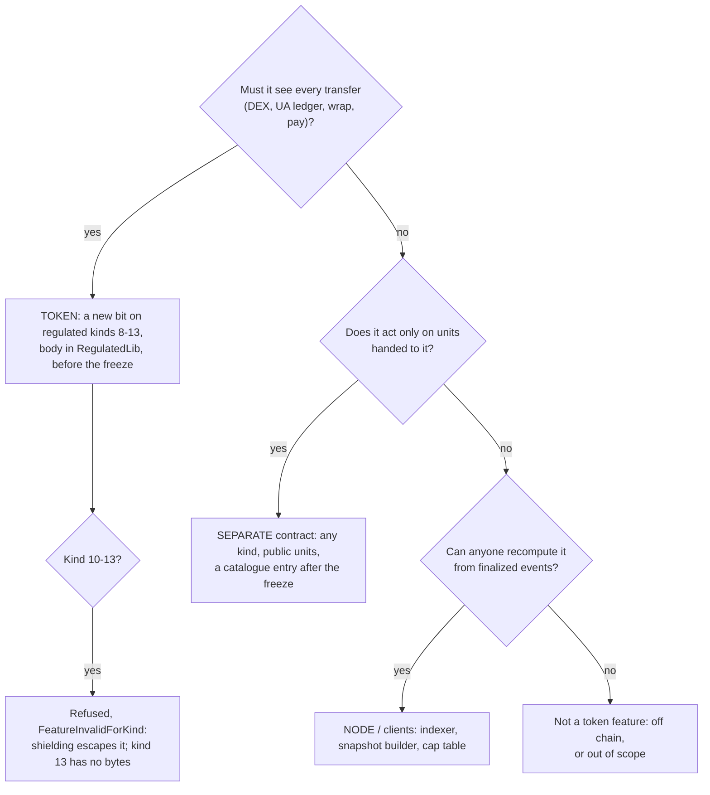

> **Research note — background and rationale only, not normative; the current rules are in docs/ (see decisions.md).**

> Vietnamese version: [token-features-catalogue.vi.md](token-features-catalogue.vi.md). This English file is the reference
> version.

# Token features and permissions: a catalogue from shares, money and financial firms

**Asked by the owner on 2026-11-06.** This note lists the token features and permissions SCaaS could add, modelled on how
shares, bonds, funds, commodities, money and banks work in real life. It keeps the controller's first answer to the owner
and goes further: it fills the gaps, checks every entry against the repository's rules and the owner rulings already
recorded, analyses the owner's new shared-fund item (§5), and covers every asset class (§6).

**Status: research only.** Nothing here is SPECIFIED, nothing is BUILT, and no rule changes. Bit numbers are proposals
written as "TBD in the SCaaS band 0–127". Sizes and gas figures marked [est.] are estimates, not measurements. Where this
note differs from a component doc or an owner ruling, the component doc or the ruling wins (AGENTS.md, "Which source wins").

**Contents**

1. [Summary](#1-summary)
2. [Rules every suggestion obeys](#2-rules-every-suggestion-obeys)
3. [Where a feature lives](#3-where-a-feature-lives)
4. [The catalogue](#4-the-catalogue)
5. [The owner's new item: a shared fund with an accruing withdrawal quota](#5-the-owners-new-item-a-shared-fund-with-an-accruing-withdrawal-quota)
6. [Asset classes](#6-asset-classes)
7. [Summary table](#7-summary-table)
8. [Recommended order](#8-recommended-order)
9. [Open questions for the owner](#9-open-questions-for-the-owner)
10. [Sources](#10-sources)

## 1. Summary

- **The classification principle stays as the controller gave it.** A feature that must gate or record **every transfer**
  of the token goes into the token, through the regulated hooks (`_regPre`, `_regMove`, `_regFeeTo`), before the EVM
  freeze. Everything else goes into separate contracts that work with any token through `mtx*` calls and payments. These
  can be added after the freeze as new catalogue entries. §3 turns the principle into three tests and adds three
  consequences: in-token features exist only on the regulated kinds (CTR-GOV-03); they are not useful on the confidential
  kinds 10–13, because a holder can shield to escape them; and kind 13 has no bytes left for them.
- **Four items of the first answer conflict with owner rulings that already exist** (§3.3). SNAPSHOT in the token is
  ruled out by CTR-AS-11 ("no balance checkpoints in tokens"). SPLIT as a scale factor and interest through an index are
  ruled out by CTR-AS-12 and asset-suite §1 ("balances never rebase"). The vesting vault was replaced by one
  `VestingGrant` clone per grant (CTR-AS-10). Redemption at maturity is already an `ExchangeOffer`. Only the transfer
  stop at maturity is left for the token. This note follows those rulings; §9 asks the owner only to confirm them.
- **What goes into the token before the freeze** (on kinds 8 and 9; refused on 10–13): LOCKUP, TRANSFER_LIMIT,
  OWNERSHIP_CAP, CLASS_CAP (an aggregate cap for a holder class, such as a foreign-ownership room), HOLDER_CAP,
  SENDER_DENYLIST (blackout windows), MATURITY, MIN_HOLDING and PURPOSE_BOUND (vouchers and purpose-bound money).
- **What comes after the freeze, as separate contracts**: the shared fund of §5, hold and capture, escrow with an
  arbiter, the existing `VestingGrant` / `Distribution` / `ExchangeOffer`, a rights offer, a term deposit, a payment
  splitter, a fund vault (ERC-7540), a secure minter, physical redemption, carbon retirement, receivables, squeeze-out.
- **The owner's new item** is a shared fund. Funders deposit money in it whenever they want. Each member has a withdrawal
  quota that accrues daily and carries over, up to a cap. The recommended name is **`StipendFund`** ("quỹ trợ cấp có hạn
  mức rút cộng dồn"). The mechanism is a token bucket over a **quota**, not over money (§5).

## 2. Rules every suggestion obeys

| Rule | Where it is stated | What it means for this catalogue |
|---|---|---|
| One rule on every chain | AGENTS.md "Rules that do not bend"; NET-ALL-17 (the asset suite per family must satisfy every rule or amend it) | No feature has an L1 / L2 or chain-kind variant. A feature can differ **by kind** (bit 8 `ALLOWLIST` is already refused on 10–13), never by chain. |
| Explicit named parameters | CTR-MTX-29; AGENTS.md | Every entry below has named, typed parameters. There is no packed `bytes` of settings. The only `bytes` values are a proof, a ciphertext, a key, a signature, or a `PayMeta.body`. |
| Every state-changing `mtx*` is relayable, with a fee of 0 too | AGENTS.md; CTR-MTX-30 (one signed entry per operation); CTR-GOV-15 (governance through the `GovernanceRouter`, fee mode `NONE`) | Every new operation has one `mtx<Op>(UAEnvelope, …, UASig)`. Governance powers are relayed by the router; the governed contract has no `mtx` twin. |
| No EIP-7702 | CTR-UA-24 | Members, funders, holders and lienholders sign with their own keys. No delegated EOA code. |
| Nothing deployed is upgraded | CTR-TOK-10, CTR-TOK-18, CTR-AS-15 | A new feature means a new release in the factory's catalogue, or a new contract. A token never gains a feature after creation; it can only lose one (`disableFeature`). |
| Ciphertexts stay in state | AGENTS.md "Never lose ciphertext"; CTR-PQZ-23 | No feature reads, moves or replaces a shielded balance. |
| Confidential kinds act on public balances only | CTR-GOV-13, CTR-GOV-17 | On 10–13 a control can see only public balances and public names. Every limit is escaped by shielding (§3.4). |
| Kind 13 size: "reduce, never `_above64KiB`" | owner 2026-11-06 (regulated-kinds spec §6.2); CTR-GOV-19 | `WrappedPqzRegulatedToken` measures 62,285 B after T32. That leaves 2,227 B under the 64,512 B stop line, and group 3e alone needs +2.3 to +4.0 KB there (pay-meta-tax spec §6.4). Kind 13 has no room for a new feature. |
| A plain transfer stays "+0"; one regulated implementation per kind, never per feature | CTR-GOV-03, CTR-GOV-11 | In-token features go only into the regulated kinds 8–13, as new bits of the one implementation per kind. They never go into kinds 0–5. |
| Bit bands | CTR-GOV-10, CTR-GOV-14 | Bits 0–127 belong to SCaaS and bits 128–255 to each application. Bits 0–12 and 15–22 are allocated, and 23 `TAX` is SPECIFIED. Bits 13 and 14 are never reused. |
| No in-place rollback | [architecture.md §2](../architecture.md) ("Three properties") | A reversal is a new compensating transaction: a refund, a release from escrow, or a forced transfer against a record. Chargebacks below are built that way. |
| No personal data on chain; market-neutral | [architecture.md §10](../architecture.md#data-protection); ARCH-POS-04 | Beneficiaries, delivery addresses, invoice numbers and travel-rule data go on chain as salted commitments only. Country examples (Vietnam's foreign-ownership room) are examples, never protocol. |
| Balances never rebase; no checkpoints in tokens | CTR-AS-11, CTR-AS-12 (owner) | No scale factor, no interest index and no checkpoint is kept in a token's balances. |

## 3. Where a feature lives

### 3.1 Three tests

1. **Must it see every transfer?** That includes the DEX's `mtxTrade`, the UA ledger's `_uaMove`, wraps, pay entries, and
   transfers that nobody planned. If yes, only the token can enforce it: the feature is **TOKEN**. Examples are a lockup,
   an ownership cap and a velocity limit.
2. **Does it act only on units the holder hands over?** Units sent to an escrow, a vault, an offer or a fund. If yes, it is
   a **SEPARATE** contract, which works with every kind 0–13 (for 10–13, public units). Examples are hold and capture,
   vesting, distribution, and the shared fund of §5.
3. **Can it be computed off chain from finalized events, by anyone, with the same result?** If yes, it belongs to the
   **NODE** and the clients. Examples are the snapshot for a record date (CTR-AS-11), the cap table (asset-suite §9) and
   accrued interest for pricing.



### 3.2 Why "before the freeze"

A new bit inside a token is new code in the regulated implementation of that kind. After the freeze it can still come, but
only as a new release of kinds 8 and 9, in the factory's catalogue (`deployImplementation(kind, version, …)`), with an
add-on audit. Tokens created earlier never get it (CTR-TOK-10). A separate contract needs no token change at all: it is new
code and can be audited on its own. That is the whole cost asymmetry behind the principle.

### 3.3 Owner rulings that the first answer did not follow

| First answer | Existing rule | What this note does |
|---|---|---|
| SNAPSHOT / record date in the token (checkpoints, +20–40 k gas per transfer) | **CTR-AS-11 (owner):** "Merkle distribution off a node-indexed snapshot, no balance checkpoints in tokens"; asset-suite §1 lists "balance checkpoints in any token" as not covered | Keeps the node-indexed snapshot. In-token SNAPSHOT is marked "ruled out" (§4.2 B1). It is needed only for on-chain voting, which the owner postponed. §9 Q9 asks the owner to confirm. |
| SPLIT / reverse split / bonus as a global scale factor | **CTR-AS-12 (owner):** a split is a migration to a new token through an `ExchangeOffer`; "a scaled view is rejected" | Uses the migration. A bonus issue is a `Distribution` of newly minted units. |
| Interest or demurrage through an index | asset-suite §1: "rebasing, scaled balances … on-chain coupon schedules, interest accrual" not covered; CTR-AS-12 "balances never rebase" | Interest goes into a separate vault whose share price grows (ERC-4626 style: the balance does not move, the price does), or into funded coupon distributions. |
| A separate `VestingVault` | **CTR-AS-10 (owner):** one EIP-1167 clone per grant, "not a vault"; it replaced the earlier `IVestingVault` | Uses `VestingGrant` (SPECIFIED) and adds claw-back as an extension. |
| MATURITY / redemption at par in the token | CTR-AS-12 / CTR-AS-13: bond redemption at maturity is an `ExchangeOffer` (non-closable, burn) | Redemption stays in the offer. What only the token can do is **stop transfers** after maturity (§4.2 B8). |
| Expiring loyalty points | asset-suite §7 (CTR-AS-14): "Points and vouchers do not expire on chain (balances never change); expiry is the end of the issuer's redemption offer" | Expiry stays the end of the redemption offer. Per-lot and inactivity expiry are ruled out (§4.4 D14). |
| Escrow with an arbiter | asset-suite §1: separate, "[tender.md](../contracts/tender.md)"; tender.md does not specify it | Kept as a separate contract (§4.3 C2). |

### 3.4 The confidential kinds 10–13

On a confidential kind, any per-account limit can be escaped. The holder shields its public units, sends them by a proof
transfer that names no recipient (CTR-GOV-17: no check reads `yTo` or a ring member), and the recipient unshields them.
An ownership cap, a holder cap, a velocity limit or a lockup on public balances therefore bounds nothing that a holder
cares to protect. The only sites where a limit can bite are the shield and wrap-shield entries (`_regPayer`). The
precedent is bit 8 `ALLOWLIST`, which is outside `_validBits()` of kinds 10–13. **Recommendation: every new
transfer-gating bit is refused on kinds 10–13** (`FeatureInvalidForKind`). This is a rule by kind, not by chain, so "one
rule on every chain" holds. It also costs kind 13 no bytes, if the new hook is an `internal virtual` function that kinds
10–13 override with an empty body: an unreferenced internal function is not compiled in [est.: confirm with a size run].

### 3.5 Hot-path and size budget on kinds 8 and 9

- **The hot slot** of `erc7201:scaas.regulated` is `complianceRegistry (20) ‖ controls u8 ‖ pausedUntil u64` = 29 of 32
  bytes. `controls` mirrors bits 5–10. To mirror more bits, `controls` widens to `u32`: 20 + 4 + 8 = 32 bytes, still one
  slot. Every new feature then costs **no new read** on a regulated token that does not enable it, because the bit is
  tested in a word the hook already loads.
- **Per-account state.** `FreezeState` slot a has 25 of 32 bytes used, with 7 spare, too few for an amount. A new
  per-account slot is therefore one cold `SLOAD` (2,100 gas) per checked side, plus writes where a counter changes. The
  per-feature figures are below.
- **Code.** The bodies go into `RegulatedLib` (8,201 B after T32), which is linked by `DELEGATECALL` and has room. The
  token side is one hook call per site and the init checks: [est.] +150 to +400 B per feature on kinds 8 and 9. Kind 9 has
  15,574 B of headroom and kind 8 has 26,255 B (runs `2026-11-04-ua-mtx-merge-regulated-sizes.txt`, T32 rows).

### 3.6 Permission bits: parameter bits and power bits

A new feature needs one of two kinds of bit. A **parameter bit** has no holder: it is configured at creation and can only
be disabled, like `ALLOWLIST` and `DENYLIST`. A **power bit** has a holder, who acts within its `Grant` (`WHOLE` or
`LIMITED`), like `FREEZE` and `TAX`. A power that can partly freeze a holder must be bounded like `FREEZE`: a maximum
duration, a cooldown, or the holder's consent. Otherwise it is a freeze under another name, and CTR-AS-05's bounds would be
bypassed. Every bit number below is "TBD in the SCaaS band 0–127". The free bits are 24 and up (and 13 and 14 are never
reused).

## 4. The catalogue

**Legend.** *Where*: TOKEN (a regulated-kind bit), SEPARATE (its own contract), NODE (indexer or clients), EXISTS (already
SPECIFIED or BUILT), RULED OUT (an owner ruling forbids it). *Conf.*: feasibility on kinds 10–13. *Priority*: **P1** before
the freeze, in the token; **P2** after the freeze, as a separate contract, soon; **P3** later; **E** exists; **R** ruled out.
Gas figures use the pre-EIP-8037 schedule [est.]; on Amsterdam, state creation moves into state gas.

### 4.1 A. Locks and vesting

**A1 LOCKUP** — locked amount per account until a date.
- *Analogue:* an IPO lock-up for insiders, a holding period for restricted securities, a lock-in of fund units, a
  staking-style commitment.
- *Mechanism:* a per-account `Lock { uint128 amount; uint64 until; }`. On every send, `balance − amount ≥ value` while
  `now < until`. Only units given to the holder can be locked, never units it already holds: `mintLocked(bytes32 to,
  uint256 amount, uint64 until)` by the minter, `transferLocked(bytes32 to, uint256 amount, uint64 until)` from the issuer
  treasury, and a self-lock `lockSelf(uint256 amount, uint64 until)` signed by the holder. A second lock extends to the
  later date and adds the amount. Nobody shortens a lock, except the owner, through `disableFeature`.
- *Bit:* a parameter bit LOCKUP, TBD in the SCaaS band 0–127. `mintLocked` / `transferLocked` are under the existing
  `MINTABLE` holder or the treasury, with no new power.
- *Where:* TOKEN, because test 1 applies: the lock must hold against the DEX, the UA ledger and pay entries.
- *Conf.:* refused on 10–13 (§3.4). The only site where a lock could bite is shield, and kind 13 has no bytes for it.
- *Size / gas:* +1 cold `SLOAD` on the sender (2,100) when the bit is set; writes only at lock time. +200–350 B token
  side [est.].
- *Freeze / priority:* before the freeze, **P1**.

**A2 VESTING** — cliff, linear or step, revocable or irrevocable.
- *Analogue:* employee equity grants, investor token unlocks, streaming payroll.
- *Mechanism:* `VestingGrant`, one clone per grant, funded counterfactually, with a permissionless `release()`
  (CTR-AS-10). This matches the market designs: OpenZeppelin `VestingWallet`, Sablier Lockup (linear, dynamic, tranched;
  cancelable or not), and Hedgey (revocable plans).
- *Bit:* none. The grantor is a party fixed at creation (CTR-GOV-14).
- *Where:* EXISTS (SPECIFIED). *Conf.:* public units only. *Freeze / priority:* after the freeze, **E / P2** (build).

**A3 CLAWBACK of vested grants** — take back vested, or even released, units for cause.
- *Analogue:* malus and claw-back clauses ("bad leaver"), forfeiture on a breach of non-compete.
- *Mechanism:* for units not yet released, a `VestingGrant` option `clawbackUntil` with a `clawbackAuthority` fixed at
  creation, who may reclaim vested but unreleased units before that date. For units already released, there is no
  token-level power: the claw-back goes through `FORCE` against a recorded order (CTR-AS-04), which is the due-process
  path.
- *Bit:* none (a party fixed at creation). *Where:* SEPARATE, as an extension of `VestingGrant` in a new `AssetFactory`
  version. *Conf.:* public units only. *Priority:* **P3**.

**A4 TERM_DEPOSIT** — a fixed term with an early-withdrawal penalty.
- *Analogue:* a bank time deposit or certificate of deposit.
- *Mechanism:* a vault clone per product: `deposit` → a position with `maturity`. `withdraw` before maturity pays
  `principal − penalty`, and the penalty goes to a creation-time `penaltyTo`. Interest is funded by the issuer as a top-up,
  never minted by the vault. It can be built over ERC-4626 shares, or per position.
- *Bit:* none, or an application bit (128–255) for the product admin. *Where:* SEPARATE. *Conf.:* public units only.
  *Priority:* **P2**.

**A5 NOTICE_ACCOUNT** — a withdrawal after N days' notice.
- *Analogue:* a bank notice account.
- *Mechanism:* the same vault as A4, with `requestWithdraw` → claimable after `notice`. This is ERC-7540's request and
  claim pattern. *Where:* SEPARATE. *Priority:* **P3**.

**A6 LIEN / PLEDGE** — encumber units for a lienholder.
- *Analogue:* a pledge of shares as loan collateral, a bank's lien on a deposit (an "amount block" in core banking), a
  margin lock.
- *Mechanism, two options.* (a) **Escrow:** the holder transfers the units to a `PledgeEscrow` naming the lienholder. The
  lienholder may `enforce(amount)` to itself after a default condition, or `release`. The holder may reclaim at `expiry`.
  (b) **In-token encumbrance:** the same slot as LOCKUP, plus a lienholder who may capture. Option (b) keeps the units in
  the holder's name, which some registers require, but it adds a transfer power to the token.
- *Recommendation:* (a) for now. It needs no token bytes and works with every kind. §9 Q16 asks whether a pledge must
  stay in the holder's name.
- *Bit:* none for (a). *Where:* SEPARATE. *Conf.:* public units only. *Priority:* **P2**.

**A7 FUND_LOCKIN** — a lock-in period of fund units. This is A1 LOCKUP applied at subscription (`mintLocked`). There is
no separate entry.

### 4.2 B. Corporate actions

**B1 SNAPSHOT / record date**
- *Analogue:* the record date of a dividend or a meeting.
- *Mechanism as ruled:* the node indexes balances at the record block deterministically, and anyone can recompute it
  (CTR-AS-11). The `Distribution` root is published with at least one hour of review before claims open. On a chain with
  atomic settlement, a transfer is settled in its own block, so ex-date and record date coincide at the record block (the
  T+1 gap between them in securities markets does not exist).
- *In-token checkpoints* (OpenZeppelin removed `ERC20Snapshot` in Contracts 5.0 and points to `ERC20Votes`
  checkpoints instead; Polymesh keeps checkpoints in the chain): **RULED OUT** by CTR-AS-11. They would be needed only
  for on-chain voting or for trustless entitlement without the review window.
- *Where:* NODE. *Priority:* **R** (in token); the node snapshot builder is **E**.

**B2 DISTRIBUTION** of dividends and coupons — `Distribution` (CTR-AS-11): a pull claim per Merkle leaf, `sweep` after
`expiry`. EXISTS (SPECIFIED). **E / P2** (build).

**B3 WITHHOLDING on distributions**
- *Analogue:* dividend withholding tax.
- *Mechanism:* the leaves are computed **net** off chain, plus one leaf per tax authority. That needs no contract change.
  Group 3e's `mtxPayWithTax` is a payer-signed split at payment and does not fit a pull claim. A claim that splits
  automatically would need `Distribution` to read `taxConfig()` of a regulated payout token: possible later, not needed.
- *Where:* NODE / clients. *Priority:* **P2** (client work).

**B4 BONUS issue, stock dividend, dividend reinvestment** — the minter mints into a `Distribution` clone of the same
token. DRIP is a claim option ("cash or units"), as two leaves per holder of which the claim takes one: a new
`Distribution` option, **P3**.

**B5 SPLIT / reverse split** — a migration through an `ExchangeOffer` (CTR-AS-12). EXISTS. A scale factor is **R**.

**B6 RIGHTS ISSUE**
- *Analogue:* a pre-emptive subscription right, renounceable (tradable) or not, with a subscription price and window, and
  optional excess (over-)subscription.
- *Mechanism:* (1) a `Distribution` of a rights token to the holders at the record date. A plain kind makes the rights
  tradable; a regulated kind with ALLOWLIST limits who may hold them; a non-transferable right is LOCKUP until the
  window's end. (2) A `RightsOffer` clone takes **two inputs**, rights plus cash, and mints or delivers new shares at a
  fixed ratio, with an excess pool allocated pro rata after the close. `ExchangeOffer` has one `tokenIn`, so this is a
  new contract.
- *Where:* SEPARATE. *Conf.:* public units only. *Priority:* **P3**.

**B7 BUYBACK / TENDER**
- *Analogue:* a fixed-price tender offer, a Dutch-auction tender, open-market repurchase.
- *Mechanism:* fixed price is an `ExchangeOffer` with `capIn`; open market is a DEX bid (CTR-AS-12). A Dutch-auction
  tender (holders bid prices; the clearing price is the lowest price that fills the target) is a new clone, close to the
  sealed-bid tender in [tender.md](../contracts/tender.md) but with holders as bidders.
- *Where:* EXISTS (fixed price), SEPARATE (Dutch). *Priority:* **E / P3**.

**B8 MATURITY** — a transfer stop at maturity.
- *Analogue:* a bond stops trading at maturity or after the last record date. A commercial paper note's life ends at its
  due date.
- *Mechanism:* a creation-time `maturityAt`. After it, every send is refused except a burn and a transfer to the token's
  named redemption offer (`redemptionOffer`, an address in `RegulatedParams`). Redemption itself stays the
  non-closable `ExchangeOffer` (CTR-AS-13). An issuer power `accelerate(uint64 newMaturity)` may only make the date
  **earlier**, bounded by a notice (`newMaturity ≥ now + noticePeriod`). This serves a full call (B9), an event of
  default (§6.1), and a sukuk dissolution event (§6.1).
- *Bit:* a parameter bit MATURITY, plus a power bit ACCELERATE (issuer, contract-only, delayed relax as 5–7), both TBD in
  the SCaaS band 0–127.
- *Where:* TOKEN (test 1: after maturity nothing may trade anywhere). *Conf.:* refused on 10–13. *Size / gas:* the date
  sits in the config slot +1 (8 bytes free there); no per-account read [est. +150–250 B]. *Priority:* **P1**.

**B9 CALL and PUT** of bonds
- *Analogue:* an issuer call (full or partial), a holder put.
- *Mechanism:* a full call is B8 `accelerate` plus an `ExchangeOffer` at the call price (par plus premium). A put is an
  `ExchangeOffer` the issuer opens at the put date: holders choose to use it. A **partial call by lot** needs randomness,
  or a pro rata choice made off chain and executed by `FORCE` against a record per holder (heavy). A partial call **pro
  rata** is an `ExchangeOffer` with `capIn` combined with off-chain allocation. Recommend pro rata redemption by offer;
  no lottery.
- *Where:* EXISTS (offers) + B8. *Priority:* **P1** (B8), **E**.

**B10 SINKING FUND** — the issuer retires part of an issue each year, by purchase or by drawing.
- *Mechanism:* purchase is a DEX bid or a fixed-price `ExchangeOffer` funded on schedule. Drawing, see B9. A funded
  schedule is a `VestingGrant` whose beneficiary is the offer (a stream into the offer). *Where:* EXISTS composition.
  *Priority:* **E** (template only, **P3**).

**B11 CONVERSION** — convertible notes into shares, preferred into common, warrants.
- *Mechanism:* a voluntary conversion is an `ExchangeOffer` (`tokenIn` burned, `tokenOut` delivered or minted), within a
  window and at a ratio. A **mandatory** conversion has the same limit as a mandatory call: the token stops trading
  (B8) and holders are converted by claim, never by moving their balances. Warrants with a strike price are an
  `ExchangeOffer` that takes the warrant plus cash, as B6's two-input contract.
- *Where:* EXISTS / B6's contract. *Priority:* **E / P3**.

**B12 MERGER, exchange offer, spin-off, name change** — a merger or exchange is an `ExchangeOffer` (old → new). A
spin-off is a `Distribution` of the new token. A name change cannot happen: name and symbol are immutable, so it is a
migration or a disclosure. **E**.

**B13 VOTING / proxy** — the owner said "not now" (regulated-kinds spec §1, non-goals). If it comes, it needs in-token
checkpoints, which would reopen CTR-AS-11. **P3 / R today**.

**ISO 15022 event types against the catalogue.** ISO 15022 lists corporate actions by event indicator (`:22F::CAEV`).
The rows below are the common ones; the full list is in the ISO 15022 data field dictionary and the ISO 20022 corporate
action event types, which this note did not reproduce in full.

| Code | Event | Catalogue entry |
|---|---|---|
| `DVCA` | cash dividend | B2 `Distribution` |
| `DVSE` | stock dividend | B4 |
| `DVOP` | dividend option (cash or stock) | B4 (DRIP option) |
| `BONU` | bonus issue | B4 |
| `SPLF` / `SPLR` | stock split / reverse split | B5 (migration) |
| `RHDI`, `RHTS`, `EXRI` | rights distribution, rights issue, exercise of rights | B6 |
| `TEND`, `BIDS` | tender / acquisition offer, repurchase offer | B7 |
| `INTR` | interest payment | B2 (coupon) |
| `REDM` | final maturity | B8 + `ExchangeOffer` |
| `MCAL` / `PCAL` | full / partial call | B9 |
| `PRED`, `DRAW` | partial redemption (with / without reduction of nominal), drawing | B9, B10, §6.1 amortising |
| `BPUT` | put redemption | B9 |
| `CONV`, `EXWA` | conversion, warrant exercise | B11 |
| `EXOF`, `MRGR`, `SOFF` | exchange offer, merger, spin-off | B12 |
| `CAPD`, `CAPG` | capital distribution, capital-gains distribution | B2 |
| `LIQU` | liquidation payment | B2 (recovery) |
| `MEET`, `XMET` | meetings | B13 (not now) |
| `CHAN` | change (name, terms) | B12 (disclosure / migration) |
| `DFLT`, `CREV` | bond default, credit event | §6.1 |
| `ACTV`, `SUSP`, `DLST` | trading status active / suspended / delisted | `PAUSE` (≤ 7 d), venue halt, B8 |
| `CLSA` | class action | off chain |

### 4.3 C. Banking and payments

**C1 HOLD / CAPTURE** — a pre-authorisation.
- *Analogue:* a card authorisation hold: the amount is reserved, then captured in full, partly, or incrementally, and
  released at expiry (scheme windows of about 5–31 days, depending on the scheme and merchant type). Also a hotel or
  car-rental deposit, or a fuel pump pre-auth.
- *Mechanism:* a `HoldEscrow` contract. The payer signs `Hold(token, merchant, maxAmount, expiry, entryRef)`. The units
  move into the escrow, under one entry per operation: `mtxHold`. The merchant calls `capture(holdId, amount,
  PayMeta)`, possibly several times, up to the maximum. Anyone may call `release(holdId)` after `expiry`; it returns the
  rest to the payer at fee 0. An incremental authorisation is a new hold signed by the payer. Reversal follows "no in-place
  rollback": a refund after capture is a new payment.
- *Bit:* none (parties fixed per hold). *Where:* SEPARATE (test 2). *Conf.:* public units; a confidential payer unshields
  first. *Priority:* **P2**.

**C2 ESCROW with an arbiter; letter of credit; demand guarantee**
- *Analogue:* an escrow agent; a documentary credit (UCP 600): payment against conforming documents examined by a bank;
  a demand guarantee (URDG 758): payment on a complying demand before expiry.
- *Mechanism:* an `ArbiterEscrow` clone with `buyer`, `seller`, `arbiter`, `expiry`, `documentsRequired` (hashes of
  required document types). The seller presents `documentHash`es; the arbiter (the issuing bank's contract or `msig`)
  calls `honour` or `refuse(discrepancyRef)`; at expiry the funds return to the buyer. The guarantee variant pays the
  beneficiary on `demand(statementHash)` unless the arbiter refuses within N days (URDG 758 sets five business days to
  reject). Documents stay off chain; only hashes go on chain (architecture §10).
- *Bit:* none. *Where:* SEPARATE. *Priority:* **P2**.

**C3 TRANSFER_LIMIT** — velocity per account per window.
- *Analogue:* an AML velocity rule, daily transfer limits of bank accounts, e-money wallet tiers.
- *Mechanism:* a per-account window counter on sends, `spent ≤ limit(tier)` within `window`. The **tier comes from
  `ComplianceRegistry` flags** (issuer bits 16–63), mapped through a token-wide table `uint128[4] tierLimit` fixed at
  creation. The token keeps no per-account limits written by an admin, so the limits are not a hidden freeze power. A
  flag change by an attester moves a holder between tiers. The window follows the `LIMITED` grant: a fixed grid,
  `spentInWindow` reset at the boundary.
- *Bit:* a parameter bit TRANSFER_LIMIT, TBD in the SCaaS band 0–127. *Where:* TOKEN (test 1). *Conf.:* refused on
  10–13.
- *Size / gas:* the tier needs the attestation, i.e. a registry call `attestationOf` (bounded, as `hasFlags`) or a new
  `tierOf` view on the registry (the `REGISTRY_CODEHASH` moves). Plus 1 `SLOAD` and 1 `SSTORE` of the counter: about
  +5–25 k gas per send [est.]. +300–500 B token side [est.].
- *Priority:* **P1**.

**C4 CHARGEBACK window** — a reversible period after a payment.
- *Analogue:* card chargebacks, a consumer's right of withdrawal.
- *Mechanism:* there is no reversal in place (architecture §2). A `SettlementEscrow` holds a payment for `window`. The
  payer may `dispute(reasonRef)` within it; an arbiter decides refund or release; without a dispute anyone may release it
  after the window. That is C2 with a time default, offered as a mode of the same contract.
- *Where:* SEPARATE. *Priority:* **P3**.

**C5 INTEREST / DEMURRAGE**
- *Analogue:* a savings rate; a negative rate or a holding fee (demurrage).
- *Mechanism:* an index in the token is **R** (§3.3). Instead, a vault holds the token and its share price rises with
  funded interest (ERC-4626; Aave's and Compound's index mechanisms are the model, but kept inside the vault, never in
  the token). Demurrage is a falling price of vault shares.
- *Where:* SEPARATE. *Priority:* **P3**.

**C6 INHERITANCE / dead-man recovery**
- *Analogue:* a payable-on-death beneficiary, a dormant-account procedure, a will executed by an executor.
- *Mechanism:* an account matter, not a token one: UA guardian recovery and `SmartKeyAccount` ([accounts.md](../contracts/accounts.md)).
  A separate `HeirSwitch` that holds funds and releases them to a beneficiary after `inactivity` without a heartbeat can
  be built on the §5 pattern. A court-ordered transfer of a deceased holder's units uses `FORCE` with a record.
- *Where:* SEPARATE / accounts. *Priority:* **P3**.

**C7 STANDING ORDERS** — `MandateWallet` (BUILT, CTR-ACC-06): a delegate pays within per-payment and per-period caps to
approved payees, and the node runs the schedule. **E**.

**C8 SWEEP / cash pooling**
- *Analogue:* zero-balancing or target-balancing sweeps into a master account; notional pooling.
- *Mechanism:* physical sweeping is a `MandateWallet` per subsidiary account whose delegate is the treasury, whose payee
  is the master, with a per-period cap. The node computes "balance above target" and sends the sweep. A target rule
  enforced on chain would be a new mandate option `keepAtLeast` (refuse a payment below the target). Notional pooling is
  accounting, off chain.
- *Where:* EXISTS + NODE; option SEPARATE. *Priority:* **P3**.

**C9 SUB-ACCOUNTS / virtual accounts** — several UA ids per subject, or one `MandateWallet` per purpose, plus `entryRef`
/ `PayMeta` for virtual accounts in the ERP. **E** (no token feature).

**C10 PAYMENT SPLIT** — fees and commissions.
- *Analogue:* a marketplace commission, an agent's fee, revenue sharing.
- *Mechanism:* a `PaymentSplitter` clone with creation-time recipients and ppm shares. A payer pays the splitter with one
  `mtxPay` and `PayMeta`; anyone calls `distribute(token)`; each recipient's share is paid out, or claimed (pull, so that
  one frozen recipient cannot block the rest). Group 3e's tax split is the token-level special case for tax only.
- *Where:* SEPARATE. *Priority:* **P2**.

**C11 MULTI-CURRENCY BASKET** — `WRAPPED` with 1–8 legs at fixed or adjustable rates (BUILT). **E**.

**C12 SHARED FUND with an accruing withdrawal quota** — the owner's item, §5. SEPARATE, **P2**.

**C13 OVERDRAFT / credit line** — lending is out of scope; at most a credit line is an escrow funded by the lender with
the §5 quota as the drawdown limit. **P3**.

**C14 DORMANT / unclaimed property** — no role moves balances except `FORCE` against a record (CTR-TOK-10), so an
escheat is a recorded order. **E** (no new feature).

### 4.4 D. Compliance

**D1 OWNERSHIP_CAP** — a per-holder cap.
- *Analogue:* a maximum shareholding without a takeover bid or approval, a single-investor limit, a CBDC holding limit
  (§6.6).
- *Mechanism:* on every credit, `balanceAfter(to) ≤ cap`, where cap is either an absolute amount or ppm of
  `totalSupply`, chosen at creation. Pass-through contracts (the DEX, escrows, offers) are exempt by
  `ELIGIBLE_CONTRACT`, which the registry already defines (CTR-AS-16). Mint counts as a credit. A later fall in
  `totalSupply` never forces a holder down: the cap is checked on receipt only.
- *Bit:* a parameter bit OWNERSHIP_CAP, TBD in the SCaaS band 0–127. *Where:* TOKEN. *Conf.:* refused on 10–13.
- *Size / gas:* the receiver's balance is already in the write path of `_update`, so there is no new read. ppm needs
  `totalSupply`, one warm read. +150–250 B [est.]. *Priority:* **P1**.

**D2 CLASS_CAP** — an aggregate cap for a holder class.
- *Analogue:* a foreign-ownership limit. **Example only:** Vietnam's listed companies have a foreign-ownership room
  ("room ngoại", Decree 155/2020/ND-CP under the Securities Law 54/2019/QH14, often 49% or a sector limit), tracked across
  all foreign holders on HOSE / HNX. Other examples: a REIT's concentration rule, a limit on non-accredited holders.
  SCaaS takes no country position (ARCH-POS-04): the class is any registry flag the issuer chooses.
- *Mechanism:* a token-wide counter `classHeld` = the sum of balances of accounts holding flag `classFlag`. Every move
  between an in-class and an out-of-class account adjusts it, and a credit to an in-class account is refused when
  `classHeld + value > classCap`. **Staleness:** an attestation can change while the holder keeps its balance (a holder
  becomes foreign, or a flag expires). A permissionless `resyncClass(bytes32 account)` recomputes that account's
  contribution: it keeps a per-account `countedInClass` bit and the counted amount, so the counter never double counts.
- *Bit:* a parameter bit CLASS_CAP, TBD. *Where:* TOKEN (test 1). *Conf.:* refused on 10–13.
- *Size / gas:* the flags of **both** sides per transfer: one bounded registry call each (≤ 2 × `REGISTRY_GAS`), plus a
  counter `SSTORE` and the per-account bit: +10–30 k gas [est.]; +400–700 B [est.]. *Priority:* **P1** if the owner wants
  regulated securities for markets with such limits, otherwise **P2** as a second release.

**D3 HOLDER_CAP** — a maximum number of holders, optionally per class.
- *Analogue:* a private company's shareholder limit, thresholds that trigger public-company status, a cap on investors who
  are not accredited.
- *Mechanism:* a counter of non-zero balances, adjusted when a balance goes 0 → non-zero or back, and refused when a new
  holder would exceed `maxHolders`. A per-class variant combines with D2's flag. Native ERC-20 and UA-ledger balances
  both count: `_update` and `_uaMove` both go through `_regMove`.
- *Bit:* a parameter bit HOLDER_CAP, TBD. *Where:* TOKEN. *Conf.:* refused on 10–13.
- *Size / gas:* the counter `SSTORE` only on a 0 ↔ non-zero transition (+2.9–5 k gas) [est.]; +150–250 B. *Priority:* **P1**.

**D4 SENDER_DENYLIST** — blackout windows and sender-side classes.
- *Analogue:* insider-trading blackout windows before results; a class lock-in; "this investor may not sell".
- *Mechanism:* the registry check is receiver-only today (CTR-GOV-18: "a denied account can still send"). The new rule is
  that a **sender** must hold none of `senderDeniedFlags`. A blackout is an attestation of flag `BLACKOUT` with
  `validUntil` = the window's end, written by an attester: it needs no new per-account storage in the token. Burn and
  unwrap stay open, as with `DENYLIST`.
- *Bit:* a parameter bit SENDER_DENYLIST, TBD. *Where:* TOKEN. *Conf.:* refused on 10–13.
- *Size / gas:* one bounded registry call per send (≤ `REGISTRY_GAS`); +150 B [est.]. *Priority:* **P1** (cheap, and
  general).

**D5 MIN_HOLDING** — a minimum holding and lot size.
- *Analogue:* a fund's minimum investment, a bond's minimum denomination (often large for wholesale issues), board lots.
- *Mechanism:* after a move, each side's balance is 0 or ≥ `minHolding`, and `value % lot == 0`. Both are creation-time
  numbers.
- *Bit:* a parameter bit MIN_HOLDING, TBD. *Where:* TOKEN. *Conf.:* refused on 10–13.
- *Size / gas:* no new read (balances are in the path); +100–200 B [est.]. *Priority:* **P1** (low cost), or P2.

**D6 TRANSFER_APPROVAL** — a two-step transfer with issuer approval, and pre-emption (right of first refusal).
- *Analogue:* ERC-1404 / ERC-3643 style pre-transfer checks; ERC-1400's controller; registered shares that need board
  approval; a right of first refusal in a shareholders' agreement.
- *Mechanism:* (a) a `TransferApprovalEscrow`: the seller sends the units with the intended buyer; the approver
  approves (release to the buyer) or rejects (return); a right-of-first-refusal holder may match within N days. (b) To
  force every transfer through it, the token needs a ROUTE_ONLY rule: sends are allowed only from or to accounts with a
  `ROUTER` flag, plus mint and burn. With ALLOWLIST, this is one more flag test in the existing call.
- *Bit:* ROUTE_ONLY parameter bit, TBD (if wanted). *Where:* SEPARATE (escrow) + TOKEN (route-only). *Conf.:* refused
  on 10–13. *Priority:* **P3**; ROUTE_ONLY **P2** decision before the freeze (§9 Q15).

**D7 COUNTERPARTY WHITELIST** chosen by the holder (allowed payees) — `MandateWallet.payeeAllowed` (BUILT), or the §5
fund's per-member payee list. In the token: no. **E**.

**D8 TRAVEL-RULE data**
- *Analogue:* FATF Recommendation 16: originator and beneficiary data travel with a transfer between service providers.
  Thresholds vary (USD/EUR 1,000 in the FATF text; zero in the EU's Regulation 2023/1113).
- *Mechanism:* never on chain (architecture §10). Service providers exchange the data off chain, keyed by the
  transaction's `entryRef` / digest. On chain there is at most a commitment in `PayMeta` (schema 2 or 3), or schema 4
  (encrypted to the payee) carrying a reference, never the data.
- *Where:* NODE / off chain. *Priority:* **P3** (the integration doc).

**D9 FORCE-MAJEURE freeze per asset class**
- *Analogue:* a market-wide halt, a circuit breaker.
- *Mechanism:* per token, `PAUSE` (≤ 7 d, cooldown, CTR-AS-06). A cross-token switch read by many tokens would add a call
  per transfer and create one key that halts every asset: rejected. A class-wide halt is venue policy: the node halts
  markets on `Paused` (NODE-DEX-11) and an operator pauses each token.
- *Where:* EXISTS + NODE. *Priority:* **E**.

**D10 Roles: transfer agent, registrar, corporate-actions agent**
- *Analogue:* a registered transfer agent keeps the cap table and runs corporate actions (Securitize is an SEC-registered
  transfer agent; Polymesh names a corporate-actions agent per asset).
- *Mapping:* the transfer agent holds the issuer bits 5–7 and the compliance bit 10 as contracts or `msig` (CTR-AS-03);
  the registrar is the `ComplianceRegistry` admin or attester; the corporate-actions agent is the `admin` of
  `Distribution` / `ExchangeOffer` clones. The cap table is node-indexed (asset-suite §9). **E**.

**D11 PARTITIONS / tranches** (ERC-1410, ERC-7518 on ERC-1155) — one balance per holder per token (CTR-AS-12's "raw
amounts" reasoning). A class or tranche is its own token, and moving between classes is an `ExchangeOffer`. A
partition-style lockup is A1. In the token: **R** (by design, not by a ruling): **P3** only as a future multi-token kind.

**D12 DOCUMENTS** (ERC-1643) — `termsHash` at creation and `documentHash` per record exist. A versioned document list per
token (prospectus, notices) is a small separate `DocumentRegistry` keyed by token, with history kept as events. **P3**.

**D13 TRANSFER RESTRICTION CODES** (ERC-1404's `detectTransferRestriction`) — a view that runs every check without
moving units, returning a reason code. `canReceive` exists; a combined `canTransfer(from, to, value) returns (bool,
uint8)` on kinds 8 and 9 serves wallets and the DEX venue pre-check. **P1** (a view only; +200 B [est.]).

**D14 LOYALTY EXPIRY** — per-lot expiry (FIFO lots per holder) costs a list per account. Inactivity expiry needs a burn by
a role, which CTR-TOK-10 forbids. Both are **R** (asset-suite §7): expiry is the end of the redemption offer.

### 4.5 E. Funds

**E1 SUBSCRIPTION / REDEMPTION windows at NAV**
- *Analogue:* mutual-fund dealing days, forward pricing at the next NAV.
- *Mechanism:* a `FundVault` with ERC-7540 asynchronous requests: `requestDeposit` / `requestRedeem` → pending →
  claimable at the NAV the fund attests at the dealing point. The price is set at fulfilment, not at request. The fund
  units are a regulated token minted by the vault as `MINTABLE` holder: the vault is the minter contract, as asset-suite
  §7 already foresees for rate limits.
- *Where:* SEPARATE. *Priority:* **P2**.

**E2 REDEMPTION GATES** — at most X% of NAV redeemed per dealing period, pro rata, with the rest carried over.
- *Mechanism:* inside `FundVault`: the requests of a period are filled pro rata to the gate. A rolling gate is a token
  bucket on redemptions: the §5 mechanism at fund level, with the quota in fund currency.
- *Where:* SEPARATE. *Priority:* **P2** (with E1).

**E3 IN-KIND creation and redemption** — ETF style: an authorised participant delivers the basket and receives a creation
unit, or the reverse. A `CreationDesk` contract (minter) takes the basket legs by `transferFrom` and mints N units;
redemption burns them and delivers the basket. Only accounts with an AP flag in the registry may use it. Close to
`WRAPPED` with legs, but with a basket that changes daily (attested), so it is a separate contract. **P3**.

**E4 FEES: management, performance, high-water mark**
- *Mechanism:* a management fee accrues in time and is collected by minting new units to the manager (dilution) or by
  the vault's share price. A performance fee above a high-water mark needs NAV per unit history; it is computed off chain
  from attested NAV and collected by minting, capped by the fund rules. Everything lives in the `FundVault` (minter);
  the token knows nothing.
- *Where:* SEPARATE. *Priority:* **P3**.

**E5 NAV / price attestation**
- *Mechanism:* a signed value from an attester UA (NAV, a reference rate, a reserve figure, a grade certificate) with
  `validUntil`. The model is group 3f's attested verifier: one attester per consumer contract, fixed or transferable with
  notice, revocable at once (owner rulings O2 and R4 of the attested-verify spec). A generic `AttestedFeed` contract
  serves E1, §6.1 (floating-rate notes), §6.2 (proof of reserves) and §6.4.
- *Where:* SEPARATE. *Priority:* **P2** (it unlocks several classes).

**E6 SWING PRICING / anti-dilution levy** — a NAV adjustment on net flows, inside `FundVault`. **P3**.

## 5. The owner's new item: a shared fund with an accruing withdrawal quota

### 5.1 What it is

The owner described it on 2026-11-06 and clarified it the same day. **Two things are separate:**

1. **Money in the fund.** Anyone authorised, for example the parents, deposits whenever they want, any amount. The
   contract never adds money by itself: nothing is minted and nothing refills automatically.
2. **Each member's withdrawal quota**, i.e. the *right* to withdraw. It accrues 1,000,000 units per day. Unused quota
   carries over, and the carry-over is capped at 30 days' worth.

A withdrawal is limited by both:

`amount ≤ min(member's available quota, the fund's balance)`, or `min(quota, the member's earmarked share)` in the
earmarked mode of §5.6.

**Main use case:** parents fund an account from which their children spend. Others are in §5.11.

### 5.2 Names

The standard terms come first. In each, the "bucket" holds **quota (a right to withdraw), not money**.

| Term | Where it comes from | Fits? |
|---|---|---|
| **Token bucket** (refill rate *r*, bucket capacity *b*) | network traffic policing (RFC 2697's committed rate and burst size); API rate limiting; Chainlink CCIP's per-lane rate limiter (`capacity`, `rate`, tokens never above capacity) | exactly the mechanism: *r* = 1,000,000 per day, *b* = 30,000,000. "Token" there means a unit of quota, which collides with our tokens; say "quota bucket" in SCaaS prose |
| **Leaky bucket** | the meter variant is the same as a token bucket; the queue variant is not | avoid: it suggests a queue |
| **Allowance with refill / carry-over** | Zodiac Roles allowances (`refill`, `maxRefill`, `period`, `balance`); Safe's spending limits (reset only, no carry-over) | close, but "allowance" is already the ERC-20 approval and token-wrappers §5's "allowance lockdown" in this repository |
| **Accruing allowance** with an **accrual cap** | HR leave: paid time off accrues per period, unused days carry over up to a cap | a good plain-language gloss |
| **Per-diem allowance** | travel expenses per day | the rate, not the carry-over |
| **Drip / faucet** | test-network faucets, "token drips" | suggests money flowing out on its own; wrong here |
| **Rate-limited stipend** | scholarships, stipends | the use, plus the limit |
| **Imprest fund** | petty cash restored to a fixed float | the fund side, not the quota |
| **Drawdown limit / available-to-draw** | credit lines, grant drawdowns | the member's view |
| **Pocket money / allowance account** | family banking products funded by parents | the main use case |

**Recommended contract name: `StipendFund`.** The mechanism is called the **draw quota** ("quota bucket": rate per day,
cap in days). Vietnamese gloss: **"Quỹ trợ cấp — hạn mức rút cộng dồn theo ngày, tối đa 30 ngày"** (short form: *quỹ
trợ cấp có hạn mức rút cộng dồn*). Runner-up: `QuotaFund`. Not recommended: anything with "Allowance" (it collides with
ERC-20 `allowance` and the `LIMITED` grant vocabulary) or "Faucet" (it suggests that money is created).

### 5.3 The quota: lazy computation

Nothing is written per day. Each member's record holds the quota as of its last write; the current value is computed on
read.

The owner's formula, continuous form: `available = min(cap, stored + rate · (now − last))`.

**Recommended form: discrete daily credit**, which members understand ("today I got 1,000,000") and which has no
rounding dust:

```text
day(t)    = floor((t + dayOffset) / 86400)            // dayOffset: the fund's fixed UTC offset in seconds
quota(m)  = min(m.capDays * m.ratePerDay,
                m.stored + m.ratePerDay * (day(now) - m.lastDay))
withdraw x (x <= quota(m), x <= fund side):  m.stored = quota(m) - x;  m.lastDay = day(now)
```

- **Calendar days and time zones.** A fund has one `dayOffset`, immutable, between −12 h and +14 h (for example +7 h
  for UTC+7). The day starts at local midnight of that offset. There is no daylight-saving rule in the contract: a fund in
  a zone with DST picks one offset and the wallet shows it. A member abroad still lives on the fund's day.
- **Rolling window or calendar day.** A token bucket has no window: what counts is the accrued quota. The only choice is
  continuous accrual (per second, rate/86,400) or a discrete credit at the day boundary. The discrete form gives
  whole-day units, so `stored` holds an exact integer and `lastDay` never loses a fraction. The continuous form loses the
  remainder of `rate · Δt / 86400` at every write unless `last` is advanced by whole units only. Recommendation:
  discrete.
- **The cap** is `capDays · ratePerDay` (30 × 1,000,000 = 30,000,000). After 30 idle days a member's quota stays at
  30,000,000, however long it waits.
- **Starting quota.** `addMember` takes `startQuota ≤ cap`. Recommended default: one day's rate, so that a new member can
  draw on its first day. 0 and the full cap are allowed.

**Worked example** (rate 1,000,000 per day, cap 30 days, pooled mode):

| Day | Event | Quota after | Fund after | Withdrawable now |
|---|---|---|---|---|
| 0 | parents deposit 10,000,000; child added with `startQuota` 1,000,000 | 1,000,000 | 10,000,000 | 1,000,000 |
| 0 | child withdraws 400,000 | 600,000 | 9,600,000 | 600,000 |
| 1 | new day | 1,600,000 | 9,600,000 | 1,600,000 |
| 41 | 40 idle days | 30,000,000 (cap) | 9,600,000 | 9,600,000 (fund-bound) |
| 41 | parents top up 50,000,000 | 30,000,000 (unchanged) | 59,600,000 | 30,000,000 (quota-bound) |
| 41 | child withdraws 30,000,000 | 0 | 29,600,000 | 0 |

The top-up changed no quota: deposits and quotas are independent.

### 5.4 Members and rates

- **Per member, not per role.** A member record is `{ uint128 ratePerDay; uint16 capDays; uint128 stored; uint32
  lastDay; bool suspended; }`. Children of different ages get different rates. There are no classes. That follows the
  owner's own choice for tax (group 3e's O10, "no tax classes"): fewer moving parts, and a class is just the same number
  set on several members.
- **Adding** a member: `addMember(bytes32 member, uint128 ratePerDay, uint16 capDays, uint128 startQuota)`, by the
  manager. Members are UA ids (`bytes32`): native or derived.
- **Removing** a member: `removeMember(bytes32 member)`. The quota is forfeited (it was a right, not money). The money
  stays in the fund.
- **Suspending** a member: `suspend(bytes32 member)` / `resume`, at once, for example when a child's phone is lost.
  Accrual continues while suspended; only withdrawals stop.
- **Changing a rate or cap**: `setRate(bytes32 member, uint128 ratePerDay, uint16 capDays)`. The quota is settled at the
  old rate up to the change day, then the new rate applies. An **increase applies at once. A decrease waits the fund's
  `noticePeriod`** (an immutable chosen at creation; 0 is allowed and fits a family). At its effective day the stored
  quota is clipped to the new cap. This is the inverse of group 3e's tax rate: there the payer is protected against an
  increase; here the member is protected against a cut.
- **The honest limit of a notice.** A manager who can remove, suspend, pause or withdraw the fund's money can bypass any
  notice on a rate cut. A notice protects members only if **every** adverse action waits the same period. Hence two modes,
  chosen at creation (§9 Q6): **MANAGED** (a family: the manager acts at once, notice 0) and **COMMITTED** (aid,
  scholarships: removal, decreases, pause and the manager's withdrawals all wait `noticePeriod`; only the emergency drain
  of §5.7 is immediate, and only to the immutable `drainTo`).

### 5.5 Funding, top-ups and refunds

- **Deposits by several funders.** A deposit is an ordinary payment to the fund's address: `mtxPay` with `PayMeta`, or
  `payWithFee`, so the token's `PaymentSettled` event with `entryRef` and the `payId` commitment records who paid and why,
  for reconciliation. The fund needs no deposit entry and no allowance. A top-up changes no quota.
- **Restricting funders to a set.** A contract without a receive hook cannot refuse an ERC-20 transfer to its address, so
  the fund cannot stop a stranger from adding money (a gift). A funder set therefore matters only for **rights**:
  refunds, and who counts as a funder in the views. Recommendation for v1: no funder set; refunds are manager
  withdrawals. Option for funders who do not trust each other (aid with several donors): a `FunderLedger` mode with an
  explicit `deposit(uint256 amount, bytes32 entryRef, PayMeta meta)` that pulls by `transferFrom` from listed funders
  (the fund is a contract, so allowance lockdown permits it) and records `contributed[funder]`. A refund to a funder is
  then bounded by `contributed − refunded` and by the pooled balance. This is **P3**.
- **Refunds and withdrawals by the owner.** `managerWithdraw(bytes32 to, uint256 amount, bytes32 ref)`: the manager takes
  money out of the pool, for example to reallocate it or end the arrangement. It never touches quotas. In COMMITTED mode
  it waits the notice. Its scalar can be bounded by a `LIMITED` grant (`perWindow`, `total`) when a second manager (the
  other parent) holds the power.

### 5.6 When the fund is short

| Rule | How it behaves | Verdict |
|---|---|---|
| **First come, first served, partial allowed** | each withdrawal takes `min(quota, balance)`; the member's quota drops only by what was paid | **recommended for v1** (pooled) |
| Refusal | a withdrawal above the balance reverts; the member retries a smaller amount | the same as above, but worse for the user; the view already shows the bound |
| Pro rata | every member gets the same fraction of its quota | needs epochs, a claim round and a freeze of withdrawals while it runs: too heavy for a family fund |
| **Earmarked shares** | each deposit names a member (`depositFor(bytes32 member, …)`) or splits by creation-time weights; a member draws `min(quota, earmark(m))` | **option** when fairness between members matters (two children, one spends faster); needs the `FunderLedger` entry |

### 5.7 Pausing and emergency drain

- `pause(bytes32 ref, uint64 until)` / `unpause`, by the manager: no withdrawals; deposits still arrive; quota accrual
  continues (a pause is about safety, not a cut). Bounded like `PAUSE` (≤ 7 days, a cooldown) in COMMITTED mode;
  unbounded in MANAGED mode.
- `drain()` by the owner: the whole balance to the immutable `drainTo`, at once, in both modes. The destination is fixed
  at creation, as `rescueTo` is (CTR-GOV-06), so a stolen owner key can only send the money back to the funders' own
  account.

### 5.8 Relayed withdrawals, payments and reconciliation

- A member withdraws by `mtxWithdraw(MetaTxLib.UAEnvelope e, bytes32 to, uint256 amount, bytes32 entryRef,
  IUARegistry.UASig auth, PayMeta meta)`, fee mode `NONE`, relayable at fee 0 (AGENTS.md; CTR-MTX-30). `PayMeta` is last,
  after `UASig`, as group 3e's rule O2 sets for pay entries. The direct form is `withdraw(bytes32 to, uint256 amount,
  bytes32 entryRef, PayMeta meta)`.
- `to` is explicit and may be the member or a third party: a child pays a shop straight from the fund within its quota.
  An optional per-member payee list (`MandateWallet`'s `payeeAllowed` pattern) turns it into purpose-bound pocket money.
- The fund pays through the token's `payWithFee(to, amount, NONE, 0, 0, entryRef, meta)` (or `payWithFeeToUA` for a
  derived `to`), as `MandateWallet` does. The payment event therefore carries the member's `entryRef` and the `PayMeta`
  commitment, and the ERP or family app reconciles it like any payment. `entryRef` is single-use per fund (`refUsed`).
- Manager operations are governance powers relayed through the `GovernanceRouter` (no `mtx` twin on the fund, CTR-GOV-15).
  Their bits are TBD in the SCaaS band 0–127, because this is a SCaaS catalogue contract (for example a member-admin
  power and a pause power). `drain` belongs to the owner.
- Node rows: the fund's `mtxSelectors()` and allow-lists in `typed.rs` / `guard.rs`, kept equal both ways, as for every
  relayable contract.

### 5.9 Confidential and regulated payout tokens

- **Confidential kinds 10–13.** The fund holds and pays **public** balances only. A contract cannot hold a PQZ key
  (CTR-PQZ-12: only a PQ signer holds one) and should not hold a Zether key. Funders unshield (or pay publicly) into the
  fund; a member receives public units and shields them itself, with `mtxShield` from its own account. No ciphertext is
  read or written by the fund.
- **Regulated tokens 8–13.** The fund is a native id with code: it can be frozen or forced like any account. A withdrawal
  to a member that fails `R` (`ALLOWLIST` / `DENYLIST`) reverts by name (`NotEligible`), and the quota is not consumed.
  Under `ALLOWLIST` the fund itself must be attested to receive deposits.

### 5.10 Security

- **Rounding.** The discrete form has none. With the continuous form, never set `last = now` after a truncating division
  (fractions are lost at every write). Store per-second rates with enough precision, or advance `last` by whole units.
  `capDays · ratePerDay` must fit `uint128`: check at `addMember` / `setRate`.
- **Replay.** The UA nonce lanes plus `entryRef` used once per fund. A signed withdrawal binds `to`, `amount`,
  `entryRef`, the fund (domain) and `validUntil`.
- **Front-running.** A member who sees a pending rate cut or removal in the mempool can withdraw its whole quota first.
  This is inherent and bounded by the quota cap. In COMMITTED mode the notice makes it explicit. A manager who needs
  surprise (a stolen phone) calls `suspend` directly in its own transaction, not by relay: a relayed operation is visible
  to every relayer of an open node, as the regulated-kinds spec notes for freezes (§3.3, F-14).
- **Griefing.** A member drains the pool first come, first served, but at most its quota: the cap bounds the harm to the
  others, and the earmarked mode removes it. Dust deposits by strangers cost the fund nothing. No function lets a third
  party "poke" a member's record (that would truncate accrual in the continuous form, and in every form it is a needless
  write).
- **Reentrancy of the payout token.** Write the quota and `refUsed` first, then pay (checks-effects-interactions), under
  `nonReentrant`. Any ERC-20 may be held. A token with transfer hooks (ERC-777 style) could re-enter; a fee-on-transfer
  token pays less than `amount`. Refuse fee-on-transfer and rebasing tokens, following CTR-TOK-11. Use the bounded token
  call pattern (`TokenCall`) with a safe-transfer check.
- **Time.** A validator's timestamp drift of seconds is irrelevant at day granularity. `uint32` days last for millions of
  years.

### 5.11 What exists already: the `LIMITED` grant and `MandateWallet`

| | `LIMITED` grant (`GovernanceLib._debit`) | `MandateWallet` | `StipendFund` |
|---|---|---|---|
| Whose money | the token's holders (the power moves others' units) | one payer's wallet | a pool from many funders |
| Who spends | one holder of a power bit, with leaves if `delegable` | one delegate per token | many members |
| Window | fixed grid `block.timestamp − block.timestamp % window`; `spentInWindow` resets | grid anchored at `periodStart`; `spentInPeriod` resets | accrual per day, carry-over, cap in days |
| Carry-over | none | none | up to `capDays` |
| Other limits | `min`, `max`, `total`, `maxUses`, `validUntil` | `maxPerPayment`, payees, `expiry`, `entryRef` once, `epoch` | rate, cap, optional payees, `entryRef` once |

**Is it a generalisation?** In one dimension, yes. A fixed window with cap C is the bucket with discrete refill of C per
window and capacity C: `min(C, stored + C) = C` at every boundary, i.e. `capDays = 1`. So both existing limits are the
special case "no carry-over" of the draw quota. But `StipendFund` is not a generalisation of either contract as a whole:
the grant bounds a governance power over other people's units, and the mandate bounds one delegate over one payer's
wallet. **Recommendation:** a new contract that reuses `MandateWallet`'s patterns (`payWithFee` as `msg.sender`,
`refUsed`, typed entries). Change neither `MandateWallet` (BUILT, typehashes pinned) nor `GrantTerms` (in
`GovernanceLib`, which every kind links, and kind 13 has no bytes). It is a SEPARATE contract, deployed by anyone like
`MandateWallet` (or as a clone), after the freeze, **P2**.

```mermaid
sequenceDiagram
    actor P as parent (funder, manager)
    participant T as payout token
    participant F as StipendFund
    actor C as child (member)
    participant R as relayer (fee 0)
    actor S as shop
    P->>T: mtxPay(fund, 50,000,000, PayMeta) — a deposit, no quota change
    P->>F: addMember(child, 1,000,000 per day, 30 days, start 1,000,000) via the router
    Note over F: quota computed on read: min(cap, stored + rate x days)
    C->>R: signs UAWithdraw(to = shop, 250,000, entryRef)
    R->>F: mtxWithdraw(e, shop, 250,000, entryRef, auth, meta)
    F->>F: check quota and balance; write quota and refUsed
    F->>T: payWithFee(shop, 250,000, NONE, 0, 0, entryRef, meta)
    T-->>S: PaymentSettled(entryRef)
```

### 5.12 Uses

| Use | Funder(s) | Members | Rate / cap | Notes |
|---|---|---|---|---|
| **Family allowance** (main) | parents, grandparents | children | per child by age; 30 days | MANAGED; optional shop payee list; children shield on a confidential kind |
| Employee per diem | employer | travelling staff | per day of travel; trip length | the employer adds a member per trip and removes it after |
| Scholarship / stipend | foundation | students | monthly-equivalent per day | COMMITTED: students rely on the rate |
| DAO contributor budgets | treasury | contributors | per role | the quota bounds a compromised contributor key |
| Corporate card budgets | company | departments or cards | per cost centre | a payee list per member = merchant categories |
| Treasury rate limit | treasury | one hot-wallet operator | daily outflow, small cap | the same bucket CCIP uses on bridges: it bounds the loss of a stolen key |
| Humanitarian aid / cash assistance | donors | households | entitlement per day | COMMITTED + earmarked; `FunderLedger` for donor refunds |
| Elderly care budget | adult children | caregiver | weekly needs | payee list: pharmacy, groceries |
| Petty cash (imprest) | finance | office managers | float per day | the fund is the float, the quota is the spending rule |
| Grant drawdown | funder | grantee | budget per period | the quota replaces a schedule of tranches |
| Condominium or club fund | members | the committee | per month | COMMITTED: the committee cannot empty it at once |

## 6. Asset classes

Each class lists only what differs from the generic catalogue, mapped to its entries. **NEW** marks an entry that §4 did
not have; each new entry is defined here.

### 6.1 Bonds and other debt

Government and corporate bonds, zero-coupon bonds, floating-rate notes, amortising bonds, sukuk, commercial paper.

| Need | Entry | In token? |
|---|---|---|
| Coupons | B2 `Distribution` per coupon date (CTR-AS-11); `INTR` | separate |
| Zero-coupon | no coupon; B8 MATURITY + redemption `ExchangeOffer` at par | B8 token |
| Floating-rate note: rate fixing from an oracle | **NEW F1 RATE_FIXING:** the coupon rate per period = an attested reference rate + margin, via E5 `AttestedFeed`; the leaf amounts are computed off chain from the attested fixing and checked by anyone | separate |
| Amortising bonds | **NEW F2 AMORTISATION:** principal repaid in parts. Balances never rebase (CTR-AS-12), so a "pool factor" is not applied to balances. Each instalment is a cash `Distribution` of principal; the outstanding face per unit is the published, attested factor; the final instalment is the redemption offer. (`PRED`) | separate |
| Call and put | B9 | B8 token + offers |
| Sinking fund | B10 | separate |
| Default and recovery | B8 `accelerate` (acceleration on default; `DFLT`), coupons stop (no more distributions), recovery payments as `Distribution` (`LIQU`), a restructuring as `ExchangeOffer` old → new | B8 token |
| Accrued interest on transfer | **NEW F3 ACCRUED_INTEREST (NODE):** the buyer pays clean price + accrued (dirty price) to the seller. That is a price convention, computed by clients and the venue from the coupon schedule and day count (e.g. Actual/Actual ICMA). The token knows no price, and the DEX settles the agreed dirty price | node / clients |
| Record date versus ex-date | B1: with atomic settlement the record block is the ex point; an ex-coupon period (no transfer of the next coupon in the last N days) is the snapshot taken N days before payment | node |
| Minimum denomination | D5 MIN_HOLDING | token |
| Sukuk | asset-backed certificates: profit, not interest (B2 distributions of rent or profit); dissolution through a purchase undertaking at maturity or on a dissolution event (B8 + `ExchangeOffer`). **NEW F4 TRADABILITY_GATE:** sukuk may trade at a market price only while tangible assets are above a Shariah threshold (sources disagree on 30–51%; AAOIFI Shariah Standard 17), otherwise only at par. The token cannot see prices, so the gate is venue policy (the node refuses off-par orders when the attested ratio is below the threshold) plus `PAUSE`. In the token: nothing new | venue + attested feed |
| Commercial paper | short maturity, often zero-coupon, wholesale: B8, D5, ALLOWLIST | token |

**In the token before the freeze:** B8 MATURITY / ACCELERATE, D5 MIN_HOLDING. Everything else is separate or node work.

### 6.2 Commodities

Gold, silver, oil, agricultural goods, carbon credits.

| Need | Entry | In token? |
|---|---|---|
| Physical backing, warehouse receipts | **NEW G1 SECURE_MINT:** the minter is a contract that mints only while `totalSupply + x ≤ attested reserve` (E5 `AttestedFeed`, custodian or auditor attestation). This is the "proof of reserves" pattern (Chainlink's Secure Mint). It is the `MINTABLE` holder, so it needs no token change. A warehouse receipt is a token per warehouse and grade, minted on deposit of goods and burned on release | separate |
| Proof of reserves, custodian attestation | E5 + G1; the bar list or warehouse stock list is published off chain with its hash attested per epoch | separate |
| Redemption for physical delivery: minimum lots, delivery fee, location | **NEW G2 PHYSICAL_REDEMPTION:** a `RedemptionDesk`: the holder sends ≥ `minLot` (e.g. one 400 oz London Good Delivery bar for gold) with `deliveryRef` (a salted commitment to the location and recipient; no personal data on chain) and the fee; the custodian `confirmDelivery` (burns) or `reject(reasonRef)` (returns units and fee) | separate |
| Storage fees, demurrage | balances never rebase (§3.3), so no in-token holding fee. The fee is charged at mint and redemption (G1, G2), or units sit in a C5 vault whose share price falls | separate |
| Grade and quality | one token per grade or specification (fungible within a grade); attributes in `termsHash` and the attested certificates | creation-time |
| Lot or serial tracking; the fungibility question | **unallocated** (a pool, fungible, the bar list attested) suits ERC-20. **Allocated** (a holder owns specific bars or lots) is not fungible: that needs the non-fungible kinds (ERC-721 / 1155, PLANNED). Recommendation: fungible pool per grade + attested lot list; allocated lots wait for the non-fungible kinds | — |
| Carbon credits: retirement (burn) with certificate and beneficiary | **NEW G3 RETIREMENT:** a `RetirementRegistry`. The holder transfers units to it with `beneficiaryRef` (a commitment to the beneficiary, or a public name the beneficiary chose), `purposeRef` and the claimed vintage; the registry burns them (holder burn of its own balance, `BURNABLE`) and emits `Retired(retirementId, …)`, which is the certificate. The registry keeps the record in state. Retirement on the origin registry (bridged credits) is off chain, as registries such as Verra record serial, vintage and beneficiary. Double counting is prevented only if the bridge retires at the origin | separate |
| Expiry and vintage | one token per project and vintage (vintage = fungibility boundary); compliance-period validity is the acceptance window of G3 or an `ExchangeOffer`, never an expiry of balances (CTR-AS-14) | creation-time |
| Oil, agricultural goods | warehouse receipts (G1), delivery (G2), perishables: the receipt's storage period is a B8 MATURITY after which only redemption or burn is possible; receipts are pledged to banks (A6) | B8 token |

**In the token before the freeze:** B8 (perishable receipts). Everything else is separate.

### 6.3 Funds

Mutual funds, ETFs, money-market funds, REITs.

| Need | Entry | In token? |
|---|---|---|
| NAV pricing | E5 `AttestedFeed`; E1 fulfilment at NAV | separate |
| Subscription and redemption windows | E1 (ERC-7540) | separate |
| Gates | E2 | separate |
| In-kind creation and redemption (ETF) | E3 `CreationDesk`, authorised participants by registry flag | separate |
| Fees: management, performance, high-water mark | E4 | separate |
| Lock-in | A1 LOCKUP via `mintLocked` | token |
| Minimum investment | D5 | token |
| Money-market fund: stable NAV, daily income, liquidity fees | daily income as an accumulating share price (no rebase) or daily `Distribution`; a liquidity fee is an E6 adjustment in the vault | separate |
| REIT: rental income, concentration rules | B2 distributions; concentration as D1 OWNERSHIP_CAP or D2 CLASS_CAP (e.g. a rule that few holders may not own most of the units) and D3 HOLDER_CAP (a minimum or maximum holder count) | token |
| Eligible investors | ALLOWLIST (exists) | token (exists) |

**In the token before the freeze:** A1, D1, D2, D3, D5.

### 6.4 Derivatives and structured products (research level only)

Futures, options, forwards. SCaaS has no derivatives venue; this is only how the catalogue would serve one.

| Need | Entry |
|---|---|
| Margin and collateral locks | A6 `PledgeEscrow` as a margin account; liquidation by the lienholder's `enforce` on an attested price; keepers are relayers |
| Expiry and settlement, cash or physical | one contract per series with `expiry`; cash settlement pays the attested settlement price difference (E5); physical settlement is DvP through the DEX or an `ExchangeOffer` |
| Oracle prices | E5 `AttestedFeed`; the risk is the oracle, and an attested single signer is a trusted party (as 3f's trust model states) |
| Options as tokens | a covered call is a vault holding the underlying and an `ExchangeOffer` at the strike until expiry (B11 with two inputs) |
| Structured notes | a regulated bond (§6.1) whose redemption amount is computed from attested fixings |

Nothing here goes into the token. **P3**, and only after an owner decision.

### 6.5 Real estate and other real-world assets

| Need | Entry | In token? |
|---|---|---|
| Fractional ownership | `NORMAL_REGULATED` with ALLOWLIST, D1, D3, D5, A1 | token |
| Rental income | B2 `Distribution` per period; expenses netted off chain | separate |
| Buy-out or squeeze-out (minority forced out at a fair price above a threshold) | **NEW H1 SQUEEZE_OUT:** a statutory squeeze-out is a legal order, so it runs on the due-process path. A `SqueezeOutDesk` holds the full price for all minority units; per holder, a recorded order (`recordOrder`, bit 10) names the acquirer as beneficiary; `freeze` + `forceTransfer` (bits 5, 6) move the units; the holder claims its price from the desk. That is one record per holder: heavy but bounded, and every step evidenced. A **drag-along** under a shareholders' agreement is the same with the agreement as the record; a **tag-along** is an `ExchangeOffer` at the same price for everyone | separate + `FORCE` |
| Pre-emption / right of first refusal | D6 | separate (+ ROUTE_ONLY) |
| Valuation | E5 attested appraisals | separate |

**In the token before the freeze:** D1, D3, D5, A1 (and the ROUTE_ONLY decision of D6).

### 6.6 Money and payments

| Class | Need | Entry | In token? |
|---|---|---|---|
| Stablecoins, e-money | reserves | `WRAPPED` (reserve on chain, BUILT) or G1 SECURE_MINT (reserve off chain, attested) | separate |
| | mint and redeem limits | the minter contract with a quota bucket on mints and redemptions (§5's mechanism at issuer level; the treasury rate limit of §5.12) | separate |
| | freeze under court orders | `FREEZE` / `RECORD` / `FORCE` (SPECIFIED, kinds 8–13) | token (exists) |
| | transaction limits by wallet tier | C3 TRANSFER_LIMIT | token |
| CBDC-like | holding limits | D1 OWNERSHIP_CAP, absolute amount, tier by registry flag (the digital euro discussion used limits around €3,000 per person, not settled) | token |
| | tiered wallets | C3 + D1, tiers from `ComplianceRegistry` flags | token |
| | waterfall / reverse waterfall (excess above the limit sent to a linked bank account; a shortfall pulled from it) | **NEW M1 OVERFLOW_REDIRECT** would redirect the excess of a credit to a linked account in the token: a credit that changes its own destination breaks every integrator's accounting (the DEX, offers). Recommendation: refuse in the token (D1), and do the waterfall in the wallet or the node (pre-split the payment) | node / wallet |
| | offline caps | device-side secure hardware, outside the chain; out of scope | — |
| Vouchers, gift cards | purpose-bound money: only to approved merchants | **NEW M2 PURPOSE_BOUND:** transfers are allowed only issuer → anyone, anyone → a holder of flag `MERCHANT`, merchant → issuer (redemption), plus burn. ALLOWLIST cannot express it (it checks every receiver, so consumers could not receive). In the token: one flag test of the receiver and one of the sender against the issuer id, in the existing registry call | token |
| | expiry | the end of the redemption `ExchangeOffer` (CTR-AS-14) | separate (exists) |
| Loyalty points | point-of-sale issuance | `OPERATOR_TRANSFER` (bit 22) `LIMITED` grants for clerks; the minter contract for campaigns | token (exists, regulated kinds) |
| | expiry | D14: ruled out on balances; the redemption offer's end | — |
| Payroll and allowances | salary streams, per diem, family allowance, withholding | A2 `VestingGrant` streams, C7 mandates, §5 `StipendFund`, C10 splits, group 3e TAX on payment | separate |

**In the token before the freeze:** C3, D1, M2 (and the existing regulated controls).

### 6.7 Invoices and receivables

Factoring, and the assignment of a receivable.

| Need | Entry | In token? |
|---|---|---|
| One token per receivable | a regulated `NORMAL` token per invoice, supply = face value, or later a non-fungible kind | creation |
| Assignment | the transfer itself; ALLOWLIST to qualified financiers | token (exists) |
| Notice to the debtor; payment redirection | **NEW R1 RECEIVABLE_SETTLEMENT:** the debtor pays a `ReceivableDesk` named at issuance (the notice of assignment names the desk once, for the life of the receivable). The desk pays the current holders: a redemption `ExchangeOffer` at par (receivable token → payment), or a `Distribution` for partial payments. This turns "who to pay" into a contract address that never changes, whatever the assignments | separate |
| Double financing | **NEW R2 RECEIVABLE_REGISTRY:** one entry per `invoiceCommitment` (a salted commitment to seller, debtor and invoice number; no invoice number on chain, O5's warning) → one token; a duplicate commitment is refused. This covers one registry only: a seller who registers the same invoice elsewhere is caught only off chain (debtor confirmation) | separate |
| Recourse, credit insurance | C2 guarantee mode (URDG-like demand on default) | separate |
| Due date, overdue | B8 MATURITY = the due date: after it the token trades only to the desk (collection) | token |
| Dispute, dilution (credit notes) | the desk accepts a credit note from the seller that reduces the amount payable; holders are paid less pro rata | separate |

**In the token before the freeze:** B8.

### 6.8 Cross-reference matrix

T = needed in the token (P1, kinds 8 and 9); S = a separate contract; N = node or clients; E = exists; · = not needed.

| Class | A1 LOCK | C3 TLIMIT | D1 OCAP | D2 CCAP | D3 HCAP | D4 SDENY | D5 MINH | B8 MATUR | M2 PBOUND | B2 DIST | ExchOffer | A2 VEST | C1/C2 HOLD-ESC | E1 FUNDV | E5 ATTEST | G1/G2 MINT-REDEEM | G3 RETIRE | §5 STIPEND |
|---|---|---|---|---|---|---|---|---|---|---|---|---|---|---|---|---|---|---|
| Equity, private shares | T | · | T | T | T | T | · | · | · | E | E | E | S | · | · | · | · | · |
| Government / corporate bond | · | · | · | T | · | · | T | T | · | E | E | · | · | · | S | · | · | · |
| Floating-rate note | · | · | · | · | · | · | T | T | · | E | E | · | · | · | S | · | · | · |
| Amortising bond | · | · | · | · | · | · | T | T | · | E | E | · | · | · | S | · | · | · |
| Sukuk | · | · | · | · | · | · | T | T | · | E | E | · | · | · | S | · | · | · |
| Commercial paper | · | · | · | · | · | · | T | T | · | · | E | · | · | · | · | · | · | · |
| Gold / silver | · | · | · | · | · | · | · | · | · | · | · | · | · | · | S | S | · | · |
| Oil / agri receipts | · | · | · | · | · | · | · | T | · | · | · | · | S | · | S | S | · | · |
| Carbon credits | · | · | · | · | · | · | · | · | · | · | E | · | · | · | S | S | S | · |
| Mutual fund / MMF | T | · | T | · | T | · | T | · | · | E | · | · | · | S | S | · | · | · |
| ETF | · | · | · | · | · | · | · | · | · | E | · | · | · | S | S | S | · | · |
| REIT | T | · | T | T | T | · | T | · | · | E | E | · | · | S | S | · | · | · |
| Derivatives (research) | · | · | · | · | · | · | · | T | · | · | E | · | S | · | S | · | · | · |
| Real estate fractions | T | · | T | T | T | · | T | · | · | E | E | · | S | · | S | · | · | · |
| Stablecoin / e-money | · | T | T | · | · | · | · | · | · | · | · | · | S | · | S | S | · | · |
| CBDC-like | · | T | T | · | · | · | · | · | · | · | · | · | · | · | · | · | · | · |
| Voucher / gift card | · | · | · | · | · | · | · | · | T | E | E | · | · | · | · | · | · | · |
| Loyalty points | · | · | · | · | · | · | · | · | · | E | E | · | · | · | · | · | · | · |
| Payroll / allowances | · | · | · | · | · | · | · | · | · | · | · | E | · | · | · | · | · | S |
| Receivables | · | · | · | · | · | · | · | T | · | E | E | · | S | · | · | · | · | · |

## 7. Summary table

| Code | Feature | Where | Bit (TBD, band 0–127) | Conf. 10–13 | Freeze | Priority |
|---|---|---|---|---|---|---|
| A1 | LOCKUP | TOKEN | parameter LOCKUP | refused | before | **P1** |
| B8 | MATURITY + ACCELERATE | TOKEN | parameter + power (issuer) | refused | before | **P1** |
| C3 | TRANSFER_LIMIT (tiers from registry) | TOKEN | parameter | refused | before | **P1** |
| D1 | OWNERSHIP_CAP | TOKEN | parameter | refused | before | **P1** |
| D2 | CLASS_CAP (aggregate, resync) | TOKEN | parameter | refused | before | **P1** / P2 |
| D3 | HOLDER_CAP | TOKEN | parameter | refused | before | **P1** |
| D4 | SENDER_DENYLIST (blackout) | TOKEN | parameter | refused | before | **P1** |
| D5 | MIN_HOLDING / lot | TOKEN | parameter | refused | before | **P1** |
| M2 | PURPOSE_BOUND | TOKEN | parameter | refused | before | **P1** |
| D13 | `canTransfer` view | TOKEN (view) | — | kinds 8, 9 | before | **P1** |
| D6 | ROUTE_ONLY (decision) | TOKEN | parameter | refused | before | P2 (decide) |
| §5 | `StipendFund` | SEPARATE | manager powers | public units | after | **P2** |
| C1 | `HoldEscrow` | SEPARATE | — | public units | after | **P2** |
| C2 | `ArbiterEscrow` (LC, guarantee) | SEPARATE | — | public units | after | **P2** |
| A2 / B2 / B5 / B7 / B9 | `VestingGrant`, `Distribution`, `ExchangeOffer` | EXISTS (SPECIFIED) | — | public units | after | **E / P2** |
| A4 | `TermDeposit` | SEPARATE | — | public units | after | **P2** |
| A6 | `PledgeEscrow` | SEPARATE | — | public units | after | **P2** |
| C10 | `PaymentSplitter` | SEPARATE | — | public units | after | **P2** |
| E1 / E2 | `FundVault` (ERC-7540, gates) | SEPARATE | — | public units | after | **P2** |
| E5 | `AttestedFeed` | SEPARATE | — | — | after | **P2** |
| G1 | secure minter | SEPARATE | — (the `MINTABLE` holder) | — | after | **P2** |
| G2 / G3 | `RedemptionDesk`, `RetirementRegistry` | SEPARATE | — | public units | after | P3 |
| R1 / R2 | `ReceivableDesk`, `ReceivableRegistry` | SEPARATE | — | public units | after | P3 |
| H1 | `SqueezeOutDesk` (+ `FORCE`) | SEPARATE | uses 5, 6, 10 | public units | after | P3 |
| B6 | `RightsOffer` (two inputs) | SEPARATE | — | public units | after | P3 |
| A3 | claw-back (VestingGrant option) | SEPARATE | — | public units | after | P3 |
| A5, C4, C6, C8, C13, E3, E4, E6, B4 DRIP, B7 Dutch, D12 | the rest | SEPARATE / NODE | — | — | after | P3 |
| F1, F2, F3, F4, B1, B3, D8, M1 | rate fixing, amortisation, accrued interest, tradability gate, snapshot, withholding, travel rule, waterfall | NODE / clients / venue | — | — | — | P2–P3 |
| B13 | VOTING | — | — | — | — | not now |
| B1 (token), B5 (scale), C5 (index), D11, D14 | in-token checkpoints, scale factor, interest index, partitions, expiring balances | — | — | — | — | **R** |

## 8. Recommended order

1. **Confirm the rulings** of §3.3 (Q9, Q10): no snapshot, scale factor or index in the token. This costs nothing and
   settles the first answer's conflicts.
2. **Before the freeze, a group of new regulated bits on kinds 8 and 9 only** (refused on 10–13), measured first on kind
   9, each body in `RegulatedLib`, `controls` widened to `u32`, one hook. In this order, by value per byte:
   D4 SENDER_DENYLIST and D5 MIN_HOLDING (almost free) → A1 LOCKUP → B8 MATURITY / ACCELERATE → D1 OWNERSHIP_CAP → D3
   HOLDER_CAP → C3 TRANSFER_LIMIT → M2 PURPOSE_BOUND → D2 CLASS_CAP → the D13 `canTransfer` view. It would be a new work
   order group after 3f (§9 Q15).
3. **After the freeze, separate contracts that unlock the most classes:** E5 `AttestedFeed` (funds, floating-rate notes,
   commodities, derivatives) → §5 `StipendFund` → C1 `HoldEscrow` → the existing `VestingGrant` / `Distribution` /
   `ExchangeOffer` build → G1 secure minter → E1 / E2 `FundVault` → C2 `ArbiterEscrow` → C10 `PaymentSplitter` → A4
   `TermDeposit` → A6 `PledgeEscrow`.
4. **Later:** G2 / G3 commodities, R1 / R2 receivables, H1 squeeze-out, B6 rights, A3 claw-back, E3 / E4 / E6, D6
   approval escrow, D12 documents, C4 / C6 / C8 / C13, voting when the owner asks.

By class: money and payments (C3, D1, M2 in the token; §5, C1, G1 after) and securities (A1, B8, D1–D5) come first,
because their in-token parts must precede the freeze. Funds, commodities and receivables follow, as separate contracts
on E5. Derivatives stay research.

## 9. Open questions for the owner

**Owner 2026-11-06:** Q1–Q17 answered as recommended, as a research direction only. Nothing is scheduled or built yet; no
spec, plan task or contract change follows from this note until the owner asks. The in-token group (kinds 8 and 9) can only
land before the EVM freeze if it is scheduled before T23.


Each question has a recommendation; none blocks the current branch.

| # | Question | Recommendation |
|---|---|---|
| Q1 | The name of the shared fund | `StipendFund` ("quỹ trợ cấp có hạn mức rút cộng dồn"); the mechanism is the "draw quota" |
| Q2 | Continuous accrual (per second) or a discrete daily credit at the fund's local midnight | discrete daily credit, one immutable UTC offset per fund, no DST |
| Q3 | When the fund is short: first come, first served; refusal; pro rata; or earmarked shares | pooled first come, first served with partial withdrawals in v1; earmarked shares as an option |
| Q4 | Restrict funders to a set? Per-funder refunds? | no funder set in v1 (arrivals cannot be refused anyway); refunds are manager withdrawals; `FunderLedger` later for multi-donor funds |
| Q5 | A new member's starting quota | one day's rate by default; 0 or the full cap allowed |
| Q6 | Notice on adverse changes: MANAGED (at once) or COMMITTED (every adverse action waits `noticePeriod`, only the drain to `drainTo` is immediate) | both modes, chosen at creation; a family uses MANAGED |
| Q7 | Does the quota accrue while the fund is paused or a member suspended? | yes: a pause is about safety; a cut goes through `setRate` |
| Q8 | May a member pay a third party directly from the fund? | yes, `to` explicit, with an optional per-member payee list |
| Q9 | The first answer put SNAPSHOT in the token; CTR-AS-11 says no balance checkpoints in tokens | keep CTR-AS-11 (node-indexed snapshot); revisit only with voting |
| Q10 | The first answer put SPLIT as a scale factor and interest as an index in the token; CTR-AS-12 says balances never rebase | keep CTR-AS-12: splits by migration, interest in vaults |
| Q11 | New transfer-gating bits on the confidential kinds 10–13? | refuse them (`FeatureInvalidForKind`), as bit 8: shielding escapes them and kind 13 has no bytes |
| Q12 | Who may set a LOCKUP? | only on units given to the holder (`mintLocked`, `transferLocked`) or by the holder itself; never on units already held |
| Q13 | TRANSFER_LIMIT: per-account values set by an admin, or tiers from registry flags? | tiers from registry flags with a creation-time table, so the limit is not a hidden freeze power |
| Q14 | CLASS_CAP (foreign-ownership room and similar) before the freeze, with a permissionless resync? | yes if regulated securities for such markets are a target; otherwise a second release after the freeze |
| Q15 | Do the P1 bits of §8 step 2 go into branch `ua-mtx-merge` as a new group after 3f, or into a second regulated release after the freeze with an add-on audit? | a group after 3f on kinds 8 and 9, measured first; decide ROUTE_ONLY (D6) in the same group |
| Q16 | Must a pledge keep the units in the holder's name (in-token encumbrance), or is a pledge escrow enough? | escrow (A6 option a) now; in-token lien only if a register demands it |
| Q17 | PURPOSE_BOUND (vouchers that go only to merchants) before the freeze? | yes: it cannot be built outside the token, and the cost is one flag test in the existing call |

## 10. Sources

Repository (read for this note): [token-wrappers.md §4](../contracts/token-wrappers.md#CTR-TOK-22) (the bit table, the
grant record); [asset-suite.md](../contracts/asset-suite.md) (CTR-AS-10 to CTR-AS-15, §1 scope, §7 templates);
[mandates.md](../contracts/mandates.md) (CTR-ACC-06); the specs
[2026-11-05-regulated-kinds.md](../superpowers/specs/2026-11-05-regulated-kinds.md),
[2026-11-05-pay-meta-tax.md](../superpowers/specs/2026-11-05-pay-meta-tax.md),
[2026-11-06-attested-verify.md](../superpowers/specs/2026-11-06-attested-verify.md);
[architecture.md](../architecture.md) (§2 "no in-place rollback", §10 data protection); [decisions.md](../decisions.md)
(CTR-GOV-03, -10, -11, -13, -14, -15, -17, -19, -20, CTR-MTX-29, -30, ARCH-POS-04, NET-ALL-17);
`smartcontracts/evm/src/wallet/MandateWallet.sol`; `smartcontracts/evm/src/governance/GovernanceLib.sol` (`_debit`) and
`IGovernance.sol` (`GrantTerms`, `Grant`); `smartcontracts/evm/runs/2026-11-04-ua-mtx-merge-regulated-sizes.txt` (the T32
size rows).

Web (consulted 2026-11-06; vendor pages are the vendors' own framing):

- Token standards: [ERC-1400 (issue 1411)](https://github.com/ethereum/EIPs/issues/1411);
  [ERC-1404 (issue 1404)](https://github.com/ethereum/EIPs/issues/1404); [ERC-3643 docs](https://docs.erc3643.org);
  [T-REX v4 white paper](https://tokeny.com/wp-content/uploads/2023/05/ERC3643-Whitepaper-T-REX-v4.pdf);
  [ERC-7518](https://eips.ethereum.org/EIPS/eip-7518); [ERC-4626](https://eips.ethereum.org/EIPS/eip-4626);
  [ERC-7540](https://eips.ethereum.org/EIPS/eip-7540).
- Snapshots and checkpoints: [OpenZeppelin forum: `ERC20Snapshot` removed in 5.0](https://forum.openzeppelin.com/t/erc20-snapshot-extension-disappeared-from-wizard/38258);
  [OpenZeppelin PR 4276](https://github.com/OpenZeppelin/openzeppelin-contracts/pull/4276);
  [Polymesh checkpoints](https://developers.polymesh.network/corporate-actions/checkpoints/) and
  [distributions](https://developers.polymesh.network/corporate-actions/distributions/).
- Vesting and streaming: [Sablier stream shapes](https://docs.sablier.com/concepts/lockup/stream-shapes);
  [Superfluid CFA](https://superfluid.gitbook.io/superfluid/protocol-overview/in-depth-overview/super-agreements/constant-flow-agreement-cfa);
  [Hedgey vesting plans](https://hedgey.gitbook.io/hedgey-community-docs/hedgey/vesting-plans);
  [Consensys audit of Hedgey](https://diligence.consensys.io/audits/2023/06/hedgey-token-lockup-and-vesting-plans);
  OpenZeppelin `VestingWallet` (Contracts 5.x, `finance/`).
- Index accrual: [Aave scaled balances](https://docs.aave.com/developers/v/2.0/the-core-protocol/atokens/iatoken);
  Compound v2 `borrowIndex` / `accrueInterest` (Compound docs, not fetched for this note).
- Corporate actions: [ISO 15022 overview](https://www.iso20022.org/welcome-iso-15022);
  [ISO 20022 change request CR0508 (event definitions)](https://iso20022.org/milestone/15001/download);
  [Euronext ISO 15022 messages](https://www.euronext.com/sites/default/files/2026-01/20260126_ISO%2015022%20Messages_EN_v9.pdf).
- Trade finance: [ICC Academy, URDG 758](https://academy.iccwbo.org/urdg-758/);
  [Reed Smith on URDG 758](https://reedsmith.com/en/perspectives/2010/07/urdg-758--a-facelift-for-the-demand-guarantee-rule).
- Cards: [Visa authorization and reversal best practices](https://usa.visa.com/content/dam/VCOM/regional/na/us/support-legal/documents/authorization-and-reversal-processing-best-practices-for-merchants.pdf);
  [Stripe, place a hold](https://docs.stripe.com/payments/place-a-hold-on-a-payment-method).
- Cash pooling: [Cash concentration](https://en.wikipedia.org/wiki/Cash_concentration);
  [Treasury Today on pooling](https://treasurytoday.com/cash-liquidity-management/pooling-thriving-and-here-to-stay).
- Core banking holds: [Oracle Banking, amount block](https://docs.oracle.com/en/industries/financial-services/banking-branch-cloud-service/14.8.1.0.0/relno/amount-block.html).
- Rate limiting: [Token bucket](https://en.wikipedia.org/wiki/Token_bucket); RFC 2697 (single-rate three-colour marker);
  [Chainlink CCIP rate limits](https://docs.chain.link/ccip/evm/concepts/cross-chain-token/rate-limits/overview);
  [Zodiac Roles allowances](https://deepwiki.com/gnosisguild/zodiac-modifier-roles/2.4-allowance-system);
  [Safe spending limits](https://help.safe.global/en/articles/40842-set-up-and-use-spending-limits).
- Tokenised-securities platforms: [Securitize, SEC-registered transfer agent](https://www.finextra.com/pressarticle/79561/securitize-becomes-an-sec-registered-transfer-agent);
  [DS Protocol compliance service](https://medium.com/securitize/ds-protocol-the-compliance-service-b6fe472d625d);
  [Polymath on ERC-1400](https://info.polymath.network/blog/erc-1400-a-library-of-interoperable-security-token-standards).
- Ownership limits (example only, ARCH-POS-04): [Decree 155 key changes](https://www.globalcompliancenews.com/2021/07/20/vietnam-key-changes-introduced-by-decree-no-155-that-impact-public-ma-transactions-06072021/);
  [Government portal: foreign investors max 49%](https://en.baochinhphu.vn/foreign-investors-to-hold-max-49-of-public-joint-stock-company-stake-111319.htm).
- Travel rule: [Elliptic, what is the travel rule](https://www.elliptic.co/blockchain-basics/what-is-the-travel-rule).
- Bonds: [Dirty price](https://en.wikipedia.org/wiki/Dirty_price); [Clean price](https://en.wikipedia.org/wiki/Clean_price).
- Sukuk: [State Bank of Pakistan, AAOIFI Shariah Standard 17 annex](https://www.sbp.org.pk/ibd/2013/C3-Annex-A.pdf);
  [AAOIFI standards on capital-market products](https://www.oicexchanges.org/files/aaoifis-standards-on-capital-market-products-mohammad-majd-bakir.pdf).
- Commodities: [LBMA Good Delivery](https://www.lbma.org.uk/good-delivery/about-good-delivery);
  [Chainlink Secure Mint](https://chain.link/blog/secure-mint);
  [Toucan's Verra bridge (deprecated)](https://docs.toucan.earth/resources/archives/verra-bridge-deprecated).
- Funds: [Optiver on ETF creation and redemption](https://www.optiver.com/insights/explainers/etf-creationredemption-and-authorised-participants).
- CBDC: [Bruegel, digital euro holding limits](https://www.bruegel.org/analysis/digital-euro-holding-limits).
- Receivables: [UNIDROIT Factoring Convention 1988](https://unidroit.org/english/conventions/1988factoring/convention-factoring1988.pdf);
  [Chainlink on on-chain factoring](https://chain.link/article/onchain-factoring).
