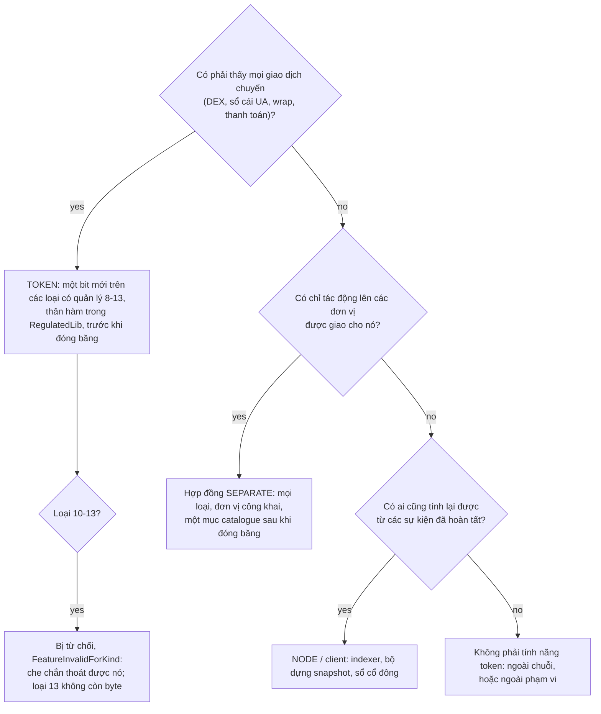
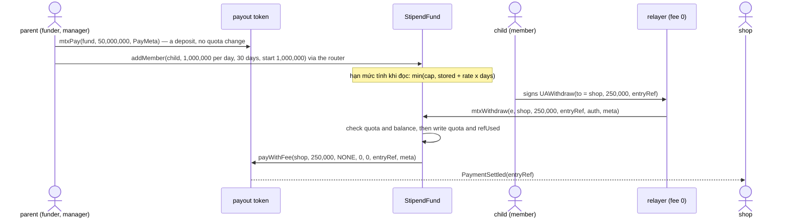

> **Research note — background and rationale only, not normative; the current rules are in docs/ (see decisions.md).**

> **Ghi chú nghiên cứu — chỉ là bối cảnh và lý do, không mang tính quy phạm; các quy tắc hiện hành nằm trong docs/ (xem decisions.md).**

> Bản tiếng Việt, ngoại lệ theo yêu cầu của chủ dự án (owner, 2026-11-06) đối với quy tắc "docs bằng tiếng Anh" của AGENTS.md. Bản tham chiếu là bản tiếng Anh: [token-features-catalogue.md](token-features-catalogue.md); khi hai bản khác nhau, bản tiếng Anh được ưu tiên.

# Tính năng và quyền của token: danh mục rút ra từ cổ phiếu, tiền tệ và các tổ chức tài chính

**Chủ dự án yêu cầu ngày 2026-11-06.** Ghi chú này liệt kê các tính năng và quyền của token mà SCaaS có thể bổ sung, mô
phỏng theo cách cổ phiếu, trái phiếu, quỹ, hàng hóa, tiền tệ và ngân hàng vận hành trong thực tế. Ghi chú giữ lại câu trả
lời đầu tiên của controller gửi chủ dự án và đi xa hơn: lấp các chỗ còn thiếu, đối chiếu từng mục với các quy tắc của kho
mã và các phán quyết của chủ dự án đã được ghi nhận, phân tích mục quỹ chung mới của chủ dự án (§5), và bao quát mọi loại
tài sản (§6).

**Trạng thái: chỉ là nghiên cứu.** Không có gì ở đây là SPECIFIED, không có gì là BUILT, và không quy tắc nào thay đổi. Số
bit là đề xuất, được viết là "TBD trong dải SCaaS 0–127". Kích thước và mức gas đánh dấu [ước tính] là ước tính, không phải
số đo. Khi ghi chú này khác với một tài liệu thành phần hoặc một phán quyết của chủ dự án, tài liệu thành phần hoặc phán
quyết được ưu tiên (AGENTS.md, "Which source wins").

**Mục lục**

1. [Tóm tắt](#1-tóm-tắt)
2. [Các quy tắc mọi đề xuất đều tuân theo](#2-các-quy-tắc-mọi-đề-xuất-đều-tuân-theo)
3. [Một tính năng nằm ở đâu](#3-một-tính-năng-nằm-ở-đâu)
4. [Danh mục](#4-danh-mục)
5. [Mục mới của chủ dự án: quỹ chung có hạn mức rút cộng dồn](#5-mục-mới-của-chủ-dự-án-quỹ-chung-có-hạn-mức-rút-cộng-dồn)
6. [Các loại tài sản](#6-các-loại-tài-sản)
7. [Bảng tổng hợp](#7-bảng-tổng-hợp)
8. [Thứ tự khuyến nghị](#8-thứ-tự-khuyến-nghị)
9. [Câu hỏi mở cho chủ dự án](#9-câu-hỏi-mở-cho-chủ-dự-án)
10. [Nguồn](#10-nguồn)

## 1. Tóm tắt

- **Nguyên tắc phân loại giữ nguyên như controller đã đưa ra.** Một tính năng phải chặn hoặc ghi nhận **mọi giao dịch
  chuyển** của token thì nằm trong token, thông qua các hook của loại có quản lý (regulated) (`_regPre`, `_regMove`,
  `_regFeeTo`), trước khi đóng băng EVM (EVM freeze). Mọi thứ khác nằm trong các hợp đồng riêng, làm việc với bất kỳ
  token nào thông qua các lệnh gọi `mtx*` và các khoản thanh toán. Những hợp đồng này có thể được thêm sau khi đóng băng
  dưới dạng mục mới trong catalogue. §3 biến nguyên tắc này thành ba phép kiểm tra và bổ sung ba hệ quả: tính năng trong
  token chỉ tồn tại trên các loại có quản lý (CTR-GOV-03); chúng không hữu ích trên các loại bảo mật (confidential) 10–13,
  vì người nắm giữ có thể che chắn (shield) để thoát khỏi chúng; và loại 13 không còn byte nào cho chúng.
- **Bốn mục của câu trả lời đầu tiên mâu thuẫn với các phán quyết của chủ dự án đã có** (§3.3). SNAPSHOT trong token bị
  loại bỏ bởi CTR-AS-11 ("no balance checkpoints in tokens" — không lưu điểm kiểm tra số dư trong token). SPLIT dưới dạng
  hệ số tỷ lệ và lãi suất qua chỉ số bị loại bỏ bởi CTR-AS-12 và asset-suite §1 ("balances never rebase" — số dư không bao
  giờ được điều chỉnh lại). Kho vesting (vesting vault) đã được thay bằng một bản sao `VestingGrant` cho mỗi khoản cấp
  (CTR-AS-10). Mua lại khi đáo hạn đã là một `ExchangeOffer`. Chỉ còn việc dừng chuyển nhượng khi đáo hạn là thuộc về
  token. Ghi chú này tuân theo các phán quyết đó; §9 chỉ đề nghị chủ dự án xác nhận chúng.
- **Những gì đi vào token trước khi đóng băng** (trên loại 8 và 9; bị từ chối trên 10–13): LOCKUP, TRANSFER_LIMIT,
  OWNERSHIP_CAP, CLASS_CAP (trần tổng hợp cho một nhóm người nắm giữ, chẳng hạn room ngoại), HOLDER_CAP,
  SENDER_DENYLIST (giai đoạn cấm giao dịch), MATURITY, MIN_HOLDING và PURPOSE_BOUND (phiếu quà tặng và tiền có mục
  đích sử dụng xác định).
- **Những gì đến sau khi đóng băng, dưới dạng các hợp đồng riêng**: quỹ chung của §5, tạm giữ và thu tiền (hold and
  capture), ký quỹ có trọng tài, các `VestingGrant` / `Distribution` / `ExchangeOffer` hiện có, chào bán quyền mua, tiền
  gửi có kỳ hạn, bộ chia thanh toán, kho quỹ (fund vault) (ERC-7540), bộ phát hành an toàn (secure minter), mua lại bằng
  hàng vật chất, hủy tín chỉ carbon, khoản phải thu, mua bắt buộc cổ phần thiểu số (squeeze-out).
- **Mục mới của chủ dự án** là một quỹ chung. Người góp quỹ nạp tiền vào bất cứ lúc nào họ muốn. Mỗi thành viên có một
  hạn mức rút cộng dồn theo ngày và được chuyển sang kỳ sau, đến một mức trần. Tên khuyến nghị là
  **`StipendFund`** ("quỹ trợ cấp có hạn mức rút cộng dồn"). Cơ chế là một token bucket áp trên **hạn mức**, không phải trên tiền (§5).

## 2. Các quy tắc mọi đề xuất đều tuân theo

| Quy tắc | Nơi được nêu | Ý nghĩa đối với danh mục này |
|---|---|---|
| Một quy tắc trên mọi chuỗi | AGENTS.md "Rules that do not bend"; NET-ALL-17 (bộ tài sản theo từng họ chuỗi phải thỏa mọi quy tắc hoặc sửa quy tắc đó) | Không tính năng nào có biến thể L1 / L2 hay theo loại chuỗi. Một tính năng có thể khác nhau **theo loại (kind)** (bit 8 `ALLOWLIST` đã bị từ chối trên 10–13), không bao giờ theo chuỗi. |
| Tham số tường minh có tên | CTR-MTX-29; AGENTS.md | Mỗi mục dưới đây có các tham số có tên, có kiểu. Không có `bytes` đóng gói các thiết lập. Các giá trị `bytes` duy nhất là bằng chứng (proof), bản mã, khóa, chữ ký hoặc một `PayMeta.body`. |
| Mọi `mtx*` thay đổi trạng thái đều chuyển tiếp được (relayable), kể cả với phí 0 | AGENTS.md; CTR-MTX-30 (một điểm vào có chữ ký cho mỗi thao tác); CTR-GOV-15 (quản trị thông qua `GovernanceRouter`, chế độ phí `NONE`) | Mỗi thao tác mới có một `mtx<Op>(UAEnvelope, …, UASig)`. Các quyền quản trị được router chuyển tiếp; hợp đồng được quản trị không có bản sao `mtx`. |
| Không EIP-7702 | CTR-UA-24 | Thành viên, người góp quỹ, người nắm giữ và người nhận cầm cố ký bằng khóa của chính họ. Không có mã EOA được ủy quyền. |
| Không nâng cấp thứ đã triển khai | CTR-TOK-10, CTR-TOK-18, CTR-AS-15 | Một tính năng mới nghĩa là một bản phát hành mới trong catalogue của factory, hoặc một hợp đồng mới. Một token không bao giờ có thêm tính năng sau khi tạo; nó chỉ có thể mất bớt (`disableFeature`). |
| Bản mã nằm trong trạng thái | AGENTS.md "Never lose ciphertext"; CTR-PQZ-23 | Không tính năng nào đọc, di chuyển hay thay thế số dư được che chắn. |
| Các loại bảo mật chỉ tác động lên số dư công khai | CTR-GOV-13, CTR-GOV-17 | Trên 10–13, một cơ chế kiểm soát chỉ thấy được số dư công khai và tên công khai. Mọi giới hạn đều bị thoát bằng cách che chắn (§3.4). |
| Kích thước loại 13: "giảm, không bao giờ `_above64KiB`" | chủ dự án 2026-11-06 (regulated-kinds spec §6.2); CTR-GOV-19 | `WrappedPqzRegulatedToken` đo được 62,285 B sau T32. Như vậy còn 2,227 B dưới vạch dừng 64,512 B, và riêng nhóm 3e đã cần thêm +2.3 đến +4.0 KB ở đó (pay-meta-tax spec §6.4). Loại 13 không còn chỗ cho tính năng mới. |
| Một giao dịch chuyển thường vẫn là "+0"; một bản cài đặt có quản lý cho mỗi loại, không bao giờ cho mỗi tính năng | CTR-GOV-03, CTR-GOV-11 | Tính năng trong token chỉ đi vào các loại có quản lý 8–13, dưới dạng bit mới của bản cài đặt duy nhất cho mỗi loại. Chúng không bao giờ đi vào loại 0–5. |
| Dải bit | CTR-GOV-10, CTR-GOV-14 | Bit 0–127 thuộc về SCaaS và bit 128–255 thuộc về từng ứng dụng. Bit 0–12 và 15–22 đã được cấp phát, và bit 23 `TAX` là SPECIFIED. Bit 13 và 14 không bao giờ được dùng lại. |
| Không hoàn tác tại chỗ | [architecture.md §2](../architecture.md) ("Three properties") | Đảo ngược là một giao dịch bù trừ mới: hoàn tiền, giải phóng khỏi ký quỹ, hoặc chuyển giao cưỡng chế dựa trên một hồ sơ. Các khoản bồi hoàn (chargeback) dưới đây được xây theo cách đó. |
| Không có dữ liệu cá nhân trên chuỗi; trung lập về thị trường | [architecture.md §10](../architecture.md#data-protection); ARCH-POS-04 | Người thụ hưởng, địa chỉ giao hàng, số hóa đơn và dữ liệu travel rule chỉ lên chuỗi dưới dạng cam kết có muối (salted commitment). Ví dụ quốc gia (room ngoại của Việt Nam) chỉ là ví dụ, không bao giờ là giao thức. |
| Số dư không bao giờ được điều chỉnh lại (rebase); không có điểm kiểm tra trong token | CTR-AS-11, CTR-AS-12 (chủ dự án) | Không giữ hệ số tỷ lệ, chỉ số lãi suất hay điểm kiểm tra nào trong số dư của token. |

## 3. Một tính năng nằm ở đâu

### 3.1 Ba phép kiểm tra

1. **Nó có phải thấy mọi giao dịch chuyển không?** Bao gồm `mtxTrade` của DEX, `_uaMove` của sổ cái UA, các lần wrap,
   các điểm vào thanh toán, và các giao dịch chuyển không ai lên kế hoạch. Nếu có, chỉ token mới thực thi được: tính năng
   là **TOKEN**. Ví dụ: phong tỏa có thời hạn (lockup), trần sở hữu và giới hạn tần suất giao dịch.
2. **Nó chỉ tác động lên các đơn vị mà người nắm giữ giao cho nó?** Các đơn vị gửi vào ký quỹ, kho (vault), lời chào hoặc
   quỹ. Nếu có, nó là một hợp đồng **SEPARATE** (riêng), làm việc với mọi loại 0–13 (với 10–13, là đơn vị công khai). Ví dụ:
   tạm giữ và thu tiền, vesting, phân phối, và quỹ chung của §5.
3. **Có thể tính nó ngoài chuỗi từ các sự kiện đã hoàn tất (finalized), bởi bất kỳ ai, với cùng kết quả không?** Nếu có, nó
   thuộc về **NODE** và các client. Ví dụ: ảnh chụp số dư cho ngày đăng ký cuối cùng (CTR-AS-11), sổ cổ đông (cap table)
   (asset-suite §9) và lãi dồn tích để định giá.



### 3.2 Vì sao "trước khi đóng băng"

Một bit mới bên trong token là mã mới trong bản cài đặt có quản lý của loại đó. Sau khi đóng băng nó vẫn có thể đến, nhưng
chỉ dưới dạng một bản phát hành mới của loại 8 và 9, trong catalogue của factory (`deployImplementation(kind, version, …)`),
kèm một đợt kiểm toán bổ sung. Các token tạo trước đó không bao giờ có nó (CTR-TOK-10). Một hợp đồng riêng không cần thay
đổi token nào: nó là mã mới và có thể được kiểm toán riêng. Đó là toàn bộ sự bất cân xứng chi phí đằng sau nguyên tắc này.

### 3.3 Các phán quyết của chủ dự án mà câu trả lời đầu tiên chưa tuân theo

| Câu trả lời đầu tiên | Quy tắc hiện có | Ghi chú này làm gì |
|---|---|---|
| SNAPSHOT / ngày đăng ký cuối cùng trong token (điểm kiểm tra, +20–40 k gas mỗi giao dịch chuyển) | **CTR-AS-11 (chủ dự án):** "Merkle distribution off a node-indexed snapshot, no balance checkpoints in tokens" (phân phối Merkle dựa trên snapshot do node lập chỉ mục, không có điểm kiểm tra số dư trong token); asset-suite §1 liệt kê "balance checkpoints in any token" là không được bao gồm | Giữ snapshot do node lập chỉ mục. SNAPSHOT trong token được đánh dấu "bị loại bỏ" (§4.2 B1). Nó chỉ cần cho bỏ phiếu trên chuỗi, việc mà chủ dự án đã hoãn. §9 Q9 đề nghị chủ dự án xác nhận. |
| SPLIT / gộp cổ phiếu / cổ phiếu thưởng dưới dạng hệ số tỷ lệ toàn cục | **CTR-AS-12 (chủ dự án):** chia tách là chuyển đổi sang token mới qua một `ExchangeOffer`; "a scaled view is rejected" (góc nhìn theo tỷ lệ bị bác bỏ) | Dùng chuyển đổi. Phát hành cổ phiếu thưởng là một `Distribution` các đơn vị mới phát hành. |
| Lãi suất hoặc phí lưu giữ (demurrage) qua chỉ số | asset-suite §1: "rebasing, scaled balances … on-chain coupon schedules, interest accrual" không được bao gồm; CTR-AS-12 "balances never rebase" | Lãi suất đi vào một kho riêng có giá cổ phần tăng dần (kiểu ERC-4626: số dư không đổi, giá thay đổi), hoặc vào các đợt phân phối coupon có cấp vốn. |
| Một `VestingVault` riêng | **CTR-AS-10 (chủ dự án):** một bản sao EIP-1167 cho mỗi khoản cấp, "not a vault" (không phải kho); nó thay thế `IVestingVault` trước đây | Dùng `VestingGrant` (SPECIFIED) và thêm thu hồi (claw-back) như một phần mở rộng. |
| MATURITY / mua lại theo mệnh giá trong token | CTR-AS-12 / CTR-AS-13: mua lại trái phiếu khi đáo hạn là một `ExchangeOffer` (không thể đóng, đốt) | Mua lại vẫn nằm trong lời chào. Điều chỉ token làm được là **dừng chuyển nhượng** sau đáo hạn (§4.2 B8). |
| Điểm thưởng khách hàng thân thiết có hạn | asset-suite §7 (CTR-AS-14): "Points and vouchers do not expire on chain (balances never change); expiry is the end of the issuer's redemption offer" (điểm và phiếu không hết hạn trên chuỗi; hết hạn là khi lời chào đổi của nhà phát hành kết thúc) | Hết hạn vẫn là khi lời chào đổi kết thúc. Hết hạn theo lô và theo không hoạt động bị loại bỏ (§4.4 D14). |
| Ký quỹ có trọng tài | asset-suite §1: riêng, "[tender.md](../contracts/tender.md)"; tender.md không đặc tả nó | Giữ là hợp đồng riêng (§4.3 C2). |

### 3.4 Các loại bảo mật 10–13

Trên một loại bảo mật, mọi giới hạn theo từng tài khoản đều có thể bị thoát. Người nắm giữ che chắn các đơn vị công khai
của mình, gửi chúng bằng một giao dịch chuyển có bằng chứng không nêu tên người nhận (CTR-GOV-17: không phép kiểm tra nào
đọc `yTo` hay một thành viên vòng (ring member)), và người nhận gỡ che chắn (unshield) chúng. Vì vậy, một trần sở hữu, trần
số người nắm giữ, giới hạn tần suất hay phong tỏa có thời hạn trên số dư công khai không giới hạn được gì mà người nắm giữ
muốn bảo vệ. Các điểm duy nhất mà một giới hạn có thể có hiệu lực là các điểm vào shield và wrap-shield (`_regPayer`). Tiền
lệ là bit 8 `ALLOWLIST`, nằm ngoài `_validBits()` của các loại 10–13. **Khuyến nghị: mọi bit mới chặn giao dịch chuyển đều
bị từ chối trên loại 10–13** (`FeatureInvalidForKind`). Đây là quy tắc theo loại, không theo chuỗi, nên "một quy tắc trên
mọi chuỗi" vẫn đúng. Nó cũng không tốn byte nào của loại 13, nếu hook mới là một hàm `internal virtual` mà các loại 10–13
ghi đè bằng thân rỗng: một hàm internal không được tham chiếu sẽ không được biên dịch vào [ước tính: xác nhận bằng một lần
đo kích thước].

### 3.5 Ngân sách đường nóng (hot path) và kích thước trên loại 8 và 9

- **Slot nóng** của `erc7201:scaas.regulated` là `complianceRegistry (20) ‖ controls u8 ‖ pausedUntil u64` = 29 trên 32
  byte. `controls` phản chiếu bit 5–10. Để phản chiếu thêm bit, `controls` mở rộng thành `u32`: 20 + 4 + 8 = 32 byte, vẫn
  một slot. Khi đó mọi tính năng mới **không tốn thêm lần đọc nào** trên một token có quản lý không bật nó, vì bit được
  kiểm tra trong một word mà hook đã nạp sẵn.
- **Trạng thái theo từng tài khoản.** Slot a của `FreezeState` dùng 25 trên 32 byte, còn dư 7, quá ít cho một số tiền. Vì
  vậy một slot mới theo tài khoản là một `SLOAD` lạnh (2,100 gas) cho mỗi phía được kiểm tra, cộng các lần ghi khi một bộ
  đếm thay đổi. Số liệu cho từng tính năng ở bên dưới.
- **Mã.** Các thân hàm đi vào `RegulatedLib` (8,201 B sau T32), được liên kết qua `DELEGATECALL` và còn chỗ. Phía token là
  một lệnh gọi hook tại mỗi điểm cộng các phép kiểm tra lúc khởi tạo: [ước tính] +150 đến +400 B mỗi tính năng trên loại 8
  và 9. Loại 9 còn dư 15,574 B và loại 8 còn 26,255 B (các lần chạy `2026-11-04-ua-mtx-merge-regulated-sizes.txt`, các hàng
  T32).

### 3.6 Bit quyền: bit tham số và bit quyền lực

Một tính năng mới cần một trong hai loại bit. Một **bit tham số** (parameter bit) không có người nắm giữ: nó được cấu hình
khi tạo và chỉ có thể bị tắt, như `ALLOWLIST` và `DENYLIST`. Một **bit quyền lực** (power bit) có người nắm giữ, người này
hành động trong phạm vi `Grant` của mình (`WHOLE` hoặc `LIMITED`), như `FREEZE` và `TAX`. Một quyền lực có thể phong tỏa
một phần tài sản của người nắm giữ phải được giới hạn như `FREEZE`: thời hạn tối đa, thời gian chờ (cooldown), hoặc sự đồng
ý của người nắm giữ. Nếu không, nó là một lệnh phong tỏa dưới tên khác, và các giới hạn của CTR-AS-05 sẽ bị lách. Mọi số
bit dưới đây đều là "TBD trong dải SCaaS 0–127". Các bit còn trống là từ 24 trở lên (và 13, 14 không bao giờ được dùng lại).

## 4. Danh mục

**Chú giải.** *Nơi nằm*: TOKEN (một bit của loại có quản lý), SEPARATE (hợp đồng riêng), NODE (indexer hoặc client),
EXISTS (đã SPECIFIED hoặc BUILT), RULED OUT (một phán quyết của chủ dự án cấm). *Bảo mật*: tính khả thi trên loại 10–13.
*Ưu tiên*: **P1** trước khi đóng băng, trong token; **P2** sau khi đóng băng, dưới dạng hợp đồng riêng, sớm; **P3** sau
này; **E** đã có; **R** bị loại bỏ. Số liệu gas dùng biểu phí trước EIP-8037 [ước tính]; trên Amsterdam, việc tạo trạng
thái chuyển sang state gas.

### 4.1 A. Phong tỏa và vesting

**A1 LOCKUP** — số lượng bị phong tỏa theo từng tài khoản cho đến một ngày.
- *Tương tự:* phong tỏa sau IPO đối với người nội bộ, thời gian nắm giữ đối với chứng khoán hạn chế chuyển nhượng, thời
  gian khóa chứng chỉ quỹ, cam kết kiểu staking.
- *Cơ chế:* một `Lock { uint128 amount; uint64 until; }` theo từng tài khoản. Với mỗi lần gửi, `balance − amount ≥ value`
  khi `now < until`. Chỉ các đơn vị được giao cho người nắm giữ mới có thể bị phong tỏa, không bao giờ là các đơn vị người
  đó đã có: `mintLocked(bytes32 to, uint256 amount, uint64 until)` bởi minter, `transferLocked(bytes32 to, uint256 amount,
  uint64 until)` từ ngân quỹ của nhà phát hành, và tự phong tỏa `lockSelf(uint256 amount, uint64 until)` do người nắm giữ
  ký. Một lần phong tỏa thứ hai kéo dài đến ngày muộn hơn và cộng thêm số lượng. Không ai rút ngắn phong tỏa, ngoại trừ
  chủ sở hữu, thông qua `disableFeature`.
- *Bit:* một bit tham số LOCKUP, TBD trong dải SCaaS 0–127. `mintLocked` / `transferLocked` nằm dưới người nắm giữ
  `MINTABLE` hiện có hoặc ngân quỹ, không thêm quyền lực mới.
- *Nơi nằm:* TOKEN, vì phép kiểm tra 1 áp dụng: phong tỏa phải đứng vững trước DEX, sổ cái UA và các điểm vào thanh toán.
- *Bảo mật:* bị từ chối trên 10–13 (§3.4). Điểm duy nhất mà phong tỏa có thể có hiệu lực là shield, và loại 13 không còn
  byte cho nó.
- *Kích thước / gas:* +1 `SLOAD` lạnh ở phía người gửi (2,100) khi bit được bật; chỉ ghi lúc phong tỏa. +200–350 B phía
  token [ước tính].
- *Đóng băng / ưu tiên:* trước khi đóng băng, **P1**.

**A2 VESTING** — cliff, tuyến tính hoặc theo bậc, có thể thu hồi hoặc không thể thu hồi.
- *Tương tự:* cấp cổ phần cho nhân viên, mở khóa token cho nhà đầu tư, trả lương theo dòng (streaming payroll).
- *Cơ chế:* `VestingGrant`, một bản sao cho mỗi khoản cấp, được cấp vốn theo kiểu phản thực tế (counterfactually), với
  `release()` không cần cấp phép (CTR-AS-10). Điều này khớp với các thiết kế trên thị trường: OpenZeppelin
  `VestingWallet`, Sablier Lockup (tuyến tính, động, theo đợt; hủy được hoặc không), và Hedgey (các kế hoạch có thể thu
  hồi).
- *Bit:* không có. Bên cấp là một bên cố định lúc tạo (CTR-GOV-14).
- *Nơi nằm:* EXISTS (SPECIFIED). *Bảo mật:* chỉ đơn vị công khai. *Đóng băng / ưu tiên:* sau khi đóng băng, **E / P2**
  (xây dựng).

**A3 CLAWBACK của các khoản cấp đã vest** — thu hồi các đơn vị đã vest, hoặc thậm chí đã giải ngân, vì lý do chính đáng.
- *Tương tự:* điều khoản giảm thưởng (malus) và thu hồi ("bad leaver" — người rời đi vi phạm), tước quyền khi vi phạm điều
  khoản không cạnh tranh.
- *Cơ chế:* với các đơn vị chưa giải ngân, một tùy chọn `VestingGrant` `clawbackUntil` với một `clawbackAuthority` cố định
  lúc tạo, người này có thể thu hồi các đơn vị đã vest nhưng chưa giải ngân trước ngày đó. Với các đơn vị đã giải ngân,
  không có quyền lực ở cấp token: việc thu hồi đi qua `FORCE` dựa trên một lệnh đã ghi nhận (CTR-AS-04), đó là con đường
  theo đúng thủ tục pháp lý (due process).
- *Bit:* không có (một bên cố định lúc tạo). *Nơi nằm:* SEPARATE, như một phần mở rộng của `VestingGrant` trong một phiên
  bản `AssetFactory` mới. *Bảo mật:* chỉ đơn vị công khai. *Ưu tiên:* **P3**.

**A4 TERM_DEPOSIT** — kỳ hạn cố định với phạt rút trước hạn.
- *Tương tự:* tiền gửi có kỳ hạn của ngân hàng hoặc chứng chỉ tiền gửi.
- *Cơ chế:* một bản sao kho cho mỗi sản phẩm: `deposit` → một vị thế có `maturity`. `withdraw` trước đáo hạn trả
  `principal − penalty`, và tiền phạt chuyển đến `penaltyTo` cố định lúc tạo. Lãi do nhà phát hành cấp vốn dưới dạng nạp
  thêm, không bao giờ do kho phát hành. Có thể xây trên cổ phần ERC-4626, hoặc theo từng vị thế.
- *Bit:* không có, hoặc một bit ứng dụng (128–255) cho quản trị viên sản phẩm. *Nơi nằm:* SEPARATE. *Bảo mật:* chỉ đơn
  vị công khai. *Ưu tiên:* **P2**.

**A5 NOTICE_ACCOUNT** — rút tiền sau N ngày báo trước.
- *Tương tự:* tài khoản tiền gửi có báo trước của ngân hàng.
- *Cơ chế:* cùng kho như A4, với `requestWithdraw` → có thể nhận sau `notice`. Đây là mẫu yêu cầu và nhận (request and
  claim) của ERC-7540. *Nơi nằm:* SEPARATE. *Ưu tiên:* **P3**.

**A6 LIEN / PLEDGE** — cầm cố đơn vị cho bên nhận cầm cố.
- *Tương tự:* cầm cố cổ phiếu làm tài sản bảo đảm khoản vay, quyền giữ tiền gửi của ngân hàng (một "phong tỏa số tiền"
  (amount block) trong core banking), khóa ký quỹ giao dịch (margin).
- *Cơ chế, hai phương án.* (a) **Ký quỹ:** người nắm giữ chuyển các đơn vị vào một `PledgeEscrow` nêu tên bên nhận cầm cố.
  Bên nhận cầm cố có thể `enforce(amount)` về chính mình sau một điều kiện vỡ nợ, hoặc `release`. Người nắm giữ có thể lấy
  lại khi `expiry`. (b) **Cầm cố trong token:** cùng slot như LOCKUP, cộng một bên nhận cầm cố có quyền thu. Phương án (b)
  giữ các đơn vị đứng tên người nắm giữ, điều mà một số sổ đăng ký yêu cầu, nhưng nó thêm một quyền chuyển giao vào token.
- *Khuyến nghị:* (a) trước mắt. Nó không cần byte nào trong token và làm việc với mọi loại. §9 Q16 hỏi liệu một khoản cầm
  cố có phải giữ đứng tên người nắm giữ không.
- *Bit:* không có cho (a). *Nơi nằm:* SEPARATE. *Bảo mật:* chỉ đơn vị công khai. *Ưu tiên:* **P2**.

**A7 FUND_LOCKIN** — thời gian khóa chứng chỉ quỹ. Đây là A1 LOCKUP áp dụng lúc đăng ký mua (`mintLocked`). Không có mục
riêng.

### 4.2 B. Sự kiện doanh nghiệp

**B1 SNAPSHOT / ngày đăng ký cuối cùng**
- *Tương tự:* ngày đăng ký cuối cùng của một đợt chia cổ tức hoặc một cuộc họp.
- *Cơ chế theo phán quyết:* node lập chỉ mục số dư tại block đăng ký một cách tất định, và ai cũng có thể tính lại
  (CTR-AS-11). Gốc của `Distribution` được công bố với ít nhất một giờ xem xét trước khi mở nhận. Trên một chuỗi có thanh
  toán nguyên tử, một giao dịch chuyển được thanh toán trong chính block của nó, nên ngày giao dịch không hưởng quyền và
  ngày đăng ký cuối cùng trùng nhau tại block đăng ký (khoảng cách T+1 giữa chúng trên thị trường chứng khoán không tồn tại).
- *Điểm kiểm tra trong token* (OpenZeppelin đã gỡ `ERC20Snapshot` trong Contracts 5.0 và chỉ sang các điểm kiểm tra của
  `ERC20Votes`; Polymesh giữ điểm kiểm tra trong chuỗi): **RULED OUT** bởi CTR-AS-11. Chúng chỉ cần thiết cho bỏ phiếu trên
  chuỗi hoặc cho quyền hưởng không cần tin cậy mà không có thời gian xem xét.
- *Nơi nằm:* NODE. *Ưu tiên:* **R** (trong token); bộ dựng snapshot của node là **E**.

**B2 DISTRIBUTION** cổ tức và coupon — `Distribution` (CTR-AS-11): nhận theo kiểu kéo (pull) cho mỗi lá Merkle, `sweep`
sau `expiry`. EXISTS (SPECIFIED). **E / P2** (xây dựng).

**B3 KHẤU TRỪ TẠI NGUỒN trên các đợt phân phối**
- *Tương tự:* thuế khấu trừ tại nguồn trên cổ tức.
- *Cơ chế:* các lá được tính **ròng** ngoài chuỗi, cộng một lá cho mỗi cơ quan thuế. Không cần thay đổi hợp đồng. `mtxPayWithTax`
  của nhóm 3e là một phép chia do người trả ký lúc thanh toán và không phù hợp với nhận theo kiểu kéo. Một lần nhận tự động
  chia sẽ cần `Distribution` đọc `taxConfig()` của một token chi trả có quản lý: có thể làm sau, chưa cần.
- *Nơi nằm:* NODE / client. *Ưu tiên:* **P2** (việc của client).

**B4 Phát hành cổ phiếu THƯỞNG, cổ tức bằng cổ phiếu, tái đầu tư cổ tức** — minter phát hành vào một bản sao `Distribution`
của cùng token. DRIP là một tùy chọn khi nhận ("tiền mặt hoặc đơn vị"), dưới dạng hai lá cho mỗi người nắm giữ mà lần nhận
lấy một: một tùy chọn `Distribution` mới, **P3**.

**B5 SPLIT / gộp cổ phiếu** — chuyển đổi qua một `ExchangeOffer` (CTR-AS-12). EXISTS. Hệ số tỷ lệ là **R**.

**B6 PHÁT HÀNH QUYỀN MUA**
- *Tương tự:* quyền ưu tiên mua, có thể chuyển nhượng (giao dịch được) hoặc không, với giá đăng ký và thời gian đăng ký, và
  tùy chọn đăng ký mua vượt (excess / over-subscription).
- *Cơ chế:* (1) một `Distribution` token quyền cho người nắm giữ tại ngày đăng ký cuối cùng. Một loại thường làm cho quyền
  giao dịch được; một loại có quản lý với ALLOWLIST giới hạn ai được nắm giữ chúng; quyền không chuyển nhượng là LOCKUP đến
  hết thời gian đăng ký. (2) Một bản sao `RightsOffer` nhận **hai đầu vào**, quyền cộng tiền mặt, và phát hành hoặc giao cổ
  phần mới theo tỷ lệ cố định, với một nhóm đăng ký vượt được phân bổ theo tỷ lệ sau khi đóng. `ExchangeOffer` chỉ có một
  `tokenIn`, nên đây là một hợp đồng mới.
- *Nơi nằm:* SEPARATE. *Bảo mật:* chỉ đơn vị công khai. *Ưu tiên:* **P3**.

**B7 MUA LẠI / CHÀO MUA CÔNG KHAI**
- *Tương tự:* chào mua công khai giá cố định, chào mua theo đấu giá kiểu Hà Lan, mua lại trên thị trường.
- *Cơ chế:* giá cố định là một `ExchangeOffer` có `capIn`; thị trường mở là một lệnh mua trên DEX (CTR-AS-12). Chào mua
  theo đấu giá kiểu Hà Lan (người nắm giữ đặt giá; giá khớp là giá thấp nhất lấp đủ mục tiêu) là một bản sao mới, gần với
  đấu thầu kín trong [tender.md](../contracts/tender.md) nhưng người đặt giá là người nắm giữ.
- *Nơi nằm:* EXISTS (giá cố định), SEPARATE (Hà Lan). *Ưu tiên:* **E / P3**.

**B8 MATURITY** — dừng chuyển nhượng khi đáo hạn.
- *Tương tự:* một trái phiếu ngừng giao dịch khi đáo hạn hoặc sau ngày đăng ký cuối cùng sau cùng. Vòng đời của một tín
  phiếu thương mại kết thúc vào ngày đến hạn.
- *Cơ chế:* một `maturityAt` lúc tạo. Sau thời điểm đó, mọi lần gửi bị từ chối trừ việc đốt và chuyển đến lời chào mua lại
  được chỉ định của token (`redemptionOffer`, một địa chỉ trong `RegulatedParams`). Bản thân việc mua lại vẫn là
  `ExchangeOffer` không thể đóng (CTR-AS-13). Một quyền lực của nhà phát hành `accelerate(uint64 newMaturity)` chỉ có thể
  làm ngày đó **sớm hơn**, bị giới hạn bởi thời gian báo trước (`newMaturity ≥ now + noticePeriod`). Điều này phục vụ mua
  lại toàn bộ trước hạn (B9), sự kiện vỡ nợ (§6.1), và sự kiện giải thể sukuk (§6.1).
- *Bit:* một bit tham số MATURITY, cộng một bit quyền lực ACCELERATE (nhà phát hành, chỉ hợp đồng, nới lỏng có độ trễ như
  5–7), cả hai TBD trong dải SCaaS 0–127.
- *Nơi nằm:* TOKEN (phép kiểm tra 1: sau đáo hạn không gì được giao dịch ở bất cứ đâu). *Bảo mật:* bị từ chối trên 10–13.
  *Kích thước / gas:* ngày nằm trong slot cấu hình +1 (còn trống 8 byte ở đó); không đọc theo tài khoản [ước tính +150–250
  B]. *Ưu tiên:* **P1**.

**B9 CALL và PUT** của trái phiếu
- *Tương tự:* quyền mua lại trước hạn của nhà phát hành (toàn bộ hoặc một phần), quyền bán lại của người nắm giữ.
- *Cơ chế:* mua lại toàn bộ là `accelerate` của B8 cộng một `ExchangeOffer` theo giá mua lại (mệnh giá cộng phần bù). Bán
  lại là một `ExchangeOffer` nhà phát hành mở vào ngày bán lại: người nắm giữ tự chọn dùng nó. **Mua lại một phần theo bốc
  thăm lô** cần tính ngẫu nhiên, hoặc một lựa chọn theo tỷ lệ thực hiện ngoài chuỗi và thực thi bằng `FORCE` dựa trên một
  hồ sơ cho mỗi người nắm giữ (nặng). Mua lại một phần **theo tỷ lệ** là một `ExchangeOffer` có `capIn` kết hợp với phân bổ
  ngoài chuỗi. Khuyến nghị mua lại theo tỷ lệ bằng lời chào; không bốc thăm.
- *Nơi nằm:* EXISTS (các lời chào) + B8. *Ưu tiên:* **P1** (B8), **E**.

**B10 QUỸ TRẢ NỢ DẦN (sinking fund)** — nhà phát hành thu hồi một phần đợt phát hành mỗi năm, bằng mua hoặc bốc thăm.
- *Cơ chế:* mua là một lệnh mua trên DEX hoặc một `ExchangeOffer` giá cố định được cấp vốn theo lịch. Bốc thăm, xem B9.
  Một lịch có cấp vốn là một `VestingGrant` có người thụ hưởng là lời chào (một dòng chảy vào lời chào). *Nơi nằm:* EXISTS
  kết hợp. *Ưu tiên:* **E** (chỉ mẫu, **P3**).

**B11 CHUYỂN ĐỔI** — trái phiếu chuyển đổi thành cổ phần, cổ phần ưu đãi thành phổ thông, chứng quyền.
- *Cơ chế:* chuyển đổi tự nguyện là một `ExchangeOffer` (`tokenIn` bị đốt, `tokenOut` được giao hoặc phát hành), trong một
  khoảng thời gian và theo một tỷ lệ. Chuyển đổi **bắt buộc** có cùng giới hạn như mua lại bắt buộc: token ngừng giao dịch
  (B8) và người nắm giữ được chuyển đổi bằng cách nhận, không bao giờ bằng cách di chuyển số dư của họ. Chứng quyền có giá
  thực hiện là một `ExchangeOffer` nhận chứng quyền cộng tiền mặt, như hợp đồng hai đầu vào của B6.
- *Nơi nằm:* EXISTS / hợp đồng của B6. *Ưu tiên:* **E / P3**.

**B12 SÁP NHẬP, chào hoán hoán đổi, tách doanh nghiệp, đổi tên** — sáp nhập hoặc hoán đổi là một `ExchangeOffer` (cũ →
mới). Tách doanh nghiệp là một `Distribution` của token mới. Đổi tên không thể xảy ra: tên và ký hiệu là bất biến, nên đó
là một chuyển đổi hoặc một công bố thông tin. **E**.

**B13 BỎ PHIẾU / ủy quyền** — chủ dự án nói "chưa phải lúc này" (regulated-kinds spec §1, non-goals). Nếu đến, nó cần điểm
kiểm tra trong token, điều sẽ mở lại CTR-AS-11. **P3 / R hôm nay**.

**Các loại sự kiện ISO 15022 đối chiếu với danh mục.** ISO 15022 liệt kê các sự kiện doanh nghiệp theo chỉ báo sự kiện
(`:22F::CAEV`). Các hàng dưới đây là những loại phổ biến; danh sách đầy đủ có trong từ điển trường dữ liệu ISO 15022 và các
loại sự kiện doanh nghiệp ISO 20022, mà ghi chú này không sao chép đầy đủ.

| Mã | Sự kiện | Mục trong danh mục |
|---|---|---|
| `DVCA` | cổ tức bằng tiền | B2 `Distribution` |
| `DVSE` | cổ tức bằng cổ phiếu | B4 |
| `DVOP` | cổ tức có lựa chọn (tiền hoặc cổ phiếu) | B4 (tùy chọn DRIP) |
| `BONU` | phát hành cổ phiếu thưởng | B4 |
| `SPLF` / `SPLR` | chia tách / gộp cổ phiếu | B5 (chuyển đổi) |
| `RHDI`, `RHTS`, `EXRI` | phân phối quyền, phát hành quyền mua, thực hiện quyền | B6 |
| `TEND`, `BIDS` | chào mua công khai / chào mua thâu tóm, chào mua lại | B7 |
| `INTR` | trả lãi | B2 (coupon) |
| `REDM` | đáo hạn cuối cùng | B8 + `ExchangeOffer` |
| `MCAL` / `PCAL` | mua lại trước hạn toàn bộ / một phần | B9 |
| `PRED`, `DRAW` | mua lại một phần (có / không giảm mệnh giá), bốc thăm | B9, B10, §6.1 trả dần |
| `BPUT` | mua lại theo quyền bán lại | B9 |
| `CONV`, `EXWA` | chuyển đổi, thực hiện chứng quyền | B11 |
| `EXOF`, `MRGR`, `SOFF` | chào hoán hoán đổi, sáp nhập, tách doanh nghiệp | B12 |
| `CAPD`, `CAPG` | phân phối vốn, phân phối lãi vốn | B2 |
| `LIQU` | thanh toán khi thanh lý | B2 (thu hồi) |
| `MEET`, `XMET` | các cuộc họp | B13 (chưa phải lúc này) |
| `CHAN` | thay đổi (tên, điều khoản) | B12 (công bố thông tin / chuyển đổi) |
| `DFLT`, `CREV` | trái phiếu vỡ nợ, sự kiện tín dụng | §6.1 |
| `ACTV`, `SUSP`, `DLST` | trạng thái giao dịch hoạt động / tạm ngừng / hủy niêm yết | `PAUSE` (≤ 7 d), sàn tạm dừng, B8 |
| `CLSA` | vụ kiện tập thể | ngoài chuỗi |

### 4.3 C. Ngân hàng và thanh toán

**C1 HOLD / CAPTURE** — cấp phép trước (pre-authorisation).
- *Tương tự:* tạm giữ cấp phép thẻ: số tiền được giữ chỗ, sau đó được thu toàn bộ, một phần, hoặc tăng dần, và được giải
  phóng khi hết hạn (thời hạn theo tổ chức thẻ khoảng 5–31 ngày, tùy tổ chức thẻ và loại đơn vị chấp nhận thẻ). Cũng như
  tiền đặt cọc khách sạn hoặc thuê xe, hay cấp phép trước ở cây xăng.
- *Cơ chế:* một hợp đồng `HoldEscrow`. Người trả ký `Hold(token, merchant, maxAmount, expiry, entryRef)`. Các đơn vị chuyển
  vào ký quỹ, dưới một điểm vào cho mỗi thao tác: `mtxHold`. Đơn vị chấp nhận gọi `capture(holdId, amount, PayMeta)`, có
  thể nhiều lần, đến mức tối đa. Bất kỳ ai cũng có thể gọi `release(holdId)` sau `expiry`; nó trả phần còn lại cho người
  trả với phí 0. Cấp phép tăng dần là một lần tạm giữ mới do người trả ký. Đảo ngược tuân theo "không hoàn tác tại chỗ":
  hoàn tiền sau khi thu là một khoản thanh toán mới.
- *Bit:* không có (các bên cố định theo từng lần tạm giữ). *Nơi nằm:* SEPARATE (phép kiểm tra 2). *Bảo mật:* đơn vị công
  khai; người trả dùng loại bảo mật thì gỡ che chắn trước. *Ưu tiên:* **P2**.

**C2 KÝ QUỸ có trọng tài; tín dụng thư; bảo lãnh theo yêu cầu**
- *Tương tự:* một đại lý ký quỹ (escrow agent); tín dụng thư chứng từ (UCP 600): thanh toán khi xuất trình chứng từ phù hợp
  do ngân hàng kiểm tra; bảo lãnh theo yêu cầu (URDG 758): thanh toán khi có yêu cầu hợp lệ trước khi hết hạn.
- *Cơ chế:* một bản sao `ArbiterEscrow` với `buyer`, `seller`, `arbiter`, `expiry`, `documentsRequired` (hash của các loại
  chứng từ yêu cầu). Người bán xuất trình các `documentHash`; trọng tài (hợp đồng của ngân hàng phát hành hoặc `msig`) gọi
  `honour` hoặc `refuse(discrepancyRef)`; khi hết hạn, tiền trả về người mua. Biến thể bảo lãnh trả cho người thụ hưởng khi
  có `demand(statementHash)` trừ khi trọng tài từ chối trong vòng N ngày (URDG 758 quy định năm ngày làm việc để từ chối).
  Chứng từ nằm ngoài chuỗi; chỉ hash lên chuỗi (architecture §10).
- *Bit:* không có. *Nơi nằm:* SEPARATE. *Ưu tiên:* **P2**.

**C3 TRANSFER_LIMIT** — tần suất theo từng tài khoản trong mỗi cửa sổ thời gian.
- *Tương tự:* quy tắc tần suất chống rửa tiền (AML), hạn mức chuyển tiền hằng ngày của tài khoản ngân hàng, các hạng ví
  tiền điện tử (e-money).
- *Cơ chế:* một bộ đếm cửa sổ theo từng tài khoản trên các lần gửi, `spent ≤ limit(tier)` trong `window`. **Hạng lấy từ
  các cờ của `ComplianceRegistry`** (bit nhà phát hành 16–63), ánh xạ qua một bảng toàn token `uint128[4] tierLimit` cố định
  lúc tạo. Token không giữ hạn mức theo tài khoản do quản trị viên ghi, nên các hạn mức không phải là một quyền phong tỏa
  ẩn. Một thay đổi cờ bởi người chứng thực (attester) chuyển người nắm giữ giữa các hạng. Cửa sổ theo grant `LIMITED`: một
  lưới cố định, `spentInWindow` được đặt lại tại ranh giới.
- *Bit:* một bit tham số TRANSFER_LIMIT, TBD trong dải SCaaS 0–127. *Nơi nằm:* TOKEN (phép kiểm tra 1). *Bảo mật:* bị từ
  chối trên 10–13.
- *Kích thước / gas:* hạng cần chứng thực, tức một lệnh gọi registry `attestationOf` (có giới hạn, như `hasFlags`) hoặc một
  view `tierOf` mới trên registry (`REGISTRY_CODEHASH` thay đổi). Cộng 1 `SLOAD` và 1 `SSTORE` của bộ đếm: khoảng +5–25 k gas
  mỗi lần gửi [ước tính]. +300–500 B phía token [ước tính].
- *Ưu tiên:* **P1**.

**C4 Thời hạn CHARGEBACK** — một giai đoạn có thể đảo ngược sau khi thanh toán.
- *Tương tự:* bồi hoàn thẻ (chargeback), quyền rút lại giao dịch của người tiêu dùng.
- *Cơ chế:* không có đảo ngược tại chỗ (architecture §2). Một `SettlementEscrow` giữ khoản thanh toán trong `window`. Người
  trả có thể `dispute(reasonRef)` trong thời gian đó; trọng tài quyết định hoàn tiền hay giải phóng; nếu không có tranh chấp,
  bất kỳ ai cũng có thể giải phóng sau cửa sổ. Đó là C2 với mặc định theo thời gian, cung cấp như một chế độ của cùng hợp
  đồng.
- *Nơi nằm:* SEPARATE. *Ưu tiên:* **P3**.

**C5 LÃI SUẤT / PHÍ LƯU GIỮ (demurrage)**
- *Tương tự:* lãi suất tiết kiệm; lãi suất âm hoặc phí nắm giữ (demurrage).
- *Cơ chế:* một chỉ số trong token là **R** (§3.3). Thay vào đó, một kho giữ token và giá cổ phần của kho tăng theo lãi
  được cấp vốn (ERC-4626; cơ chế chỉ số của Aave và Compound là mô hình, nhưng giữ bên trong kho, không bao giờ trong
  token). Phí lưu giữ là giá cổ phần kho giảm dần.
- *Nơi nằm:* SEPARATE. *Ưu tiên:* **P3**.

**C6 THỪA KẾ / khôi phục khi chủ tài khoản không còn hoạt động (dead-man recovery)**
- *Tương tự:* người thụ hưởng khi chủ tài khoản qua đời (payable-on-death), thủ tục tài khoản ngủ đông, di chúc do người
  thi hành di chúc thực hiện.
- *Cơ chế:* là vấn đề của tài khoản, không phải của token: khôi phục bằng người giám hộ UA và `SmartKeyAccount`
  ([accounts.md](../contracts/accounts.md)). Một `HeirSwitch` riêng giữ tiền và giải phóng cho người thụ hưởng sau
  `inactivity` không có tín hiệu sống (heartbeat) có thể được xây trên mẫu của §5. Chuyển giao theo lệnh tòa án các đơn vị
  của người nắm giữ đã mất dùng `FORCE` với một hồ sơ.
- *Nơi nằm:* SEPARATE / tài khoản. *Ưu tiên:* **P3**.

**C7 LỆNH CHUYỂN TIỀN ĐỊNH KỲ** — `MandateWallet` (BUILT, CTR-ACC-06): một người được ủy quyền thanh toán trong hạn mức
mỗi lần và mỗi kỳ cho các người nhận đã duyệt, và node chạy lịch. **E**.

**C8 QUÉT SỐ DƯ (sweep) / gộp quỹ (cash pooling)**
- *Tương tự:* quét về số dư không hoặc về số dư mục tiêu vào một tài khoản chính; gộp quỹ danh nghĩa (notional pooling).
- *Cơ chế:* quét vật lý là một `MandateWallet` cho mỗi tài khoản công ty con với người được ủy quyền là ngân quỹ, người nhận
  là tài khoản chính, kèm hạn mức mỗi kỳ. Node tính "số dư trên mức mục tiêu" và gửi lệnh quét. Một quy tắc mục tiêu thực
  thi trên chuỗi sẽ là một tùy chọn mandate mới `keepAtLeast` (từ chối khoản thanh toán làm số dư xuống dưới mục tiêu). Gộp
  quỹ danh nghĩa là việc kế toán, ngoài chuỗi.
- *Nơi nằm:* EXISTS + NODE; tùy chọn SEPARATE. *Ưu tiên:* **P3**.

**C9 TÀI KHOẢN PHỤ / tài khoản ảo** — nhiều id UA cho mỗi chủ thể, hoặc một `MandateWallet` cho mỗi mục đích, cộng
`entryRef` / `PayMeta` cho tài khoản ảo trong ERP. **E** (không có tính năng token).

**C10 CHIA THANH TOÁN** — phí và hoa hồng.
- *Tương tự:* hoa hồng sàn thương mại, phí đại lý, chia sẻ doanh thu.
- *Cơ chế:* một bản sao `PaymentSplitter` với các người nhận cố định lúc tạo và tỷ lệ theo ppm. Người trả thanh toán cho
  bộ chia bằng một `mtxPay` và `PayMeta`; bất kỳ ai gọi `distribute(token)`; phần của từng người nhận được chi trả, hoặc được
  nhận (kéo, để một người nhận bị phong tỏa không chặn được những người còn lại). Phép chia thuế của nhóm 3e là trường hợp
  đặc biệt ở cấp token chỉ dành cho thuế.
- *Nơi nằm:* SEPARATE. *Ưu tiên:* **P2**.

**C11 RỔ ĐA TIỀN TỆ** — `WRAPPED` với 1–8 chân theo tỷ lệ cố định hoặc điều chỉnh được (BUILT). **E**.

**C12 QUỸ CHUNG có hạn mức rút cộng dồn** — mục của chủ dự án, §5. SEPARATE, **P2**.

**C13 THẤU CHI / hạn mức tín dụng** — cho vay nằm ngoài phạm vi; tối đa, một hạn mức tín dụng là một ký quỹ do bên cho vay
cấp vốn với hạn mức của §5 làm giới hạn giải ngân. **P3**.

**C14 Tài sản NGỦ ĐÔNG / không người nhận** — không vai trò nào di chuyển số dư ngoài `FORCE` dựa trên một hồ sơ
(CTR-TOK-10), nên việc sung công (escheat) là một lệnh đã ghi nhận. **E** (không có tính năng mới).

### 4.4 D. Tuân thủ

**D1 OWNERSHIP_CAP** — trần cho mỗi người nắm giữ.
- *Tương tự:* tỷ lệ sở hữu tối đa khi không chào mua công khai hoặc không được chấp thuận, giới hạn cho một nhà đầu tư, hạn
  mức nắm giữ CBDC (§6.6).
- *Cơ chế:* với mỗi lần ghi có, `balanceAfter(to) ≤ cap`, trong đó cap là một số lượng tuyệt đối hoặc ppm của
  `totalSupply`, chọn lúc tạo. Các hợp đồng trung chuyển (DEX, ký quỹ, lời chào) được miễn nhờ `ELIGIBLE_CONTRACT`, mà
  registry đã định nghĩa (CTR-AS-16). Phát hành được tính là ghi có. Việc `totalSupply` giảm sau đó không bao giờ buộc người
  nắm giữ phải giảm: trần chỉ được kiểm tra khi nhận.
- *Bit:* một bit tham số OWNERSHIP_CAP, TBD trong dải SCaaS 0–127. *Nơi nằm:* TOKEN. *Bảo mật:* bị từ chối trên 10–13.
- *Kích thước / gas:* số dư của người nhận đã nằm trong đường ghi của `_update`, nên không có lần đọc mới. ppm cần
  `totalSupply`, một lần đọc ấm. +150–250 B [ước tính]. *Ưu tiên:* **P1**.

**D2 CLASS_CAP** — trần tổng hợp cho một nhóm người nắm giữ.
- *Tương tự:* giới hạn sở hữu nước ngoài. **Chỉ là ví dụ:** các công ty niêm yết của Việt Nam có room ngoại ("room ngoại",
  Nghị định 155/2020/ND-CP theo Luật Chứng khoán 54/2019/QH14, thường là 49% hoặc giới hạn theo ngành), được theo dõi trên
  toàn bộ các nhà đầu tư nước ngoài trên HOSE / HNX. Các ví dụ khác: quy tắc tập trung của REIT, giới hạn đối với người nắm
  giữ không phải nhà đầu tư chuyên nghiệp. SCaaS không có lập trường theo quốc gia (ARCH-POS-04): nhóm là bất kỳ cờ registry
  nào nhà phát hành chọn.
- *Cơ chế:* một bộ đếm toàn token `classHeld` = tổng số dư của các tài khoản mang cờ `classFlag`. Mọi chuyển động giữa một
  tài khoản trong nhóm và một tài khoản ngoài nhóm đều điều chỉnh nó, và một lần ghi có vào tài khoản trong nhóm bị từ chối
  khi `classHeld + value > classCap`. **Dữ liệu cũ (staleness):** một chứng thực có thể thay đổi trong khi người nắm giữ vẫn
  giữ số dư (người nắm giữ trở thành nước ngoài, hoặc một cờ hết hạn). Một `resyncClass(bytes32 account)` không cần cấp phép
  tính lại phần đóng góp của tài khoản đó: nó giữ một bit `countedInClass` theo tài khoản và số lượng đã tính, nên bộ đếm
  không bao giờ tính trùng.
- *Bit:* một bit tham số CLASS_CAP, TBD. *Nơi nằm:* TOKEN (phép kiểm tra 1). *Bảo mật:* bị từ chối trên 10–13.
- *Kích thước / gas:* các cờ của **cả hai** phía mỗi giao dịch chuyển: mỗi bên một lệnh gọi registry có giới hạn (≤ 2 ×
  `REGISTRY_GAS`), cộng một `SSTORE` bộ đếm và bit theo tài khoản: +10–30 k gas [ước tính]; +400–700 B [ước tính]. *Ưu
  tiên:* **P1** nếu chủ dự án muốn chứng khoán có quản lý cho các thị trường có giới hạn như vậy, nếu không thì **P2** dưới
  dạng bản phát hành thứ hai.

**D3 HOLDER_CAP** — số lượng người nắm giữ tối đa, có thể theo từng nhóm.
- *Tương tự:* giới hạn số cổ đông của công ty tư nhân, các ngưỡng làm phát sinh tư cách công ty đại chúng, trần số nhà đầu
  tư không chuyên nghiệp.
- *Cơ chế:* một bộ đếm số dư khác không, điều chỉnh khi một số dư chuyển từ 0 → khác không hoặc ngược lại, và từ chối khi
  một người nắm giữ mới làm vượt `maxHolders`. Một biến thể theo nhóm kết hợp với cờ của D2. Số dư ERC-20 gốc và số dư sổ cái
  UA đều được tính: `_update` và `_uaMove` đều đi qua `_regMove`.
- *Bit:* một bit tham số HOLDER_CAP, TBD. *Nơi nằm:* TOKEN. *Bảo mật:* bị từ chối trên 10–13.
- *Kích thước / gas:* `SSTORE` bộ đếm chỉ khi chuyển trạng thái 0 ↔ khác không (+2.9–5 k gas) [ước tính]; +150–250 B. *Ưu
  tiên:* **P1**.

**D4 SENDER_DENYLIST** — giai đoạn cấm giao dịch và các nhóm phía người gửi.
- *Tương tự:* giai đoạn cấm giao dịch của người nội bộ trước khi công bố kết quả kinh doanh; khóa theo nhóm; "nhà đầu tư
  này không được bán".
- *Cơ chế:* kiểm tra registry hiện chỉ áp cho người nhận (CTR-GOV-18: "a denied account can still send" — tài khoản bị từ
  chối vẫn gửi được). Quy tắc mới là **người gửi** không được mang cờ nào trong `senderDeniedFlags`. Giai đoạn cấm giao dịch
  là một chứng thực cờ `BLACKOUT` với `validUntil` = thời điểm kết thúc giai đoạn, do một người chứng thực ghi: không cần lưu
  trữ mới theo tài khoản trong token. Đốt và unwrap vẫn mở, như với `DENYLIST`.
- *Bit:* một bit tham số SENDER_DENYLIST, TBD. *Nơi nằm:* TOKEN. *Bảo mật:* bị từ chối trên 10–13.
- *Kích thước / gas:* một lệnh gọi registry có giới hạn mỗi lần gửi (≤ `REGISTRY_GAS`); +150 B [ước tính]. *Ưu tiên:*
  **P1** (rẻ, và tổng quát).

**D5 MIN_HOLDING** — mức nắm giữ tối thiểu và quy mô lô.
- *Tương tự:* mức đầu tư tối thiểu của quỹ, mệnh giá tối thiểu của trái phiếu (thường lớn với các đợt phát hành cho nhà
  đầu tư tổ chức), lô chẵn.
- *Cơ chế:* sau một chuyển động, số dư mỗi phía là 0 hoặc ≥ `minHolding`, và `value % lot == 0`. Cả hai là các số cố định
  lúc tạo.
- *Bit:* một bit tham số MIN_HOLDING, TBD. *Nơi nằm:* TOKEN. *Bảo mật:* bị từ chối trên 10–13.
- *Kích thước / gas:* không có lần đọc mới (số dư đã nằm trong đường đi); +100–200 B [ước tính]. *Ưu tiên:* **P1** (chi phí
  thấp), hoặc P2.

**D6 TRANSFER_APPROVAL** — chuyển nhượng hai bước có phê duyệt của nhà phát hành, và quyền ưu tiên mua (quyền từ chối đầu
tiên (right of first refusal)).
- *Tương tự:* các kiểm tra trước chuyển nhượng kiểu ERC-1404 / ERC-3643; controller của ERC-1400; cổ phần ghi danh cần hội
  đồng quản trị chấp thuận; quyền từ chối đầu tiên trong thỏa thuận cổ đông.
- *Cơ chế:* (a) một `TransferApprovalEscrow`: người bán gửi các đơn vị kèm người mua dự kiến; người phê duyệt chấp thuận
  (giải phóng cho người mua) hoặc từ chối (trả lại); người có quyền từ chối đầu tiên có thể mua với cùng điều kiện trong N
  ngày. (b) Để buộc mọi giao dịch chuyển đi qua nó, token cần một quy tắc ROUTE_ONLY: chỉ cho phép gửi từ hoặc đến các tài
  khoản có cờ `ROUTER`, cộng phát hành và đốt. Với ALLOWLIST, đây là thêm một phép kiểm tra cờ trong lệnh gọi hiện có.
- *Bit:* bit tham số ROUTE_ONLY, TBD (nếu muốn). *Nơi nằm:* SEPARATE (ký quỹ) + TOKEN (route-only). *Bảo mật:* bị từ chối
  trên 10–13. *Ưu tiên:* **P3**; ROUTE_ONLY là quyết định **P2** trước khi đóng băng (§9 Q15).

**D7 DANH SÁCH TRẮNG ĐỐI TÁC** do người nắm giữ chọn (người nhận được phép) — `MandateWallet.payeeAllowed` (BUILT), hoặc
danh sách người nhận theo từng thành viên của quỹ §5. Trong token: không. **E**.

**D8 Dữ liệu TRAVEL-RULE**
- *Tương tự:* Khuyến nghị 16 của FATF: dữ liệu người khởi tạo và người thụ hưởng đi kèm giao dịch chuyển giữa các nhà cung
  cấp dịch vụ. Ngưỡng khác nhau (USD/EUR 1,000 trong văn bản FATF; bằng không trong Quy định 2023/1113 của EU).
- *Cơ chế:* không bao giờ trên chuỗi (architecture §10). Các nhà cung cấp dịch vụ trao đổi dữ liệu ngoài chuỗi, khóa theo
  `entryRef` / digest của giao dịch. Trên chuỗi tối đa chỉ có một cam kết trong `PayMeta` (schema 2 hoặc 3), hoặc schema 4
  (mã hóa cho người nhận) mang một tham chiếu, không bao giờ là dữ liệu.
- *Nơi nằm:* NODE / ngoài chuỗi. *Ưu tiên:* **P3** (tài liệu tích hợp).

**D9 Phong tỏa BẤT KHẢ KHÁNG theo loại tài sản**
- *Tương tự:* tạm dừng toàn thị trường, cơ chế ngắt mạch (circuit breaker).
- *Cơ chế:* theo từng token, `PAUSE` (≤ 7 d, thời gian chờ, CTR-AS-06). Một công tắc liên token được nhiều token đọc sẽ thêm
  một lệnh gọi mỗi giao dịch chuyển và tạo ra một khóa duy nhất dừng được mọi tài sản: bị bác bỏ. Tạm dừng toàn loại là
  chính sách của sàn: node dừng các thị trường khi `Paused` (NODE-DEX-11) và một nhà vận hành tạm dừng từng token.
- *Nơi nằm:* EXISTS + NODE. *Ưu tiên:* **E**.

**D10 Vai trò: đại lý chuyển nhượng, tổ chức đăng ký, đại lý sự kiện doanh nghiệp**
- *Tương tự:* một đại lý chuyển nhượng đã đăng ký giữ sổ cổ đông và thực hiện các sự kiện doanh nghiệp (Securitize là đại
  lý chuyển nhượng đã đăng ký với SEC; Polymesh chỉ định một đại lý sự kiện doanh nghiệp cho mỗi tài sản).
- *Ánh xạ:* đại lý chuyển nhượng nắm các bit nhà phát hành 5–7 và bit tuân thủ 10 dưới dạng hợp đồng hoặc `msig`
  (CTR-AS-03); tổ chức đăng ký là quản trị viên hoặc người chứng thực của `ComplianceRegistry`; đại lý sự kiện doanh nghiệp
  là `admin` của các bản sao `Distribution` / `ExchangeOffer`. Sổ cổ đông do node lập chỉ mục (asset-suite §9). **E**.

**D11 PHÂN VÙNG / đợt (tranche)** (ERC-1410, ERC-7518 trên ERC-1155) — một số dư cho mỗi người nắm giữ trên mỗi token (lập
luận "raw amounts" của CTR-AS-12). Một nhóm hoặc đợt là token riêng của nó, và chuyển giữa các nhóm là một `ExchangeOffer`.
Phong tỏa kiểu phân vùng là A1. Trong token: **R** (theo thiết kế, không theo phán quyết): **P3** chỉ như một loại đa token
trong tương lai.

**D12 TÀI LIỆU** (ERC-1643) — `termsHash` lúc tạo và `documentHash` cho mỗi hồ sơ đã có. Một danh sách tài liệu có phiên
bản cho mỗi token (bản cáo bạch, thông báo) là một `DocumentRegistry` riêng nhỏ khóa theo token, với lịch sử giữ dưới dạng
sự kiện. **P3**.

**D13 MÃ HẠN CHẾ CHUYỂN NHƯỢNG** (`detectTransferRestriction` của ERC-1404) — một view chạy mọi phép kiểm tra mà không di
chuyển đơn vị, trả về một mã lý do. `canReceive` đã có; một `canTransfer(from, to, value) returns (bool, uint8)` kết hợp
trên loại 8 và 9 phục vụ ví và bước kiểm tra trước của sàn DEX. **P1** (chỉ là view; +200 B [ước tính]).

**D14 HẾT HẠN ĐIỂM THƯỞNG** — hết hạn theo lô (các lô FIFO cho mỗi người nắm giữ) tốn một danh sách cho mỗi tài khoản. Hết
hạn do không hoạt động cần một vai trò đốt, điều CTR-TOK-10 cấm. Cả hai đều là **R** (asset-suite §7): hết hạn là khi lời
chào đổi kết thúc.

### 4.5 E. Quỹ

**E1 Cửa sổ ĐĂNG KÝ MUA / BÁN LẠI theo NAV**
- *Tương tự:* ngày giao dịch của quỹ mở, định giá theo NAV kỳ tới (forward pricing).
- *Cơ chế:* một `FundVault` với các yêu cầu bất đồng bộ của ERC-7540: `requestDeposit` / `requestRedeem` → đang chờ → có thể
  nhận theo NAV mà quỹ chứng thực tại điểm giao dịch. Giá được xác định khi thực hiện, không phải khi yêu cầu. Chứng chỉ quỹ
  là một token có quản lý do kho phát hành với tư cách người nắm giữ `MINTABLE`: kho là hợp đồng minter, như asset-suite §7
  đã dự liệu cho giới hạn tốc độ.
- *Nơi nằm:* SEPARATE. *Ưu tiên:* **P2**.

**E2 CỔNG GIỚI HẠN BÁN LẠI (redemption gate)** — tối đa X% NAV được bán lại mỗi kỳ giao dịch, theo tỷ lệ, phần còn lại
chuyển sang kỳ sau.
- *Cơ chế:* bên trong `FundVault`: các yêu cầu của một kỳ được thực hiện theo tỷ lệ đến mức cổng. Cổng cuộn là một token
  bucket trên các lần bán lại: cơ chế của §5 ở cấp quỹ, với hạn mức tính bằng đồng tiền của quỹ.
- *Nơi nằm:* SEPARATE. *Ưu tiên:* **P2** (cùng E1).

**E3 Tạo lập và mua lại BẰNG HIỆN VẬT** — kiểu ETF: một thành viên lập quỹ (authorised participant) giao rổ và nhận một lô
chứng chỉ quỹ, hoặc ngược lại. Một hợp đồng `CreationDesk` (minter) nhận các chân của rổ bằng `transferFrom` và phát hành N
đơn vị; mua lại đốt chúng và giao rổ. Chỉ các tài khoản có cờ AP trong registry mới được dùng. Gần với `WRAPPED` có chân,
nhưng với một rổ thay đổi hằng ngày (được chứng thực), nên đây là một hợp đồng riêng. **P3**.

**E4 PHÍ: quản lý, thưởng hiệu quả, mốc cao nhất (high-water mark)**
- *Cơ chế:* phí quản lý dồn tích theo thời gian và được thu bằng cách phát hành đơn vị mới cho người quản lý (pha loãng)
  hoặc qua giá cổ phần của kho. Phí thưởng hiệu quả trên mốc cao nhất cần lịch sử NAV trên mỗi đơn vị; nó được tính ngoài
  chuỗi từ NAV đã chứng thực và thu bằng phát hành, có trần theo điều lệ quỹ. Mọi thứ nằm trong `FundVault` (minter); token
  không biết gì.
- *Nơi nằm:* SEPARATE. *Ưu tiên:* **P3**.

**E5 Chứng thực NAV / giá**
- *Cơ chế:* một giá trị có chữ ký từ một UA người chứng thực (NAV, lãi suất tham chiếu, số liệu dự trữ, chứng nhận chất
  lượng) kèm `validUntil`. Mô hình là verifier có chứng thực của nhóm 3f: một người chứng thực cho mỗi hợp đồng sử dụng, cố
  định hoặc chuyển giao được có báo trước, thu hồi được ngay (các phán quyết O2 và R4 của chủ dự án trong attested-verify
  spec). Một hợp đồng `AttestedFeed` tổng quát phục vụ E1, §6.1 (trái phiếu lãi suất thả nổi), §6.2 (bằng chứng dự trữ) và
  §6.4.
- *Nơi nằm:* SEPARATE. *Ưu tiên:* **P2** (nó mở khóa nhiều loại tài sản).

**E6 ĐỊNH GIÁ ĐIỀU CHỈNH (swing pricing) / phí chống pha loãng** — điều chỉnh NAV theo dòng tiền ròng, bên trong
`FundVault`. **P3**.

## 5. Mục mới của chủ dự án: quỹ chung có hạn mức rút cộng dồn

### 5.1 Nó là gì

Chủ dự án mô tả nó vào ngày 2026-11-06 và làm rõ trong cùng ngày. **Có hai thứ tách biệt:**

1. **Tiền trong quỹ.** Bất kỳ ai được phép, ví dụ cha mẹ, nạp tiền bất cứ lúc nào họ muốn, với bất kỳ số tiền nào. Hợp
   đồng không bao giờ tự thêm tiền: không có gì được phát hành và không có gì tự động nạp lại.
2. **Hạn mức rút của mỗi thành viên**, tức *quyền* được rút. Nó cộng dồn 1,000,000 đơn vị mỗi ngày. Hạn mức chưa dùng được
   chuyển sang kỳ sau, và phần chuyển sang có trần bằng 30 ngày.

Một lần rút bị giới hạn bởi cả hai:

`amount ≤ min(member's available quota, the fund's balance)`, hoặc `min(quota, the member's earmarked share)` trong chế độ
phân bổ riêng (earmarked) của §5.6.

**Trường hợp sử dụng chính:** cha mẹ cấp vốn cho một tài khoản mà con cái chi tiêu từ đó. Các trường hợp khác ở §5.11.

### 5.2 Tên gọi

Các thuật ngữ chuẩn được nêu trước. Trong mỗi thuật ngữ, "xô" (bucket) chứa **hạn mức (quyền được rút), không phải tiền**.

| Thuật ngữ | Xuất xứ | Phù hợp? |
|---|---|---|
| **Token bucket** (tốc độ nạp lại *r*, dung lượng xô *b*) | kiểm soát lưu lượng mạng (tốc độ cam kết và kích thước bùng phát của RFC 2697); giới hạn tốc độ API; bộ giới hạn tốc độ theo từng làn của Chainlink CCIP (`capacity`, `rate`, số token không bao giờ vượt dung lượng) | đúng chính xác cơ chế: *r* = 1,000,000 mỗi ngày, *b* = 30,000,000. "Token" ở đó nghĩa là một đơn vị hạn mức, trùng với token của chúng ta; trong văn bản SCaaS hãy nói "quota bucket" (xô hạn mức) |
| **Leaky bucket** | biến thể đồng hồ đo giống token bucket; biến thể hàng đợi thì không | tránh: nó gợi ý một hàng đợi |
| **Hạn mức có nạp lại / chuyển sang kỳ sau (allowance with refill / carry-over)** | hạn mức của Zodiac Roles (`refill`, `maxRefill`, `period`, `balance`); giới hạn chi tiêu của Safe (chỉ đặt lại, không chuyển sang kỳ sau) | gần, nhưng "allowance" đã là phê duyệt ERC-20 và "allowance lockdown" của token-wrappers §5 trong kho mã này |
| **Hạn mức cộng dồn (accruing allowance)** với **trần cộng dồn (accrual cap)** | nhân sự, nghỉ phép: ngày phép có lương cộng dồn theo kỳ, ngày chưa dùng được chuyển sang đến một mức trần | một cách diễn giải bằng ngôn ngữ thông thường tốt |
| **Phụ cấp theo ngày (per-diem allowance)** | công tác phí theo ngày | là tốc độ, không phải phần chuyển sang |
| **Drip / faucet** | faucet của mạng thử nghiệm, "token drips" | gợi ý tiền tự chảy ra; sai ở đây |
| **Trợ cấp có giới hạn tốc độ (rate-limited stipend)** | học bổng, trợ cấp | là cách dùng, cộng giới hạn |
| **Quỹ tạm ứng cố định (imprest fund)** | tiền mặt lặt vặt được bù về một mức cố định | là phía quỹ, không phải hạn mức |
| **Hạn mức giải ngân / số có thể rút (drawdown limit / available-to-draw)** | hạn mức tín dụng, giải ngân tài trợ | góc nhìn của thành viên |
| **Tiền tiêu vặt / tài khoản tiêu vặt (pocket money / allowance account)** | các sản phẩm ngân hàng gia đình do cha mẹ cấp vốn | trường hợp sử dụng chính |

**Tên hợp đồng khuyến nghị: `StipendFund`.** Cơ chế được gọi là **hạn mức rút (draw quota)** ("quota bucket": tốc độ mỗi
ngày, trần tính bằng ngày). Diễn giải tiếng Việt: **"Quỹ trợ cấp — hạn mức rút cộng dồn theo ngày, tối đa 30 ngày"** (dạng
ngắn: *quỹ trợ cấp có hạn mức rút cộng dồn*). Phương án dự phòng: `QuotaFund`. Không khuyến nghị: bất cứ tên nào có
"Allowance" (trùng với `allowance` của ERC-20 và từ vựng của grant `LIMITED`) hoặc "Faucet" (gợi ý rằng tiền được tạo ra).

### 5.3 Hạn mức: tính toán lười (lazy computation)

Không có gì được ghi mỗi ngày. Hồ sơ của mỗi thành viên giữ hạn mức tại lần ghi cuối cùng; giá trị hiện tại được tính khi
đọc.

Công thức của chủ dự án, dạng liên tục: `available = min(cap, stored + rate · (now − last))`.

**Dạng khuyến nghị: ghi có rời rạc hằng ngày**, dạng mà thành viên dễ hiểu ("hôm nay tôi được 1,000,000") và không có phần
dư làm tròn:

```text
day(t)    = floor((t + dayOffset) / 86400)            // dayOffset: độ lệch UTC cố định của quỹ, tính bằng giây
quota(m)  = min(m.capDays * m.ratePerDay,
                m.stored + m.ratePerDay * (day(now) - m.lastDay))
withdraw x (x <= quota(m), x <= fund side):  m.stored = quota(m) - x;  m.lastDay = day(now)
```

- **Ngày dương lịch và múi giờ.** Một quỹ có một `dayOffset`, bất biến, trong khoảng −12 h đến +14 h (ví dụ +7 h cho
  UTC+7). Ngày bắt đầu lúc nửa đêm địa phương theo độ lệch đó. Hợp đồng không có quy tắc giờ mùa hè: một quỹ ở múi giờ có
  DST chọn một độ lệch và ví hiển thị nó. Một thành viên ở nước ngoài vẫn sống theo ngày của quỹ.
- **Cửa sổ cuộn hay ngày dương lịch.** Token bucket không có cửa sổ: điều quan trọng là hạn mức đã cộng dồn. Lựa chọn duy
  nhất là cộng dồn liên tục (theo giây, rate/86,400) hoặc ghi có rời rạc tại ranh giới ngày. Dạng rời rạc cho đơn vị trọn
  ngày, nên `stored` giữ một số nguyên chính xác và `lastDay` không bao giờ mất phần lẻ. Dạng liên tục mất phần dư của
  `rate · Δt / 86400` ở mỗi lần ghi trừ khi `last` chỉ được tăng theo đơn vị trọn. Khuyến nghị: rời rạc.
- **Trần** là `capDays · ratePerDay` (30 × 1,000,000 = 30,000,000). Sau 30 ngày không dùng, hạn mức của thành viên dừng ở
  30,000,000, dù chờ bao lâu.
- **Hạn mức ban đầu.** `addMember` nhận `startQuota ≤ cap`. Mặc định khuyến nghị: tốc độ một ngày, để thành viên mới có thể
  rút ngay ngày đầu. Cho phép 0 và toàn bộ trần.

**Ví dụ minh họa** (tốc độ 1,000,000 mỗi ngày, trần 30 ngày, chế độ gộp chung):

| Ngày | Sự kiện | Hạn mức sau | Quỹ sau | Có thể rút ngay |
|---|---|---|---|---|
| 0 | cha mẹ nạp 10,000,000; thêm con với `startQuota` 1,000,000 | 1,000,000 | 10,000,000 | 1,000,000 |
| 0 | con rút 400,000 | 600,000 | 9,600,000 | 600,000 |
| 1 | ngày mới | 1,600,000 | 9,600,000 | 1,600,000 |
| 41 | 40 ngày không dùng | 30,000,000 (trần) | 9,600,000 | 9,600,000 (giới hạn bởi quỹ) |
| 41 | cha mẹ nạp thêm 50,000,000 | 30,000,000 (không đổi) | 59,600,000 | 30,000,000 (giới hạn bởi hạn mức) |
| 41 | con rút 30,000,000 | 0 | 29,600,000 | 0 |

Lần nạp thêm không thay đổi hạn mức nào: tiền nạp và hạn mức độc lập với nhau.

### 5.4 Thành viên và tốc độ

- **Theo từng thành viên, không theo vai trò.** Một hồ sơ thành viên là `{ uint128 ratePerDay; uint16 capDays; uint128
  stored; uint32 lastDay; bool suspended; }`. Con cái ở các độ tuổi khác nhau có tốc độ khác nhau. Không có nhóm. Điều đó
  theo lựa chọn của chính chủ dự án cho thuế (O10 của nhóm 3e, "no tax classes" — không có nhóm thuế): ít bộ phận chuyển
  động hơn, và một nhóm chỉ là cùng một con số đặt cho nhiều thành viên.
- **Thêm** thành viên: `addMember(bytes32 member, uint128 ratePerDay, uint16 capDays, uint128 startQuota)`, bởi người quản
  lý. Thành viên là các id UA (`bytes32`): gốc hoặc dẫn xuất.
- **Xóa** thành viên: `removeMember(bytes32 member)`. Hạn mức bị mất (nó là quyền, không phải tiền). Tiền vẫn ở trong quỹ.
- **Tạm ngừng** thành viên: `suspend(bytes32 member)` / `resume`, ngay lập tức, ví dụ khi điện thoại của con bị mất. Hạn
  mức vẫn cộng dồn khi tạm ngừng; chỉ việc rút bị dừng.
- **Thay đổi tốc độ hoặc trần**: `setRate(bytes32 member, uint128 ratePerDay, uint16 capDays)`. Hạn mức được chốt theo tốc
  độ cũ đến ngày thay đổi, sau đó tốc độ mới áp dụng. **Tăng có hiệu lực ngay. Giảm phải chờ `noticePeriod` của quỹ** (một
  giá trị bất biến chọn lúc tạo; cho phép 0 và phù hợp với gia đình). Vào ngày có hiệu lực, hạn mức đã lưu bị cắt về trần
  mới. Đây là nghịch đảo của thuế suất ở nhóm 3e: ở đó người trả được bảo vệ trước việc tăng; ở đây thành viên được bảo vệ
  trước việc cắt giảm.
- **Giới hạn thực tế của thời gian báo trước.** Một người quản lý có thể xóa, tạm ngừng, tạm dừng hoặc rút tiền của quỹ thì
  có thể lách mọi thời gian báo trước đối với việc cắt giảm tốc độ. Thời gian báo trước chỉ bảo vệ thành viên nếu **mọi**
  hành động bất lợi đều chờ cùng một khoảng thời gian. Do đó có hai chế độ, chọn lúc tạo (§9 Q6): **MANAGED** (gia đình:
  người quản lý hành động ngay, báo trước 0) và **COMMITTED** (viện trợ, học bổng: xóa, giảm, tạm dừng và việc rút tiền của
  người quản lý đều chờ `noticePeriod`; chỉ việc rút khẩn cấp toàn bộ của §5.7 là tức thì, và chỉ về `drainTo` bất biến).

### 5.5 Cấp vốn, nạp thêm và hoàn tiền

- **Nạp tiền bởi nhiều người góp quỹ.** Một lần nạp là một khoản thanh toán thông thường vào địa chỉ của quỹ: `mtxPay` với
  `PayMeta`, hoặc `payWithFee`, nên sự kiện `PaymentSettled` của token với `entryRef` và cam kết `payId` ghi lại ai đã trả và
  vì sao, phục vụ đối soát. Quỹ không cần điểm vào nạp tiền và không cần allowance. Một lần nạp thêm không thay đổi hạn mức.
- **Giới hạn người góp quỹ trong một tập hợp.** Một hợp đồng không có hook nhận không thể từ chối một giao dịch chuyển ERC-20
  đến địa chỉ của nó, nên quỹ không thể ngăn người lạ thêm tiền (một món quà). Vì vậy một tập người góp quỹ chỉ quan trọng
  đối với **quyền**: hoàn tiền, và ai được tính là người góp quỹ trong các view. Khuyến nghị cho v1: không có tập người góp
  quỹ; hoàn tiền là việc rút tiền của người quản lý. Tùy chọn cho những người góp quỹ không tin nhau (viện trợ với nhiều nhà
  tài trợ): một chế độ `FunderLedger` với một `deposit(uint256 amount, bytes32 entryRef, PayMeta meta)` tường minh, kéo tiền
  bằng `transferFrom` từ những người góp quỹ trong danh sách (quỹ là hợp đồng, nên allowance lockdown cho phép) và ghi lại
  `contributed[funder]`. Khi đó hoàn tiền cho một người góp quỹ bị giới hạn bởi `contributed − refunded` và bởi số dư gộp
  chung. Đây là **P3**.
- **Hoàn tiền và rút tiền bởi chủ sở hữu.** `managerWithdraw(bytes32 to, uint256 amount, bytes32 ref)`: người quản lý lấy
  tiền ra khỏi quỹ chung, ví dụ để phân bổ lại hoặc kết thúc thỏa thuận. Nó không bao giờ chạm vào hạn mức. Ở chế độ
  COMMITTED nó phải chờ thời gian báo trước. Giá trị của nó có thể bị giới hạn bởi một grant `LIMITED` (`perWindow`,
  `total`) khi một người quản lý thứ hai (người cha hoặc mẹ còn lại) nắm quyền lực đó.

### 5.6 Khi quỹ thiếu tiền

| Quy tắc | Cách hoạt động | Kết luận |
|---|---|---|
| **Đến trước được phục vụ trước, cho phép rút một phần** | mỗi lần rút lấy `min(quota, balance)`; hạn mức của thành viên chỉ giảm đúng bằng số đã trả | **khuyến nghị cho v1** (gộp chung) |
| Từ chối | một lần rút vượt số dư bị hoàn lại (revert); thành viên thử lại với số nhỏ hơn | giống như trên, nhưng tệ hơn cho người dùng; view đã hiển thị giới hạn |
| Theo tỷ lệ | mọi thành viên nhận cùng một tỷ lệ hạn mức của mình | cần các kỳ (epoch), một vòng nhận và phong tỏa việc rút trong khi chạy: quá nặng cho một quỹ gia đình |
| **Phần phân bổ riêng (earmarked shares)** | mỗi lần nạp nêu tên một thành viên (`depositFor(bytes32 member, …)`) hoặc chia theo trọng số cố định lúc tạo; một thành viên rút `min(quota, earmark(m))` | **tùy chọn** khi công bằng giữa các thành viên là quan trọng (hai con, một đứa tiêu nhanh hơn); cần điểm vào `FunderLedger` |

### 5.7 Tạm dừng và rút khẩn cấp toàn bộ

- `pause(bytes32 ref, uint64 until)` / `unpause`, bởi người quản lý: không rút được; tiền nạp vẫn đến; hạn mức vẫn cộng dồn
  (tạm dừng là vì an toàn, không phải cắt giảm). Bị giới hạn như `PAUSE` (≤ 7 ngày, có thời gian chờ) ở chế độ COMMITTED;
  không giới hạn ở chế độ MANAGED.
- `drain()` bởi chủ sở hữu: toàn bộ số dư về `drainTo` bất biến, ngay lập tức, ở cả hai chế độ. Đích đến được cố định lúc
  tạo, như `rescueTo` (CTR-GOV-06), nên một khóa chủ sở hữu bị đánh cắp chỉ có thể gửi tiền về lại tài khoản của chính những
  người góp quỹ.

### 5.8 Rút tiền qua relayer, thanh toán và đối soát

- Một thành viên rút bằng `mtxWithdraw(MetaTxLib.UAEnvelope e, bytes32 to, uint256 amount, bytes32 entryRef,
  IUARegistry.UASig auth, PayMeta meta)`, chế độ phí `NONE`, chuyển tiếp được với phí 0 (AGENTS.md; CTR-MTX-30). `PayMeta`
  đứng cuối, sau `UASig`, như quy tắc O2 của nhóm 3e quy định cho các điểm vào thanh toán. Dạng trực tiếp là
  `withdraw(bytes32 to, uint256 amount, bytes32 entryRef, PayMeta meta)`.
- `to` là tường minh và có thể là thành viên hoặc một bên thứ ba: một đứa trẻ trả tiền trực tiếp cho cửa hàng từ quỹ trong
  phạm vi hạn mức của mình. Một danh sách người nhận tùy chọn theo từng thành viên (mẫu `payeeAllowed` của `MandateWallet`)
  biến nó thành tiền tiêu vặt có mục đích sử dụng xác định.
- Quỹ thanh toán qua `payWithFee(to, amount, NONE, 0, 0, entryRef, meta)` của token (hoặc `payWithFeeToUA` cho một `to` dẫn
  xuất), như `MandateWallet` làm. Vì vậy sự kiện thanh toán mang `entryRef` của thành viên và cam kết `PayMeta`, và ERP hoặc
  ứng dụng gia đình đối soát nó như mọi khoản thanh toán. `entryRef` chỉ dùng một lần cho mỗi quỹ (`refUsed`).
- Các thao tác của người quản lý là quyền lực quản trị được chuyển tiếp qua `GovernanceRouter` (không có bản sao `mtx` trên
  quỹ, CTR-GOV-15). Các bit của chúng là TBD trong dải SCaaS 0–127, vì đây là một hợp đồng catalogue của SCaaS (ví dụ một
  quyền lực quản trị thành viên và một quyền lực tạm dừng). `drain` thuộc về chủ sở hữu.
- Các hàng của node: `mtxSelectors()` của quỹ và các allow-list trong `typed.rs` / `guard.rs`, giữ bằng nhau theo cả hai
  chiều, như với mọi hợp đồng chuyển tiếp được.

### 5.9 Token chi trả bảo mật và có quản lý

- **Các loại bảo mật 10–13.** Quỹ chỉ giữ và chi trả số dư **công khai**. Một hợp đồng không thể giữ khóa PQZ (CTR-PQZ-12:
  chỉ một PQ signer giữ khóa) và không nên giữ khóa Zether. Người góp quỹ gỡ che chắn (hoặc thanh toán công khai) vào quỹ;
  thành viên nhận đơn vị công khai và tự che chắn chúng, bằng `mtxShield` từ tài khoản của chính mình. Quỹ không đọc hay ghi
  bản mã nào.
- **Các token có quản lý 8–13.** Quỹ là một id gốc có mã: nó có thể bị phong tỏa hoặc bị cưỡng chế như mọi tài khoản. Một lần
  rút cho thành viên không qua được `R` (`ALLOWLIST` / `DENYLIST`) sẽ bị hoàn lại theo tên (`NotEligible`), và hạn mức không
  bị tiêu. Dưới `ALLOWLIST`, bản thân quỹ phải được chứng thực để nhận tiền nạp.

### 5.10 Bảo mật

- **Làm tròn.** Dạng rời rạc không có. Với dạng liên tục, không bao giờ đặt `last = now` sau một phép chia cắt bớt (phần lẻ
  bị mất ở mỗi lần ghi). Lưu tốc độ theo giây với độ chính xác đủ, hoặc tăng `last` theo đơn vị trọn. `capDays · ratePerDay`
  phải vừa `uint128`: kiểm tra tại `addMember` / `setRate`.
- **Phát lại (replay).** Các làn nonce của UA cộng với `entryRef` dùng một lần cho mỗi quỹ. Một lần rút có chữ ký ràng buộc
  `to`, `amount`, `entryRef`, quỹ (domain) và `validUntil`.
- **Chạy trước (front-running).** Một thành viên thấy một lệnh cắt giảm tốc độ hoặc xóa thành viên đang chờ trong mempool có
  thể rút toàn bộ hạn mức trước. Điều này là cố hữu và bị giới hạn bởi trần hạn mức. Ở chế độ COMMITTED, thời gian báo trước
  làm nó trở nên tường minh. Một người quản lý cần yếu tố bất ngờ (điện thoại bị đánh cắp) gọi `suspend` trực tiếp trong giao
  dịch của chính mình, không qua relayer: một thao tác được chuyển tiếp hiển thị với mọi relayer của một node mở, như
  regulated-kinds spec ghi chú về các lệnh phong tỏa (§3.3, F-14).
- **Phá rối (griefing).** Một thành viên rút cạn quỹ chung theo kiểu đến trước được phục vụ trước, nhưng tối đa chỉ bằng hạn
  mức của mình: trần giới hạn thiệt hại cho những người khác, và chế độ phân bổ riêng loại bỏ nó. Các khoản nạp siêu nhỏ
  (dust) của người lạ không làm quỹ tốn gì. Không có hàm nào cho phép bên thứ ba "chọc" (poke) hồ sơ của một thành viên (điều
  đó sẽ cắt bớt phần cộng dồn ở dạng liên tục, và ở mọi dạng đều là một lần ghi không cần thiết).
- **Tái nhập (reentrancy) của token chi trả.** Ghi hạn mức và `refUsed` trước, rồi mới thanh toán
  (checks-effects-interactions), dưới `nonReentrant`. Có thể giữ bất kỳ ERC-20 nào. Một token có hook chuyển (kiểu ERC-777)
  có thể tái nhập; một token thu phí khi chuyển (fee-on-transfer) trả ít hơn `amount`. Từ chối token thu phí khi chuyển và
  token rebase, theo CTR-TOK-11. Dùng mẫu gọi token có giới hạn (`TokenCall`) với kiểm tra chuyển an toàn.
- **Thời gian.** Độ lệch timestamp vài giây của validator là không đáng kể ở độ chi tiết theo ngày. Ngày dạng `uint32` đủ
  dùng hàng triệu năm.

### 5.11 Những gì đã có: grant `LIMITED` và `MandateWallet`

| | Grant `LIMITED` (`GovernanceLib._debit`) | `MandateWallet` | `StipendFund` |
|---|---|---|---|
| Tiền của ai | của những người nắm giữ token (quyền lực di chuyển đơn vị của người khác) | ví của một người trả | một quỹ chung từ nhiều người góp quỹ |
| Ai chi tiêu | một người nắm giữ bit quyền lực, với các nhánh con nếu `delegable` | một người được ủy quyền cho mỗi token | nhiều thành viên |
| Cửa sổ | lưới cố định `block.timestamp − block.timestamp % window`; `spentInWindow` được đặt lại | lưới neo tại `periodStart`; `spentInPeriod` được đặt lại | cộng dồn theo ngày, chuyển sang kỳ sau, trần tính bằng ngày |
| Chuyển sang kỳ sau | không | không | đến `capDays` |
| Giới hạn khác | `min`, `max`, `total`, `maxUses`, `validUntil` | `maxPerPayment`, người nhận, `expiry`, `entryRef` một lần, `epoch` | tốc độ, trần, người nhận tùy chọn, `entryRef` một lần |

**Nó có phải là một sự tổng quát hóa không?** Theo một chiều, có. Một cửa sổ cố định với trần C là xô có nạp lại rời rạc C
mỗi cửa sổ và dung lượng C: `min(C, stored + C) = C` tại mọi ranh giới, tức `capDays = 1`. Vì vậy cả hai giới hạn hiện có
đều là trường hợp đặc biệt "không chuyển sang kỳ sau" của hạn mức rút. Nhưng `StipendFund` không phải là sự tổng quát hóa
của hợp đồng nào trong hai hợp đồng đó xét như một tổng thể: grant giới hạn một quyền lực quản trị trên đơn vị của người
khác, và mandate giới hạn một người được ủy quyền trên ví của một người trả. **Khuyến nghị:** một hợp đồng mới tái sử dụng
các mẫu của `MandateWallet` (`payWithFee` dưới dạng `msg.sender`, `refUsed`, các điểm vào có kiểu). Không thay đổi
`MandateWallet` (BUILT, typehash đã ghim) cũng như `GrantTerms` (trong `GovernanceLib`, mà mọi loại đều liên kết, và loại 13
không còn byte). Đây là một hợp đồng SEPARATE, bất kỳ ai cũng triển khai được như `MandateWallet` (hoặc dưới dạng bản sao),
sau khi đóng băng, **P2**.



### 5.12 Các trường hợp sử dụng

| Trường hợp | Người góp quỹ | Thành viên | Tốc độ / trần | Ghi chú |
|---|---|---|---|---|
| **Tiền tiêu vặt gia đình** (chính) | cha mẹ, ông bà | con cái | theo từng con tùy độ tuổi; 30 ngày | MANAGED; danh sách cửa hàng nhận tiền tùy chọn; con cái tự che chắn trên loại bảo mật |
| Công tác phí nhân viên | người sử dụng lao động | nhân viên đi công tác | theo ngày công tác; độ dài chuyến đi | người sử dụng lao động thêm một thành viên cho mỗi chuyến và xóa sau đó |
| Học bổng / trợ cấp | quỹ tài trợ | sinh viên | quy đổi từ mức tháng ra mỗi ngày | COMMITTED: sinh viên dựa vào tốc độ |
| Ngân sách người đóng góp của DAO | ngân quỹ | người đóng góp | theo vai trò | hạn mức giới hạn thiệt hại khi khóa của người đóng góp bị lộ |
| Ngân sách thẻ doanh nghiệp | công ty | phòng ban hoặc thẻ | theo trung tâm chi phí | danh sách người nhận theo thành viên = nhóm ngành hàng của đơn vị chấp nhận thẻ |
| Giới hạn tốc độ ngân quỹ | ngân quỹ | một nhà vận hành ví nóng | dòng tiền ra hằng ngày, trần nhỏ | cùng loại xô mà CCIP dùng trên cầu nối: giới hạn thiệt hại khi khóa bị đánh cắp |
| Viện trợ nhân đạo / hỗ trợ tiền mặt | các nhà tài trợ | hộ gia đình | quyền hưởng mỗi ngày | COMMITTED + phân bổ riêng; `FunderLedger` để hoàn tiền cho nhà tài trợ |
| Ngân sách chăm sóc người cao tuổi | con cái trưởng thành | người chăm sóc | nhu cầu hằng tuần | danh sách người nhận: nhà thuốc, cửa hàng thực phẩm |
| Tiền mặt lặt vặt (quỹ tạm ứng cố định) | bộ phận tài chính | quản lý văn phòng | mức quỹ mỗi ngày | quỹ là mức tiền tạm ứng, hạn mức là quy tắc chi tiêu |
| Giải ngân tài trợ | nhà tài trợ | bên nhận tài trợ | ngân sách mỗi kỳ | hạn mức thay thế lịch giải ngân theo đợt |
| Quỹ chung cư hoặc câu lạc bộ | các thành viên | ban quản trị | mỗi tháng | COMMITTED: ban quản trị không thể rút cạn ngay lập tức |

## 6. Các loại tài sản

Mỗi loại chỉ liệt kê những gì khác với danh mục chung, ánh xạ tới các mục của nó. **NEW** đánh dấu một mục mà §4 chưa có;
mỗi mục mới được định nghĩa tại đây.

### 6.1 Trái phiếu và các công cụ nợ khác

Trái phiếu chính phủ và doanh nghiệp, trái phiếu không trả lãi định kỳ (zero-coupon), trái phiếu lãi suất thả nổi, trái phiếu
trả dần gốc, sukuk, tín phiếu thương mại.

| Nhu cầu | Mục | Trong token? |
|---|---|---|
| Coupon | B2 `Distribution` cho mỗi ngày trả coupon (CTR-AS-11); `INTR` | riêng |
| Zero-coupon | không có coupon; B8 MATURITY + `ExchangeOffer` mua lại theo mệnh giá | B8 token |
| Trái phiếu lãi suất thả nổi: xác định lãi suất từ oracle | **NEW F1 RATE_FIXING:** lãi suất coupon mỗi kỳ = một lãi suất tham chiếu đã chứng thực + biên độ, qua E5 `AttestedFeed`; số tiền của các lá được tính ngoài chuỗi từ lãi suất đã chứng thực và ai cũng kiểm tra được | riêng |
| Trái phiếu trả dần gốc | **NEW F2 AMORTISATION:** gốc được trả từng phần. Số dư không bao giờ được điều chỉnh lại (CTR-AS-12), nên "hệ số dư nợ" (pool factor) không áp lên số dư. Mỗi kỳ trả là một `Distribution` tiền gốc; mệnh giá còn lại trên mỗi đơn vị là hệ số đã công bố, đã chứng thực; kỳ trả cuối cùng là lời chào mua lại. (`PRED`) | riêng |
| Call và put | B9 | B8 token + các lời chào |
| Quỹ trả nợ dần | B10 | riêng |
| Vỡ nợ và thu hồi | B8 `accelerate` (đáo hạn trước khi vỡ nợ; `DFLT`), coupon dừng (không còn phân phối), các khoản thu hồi dưới dạng `Distribution` (`LIQU`), tái cơ cấu dưới dạng `ExchangeOffer` cũ → mới | B8 token |
| Lãi dồn tích khi chuyển nhượng | **NEW F3 ACCRUED_INTEREST (NODE):** người mua trả giá sạch + lãi dồn tích (giá bẩn) cho người bán. Đó là một quy ước giá, do client và sàn tính từ lịch coupon và quy ước đếm ngày (ví dụ Actual/Actual ICMA). Token không biết giá, và DEX thanh toán giá bẩn đã thỏa thuận | node / client |
| Ngày đăng ký cuối cùng so với ngày giao dịch không hưởng quyền | B1: với thanh toán nguyên tử, block đăng ký là điểm không hưởng quyền; một giai đoạn không hưởng coupon (không chuyển coupon kế tiếp trong N ngày cuối) là snapshot chụp N ngày trước khi thanh toán | node |
| Mệnh giá tối thiểu | D5 MIN_HOLDING | token |
| Sukuk | chứng chỉ có tài sản bảo đảm: lợi nhuận, không phải lãi (B2 phân phối tiền thuê hoặc lợi nhuận); giải thể thông qua cam kết mua lại khi đáo hạn hoặc khi có sự kiện giải thể (B8 + `ExchangeOffer`). **NEW F4 TRADABILITY_GATE:** sukuk chỉ được giao dịch theo giá thị trường khi tài sản hữu hình vượt một ngưỡng Shariah (các nguồn không thống nhất, 30–51%; AAOIFI Shariah Standard 17), nếu không chỉ theo mệnh giá. Token không thấy giá, nên cổng là chính sách của sàn (node từ chối lệnh khác mệnh giá khi tỷ lệ đã chứng thực dưới ngưỡng) cộng `PAUSE`. Trong token: không có gì mới | sàn + nguồn dữ liệu chứng thực |
| Tín phiếu thương mại | kỳ hạn ngắn, thường zero-coupon, cho nhà đầu tư tổ chức: B8, D5, ALLOWLIST | token |

**Trong token trước khi đóng băng:** B8 MATURITY / ACCELERATE, D5 MIN_HOLDING. Mọi thứ khác là hợp đồng riêng hoặc việc
của node.

### 6.2 Hàng hóa

Vàng, bạc, dầu, nông sản, tín chỉ carbon.

| Nhu cầu | Mục | Trong token? |
|---|---|---|
| Bảo đảm bằng hàng vật chất, chứng nhận kho (warehouse receipt) | **NEW G1 SECURE_MINT:** minter là một hợp đồng chỉ phát hành khi `totalSupply + x ≤ attested reserve` (E5 `AttestedFeed`, chứng thực của bên lưu ký hoặc kiểm toán). Đây là mẫu "bằng chứng dự trữ" (proof of reserves) (Secure Mint của Chainlink). Nó là người nắm giữ `MINTABLE`, nên không cần thay đổi token. Một chứng nhận kho là một token cho mỗi kho và cấp chất lượng, phát hành khi gửi hàng và đốt khi xuất hàng | riêng |
| Bằng chứng dự trữ, chứng thực của bên lưu ký | E5 + G1; danh sách thỏi hoặc danh sách hàng tồn kho được công bố ngoài chuỗi với hash được chứng thực mỗi kỳ | riêng |
| Mua lại để giao hàng vật chất: lô tối thiểu, phí giao hàng, địa điểm | **NEW G2 PHYSICAL_REDEMPTION:** một `RedemptionDesk`: người nắm giữ gửi ≥ `minLot` (ví dụ một thỏi London Good Delivery 400 oz với vàng) kèm `deliveryRef` (một cam kết có muối về địa điểm và người nhận; không có dữ liệu cá nhân trên chuỗi) và phí; bên lưu ký `confirmDelivery` (đốt) hoặc `reject(reasonRef)` (trả lại đơn vị và phí) | riêng |
| Phí lưu kho, phí lưu giữ | số dư không bao giờ được điều chỉnh lại (§3.3), nên không có phí nắm giữ trong token. Phí được thu khi phát hành và mua lại (G1, G2), hoặc đơn vị nằm trong một kho C5 có giá cổ phần giảm dần | riêng |
| Cấp và chất lượng | một token cho mỗi cấp hoặc đặc tả (có thể thay thế lẫn nhau trong cùng cấp); thuộc tính nằm trong `termsHash` và các chứng nhận đã chứng thực | lúc tạo |
| Theo dõi lô hoặc số sê-ri; vấn đề tính thay thế được (fungibility) | **chưa phân bổ** (unallocated) (một quỹ chung, có thể thay thế, danh sách thỏi được chứng thực) phù hợp với ERC-20. **Đã phân bổ** (allocated) (người nắm giữ sở hữu các thỏi hoặc lô cụ thể) không thể thay thế: cần các loại không thể thay thế (ERC-721 / 1155, PLANNED). Khuyến nghị: quỹ chung có thể thay thế cho mỗi cấp + danh sách lô đã chứng thực; các lô đã phân bổ chờ các loại không thể thay thế | — |
| Tín chỉ carbon: hủy (đốt) kèm chứng nhận và người thụ hưởng | **NEW G3 RETIREMENT:** một `RetirementRegistry`. Người nắm giữ chuyển đơn vị vào đó kèm `beneficiaryRef` (một cam kết về người thụ hưởng, hoặc một tên công khai do người thụ hưởng chọn), `purposeRef` và năm phát hành (vintage) được khai báo; registry đốt chúng (người nắm giữ đốt số dư của chính mình, `BURNABLE`) và phát `Retired(retirementId, …)`, đó là chứng nhận. Registry giữ hồ sơ trong trạng thái. Việc hủy trên registry gốc (tín chỉ được bắc cầu) là ngoài chuỗi, vì các registry như Verra ghi nhận số sê-ri, năm phát hành và người thụ hưởng. Tính trùng chỉ được ngăn nếu cầu nối hủy tại gốc | riêng |
| Hết hạn và năm phát hành | một token cho mỗi dự án và năm phát hành (năm phát hành = ranh giới thay thế được); hiệu lực theo kỳ tuân thủ là cửa sổ chấp nhận của G3 hoặc của một `ExchangeOffer`, không bao giờ là hết hạn số dư (CTR-AS-14) | lúc tạo |
| Dầu, nông sản | chứng nhận kho (G1), giao hàng (G2), hàng dễ hỏng: thời hạn lưu kho của chứng nhận là một B8 MATURITY mà sau đó chỉ còn mua lại hoặc đốt; chứng nhận được cầm cố cho ngân hàng (A6) | B8 token |

**Trong token trước khi đóng băng:** B8 (chứng nhận hàng dễ hỏng). Mọi thứ khác là hợp đồng riêng.

### 6.3 Quỹ

Quỹ mở, ETF, quỹ thị trường tiền tệ, REIT.

| Nhu cầu | Mục | Trong token? |
|---|---|---|
| Định giá NAV | E5 `AttestedFeed`; E1 thực hiện theo NAV | riêng |
| Cửa sổ đăng ký mua và bán lại | E1 (ERC-7540) | riêng |
| Cổng giới hạn | E2 | riêng |
| Tạo lập và mua lại bằng hiện vật (ETF) | E3 `CreationDesk`, thành viên lập quỹ theo cờ registry | riêng |
| Phí: quản lý, thưởng hiệu quả, mốc cao nhất | E4 | riêng |
| Thời gian khóa | A1 LOCKUP qua `mintLocked` | token |
| Đầu tư tối thiểu | D5 | token |
| Quỹ thị trường tiền tệ: NAV ổn định, thu nhập hằng ngày, phí thanh khoản | thu nhập hằng ngày dưới dạng giá cổ phần tích lũy (không rebase) hoặc `Distribution` hằng ngày; phí thanh khoản là một điều chỉnh E6 trong kho | riêng |
| REIT: thu nhập cho thuê, quy tắc tập trung | B2 phân phối; tập trung dưới dạng D1 OWNERSHIP_CAP hoặc D2 CLASS_CAP (ví dụ quy tắc rằng một số ít người nắm giữ không được sở hữu phần lớn đơn vị) và D3 HOLDER_CAP (số người nắm giữ tối thiểu hoặc tối đa) | token |
| Nhà đầu tư đủ điều kiện | ALLOWLIST (đã có) | token (đã có) |

**Trong token trước khi đóng băng:** A1, D1, D2, D3, D5.

### 6.4 Phái sinh và sản phẩm cấu trúc (chỉ ở mức nghiên cứu)

Hợp đồng tương lai, quyền chọn, hợp đồng kỳ hạn. SCaaS không có sàn phái sinh; đây chỉ là cách danh mục sẽ phục vụ một sàn
như vậy.

| Nhu cầu | Mục |
|---|---|
| Khóa ký quỹ và tài sản bảo đảm | A6 `PledgeEscrow` làm tài khoản ký quỹ; thanh lý bằng `enforce` của bên nhận cầm cố dựa trên giá đã chứng thực; keeper là các relayer |
| Đáo hạn và thanh toán, bằng tiền hoặc bằng hàng | một hợp đồng cho mỗi chuỗi (series) với `expiry`; thanh toán bằng tiền trả phần chênh lệch theo giá thanh toán đã chứng thực (E5); thanh toán bằng hàng là DvP qua DEX hoặc một `ExchangeOffer` |
| Giá từ oracle | E5 `AttestedFeed`; rủi ro là oracle, và một người ký duy nhất có chứng thực là một bên được tin cậy (như mô hình tin cậy của 3f nêu) |
| Quyền chọn dưới dạng token | quyền chọn mua có bảo đảm (covered call) là một kho giữ tài sản cơ sở và một `ExchangeOffer` theo giá thực hiện đến khi đáo hạn (B11 với hai đầu vào) |
| Chứng chỉ có cấu trúc (structured notes) | một trái phiếu có quản lý (§6.1) có số tiền mua lại tính từ các giá trị xác định đã chứng thực |

Không có gì ở đây đi vào token. **P3**, và chỉ sau khi chủ dự án quyết định.

### 6.5 Bất động sản và các tài sản thực khác

| Nhu cầu | Mục | Trong token? |
|---|---|---|
| Sở hữu phân mảnh | `NORMAL_REGULATED` với ALLOWLIST, D1, D3, D5, A1 | token |
| Thu nhập cho thuê | B2 `Distribution` mỗi kỳ; chi phí được bù trừ ngoài chuỗi | riêng |
| Mua lại toàn bộ hoặc mua bắt buộc cổ phần thiểu số (squeeze-out) (cổ đông thiểu số bị buộc bán ở giá hợp lý khi vượt một ngưỡng) | **NEW H1 SQUEEZE_OUT:** squeeze-out theo luật định là một lệnh pháp lý, nên nó chạy trên con đường đúng thủ tục. Một `SqueezeOutDesk` giữ toàn bộ giá cho mọi đơn vị thiểu số; với mỗi người nắm giữ, một lệnh đã ghi nhận (`recordOrder`, bit 10) nêu bên thâu tóm là người thụ hưởng; `freeze` + `forceTransfer` (bit 5, 6) di chuyển các đơn vị; người nắm giữ nhận giá của mình từ desk. Đó là một hồ sơ cho mỗi người nắm giữ: nặng nhưng có giới hạn, và mỗi bước đều có bằng chứng. **Quyền kéo theo (drag-along)** theo thỏa thuận cổ đông là giống vậy với thỏa thuận làm hồ sơ; **quyền bán theo (tag-along)** là một `ExchangeOffer` cùng giá cho tất cả mọi người | riêng + `FORCE` |
| Quyền ưu tiên mua / quyền từ chối đầu tiên | D6 | riêng (+ ROUTE_ONLY) |
| Định giá | E5 thẩm định giá đã chứng thực | riêng |

**Trong token trước khi đóng băng:** D1, D3, D5, A1 (và quyết định ROUTE_ONLY của D6).

### 6.6 Tiền và thanh toán

| Loại | Nhu cầu | Mục | Trong token? |
|---|---|---|---|
| Stablecoin, tiền điện tử (e-money) | dự trữ | `WRAPPED` (dự trữ trên chuỗi, BUILT) hoặc G1 SECURE_MINT (dự trữ ngoài chuỗi, có chứng thực) | riêng |
| | giới hạn phát hành và mua lại | hợp đồng minter với một xô hạn mức trên phát hành và mua lại (cơ chế của §5 ở cấp nhà phát hành; giới hạn tốc độ ngân quỹ của §5.12) | riêng |
| | phong tỏa theo lệnh tòa án | `FREEZE` / `RECORD` / `FORCE` (SPECIFIED, loại 8–13) | token (đã có) |
| | hạn mức giao dịch theo hạng ví | C3 TRANSFER_LIMIT | token |
| Kiểu CBDC | hạn mức nắm giữ | D1 OWNERSHIP_CAP, số lượng tuyệt đối, hạng theo cờ registry (thảo luận về đồng euro kỹ thuật số dùng hạn mức khoảng €3,000 mỗi người, chưa chốt) | token |
| | ví phân hạng | C3 + D1, hạng từ các cờ `ComplianceRegistry` | token |
| | thác nước / thác nước ngược (waterfall / reverse waterfall) (phần vượt hạn mức được gửi sang một tài khoản ngân hàng liên kết; phần thiếu được kéo từ đó) | **NEW M1 OVERFLOW_REDIRECT** sẽ chuyển hướng phần vượt của một lần ghi có sang một tài khoản liên kết trong token: một lần ghi có tự thay đổi đích đến của chính nó phá vỡ kế toán của mọi bên tích hợp (DEX, các lời chào). Khuyến nghị: từ chối trong token (D1), và thực hiện thác nước trong ví hoặc node (chia trước khoản thanh toán) | node / ví |
| | hạn mức ngoại tuyến | phần cứng bảo mật phía thiết bị, ngoài chuỗi; ngoài phạm vi | — |
| Phiếu quà tặng, thẻ quà tặng | tiền có mục đích sử dụng xác định: chỉ cho đơn vị chấp nhận đã duyệt | **NEW M2 PURPOSE_BOUND:** chỉ cho phép chuyển nhà phát hành → bất kỳ ai, bất kỳ ai → người mang cờ `MERCHANT`, đơn vị chấp nhận → nhà phát hành (đổi), cộng đốt. ALLOWLIST không diễn đạt được (nó kiểm tra mọi người nhận, nên người tiêu dùng không nhận được). Trong token: một phép kiểm tra cờ của người nhận và một của người gửi so với id nhà phát hành, trong lệnh gọi registry hiện có | token |
| | hết hạn | kết thúc của `ExchangeOffer` đổi (CTR-AS-14) | riêng (đã có) |
| Điểm thưởng khách hàng thân thiết | phát hành tại điểm bán | grant `LIMITED` của `OPERATOR_TRANSFER` (bit 22) cho nhân viên thu ngân; hợp đồng minter cho các chiến dịch | token (đã có, loại có quản lý) |
| | hết hạn | D14: bị loại bỏ trên số dư; kết thúc của lời chào đổi | — |
| Lương và phụ cấp | dòng lương, công tác phí, tiền tiêu vặt gia đình, khấu trừ tại nguồn | A2 dòng `VestingGrant`, C7 mandate, §5 `StipendFund`, C10 chia, TAX của nhóm 3e khi thanh toán | riêng |

**Trong token trước khi đóng băng:** C3, D1, M2 (và các cơ chế kiểm soát có quản lý hiện có).

### 6.7 Hóa đơn và khoản phải thu

Bao thanh toán (factoring), và chuyển nhượng khoản phải thu.

| Nhu cầu | Mục | Trong token? |
|---|---|---|
| Một token cho mỗi khoản phải thu | một token `NORMAL` có quản lý cho mỗi hóa đơn, cung = giá trị danh nghĩa, hoặc sau này một loại không thể thay thế | lúc tạo |
| Chuyển nhượng | chính giao dịch chuyển; ALLOWLIST cho các bên cấp vốn đủ điều kiện | token (đã có) |
| Thông báo cho bên nợ; chuyển hướng thanh toán | **NEW R1 RECEIVABLE_SETTLEMENT:** bên nợ trả cho một `ReceivableDesk` được chỉ định lúc phát hành (thông báo chuyển nhượng nêu desk một lần, cho suốt vòng đời của khoản phải thu). Desk trả cho những người nắm giữ hiện tại: một `ExchangeOffer` mua lại theo mệnh giá (token khoản phải thu → thanh toán), hoặc một `Distribution` cho các khoản thanh toán một phần. Điều này biến "trả cho ai" thành một địa chỉ hợp đồng không bao giờ thay đổi, bất kể các lần chuyển nhượng | riêng |
| Cấp vốn trùng | **NEW R2 RECEIVABLE_REGISTRY:** một mục cho mỗi `invoiceCommitment` (một cam kết có muối về người bán, bên nợ và số hóa đơn; không có số hóa đơn trên chuỗi, cảnh báo của O5) → một token; cam kết trùng bị từ chối. Điều này chỉ bao phủ một registry: người bán đăng ký cùng hóa đơn ở nơi khác chỉ bị phát hiện ngoài chuỗi (bên nợ xác nhận) | riêng |
| Truy đòi, bảo hiểm tín dụng | chế độ bảo lãnh C2 (yêu cầu kiểu URDG khi vỡ nợ) | riêng |
| Ngày đến hạn, quá hạn | B8 MATURITY = ngày đến hạn: sau đó token chỉ giao dịch đến desk (thu nợ) | token |
| Tranh chấp, giảm giá trị (giấy báo có) | desk chấp nhận giấy báo có (credit note) từ người bán làm giảm số tiền phải trả; người nắm giữ được trả ít hơn theo tỷ lệ | riêng |

**Trong token trước khi đóng băng:** B8.

### 6.8 Ma trận đối chiếu

T = cần trong token (P1, loại 8 và 9); S = một hợp đồng riêng; N = node hoặc client; E = đã có; · = không cần.

| Loại | A1 LOCK | C3 TLIMIT | D1 OCAP | D2 CCAP | D3 HCAP | D4 SDENY | D5 MINH | B8 MATUR | M2 PBOUND | B2 DIST | ExchOffer | A2 VEST | C1/C2 HOLD-ESC | E1 FUNDV | E5 ATTEST | G1/G2 MINT-REDEEM | G3 RETIRE | §5 STIPEND |
|---|---|---|---|---|---|---|---|---|---|---|---|---|---|---|---|---|---|---|
| Cổ phần, cổ phần tư nhân | T | · | T | T | T | T | · | · | · | E | E | E | S | · | · | · | · | · |
| Trái phiếu chính phủ / doanh nghiệp | · | · | · | T | · | · | T | T | · | E | E | · | · | · | S | · | · | · |
| Trái phiếu lãi suất thả nổi | · | · | · | · | · | · | T | T | · | E | E | · | · | · | S | · | · | · |
| Trái phiếu trả dần gốc | · | · | · | · | · | · | T | T | · | E | E | · | · | · | S | · | · | · |
| Sukuk | · | · | · | · | · | · | T | T | · | E | E | · | · | · | S | · | · | · |
| Tín phiếu thương mại | · | · | · | · | · | · | T | T | · | · | E | · | · | · | · | · | · | · |
| Vàng / bạc | · | · | · | · | · | · | · | · | · | · | · | · | · | · | S | S | · | · |
| Chứng nhận kho dầu / nông sản | · | · | · | · | · | · | · | T | · | · | · | · | S | · | S | S | · | · |
| Tín chỉ carbon | · | · | · | · | · | · | · | · | · | · | E | · | · | · | S | S | S | · |
| Quỹ mở / quỹ thị trường tiền tệ | T | · | T | · | T | · | T | · | · | E | · | · | · | S | S | · | · | · |
| ETF | · | · | · | · | · | · | · | · | · | E | · | · | · | S | S | S | · | · |
| REIT | T | · | T | T | T | · | T | · | · | E | E | · | · | S | S | · | · | · |
| Phái sinh (nghiên cứu) | · | · | · | · | · | · | · | T | · | · | E | · | S | · | S | · | · | · |
| Bất động sản phân mảnh | T | · | T | T | T | · | T | · | · | E | E | · | S | · | S | · | · | · |
| Stablecoin / tiền điện tử | · | T | T | · | · | · | · | · | · | · | · | · | S | · | S | S | · | · |
| Kiểu CBDC | · | T | T | · | · | · | · | · | · | · | · | · | · | · | · | · | · | · |
| Phiếu quà tặng / thẻ quà tặng | · | · | · | · | · | · | · | · | T | E | E | · | · | · | · | · | · | · |
| Điểm thưởng khách hàng thân thiết | · | · | · | · | · | · | · | · | · | E | E | · | · | · | · | · | · | · |
| Lương / phụ cấp | · | · | · | · | · | · | · | · | · | · | · | E | · | · | · | · | · | S |
| Khoản phải thu | · | · | · | · | · | · | · | T | · | E | E | · | S | · | · | · | · | · |

## 7. Bảng tổng hợp

| Mã | Tính năng | Nơi nằm | Bit (TBD, dải 0–127) | Bảo mật 10–13 | Đóng băng | Ưu tiên |
|---|---|---|---|---|---|---|
| A1 | LOCKUP | TOKEN | tham số LOCKUP | bị từ chối | trước | **P1** |
| B8 | MATURITY + ACCELERATE | TOKEN | tham số + quyền lực (nhà phát hành) | bị từ chối | trước | **P1** |
| C3 | TRANSFER_LIMIT (hạng từ registry) | TOKEN | tham số | bị từ chối | trước | **P1** |
| D1 | OWNERSHIP_CAP | TOKEN | tham số | bị từ chối | trước | **P1** |
| D2 | CLASS_CAP (tổng hợp, đồng bộ lại) | TOKEN | tham số | bị từ chối | trước | **P1** / P2 |
| D3 | HOLDER_CAP | TOKEN | tham số | bị từ chối | trước | **P1** |
| D4 | SENDER_DENYLIST (giai đoạn cấm giao dịch) | TOKEN | tham số | bị từ chối | trước | **P1** |
| D5 | MIN_HOLDING / lô | TOKEN | tham số | bị từ chối | trước | **P1** |
| M2 | PURPOSE_BOUND | TOKEN | tham số | bị từ chối | trước | **P1** |
| D13 | view `canTransfer` | TOKEN (view) | — | loại 8, 9 | trước | **P1** |
| D6 | ROUTE_ONLY (quyết định) | TOKEN | tham số | bị từ chối | trước | P2 (quyết định) |
| §5 | `StipendFund` | SEPARATE | quyền lực của người quản lý | đơn vị công khai | sau | **P2** |
| C1 | `HoldEscrow` | SEPARATE | — | đơn vị công khai | sau | **P2** |
| C2 | `ArbiterEscrow` (LC, bảo lãnh) | SEPARATE | — | đơn vị công khai | sau | **P2** |
| A2 / B2 / B5 / B7 / B9 | `VestingGrant`, `Distribution`, `ExchangeOffer` | EXISTS (SPECIFIED) | — | đơn vị công khai | sau | **E / P2** |
| A4 | `TermDeposit` | SEPARATE | — | đơn vị công khai | sau | **P2** |
| A6 | `PledgeEscrow` | SEPARATE | — | đơn vị công khai | sau | **P2** |
| C10 | `PaymentSplitter` | SEPARATE | — | đơn vị công khai | sau | **P2** |
| E1 / E2 | `FundVault` (ERC-7540, cổng giới hạn) | SEPARATE | — | đơn vị công khai | sau | **P2** |
| E5 | `AttestedFeed` | SEPARATE | — | — | sau | **P2** |
| G1 | secure minter | SEPARATE | — (người nắm giữ `MINTABLE`) | — | sau | **P2** |
| G2 / G3 | `RedemptionDesk`, `RetirementRegistry` | SEPARATE | — | đơn vị công khai | sau | P3 |
| R1 / R2 | `ReceivableDesk`, `ReceivableRegistry` | SEPARATE | — | đơn vị công khai | sau | P3 |
| H1 | `SqueezeOutDesk` (+ `FORCE`) | SEPARATE | dùng 5, 6, 10 | đơn vị công khai | sau | P3 |
| B6 | `RightsOffer` (hai đầu vào) | SEPARATE | — | đơn vị công khai | sau | P3 |
| A3 | thu hồi (tùy chọn VestingGrant) | SEPARATE | — | đơn vị công khai | sau | P3 |
| A5, C4, C6, C8, C13, E3, E4, E6, B4 DRIP, B7 Dutch, D12 | phần còn lại | SEPARATE / NODE | — | — | sau | P3 |
| F1, F2, F3, F4, B1, B3, D8, M1 | xác định lãi suất, trả dần gốc, lãi dồn tích, cổng giao dịch, snapshot, khấu trừ tại nguồn, travel rule, thác nước | NODE / client / sàn | — | — | — | P2–P3 |
| B13 | VOTING | — | — | — | — | chưa phải lúc này |
| B1 (token), B5 (tỷ lệ), C5 (chỉ số), D11, D14 | điểm kiểm tra trong token, hệ số tỷ lệ, chỉ số lãi suất, phân vùng, số dư có hạn | — | — | — | — | **R** |

## 8. Thứ tự khuyến nghị

1. **Xác nhận các phán quyết** của §3.3 (Q9, Q10): không có snapshot, hệ số tỷ lệ hay chỉ số trong token. Việc này không tốn
   gì và giải quyết các mâu thuẫn của câu trả lời đầu tiên.
2. **Trước khi đóng băng, một nhóm bit có quản lý mới chỉ trên loại 8 và 9** (bị từ chối trên 10–13), đo trước trên loại 9,
   mỗi thân hàm trong `RegulatedLib`, `controls` mở rộng thành `u32`, một hook. Theo thứ tự này, xét theo giá trị trên mỗi
   byte: D4 SENDER_DENYLIST và D5 MIN_HOLDING (gần như miễn phí) → A1 LOCKUP → B8 MATURITY / ACCELERATE → D1
   OWNERSHIP_CAP → D3 HOLDER_CAP → C3 TRANSFER_LIMIT → M2 PURPOSE_BOUND → D2 CLASS_CAP → view D13 `canTransfer`. Đây sẽ là
   một nhóm mới trong thứ tự công việc sau 3f (§9 Q15).
3. **Sau khi đóng băng, các hợp đồng riêng mở khóa nhiều loại tài sản nhất:** E5 `AttestedFeed` (quỹ, trái phiếu lãi suất
   thả nổi, hàng hóa, phái sinh) → §5 `StipendFund` → C1 `HoldEscrow` → xây dựng các `VestingGrant` / `Distribution` /
   `ExchangeOffer` hiện có → G1 secure minter → E1 / E2 `FundVault` → C2 `ArbiterEscrow` → C10 `PaymentSplitter` → A4
   `TermDeposit` → A6 `PledgeEscrow`.
4. **Sau này:** G2 / G3 hàng hóa, R1 / R2 khoản phải thu, H1 squeeze-out, B6 quyền mua, A3 thu hồi, E3 / E4 / E6, D6 ký quỹ
   phê duyệt, D12 tài liệu, C4 / C6 / C8 / C13, bỏ phiếu khi chủ dự án yêu cầu.

Theo loại tài sản: tiền và thanh toán (C3, D1, M2 trong token; §5, C1, G1 sau đó) và chứng khoán (A1, B8, D1–D5) đi trước,
vì phần trong token của chúng phải có trước khi đóng băng. Quỹ, hàng hóa và khoản phải thu theo sau, dưới dạng hợp đồng
riêng trên E5. Phái sinh vẫn ở mức nghiên cứu.

## 9. Câu hỏi mở cho chủ dự án

**Chủ dự án 2026-11-06:** Q1–Q17 trả lời theo đề xuất, chỉ là định hướng nghiên cứu. Chưa lên lịch, chưa build; chưa có spec,
task hay thay đổi contract nào từ ghi chú này cho tới khi chủ dự án yêu cầu. Nhóm tính năng trong token (kind 8 và 9) chỉ
vào được trước EVM freeze nếu được lên lịch trước T23.


Mỗi câu hỏi có một khuyến nghị; không câu nào chặn nhánh hiện tại.

| # | Câu hỏi | Khuyến nghị |
|---|---|---|
| Q1 | Tên của quỹ chung | `StipendFund` ("quỹ trợ cấp có hạn mức rút cộng dồn"); cơ chế là "hạn mức rút" (draw quota) |
| Q2 | Cộng dồn liên tục (theo giây) hay ghi có rời rạc hằng ngày lúc nửa đêm địa phương của quỹ | ghi có rời rạc hằng ngày, một độ lệch UTC bất biến cho mỗi quỹ, không DST |
| Q3 | Khi quỹ thiếu tiền: đến trước được phục vụ trước; từ chối; theo tỷ lệ; hay phần phân bổ riêng | gộp chung, đến trước được phục vụ trước, cho phép rút một phần ở v1; phần phân bổ riêng là một tùy chọn |
| Q4 | Giới hạn người góp quỹ trong một tập hợp? Hoàn tiền theo từng người góp quỹ? | không có tập người góp quỹ ở v1 (dù sao cũng không thể từ chối tiền đến); hoàn tiền là việc rút tiền của người quản lý; `FunderLedger` sau này cho các quỹ nhiều nhà tài trợ |
| Q5 | Hạn mức ban đầu của thành viên mới | mặc định tốc độ một ngày; cho phép 0 hoặc toàn bộ trần |
| Q6 | Báo trước đối với các thay đổi bất lợi: MANAGED (ngay lập tức) hay COMMITTED (mọi hành động bất lợi chờ `noticePeriod`, chỉ việc rút toàn bộ về `drainTo` là tức thì) | cả hai chế độ, chọn lúc tạo; gia đình dùng MANAGED |
| Q7 | Hạn mức có cộng dồn khi quỹ bị tạm dừng hoặc thành viên bị tạm ngừng không? | có: tạm dừng là vì an toàn; cắt giảm đi qua `setRate` |
| Q8 | Thành viên có được trả trực tiếp cho bên thứ ba từ quỹ không? | có, `to` tường minh, với danh sách người nhận tùy chọn theo từng thành viên |
| Q9 | Câu trả lời đầu tiên đặt SNAPSHOT trong token; CTR-AS-11 nói không có điểm kiểm tra số dư trong token | giữ CTR-AS-11 (snapshot do node lập chỉ mục); chỉ xem lại khi có bỏ phiếu |
| Q10 | Câu trả lời đầu tiên đặt SPLIT dưới dạng hệ số tỷ lệ và lãi suất dưới dạng chỉ số trong token; CTR-AS-12 nói số dư không bao giờ được điều chỉnh lại | giữ CTR-AS-12: chia tách bằng chuyển đổi, lãi suất trong kho |
| Q11 | Các bit mới chặn giao dịch chuyển trên các loại bảo mật 10–13? | từ chối chúng (`FeatureInvalidForKind`), như bit 8: che chắn thoát được chúng và loại 13 không còn byte |
| Q12 | Ai được đặt LOCKUP? | chỉ trên các đơn vị giao cho người nắm giữ (`mintLocked`, `transferLocked`) hoặc bởi chính người nắm giữ; không bao giờ trên các đơn vị đã nắm giữ |
| Q13 | TRANSFER_LIMIT: giá trị theo từng tài khoản do quản trị viên đặt, hay hạng từ cờ registry? | hạng từ cờ registry với một bảng cố định lúc tạo, để hạn mức không phải là một quyền phong tỏa ẩn |
| Q14 | CLASS_CAP (room ngoại và tương tự) trước khi đóng băng, với đồng bộ lại không cần cấp phép? | có nếu chứng khoán có quản lý cho các thị trường như vậy là mục tiêu; nếu không thì một bản phát hành thứ hai sau khi đóng băng |
| Q15 | Các bit P1 của §8 bước 2 đi vào nhánh `ua-mtx-merge` như một nhóm mới sau 3f, hay vào một bản phát hành có quản lý thứ hai sau khi đóng băng kèm kiểm toán bổ sung? | một nhóm sau 3f trên loại 8 và 9, đo trước; quyết định ROUTE_ONLY (D6) trong cùng nhóm |
| Q16 | Một khoản cầm cố có phải giữ các đơn vị đứng tên người nắm giữ (cầm cố trong token), hay ký quỹ cầm cố là đủ? | ký quỹ (A6 phương án a) lúc này; quyền cầm giữ trong token chỉ khi một sổ đăng ký đòi hỏi |
| Q17 | PURPOSE_BOUND (phiếu quà tặng chỉ đến đơn vị chấp nhận) trước khi đóng băng? | có: nó không thể xây bên ngoài token, và chi phí là một phép kiểm tra cờ trong lệnh gọi hiện có |

## 10. Nguồn

Kho mã (đã đọc cho ghi chú này): [token-wrappers.md §4](../contracts/token-wrappers.md#CTR-TOK-22) (bảng bit, bản ghi
grant); [asset-suite.md](../contracts/asset-suite.md) (CTR-AS-10 đến CTR-AS-15, §1 phạm vi, §7 các mẫu);
[mandates.md](../contracts/mandates.md) (CTR-ACC-06); các spec
[2026-11-05-regulated-kinds.md](../superpowers/specs/2026-11-05-regulated-kinds.md),
[2026-11-05-pay-meta-tax.md](../superpowers/specs/2026-11-05-pay-meta-tax.md),
[2026-11-06-attested-verify.md](../superpowers/specs/2026-11-06-attested-verify.md);
[architecture.md](../architecture.md) (§2 "không hoàn tác tại chỗ", §10 bảo vệ dữ liệu); [decisions.md](../decisions.md)
(CTR-GOV-03, -10, -11, -13, -14, -15, -17, -19, -20, CTR-MTX-29, -30, ARCH-POS-04, NET-ALL-17);
`smartcontracts/evm/src/wallet/MandateWallet.sol`; `smartcontracts/evm/src/governance/GovernanceLib.sol` (`_debit`) và
`IGovernance.sol` (`GrantTerms`, `Grant`); `smartcontracts/evm/runs/2026-11-04-ua-mtx-merge-regulated-sizes.txt` (các hàng
kích thước T32).

Web (tham khảo ngày 2026-11-06; trang của nhà cung cấp là cách trình bày của chính nhà cung cấp):

- Chuẩn token: [ERC-1400 (issue 1411)](https://github.com/ethereum/EIPs/issues/1411);
  [ERC-1404 (issue 1404)](https://github.com/ethereum/EIPs/issues/1404); [tài liệu ERC-3643](https://docs.erc3643.org);
  [sách trắng T-REX v4](https://tokeny.com/wp-content/uploads/2023/05/ERC3643-Whitepaper-T-REX-v4.pdf);
  [ERC-7518](https://eips.ethereum.org/EIPS/eip-7518); [ERC-4626](https://eips.ethereum.org/EIPS/eip-4626);
  [ERC-7540](https://eips.ethereum.org/EIPS/eip-7540).
- Snapshot và điểm kiểm tra: [diễn đàn OpenZeppelin: `ERC20Snapshot` bị gỡ trong 5.0](https://forum.openzeppelin.com/t/erc20-snapshot-extension-disappeared-from-wizard/38258);
  [OpenZeppelin PR 4276](https://github.com/OpenZeppelin/openzeppelin-contracts/pull/4276);
  [điểm kiểm tra của Polymesh](https://developers.polymesh.network/corporate-actions/checkpoints/) và
  [phân phối](https://developers.polymesh.network/corporate-actions/distributions/).
- Vesting và dòng chảy: [các dạng dòng chảy của Sablier](https://docs.sablier.com/concepts/lockup/stream-shapes);
  [Superfluid CFA](https://superfluid.gitbook.io/superfluid/protocol-overview/in-depth-overview/super-agreements/constant-flow-agreement-cfa);
  [các kế hoạch vesting của Hedgey](https://hedgey.gitbook.io/hedgey-community-docs/hedgey/vesting-plans);
  [kiểm toán Hedgey của Consensys](https://diligence.consensys.io/audits/2023/06/hedgey-token-lockup-and-vesting-plans);
  OpenZeppelin `VestingWallet` (Contracts 5.x, `finance/`).
- Cộng dồn theo chỉ số: [số dư theo tỷ lệ của Aave](https://docs.aave.com/developers/v/2.0/the-core-protocol/atokens/iatoken);
  Compound v2 `borrowIndex` / `accrueInterest` (tài liệu Compound, không tải về cho ghi chú này).
- Sự kiện doanh nghiệp: [tổng quan ISO 15022](https://www.iso20022.org/welcome-iso-15022);
  [yêu cầu thay đổi ISO 20022 CR0508 (định nghĩa sự kiện)](https://iso20022.org/milestone/15001/download);
  [các thông điệp ISO 15022 của Euronext](https://www.euronext.com/sites/default/files/2026-01/20260126_ISO%2015022%20Messages_EN_v9.pdf).
- Tài trợ thương mại: [ICC Academy, URDG 758](https://academy.iccwbo.org/urdg-758/);
  [Reed Smith về URDG 758](https://reedsmith.com/en/perspectives/2010/07/urdg-758--a-facelift-for-the-demand-guarantee-rule).
- Thẻ: [thực hành tốt nhất về cấp phép và đảo ngược của Visa](https://usa.visa.com/content/dam/VCOM/regional/na/us/support-legal/documents/authorization-and-reversal-processing-best-practices-for-merchants.pdf);
  [Stripe, đặt tạm giữ](https://docs.stripe.com/payments/place-a-hold-on-a-payment-method).
- Gộp quỹ: [Tập trung tiền mặt](https://en.wikipedia.org/wiki/Cash_concentration);
  [Treasury Today về gộp quỹ](https://treasurytoday.com/cash-liquidity-management/pooling-thriving-and-here-to-stay).
- Tạm giữ trong core banking: [Oracle Banking, phong tỏa số tiền](https://docs.oracle.com/en/industries/financial-services/banking-branch-cloud-service/14.8.1.0.0/relno/amount-block.html).
- Giới hạn tốc độ: [Token bucket](https://en.wikipedia.org/wiki/Token_bucket); RFC 2697 (bộ đánh dấu ba màu một tốc độ);
  [giới hạn tốc độ của Chainlink CCIP](https://docs.chain.link/ccip/evm/concepts/cross-chain-token/rate-limits/overview);
  [hạn mức của Zodiac Roles](https://deepwiki.com/gnosisguild/zodiac-modifier-roles/2.4-allowance-system);
  [giới hạn chi tiêu của Safe](https://help.safe.global/en/articles/40842-set-up-and-use-spending-limits).
- Nền tảng chứng khoán token hóa: [Securitize, đại lý chuyển nhượng đã đăng ký với SEC](https://www.finextra.com/pressarticle/79561/securitize-becomes-an-sec-registered-transfer-agent);
  [dịch vụ tuân thủ DS Protocol](https://medium.com/securitize/ds-protocol-the-compliance-service-b6fe472d625d);
  [Polymath về ERC-1400](https://info.polymath.network/blog/erc-1400-a-library-of-interoperable-security-token-standards).
- Giới hạn sở hữu (chỉ là ví dụ, ARCH-POS-04): [các thay đổi chính của Nghị định 155](https://www.globalcompliancenews.com/2021/07/20/vietnam-key-changes-introduced-by-decree-no-155-that-impact-public-ma-transactions-06072021/);
  [Cổng thông tin Chính phủ: nhà đầu tư nước ngoài tối đa 49%](https://en.baochinhphu.vn/foreign-investors-to-hold-max-49-of-public-joint-stock-company-stake-111319.htm).
- Travel rule: [Elliptic, travel rule là gì](https://www.elliptic.co/blockchain-basics/what-is-the-travel-rule).
- Trái phiếu: [Giá bẩn](https://en.wikipedia.org/wiki/Dirty_price); [Giá sạch](https://en.wikipedia.org/wiki/Clean_price).
- Sukuk: [Ngân hàng Nhà nước Pakistan, phụ lục AAOIFI Shariah Standard 17](https://www.sbp.org.pk/ibd/2013/C3-Annex-A.pdf);
  [các chuẩn AAOIFI về sản phẩm thị trường vốn](https://www.oicexchanges.org/files/aaoifis-standards-on-capital-market-products-mohammad-majd-bakir.pdf).
- Hàng hóa: [LBMA Good Delivery](https://www.lbma.org.uk/good-delivery/about-good-delivery);
  [Chainlink Secure Mint](https://chain.link/blog/secure-mint);
  [cầu nối Verra của Toucan (đã ngừng)](https://docs.toucan.earth/resources/archives/verra-bridge-deprecated).
- Quỹ: [Optiver về tạo lập và mua lại ETF](https://www.optiver.com/insights/explainers/etf-creationredemption-and-authorised-participants).
- CBDC: [Bruegel, hạn mức nắm giữ đồng euro kỹ thuật số](https://www.bruegel.org/analysis/digital-euro-holding-limits).
- Khoản phải thu: [Công ước UNIDROIT về bao thanh toán 1988](https://unidroit.org/english/conventions/1988factoring/convention-factoring1988.pdf);
  [Chainlink về bao thanh toán trên chuỗi](https://chain.link/article/onchain-factoring).
