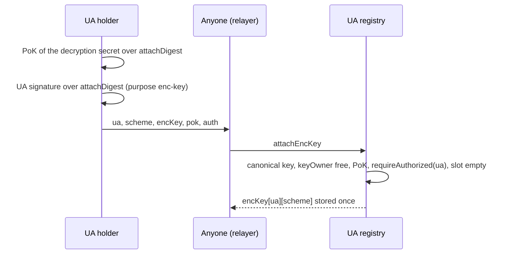

> **Research note — background and rationale only, not normative; the current rules are in docs/ (see decisions.md).**

# UA identity: id derivation and encryption keys as attributes

Written 2026-10-20 at the owner's request. The question: "Does the UA need to be that complex? An EOA just pads into a
UA; a 32-byte public key (Stellar/XLM ed25519) is the UA; Zether → hash; other kinds: hash if not a 32-byte public key?"
The owner ruled the same day that (R1) a UA is always **one** entity that can verify signatures (single key, BLS,
`msig` m-of-n, …); (R2) encryption keys (the PQZ PQZL public key, 16,384 B; the Zether public key `Y`) are
**attributes** of a UA supplied at registration, not UA kinds; (R3) an encryption key registered to one UA may never be
used by another UA, `msig` included. Research only: nothing here is built, nothing was measured. Every URL was read on
**2026-10-20**. Tags: **[source]** official documentation, a specification or source code; **[repo]** this
repository at `d3f777e6`; **[inference]** this note's reasoning; **[estimate]** a number computed from sources;
**[recommendation]** what this note proposes, for the owner to accept or reject.

## 1. Result

| Question | Answer |
|---|---|
| Is the current id rule far from the owner's sketch? | **No.** EOAs (and every 20-byte native id) are already zero-padded; a Stellar `G…`, Solana, Aptos, Sui, TON or 32-byte Cosmos native id is already used as-is; every other kind is already a hash. The only difference: a 32-byte key **registered as a derived kind** (`ed25519` 0x0102, `bip340` 0x0103, `slhdsa128s` 0x0133) is hashed, not used raw. [repo, §2] |
| Should a registered 32-byte key be its own id? | **No** [recommendation]. Gain: one id per ed25519 key across Stellar / Solana / EVM. Costs: four 32-byte schemes would share one byte string (kind confusion, so the kind must travel with every id anyway); and on Stellar, NEAR and Aptos the native account's authority is **not** the key in its id (signers and auth keys rotate), so "id = key" would let a key the owner disabled natively still spend under the same id elsewhere. Solana, Sui, Aptos and Cosmos ADR-028 all add a scheme flag or reject on-curve values for this reason. [source / inference, §3] |
| Encryption key inside the id (option a) or an attribute record (option b)? | **(b)**: an immutable record `encKey[ua][scheme]`, set once with a proof of knowledge of the decryption secret and the UA's own signature, with uniqueness through the existing `keyOwner[keyHash]` map. (a) cannot work for native ids (an EOA's id is fixed) and would give one signing key several ids. [recommendation, §4] |
| What does the proof statement then bind? | Both the UA id and the key: the PQZ header already carries `fromUA` / `toUA` and the body `pk_f ‖ pk_t ‖ pk_a`, loaded by the contract from the registry; the registry map `ua → pk` (one-to-one by R3) replaces "id = hash(pk)". `R_TX` is unchanged; the `R_REG` message changes. [repo / inference, §4.5] |
| Classical signer with a PQZ key? | The owner's decision (§5): PQ confidentiality is kept either way; spend authority is only as quantum-safe as the signer. |
| Net simplification | The kind table loses the three ZETHER kinds, the `authRef` field, the ZETHER kind set, `requireZetherAuthorized`, the `authref` purpose and the "self" Zether mode; it gains one record type and one function. [recommendation, §6] |

## 2. The current rules and the owner's sketch

Facts, from `docs/contracts/accounts.md` §1.3–1.8 and `clients/ua-rs/src/lib.rs` [repo]:

- **CTR-UA-02** — a native single-key account's id is its native address / key; every other kind is
  `UA = keccak256(keccak256(kind_tag) ‖ key_data)` with `kind_tag = "scaas.ua.<name>.v<n>"` (`ua_of`).
- **CTR-UA-03** — ids are 32 bytes. A derived id must have a non-zero top 96 bits (`UAIdInNativeSpace`, honest
  probability 2^-96; `derive_ua`). 20-byte native ids (EVM, Cosmos secp256k1) are left-zero-padded (`native_id`), so on
  those families `id >> 160` separates native from derived. On families whose native ids are 32 bytes (Solana, Aptos,
  Sui, Soroban, GRAM, 32-byte Cosmos accounts) native and derived ids **share one space**; records there store an
  explicit `owner_kind` and dispatch by kind, never by shape. Canonical text form: lower-case hex, the 20-byte form for
  top-96-zero values.
- **CTR-UA-04** — keccak256 in every family, so a key gives the same derived id on every chain.
- **CTR-UA-06** — native ids need no registration; every derived kind registers on each chain (PoP, one key one
  purpose, typo protection: an unregistered derived id cannot receive). Since 2026-10-17 a native key may also register
  as a derived kind; its derived id differs from its native id and the two are **separate accounts** (a Phantom
  ed25519 key: Solana native id = `pk`, registered `ed25519` id = `keccak256(TAG(0x0102) ‖ pk)`).
- **CTR-UA-10 / -11** — `keyOwner[keccak256(GROUP(g) ‖ canonical_pk)] → ua` per curve group, so one key has one
  derived owner across all kinds of its group (`UAKeyInUse`).
- **CTR-UA-16, CTR-PQZ-12 / -13** — `zether-bn254` (0x0140), `zether-bls12381` (0x0141) and `pqz-mlwe` (0x0142) are UA
  kinds whose id is the hash of the encryption key, with an immutable `authRef` (0 = self for Zether; a PQ signing UA or
  a PQ-dominant `msig` for PQZ). They form the ZETHER kind set: never a receiver of public funds, never a signer
  through `requireAuthorized`.

The owner's sketch against these rules:

| Sketch | Current rule | Difference |
|---|---|---|
| EOA pads into a UA | identical (CTR-UA-03, `native_id`) | none |
| Stellar `G…` 32-byte key is the UA | identical for the **native** kind `stellar-account` 0x0011 (and `solana-ed25519` 0x0010) | the same key **registered** as `ed25519` 0x0102 (on EVM, or on Stellar itself) gets a hashed id |
| Zether → hash | identical (0x0140 / 0x0141 / 0x0142 ids are hashes of `Y` / `pk`) | the owner's R2 removes these ids altogether (§4) |
| other kinds: hash if not a 32-byte key | every derived kind is hashed, 32-byte keys included | `ed25519`, `bip340` (x-only), `slhdsa128s` and a compressed bn254 `Y` would become raw |

So the rule set is already the sketch minus one exception; the complexity the owner sees sits elsewhere (three ZETHER
kinds with `authRef`, the closed kind sets, the PQ `authRef` rule), which R2 removes (§6) [inference].

## 3. A raw 32-byte public key as the id

### 3.1 Which keys are 32 bytes

| Key | 32-byte form | Valid 32-byte strings |
|---|---|---|
| ed25519 | compressed `y` + sign bit (RFC 8032) | about half of all strings decode to a curve point [inference: a random `y` has a square `x²` with probability ≈ 1/2] |
| secp256k1 x-only (BIP-340) | `x` | about half (a random `x < p` has `x³ + 7` square with probability ≈ 1/2) [inference] |
| SLH-DSA-SHA2-128s | `PK.seed ‖ PK.root`, 16 + 16 bytes ([FIPS 205](https://csrc.nist.gov/pubs/fips/205/final)) [source] | every string is a well-formed key |
| bn254 G1 compressed (`Y`) | `x` + flag bits | about half [inference] |
| BLS12-381 | 48 B (G1) / 96 B (G2) compressed ([IETF BLS draft](https://datatracker.ietf.org/doc/draft-irtf-cfrg-bls-signature/)) [source] | not 32 bytes: always hashed |
| P-256, secp256k1 full, ML-DSA, FN-DSA, `msig`, MuSig2, FROST | 33–2,592 B or structures | not 32 bytes: always hashed |

So one 32-byte string is typically a valid key under two or three schemes at once.

### 3.2 How other chains form ids

| Chain | Id from a key | Scheme in the id? |
|---|---|---|
| Solana | the ed25519 public key itself; a PDA is `sha256(seeds ‖ program_id ‖ "ProgramDerivedAddress")` and is **rejected if it lies on the curve**, so a derived id can never be a key ([PDA](https://solana.com/docs/core/pda)) [source] | one scheme only; derived ids kept off the key space |
| Stellar | the ed25519 key; the strkey version byte (`G` = 6 << 3, `C` = 2 << 3, `M` = 12 << 3) is inside the CRC16-checked string, and the XDR `PublicKey` is a typed union ([SEP-23](https://github.com/stellar/stellar-protocol/blob/master/ecosystem/sep-0023.md)) [source] | yes, as a type tag beside the 32 bytes |
| NEAR | implicit account = 64 hex of an ed25519 key; ETH-implicit = `0x` + 40 hex ([account id](https://docs.near.org/protocol/accounts-contracts/account-id)) [source] | the shape and the `0x` prefix |
| Sui | `blake2b256(flag ‖ pk)`, flags 0x00 ed25519, 0x01 secp256k1, 0x02 secp256r1, 0x03 multisig (later 0x05 zkLogin, 0x06 passkey) ([auth overview](https://docs.sui.io/develop/transactions/transaction-auth/auth-overview); the page's address list stops at 0x03, passkey 0x06 per `docs/networks/sui.md`) [source] | yes, hashed in |
| Aptos | `sha3_256(pk ‖ 0x00)` ed25519, `… ‖ 0x01` MultiEd25519, `sha3_256(key_type ‖ pk ‖ 0x02)` SingleKey, `… ‖ 0x03` MultiKey; the address stays when the auth key is rotated ([accounts](https://aptos.dev/network/blockchain/accounts)) [source] | yes, hashed in |
| Cosmos | legacy `ripemd160(sha256(pk))[:20]` kept; new types `sha256(sha256(typ) ‖ key)` (32 B), "to separate the inputs for different kinds of account types", including a key valid under two algorithms ([ADR-028](https://github.com/cosmos/cosmos-sdk/blob/main/docs/architecture/adr-028-public-key-addresses.md)) [source] | yes; ADR-028 is the SCaaS rule with sha256 |
| TON | `account_id = hash(initial_code, initial_data)` with a workchain prefix ([addresses](https://docs.ton.org/foundations/addresses/overview)) [source] | the wallet code is hashed in |

Every chain that supports more than one scheme either hashes a scheme flag into the id (Sui, Aptos, Cosmos ADR-028,
SCaaS) or carries a type tag beside the raw key (Stellar). Only single-scheme spaces use the raw key (Solana, NEAR
implicit), and Solana still pushes derived ids off the curve so they cannot collide with keys [source / inference].

### 3.3 Kind confusion and collisions

- **Kind confusion.** With raw ids, `X` can be an `ed25519`, a `bip340` and an `slhdsa128s` id at once. A verifier
  must then learn the kind from somewhere: a stored record (registration, as today for derived kinds) or an
  `owner_kind` carried with every id. If any surface accepted "any 32-byte scheme whose key equals the id", the
  account would be as weak as the weakest 32-byte scheme ever enabled, and adding a scheme would weaken existing
  accounts [inference]. With today's hashed ids the kind is in the preimage, so this cannot happen by construction.
- **Collisions.** Two holders reaching the same 32 bytes under two schemes is a discrete-log or 2^128 birthday problem
  for ed25519 / secp256k1 / bn254, so infeasible; for `slhdsa128s` the root is a 128-bit hash output, so a targeted
  match is a 2^128 second preimage — at the level of the scheme itself, no margin [inference]. Raw keys against the
  hash-shaped native ids of Aptos / Sui / TON / Cosmos ADR-028 are likewise 2^128. The top-96-bit rule still holds
  (an ed25519 key with 96 leading zero bits is 2^-96). Registration would also catch a cross-scheme reuse of the same
  id (`UAAlreadyRegistered`). So collisions are not the blocker; confusion and the next point are.
- **Cross-chain sameness.** Both rules are pure functions, so both give the same id on every chain. Raw ids add one
  thing: a Stellar or Solana native id would equal the same key's registered `ed25519` id on EVM [inference].

### 3.4 A native id is not always its key's authority

On three families the native account outlives its first key [source]:

- **Stellar**: a `G…` account has up to 20 signers with weights and thresholds; the master key (the key in the id)
  can be set to weight 0 ([multisig](https://developers.stellar.org/docs/learn/fundamentals/transactions/signatures-multisig)).
- **NEAR**: an implicit account adds and deletes full-access keys like any account
  ([access keys](https://docs.near.org/protocol/accounts-contracts/access-keys)).
- **Aptos**: "The account address never changes" while `rotate_authentication_key` replaces the key
  ([accounts](https://aptos.dev/network/blockchain/accounts)).

If the registered `ed25519` id were the raw key, the same id would mean "the master key" on EVM and "whatever signers
the account has now" on Stellar. A user who disables a leaked master key on Stellar would still lose everything that
key controls under the same id on every other chain and in the Soroban UA ledger, and indexers would show one account
where there are two authorities [inference]. Today's rule (CTR-UA-06, 2026-10-17) avoids this: the native id follows
the native chain's authority, the derived id follows the key, and the ids differ.

### 3.5 Recommendation

[recommendation] Keep CTR-UA-02 / -03 / -04 as they are: native ids as-is (20-byte padded, 32-byte raw), every
derived kind hashed with its kind tag, 32-byte keys included. Reasons: one rule instead of two; the kind is in the id,
so no surface can confuse schemes; native and derived authorities stay separate where native accounts rotate keys;
it is the ADR-028 / Sui / Aptos practice. The owner's sketch is already the rule for native ids, which is where raw
keys are safe (the chain itself fixes the scheme). Nothing in §4–§6 depends on this choice.

## 4. Encryption keys as attributes

### 4.1 Precedents

| System | Where the encryption / viewing key lives | Mutable? |
|---|---|---|
| Aztec | committed in the address: `address = (pre_address·G + Ivpk_m).x`, `pre_address = hash(public_keys_hash, partial_address)`; the signing key is **not** in it ([keys](https://docs.aztec.network/developers/docs/foundational-topics/accounts/keys), [barretenberg address derivation](https://barretenberg.aztec.network/api/simulation_2gadgets_2address__derivation_8cpp_source)) [source] | protocol keys never rotate (new account); signing keys rotate inside the account contract |
| Zcash unified address | an off-chain encoding bundling receivers (Orchard 0x03, Sapling 0x02, transparent 0x00 / 0x01), F4Jumble + Bech32m; not an on-chain identity ([ZIP 316](https://zips.z.cash/zip-0316)) [source] | new address any time; no registry |
| Penumbra | address = (diversifier, transmission key, clue key) from one spend key; diversified addresses unlinkable; no registry described ([addresses and keys](https://protocol.penumbra.zone/main/addresses_keys.html)) [source] | new address any time |
| Railgun | `0zk` address encodes a spending key (Baby Jubjub) and a separate viewing key (ed25519) ([wallets and keys](https://docs.railgun.org/wiki/learn/wallets-and-keys.md)) [source] | new wallet |
| ERC-5564 / ERC-6538 | meta-address `st:eth:0x<spendingPubKey><viewingPubKey>`; registry `stealthMetaAddressOf[registrant][schemeId]`, set by the registrant or on its behalf with an EIP-712 / ERC-1271 signature, **overwritable** ([ERC-5564](https://eips.ethereum.org/EIPS/eip-5564), [ERC-6538](https://eips.ethereum.org/EIPS/eip-6538)) [source] | yes, any time |
| ENS | `pubkey(node)` record, EIP-619, `setPubkey` by the node's authorised party, overwritable and versioned ([PubkeyResolver.sol](https://github.com/ensdomains/ens-contracts/blob/staging/contracts/resolvers/profiles/PubkeyResolver.sol)) [source] | yes |

Two families: privacy chains put the keys in the address (Aztec) or make addresses throwaway encodings (Zcash,
Penumbra, Railgun); account chains attach a key record to an existing account (ERC-6538, ENS). Note that ERC-6538 and
Aztec both separate the signing / spending authority from the viewing key, as R1 / R2 do [inference].

### 4.2 Option (a): commit the encryption key inside the id

`UA = keccak256(TAG(kind) ‖ key_data ‖ encKeysHash)`. Effects [inference]:

- Impossible for native ids: an EOA's or a `G…` account's id is fixed by its chain, so an EOA could never hold a
  confidential balance under its own id — against R2.
- One signing key would have one id per encryption-key set; `keyOwner` (CTR-UA-11) allows the signing key one owner,
  so either the second id is refused or the one-key-one-purpose map is loosened.
- No gain the registry does not already give: ids are immutable records already (CTR-UA-15), so "the key cannot
  change" holds in (b) too. Aztec needs (a) because its address must be usable before any contract is deployed; a
  SCaaS UA must register anyway before it can receive (CTR-UA-06).

### 4.3 Option (b): an immutable attribute record

`encKey[ua][scheme] → keyPtr`, written once by `attachEncKey`, never changed (CTR-UA-15 monotonic), with:

- **who may attach**: the UA itself — `requireAuthorized(ua, PURPOSE_ENC_KEY, attachDigest, auth)`; a native id signs
  the EIP-712 `UAAuth` (CTR-UA-12), an `msig` its m-of-n — so nobody attaches a key to a victim's id;
- **proof of knowledge** of the decryption secret over the same `attachDigest` (Zether: the Schnorr by `x` under the
  Zether tag; PQZ: `R_REG`), so nobody attaches someone else's public key (which would let them read nothing, but would
  claim the key and block its owner);
- **uniqueness** (R3): `keyOwner[keccak256(GROUP(g) ‖ encKey)] → ua`, the existing map and groups (`bn254-g1`,
  `bls12381-g1`, `pqz-mlwe`); a second attach of the same key to any UA reverts `UAKeyInUse`. No new map is needed;
- `attachDigest = keccak256(ENC_TAG ‖ chainKeyHash ‖ chainUid ‖ registry_id ‖ ua ‖ scheme)` — binds chain, registry,
  UA and scheme, not the caller (as CTR-UA-07), so it is relayable and a front-runner gets the identical record.

### 4.4 Effects of (b)

| Aspect | Today | With (b) |
|---|---|---|
| Native UAs (EOA, `G…`) | cannot hold a confidential balance under their own id; they act through a Zether UA whose `authRef` names them | attach once (one transaction); signing stays native, no signing record is created |
| Immutability | ZETHER record and `authRef` immutable | `encKey[ua][scheme]` immutable; one key per (UA, scheme) [recommendation: no slots or indices in v1] |
| Sender lookup | the token derives the receiver id from `Y` with one keccak, no lookup | the payload names `toUA`; the token reads `encKeyOf(toUA, scheme)` (PQZ already loads `pk` from the registry; Zether adds one external call + SSTORE2 read of 64 / 128 B, ≈ 5–8 k gas) [estimate] |
| Authorization | proof + `authRef` signature (`self` = proof alone) | proof + the UA's own signature over `authDigest`; no `self` mode (R1: the authorizer is always a signature-verifying UA) |
| Leaked decryption key | read-only breach if `authRef ≠ 0` | always read-only (`survivesEncKeyLeak` for every account) |
| Lost decryption key | confidential balance stuck | the same; the UA's public balance and other attributes are unaffected |
| Rotation | new Zether UA + confidential transfer | new signing UA + attach + confidential transfer (the old record cannot be replaced) |
| Multisig | `authRef` = `msig` | the `msig` UA attaches directly; see below |
| Privacy | the `authRef` is public in the record, so a Zether UA with `authRef ≠ 0` is already linked on chain; `self` accounts are unlinked | public and confidential balances sit under one id (linked); a user who wants them apart uses a second signing UA for the confidential side |

**Multisig.** The decryption secret is one secret: whoever proves must hold all of it, so it is not m-of-n. For an
`msig` UA the encryption key is a **view / prove key** held by one operator (or a key oracle, `conf_custody` in
CTR-PQZ-13), and the m-of-n signature is the **authorization** of every spend over `authDigest`. That is today's
`authRef = msig` split, kept; R3 additionally stops the operator from reusing that key for a second UA [inference].
Threshold decryption for lattice or ElGamal keys exists but would change the proof relations; not proposed.

**Storage per chain** [estimate]: EVM SSTORE2 of 16,384 B ≈ 3.3 M gas (CTR-PQZ-13, unchanged — the same bytes move
from a kind record to an attribute record), 64 / 128 B for Zether as today. PQZ is chain-7622-only and Zether EVM
dev chains only (CTR-PQZ-01, CTR-ZTH-02), so no other family stores these records today. If a family ever does: Solana
rent-exempt deposit `(128 + 16,384) × 5,080` lamports ≈ 0.084 SOL for one PQZ key at the live rate
([near-algorand.md §5.1](near-algorand.md)); Sui and Aptos charge a per-byte storage fee into a refundable rebate /
deposit on an object or resource, of the same order as their other records (not computed here).

### 4.5 Statement binding

Today `R_TX` row 1, `pk_f = A·s_f + e_f`, "shows the sender holds **the** key of `fromUA`" because
`fromUA = keccak256(TAG(0x0142) ‖ pk_f)` [repo: pq-zero-knowledge.md §7.4]. Under (b) the id is no longer a hash of
`pk`, so the binding moves to the registry [inference]:

- The PQZ statement already carries both: header `fromUA` (offset 160), `toUA` (192), `beneficiaryUA` (224); body
  `pk_f ‖ [pk_t] ‖ [pk_a]`, which the contract loads from the registry, never from the caller (§7.7, §7.9) [repo]. With
  `pk_f = encKeyOf(fromUA)`, `pk_t = encKeyOf(toUA)`, `pk_a = encKeyOf(auditorUA)` the statement binds the pairs
  `(ua, pk)`; R3 makes `ua ↔ pk` one-to-one per scheme, so "the key of `fromUA`" stays unique. **`R_TX`, `R_TX0`, `R_TXM`,
  `R_BURN` and the disclosure relations do not change**; their statement bytes do (new ids).
- `authDigest = keccak256(tag ‖ keccak256(statement))` already covers the header ids, so the UA's signature binds
  `fromUA`, the recipients and the keys [repo].
- `R_REG` keeps its relation (`pk = A s + e`, the message absorbed); only the message changes from
  `uaMessage(0x0142, POP_TAG, popDigest(ua, authRef))` to the `attachDigest` of §4.3 [inference].
- Classical Zether builds its statement from `Y` values taken from the payload and derives the account id from them
  (`ZetherTypes.toUA`, `ZetherStatements._acct`) [repo]. Under (b) the payload names UA ids, the contract loads each
  `Y` from the registry (or checks a supplied `Y` against `keyOwner`) and keys account state by the UA id; the
  Zether relations are unchanged, the `authDigest` should include the UA ids (it covers the statement, so adding them
  to the statement context is enough) [inference].

## 5. Classical-signing UAs carrying a PQZ key (owner's decision)

CTR-PQZ-12 today requires a PQ `authRef` (`mldsa*`, `fndsa512`, `slhdsa128s`, or an `msig` whose non-PQ weight is below
its threshold) [repo]. Under (b) the same rule becomes "which UA kinds may attach a `pqz-mlwe` key". The trade-off,
stated only [inference]:

| | Allow classical UAs (EOA, `p256`, passkey, BLS, `secp256k1`) | Keep PQ-only |
|---|---|---|
| Confidentiality against a future quantum adversary (harvest now, decrypt later) | kept: amounts are MLWE-encrypted whoever signs | kept |
| Spend authority against a quantum adversary | lost once secp256k1 / P-256 / BLS fall: the attacker signs the `authDigest` | kept (PQ or PQ-dominant `msig`) |
| Who can use PQZ | any wallet: MetaMask, passkeys, HSMs; no ML-DSA support needed | users with an ML-DSA / FN-DSA / SLH-DSA key (or a hybrid `msig`); EOAs only as a minority `msig` member |
| Cost per spend on 7622 | ECDSA ≈ 3 k gas, 65 B | ML-DSA-65 ≈ 236 k gas with the precompile, 3,309 B signature |
| Later tightening | immutable records: a later PQ-only rule cannot reach existing attachments; users would have to move funds | nothing to tighten |

A middle option is a per-token immutable flag (`pqAuthRequired`, set at `initialize`): a token chooses, users see it.

## 6. Recommended minimal design

[recommendation] Rules:

```
UA id         unchanged: native as-is (20 B padded / 32 B raw), derived = keccak256(TAG(kind) ‖ key_data), top 96 bits ≠ 0
UA            one signing entity (R1): native kinds + SIGNING kinds; ZETHER kinds 0x0140–0x0142 removed as UA kinds
enc scheme    zether-bn254 (Y, 64 B), zether-bls12381 (Y, 128 B), pqz-mlwe (pk, 16,384 B); same canonical-encoding rules
attachDigest  keccak256(ENC_TAG ‖ chainKeyHash ‖ chainUid ‖ registry_id ‖ ua ‖ scheme)
attach        ua native or registered SIGNING (an unregistered derived id: UANotRegistered)
              encKey canonical; keyOwner[keccak256(GROUP(g) ‖ encKey)] free → set to ua      (R3, UAKeyInUse)
              PoK(scheme, encKey, attachDigest)                                                (Zether Schnorr by x; R_REG)
              requireAuthorized(ua, PURPOSE_ENC_KEY, attachDigest, auth)                      (native: EIP-712 UAAuth)
              scheme rule: pqz-mlwe per §5; zether-bls12381 refused for a bls12381-minsig UA (CTR-UA-16's DDH rule)
              encKey[ua][scheme] empty → SSTORE2(encKey); never rewritten                     (UAEncKeySet)
spend         proof over a statement built from encKeyOf(ua, scheme) + requireAuthorized(ua, PURPOSE_ZETHER_AUTH,
              authDigest, auth) — the same check as every other UA operation
```

```solidity
event UAEncKeyAttached(bytes32 indexed ua, uint16 indexed scheme, bytes encKey);
function attachEncKey(bytes32 ua, uint16 scheme, bytes calldata encKey, bytes calldata pok, bytes calldata auth) external;
function encKeyOf(bytes32 ua, uint16 scheme) external view returns (bytes memory);   // empty if none
```

Attach as a flow:



Choices inside the design, all [recommendation]:

- **One function, not a `register` argument.** Native ids have no `register`, so `attachEncKey` is their only path;
  a derived UA registers and attaches in two calls (the node may batch them). "Supplied at registration" then means
  "attached once, before the first confidential use". Making it a `register` argument as well would be a second path to
  the same record.
- **Keep the scheme numbers 0x0140–0x0142** as encryption-scheme ids, so vectors and tags (`scaas.ua.zether-bn254.v1`
  as the PoK tag, the PQZ seed `info` of CTR-PQZ-13) keep their bytes where the meaning is unchanged; the ids move
  out of the UA kind table into an "encryption schemes" table. All chains are test-only, so nothing needs to stay
  compatible.
- **Drop `self` mode.** A Zether user needs a signing UA (an EOA suffices); one ECDSA check per spend (≈ 3 k gas)
  buys a single authorization path and `survivesEncKeyLeak` for everyone.
- **No rotation, no slots.** One key per (UA, scheme), immutable; a new key means a new signing UA, as CTR-UA-13.

What it removes: `authRef` and `authPop` (record field, `register` arguments, `UAAuthRef`, purpose `authref`), the
ZETHER kind set, `requireZetherAuthorized` and its `zkCovered` flag, the three ZETHER rows of the kind table, the
"Zether UA cannot be a receiver" rules (CTR-UA-14 / -27), and most of CTR-ZTH-51 (the confidential account and its
public side are now the same UA).

## 7. Migration impact

All chains are test-only (owner; mainnet 22776 not launched): redeploy, no compatibility path.

| Area | Change |
|---|---|
| Specs | `contracts/accounts.md`: CTR-UA-06 (native ids may hold an attribute record), -07 (no `authRef`), -10 purpose table (`enc-key` in, `authref` out), -14, -15, -16 (rewritten as the attribute rule), -17 (`keyOf` → `encKeyOf`), -27, kind table and closed sets, `IUARegistry`; `contracts/zether.md` registry section, CTR-ZTH-50 / -51, the `authRef` table; `contracts/pq-zero-knowledge.md` CTR-PQZ-12 / -13, §6, §7.2, §7.4 row 1 wording, §7.7 (ids), §7.10; `decisions.md` entries for every changed rule |
| Registry | `smartcontracts/evm/src/ua/UARegistry.sol`, `IUARegistry.sol`, `UAKinds.sol` (record without `authRef`, `attachEncKey`, `encKeyOf`, scheme table; `_checkPqzAuthRef` becomes the §5 scheme rule) |
| Verifiers | `UAPqzVerifier` (message = `attachDigest`); the Zether Schnorr verifiers (PoK digest); PQZ precompile unchanged (`R_REG` absorbs the message as opaque bytes) |
| Tokens | `ZetherLib`, `ZetherTypes.toUA` (removed), `ZetherStatements`, `ZetherLayer` (state keyed by UA id, `Y` from the registry); `PqzLib`, `PqzLayer` (`encKeyOf` instead of `keyPtr`, `requireAuthorized`); the UA allowlist entries for Zether / PQZ ops |
| Vectors | `smartcontracts/vectors/ua/kinds.json`, `signatures.json`, `pq_signatures.json` (ZETHER rows out, attach vectors in); `smartcontracts/vectors/pqz/statement_*.json` and `statement_register.json` (new ids and message); Zether statement vectors |
| Clients | `clients/ua-rs`, `ua-go`, `ua-c`, `ua-cs`, `ua-cxx`, `ua-dart` / `ua-dart-frb`, `ua-py`, `ua-qt` (kind table, `is_zether`, attach digest, scheme table); `clients/zether-prover`; `clients/clientkeys` (key paths unchanged; attach signing flow); `pqz-core` prover and `pqz-cli` (statement ids, `R_REG` message) |
| Node / indexer | Zether / PQZ accounts indexed by UA id; `UAEncKeyAttached` replaces the ZETHER `UARegistered` rows |
| Tests | registry tests T-REG-3 / 3b (relayable attach, front-running), uniqueness across UAs (R3, `msig` included), PQ scheme rule, Zether / PQZ token suites |

## 8. Open points for the owner

1. §3.5: keep hashed ids for registered 32-byte keys (recommended) or adopt raw keys with a mandatory kind.
2. §5: classical signers with a PQZ key — allowed, PQ-only (today), or a per-token flag.
3. §6: drop Zether `self` mode (recommended) or keep a "proof alone" path for single holders.
4. §6: attach as its own function (recommended) or also as a `register` argument.
