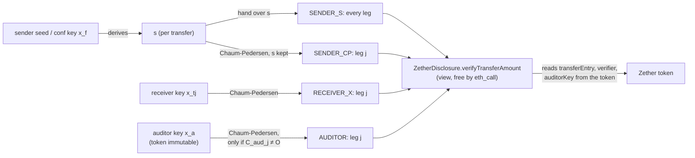
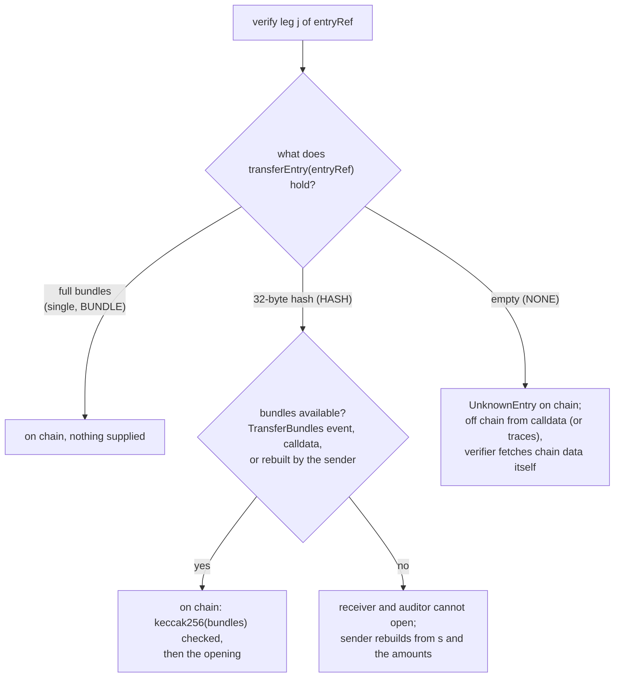

> **Research note — background and rationale only, not normative; the current rules are in docs/ (see decisions.md).**

# Zether disclosure — who can reveal what, under which conditions (2026-10-11)

**Status (owner decisions, 2026-10-11; built in P3b, see [contracts/zether.md](../contracts/zether.md) CTR-ZTH-30, -38, -42, -48 to -50, and CTR-PQZ-19, -23, -24):**
- **R3** (opt-out undermines compliance, Q1) is addressed by `auditorMode = FULL` (no opt-out); the opt-out is kept by choice under `OPTIONAL`.
- **G1 / R7** (`s` derivation) are closed by the salt rule: `s = HKDF(seed_zether, "ZTX/s/v2" ‖ chainUid ‖ token ‖ fromUA ‖ sendCounter ‖ salt)` with a fresh published 16-byte salt per build.
- **§7** (alternatives to storing the bundle) is superseded by the sender-memo rule: commit-reveal stores the commitment plus a 17 + 40·M byte memo (a flags byte records the auditor choice), and the sender recovers from seed + storage alone; tokens choose `disclosureMode ∈ {BUNDLE, COMPACT}` at creation.
- **R6** (data availability of `TransferBundles` logs for receiver and auditor under commit-reveal) is still open.

Written 2026-10-11 for the owner: "With Zether, can the sender, the receiver and the auditor reveal part or all of a
transaction, or every transaction of the token? This matters; it needs a document and a careful review. Give a table
plus conditions." A follow-up asked whether there is an alternative to storing the 256-byte bundle, for example a
per-transaction secret that can be recomputed later (§7). Review only: nothing here changes a rule. SCaaS facts cite
rule ids of [contracts/zether.md](../contracts/zether.md) and [contracts/pq-zether.md](../contracts/pq-zether.md), and
code as `file:line` on `main` at `d85fc8b` (paths under `smartcontracts/evm/` unless stated). **[inference]** marks a
conclusion drawn here, not stated by the spec or the code; **[estimate]** marks a gas figure not measured;
**[unverified]** marks an outside claim not confirmed against a primary source.

## 1. Summary

**Short answer.** Identities, the transaction graph, fees, shield and unshield amounts are public to everyone. An
amount hidden inside a transfer can be revealed, with an on-chain-verifiable proof, by:

- **the sender**, for one leg (`SENDER_CP`) or for every leg of its transfer (`SENDER_S`, which hands over `s`);
- **each receiver**, for its own leg only (`RECEIVER_X`), without the sender's cooperation;
- **the token auditor**, for any leg of any transfer of the token, **but only** when the token was created with an
  auditor key and the sender did not leave the auditor out of that transfer.

Nobody can prove a **balance** on chain (no opening exists for `acc`/`pending`). Only the key owner decrypts its own
balance. The auditor cannot decrypt balances, but it can **compute** them from the flows it sees. **Every transaction
of the token** can be revealed only by the auditor, and only for transfers that included it. Opt-outs are visible as
`C_aud = O`. A token without an auditor has no party that sees everything. Every opening is permanent and can be
forwarded to anyone.

Top findings (detail in §6):

| # | Rating | Finding |
|---|---|---|
| R1 | High | The auditor key is immutable and cannot be rotated. A leak exposes every included transfer of the token, past and future. bn254 (~100-bit) and a future quantum adversary expose every ciphertext anyway. |
| R2 | High | "The auditor never reads anyone's balance" is true for decryption only. The auditor rebuilds the exact balance of every account whose flows all included it; the built test shows 500 − 321 = 179. |
| R3 | High | An auditor-enabled token does not guarantee coverage: the sender may leave the auditor out of any transfer (CTR-ZTH-42). For travel rule or tax use, coverage needs a rule that does not exist. |
| R4 | Medium | INT-ERP-11 says "an audit key per company", but the key is per token. On a token shared by several companies, the auditor sees all of them. |
| R5 | Medium | The account key `x` is the only view key. For `authRef = 0` (built `SELF_SCHNORR`) the same `x` can also spend. No separate viewing key exists (`<use> = 8` is reserved only). |
| R6 | Medium | Disclosure data availability: HASH bundles live only in logs and calldata, and nobody is assigned to archive them. Receiver and auditor openings depend on them. |
| R7 | Medium | Spec and code disagree on how `s` is derived. Under the spec's counter-only rule, a retry with another amount reuses `s`. Under the code's rule, the client must keep the per-leg amounts. |
| R8 | Medium | `ZetherDisclosure` trusts the token's own `verifier()`. A token with a non-canonical verifier makes every opening "true". `disclosure()` itself is not pinned (CTR-ZTH-20 pins only verifier and registry). |

## 2. The objects in one page

Per transfer (single format = one leg `j = 0`; multi-recipient = `M ≤ 16` legs, one shared `s`):

| Item | Value | Public? | Who can read the amount |
|---|---|---|---|
| `D_out` | `[s]G` | yes (calldata; bundle) | — |
| `C_out_j` | `[v_j]G + [s]Y_tj` | yes | receiver `j` (`x_tj`), anyone with `s` |
| `C_aud_j` | `[v_j]G + [s]Y_a`, or `O` (auditor off or left out) | yes | auditor (`x_a`), anyone with `s` |
| `C_deb` | `[Σv_j]G + [s]Y_f` | calldata only (not in the bundle) | sender (`x_f`), anyone with `s` |
| `fee`, `beneficiary`, `from`, `recipients[]`, `entryRef`, `sendCounter`, mode | scalars and ids | yes (events, calldata) | everyone |
| sender's `acc`, receivers' `pending` | ElGamal under the owner's `Y` | yes (state) | only the owner of that `Y` |

`E3_j`/`E4`/`E6_j` share `z_vj` and `z_s`, so a verified transfer guarantees that `C_out_j`, `C_aud_j` and the
debit encrypt the same `v_j` with the same `s` (`ZetherVerifier.sol:230-235`, `:314-319`). The bundle of leg `j` is
`B_j = Y_tj ‖ C_out_j ‖ D_out ‖ C_aud_j` (CTR-ZTH-38). Where it lives depends on the mode:

| Mode | Entry point (built name) | Stored | Bundles also in |
|---|---|---|---|
| single | `zetherTransferSingle` (`transferConfidentialSingle`; BUNDLE tokens) | full `R = salt ‖ B_0` | calldata |
| BUNDLE (default on a BUNDLE token) | `zetherTransfer` | full `R = salt ‖ B_1 ‖ … ‖ B_M` | calldata |
| commit-reveal (default on a COMPACT token) | `zetherTransferCompact`; `zetherTransfer` on a COMPACT token | `keccak256(R)` ‖ sender memo | `TransferBundles` event, calldata |
| NONE | `zetherTransferNoBundle` (BUNDLE tokens) | nothing | calldata only |

Who holds which secret, and which opening it yields:

## 3. Matrix — who can reveal what

Condition codes used in the cells:

- **A**: the token has an auditor (`Y_a ≠ O`, chosen by the creator at `initialize`, immutable, CTR-ZTH-09).
- **O**: the sender did not leave the auditor out of this transfer (`C_aud ≠ O`, CTR-ZTH-42).
- **S**: storage mode. *stored* means single or BUNDLE (nothing to supply). *HASH* means the caller supplies all
  bundles of the transfer from the event or calldata; any copy works, because the stored hash checks it. *NONE* means
  off chain only, from calldata (`UnknownEntry` on chain).
- **D**: data availability: event logs or transaction bodies (traces for nested calls) still retrievable.
- **K**: key retained: `x`, `x_a`, the seed, or the per-leg amounts the code's `s` derivation needs (§4.6).
- **[P]**: provable to a third party (`verifyTransferAmount`, a view). **[T]**: trust-me (private decryption, no
  proof kind exists).

**3.1 One transfer and one account** (scopes a–d):

| Actor | (a) one amount: single transfer, or leg `j` | (b) the whole transfer | (c) a balance at time t | (d) an account's full history |
|---|---|---|---|---|
| **Sender** (`x_f`, `s`) | **Yes [P].** Use `SENDER_CP` for leg `j` only; `SENDER_S` hands over `s` and opens every leg, decoys included. Needs K, plus S/D. | **Yes [P]** for every leg (via `s`). Fee, parties, `entryRef` are public. Its own balance before/after: yes [T]. Receivers' balances: no. | Own: yes [T] (`C − [x]D` + BSGS; `zether-read-balance`); no proof kind. Others: no. | Own: yes [T]. Incoming legs: `x` on `C_out`, needs D. Outgoing totals: `x` on `C_deb` (calldata) or `acc` differences (archive state). Outgoing legs: via `s`. Each transfer provable [P]. |
| **Receiver `j`** (`x_tj`) | Own leg: **yes [P]** with `RECEIVER_X`, no sender cooperation; needs S/D. Other legs: no. | Own leg + public metadata. Other legs: no. Sender's balance: no. | Own: yes [T]. Others: no. | Own incoming: yes [T], each leg [P]. As a sender: as the sender row. |
| **Token auditor** (`x_a`) | **Yes [P]** with `AUDITOR`, only if A∧O. Otherwise no, and the miss is visible (`ZetherDisclosure.sol:58-59`). | Every leg, decoys seen as 0, if A∧O; [T] by decryption, [P] per leg. | Cannot decrypt (`ZetherToken.t.sol:523`). **Can compute it [inference]** when every flow of the account since creation had A∧O and D (§4.5). | Every included flow of every account; opt-outs are visible gaps. |
| **Issuer / token creator / factory admin** (without `x_a`) | No. | Public metadata only. | No. | Public metadata only. |
| **Third party given an opening** | Exactly the opened leg (every leg if given `s`); verifies on chain or by `eth_call` and can forward it forever. | Only the opened legs. | No. | Only what it was handed. |
| **Third party given `x` of an account** ("view key", §4.7) | Every leg paid to the account. Its outgoing legs via `s` re-derived from `x` plus the amounts (code). | As that account. | Yes [T], at any block (archive state). | Yes, past and future, until the UA is abandoned. If `authRef = 0`, it can also **spend**. |
| **Public / anyone** | No. (Shield, unshield and fee amounts are public.) | Parties, fee, beneficiary, `entryRef`, `sendCounter`, mode, `M` and the decoy set (not which leg is real), the opt-out flag. | No. Bounds only, from public flows [inference]. | Activity counters (`sendCounter`, `pendingSeq`, `accSeq` via `accountState`, `ZetherToken.sol:184-191`) and timing. |
| **Relayer / node** | No. | As public, but earlier (before inclusion), plus the envelope signer's address. Job payloads kept ≤ 30 days. | No. | As public. |

**3.2 The token and the edges** (scopes e–g):

| Actor | (e) every transaction of the token | (f) shield / unshield amounts | (g) linkage and identities |
|---|---|---|---|
| **Sender** | No (its own only). | Public. | Public anyway; knows which legs are decoys. |
| **Receiver** | No. | Public. | Public; a decoy learns it received 0, hence that it was a decoy. |
| **Token auditor** | **Yes for A∧O transfers**, past and future, while `x_a` exists (no rotation). Needs D for HASH/NONE bundles. Each leg [P], except NONE (off chain). Opt-outs are listed but unreadable. | Public. | Public; sees through decoys. |
| **Issuer / creator / admin** | No, unless it is the auditor: it chose `Y_a`. | Public. | Public. |
| **Third party with an opening** | No. | Public. | Public. |
| **Third party with `x`** | No (one account). | Public. | Public. |
| **Public** | Metadata of every transaction and `totalShielded`; no amounts. | **Yes**: `Funded(ua, amount)` (`ZetherToken.sol:221`), `Burned(ua, amount, recipient)` (`:561`), calldata. | **Yes**: UAs, the recipient list, the beneficiary; EVM links (`link_eth`, the `fund` caller, the unshield recipient, the envelope `m.from`). |
| **Relayer / node** | No. | Public. | Public, plus the envelope signer. |

Conditions that change nothing, or change a cell only through K:

- **Rollover** moves `pending` into `acc` and leaves per-transfer disclosure untouched; a balance is `acc + pending`.
- **Key change** means a new UA (CTR-UA-13). Old transfers stay openable only with the old `x` (and, in code, `s`
  is keyed by `x`). Destroying an old key, for crypto-shredding or after a migration, ends that party's ability to
  disclose those transfers. A leaked old key exposes the old history.
- **Chain**: the challenge binds `chainid`, the token, `entryRef`, `j`, `amount` and `kind` (`ZetherDisclosure.sol:62`).
  `chainUid` is SPECIFIED (CTR-ZTH-36), not built.

## 4. Conditions and guarantees

### 4.1 What a third party verifies

| Kind | Secret | What `verifyTransferAmount` checks (leg `j`) | Can the discloser lie? | Scope | Forwardable |
|---|---|---|---|---|---|
| `SENDER_S` | `s` itself | `[s]G == D_out` and `[amount]G + [s]Y_tj == C_out_j` (`ZetherDisclosure.sol:44-52`) | No, perfectly binding: `D_out` fixes `s`, then `C_out_j` fixes `amount mod r`, and `amount < 2^64 < r` (`:43`) | every leg, decoys included | yes; `s` is a bearer secret |
| `SENDER_CP` | `s` (kept) | DLEQ `log_G D_out == log_{Y_tj}(C_out_j − [amount]G)` | No, under DL in the random-oracle model | leg `j` only | yes (a NIZK) |
| `RECEIVER_X` | `x_tj` | DLEQ `log_G Y_tj == log_{D_out}(C_out_j − [amount]G)` | No | leg `j` only | yes |
| `AUDITOR` | `x_a` | DLEQ on `(Y_a, D_out, C_aud_j − [amount]G)`; false when the token has no auditor or `C_aud_j = O` | No; and E6 ties `C_aud_j` to the same `v_j` as `C_out_j` | leg `j` only | yes |

The DLEQ challenge hashes `chainid ‖ token ‖ entryRef ‖ j ‖ amount ‖ kind ‖ A1 ‖ A2` (`ZetherDisclosure.sol:62`),
so a proof does not move to another leg, kind, amount, token or chain id. Tests cover leg, kind and amount
(`ZetherMulti.t.sol:294-327`); token and chain are not tested (§9.2). Selective disclosure works per leg with
`SENDER_CP`, `RECEIVER_X` and `AUDITOR`. Only `SENDER_S` opens more than asked (CTR-ZTH-37 accepts this).

Proofs do not cover:

- **A balance.** No opening kind exists for `acc`/`pending`.
- **That a list of transfers is complete.** Completeness comes from public events instead: every transfer names
  `from` and every recipient, so a verifier enumerates all `entryRef`s touching a UA and asks for an opening of each
  [inference].
- **A NONE-mode leg on chain** (`UnknownEntry`).
- **A token's honesty** (§6, R8).

### 4.2 Trust-me versus proof

Decrypting with a key is private knowledge ([T]). To convince someone else, the key holder produces an opening, or
hands over the key itself (§4.7). Decrypting a balance has no matching opening. A key owner who wants to prove a
balance can only share `x` or an off-chain DLEQ on `(Y, D, C − [b]G)` that nobody builds today. Monero's reserve
proof is the analog (§8.2). The prover's JSON/WASM/CLI API exposes `decrypt` for any ciphertext, so an auditor can
decrypt `(C_aud_j, D_out)`. The API has no opening command: openings exist only as Rust library functions
(`clients/zether-prover/src/schnorr.rs:125`, `:179`, `:201`, `:220`; `src/api.rs:334-399`).

### 4.3 What leaks anyway

The following is public whatever keys exist:

- Identities and the graph (ring size 2, CTR-ZTH-01).
- The recipient list, including decoys (`M` and the set, not which leg is real).
- The beneficiary and the fee.
- Timing and the per-account counters.
- The auditor opt-out bit.
- Shield and unshield amounts with their EVM addresses.
- `totalShielded`.

These public boundary flows bound hidden amounts. Take an account funded only by one shield of `X` that later
unshields `Y`: what it sent in between lies in `[0, X − Y]` minus fees [inference]. Decoys hide the real recipient
from the public only. The auditor reads `0` on decoy legs, and each decoy owner decrypts its own `0`.

### 4.4 Storage modes and who must supply what

HASH bundles are self-authenticating: any copy from any archive works, because the stored hash checks it. Without
a stored commitment (NONE), a bundle handed over by a party proves nothing. Anyone can build a self-consistent fake
`(s', v', C')`, so the verifier must read the transaction from a node it trusts [inference].

### 4.5 The auditor: can and cannot

| Can | Cannot |
|---|---|
| Decrypt `v_j` of every leg of every transfer with A∧O, past and future, while `x_a` exists (`ZetherToken.t.sol:523` reads `C_aud`) | Decrypt any `acc` or `pending` (encrypted under the owners' keys; same test) |
| Prove each such leg to anyone with `AUDITOR` (on chain for stored/HASH, off chain for NONE) | Read a transfer the sender left it out of (`ZetherToken.t.sol:450`, `ZetherMulti.t.sol:330`) |
| See decoys as 0, so it learns which recipient is real | Open shield/unshield (nothing to open: they are public) |
| **Rebuild every balance by bookkeeping** [inference] from public flows (shields, unshields, fees) plus every included leg, exactly, for accounts whose flows all had A∧O | Rebuild a balance once a single opt-out touches the account (it learns only bounds from then on) |
| List exactly which transfers it is missing (`C_aud = O` is public) | Rotate or revoke its own key, or be removed (CTR-ZTH-09) |

The built test shows bookkeeping in one step. Alice shields 500 (public) and sends 321 (auditor reads it). Her
balance 179 is then known to the auditor without decrypting `acc` (`ZetherToken.t.sol:523-540`). The k-of-n
threshold auditor (CTR-ZTH-41) is docs only: no threshold decryption or threshold DLEQ protocol exists in the prover.

### 4.6 Can the sender disclose later? (`s`)

| | Spec (CTR-ZTH-30) | Code (`clients/zether-prover/src/zether.rs:503-516`, `:941-954`) |
|---|---|---|
| Formula | `HKDF-SHA256(seed_zether, "ZTX/s/v1" ‖ chainId ‖ token ‖ fromUA ‖ sendCounter)` | `SHA-512("SCAAS-ZETHER-S-V1" ‖ x ‖ chainId ‖ token ‖ sendCounter ‖ Y_to ‖ v)` mod `r`; multi: `"…-S-MULTI-V1"` and every `(Y_tj, v_j)` in order |
| Rebuild needs | seed + the on-chain counter ("stores nothing") | `x` + the counter + **every leg's recipient and amount** |
| Retry at the same counter with another amount | same `s` ⇒ `C_out − C_out' = [v − v']G` leaks the difference (BSGS-small), whenever the failed attempt's calldata became public (a mined revert, a mempool) [inference] | different `s`, no leak |
| `chainUid` | absent | absent |

So the sender can always disclose later if it keeps its keys **and**, in code, the amounts. Single-recipient
recovery needs no stored amount: `x` decrypts `C_deb` (calldata) to `V = v`. A multi-recipient transfer with one real
leg is recovered by trying `M` placements. With two or more non-zero legs, the split is lost unless stored. PQZ
already uses the message-bound form, and says classical is counter-only (CTR-PQZ-19).

### 4.7 The receiver, and `x` as the only view key

The receiver proves each received leg with `RECEIVER_X`, without the sender. It knows its balance [T] but cannot
prove it (§4.2). To let an accountant or regulator see an account, the only key to share is `x`. Zether's proof uses
the decryption key in `E1`/`E5`, so a decrypt-only key cannot be split from the proving key without a redesign
[inference]. Spending is separated only by `authRef` (CTR-UA-16; built: `AuthScheme`). With `authRef = 0` (built
`SELF_SCHNORR`), `x` alone spends. `<use> = 8` "viewing/disclosure keys" is reserved and unused
(`clients/clientkeys/src/zether.js:18`).

### 4.8 "All transactions of the token"

Only the auditor can reveal them, for transfers with A∧O. It needs the bundle data of HASH/NONE transfers (D), and
the key must survive. For a token without an auditor, the only route is to collect openings from each party
transfer by transfer. Opt-outs are excluded, visibly. Shields, unshields and fees need no key.

### 4.9 Regulator scenarios

| Scenario | Route | Limits |
|---|---|---|
| Travel rule (VASP to VASP) | IVMS101 data travels off chain. The amount is verified by the beneficiary VASP's own `RECEIVER_X`, or by a `SENDER_CP` from the originator. | The rule binds VASPs only (research 13 §13.6.2). The auditor helps only if it is the regulator and A∧O. |
| Court order, one transfer | `RECEIVER_X` from the receiver (no sender needed), `SENDER_CP` from the sender, or `AUDITOR`; checked by `eth_call` or the planned CLI (CTR-ZTH-29). | NONE mode: off chain only. HASH: bundles needed. |
| Court order, one account's history | The account's `x` (view, and spend if `authRef = 0`), the auditor's bookkeeping, or one opening per `entryRef`, enumerated from events. | Balance: no proof kind. |
| Tax audit of a company | `RECEIVER_X` for receipts, `SENDER_CP` for payments; completeness from events. | Old UAs: old keys must be retained. |
| Erasure request (GDPR-style) | Delete the off-chain UA ↔ party mapping (INT-ERP-24). | The ciphertexts stay on chain forever. Holders of `x`, `x_a` and openings keep their power. A future DL break opens everything. |

## 5. Built versus specified

| Mechanism | Rule | Code today | Tests |
|---|---|---|---|
| Four openings, stateless `ZetherDisclosure` | CTR-ZTH-40, -43 | BUILT, `src/zether/ZetherDisclosure.sol:33-116`; `disclosure()` implementation immutable (`ZetherToken.sol:94`, `:175`) | `ZetherToken.t.sol:409` (all kinds, alias mod r, ≥ 2^64, malformed); `ZetherMulti.t.sol:294`, `:315`; `ZetherS3Vectors.t.sol:207-208` (8 cross-implementation cases); `clients/zether-prover/tests/envelope_disclosure.rs:174`, `:179` |
| Storage modes | CTR-ZTH-38 | BUILT (`ZetherToken.sol:467-476`); HASH is stored as a 32-byte `bytes` | `ZetherMulti.t.sol:248`, `:268`, `:277`; `ZetherRevertPaths.t.sol:304` |
| Auditor key immutable, optional | CTR-ZTH-09 | BUILT (`ZetherToken.sol:150`, `:161`; no setter) | `ZetherMulti.t.sol:162`, `:365` |
| Per-transfer opt-out | CTR-ZTH-42 | BUILT (`ZetherToken.sol:708-718`; verifier `:230-235`, `:314-319`) | `ZetherToken.t.sol:450`; `ZetherMulti.t.sol:330`, `:350` |
| No attestation | CTR-ZTH-39 | BUILT (none in code) | — |
| Derived `s` | CTR-ZTH-30 | **Differs** (§4.6) | none pins the derivation or a later rebuild |
| `chainUid` in challenge and `entryRef` | CTR-ZTH-36 | SPECIFIED; built uses `block.chainid` (`ZetherDisclosure.sol:62`, `ZetherToken.sol:369`, `:443`; prover `schnorr.rs:103`) | — |
| Threshold auditor | CTR-ZTH-41 | docs only | — |
| Independent verifier CLI | CTR-ZTH-29 | PLANNED; openings only in the Rust library, not in the JSON/WASM/CLI API | — |
| Viewing/disclosure key `<use> = 8` | §22 | reserved constant only | — |
| Node archiving of `TransferBundles` | — | none: `scaas-node/src` has no Zether code; the indexer spec names only PQZ events | — |

Gaps between spec and code:

| # | Gap |
|---|---|
| G1 | **`s` derivation** (§4.6): different key material, hash and inputs. The spec's "stores nothing" does not hold for the code's multi-recipient transfers. |
| G2 | **HASH "one slot"** (CTR-ZTH-38) is two in code. `mapping(bytes32 => bytes)` holding 32 bytes uses Solidity's long form (length slot + data slot). That fits the measured HASH − NONE of 51,229 gas at M = 1 bn254: ≈ 44.2 k for two new slots plus the event [inference]. |
| G3 | **The relayed path** in code reaches only the single format, which stores the full bundle (`ZetherToken.sol:617-627`, ≈ +200 k gas). The target path is `zetherTransfer` (HASH) through the generic self-call (CTR-ZTH-34). |
| G4 | **`ZetherDisclosure` must change in P3.** CTR-ZTH-44 says it "stays as built", but CTR-ZTH-36 puts `chainUid` into its challenge, so it needs a new stateless version that reads the token's `chainUid()`, plus new disclosure vectors. |
| G5 | **Stale NatSpec.** `ITransferDisclosure.sol:26` still says the transfer pays nothing extra for disclosure (CTR-ZTH-14 says it is corrected with the next fix). |
| G6 | **The built registry has no getter for `Y` by UA** (only `keyLengthOf`, `IUniversalAccountRegistry.sol:55`), and `AccountRegistered` does not carry `Y`. `Y_tj` comes from calldata, the bundle or the parties. The UA registry (accounts.md) stores `keyPtr`. |
| G7 | **The evidence file of CTR-ZTH-29** `(entryRef, v, s, chainId, tokenAddress)` lacks the leg `j`, the kind and opening, the HASH bundles, and `chainUid`. It covers only `SENDER_S`. |
| G8 | **INT-ERP-11** quotes "a decrypt bound of 2^40" (superseded by CTR-ZTH-19) and "an audit key per company" (the key is per token, R4). |
| G9 | **Attestation differs between the classes.** PQZ still specifies `attestTransferAmount`/`AmountAttested` (CTR-PQZ-14), which classical removed (CTR-ZTH-39); open per CTR-PQZ-22. |

## 6. Risks and review findings

| # | Risk | Rating | Recommendation |
|---|---|---|---|
| R1 | **Auditor key compromise.** One leak exposes every included leg of the token, past and future. The key is immutable (CTR-ZTH-09), so the only remedy is a new token, which protects only future transfers. bn254's ~100-bit level and harvest-now-decrypt-later by a quantum adversary expose every `C_aud` and every balance eventually. | High | Make the k-of-n key (CTR-ZTH-41) a precondition for any token sold as "audited", with the DKG transcript published beside `auditorKey()`. Shares go in HSMs, off the operating infrastructure (research 12 §12.3.9). Write a runbook for migrating to a new token. Long-horizon secrecy needs BLS12-381 or PQZ. |
| R2 | **Balance privacy from the auditor is not provided.** It follows from bookkeeping (§4.5); the spec says only that the auditor "never" reads `acc`/`pending`. | High (expectation) | Amend the spec text (§9.1 S4) and tell data subjects. If an account must keep its balance from the auditor, the only tools are per-transfer opt-outs, or a token without an auditor. |
| R3 | **Opt-out undermines compliance** (CTR-ZTH-42, owner-accepted). An auditor-enabled token does not prove coverage. The opt-out is visible but unreadable. | High for regulated use | Open question Q1: an immutable `auditorRequired` parameter at creation. Meanwhile a gateway/client policy can refuse opt-outs on tokens flagged required, and compliance screens list opt-outs per account. |
| R4 | **One auditor per shared token.** On a token used by several companies, the auditor (often the operator who created the token) sees all their amounts. | Medium | One token per company or consortium when auditors differ. Correct INT-ERP-11. |
| R5 | **`x` is view and spend key for `authRef = 0`.** Sharing a view gives spend power. | Medium | Accounts whose key is escrowed or shared use `authRef ≠ 0`. State it in clientkeys and integration docs. A separate viewing key needs a redesign (§4.7). |
| R6 | **Data availability.** HASH bundles live only in logs and calldata; NONE lives in calldata, and nested calls (a smart-account or envelope call) need traces. History expiry: partial expiry is live on Ethereum mainnet since July 2025, rolling expiry is in progress (EF blog, 2025-07-08). Receiver and auditor cannot open lost bundles; the sender can rebuild them (§7). | Medium | The node indexer archives `TransferBundles` per token. Wallets keep their own legs' bundles. The evidence export (G7) carries the bundles. |
| R7 | **`s` derivation** (G1). The spec form reuses randomness on a retry; the code form needs stored amounts. | Medium | Amend CTR-ZTH-30 to the message-bound form plus `chainUid` (§9.1 S1). The client vault keeps per-leg amounts (or `s`) per `entryRef`. Add the tests in §9.2. |
| R8 | **Forged disclosure through the token.** `ZetherDisclosure` uses the token's `verifier()` for every group operation, and the factory accepts non-canonical verifiers (CTR-ZTH-20). A fake verifier makes any opening true. An on-chain consumer that follows `token.disclosure()` trusts a token-chosen address. | Medium | Extend the pin list to the canonical `ZetherDisclosure` per chain. On-chain consumers check factory provenance, the canonical verifier and the canonical disclosure before trusting `true`. |
| R9 | **Irrevocable, transferable openings.** `SENDER_S` gives away `s` for good, opening all legs and decoys. No designated-verifier option exists. Ciphertexts are permanent, so crypto-shredding cannot cover them while any key or opening survives. | Medium | Clients default to `SENDER_CP`. Keep an append-only disclosure log (research 13, `blockchain.audit.disclosure`). Tell data subjects (INT-ERP-24 already says openings cannot be revoked). |
| R10 | **Replay across chains or tokens.** The challenge binds `chainid`, token and `entryRef`, so another token fails. A re-created chain with the same chain id and token address accepts the same opening, but for a true statement only: with message-bound `s`, the same transfer yields the same ciphertexts [inference]. | Low | Land CTR-ZTH-36. Test cross-token and cross-chain rejection. |
| R11 | **Metadata inference** (§4.3). Counters, timing, the decoy set and public boundary flows narrow hidden amounts. | Low (by design) | Document it for users. Decoys protect against the public only. |
| R12 | **Revocation impossibility** in general: auditor access can be neither withdrawn nor narrowed. | Low (owner rule) | Covered by R1/R3. A new token is the only reset. |

## 7. Alternatives to storing the bundle

**The question:** "Besides storing the bundle (256 B), is there another way, for example a per-transaction secret
key that can be recomputed later?"

**Answer.** Yes: that secret already exists. It is `s`, derived per transfer (§4.6). With `s` and the leg amounts,
the sender recomputes the whole bundle, because `B_j` is a deterministic function of `(s, v_j, Y_tj, Y_a,
opted-out)`. For the sender, then, a 32-byte commitment is enough. That is what HASH, the default `zetherTransfer`,
already stores: the 256 B is stored only by BUNDLE and by the single format, which today is also the only relayed
path (G3). The secret does not help the receiver or the auditor: they do not know `s`. They need `D_out` and their
own ciphertext from the event, the calldata or storage.

### 7.1 The coordinator's six points, checked

1. **"`s = HKDF(seed, …sendCounter)` already exists" — partly.** That is the spec (CTR-ZTH-30). The code derives
   `s` from `x` and binds the recipients and amounts (§4.6), so it can be recomputed only with the amounts. Neither
   form has `chainUid`.
2. **"`B_j` is recomputable from `(v_j, s)` plus public keys" — yes, with four corrections.**
   - `Y_tj` is public through calldata, the bundle or the UA registry's `keyPtr`, but the built registry exposes
     no `Y` (G6). `Y_a` is `auditorKey()`. The opt-out bit must also be known.
   - HASH commits to all legs, so rebuilding leg `j` needs every leg's `(Y_tk, v_k)`. That is the same information
     as `s`, which opens every leg anyway.
   - **No contract change is needed.** The client rebuilds the bundles and passes them in the existing `bundles`
     argument (`ZetherDisclosure.sol:107-110`).
   - Recomputing on chain instead costs about 3 `ecMul` + 2 `ecAdd` per leg (≈ 18 k gas on bn254 [estimate]),
     against ≈ 4 k of calldata for a 256 B bundle. So on-chain recomputation is not worth it.

   Is `s` alone enough? Only while `C_out_j` is available: then `v_j = dlog(C_out_j − [s]Y_tj)` by BSGS, up to
   2^54, minutes on a desktop (CTR-ZTH-19). With only the hash left, no. The keccak blocks BSGS, so finding `v` is a
   linear search of up to 2^54 trials. In code, `s` itself needs `v`.
3. **"HASH needs all bundles; use a Merkle root of legs" — correct, with one correction.** HASH bundles are public
   already (event and calldata), so supplying all of them reveals nothing new for `RECEIVER_X`, `AUDITOR` or
   `SENDER_CP`. A Merkle root saves calldata only.
   - bn254, M = 16: 4,096 B → 256 B + 4 × 32 B. That is ≈ 59 k gas less per on-chain disclosure at 16 gas/byte
     [estimate]; an `eth_call` is free either way.
   - The transfer pays ≈ M − 1 extra keccaks (< 2 k gas [estimate]).
   - Privacy changes only for the rejected "recompute from amounts" variant.
4. **"Derive `s` by ECDH so the receiver can recompute" — evaluated, not recommended.**
   - With shared `s`, any receiver opens every leg, decoys included. So this needs per-leg randomness: a
     proof-system change, +1 point and +1 `E2`-type check per leg, ≈ +15–20 k gas per leg [estimate].
   - It still does not free the receiver from data: to rebuild its bundle it needs `v_j`, which it learns by
     decrypting `C_out_j` from the data, unless it recorded it.
   - A counter-only ECDH `s` would also bring back the retry leak.
   - Verdict: later, or PQZ (whose split-randomness fallback, CTR-PQZ-04, is the same idea). Not P3.
5. **"Zero storage, proved against the block" — yes, with corrections.**
   - NONE keeps the bundle in calldata only. A call nested in an envelope or smart account is visible only through
     traces.
   - The robust form is to emit the bundles as a log (`TransferBundles`) with no commitment (a "LOG" mode = HASH
     without the store). The receipts root then proves the token emitted it.
   - On chain, block hashes are reachable for 8,191 blocks (EIP-2935, Final, in Prague; ≈ 27 h at 12 s). A
     receipt-proof verifier would cost ≈ 100–300 k gas [estimate]. Beyond that window, verification is off chain
     only, against a trusted header (the CTR-ZTH-29 CLI).
   - Without a stored commitment, the verifier must fetch chain data itself (§4.4).
   - History expiry is R6.
6. **"Cheaper commitments" — mostly no.**
   - **Per-account hash chain.** It is not "free beside `sendCounter`": that slot is full (`accSeq`, `pendingSeq`,
     `lastRolledPendingSeq`, `sendCounter`, 4 × 64 bits). A 256-bit head needs its own slot: 22.1 k the first time,
     then ≈ 5 k per transfer as a cold non-zero → non-zero write. A 184-bit head fits beside `modeNonce`/`mode` at
     the same ≈ 5 k, with 92-bit collision security. Verifying entry `k` needs every later bundle hash of that
     account, O(n − k), and races with new transfers.
   - **Per-token MMR.** Proofs go stale as peaks move, unless every historical root is stored (an SSTORE per
     append), and then it saves nothing over HASH.
   - **Truncated hash.** Refuse, agreed. A 2^64 birthday bound lets a sender equivocate below even bn254's
     ~100-bit level, and it saves nothing unless two entries share a slot.

### 7.2 Comparison

Gas is extra execution gas per transfer over NONE on bn254. "Measured" figures are differences of the
CTR-ZTH-38 gas table, rev 6; BLS12-381 is in brackets.

| Option | Storage / gas per transfer | Disclosure without the sender | On-chain verifiable | Needs history / archive | Per-leg selective | Change size |
|---|---|---|---|---|---|---|
| Full bundle (BUNDLE, single) | 256 B per leg; **+202,536** at M = 1, **+1,455,431** at M = 8, measured [+380,040 / +2,876,467] | receiver, auditor | yes, forever (state) | no | yes | built |
| HASH as built | 32 B as `bytes` (2 slots) + event; **+51,229** / **+76,947** measured [+53,373 / +95,782] | receiver, auditor, given bundles (any copy) | yes, forever, given bundles | yes for receiver/auditor; the sender rebuilds | yes; supplies all legs' (public) bundles | built |
| HASH as `bytes32` | 1 slot; ≈ +29 k at M = 1 [estimate] | as HASH | as HASH | as HASH | as HASH | small: token + `ZetherDisclosure` read |
| HASH with a Merkle root of legs | 1 slot; ≈ +30 k at M = 1 [estimate] | as HASH | yes: `B_j` + ⌈log2 M⌉ siblings | as HASH | yes, O(log M) calldata | token + `ZetherDisclosure` |
| Sender rebuild (client) | no extra storage beyond the HASH commitment | sender only | yes (HASH) | no, if amounts and keys kept | no: needs every leg's amount | client helper only |
| LOG only (event, no commitment) | ≈ +7 k at M = 1, ≈ +33 k at M = 8 [estimate] | all three, given logs | only within 8,191 blocks via a receipt proof; then off chain | yes (receipts) | yes | token mode + CLI |
| NONE | 0 | all three, given calldata or traces | no (`UnknownEntry`) | yes (bodies, traces) | yes | built |
| Per-account hash chain | ≈ 5 k (22.1 k first) [estimate] | all three, given later bundle hashes | yes, O(later entries), racy | yes | awkward | token + `ZetherDisclosure` |
| Per-token MMR | ≈ 10–30 k [estimate] | — | only against current peaks; proofs must be refreshed | yes (all leaves) | yes | refuse |
| Truncated hash | saves nothing | — | equivocable at 2^64 | — | — | refuse |
| Per-leg randomness / ECDH `s` | proof change; ≈ +15–20 k per leg [estimate] | receiver rebuilds its own leg if it recorded `v_j` | as the storage it is paired with | as paired | yes, `SENDER_S` per leg | new proof system; later / PQZ |

### 7.3 Recommendation

- Keep HASH as the default. It already is the 32-byte commitment the owner's idea needs, and it lets the sender
  rebuild everything from `s` and the amounts.
- In P3, store the HASH entry as a `bytes32` (≈ 22 k gas less per transfer, G2) and route relayed transfers to HASH,
  not the single format. That saves ≈ 141 k gas per relayed transfer: direct bn254 single 3,287,303 against HASH
  3,146,110, measured. With S2 it saves ≈ 163 k [estimate] (G3).
- Give the client a `rebuildBundles(x or s, header, legs, optedOut)` helper. Have the vault keep per-leg amounts
  per `entryRef`.
- Have the node indexer archive `TransferBundles`.
- Add the Merkle root only if on-chain disclosure at large `M` matters.
- Keep BUNDLE for parties that must disclose on chain with no data dependence, and NONE for off-chain-only use.
- Do not build the hash chain, the MMR or truncated hashes. Leave per-leg randomness to PQZ or a later revision.

## 8. Comparison

### 8.1 PQ Zether (pq-zether.md) — short matrix

PQZ is SPECIFIED; nothing is built. It differs from classical where it matters for disclosure:

| Actor | Can reveal | Differences from classical |
|---|---|---|
| Sender | its transfer's amount, with `SENDER_S` as a **ZK proof** that re-derives `r, e1, e2_t` from `pqzKeySeed` and the message (CTR-PQZ-19); the opening never reveals `r` | revealing `r` would open `v_f`, the sender's **new balance**, so no "hand over the randomness" opening exists; no `SENDER_CP` and no multi-recipient yet (open, CTR-PQZ-22) |
| Receiver | its amount, `RECEIVER_X` (ZK) | same role |
| Auditor | `v_a` of each transfer with `auditorOn = 1`, `AUDITOR` (ZK); an immutable registered `auditorUA` per token (CTR-PQZ-04) | the per-transfer opt-out (Z12) is not ruled for PQZ; `auditorOn` sits in the statement header; a colluding receiver and auditor get ≤ 32 hints on `(r, e1)`, an explicit assumption with a split-randomness fallback (CTR-PQZ-04) |
| Public | identities, graph, fees and shield amounts as the public `plainPending` integer | amounts safe against harvest-now-decrypt-later (CTR-PQZ-02 parameters) |
| Storage | `entry[entryRef] = keccak256(u ‖ v_t ‖ v_a ‖ toUA)`, bytes in the `PqzTransfer` event (CTR-PQZ-07); `transferCiphertext` reverts | as HASH; events are mandatory anyway, since clients rebuild state from logs |
| Attestation | `attestTransferAmount`/`AmountAttested` still specified | classical removed it (CTR-ZTH-39); open |

The bookkeeping inference of §4.5 applies to PQZ unchanged [inference].

### 8.2 Other confidential-token designs

| Design | View / audit mechanism | Scope and revocation | Source |
|---|---|---|---|
| **Solana Token-2022 confidential transfers** | Optional global auditor ElGamal key on the mint. When set, every confidential transfer encrypts the amount for sender, recipient **and** auditor, and the proof checks all three. | The confidential-transfer authority can rotate or clear the key with `UpdateMint`; rotation applies to future transfers only. **No sender opt-out.** Contrast: SCaaS has an immutable key with a sender opt-out. | [solana.com confidential transfer](https://solana.com/docs/tokens/extensions/confidential-transfer) (read 2026-10-11) |
| **Zcash** (Sapling/Orchard, unified keys) | Per-account full viewing key (incoming and outgoing) and incoming viewing key (incoming only). No protocol auditor. | Everything past and future for that account; ZIP 316 does not discuss revocation, and the keys are deterministic, so they are not revocable [inference]. Payment disclosure ZIP 311 is a draft [unverified]. | [ZIP 316](https://zips.z.cash/zip-0316), [ZIP 311](https://zips.z.cash/zip-0311) |
| **Monero** | Per-transaction secret key: `get_tx_key`/`check_tx_key`, the analog of `SENDER_S` and of the owner's "per-transaction secret". Message-bound `get_tx_proof`, the analog of `SENDER_CP`/`RECEIVER_X`. **`get_reserve_proof`, a balance proof**, which SCaaS lacks. View key for incoming outputs. | Wallet-held; whether the tx key is always stored is not stated on the RPC page [unverified]. | [Monero wallet RPC](https://docs.getmonero.org/rpc-library/wallet-rpc/) |
| **Aztec** | Per-account incoming viewing key decrypts received notes. Newer docs mark the outgoing viewing and tagging keys "reserved". No protocol-level auditor; apps build their own. | Per account [unverified for the current version] | [Aztec keys](https://docs.aztec.network/developers/docs/concepts/accounts/keys) |

**Lessons [inference]:**

- Solana's mandatory, rotatable auditor sits at the opposite end from SCaaS's optional-per-transfer, immutable one.
  Q1 and R1 are exactly that gap.
- Monero shows that a balance proof and a message-bound tx proof are standard user tools.
- Viewing keys elsewhere are per account, never per token. SCaaS's per-token auditor is the stronger power and needs
  the stronger custody.

## 9. Recommendations

### 9.1 Spec amendment proposals (for the owner; not edits)

| # | Target | Proposal |
|---|---|---|
| S1 | CTR-ZTH-30 | Adopt the code's message-bound derivation, keyed by `seed_zether` and with `chainUid`: `HKDF(seed_zether, "ZTX/s/v2" ‖ chainId ‖ chainUid ‖ token ‖ fromUA ‖ sendCounter ‖ keccak(legs))`. Replace "stores nothing" with "the client keeps the per-leg amounts (or `s`) per `entryRef`". |
| S2 | CTR-ZTH-38 | The HASH entry is a `bytes32` in its own mapping (one slot), and the gas table is restated. |
| S3 | CTR-ZTH-42 | Optional immutable `auditorRequired` per token (Q1). |
| S4 | §14 text | Next to "never anyone's `acc`/`pending`": "the auditor can still compute balances from public flows and the legs it reads". |
| S5 | CTR-ZTH-20 | Pin the canonical `ZetherDisclosure` per chain. On-chain consumers check provenance before trusting `true`. |
| S6 | CTR-ZTH-29 | The evidence file carries `j`, the kind and opening, the HASH bundles, `chainUid` and the block. |
| S7 | new, optional | A balance opening `BALANCE_X`: DLEQ `log_G Y == log_D (C − [b]G)` over `acc + pending`, at the block of the call (Q3). |
| S8 | INT-ERP-11 | Drop "2^40". "Audit key per company" becomes "one auditor key per token; one token per company where auditors differ". |
| S9 | node indexer spec | Archive classical `TransferBundles` (Q4). |
| S10 | accounts / clientkeys | `authRef ≠ 0` for any Zether account whose `x` is escrowed or shared. |

### 9.2 Test gaps

| # | Missing test |
|---|---|
| T1 | Every opening kind fails for another token and under `vm.chainId` of another chain. |
| T2 | Rebuild `s` after the fact from keys and amounts, then open. A retry at the same counter with another amount gives another `s`. |
| T3 | HASH: bundles rebuilt from `s`, the amounts and the keys match the stored hash. |
| T4 | BLS12-381: `A1`/`A2` outside the subgroup make an opening false or revert. |
| T5 | A property test that the auditor's bookkeeping equals the balance, so the inference stays documented. |
| T6 | A consumer refuses a token whose `verifier()` or `disclosure()` is not canonical (client and gateway, with ZF-FIX3). |
| T7 | Off-chain NONE verification from a relayed call's calldata with `verify_opening`. |

### 9.3 What P3 (`*_ZETHER` kinds) must carry over

- **Disclosure surface:**
  - `ITransferDisclosure` unchanged.
  - A new stateless `ZetherDisclosure` with `chainUid` in the challenge (G4).
  - `transferEntry`, `auditorKey()` and `disclosure()` (an implementation immutable) on the layer.
- **Entries and bundles:**
  - The HASH entry as `bytes32` (S2).
  - `entryRef` with `chainUid`.
  - `TransferBundles` and the recipient list in `ZetherTransferMulti`.
- **Auditor and the default path:**
  - The auditor key fixed at creation, with opt-out semantics as built: `AuditorLegsMixed`, and `Y_a = O` in the
    statement when left out.
  - Optionally `auditorRequired`, if Q1 says so.
  - The relayed default is `zetherTransfer` (HASH) through `mtxExecute`.
- **Prover:** `derive_s` and `HEADER_LEN` gain `chainUid`, and the vectors are regenerated.
- **Tests:** every test listed in §5, ported, plus T1–T3.

### 9.4 Open questions

| # | Question |
|---|---|
| Q1 | Should a token be able to make the auditor mandatory (no opt-out)? |
| Q2 | Is the auditor's ability to compute balances acceptable, and is it stated to users? |
| Q3 | Is a balance opening (S7) wanted? |
| Q4 | Who archives HASH bundles: the node indexer, the parties, or both? |
| Q5 | Should the canonical `ZetherDisclosure` be pinned per chain (S5)? |
| Q6 | Should `SENDER_S` stay a client option, or should clients offer only `SENDER_CP`? |
| Q7 | Which key-retention period applies to old UAs' keys, which disclosure needs and crypto-shredding would destroy? |
| Q8 | What is the runbook for a compromised auditor key, given that it cannot be rotated? |

## 10. Sources

- Spec:
  - [contracts/zether.md](../contracts/zether.md): CTR-ZTH-09, -14, -20, -29, -30, -36…-46.
  - [contracts/pq-zether.md](../contracts/pq-zether.md): CTR-PQZ-04, -07, -14, -19, -22.
  - [contracts/accounts.md](../contracts/accounts.md): CTR-UA-13, -16.
  - [integration.md](../integration.md): INT-ERP-11, -22…-26.
- Code (`main` at `d85fc8b`):
  - Contracts: `smartcontracts/evm/src/zether/{ZetherDisclosure,ZetherToken,ZetherVerifier,ITransferDisclosure}.sol`,
    `src/registry/IUniversalAccountRegistry.sol`.
  - Tests: `smartcontracts/evm/test/zether/*.t.sol`.
  - Clients: `clients/zether-prover/src/{zether,schnorr,api}.rs`, `clients/clientkeys/src/zether.js`.
- Earlier research: [03-zether-crypto.md](03-zether-crypto.md) §3.4.8 (auditor ciphertext, "future transactions
  only"), [12-threat-model.md](12-threat-model.md) §12.3.9 (auditor key), [13-legal-vn.md](13-legal-vn.md) §13.6
  (travel rule).
- Outside:
  - Solana confidential transfer: https://solana.com/docs/tokens/extensions/confidential-transfer
  - ZIP 316: https://zips.z.cash/zip-0316 · ZIP 311: https://zips.z.cash/zip-0311
  - Monero wallet RPC: https://docs.getmonero.org/rpc-library/wallet-rpc/
  - Aztec keys: https://docs.aztec.network/developers/docs/concepts/accounts/keys
  - EIP-2935: https://eips.ethereum.org/EIPS/eip-2935 · EIP-4444: https://eips.ethereum.org/EIPS/eip-4444 · partial
    history expiry: https://blog.ethereum.org/2025/07/08/partial-history-exp
  - Solidity storage layout of `bytes`:
    https://docs.soliditylang.org/en/latest/internals/layout_in_storage.html#bytes-and-string
