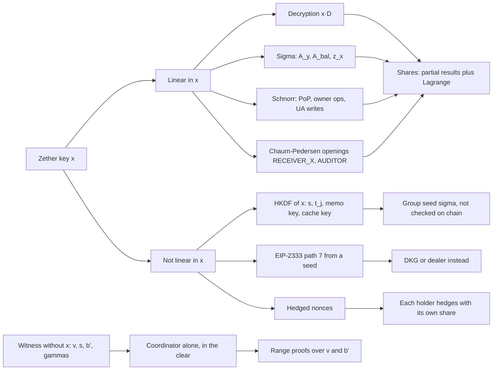
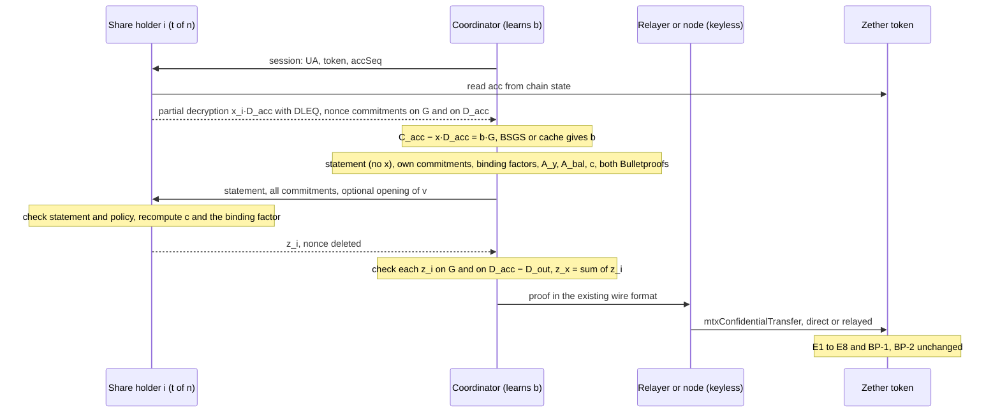

> **Research note — background and rationale only, not normative; the current rules are in docs/ (see decisions.md).**

> Vietnamese version: [zether-threshold-mpc.vi.md](zether-threshold-mpc.vi.md). This English file is the reference version.

# Threshold Zether: how far MPC can remove the single holder of `x` (2026-11)

Written 2026-11-06 at the owner's request. Research only: nothing here is a rule or a schedule. Everything cryptographic in
SCaaS is **UNAUDITED**, and so is every construction below. This note covers **classical Zether only** (lifted ElGamal and
Σ-Bullets on BLS12-381 G1, kind `0x0141` `zether-bls12381`). PQZ is a separate system; the survey
[pq-mpc-threshold.md](pq-mpc-threshold.md) covers both at a higher level and is the context for this note. It refines the
survey's row "Zether threshold spending: distributed Σ-Bullets prover, research, no": the analysis below finds that no general
collaborative prover is needed, because every use of `x` that a verifier sees is linear (§3, §5).

**Evidence tags.** [paper] peer-reviewed publication or a standards-body document (IETF RFC); [preprint] ePrint or arXiv,
not peer-reviewed; [vendor] a project's or company's own documentation, specification or blog (a Zcash ZIP, Penumbra docs);
[repo] read from this repository or a code repository; [inference] our reasoning or arithmetic, including the small script of
§5.8; [unverified] could not be checked. Sources: §10.

## 1. At a glance

| Topic | Finding | Evidence | Contract change | Recommendation |
|---|---|---|---|---|
| Where `x` enters | Decryption, the `x` lines of each Σ proof (`A_y`, `A_bal`, `z_x`), every Zether Schnorr and the `RECEIVER_X` / `AUDITOR` openings: all **linear** in `x`. Non-linear uses (HKDF of `x` for `s`, `t_j`, memo and cache keys, EIP-2333 path 7) are client-side and unchecked on chain | [repo] | — | §3 |
| (C) Threshold decryption | Shamir shares of `x`, partial decryptions `[x_i]D` with a DLEQ proof, Lagrange in the exponent, then the existing BSGS. One round. Textbook since 1989 | [paper] | none | build, with the auditor of CTR-ZTH-41 first |
| (D) Threshold proving | Only `z_x` and the `k_x` parts of `A_y`, `A_bal` need the shares: a FROST-style threshold Schnorr with nonces on two bases. The Bulletproofs hold no `x` and are built by one coordinator in the clear | [repo] [inference] | none | prototype now, cryptographic review before value |
| Does the joint proof verify unchanged? | **Yes.** Same statement, transcript, wire format and verifier; no new `proofSystemId`, no new on-chain vectors. A script on real BLS12-381 checks E1–E8 on a 3-of-5 joint proof | [inference] | none | add a forge test with a joint proof in the prototype |
| Balance privacy inside the quorum | Not achievable: whoever builds BP#2 needs `b'` in the clear, and a threshold decryption yields `[b]G`, whose small log anyone holding it can find. Only the coordinator must learn it | [inference] | — | choose who coordinates |
| PoP, owner ops, UA-ledger writes | FROST with a SCaaS Zether ciphersuite (as ua-rs's FROST-bn254 one) gives a plain Zether Schnorr; registry and tokens verify it unchanged. BLS threshold does not apply | [repo] [inference] | none | reuse frost-core |
| Auditor key (CTR-ZTH-41) | Threshold decryption of `C_aud_j` plus a threshold Chaum–Pedersen `AUDITOR` opening; both verify unchanged | [repo] [inference] | none | first deliverable |
| Viewing key `<use> = 8` | An independent ElGamal key from the same seed; it cannot read the account. Zether has no view / spend split: `x` does both | [repo] | — | do not present it as a viewing key of the account |
| msig on chain | For classical Zether **the proof alone spends** (CTR-UA-16): no on-chain `msig` gates a Zether spend today, unlike PQZ (CTR-PQZ-12). A threshold key is the only cryptographic quorum | [repo] | none for (D) | prefer (D) over a contract hook |
| Interim | A k-of-n backup of `x`, the twin of PQZ T16a: fixes loss, not the single holder | [repo] [inference] | none | reuse T16a's code once it lands |
| **Overall** | (C) is ready to build; (D) is feasible with no contract change and is mostly engineering plus one review | | **none** | (C) now with CTR-ZTH-29, (D) prototype next |

## 2. Today: one holder of `x`

**What `x` is.** A Zether account is the UA `keccak256(TAG_ZETHER_BLS12381 ‖ Y)` with `Y = [x]G`; "the Zether key is the UA,
with no authority record: the proof alone spends, every other write is a Schnorr signature by `x`"
([CTR-UA-16](../contracts/accounts.md#CTR-UA-16), owner ruling CTR-UA-30) [repo]. The same `x` also decrypts every balance,
seeds the per-transfer randomness `s` and `t_j` and the sender memo key ([CTR-ZTH-30](../contracts/zether.md#CTR-ZTH-30),
[CTR-ZTH-50](../contracts/zether.md#CTR-ZTH-50)), and keys the device balance cache (`HKDF(x, "scaas-zether-balance-cache-v1")`,
ua-rs facade on branch `ua-rs-sign`) [repo]. Wallets derive it on EIP-2333 path `m/12381/<coin>/<account>/7`
([CLI-SGN-10](../clients/signers-clientkeys.md#CLI-SGN-10)) [repo].

**No `msig` gate for classical Zether.** The premise "the `msig` authorises, the operator proves" is the PQZ model:
[CTR-PQZ-12](../contracts/pq-zero-knowledge.md#CTR-PQZ-12) makes the PQZ key an attribute of a PQ signing UA, and every PQZ
debit also carries `requireAuthorized(from, PURPOSE_ZETHER_AUTH, …)` [repo]. Classical Zether dropped its `authRef` in UA-6
(the migration table under [CTR-UA-22](../contracts/accounts.md#CTR-UA-22): "a threshold or multisig holder is an `msig` UA …
that owns its own funds"), and `zether-bls12381` is SIGNING, not MEMBER, so it cannot even be an `msig` member
([CTR-UA-14](../contracts/accounts.md#CTR-UA-14)) [repo]. A proof may also be submitted directly (`ZTX_V1_DIRECT`, binding 0),
bypassing any envelope an `msig` signed ([CTR-ZTH-34](../contracts/zether.md#direct-calls)) [repo]. So whoever holds `x` today:

1. **sees** every balance and every incoming amount;
2. **spends alone**: nothing on chain asks for a second party;
3. **is a single point of loss**: no key rotation ([CTR-UA-13](../contracts/accounts.md#CTR-UA-13)), no recovery path in the
   protocol (the older research row U1 of [03-zether-crypto.md](03-zether-crypto.md) already named "MPC custody, shard `x`" as
   the way out) [repo].

**What the docs already plan.** [CTR-ZTH-41](../contracts/zether.md#CTR-ZTH-41) (owner): the auditor key "should be a k-of-n
threshold key … `x_a` is split off chain by a DKG … No contract change; the prover / CLI protocol follows with
[CTR-ZTH-29](../contracts/zether.md#CTR-ZTH-29)" [repo]; [zether-disclosure.md](zether-disclosure.md) records it as "docs only: no
threshold decryption or threshold DLEQ protocol exists in the prover" [repo].
[CLI-SGN-32](../clients/signers-clientkeys.md#CLI-SGN-32) (owner, PLANNED): an auditor `y_audit` as a 3-of-5 threshold ElGamal
key, and B2B settlement with Zether using "`x` split Shamir 2-of-3, of which the platform holds **one share** — it cannot spend
alone" [repo]. That last property holds only if no party ever reassembles `x`, which is exactly (D) below.
[CLI-SGN-31](../clients/signers-clientkeys.md#CLI-SGN-31) (owner) narrows a key oracle to `zk_mul_by_x`, `zk_nonce_commit`,
`zk_response` and a chain-witnessed `elgamal_decrypt` [repo]; §8 shows these are exactly the per-share operations a threshold
group needs.

*Aside for the owner (not a finding of this note):* CLI-SGN-32 says "the memo key derives from `D^x`"; the current memo key is
`HKDF(seed_zether, …)` with `seed_zether = x` ([CTR-ZTH-50](../contracts/zether.md#CTR-ZTH-50)) and there is no AEAD memo
(CTR-ZTH-12). The phrase looks older than the rule [inference].

## 3. The secret surface

`B` below is `D_acc − D_out` on a transfer and `D_acc` on a burn. "Coordinator" is the one party that assembles a proof.

| # | Use of `x` | Formula (zether.md, zether-prover) | Linear in `x`? | With shares |
|---|---|---|---|---|
| 1 | Decryption, balance check | `[b]G = C − [x]D`, then BSGS ([CTR-ZTH-19](../contracts/zether.md#CTR-ZTH-19)) | yes (`[x]D`); the log is public work | partial `[x_i]D` + DLEQ, Lagrange (§4) |
| 2 | Public key, UA id | `Y = [x]G`, `UA = keccak256(TAG ‖ Y)` | yes | DKG output `Y = Σ C_i0` (§6) |
| 3 | Σ transfer, multi, burn | `A_y = [k_x]G`, `A_bal = [k_b]G + [k_x]B`, `z_x = k_x + c·x` (§8.1, §8.2, §11) | yes | two-base threshold Schnorr (§5) |
| 4 | Other Σ responses | `z_v, z_s, z_b, z_gv, z_gb, z_vj, z_tj` | no `x` | coordinator |
| 5 | Statement points | `C_out, D_out, C_deb = [v]G + [s]Y_f, C_aud` | no `x` (uses `Y_f`) | coordinator |
| 6 | Bulletproofs | `A, S, T1, T2, L_j, R_j, τ_x, μ, t̂, a, b` over `(v, γ_v)`, `(b', γ_b)` (§9) | no `x`; non-linear in `b'` (bits) | coordinator, in the clear (§5.4) |
| 7 | Fiat–Shamir | `c, y, z, x, w, u_j` from the keccak transcript (§5) | public hash | coordinator computes, holders recompute `c` |
| 8 | Schnorr: PoP, owner ops, UA-ledger writes | `R = [k]G`, `e = H(tag ‖ R ‖ Y ‖ msg)`, `z = k + e·x` (§13) | yes | FROST (§6) |
| 9 | `RECEIVER_X` / `AUDITOR` openings | DLEQ: `A1 = [k]G`, `A2 = [k]B`, `z = k + e·x` ([CTR-ZTH-40](../contracts/zether.md#CTR-ZTH-40)) | yes | two-base threshold Schnorr (§7) |
| 10 | `s`, `t_j`, memo key | `HKDF-SHA256(x, "ZTX/s/v2" ‖ …)` etc. ([CTR-ZTH-30](../contracts/zether.md#CTR-ZTH-30), [CTR-ZTH-50](../contracts/zether.md#CTR-ZTH-50)) | **no** | a group seed `σ` in its place; the contract never checks how `s` was made |
| 11 | Balance-cache key | `HKDF(x, "scaas-zether-balance-cache-v1")` | **no** | each member's own key, or `σ` |
| 12 | Hedged nonces | `k = SHA-512("ZETHER-NONCE-v1" ‖ secrets ‖ rng32 ‖ i) mod r` (`nonce.rs`) | **no**, local | each holder hedges with its own share; never deterministic (§5.7) |
| 13 | Key derivation | EIP-2333 `m/12381/<coin>/<account>/7` from a BIP-39 seed | **no** | impossible for a group key: DKG or a dealer (§6) |

**Reading the table.** Every on-chain check that involves `x` sees it only through rows 1, 3, 8 and 9, each of the form
"a point times `x`" or "`k + c·x`". Both are linear, so Shamir shares and Lagrange coefficients carry them with no MPC beyond
addition. Rows 10–13 are non-linear but never reach a verifier; they need a different secret, not a protocol. Rows 4–7 hold
no `x` at all. This is the central result: **classical Zether needs no generic MPC to be threshold** [inference].

## 4. (C) Threshold decryption and viewing

### 4.1 Construction

1. **Key.** `x` is Shamir-shared t-of-n: holder `i` keeps `x_i = f(i)` with `f(0) = x`, and everyone knows the verification
   shares `Y_i = [x_i]G`. A **DKG** produces this with no party ever holding `x`: Pedersen's protocol (Feldman commitments,
   each dealer's constant term summed) [paper], hardened by Gennaro, Jarecki, Krawczyk and Rabin against key bias [paper]; plain
   Pedersen DKG still suffices for threshold Schnorr signatures [paper] (we assume the same for ElGamal decryption
   [inference]), and FROST's key generation, Pedersen's DKG with proofs of possession ("PedPoP"), has a security proof in the
   FROST setting by Bellare, Crites, Komlo, Maller, Tessaro and Zhu [paper]. A **dealer** (generate, split, delete) is simpler
   and fits a key set up by one organisation. Either way the result is one ordinary key `Y` [inference].
2. **Partial decryption.** For a ciphertext `(C, D)` read from chain state, holder `i` returns `P_i = [x_i]D` with a
   Chaum–Pedersen proof `log_G Y_i = log_D P_i` [paper] — the same DLEQ `ZetherDisclosure` already checks
   ([CTR-ZTH-40](../contracts/zether.md#CTR-ZTH-40)) [repo].
3. **Combine.** For any t valid shares `S`: `[x]D = Σ_{i∈S} λ_i P_i` (Lagrange coefficients at 0), `[b]G = C − [x]D`, then
   the existing client BSGS or, with a balance cache, the one-point check `[b]G == C − [x]D`
   ([CTR-ZTH-19](../contracts/zether.md#CTR-ZTH-19)) [repo]. A bad share fails its DLEQ and names its holder (robustness with
   t honest responders) [paper].

### 4.2 Who learns the balance

The **combiner** learns `[b]G` and so `b` (balances are `≤ 2^54`, [CTR-ZTH-26](../contracts/zether.md#CTR-ZTH-26)). It can be
the requesting member's own device (each holder encrypts its `P_i` to the requester), or every member at once: the shares and
their DLEQ proofs can be broadcast, and each member verifies and combines for itself. No holder learns `b` from its own share
[inference]. Compared with Zcash, Penumbra and Monero (§5.5), where each participant holds a full viewing key, a t-of-n Zether
group is stricter: viewing needs t holders every time [inference].

### 4.3 The one rule: decrypt only chain state

A holder must never answer for a caller-chosen `D`, only for `acc` / `pending` of the group's UA or a stored leg
(`transferEntry`), read by the holder itself or proven with the `ChainWitness` of
[CLI-SGN-31](../clients/signers-clientkeys.md#CLI-SGN-31) [repo]. Two reasons:

- **Policy.** Any ciphertext under `Y` decrypts the same way; an open service would decrypt whatever is handed to it.
- **Static Diffie–Hellman.** An oracle `P ↦ [x]P` lets an attacker build `[x^d]G` by feeding outputs back, and Cheon's
  algorithm then finds `x` in about `√(r/d) + √d` group operations when `d | r − 1` [paper]. For BLS12-381,
  `r − 1 = 2^32 · 3 · 11 · 19 · 10177 · 125527 · 859267 · 906349^2 · 2508409 · 2529403 · 52437899 · 254760293^2`, fully smooth,
  while `r + 1` has a 225-bit cofactor [inference, sympy]. With `d` near 2^30 queries the cost falls from about 2^127.4 to
  about 2^112.4 [inference]. Not a break, but a measurable loss that the chain-state rule removes: every `D` on chain is a sum
  of points whose logs their creators proved they know (E2 for `D_out = [s]G`, E6′ for `D_aud_j = [t_j]G`; a shield leaves `D`
  unchanged). The powers `[x^i]G` that Cheon's attack must feed back can never become chain state, and an answer `[x]D` tells
  the creator of `D = [s]G` only `[s]Y`, which it could compute already [inference].

### 4.4 Cost and rounds

| Item | Per holder | Combiner |
|---|---|---|
| Rounds | 1 (request, answer) | — |
| Group work | 3 scalar multiplications (`P_i`, `A1`, `A2`) | t DLEQ checks (4 each), one t-term MSM, then BSGS or the cache check |
| Bytes out | `P_i` 128 B + DLEQ 288 B = **416 B** per ciphertext | — |
| Frequency | one `acc` per `accSeq`, one per `pending` read or credit | BSGS dominates (seconds to minutes at 2^54, [CTR-ZTH-19](../contracts/zether.md#CTR-ZTH-19)); the cache avoids it |

[inference; point and scalar sizes from zether.md §3]. No timing was measured.

### 4.5 Precedents

Threshold ElGamal is the textbook threshold cryptosystem: Desmedt–Frankel (1989), Pedersen (1991), and Shoup–Gennaro's TDH1 /
TDH2, whose every decryption share carries a non-interactive proof that it is a Diffie–Hellman triple (a DLEQ) [paper]. In
public specification or production:

- **ElectionGuard 2.0**: guardians compute partial decryptions and then **one joint Chaum–Pedersen proof**: each guardian
  commits `(g^{u_i}, A^{u_i})`, the commitments are multiplied, one challenge `c` is hashed, guardian `i` answers with the
  Lagrange-weighted `c_i = c·w_i`, each answer is checked on its own, and the record publishes the combined `(c, v = Σ v_i)`
  (spec §3.6.3) [vendor]. This is the two-base pattern §5 and §7 use.
- **Helios at the IACR** ran **n-of-n** trustees. In November 2025 one trustee lost their private key, the election was voided,
  and the IACR announced a 2-of-3 threshold [vendor]: the loss risk of §2, item 3, in practice.
- **Penumbra** specified threshold ElGamal "flow encryption" with a DKG but did not ship it in V1 [vendor].
- **Ferveo** (Bebel, Ojha) [preprint], implemented on arkworks BLS12-381 and used by Threshold Network's TACo [repo], and
  **Shutter**'s encrypted mempool on Gnosis Chain (first mainnet use, opt-in beta, November 2024) [vendor] run DKG-based
  threshold decryption on BLS12-381, pairing-based rather than ElGamal on G1, with the same kind of key generation.
- **drand** runs Pedersen's DKG on BLS12-381 for its threshold BLS beacon, in production since 2020 [vendor].

Library: ZF `frost-core`'s DKG, already a dependency of ua-rs on `ua-rs-sign` [repo]. URLs: §10.

### 4.6 Contract impact

None. `Y` (or `Y_a`) stays one public key; ciphertexts, statements and disclosure are unchanged [repo].

## 5. (D) Threshold proving and spending

### 5.1 What the verifier needs from `x`

E1 `[z_x]G − [c]Y_f − A_y` and E5 `[z_b + c·fee]G + [z_x]D_acc − [z_x]D_out − [c]C_acc + [c]C_deb − A_bal` are the only
equations that involve `x`, through `z_x` ([§8.1](../contracts/zether.md#81-transfer); the burn and the multi-recipient form
have the same E1 and E5, the burn with `B = D_acc`) [repo]. With `A_y = [k_x]G` and the `k_x` part of `A_bal` being `[k_x]B`, the pair (E1, E5) is a
Chaum–Pedersen proof on bases `G` and `B` with one response `z_x`, folded into the larger Σ through `k_b` and `z_b`
[inference]. Threshold Schnorr (FROST, RFC 9591) handles one base [paper]; the same algebra handles two, as ElectionGuard's
joint decryption proof shows (§4.5) [vendor] [inference].

### 5.2 The protocol

Holders `S` (t of n) and one **coordinator**, who may itself be a holder:

1. **Round 1 (preprocessable per `accSeq`).** Each holder reads `acc` itself and sends its decryption share `[x_i]D_acc` with
   its DLEQ, and two fresh nonces `d_i`, `e_i`, each committed on both bases: `(D_i, E_i) = ([d_i]G, [e_i]G)` and
   `(D'_i, E'_i) = ([d_i]D_acc, [e_i]D_acc)`.
2. **Coordinator.** Combines `[b]G`, finds `b` (BSGS or cache), takes `v` and the token's `fee`, sets `b' = b − v − fee`, draws `s` (from `σ`, §5.6),
   `γ_v`, `γ_b`, builds the statement exactly as today (it holds no `x`), and fixes its own commitments
   `V_v, V_b, A_D, A_out, A_deb, A_aud, A_Vv, A_Vb` and `K_b = [k_b]G`.
3. **Binding factors.** `ρ_i = H("…TSIGMA-RHO" ‖ i ‖ statement ‖ coordinator commitments ‖ all holders' nonce pairs)`, a
   hash separate from the Zether transcript. Effective nonce of holder `i`: `R_i = D_i + [ρ_i]E_i` on `G`, and on `B`:
   `R'_i = D'_i + [ρ_i]E'_i − [s]R_i` (since `D_out = [s]G`, the coordinator derives the `D_out` part itself).
4. **Aggregate and challenge.** `A_y = Σ R_i`, `A_bal = K_b + Σ R'_i`; absorb into the **existing** transcript exactly as a
   single prover does; `c = T.challenge("sigma.c")`; build both Bulletproofs from the same transcript (they need `v`, `b'`, the
   `γ`s, nothing of `x`).
5. **Round 2.** The coordinator sends the statement, every commitment, and optionally an opening `(v, s)` of `C_out`. Each holder
   checks the statement (it can rebuild it from chain through `ZetherStatements`,
   [CTR-ZTH-46](../contracts/zether.md#CTR-ZTH-46)) and its policy, recomputes `ρ_i` and `c` itself, and answers **once**:
   `z_i = d_i + ρ_i·e_i + λ_i·c·x_i`, then deletes `d_i, e_i`.
6. **Assemble.** For each holder: `[z_i]G == R_i + [λ_i·c]Y_i` and `[z_i]B == R'_i + [λ_i·c]([x_i]D_acc − [s]Y_i)`; the term
   `[x_i]D_acc` is the round-1 decryption share, so both bases are checkable and a failure names the holder (identifiable abort).
   `z_x = Σ z_i`; the coordinator computes the other responses itself. The proof bytes are the single-prover format.

Signatures and openings (§6, §7) are the same steps with one base (Schnorr) or the bases `G`, `D_aud_j` / `D_out` (openings) and
no Bulletproofs.

### 5.3 Joint Fiat–Shamir

The Zether transcript is a keccak chain over public bytes: `init`, `absorb("statement")`, `absorb("sigma.commit")`, then the
Σ challenge and the Bulletproof challenges `y, z, x, w, u_j` ([§5](../contracts/zether.md#5-hash-to-scalar-and-the-fiat-shamir-transcript))
[repo]. In the joint protocol the coordinator runs it unchanged on the aggregate commitments, and every holder recomputes `c` from
the same bytes before answering, so no holder signs a challenge it has not derived itself [inference]. No `z_*` is absorbed, so
the coordinator may finish the Bulletproofs before or after the responses arrive [repo]. The only new hash is the binding factor,
which never touches the Zether transcript: it is client-protocol material with its own vectors, not an on-chain change
[inference].

### 5.4 The Bulletproofs, and balance privacy inside the quorum

The range proofs prove `v` and `b'` in `[0, 2^64)` over `V_v = [v]G + [γ_v]Hb` and `V_b = [b']G + [γ_b]Hb`; their witness is
`(v, γ_v)`, `(b', γ_b)` and the bit vectors `a_L` of those values ([§9](../contracts/zether.md#9-bulletproofs--exactly-two-range-statements))
[repo]. They hold no `x`. Could `b'` stay secret-shared, so that no single party learns the balance?

- The Bulletproofs paper's "simple MPC protocol" (§4.5) lets m parties, **each holding its own value**, build one aggregated
  range proof through a dealer, secure against honest-but-curious parties only; the paper leaves "an efficient MPC protocol for
  more complicated circuits" open [paper]. dalek's `bulletproofs` crate implements it (`range_proof_mpc`) [repo]. It is not a
  threshold protocol: no value is shared.
- Collaborative proving over a **shared** witness: Ozdemir–Boneh analyse Groth16, Plonk, Marlin and Fractal and implement the
  first three; they note that the distributed Bulletproofs above define no collaborative security and assume honest-but-curious
  parties [paper]. zkSaaS covers Groth16 and Plonk [preprint]. One preprint does make Bulletproofs collaborative over a witness
  distributed among provers: Alghazwi, Bontekoe, Visscher and Turkmen, "Collaborative CP-NIZKs" (Groth16 and Bulletproofs)
  [preprint].
- That would solve the range proof, not the input. A shared `b'` needs a shared `b`, and the only source of `b` is a
  decryption, which yields `[b]G`; turning it into a shared integer means a discrete logarithm of up to 54 bits inside MPC, far
  beyond any practical protocol [inference].

**Answer.** `b'` must be known in the clear to the coordinator, and to nobody else: holders answer with `z_i` and never need `v`
or `b'` unless their policy asks for `v` (they can check an opening). Hiding the balance from **every** party is not achievable at
reasonable cost in Zether [inference]. The choice is **who coordinates**: a member's device, the platform if it holds a share
(CLI-SGN-32), or an enclave of [CLI-SGN-31](../clients/signers-clientkeys.md#CLI-SGN-31) [repo].

### 5.5 Precedents for "threshold spend, coordinator sees amounts"

The same split is standard where the spend authority and the viewing material are separate keys:

- **Zcash ZIP 312** splits only the spend authorization key `ask` among FROST signers (re-randomized FROST, Gouvea–Komlo
  [preprint]); "the proof generation will still be performed by a single participant", and "all key share holders are also
  trusted with the privacy of the transaction" [vendor].
- **Penumbra threshold custody** (`pcli init threshold`, by a dealer or a DKG; FROST over decaf377 in the `decaf377-frost`
  crate) gives every party "full viewing authority" and splits the spend authority [vendor] [repo].
- **Monero multisig**: "every participant ends up knowing the public address and private view key"; most of a transaction,
  including its range proof, is built by whoever initiated it, and only the signatures need collaboration [vendor].

Zether has a single key for both roles, but because the `x`-dependent part of its proof is linear, it can follow the same
pattern without a second key, and viewing still needs t holders (§4.2) [inference]. URLs: §10.

### 5.6 What changes on the client

- **`s`, `t_j` and the memo key.** These are `HKDF(seed_zether, …)` with `seed_zether = x` today (a controller ruling pending the
  owner, [CTR-ZTH-30](../contracts/zether.md#CTR-ZTH-30)) [repo]. A group has no `x` to hash. The contract never checks how `s`
  or `t_j` were chosen and reads the memo only for its length and salt [repo], so a **group seed `σ`** (32 random bytes made at
  key setup and sealed to every holder) can take the place of `x` in the same HKDF formulas with no on-chain change. Whoever
  holds `σ` can open the group's **outgoing** transfers (`SENDER_S`, `SENDER_CP`) and rebuild them from storage
  ([CTR-ZTH-50](../contracts/zether.md#CTR-ZTH-50)), without the shares [inference].
- **The prover API.** `prove_*_core` computes `z_x = k_x + c·x` inside; a threshold build needs it split into "commitments with
  external `A_y`, `A_bal` parts → `c` and the Bulletproofs" and "insert `z_x`" [repo, `zether.rs`] [inference].
- **Roll-over mode.** A public `mtxRollOver` changes `acc` and `accSeq`, which voids the round-1 shares and nonces and refuses the
  proof as `StaleAccSeq` ([rollover](../contracts/zether.md#rollover)) [repo]. Threshold sessions take longer than one device's
  proof, so a group account is better in `OWNER_ONLY`, where each roll-over is one threshold Schnorr
  ([CTR-ZTH-16](../contracts/zether.md#CTR-ZTH-16)) [inference]. Expiry: a `validUntilBlock` that covers the rounds
  ([expiry](../contracts/zether.md#valid-until)).

### 5.7 Pitfalls

| Pitfall | What goes wrong | Guard |
|---|---|---|
| ROS / concurrent sessions | Two-round Schnorr schemes with one nonce per party have no security proof (Drijvers et al.) and fall in polynomial time once more than about `log p` sessions run concurrently (the ROS attack) [paper] | FROST's two nonces and binding factors; here `ρ_i` must hash **every** input of `c` other than the holders' nonces: the statement and all the coordinator's commitments, including `K_b`. A coordinator that can vary any free input of `c` without changing `ρ_i` reopens the attack [inference] |
| Nonce reuse | Two answers with one nonce and two challenges give `x_i` | nonces from a fresh RNG, stored, used once, deleted on use or abort (the remove-not-get rule of CLI-SGN-31) [repo] |
| Deterministic nonces | Fine for one signer, unsafe for several: a coordinator replays one message with different co-signer commitments and gets two answers on one nonce (MuSig-DN explains this) [paper] | never derive the round-1 nonce from `(share, message)` alone; the prover's hedged `Nonces` (which degrades to deterministic on a dead RNG) must not be reused as is [repo] [inference] |
| Biased nonces | A few biased bits per nonce leak the key by lattice reduction (Breitner–Heninger) [paper] | full-width nonces reduced from 512 bits, as `hashToScalar` and `Nonces` already do [repo] |
| Quorum change mid-session | A nonce answered under two Lagrange sets leaks the share | a session is bound to its set `S`; any change restarts with new nonces [inference] |
| Abort | A silent holder stalls the session | discard all nonces, restart with another quorum; never re-answer an old session [inference] |
| Identifiable abort | A bad `z_i` breaks E1 or E5 without saying who | check every `z_i` on both bases (step 6); authenticate holder messages with each holder's own UA key so blame is attributable [inference] |
| Subgroup | BLS12-381 G1 has a cofactor: a low-order component in a share or commitment can survive Lagrange sums | subgroup-check every received point (the off-EVM warning of [§9.1](../contracts/zether.md#merged-check)) [repo] |
| Side channels | Shares are multiplied on arkworks curves | `scaas-ct` `secret_mul` (ua-rs-sign §12) for every `x_i`, `d_i`, `e_i` multiplication [repo] |
| Old shares | After resharing, t old holders can still rebuild `x` | erase old shares; prefer a new UA for a membership change until resharing is reviewed (§8.3) [inference] |

### 5.8 Does the joint proof verify unchanged?

**Yes, by construction** [inference]: the verifier reads `A_y`, `A_bal` and `z_x` as numbers and checks equations that a
correctly aggregated proof satisfies; the statement, the transcript, the proof bytes and the `proofSystemId` are those of a
single prover. Consequences: **no contract change, no new `proofSystemId`, no new on-chain vectors**; the zero-knowledge
property holds as long as one honest holder's nonce is uniform. New vectors are needed only for the client protocol (the
ciphersuite, the binding factor, the share formats).

**Check.** A short Python script (py_ecc, real BLS12-381 G1, the zether.md §5 transcript and `hashToScalar`; kept in a private
scratchpad, not committed) runs a Pedersen-style 3-of-5 DKG, a threshold decryption of `acc` with DLEQ shares, the joint Σ of a
single-recipient audited transfer as in §5.2, a threshold Zether Schnorr and a threshold `AUDITOR` opening, and checks E1–E8 as
written in §8.1 [inference]. Results:

| Case | E1–E8 | Holders blamed by step 6 |
|---|---|---|
| 3 of 5 answer | all hold | none |
| only 2 of the 3 needed answer | E1, E5 fail | none (each share is valid; the set is too small) |
| holder 3 adds 1 to `z_i` | E1, E5 fail | holder 3 |
| holder 4 uses another nonce on `D_acc` | E5 fails | holder 4 |
| threshold Schnorr, threshold `AUDITOR` opening | verify | — |

The script does not build Bulletproofs (no `x` in them) and uses a random `Hb`, not the NUMS generator; it is an algebra check,
not a test of the Rust prover or the Solidity verifier. The prototype should add a forge test that feeds a jointly produced
proof to the real verifier.

### 5.9 Rounds and communication

Single-recipient transfer, t = 3, BLS12-381 (point 128 B, scalar 32 B) [inference]:

| Message | Size | Note |
|---|---|---|
| Round 1, holder → coordinator | 128 + 288 + 4 · 128 = **928 B** | decryption share, DLEQ, two nonces on two bases; preprocessable per `accSeq` |
| Round 2, coordinator → holder | statement 1,664 + own commitments 9 · 128 + list 3 · 516 + opening 64 ≈ **4.4 KB** | the holder may rebuild the statement from chain instead |
| Round 2, holder → coordinator | **32 B** | `z_i` |
| Per spend, all holders | ≈ **16 KB** | 2 rounds; 1 online round with preprocessing |
| Holder computation | ≤ 10 scalar multiplications | coordinator: t DLEQ checks, 2t share checks, BSGS or cache, both Bulletproofs as today |

A multi-recipient transfer adds `4 · 128` statement bytes and five coordinator commitments per leg; the holders' part does not
grow. A Schnorr (PoP, owner op) is plain FROST: about 0.3 KB out and 1 KB in per holder [inference].

## 6. Registration, PoP and signatures with a shared `x`

- **Key.** A DKG (or a dealer) gives `Y`; the UA is `keccak256(TAG_ZETHER_BLS12381 ‖ Y)` as for any key. A group key is not
  derivable from anyone's seed (row 13). An existing single-key UA cannot become a group UA: no rotation
  ([CTR-UA-13](../contracts/accounts.md#CTR-UA-13)), so the path is a new group UA and a confidential transfer from the old one,
  signed by the old holder [repo].
- **PoP.** `register(0x0141, Y, attrs0, pop, "")` takes a Zether Schnorr over
  `uaMessage(0x0141, PURPOSE_POP_V2, typed registration)`, portable and relayable by anyone
  ([CTR-UA-07](../contracts/accounts.md#CTR-UA-07), [registry](../contracts/zether.md#registry)) [repo]. A FROST signature by the
  group over that message is an ordinary Zether Schnorr: `ZetherSchnorrBls12381Verifier` cannot tell it from one signer's. The DKG's
  own proofs of knowledge stop rogue keys inside the group; the registry's PoP does the rest [inference].
- **Owner ops and UA-ledger writes.** `mtxRollOverSigned`, `mtxSetRollOverMode` and every `ua*` write of the group UA are the
  same Schnorr under their purposes (`zether-owner`, `metatx`, …), so FROST covers them unchanged [repo] [inference].
- **Ciphersuite.** ua-rs on `ua-rs-sign` already defines `FROST(bn254, keccak256)` whose `H2` is the SCaaS Schnorr challenge, so
  its output verifies as `schnorr-bn254` (`frost.rs`) [repo]. A `FROST(BLS12-381-G1, keccak256)` for Zether is the same pattern:
  128-byte EIP-2537 elements, `H2(m) = hashToScalar(keccak256("SCAAS-ZETHER-SCHNORR-V1" ‖ m))` with `m = R ‖ Y ‖ msg32`, and a
  **subgroup check in `deserialize`** (bn254 G1 has cofactor 1, BLS12-381 G1 does not) [inference]. frost-core's DKG then gives
  the key shares for every use in this note [repo].
- **BLS threshold: not applicable.** The Zether secret must never be a BLS key on the same curve (publishing `[x]G2` makes DDH on
  G1 decidable; a wallet rule, [registry](../contracts/zether.md#registry)) [repo], so there is no BLS signature by `x` to make
  threshold.
- **What the chain sees.** One `Y`, one Schnorr, one proof: a group UA is indistinguishable from a single holder's, and the
  quorum is not public (unlike an `msig`, which shows its members and pays per signature) [inference].

## 7. Auditor and viewing keys

**The threshold auditor (CTR-ZTH-41).** The owner rule asks for `Y_a` to stay one key with `x_a` split by a DKG, "so decrypting or an
`AUDITOR` opening needs k parties (FULL and OPTIONAL tokens)" [repo]. Both parts are covered:

- reading leg `j`: threshold decryption (§4) of `(C_aud_j, D_aud_j)`; the leg's own `t_j` keeps legs apart
  ([CTR-ZTH-30](../contracts/zether.md#CTR-ZTH-30)) [repo];
- proving it: the `AUDITOR` opening is the DLEQ `log_G Y_a == log_{D_aud_j}(C_aud_j − [v]G)` with challenge
  `e = H("SCAAS-ZETHER-DISCLOSE-V2" ‖ … ‖ G ‖ K ‖ B ‖ M ‖ A1 ‖ A2)` ([CTR-ZTH-40](../contracts/zether.md#CTR-ZTH-40)) [repo]; with
  two-base FROST nonces on `G` and `D_aud_j` the group produces `(A1, A2, z)` that `ZetherDisclosure.verifyTransferAmount`
  accepts unchanged (checked by the script of §5.8) [inference]. The view stays free and nothing is attested on chain
  ([CTR-ZTH-39](../contracts/zether.md#CTR-ZTH-39)) [repo].

The auditor of a FULL token can rebuild exact balances by bookkeeping ([zether-disclosure.md](zether-disclosure.md) R2) [repo]; a
threshold auditor keeps that power but needs k members to use it [inference]. The disclosure CLI
([CTR-ZTH-29](../contracts/zether.md#CTR-ZTH-29)) verifies a threshold opening exactly like a single one.

**The `<use> = 8` key.** zether-prover's `USE_DISCLOSURE = 8`, exposed by the ua-rs facade as `USE_VIEWING`, derives a second,
**independent** scalar on `m/12381/<coin>/<account>/8` [repo]. Balances are encrypted under `Y = [x]G` of path 7, so the path-8
key cannot read them; it is a natural candidate for an auditor key or a disclosure key, nothing more [inference]. Zether has no
view-only key for an account: decrypting and proving use the same `x`. The only view-only capabilities are (a) the threshold
decryption of §4, where holders hand out `[x]D` for chain-state `D` without handing out `x`, and (b) per-transfer openings.

**Does per-member viewing through openings avoid threshold decryption?** Partly [inference]:

| What a member wants to see | Without the shares | Needs the shares |
|---|---|---|
| Outgoing amounts | yes, with `σ`: `SENDER_S` / `SENDER_CP` and the memo (§5.6) | — |
| Shields | yes: public amounts | — |
| Incoming amounts | only if each sender hands over an opening | `RECEIVER_X` is a DLEQ in `x` (threshold, as the auditor's), or a threshold decryption of each credit |
| The balance | only by bookkeeping all of the above | one threshold decryption of `acc` per `accSeq`, broadcast with its DLEQ shares so every member verifies (§4.2) |

So openings cover the group's own spending; anything that arrives encrypted to the group needs t holders once. Broadcasting one
verified decryption per `accSeq` gives every member the balance at the cost of one round [inference].

## 8. Integration with SCaaS

### 8.1 Where it would live

- **`clients/zether-prover`**: the split prover API (§5.6), the coordinator assembly, the holder steps (partial decryption with
  DLEQ, two-base nonce commitments, response), the threshold `AUDITOR` / `RECEIVER_X` openings, and a forge test with a jointly
  produced proof [inference].
- **ua-rs facade** (`ua-rs-sign`): a share handle in the wallet arena next to today's `ZetherKey` handle, `secret_mul` from
  `scaas-ct` for share multiplications, the FROST machinery of T3c with the Zether ciphersuite of §6, and the sealed container
  (T8 / T9) to deliver shares and `σ` to members' own single-key UA KEM keys, as T16a does for PQZ seeds [repo] [inference].
- **The key oracle** ([CLI-SGN-31](../clients/signers-clientkeys.md#CLI-SGN-31)) maps one to one: `zk_mul_by_x` → the partial
  decryption with its DLEQ; `zk_nonce_commit(bases)` → two nonces on `G` and `D_acc`; `zk_response(nonce_id, challenge)` →
  `z_i`, with the binding factor and `λ_i` added; its single-use rule stays. A t-of-n group of such oracles is the CLI-SGN-32
  2-of-3 without anyone reassembling `x` [inference].
- **The node** stays keyless and unchanged: it never sees a share, a nonce or a session; the finished proof is an ordinary job,
  direct or relayed ([decisions.md](../decisions.md) on relayer blindness) [repo]. The holders' session transport is outside the
  node.

### 8.2 `msig` governance and a group UA

On chain, an `msig` cannot gate a classical Zether spend (§2). Three ways to combine them [inference]:

1. **The threshold group is the quorum (recommended).** t-of-n holders of `x` shares are the spend authority; the contract
   enforces it by verifying a proof that only t holders together can make. The group's `msig` (if any) keeps its own public
   funds and identity.
2. **Holder policy on the envelope.** Holders answer only for a statement whose `envelopeBinding` is a UA envelope signed by the
   organisation's `msig` (`uaExecute` / named entries, [CTR-ZTH-34](../contracts/zether.md#direct-calls)) [repo]. The chain then
   shows the `msig` signature on every relayed spend, but a DIRECT proof by t colluding holders still passes: this is an extra
   off-chain check, never the guard.
3. **An on-chain hook** (a Zether `authRef` naming an `msig`, removed in UA-6): a contract and registry change for little gain
   over option 1; not recommended.

### 8.3 Membership changes

A group UA can keep its `Y` across a membership change by **resharing** (proactive secret sharing; dynamic committees as in
CHURP) [paper], which an `msig` cannot do (a membership change is a new UA there, [CTR-UA-13](../contracts/accounts.md#CTR-UA-13))
[repo]. The catch: t holders of the **old** sharing who kept their shares can still rebuild `x`. Until resharing has its own
review, a new group UA plus one transfer is the clean path [inference].

### 8.4 Compared with today and with the PQZ backup

| | Today: one holder | (A′) k-of-n backup of `x` | (C) only | (D) with (C) | PQZ today (CTR-PQZ-12 + T16a) |
|---|---|---|---|---|---|
| Who can read the balance | the holder | the holder (and any k members who rebuild) | t holders together | the session's coordinator, or t holders | the operator |
| Who can spend alone | the holder | the holder | the holder of `x` (a prover still needs it) | **nobody**: t holders | nobody (`msig` signs on chain), but only the operator can prove |
| Loss of a holder | balance stuck | k members rebuild `x`, one becomes holder | as today for the prover's `x` | up to n − t shares lost, no effect | T16a rebuild |
| Member change | new UA, transfer | new UA, transfer | resharing or new key | resharing or new UA (§8.3) | new UA, transfer |
| Contract change | — | none | none | none | none |
| Client work | built | small: T16a's code with `x` as the secret | medium | medium, plus a review | T16a planned |

(A′) shares the 32-byte `x` itself, never the BIP-39 entropy; the share header binds `(UA, k, n, index)` and a rebuild is accepted
only if `[x]G == keyOf(UA)`, the Zether twin of T16a's `pqzKeyHash` check [repo] [inference]. Like T16a, it removes the loss
risk, not the single holder. (C) alone helps only a key that never proves, which is why the auditor comes first; for an account
key it must come with (D).

## 9. Verdict and roadmap

| | (C) threshold decryption | (D) threshold proving |
|---|---|---|
| Build now? | **Yes**: threshold ElGamal with DLEQ is decades old | **Yes, as a prototype**: every step is linear; no library does the two-base Zether Σ |
| Needs research | none for the scheme; the chain-state rule is a design point | a written security argument for FROST with an extended message and two-base nonces, then an outside review; hiding `b` from every party is research and not recommended |
| Contract impact | none | none (same verifier, transcript, `proofSystemId`, on-chain vectors) |
| Client rule changes | the chain-state-only rule | `s`, `t_j` and memo key from `σ` for group UAs (CTR-ZTH-30 / -50 wording); `OWNER_ONLY` roll-over advised |
| Prototype estimate | **4–7 agent-days**: Zether FROST ciphersuite and DKG 1–2, decryption shares and combine 1–2, threshold `AUDITOR` opening 1, tests with negative controls and vectors 1–2 | **7–10 agent-days** on top of (C): prover split 1–2, two-base sessions for single, multi and burn 2–3, PoP and owner ops via FROST 1, `σ` derivation and recovery 1, native and forge verification of joint proofs 1–2, mutants 1 |
| First target | the CTR-ZTH-41 auditor, delivered with the CTR-ZTH-29 CLI | the CLI-SGN-32 B2B 2-of-3 account |

Estimates are [inference] for an agent working in this repository, excluding the outside review. The (A′) backup is about 1–2
agent-days once T16a has landed.

**Suggested order** [inference]: (A′) with or after T16a → (C) for the auditor with CTR-ZTH-29 → (D) prototype → review → any use
with value. Scheduling is the owner's.

### Open questions for the owner

**Owner 2026-11-06:** answered as recommended, as a research direction only. Nothing is scheduled, specified or built; no
plan task or contract change follows from this note until the owner asks.

1. **Should an organisation's Zether account be a threshold group (D) rather than one holder?** *Recommendation:* yes for
   organisation accounts; it is the only way a classical Zether spend can need more than one party, and CLI-SGN-32's 2-of-3
   already assumes it.
2. **The group seed `σ` for `s`, `t_j` and the memo key.** Seal `σ` to every holder, so any holder can open and rebuild the group's
   outgoing transfers? *Recommendation:* yes; extend the CTR-ZTH-30 / CTR-ZTH-50 wording to "`x`, or `σ` for a group key" (an
   owner ruling, since `seed_zether = x` is a pending controller ruling).
3. **Who coordinates and so learns the balance?** *Recommendation:* the initiating member's device by default; the platform only
   where it holds a share (CLI-SGN-32); never the node.
4. **Interim (A′): a k-of-n backup of a single holder's `x`, as T16a for PQZ?** *Recommendation:* yes, after T16a, same code,
   warning not refusal as T16a.
5. **An on-chain `msig` gate for Zether spends?** *Recommendation:* no contract change; the threshold key is the gate, and an
   envelope policy (§8.2 option 2) can add an on-chain `msig` trace for relayed spends.
6. **DKG or dealer?** *Recommendation:* DKG (frost-core's) for groups of independent parties such as company, audit firm and
   regulator; a dealer only where one organisation sets up and then destroys the key.
7. **Membership change: resharing or a new UA?** *Recommendation:* a new UA and one transfer until resharing has been reviewed.
8. **Roll-over mode for group accounts.** *Recommendation:* `OWNER_ONLY` by default (one threshold Schnorr per roll-over).
9. **Review before value.** *Recommendation:* an outside cryptographic review of the two-base threshold Σ and of the binding
   factor before mainnet 22776 or any customer use; it is UNAUDITED until then.
10. **CLI-SGN-32 wording** ("the memo key derives from `D^x`", §2 aside). *Recommendation:* correct it in a docs pass; not part of
    this note.

## 10. Sources

Repository [repo]: [zether.md](../contracts/zether.md) (§3, §5, §8, §9, §9.1, §13, CTR-ZTH-16/19/26/29/30/34/39/40/41/46/50),
[accounts.md](../contracts/accounts.md) (CTR-UA-07/13/14/16/22), [pq-zero-knowledge.md](../contracts/pq-zero-knowledge.md)
(CTR-PQZ-12), [signers-clientkeys.md](../clients/signers-clientkeys.md) (CLI-SGN-10/31/32), [zether-disclosure.md](zether-disclosure.md),
[03-zether-crypto.md](03-zether-crypto.md) (U1), [pq-mpc-threshold.md](pq-mpc-threshold.md);
`clients/zether-prover/src/{zether.rs,bulletproofs.rs,nonce.rs,keys.rs,schnorr.rs,api.rs}`;
`smartcontracts/evm/src/zether/{ZetherTranscript.sol,ZetherLib.sol,ZetherLayer.sol}`; branch `ua-rs-sign`:
`clients/ua-rs/src/{frost.rs,facade/zether.rs}`, `clients/scaas-ct/src/lib.rs`, plan
`docs/superpowers/plans/2026-11-05-ua-rs-sign.md` (T3c, T8, T9, T16a).

Threshold decryption and key generation:
- [paper] Desmedt, Frankel, "Threshold cryptosystems", CRYPTO '89: https://doi.org/10.1007/0-387-34805-0_28
- [paper] Pedersen, "A threshold cryptosystem without a trusted party", Eurocrypt '91: https://doi.org/10.1007/3-540-46416-6_47
- [paper] Chaum, Pedersen, "Wallet databases with observers", CRYPTO '92 (the DLEQ proof): https://doi.org/10.1007/3-540-48071-4_7
- [paper] Shoup, Gennaro, "Securing threshold cryptosystems against chosen ciphertext attack" (TDH1, TDH2), J. Cryptology 15
  (2002): https://doi.org/10.1007/s00145-001-0020-9 ; https://www.shoup.net/papers/thresh1.pdf
- [paper] Gennaro, Jarecki, Krawczyk, Rabin, "Secure distributed key generation for discrete-log based cryptosystems",
  Eurocrypt '99 and J. Cryptology 20 (2007): https://doi.org/10.1007/3-540-48910-X_21 ;
  https://doi.org/10.1007/s00145-006-0347-3
- [paper] Gennaro, Jarecki, Krawczyk, Rabin, "Secure applications of Pedersen's distributed key generation protocol", CT-RSA
  2003 (Pedersen DKG suffices for threshold Schnorr; read from the abstract): https://doi.org/10.1007/3-540-36563-X_26
- [paper] Bellare, Crites, Komlo, Maller, Tessaro, Zhu, "Better than advertised security for non-interactive threshold
  signatures", CRYPTO 2022 (PedPoP in FROST, as cited by Komlo–Goldberg–Stebila): https://doi.org/10.1007/978-3-031-15985-5_18 ;
  [preprint] Komlo, Goldberg, Stebila, ePrint 2023/292: https://eprint.iacr.org/2023/292
- [paper] Herzberg, Jarecki, Krawczyk, Yung, "Proactive secret sharing", CRYPTO '95: https://doi.org/10.1007/3-540-44750-4_27 ;
  Maram et al., "CHURP: dynamic-committee proactive secret sharing", CCS 2019: https://eprint.iacr.org/2019/017
- [vendor] ElectionGuard specification 2.0, §3.6 (partial decryption, joint Chaum–Pedersen proof):
  https://github.com/microsoft/electionguard/releases/download/v2.0/EG_Spec_2_0.pdf
- [vendor] IACR Helios: 2010 report (n-of-n trustees): https://iacr.org/elections/eVoting/finalReportHelios_2010-09-27.html ;
  2025 lost trustee key, move to 2-of-3: https://www.iacr.org/news/item/27138
- [vendor] Penumbra flow encryption: https://protocol.penumbra.zone/main/crypto/flow.html ;
  https://protocol.penumbra.zone/main/crypto/flow-encryption/threshold-encryption.html ;
  https://protocol.penumbra.zone/main/crypto/flow-encryption/dkg.html
- [preprint] Bebel, Ojha, "Ferveo: threshold decryption for mempool privacy in BFT networks", ePrint 2022/898:
  https://eprint.iacr.org/2022/898 ; [repo] https://github.com/nucypher/ferveo (arkworks BLS12-381; TACo's dependency via
  nucypher-core) ; [vendor] TACo trust model:
  https://docs.threshold.network/app-development/threshold-access-control-tac/trust-assumptions/mainnet-trust-model-foundation
- [vendor] Shutter on Gnosis Chain, first mainnet encrypted mempool (November 2024):
  https://eigenphi.substack.com/p/first-mainnet-encrypted-mempool-from-shutter-network
- [vendor] drand (Pedersen DKG, threshold BLS on BLS12-381): https://docs.drand.love/docs/cryptography/ ; https://drand.love/about/

Static Diffie–Hellman:
- [preprint] Brown, Gallant, "The static Diffie–Hellman problem", ePrint 2004/306: https://eprint.iacr.org/2004/306
- [paper] Cheon, "Security analysis of the strong Diffie–Hellman problem", Eurocrypt 2006 (`d | p − 1`: `O(√(p/d) + √d)`;
  `d | p + 1`: `O(√(p/d) + d)`): https://doi.org/10.1007/11761679_1 ;
  https://www.math.snu.ac.kr/~jhcheon/publications/2010/StrongDH_JoC_Final2.pdf

Threshold Schnorr and its pitfalls:
- [paper] RFC 9591, FROST (§4.4 binding factors from the group key, message and commitment list; §5.3 the coordinator may verify
  each share to identify misbehaving participants): https://www.rfc-editor.org/rfc/rfc9591.html
- [paper] Drijvers et al., "On the security of two-round multi-signatures", IEEE S&P 2019: https://eprint.iacr.org/2018/417
- [paper] Benhamouda, Lepoint, Loss, Orrù, Raykova, "On the (in)security of ROS", Eurocrypt 2021 / J. Cryptology 2022:
  https://eprint.iacr.org/2020/945
- [paper] Nick, Ruffing, Seurin, Wuille, "MuSig-DN", CCS 2020 (why deterministic nonces fail with several signers):
  https://eprint.iacr.org/2020/1057
- [paper] Breitner, Heninger, "Biased nonce sense", FC 2019: https://eprint.iacr.org/2019/023

Threshold spending in other systems:
- [vendor] ZIP 312, FROST for spend authorization: https://zips.z.cash/zip-0312 ; [preprint] Gouvea, Komlo, "Re-randomized FROST",
  ePrint 2024/436: https://eprint.iacr.org/2024/436
- [vendor] Penumbra threshold custody: https://guide.penumbra.zone/usage/pcli/wallet/threshold ; [repo] `decaf377-frost`:
  https://lib.rs/crates/decaf377-frost
- [vendor] Monero multisig: https://docs.getmonero.org/multisignature/ ; Zero to Monero 2.0 (2020), chapter 9 (written for
  Bulletproofs and MLSAG, before BP+ and CLSAG): https://www.getmonero.org/library/Zero-to-Monero-2-0-0.pdf

Distributed and collaborative proofs:
- [paper] Bünz, Bootle, Boneh, Poelstra, Wuille, Maxwell, "Bulletproofs", IEEE S&P 2018, §4.5 "A simple MPC protocol for
  Bulletproofs": https://eprint.iacr.org/2017/1066 ; https://web.stanford.edu/~buenz/pubs/bulletproofs.pdf
- [repo] dalek `bulletproofs`, module `range_proof_mpc` (party, dealer): https://doc-internal.dalek.rs/bulletproofs/range_proof_mpc/index.html
- [paper] Ozdemir, Boneh, "Experimenting with collaborative zk-SNARKs", USENIX Security 2022:
  https://eprint.iacr.org/2021/1530 ; https://www.usenix.org/system/files/sec22-ozdemir.pdf
- [preprint] Garg, Goel, Jain, Policharla, Sekar, "zkSaaS", ePrint 2023/905: https://eprint.iacr.org/2023/905
- [preprint] Alghazwi, Bontekoe, Visscher, Turkmen, "Collaborative CP-NIZKs: modular, composable proofs for distributed secrets"
  (Groth16 and Bulletproofs), ePrint 2024/1209: https://eprint.iacr.org/2024/1209

**Not verified.** The full text of the CT-RSA 2003 paper (only its abstract was read); how Collaborative CP-NIZKs shares the
witness in detail (only the abstract was read); whether Shutter's mempool is still live today; the agent-day estimates and the
communication figures are ours, not measured.
