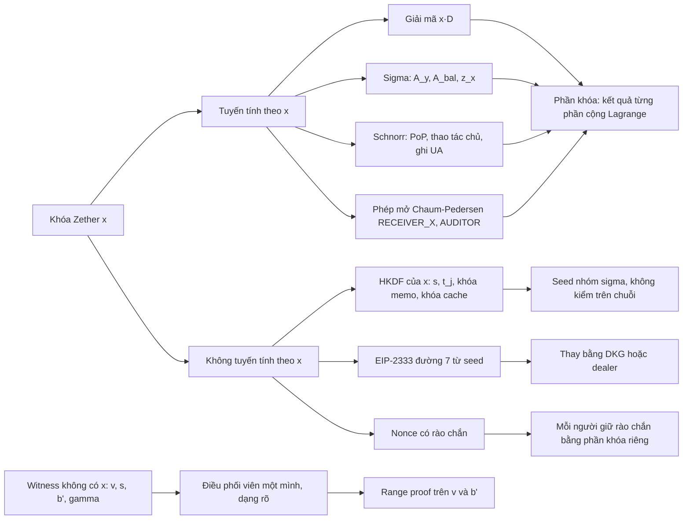
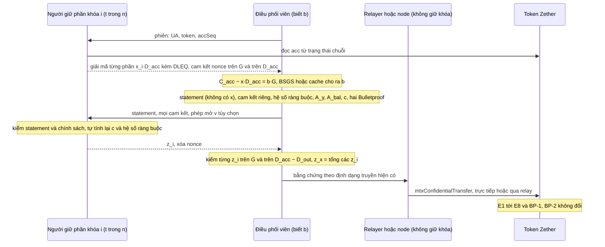

> **Research note — background and rationale only, not normative; the current rules are in docs/ (see decisions.md).**

> **Ghi chú nghiên cứu — chỉ là bối cảnh và lý do, không mang tính quy phạm; các quy tắc hiện hành nằm trong docs/ (xem decisions.md).**

> Bản tiếng Việt là bản phụ, ngoại lệ theo phán quyết của chủ dự án (owner, 2026-11-06) đối với quy tắc "docs bằng tiếng Anh" của AGENTS.md. Bản tham chiếu là bản tiếng Anh: [zether-threshold-mpc.md](zether-threshold-mpc.md); khi hai bản khác nhau, bản tiếng Anh được ưu tiên.

# Zether ngưỡng: MPC loại bỏ được người giữ duy nhất của `x` đến đâu (2026-11)

Viết ngày 2026-11-06 theo yêu cầu của chủ dự án. Chỉ là nghiên cứu: không có gì ở đây là quy tắc hay lịch làm việc. Mọi thứ
mật mã trong SCaaS đều **UNAUDITED**, và mọi cấu trúc dưới đây cũng vậy. Ghi chú này chỉ nói về **Zether cổ điển** (ElGamal
nâng và Σ-Bullets trên BLS12-381 G1, kind `0x0141` `zether-bls12381`). PQZ là một hệ riêng; bản khảo sát
[pq-mpc-threshold.vi.md](pq-mpc-threshold.vi.md) bàn cả hai ở mức tổng quát hơn và là bối cảnh của ghi chú này. Ghi chú này
chỉnh lại dòng "Chi tiêu ngưỡng Zether: prover Σ-Bullets phân tán, nghiên cứu, không" của bản khảo sát: phân tích dưới đây cho
thấy không cần một prover cộng tác tổng quát nào, vì mọi cách dùng `x` mà verifier nhìn thấy đều tuyến tính (§3, §5).

**Nhãn bằng chứng.** [paper] công bố có bình duyệt hoặc tài liệu của một tổ chức tiêu chuẩn (IETF RFC); [preprint] ePrint
hoặc arXiv, chưa bình duyệt; [vendor] tài liệu, đặc tả hay blog của chính dự án hoặc công ty (một ZIP của Zcash, tài liệu
Penumbra); [repo] đọc từ kho mã này hoặc một kho mã khác; [inference] suy luận hoặc tính toán của chúng tôi, kể cả đoạn script
nhỏ ở §5.8; [unverified] không kiểm chứng được. Nguồn: §10.

## 1. Tóm tắt nhanh

| Chủ đề | Kết quả | Bằng chứng | Đổi hợp đồng | Khuyến nghị |
|---|---|---|---|---|
| `x` đi vào đâu | Giải mã, các dòng chứa `x` của mỗi bằng chứng Σ (`A_y`, `A_bal`, `z_x`), mọi chữ ký Schnorr Zether và các phép mở `RECEIVER_X` / `AUDITOR`: tất cả **tuyến tính** theo `x`. Các chỗ phi tuyến (HKDF của `x` cho `s`, `t_j`, khóa memo và khóa cache, đường EIP-2333 số 7) nằm ở client và không được kiểm trên chuỗi | [repo] | — | §3 |
| (C) Giải mã ngưỡng | Chia `x` theo Shamir, giải mã từng phần `[x_i]D` kèm bằng chứng DLEQ, Lagrange trên số mũ, rồi BSGS như hiện có. Một vòng. Kinh điển từ 1989 | [paper] | không | xây, bắt đầu bằng auditor của CTR-ZTH-41 |
| (D) Chứng minh ngưỡng | Chỉ `z_x` và phần `k_x` của `A_y`, `A_bal` cần các phần khóa: một Schnorr ngưỡng kiểu FROST với nonce trên hai cơ sở. Bulletproofs không chứa `x`, do một điều phối viên dựng ở dạng rõ | [repo] [inference] | không | làm prototype ngay, review mật mã trước khi có giá trị thật |
| Bằng chứng chung có qua verifier cũ nguyên vẹn không? | **Có.** Cùng statement, transcript, định dạng truyền và verifier; không có `proofSystemId` mới, không có vector on-chain mới. Một script trên BLS12-381 thật kiểm E1–E8 cho một bằng chứng chung 3-of-5 | [inference] | không | thêm một forge test với bằng chứng chung trong prototype |
| Giữ kín số dư ngay trong nhóm | Không làm được: ai dựng BP#2 cũng cần `b'` ở dạng rõ, và giải mã ngưỡng cho ra `[b]G`, mà ai giữ nó cũng tìm được log nhỏ. Chỉ điều phối viên phải biết | [inference] | — | chọn ai điều phối |
| PoP, thao tác chủ tài khoản, ghi sổ UA | FROST với một ciphersuite Zether của SCaaS (như ciphersuite FROST-bn254 của ua-rs) cho ra một Schnorr Zether bình thường; registry và token xác minh không đổi. Ngưỡng BLS không áp dụng | [repo] [inference] | không | dùng lại frost-core |
| Khóa auditor (CTR-ZTH-41) | Giải mã ngưỡng `C_aud_j` cộng một phép mở Chaum–Pedersen `AUDITOR` ngưỡng; cả hai xác minh không đổi | [repo] [inference] | không | sản phẩm đầu tiên |
| Khóa xem `<use> = 8` | Một khóa ElGamal độc lập từ cùng seed; nó không đọc được tài khoản. Zether không tách khóa xem / khóa tiêu: `x` làm cả hai | [repo] | — | đừng giới thiệu nó như khóa xem của tài khoản |
| msig trên chuỗi | Với Zether cổ điển **chỉ bằng chứng là đủ để tiêu** (CTR-UA-16): hôm nay không `msig` nào trên chuỗi chặn được một lần tiêu Zether, khác PQZ (CTR-PQZ-12). Khóa ngưỡng là đa số mật mã duy nhất | [repo] | không cho (D) | chọn (D) thay vì móc vào hợp đồng |
| Tạm thời | Sao lưu k-of-n của `x`, song sinh của T16a cho PQZ: chữa mất khóa, không bỏ được người giữ duy nhất | [repo] [inference] | không | dùng lại mã T16a khi nó xong |
| **Tổng thể** | (C) sẵn sàng để xây; (D) khả thi không đổi hợp đồng, chủ yếu là kỹ thuật cộng một lần review | | **không** | (C) ngay cùng CTR-ZTH-29, prototype (D) tiếp theo |

## 2. Hôm nay: một người giữ `x`

**`x` là gì.** Một tài khoản Zether là UA `keccak256(TAG_ZETHER_BLS12381 ‖ Y)` với `Y = [x]G`; "khóa Zether chính là UA,
không có bản ghi quyền: chỉ bằng chứng là đủ để tiêu, mọi thao tác ghi khác là chữ ký Schnorr bằng `x`"
([CTR-UA-16](../contracts/accounts.md#CTR-UA-16), phán quyết CTR-UA-30 của chủ dự án) [repo]. Cùng `x` đó còn giải mã mọi số
dư, làm mầm cho độ ngẫu nhiên `s` và `t_j` của mỗi giao dịch và cho khóa memo của người gửi
([CTR-ZTH-30](../contracts/zether.md#CTR-ZTH-30), [CTR-ZTH-50](../contracts/zether.md#CTR-ZTH-50)), và làm khóa cho cache số dư
trên thiết bị (`HKDF(x, "scaas-zether-balance-cache-v1")`, facade ua-rs trên nhánh `ua-rs-sign`) [repo]. Ví dẫn xuất nó trên
đường EIP-2333 `m/12381/<coin>/<account>/7` ([CLI-SGN-10](../clients/signers-clientkeys.md#CLI-SGN-10)) [repo].

**Zether cổ điển không có cổng `msig`.** Tiền đề "`msig` cho phép, operator chứng minh" là mô hình của PQZ:
[CTR-PQZ-12](../contracts/pq-zero-knowledge.md#CTR-PQZ-12) biến khóa PQZ thành thuộc tính của một UA ký hậu lượng tử, và mọi
khoản trừ PQZ còn mang `requireAuthorized(from, PURPOSE_ZETHER_AUTH, …)` [repo]. Zether cổ điển đã bỏ `authRef` ở UA-6 (bảng
chuyển đổi dưới [CTR-UA-22](../contracts/accounts.md#CTR-UA-22): "a threshold or multisig holder is an `msig` UA … that owns its
own funds"), và `zether-bls12381` là SIGNING, không phải MEMBER, nên nó thậm chí không thể là thành viên của một `msig`
([CTR-UA-14](../contracts/accounts.md#CTR-UA-14)) [repo]. Một bằng chứng cũng có thể được nộp trực tiếp (`ZTX_V1_DIRECT`,
binding 0), bỏ qua mọi envelope mà một `msig` đã ký ([CTR-ZTH-34](../contracts/zether.md#direct-calls)) [repo]. Vậy hôm nay, ai
giữ `x` thì:

1. **thấy** mọi số dư và mọi khoản tiền đến;
2. **tiêu một mình**: không có gì trên chuỗi đòi một bên thứ hai;
3. **là điểm mất duy nhất**: không xoay khóa ([CTR-UA-13](../contracts/accounts.md#CTR-UA-13)), giao thức không có đường khôi
   phục (dòng U1 cũ của [03-zether-crypto.md](03-zether-crypto.md) đã nêu "MPC custody, chia nhỏ `x`" làm lối ra) [repo].

**Những gì docs đã lên kế hoạch.** [CTR-ZTH-41](../contracts/zether.md#CTR-ZTH-41) (chủ dự án): khóa auditor "should be a
k-of-n threshold key … `x_a` is split off chain by a DKG … No contract change; the prover / CLI protocol follows with
[CTR-ZTH-29](../contracts/zether.md#CTR-ZTH-29)" [repo]; [zether-disclosure.md](zether-disclosure.md) ghi nhận nó là "docs only:
no threshold decryption or threshold DLEQ protocol exists in the prover" [repo].
[CLI-SGN-32](../clients/signers-clientkeys.md#CLI-SGN-32) (chủ dự án, PLANNED): `y_audit` của auditor là một khóa ElGamal
ngưỡng 3-of-5, và thanh toán B2B có Zether dùng "`x` split Shamir 2-of-3, of which the platform holds **one share** — it cannot
spend alone" [repo]. Tính chất cuối chỉ đúng nếu không bên nào ghép lại `x`, đúng là (D) bên dưới.
[CLI-SGN-31](../clients/signers-clientkeys.md#CLI-SGN-31) (chủ dự án) thu hẹp một key oracle còn `zk_mul_by_x`,
`zk_nonce_commit`, `zk_response` và một `elgamal_decrypt` có chứng cứ chuỗi [repo]; §8 cho thấy đó chính là các thao tác trên
từng phần khóa mà một nhóm ngưỡng cần.

*Ghi chú bên lề cho chủ dự án (không phải kết quả của ghi chú này):* CLI-SGN-32 viết "the memo key derives from `D^x`"; khóa
memo hiện nay là `HKDF(seed_zether, …)` với `seed_zether = x` ([CTR-ZTH-50](../contracts/zether.md#CTR-ZTH-50)) và không có memo
AEAD (CTR-ZTH-12). Câu đó có vẻ cũ hơn quy tắc [inference].

## 3. Bề mặt bí mật

Dưới đây `B` là `D_acc − D_out` với một giao dịch chuyển và `D_acc` với một lần burn. "Điều phối viên" là bên duy nhất ghép
một bằng chứng.

| # | Cách dùng `x` | Công thức (zether.md, zether-prover) | Tuyến tính theo `x`? | Với các phần khóa |
|---|---|---|---|---|
| 1 | Giải mã, kiểm số dư | `[b]G = C − [x]D`, rồi BSGS ([CTR-ZTH-19](../contracts/zether.md#CTR-ZTH-19)) | có (`[x]D`); phần log là việc công khai | từng phần `[x_i]D` + DLEQ, Lagrange (§4) |
| 2 | Khóa công khai, id UA | `Y = [x]G`, `UA = keccak256(TAG ‖ Y)` | có | đầu ra DKG `Y = Σ C_i0` (§6) |
| 3 | Σ chuyển, nhiều người nhận, burn | `A_y = [k_x]G`, `A_bal = [k_b]G + [k_x]B`, `z_x = k_x + c·x` (§8.1, §8.2, §11) | có | Schnorr ngưỡng hai cơ sở (§5) |
| 4 | Các phản hồi Σ khác | `z_v, z_s, z_b, z_gv, z_gb, z_vj, z_tj` | không có `x` | điều phối viên |
| 5 | Các điểm của statement | `C_out, D_out, C_deb = [v]G + [s]Y_f, C_aud` | không có `x` (dùng `Y_f`) | điều phối viên |
| 6 | Bulletproofs | `A, S, T1, T2, L_j, R_j, τ_x, μ, t̂, a, b` trên `(v, γ_v)`, `(b', γ_b)` (§9) | không có `x`; phi tuyến theo `b'` (các bit) | điều phối viên, ở dạng rõ (§5.4) |
| 7 | Fiat–Shamir | `c, y, z, x, w, u_j` từ transcript keccak (§5) | hash công khai | điều phối viên tính, người giữ tính lại `c` |
| 8 | Schnorr: PoP, thao tác chủ, ghi sổ UA | `R = [k]G`, `e = H(tag ‖ R ‖ Y ‖ msg)`, `z = k + e·x` (§13) | có | FROST (§6) |
| 9 | Phép mở `RECEIVER_X` / `AUDITOR` | DLEQ: `A1 = [k]G`, `A2 = [k]B`, `z = k + e·x` ([CTR-ZTH-40](../contracts/zether.md#CTR-ZTH-40)) | có | Schnorr ngưỡng hai cơ sở (§7) |
| 10 | `s`, `t_j`, khóa memo | `HKDF-SHA256(x, "ZTX/s/v2" ‖ …)` v.v. ([CTR-ZTH-30](../contracts/zether.md#CTR-ZTH-30), [CTR-ZTH-50](../contracts/zether.md#CTR-ZTH-50)) | **không** | một seed nhóm `σ` thay vào; hợp đồng không bao giờ kiểm `s` được tạo ra thế nào |
| 11 | Khóa cache số dư | `HKDF(x, "scaas-zether-balance-cache-v1")` | **không** | khóa riêng của mỗi thành viên, hoặc `σ` |
| 12 | Nonce có rào chắn | `k = SHA-512("ZETHER-NONCE-v1" ‖ secrets ‖ rng32 ‖ i) mod r` (`nonce.rs`) | **không**, cục bộ | mỗi người giữ rào chắn bằng phần khóa của mình; không bao giờ tất định (§5.7) |
| 13 | Dẫn xuất khóa | EIP-2333 `m/12381/<coin>/<account>/7` từ một seed BIP-39 | **không** | không thể cho khóa nhóm: dùng DKG hoặc dealer (§6) |

**Đọc bảng.** Mọi phép kiểm trên chuỗi có liên quan tới `x` chỉ thấy nó qua các dòng 1, 3, 8 và 9, mỗi dòng có dạng "một điểm
nhân `x`" hoặc "`k + c·x`". Cả hai đều tuyến tính, nên phần khóa Shamir và hệ số Lagrange mang được chúng mà không cần MPC nào
ngoài phép cộng. Các dòng 10–13 phi tuyến nhưng không bao giờ tới verifier; chúng cần một bí mật khác, không cần một giao thức.
Các dòng 4–7 không chứa `x`. Đây là kết quả trung tâm: **Zether cổ điển không cần MPC tổng quát để thành ngưỡng** [inference].

## 4. (C) Giải mã và xem ngưỡng

### 4.1 Cấu trúc

1. **Khóa.** `x` được chia Shamir t-of-n: người giữ `i` cầm `x_i = f(i)` với `f(0) = x`, và mọi người biết các phần kiểm
   `Y_i = [x_i]G`. Một **DKG** tạo ra điều này mà không bên nào từng giữ `x`: giao thức của Pedersen (cam kết Feldman, cộng hằng
   số của từng dealer) [paper], được Gennaro, Jarecki, Krawczyk và Rabin gia cố chống thiên lệch khóa [paper]; DKG Pedersen
   thuần vẫn đủ cho chữ ký Schnorr ngưỡng [paper] (chúng tôi giả định điều tương tự cho giải mã ElGamal [inference]), và khâu
   sinh khóa của FROST, DKG Pedersen kèm bằng chứng sở hữu ("PedPoP"), có chứng minh an toàn trong bối cảnh FROST của Bellare,
   Crites, Komlo, Maller, Tessaro và Zhu [paper]. Một **dealer** (sinh, chia, xóa) đơn giản hơn và hợp với một khóa do một tổ
   chức thiết lập. Cách nào thì kết quả cũng là một khóa `Y` bình thường [inference].
2. **Giải mã từng phần.** Với một bản mã `(C, D)` đọc từ trạng thái chuỗi, người giữ `i` trả về `P_i = [x_i]D` kèm bằng chứng
   Chaum–Pedersen `log_G Y_i = log_D P_i` [paper], cùng loại DLEQ mà `ZetherDisclosure` đã kiểm
   ([CTR-ZTH-40](../contracts/zether.md#CTR-ZTH-40)) [repo].
3. **Kết hợp.** Với t phần hợp lệ bất kỳ `S`: `[x]D = Σ_{i∈S} λ_i P_i` (hệ số Lagrange tại 0), `[b]G = C − [x]D`, rồi BSGS
   phía client như hiện có, hoặc với cache số dư thì chỉ kiểm một điểm `[b]G == C − [x]D`
   ([CTR-ZTH-19](../contracts/zether.md#CTR-ZTH-19)) [repo]. Một phần sai trượt DLEQ của nó và chỉ ra người giữ nó (bền vững khi
   có t người trả lời trung thực) [paper].

### 4.2 Ai biết số dư

**Bên kết hợp** biết `[b]G` và do đó biết `b` (số dư `≤ 2^54`, [CTR-ZTH-26](../contracts/zether.md#CTR-ZTH-26)). Đó có thể là
thiết bị của chính thành viên yêu cầu (mỗi người giữ mã hóa `P_i` của mình cho người yêu cầu), hoặc mọi thành viên cùng lúc:
các phần và bằng chứng DLEQ có thể được phát cho tất cả, và mỗi thành viên tự kiểm và tự kết hợp. Không người giữ nào biết `b`
từ phần của riêng mình [inference]. So với Zcash, Penumbra và Monero (§5.5), nơi mỗi người tham gia giữ một khóa xem đầy đủ,
một nhóm Zether t-of-n chặt hơn: lần xem nào cũng cần t người giữ [inference].

### 4.3 Quy tắc duy nhất: chỉ giải mã trạng thái chuỗi

Một người giữ không bao giờ trả lời cho một `D` do người gọi chọn, chỉ cho `acc` / `pending` của UA nhóm hoặc một leg đã lưu
(`transferEntry`), do chính người giữ đọc hoặc được chứng minh bằng `ChainWitness` của
[CLI-SGN-31](../clients/signers-clientkeys.md#CLI-SGN-31) [repo]. Hai lý do:

- **Chính sách.** Mọi bản mã dưới `Y` giải mã như nhau; một dịch vụ mở sẽ giải mã bất cứ gì được đưa tới.
- **Diffie–Hellman tĩnh.** Một oracle `P ↦ [x]P` cho kẻ tấn công dựng `[x^d]G` bằng cách đưa đầu ra quay lại, rồi thuật toán của
  Cheon tìm `x` trong khoảng `√(r/d) + √d` phép toán nhóm khi `d | r − 1` [paper]. Với BLS12-381,
  `r − 1 = 2^32 · 3 · 11 · 19 · 10177 · 125527 · 859267 · 906349^2 · 2508409 · 2529403 · 52437899 · 254760293^2`, trơn hoàn toàn,
  còn `r + 1` có một thừa số 225 bit [inference, sympy]. Với `d` cỡ 2^30 truy vấn, chi phí giảm từ khoảng 2^127.4 xuống khoảng
  2^112.4 [inference]. Không phải là phá vỡ, nhưng là một mất mát đo được mà quy tắc trạng thái chuỗi loại bỏ: mọi `D` trên
  chuỗi là tổng của các điểm mà người tạo đã chứng minh biết log (E2 cho `D_out = [s]G`, E6′ cho `D_aud_j = [t_j]G`; shield
  không đổi `D`). Các lũy thừa `[x^i]G` mà tấn công của Cheon phải đưa quay lại không bao giờ trở thành trạng thái chuỗi, và một
  câu trả lời `[x]D` chỉ cho người tạo ra `D = [s]G` biết `[s]Y`, thứ họ vốn đã tính được [inference].

### 4.4 Chi phí và số vòng

| Mục | Mỗi người giữ | Bên kết hợp |
|---|---|---|
| Số vòng | 1 (yêu cầu, trả lời) | — |
| Phép toán nhóm | 3 phép nhân vô hướng (`P_i`, `A1`, `A2`) | t lần kiểm DLEQ (mỗi lần 4), một MSM t hạng tử, rồi BSGS hoặc kiểm cache |
| Byte gửi đi | `P_i` 128 B + DLEQ 288 B = **416 B** mỗi bản mã | — |
| Tần suất | một `acc` mỗi `accSeq`, một cho mỗi lần đọc `pending` hay mỗi khoản đến | BSGS chiếm phần lớn (vài giây tới vài phút ở 2^54, [CTR-ZTH-19](../contracts/zether.md#CTR-ZTH-19)); cache tránh được nó |

[inference; kích thước điểm và vô hướng theo zether.md §3]. Không đo thời gian.

### 4.5 Tiền lệ

ElGamal ngưỡng là hệ mật ngưỡng kinh điển: Desmedt–Frankel (1989), Pedersen (1991), và TDH1 / TDH2 của Shoup–Gennaro, trong đó
mỗi phần giải mã mang một bằng chứng không tương tác rằng nó là một bộ ba Diffie–Hellman (một DLEQ) [paper]. Trong đặc tả công
khai hoặc trong sản xuất:

- **ElectionGuard 2.0**: các guardian tính giải mã từng phần rồi **một bằng chứng Chaum–Pedersen chung**: mỗi guardian cam kết
  `(g^{u_i}, A^{u_i})`, các cam kết được nhân lại, một challenge `c` được hash, guardian `i` trả lời với `c_i = c·w_i` có trọng số
  Lagrange, mỗi câu trả lời được kiểm riêng, và bản ghi công bố `(c, v = Σ v_i)` gộp (đặc tả §3.6.3) [vendor]. Đây là mẫu hai cơ
  sở mà §5 và §7 dùng.
- **Helios ở IACR** chạy trustee **n-of-n**. Tháng 11/2025 một trustee mất khóa riêng, cuộc bầu bị hủy, và IACR thông báo chuyển
  sang ngưỡng 2-of-3 [vendor]: rủi ro mất khóa ở §2, mục 3, ngoài đời thật.
- **Penumbra** đặc tả "flow encryption" bằng ElGamal ngưỡng với một DKG nhưng không phát hành nó trong V1 [vendor].
- **Ferveo** (Bebel, Ojha) [preprint], cài đặt trên arkworks BLS12-381 và được TACo của Threshold Network dùng [repo], và
  mempool mã hóa của **Shutter** trên Gnosis Chain (lần dùng mainnet đầu tiên, beta tự chọn, tháng 11/2024) [vendor] chạy giải
  mã ngưỡng dựa trên DKG trên BLS12-381, dựa trên pairing chứ không phải ElGamal trên G1, với cùng kiểu sinh khóa.
- **drand** chạy DKG của Pedersen trên BLS12-381 cho beacon BLS ngưỡng của nó, trong sản xuất từ 2020 [vendor].

Thư viện: DKG của ZF `frost-core`, vốn đã là phụ thuộc của ua-rs trên `ua-rs-sign` [repo]. URL: §10.

### 4.6 Tác động lên hợp đồng

Không có. `Y` (hay `Y_a`) vẫn là một khóa công khai; bản mã, statement và disclosure không đổi [repo].

## 5. (D) Chứng minh và chi tiêu ngưỡng

### 5.1 Verifier cần gì từ `x`

E1 `[z_x]G − [c]Y_f − A_y` và E5 `[z_b + c·fee]G + [z_x]D_acc − [z_x]D_out − [c]C_acc + [c]C_deb − A_bal` là hai phương trình
duy nhất có liên quan tới `x`, qua `z_x` ([§8.1](../contracts/zether.md#81-transfer); burn và dạng nhiều người nhận có cùng E1 và
E5, burn với `B = D_acc`) [repo]. Với `A_y = [k_x]G` và phần `k_x` của `A_bal` là `[k_x]B`, cặp (E1, E5) là một bằng chứng
Chaum–Pedersen trên hai cơ sở `G` và `B` với một phản hồi `z_x`, gộp vào Σ lớn hơn qua `k_b` và `z_b` [inference]. Schnorr
ngưỡng (FROST, RFC 9591) xử lý một cơ sở [paper]; cùng đại số đó xử lý được hai, như bằng chứng giải mã chung của ElectionGuard
cho thấy (§4.5) [vendor] [inference].

### 5.2 Giao thức

Các người giữ `S` (t trong n) và một **điều phối viên**, có thể chính là một người giữ:

1. **Vòng 1 (tiền xử lý được theo `accSeq`).** Mỗi người giữ tự đọc `acc` và gửi phần giải mã `[x_i]D_acc` kèm DLEQ của nó, cùng
   hai nonce mới `d_i`, `e_i`, mỗi nonce được cam kết trên cả hai cơ sở: `(D_i, E_i) = ([d_i]G, [e_i]G)` và
   `(D'_i, E'_i) = ([d_i]D_acc, [e_i]D_acc)`.
2. **Điều phối viên.** Kết hợp `[b]G`, tìm `b` (BSGS hoặc cache), lấy `v` và `fee` của token, đặt `b' = b − v − fee`, rút `s` (từ
   `σ`, §5.6), `γ_v`, `γ_b`, dựng statement đúng như hôm nay (nó không giữ `x`), và chốt các cam kết của chính nó
   `V_v, V_b, A_D, A_out, A_deb, A_aud, A_Vv, A_Vb` và `K_b = [k_b]G`.
3. **Hệ số ràng buộc.** `ρ_i = H("…TSIGMA-RHO" ‖ i ‖ statement ‖ cam kết của điều phối viên ‖ mọi cặp nonce của người giữ)`, một
   hash tách khỏi transcript Zether. Nonce hiệu dụng của người giữ `i`: `R_i = D_i + [ρ_i]E_i` trên `G`, và trên `B`:
   `R'_i = D'_i + [ρ_i]E'_i − [s]R_i` (vì `D_out = [s]G`, điều phối viên tự suy ra phần `D_out`).
4. **Gộp và challenge.** `A_y = Σ R_i`, `A_bal = K_b + Σ R'_i`; hấp thụ vào transcript **hiện có** đúng như một prover đơn;
   `c = T.challenge("sigma.c")`; dựng cả hai Bulletproof từ cùng transcript (chúng cần `v`, `b'`, các `γ`, không cần gì của `x`).
5. **Vòng 2.** Điều phối viên gửi statement, mọi cam kết, và tùy chọn một phép mở `(v, s)` của `C_out`. Mỗi người giữ kiểm
   statement (nó có thể tự dựng lại từ chuỗi qua `ZetherStatements`, [CTR-ZTH-46](../contracts/zether.md#CTR-ZTH-46)) và chính
   sách của nó, tự tính lại `ρ_i` và `c`, rồi trả lời **một lần**: `z_i = d_i + ρ_i·e_i + λ_i·c·x_i`, sau đó xóa `d_i, e_i`.
6. **Ghép.** Với mỗi người giữ: `[z_i]G == R_i + [λ_i·c]Y_i` và `[z_i]B == R'_i + [λ_i·c]([x_i]D_acc − [s]Y_i)`; hạng tử
   `[x_i]D_acc` là phần giải mã của vòng 1, nên kiểm được trên cả hai cơ sở và một lỗi chỉ ra người giữ gây ra nó (dừng có
   định danh). `z_x = Σ z_i`; điều phối viên tự tính các phản hồi còn lại. Các byte của bằng chứng theo định dạng prover đơn.

Chữ ký và phép mở (§6, §7) là cùng các bước với một cơ sở (Schnorr) hoặc với các cơ sở `G`, `D_aud_j` / `D_out` (phép mở) và không
có Bulletproof.

### 5.3 Fiat–Shamir chung

Transcript Zether là một chuỗi keccak trên các byte công khai: `init`, `absorb("statement")`, `absorb("sigma.commit")`, rồi
challenge Σ và các challenge Bulletproof `y, z, x, w, u_j`
([§5](../contracts/zether.md#5-hash-to-scalar-and-the-fiat-shamir-transcript)) [repo]. Trong giao thức chung, điều phối viên chạy
nó không đổi trên các cam kết gộp, và mỗi người giữ tự tính lại `c` từ cùng các byte trước khi trả lời, nên không người giữ nào
ký một challenge mà nó chưa tự suy ra [inference]. Không `z_*` nào được hấp thụ, nên điều phối viên có thể hoàn thành Bulletproof
trước hay sau khi các phản hồi về [repo]. Hash mới duy nhất là hệ số ràng buộc, không bao giờ chạm vào transcript Zether: nó là
vật liệu của giao thức client với vector riêng, không phải thay đổi on-chain [inference].

### 5.4 Bulletproofs, và giữ kín số dư trong nhóm

Range proof chứng minh `v` và `b'` thuộc `[0, 2^64)` trên `V_v = [v]G + [γ_v]Hb` và `V_b = [b']G + [γ_b]Hb`; witness của chúng
là `(v, γ_v)`, `(b', γ_b)` và các vector bit `a_L` của các giá trị đó
([§9](../contracts/zether.md#9-bulletproofs--exactly-two-range-statements)) [repo]. Chúng không chứa `x`. Liệu `b'` có thể giữ ở
dạng chia sẻ bí mật, để không bên nào biết số dư?

- "Giao thức MPC đơn giản" của bài Bulletproofs (§4.5) cho m bên, **mỗi bên giữ giá trị riêng của mình**, dựng một range proof
  gộp qua một dealer, chỉ an toàn trước các bên trung thực nhưng tò mò; bài báo để ngỏ "an efficient MPC protocol for more
  complicated circuits" [paper]. Crate `bulletproofs` của dalek cài đặt nó (`range_proof_mpc`) [repo]. Đó không phải giao thức
  ngưỡng: không giá trị nào được chia sẻ.
- Chứng minh cộng tác trên một witness **được chia sẻ**: Ozdemir–Boneh phân tích Groth16, Plonk, Marlin và Fractal và cài đặt ba
  hệ đầu; họ lưu ý rằng Bulletproofs phân tán ở trên không định nghĩa an toàn cộng tác và giả định các bên trung thực nhưng tò mò
  [paper]. zkSaaS bao Groth16 và Plonk [preprint]. Một preprint làm được Bulletproofs cộng tác trên witness phân tán giữa các
  prover: Alghazwi, Bontekoe, Visscher và Turkmen, "Collaborative CP-NIZKs" (Groth16 và Bulletproofs) [preprint].
- Điều đó giải được range proof, không giải được đầu vào. Một `b'` chia sẻ cần một `b` chia sẻ, và nguồn duy nhất của `b` là một
  phép giải mã, cho ra `[b]G`; biến nó thành một số nguyên chia sẻ nghĩa là tính một logarit rời rạc tới 54 bit bên trong MPC,
  vượt xa mọi giao thức thực tế [inference].

**Trả lời.** `b'` phải được điều phối viên biết ở dạng rõ, và không ai khác: người giữ trả lời bằng `z_i` và không bao giờ cần `v`
hay `b'`, trừ khi chính sách của họ đòi xem `v` (họ có thể kiểm một phép mở). Giấu số dư khỏi **mọi** bên là không làm được với
chi phí hợp lý trong Zether [inference]. Lựa chọn là **ai điều phối**: thiết bị của một thành viên, nền tảng nếu nó giữ một phần
(CLI-SGN-32), hoặc một enclave của [CLI-SGN-31](../clients/signers-clientkeys.md#CLI-SGN-31) [repo].

### 5.5 Tiền lệ cho "tiêu theo ngưỡng, điều phối viên thấy số tiền"

Cách tách này là chuẩn ở những hệ mà quyền tiêu và vật liệu xem là hai khóa riêng:

- **Zcash ZIP 312** chỉ chia khóa ủy quyền tiêu `ask` cho các bên ký FROST (FROST tái ngẫu nhiên hóa, Gouvea–Komlo [preprint]);
  "the proof generation will still be performed by a single participant", và "all key share holders are also trusted with the
  privacy of the transaction" [vendor].
- **Penumbra threshold custody** (`pcli init threshold`, bằng dealer hoặc DKG; FROST trên decaf377 trong crate `decaf377-frost`)
  cho mỗi bên "full viewing authority" và chia quyền tiêu [vendor] [repo].
- **Monero multisig**: "every participant ends up knowing the public address and private view key"; phần lớn một giao dịch, kể cả
  range proof, do người khởi tạo dựng, và chỉ chữ ký cần cộng tác [vendor].

Zether chỉ có một khóa cho cả hai vai trò, nhưng vì phần phụ thuộc `x` của bằng chứng là tuyến tính, nó theo được cùng mẫu mà
không cần khóa thứ hai, và việc xem vẫn cần t người giữ (§4.2) [inference]. URL: §10.

### 5.6 Những gì đổi ở client

- **`s`, `t_j` và khóa memo.** Hôm nay chúng là `HKDF(seed_zether, …)` với `seed_zether = x` (một phán quyết của controller còn
  chờ chủ dự án, [CTR-ZTH-30](../contracts/zether.md#CTR-ZTH-30)) [repo]. Một nhóm không có `x` để hash. Hợp đồng không bao giờ
  kiểm `s` hay `t_j` được chọn thế nào và chỉ đọc memo để kiểm độ dài và salt [repo], nên một **seed nhóm `σ`** (32 byte ngẫu
  nhiên tạo lúc thiết lập khóa và niêm phong cho mỗi người giữ) có thể thay `x` trong cùng các công thức HKDF mà không đổi gì
  on-chain. Ai giữ `σ` thì mở được các giao dịch **đi** của nhóm (`SENDER_S`, `SENDER_CP`) và dựng lại chúng từ storage
  ([CTR-ZTH-50](../contracts/zether.md#CTR-ZTH-50)), không cần các phần khóa [inference].
- **API của prover.** `prove_*_core` tính `z_x = k_x + c·x` bên trong; một bản dựng ngưỡng cần tách nó thành "cam kết với phần
  `A_y`, `A_bal` từ bên ngoài → `c` và Bulletproofs" và "chèn `z_x`" [repo, `zether.rs`] [inference].
- **Chế độ roll-over.** Một `mtxRollOver` công khai đổi `acc` và `accSeq`, làm vô hiệu các phần và nonce của vòng 1 và khiến bằng
  chứng bị từ chối là `StaleAccSeq` ([rollover](../contracts/zether.md#rollover)) [repo]. Phiên ngưỡng lâu hơn bằng chứng của một
  thiết bị, nên một tài khoản nhóm nên dùng `OWNER_ONLY`, nơi mỗi roll-over là một Schnorr ngưỡng
  ([CTR-ZTH-16](../contracts/zether.md#CTR-ZTH-16)) [inference]. Hạn dùng: một `validUntilBlock` đủ dài cho các vòng
  ([expiry](../contracts/zether.md#valid-until)).

### 5.7 Cạm bẫy

| Cạm bẫy | Điều gì hỏng | Biện pháp |
|---|---|---|
| ROS / phiên đồng thời | Lược đồ Schnorr hai vòng với một nonce mỗi bên không có chứng minh an toàn (Drijvers và cộng sự) và sụp trong thời gian đa thức khi hơn khoảng `log p` phiên chạy đồng thời (tấn công ROS) [paper] | hai nonce và hệ số ràng buộc của FROST; ở đây `ρ_i` phải hash **mọi** đầu vào của `c` ngoài nonce của người giữ: statement và mọi cam kết của điều phối viên, kể cả `K_b`. Một điều phối viên đổi được bất kỳ đầu vào tự do nào của `c` mà không đổi `ρ_i` sẽ mở lại tấn công [inference] |
| Dùng lại nonce | Hai câu trả lời với một nonce và hai challenge cho ra `x_i` | nonce từ RNG mới, lưu lại, dùng một lần, xóa khi dùng hoặc khi hủy (quy tắc lấy-rồi-xóa của CLI-SGN-31) [repo] |
| Nonce tất định | Ổn cho một bên ký, không an toàn cho nhiều bên: điều phối viên phát lại một thông điệp với cam kết khác của bên ký cùng và lấy được hai câu trả lời trên một nonce (MuSig-DN giải thích điều này) [paper] | không bao giờ dẫn xuất nonce vòng 1 chỉ từ `(phần khóa, thông điệp)`; `Nonces` có rào chắn của prover (thoái hóa thành tất định khi RNG chết) không được dùng lại nguyên trạng [repo] [inference] |
| Nonce thiên lệch | Vài bit thiên lệch mỗi nonce làm lộ khóa qua rút gọn lưới (Breitner–Heninger) [paper] | nonce đủ độ rộng rút gọn từ 512 bit, như `hashToScalar` và `Nonces` đã làm [repo] |
| Đổi nhóm giữa phiên | Một nonce được trả lời dưới hai tập Lagrange làm lộ phần khóa | một phiên gắn với tập `S` của nó; mọi thay đổi khởi động lại với nonce mới [inference] |
| Hủy phiên | Một người giữ im lặng làm phiên đứng | bỏ mọi nonce, khởi động lại với một nhóm khác; không bao giờ trả lời lại một phiên cũ [inference] |
| Dừng có định danh | Một `z_i` sai làm hỏng E1 hoặc E5 mà không nói ai | kiểm mọi `z_i` trên cả hai cơ sở (bước 6); xác thực thông điệp của người giữ bằng khóa UA riêng của từng người để quy trách nhiệm được [inference] |
| Nhóm con | BLS12-381 G1 có cofactor: một thành phần bậc thấp trong một phần khóa hay cam kết có thể sống sót qua tổng Lagrange | kiểm nhóm con mọi điểm nhận được (cảnh báo ngoài EVM của [§9.1](../contracts/zether.md#merged-check)) [repo] |
| Kênh phụ | Phần khóa được nhân trên đường cong arkworks | `secret_mul` của `scaas-ct` (ua-rs-sign §12) cho mọi phép nhân với `x_i`, `d_i`, `e_i` [repo] |
| Phần khóa cũ | Sau khi chia lại, t người giữ cũ vẫn dựng lại được `x` | xóa phần cũ; ưu tiên UA mới khi đổi thành viên cho tới khi việc chia lại được review (§8.3) [inference] |

### 5.8 Bằng chứng chung có qua verifier không đổi không?

**Có, theo cấu trúc** [inference]: verifier đọc `A_y`, `A_bal` và `z_x` như những con số và kiểm các phương trình mà một bằng
chứng được gộp đúng thỏa mãn; statement, transcript, byte của bằng chứng và `proofSystemId` là của một prover đơn. Hệ quả:
**không đổi hợp đồng, không có `proofSystemId` mới, không có vector on-chain mới**; tính zero-knowledge giữ nguyên chừng nào nonce
của một người giữ trung thực là đều. Vector mới chỉ cần cho giao thức client (ciphersuite, hệ số ràng buộc, định dạng phần khóa).

**Kiểm.** Một script Python ngắn (py_ecc, BLS12-381 G1 thật, transcript và `hashToScalar` của zether.md §5; giữ trong một
scratchpad riêng, không commit) chạy một DKG kiểu Pedersen 3-of-5, một giải mã ngưỡng `acc` với phần DLEQ, Σ chung của một giao
dịch một người nhận có auditor như §5.2, một Schnorr Zether ngưỡng và một phép mở `AUDITOR` ngưỡng, rồi kiểm E1–E8 đúng như
§8.1 [inference]. Kết quả:

| Trường hợp | E1–E8 | Người giữ bị bước 6 chỉ ra |
|---|---|---|
| 3 trong 5 trả lời | đều đúng | không ai |
| chỉ 2 trong 3 người cần thiết trả lời | E1, E5 sai | không ai (mỗi phần đều hợp lệ; tập quá nhỏ) |
| người giữ 3 cộng 1 vào `z_i` | E1, E5 sai | người giữ 3 |
| người giữ 4 dùng nonce khác trên `D_acc` | E5 sai | người giữ 4 |
| Schnorr ngưỡng, phép mở `AUDITOR` ngưỡng | xác minh được | — |

Script không dựng Bulletproof (chúng không chứa `x`) và dùng một `Hb` ngẫu nhiên, không phải generator NUMS; nó là một phép kiểm
đại số, không phải kiểm thử prover Rust hay verifier Solidity. Prototype nên thêm một forge test đưa một bằng chứng dựng chung
vào verifier thật.

### 5.9 Số vòng và lưu lượng

Giao dịch một người nhận, t = 3, BLS12-381 (điểm 128 B, vô hướng 32 B) [inference]:

| Thông điệp | Kích thước | Ghi chú |
|---|---|---|
| Vòng 1, người giữ → điều phối viên | 128 + 288 + 4 · 128 = **928 B** | phần giải mã, DLEQ, hai nonce trên hai cơ sở; tiền xử lý được theo `accSeq` |
| Vòng 2, điều phối viên → người giữ | statement 1,664 + cam kết riêng 9 · 128 + danh sách 3 · 516 + phép mở 64 ≈ **4.4 KB** | người giữ có thể tự dựng statement từ chuỗi |
| Vòng 2, người giữ → điều phối viên | **32 B** | `z_i` |
| Mỗi lần tiêu, mọi người giữ | ≈ **16 KB** | 2 vòng; 1 vòng trực tuyến nếu tiền xử lý |
| Tính toán của người giữ | ≤ 10 phép nhân vô hướng | điều phối viên: t lần kiểm DLEQ, 2t lần kiểm phần, BSGS hoặc cache, hai Bulletproof như hôm nay |

Một giao dịch nhiều người nhận thêm `4 · 128` byte statement và năm cam kết của điều phối viên mỗi leg; phần của người giữ không
tăng. Một Schnorr (PoP, thao tác chủ) là FROST thường: khoảng 0.3 KB đi và 1 KB đến mỗi người giữ [inference].

## 6. Đăng ký, PoP và chữ ký với `x` được chia

- **Khóa.** Một DKG (hoặc một dealer) cho ra `Y`; UA là `keccak256(TAG_ZETHER_BLS12381 ‖ Y)` như mọi khóa. Một khóa nhóm không
  dẫn xuất được từ seed của ai (dòng 13). Một UA khóa đơn hiện có không thể trở thành UA nhóm: không xoay khóa
  ([CTR-UA-13](../contracts/accounts.md#CTR-UA-13)), nên con đường là một UA nhóm mới và một giao dịch mật từ UA cũ, do người giữ
  cũ ký [repo].
- **PoP.** `register(0x0141, Y, attrs0, pop, "")` nhận một Schnorr Zether trên
  `uaMessage(0x0141, PURPOSE_POP_V2, typed registration)`, khả chuyển và ai cũng relay được
  ([CTR-UA-07](../contracts/accounts.md#CTR-UA-07), [registry](../contracts/zether.md#registry)) [repo]. Một chữ ký FROST của nhóm
  trên thông điệp đó là một Schnorr Zether bình thường: `ZetherSchnorrBls12381Verifier` không phân biệt được với chữ ký của một
  người. Bằng chứng tri thức của chính DKG chặn khóa giả mạo trong nhóm; PoP của registry làm phần còn lại [inference].
- **Thao tác chủ và ghi sổ UA.** `mtxRollOverSigned`, `mtxSetRollOverMode` và mọi thao tác `ua*` của UA nhóm là cùng Schnorr dưới
  mục đích của chúng (`zether-owner`, `metatx`, …), nên FROST bao chúng không đổi [repo] [inference].
- **Ciphersuite.** ua-rs trên `ua-rs-sign` đã định nghĩa `FROST(bn254, keccak256)` có `H2` là challenge Schnorr của SCaaS, nên đầu
  ra của nó xác minh như `schnorr-bn254` (`frost.rs`) [repo]. Một `FROST(BLS12-381-G1, keccak256)` cho Zether theo cùng mẫu: phần
  tử 128 byte EIP-2537, `H2(m) = hashToScalar(keccak256("SCAAS-ZETHER-SCHNORR-V1" ‖ m))` với `m = R ‖ Y ‖ msg32`, và **kiểm nhóm
  con trong `deserialize`** (bn254 G1 có cofactor 1, BLS12-381 G1 thì không) [inference]. DKG của frost-core sau đó cho các phần
  khóa cho mọi cách dùng trong ghi chú này [repo].
- **Ngưỡng BLS: không áp dụng.** Bí mật Zether không bao giờ được là một khóa BLS trên cùng đường cong (công bố `[x]G2` làm DDH
  trên G1 quyết định được; một quy tắc của ví, [registry](../contracts/zether.md#registry)) [repo], nên không có chữ ký BLS nào
  bằng `x` để làm ngưỡng.
- **Chuỗi thấy gì.** Một `Y`, một Schnorr, một bằng chứng: một UA nhóm không phân biệt được với UA của một người, và nhóm không
  công khai (khác `msig`, vốn lộ thành viên và trả phí theo từng chữ ký) [inference].

## 7. Khóa auditor và khóa xem

**Auditor ngưỡng (CTR-ZTH-41).** Quy tắc của chủ dự án yêu cầu `Y_a` giữ là một khóa với `x_a` chia bằng DKG, "so decrypting or an
`AUDITOR` opening needs k parties (FULL and OPTIONAL tokens)" [repo]. Cả hai phần đều được bao:

- đọc leg `j`: giải mã ngưỡng (§4) của `(C_aud_j, D_aud_j)`; `t_j` riêng của leg giữ các leg tách nhau
  ([CTR-ZTH-30](../contracts/zether.md#CTR-ZTH-30)) [repo];
- chứng minh nó: phép mở `AUDITOR` là DLEQ `log_G Y_a == log_{D_aud_j}(C_aud_j − [v]G)` với challenge
  `e = H("SCAAS-ZETHER-DISCLOSE-V2" ‖ … ‖ G ‖ K ‖ B ‖ M ‖ A1 ‖ A2)` ([CTR-ZTH-40](../contracts/zether.md#CTR-ZTH-40)) [repo]; với
  nonce FROST hai cơ sở trên `G` và `D_aud_j`, nhóm tạo ra `(A1, A2, z)` mà `ZetherDisclosure.verifyTransferAmount` chấp nhận
  không đổi (đã kiểm bằng script ở §5.8) [inference]. Phép xem vẫn miễn phí và không có gì được chứng thực trên chuỗi
  ([CTR-ZTH-39](../contracts/zether.md#CTR-ZTH-39)) [repo].

Auditor của một token FULL dựng lại được số dư chính xác bằng sổ sách ([zether-disclosure.md](zether-disclosure.md) R2) [repo];
một auditor ngưỡng giữ năng lực đó nhưng cần k thành viên để dùng [inference]. CLI disclosure
([CTR-ZTH-29](../contracts/zether.md#CTR-ZTH-29)) kiểm một phép mở ngưỡng y như một phép mở đơn.

**Khóa `<use> = 8`.** `USE_DISCLOSURE = 8` của zether-prover, được facade ua-rs đưa ra dưới tên `USE_VIEWING`, dẫn xuất một vô
hướng thứ hai, **độc lập**, trên `m/12381/<coin>/<account>/8` [repo]. Số dư được mã hóa dưới `Y = [x]G` của đường 7, nên khóa
đường 8 không đọc được chúng; nó là ứng viên tự nhiên cho một khóa auditor hay khóa disclosure, không hơn [inference]. Zether
không có khóa chỉ-xem cho một tài khoản: giải mã và chứng minh dùng cùng `x`. Các năng lực chỉ-xem duy nhất là (a) giải mã ngưỡng
ở §4, nơi người giữ trao `[x]D` cho `D` thuộc trạng thái chuỗi mà không trao `x`, và (b) các phép mở theo từng giao dịch.

**Xem theo từng thành viên qua phép mở có tránh được giải mã ngưỡng không?** Một phần [inference]:

| Thành viên muốn xem gì | Không cần phần khóa | Cần phần khóa |
|---|---|---|
| Số tiền đi | có, với `σ`: `SENDER_S` / `SENDER_CP` và memo (§5.6) | — |
| Shield | có: số tiền công khai | — |
| Số tiền đến | chỉ khi mỗi người gửi trao một phép mở | `RECEIVER_X` là một DLEQ theo `x` (ngưỡng, như của auditor), hoặc giải mã ngưỡng từng khoản đến |
| Số dư | chỉ bằng sổ sách mọi thứ trên | một lần giải mã ngưỡng `acc` mỗi `accSeq`, phát kèm phần DLEQ để mọi thành viên tự kiểm (§4.2) |

Vậy phép mở bao được chi tiêu của chính nhóm; mọi thứ đến được mã hóa cho nhóm cần t người giữ một lần. Phát một lần giải mã đã
kiểm cho mỗi `accSeq` cho mọi thành viên biết số dư với giá một vòng [inference].

## 8. Tích hợp với SCaaS

### 8.1 Nằm ở đâu

- **`clients/zether-prover`**: API prover tách đôi (§5.6), phần ghép của điều phối viên, các bước của người giữ (giải mã từng phần
  kèm DLEQ, cam kết nonce hai cơ sở, phản hồi), phép mở `AUDITOR` / `RECEIVER_X` ngưỡng, và một forge test với bằng chứng dựng
  chung [inference].
- **Facade ua-rs** (`ua-rs-sign`): một handle phần khóa trong arena của ví cạnh handle `ZetherKey` hôm nay, `secret_mul` từ
  `scaas-ct` cho phép nhân phần khóa, bộ máy FROST của T3c với ciphersuite Zether ở §6, và container niêm phong (T8 / T9) để giao
  phần khóa và `σ` tới khóa KEM của UA khóa đơn riêng của các thành viên, như T16a làm cho seed PQZ [repo] [inference].
- **Key oracle** ([CLI-SGN-31](../clients/signers-clientkeys.md#CLI-SGN-31)) khớp một-một: `zk_mul_by_x` → giải mã từng phần kèm
  DLEQ; `zk_nonce_commit(bases)` → hai nonce trên `G` và `D_acc`; `zk_response(nonce_id, challenge)` → `z_i`, thêm hệ số ràng buộc
  và `λ_i`; quy tắc dùng một lần giữ nguyên. Một nhóm t-of-n các oracle như vậy chính là 2-of-3 của CLI-SGN-32 mà không ai ghép
  lại `x` [inference].
- **Node** vẫn không giữ khóa và không đổi: nó không bao giờ thấy một phần khóa, một nonce hay một phiên; bằng chứng hoàn chỉnh là
  một job bình thường, trực tiếp hoặc qua relay ([decisions.md](../decisions.md) về sự mù của relayer) [repo]. Kênh truyền phiên
  giữa các người giữ nằm ngoài node.

### 8.2 Quản trị `msig` và một UA nhóm

Trên chuỗi, một `msig` không chặn được một lần tiêu Zether cổ điển (§2). Ba cách kết hợp [inference]:

1. **Nhóm ngưỡng là đa số (khuyến nghị).** t-of-n người giữ phần `x` là quyền tiêu; hợp đồng cưỡng chế điều đó bằng cách xác
   minh một bằng chứng mà chỉ t người giữ cùng nhau mới làm ra. `msig` của nhóm (nếu có) giữ tiền công khai và danh tính riêng.
2. **Chính sách của người giữ trên envelope.** Người giữ chỉ trả lời cho một statement có `envelopeBinding` là một envelope UA do
   `msig` của tổ chức ký (`uaExecute` / các entry có tên, [CTR-ZTH-34](../contracts/zether.md#direct-calls)) [repo]. Khi đó chuỗi
   cho thấy chữ ký `msig` trên mỗi lần tiêu qua relay, nhưng một bằng chứng DIRECT của t người giữ thông đồng vẫn qua: đây là phép
   kiểm ngoài chuỗi bổ sung, không bao giờ là hàng rào.
3. **Một móc trên chuỗi** (một `authRef` Zether trỏ tới một `msig`, đã bỏ ở UA-6): đổi hợp đồng và registry mà lợi ít so với cách
   1; không khuyến nghị.

### 8.3 Đổi thành viên

Một UA nhóm có thể giữ `Y` qua một lần đổi thành viên bằng **chia lại** (chia sẻ bí mật chủ động; ủy ban động như CHURP)
[paper], điều một `msig` không làm được (ở đó đổi thành viên là một UA mới, [CTR-UA-13](../contracts/accounts.md#CTR-UA-13))
[repo]. Điểm vướng: t người giữ của lần chia **cũ** còn giữ phần vẫn dựng lại được `x`. Cho tới khi việc chia lại có review
riêng, một UA nhóm mới cộng một giao dịch là con đường sạch [inference].

### 8.4 So với hôm nay và với sao lưu PQZ

| | Hôm nay: một người giữ | (A′) sao lưu k-of-n của `x` | Chỉ (C) | (D) cùng (C) | PQZ hôm nay (CTR-PQZ-12 + T16a) |
|---|---|---|---|---|---|
| Ai đọc được số dư | người giữ | người giữ (và k thành viên bất kỳ dựng lại) | t người giữ cùng nhau | điều phối viên của phiên, hoặc t người giữ | operator |
| Ai tiêu được một mình | người giữ | người giữ | người giữ `x` (prover vẫn cần nó) | **không ai**: t người giữ | không ai (`msig` ký trên chuỗi), nhưng chỉ operator chứng minh được |
| Mất một người giữ | số dư kẹt | k thành viên dựng lại `x`, một người thành người giữ | như hôm nay với `x` của prover | mất tới n − t phần, không ảnh hưởng | T16a dựng lại |
| Đổi thành viên | UA mới, chuyển | UA mới, chuyển | chia lại hoặc khóa mới | chia lại hoặc UA mới (§8.3) | UA mới, chuyển |
| Đổi hợp đồng | — | không | không | không | không |
| Việc ở client | đã xây | nhỏ: mã T16a với `x` làm bí mật | vừa | vừa, cộng một lần review | T16a đã lên kế hoạch |

(A′) chia chính 32 byte `x`, không bao giờ chia entropy BIP-39; header của phần ràng buộc `(UA, k, n, index)` và một lần dựng lại
chỉ được chấp nhận nếu `[x]G == keyOf(UA)`, song sinh Zether của phép kiểm `pqzKeyHash` của T16a [repo] [inference]. Như T16a, nó
loại rủi ro mất khóa, không loại người giữ duy nhất. Chỉ (C) thì chỉ giúp một khóa không bao giờ chứng minh, vì thế auditor đi
trước; với khóa tài khoản nó phải đi cùng (D).

## 9. Kết luận và lộ trình

| | (C) giải mã ngưỡng | (D) chứng minh ngưỡng |
|---|---|---|
| Xây ngay? | **Có**: ElGamal ngưỡng với DLEQ đã có hàng chục năm | **Có, dạng prototype**: mọi bước đều tuyến tính; chưa thư viện nào làm Σ Zether hai cơ sở |
| Cần nghiên cứu | không cho lược đồ; quy tắc trạng thái chuỗi là một điểm thiết kế | một lập luận an toàn viết ra cho FROST với thông điệp mở rộng và nonce hai cơ sở, rồi một review bên ngoài; giấu `b` khỏi mọi bên là nghiên cứu và không khuyến nghị |
| Tác động hợp đồng | không | không (cùng verifier, transcript, `proofSystemId`, vector on-chain) |
| Đổi quy tắc client | quy tắc chỉ-trạng-thái-chuỗi | `s`, `t_j` và khóa memo từ `σ` cho UA nhóm (câu chữ CTR-ZTH-30 / -50); khuyên roll-over `OWNER_ONLY` |
| Ước lượng prototype | **4–7 ngày-agent**: ciphersuite FROST Zether và DKG 1–2, phần giải mã và kết hợp 1–2, phép mở `AUDITOR` ngưỡng 1, kiểm thử có đối chứng âm và vector 1–2 | **7–10 ngày-agent** cộng thêm trên (C): tách prover 1–2, phiên hai cơ sở cho đơn, nhiều người nhận và burn 2–3, PoP và thao tác chủ qua FROST 1, dẫn xuất `σ` và khôi phục 1, xác minh native và forge cho bằng chứng chung 1–2, mutant 1 |
| Mục tiêu đầu | auditor CTR-ZTH-41, giao cùng CLI CTR-ZTH-29 | tài khoản B2B 2-of-3 của CLI-SGN-32 |

Ước lượng là [inference] cho một agent làm trong kho này, không tính review bên ngoài. Sao lưu (A′) khoảng 1–2 ngày-agent khi T16a
đã xong.

**Thứ tự gợi ý** [inference]: (A′) cùng hoặc sau T16a → (C) cho auditor cùng CTR-ZTH-29 → prototype (D) → review → mọi cách dùng có
giá trị thật. Xếp lịch là việc của chủ dự án.

### Câu hỏi mở cho chủ dự án

**Chủ dự án 2026-11-06:** trả lời theo đề xuất, chỉ là định hướng nghiên cứu. Chưa lên lịch, chưa có spec hay build; không có
task hay thay đổi contract nào từ ghi chú này cho tới khi chủ dự án yêu cầu.

1. **Tài khoản Zether của một tổ chức nên là một nhóm ngưỡng (D) thay vì một người giữ?** *Khuyến nghị:* có cho tài khoản tổ chức;
   đó là cách duy nhất để một lần tiêu Zether cổ điển cần hơn một bên, và 2-of-3 của CLI-SGN-32 đã giả định điều đó.
2. **Seed nhóm `σ` cho `s`, `t_j` và khóa memo.** Niêm phong `σ` cho mọi người giữ, để người giữ nào cũng mở và dựng lại được các
   giao dịch đi của nhóm? *Khuyến nghị:* có; mở rộng câu chữ CTR-ZTH-30 / CTR-ZTH-50 thành "`x`, hoặc `σ` cho khóa nhóm" (một
   phán quyết của chủ dự án, vì `seed_zether = x` là một phán quyết controller còn chờ).
3. **Ai điều phối và vì thế biết số dư?** *Khuyến nghị:* mặc định là thiết bị của thành viên khởi tạo; nền tảng chỉ khi nó giữ một
   phần (CLI-SGN-32); không bao giờ là node.
4. **Tạm thời (A′): sao lưu k-of-n `x` của một người giữ, như T16a cho PQZ?** *Khuyến nghị:* có, sau T16a, cùng mã, cảnh báo chứ
   không từ chối như T16a.
5. **Một cổng `msig` trên chuỗi cho chi tiêu Zether?** *Khuyến nghị:* không đổi hợp đồng; khóa ngưỡng là cổng, và một chính sách
   envelope (§8.2 cách 2) có thể thêm dấu vết `msig` trên chuỗi cho các lần tiêu qua relay.
6. **DKG hay dealer?** *Khuyến nghị:* DKG (của frost-core) cho nhóm các bên độc lập như công ty, hãng kiểm toán và cơ quan quản lý;
   dealer chỉ khi một tổ chức tự thiết lập rồi hủy khóa.
7. **Đổi thành viên: chia lại hay UA mới?** *Khuyến nghị:* UA mới và một giao dịch cho tới khi việc chia lại được review.
8. **Chế độ roll-over cho tài khoản nhóm.** *Khuyến nghị:* mặc định `OWNER_ONLY` (một Schnorr ngưỡng mỗi roll-over).
9. **Review trước khi có giá trị thật.** *Khuyến nghị:* một review mật mã bên ngoài cho Σ ngưỡng hai cơ sở và hệ số ràng buộc trước
   mainnet 22776 hay mọi khách hàng dùng; tới lúc đó nó là UNAUDITED.
10. **Câu chữ CLI-SGN-32** ("the memo key derives from `D^x`", ghi chú bên lề §2). *Khuyến nghị:* sửa trong một lượt docs; không
    thuộc ghi chú này.

## 10. Nguồn

Kho mã [repo]: [zether.md](../contracts/zether.md) (§3, §5, §8, §9, §9.1, §13, CTR-ZTH-16/19/26/29/30/34/39/40/41/46/50),
[accounts.md](../contracts/accounts.md) (CTR-UA-07/13/14/16/22), [pq-zero-knowledge.md](../contracts/pq-zero-knowledge.md)
(CTR-PQZ-12), [signers-clientkeys.md](../clients/signers-clientkeys.md) (CLI-SGN-10/31/32), [zether-disclosure.md](zether-disclosure.md),
[03-zether-crypto.md](03-zether-crypto.md) (U1), [pq-mpc-threshold.vi.md](pq-mpc-threshold.vi.md);
`clients/zether-prover/src/{zether.rs,bulletproofs.rs,nonce.rs,keys.rs,schnorr.rs,api.rs}`;
`smartcontracts/evm/src/zether/{ZetherTranscript.sol,ZetherLib.sol,ZetherLayer.sol}`; nhánh `ua-rs-sign`:
`clients/ua-rs/src/{frost.rs,facade/zether.rs}`, `clients/scaas-ct/src/lib.rs`, kế hoạch
`docs/superpowers/plans/2026-11-05-ua-rs-sign.md` (T3c, T8, T9, T16a).

Tên bài và tên tài liệu giữ nguyên tiếng Anh.

Giải mã ngưỡng và sinh khóa:
- [paper] Desmedt, Frankel, "Threshold cryptosystems", CRYPTO '89: https://doi.org/10.1007/0-387-34805-0_28
- [paper] Pedersen, "A threshold cryptosystem without a trusted party", Eurocrypt '91: https://doi.org/10.1007/3-540-46416-6_47
- [paper] Chaum, Pedersen, "Wallet databases with observers", CRYPTO '92 (the DLEQ proof): https://doi.org/10.1007/3-540-48071-4_7
- [paper] Shoup, Gennaro, "Securing threshold cryptosystems against chosen ciphertext attack" (TDH1, TDH2), J. Cryptology 15
  (2002): https://doi.org/10.1007/s00145-001-0020-9 ; https://www.shoup.net/papers/thresh1.pdf
- [paper] Gennaro, Jarecki, Krawczyk, Rabin, "Secure distributed key generation for discrete-log based cryptosystems",
  Eurocrypt '99 and J. Cryptology 20 (2007): https://doi.org/10.1007/3-540-48910-X_21 ;
  https://doi.org/10.1007/s00145-006-0347-3
- [paper] Gennaro, Jarecki, Krawczyk, Rabin, "Secure applications of Pedersen's distributed key generation protocol", CT-RSA
  2003 (Pedersen DKG suffices for threshold Schnorr; read from the abstract): https://doi.org/10.1007/3-540-36563-X_26
- [paper] Bellare, Crites, Komlo, Maller, Tessaro, Zhu, "Better than advertised security for non-interactive threshold
  signatures", CRYPTO 2022 (PedPoP in FROST, as cited by Komlo–Goldberg–Stebila): https://doi.org/10.1007/978-3-031-15985-5_18 ;
  [preprint] Komlo, Goldberg, Stebila, ePrint 2023/292: https://eprint.iacr.org/2023/292
- [paper] Herzberg, Jarecki, Krawczyk, Yung, "Proactive secret sharing", CRYPTO '95: https://doi.org/10.1007/3-540-44750-4_27 ;
  Maram et al., "CHURP: dynamic-committee proactive secret sharing", CCS 2019: https://eprint.iacr.org/2019/017
- [vendor] ElectionGuard specification 2.0, §3.6 (partial decryption, joint Chaum–Pedersen proof):
  https://github.com/microsoft/electionguard/releases/download/v2.0/EG_Spec_2_0.pdf
- [vendor] IACR Helios: 2010 report (n-of-n trustees): https://iacr.org/elections/eVoting/finalReportHelios_2010-09-27.html ;
  2025 lost trustee key, move to 2-of-3: https://www.iacr.org/news/item/27138
- [vendor] Penumbra flow encryption: https://protocol.penumbra.zone/main/crypto/flow.html ;
  https://protocol.penumbra.zone/main/crypto/flow-encryption/threshold-encryption.html ;
  https://protocol.penumbra.zone/main/crypto/flow-encryption/dkg.html
- [preprint] Bebel, Ojha, "Ferveo: threshold decryption for mempool privacy in BFT networks", ePrint 2022/898:
  https://eprint.iacr.org/2022/898 ; [repo] https://github.com/nucypher/ferveo (arkworks BLS12-381; TACo's dependency via
  nucypher-core) ; [vendor] TACo trust model:
  https://docs.threshold.network/app-development/threshold-access-control-tac/trust-assumptions/mainnet-trust-model-foundation
- [vendor] Shutter on Gnosis Chain, first mainnet encrypted mempool (November 2024):
  https://eigenphi.substack.com/p/first-mainnet-encrypted-mempool-from-shutter-network
- [vendor] drand (Pedersen DKG, threshold BLS on BLS12-381): https://docs.drand.love/docs/cryptography/ ; https://drand.love/about/

Diffie–Hellman tĩnh:
- [preprint] Brown, Gallant, "The static Diffie–Hellman problem", ePrint 2004/306: https://eprint.iacr.org/2004/306
- [paper] Cheon, "Security analysis of the strong Diffie–Hellman problem", Eurocrypt 2006 (`d | p − 1`: `O(√(p/d) + √d)`;
  `d | p + 1`: `O(√(p/d) + d)`): https://doi.org/10.1007/11761679_1 ;
  https://www.math.snu.ac.kr/~jhcheon/publications/2010/StrongDH_JoC_Final2.pdf

Schnorr ngưỡng và cạm bẫy:
- [paper] RFC 9591, FROST (§4.4 binding factors from the group key, message and commitment list; §5.3 the coordinator may verify
  each share to identify misbehaving participants): https://www.rfc-editor.org/rfc/rfc9591.html
- [paper] Drijvers et al., "On the security of two-round multi-signatures", IEEE S&P 2019: https://eprint.iacr.org/2018/417
- [paper] Benhamouda, Lepoint, Loss, Orrù, Raykova, "On the (in)security of ROS", Eurocrypt 2021 / J. Cryptology 2022:
  https://eprint.iacr.org/2020/945
- [paper] Nick, Ruffing, Seurin, Wuille, "MuSig-DN", CCS 2020 (why deterministic nonces fail with several signers):
  https://eprint.iacr.org/2020/1057
- [paper] Breitner, Heninger, "Biased nonce sense", FC 2019: https://eprint.iacr.org/2019/023

Chi tiêu ngưỡng ở hệ khác:
- [vendor] ZIP 312, FROST for spend authorization: https://zips.z.cash/zip-0312 ; [preprint] Gouvea, Komlo, "Re-randomized FROST",
  ePrint 2024/436: https://eprint.iacr.org/2024/436
- [vendor] Penumbra threshold custody: https://guide.penumbra.zone/usage/pcli/wallet/threshold ; [repo] `decaf377-frost`:
  https://lib.rs/crates/decaf377-frost
- [vendor] Monero multisig: https://docs.getmonero.org/multisignature/ ; Zero to Monero 2.0 (2020), chapter 9 (written for
  Bulletproofs and MLSAG, before BP+ and CLSAG): https://www.getmonero.org/library/Zero-to-Monero-2-0-0.pdf

Chứng minh phân tán và cộng tác:
- [paper] Bünz, Bootle, Boneh, Poelstra, Wuille, Maxwell, "Bulletproofs", IEEE S&P 2018, §4.5 "A simple MPC protocol for
  Bulletproofs": https://eprint.iacr.org/2017/1066 ; https://web.stanford.edu/~buenz/pubs/bulletproofs.pdf
- [repo] dalek `bulletproofs`, module `range_proof_mpc` (party, dealer): https://doc-internal.dalek.rs/bulletproofs/range_proof_mpc/index.html
- [paper] Ozdemir, Boneh, "Experimenting with collaborative zk-SNARKs", USENIX Security 2022:
  https://eprint.iacr.org/2021/1530 ; https://www.usenix.org/system/files/sec22-ozdemir.pdf
- [preprint] Garg, Goel, Jain, Policharla, Sekar, "zkSaaS", ePrint 2023/905: https://eprint.iacr.org/2023/905
- [preprint] Alghazwi, Bontekoe, Visscher, Turkmen, "Collaborative CP-NIZKs: modular, composable proofs for distributed secrets"
  (Groth16 and Bulletproofs), ePrint 2024/1209: https://eprint.iacr.org/2024/1209

**Chưa kiểm chứng.** Toàn văn bài CT-RSA 2003 (chỉ đọc tóm tắt); cách Collaborative CP-NIZKs chia witness chi tiết (chỉ đọc tóm
tắt); mempool của Shutter có còn chạy hôm nay không; ước lượng ngày-agent và số liệu lưu lượng là của chúng tôi, không đo.
