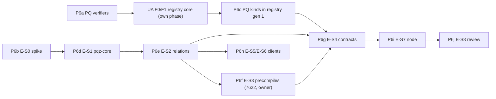

# P6 — PQ Zether and EIP-compatible PQ signatures — Roadmap

**Scope (TODO.md §00 row P6, owner 2026-10-11/12).** The PQ Zether stream E-S0…E-S9
([pq-zero-knowledge.md](../../contracts/pq-zero-knowledge.md), streams in `docs/history/specs/2026-10-06-pq-zether-design.md` §16) on
the finished token tree (`PqzToken` with CTR-PQZ-23 storage modes and CTR-PQZ-24 auditor modes), and PQ signatures as
compatible as possible with the Ethereum drafts in both directions: ML-DSA (EIP-8051, EIP-8355: the empty FIPS 204
context, `pq_msg = keccak256(TAG(kind) ‖ ua_msg)`, the EIP key encodings incl. the EIP-8051 expanded key), Falcon/FN-DSA
(EIP-8052) and the hash-based kind `slhdsa128s` (FIPS 205 SLH-DSA-SHA2-128s, 0x0133) behind a gas gate; precompiles by
probe at the EIP addresses; chain 7622's own precompile addresses moved out of the EIP-1352 range; no hybrid
(classical + PQ) kind. Spec: [accounts.md](../../contracts/accounts.md) CTR-UA-12, CTR-UA-17, CTR-UA-23 and the kind
table; [pq-zero-knowledge.md](../../contracts/pq-zero-knowledge.md) (CTR-PQZ-01…24, §9.2); [pq-eips-vs-scaas.md](../../research/pq-eips-vs-scaas.md) Q1–Q8.

**Base:** `main` at `9305f37` (P1–P5 and P3b merged; forge 890 passed / 10 skipped; clientkeys 62 / 60 / 2).

## 1. Survey (2026-10-12)

| Item | Status |
|---|---|
| UA registry with kinds (`UARegistry`, CTR-UA-*) | **Not built.** The built `src/registry/UniversalAccountRegistry.sol` is the Zether-era registry (8 `AuthScheme`s, `PQ_COMMITMENT` "verify off chain"); the kind registry is UA F0/F1 (not started). PQ Zether (E-S4) and every PQ kind need it. |
| PQ signature verifiers (`mldsa44/65`, `fndsa512`, `slhdsa128s`) | **None** before P6a: no Solidity verifier, no precompile probe, no KAT. P6a builds and measures them (below). |
| Precompile probe at EIP addresses | **None.** No EIP precompile is scheduled for any fork (EIP-8355 declined for Hegotá 2026-10-08); EIP-8052 has no addresses. |
| KATs | **None** in the repo. P6a imports ACVP FIPS 204/205 sigVer, the EIP-8051 / EIP-8052 KATs and the EIP-8355 cases, and generates SCaaS vectors. |
| `pqz-core` / LaZer | **Nothing.** No `pqz-core/`, no LaZer fork, no relations, no `pqz-ffi`. |
| SCaaS testnet Nethermind (`/home/dockers/mba-chain-nethermind`, read only) | Stock image `nethermind/nethermind:1.39.0`, Clique, Osaka-era chainspec incl. EIP-7825 and EIP-7623, `maxCodeSize` 0x10000; **no PQZ or ML-DSA precompile**, no `pqzTransitionTimestamp`. |
| clientkeys PQ seeds | **Built** after this survey: P6a added `src/pq.js` (`@noble/post-quantum` 0.7.1) and P6c the registry vectors `pq_signatures.json` (signers-clientkeys.md "PQ seeds"). |
| EIP-8051 μ-prefix concern | **Confirmed in the text, not in the vectors**: the draft's pseudocode omits FIPS 204's `0x00 ‖ len(ctx) ‖ ctx` and says a 32-byte `tr`; its KAT file and reference Solidity use the FIPS form (empty context, 64-byte `tr`). Recorded in the research note (Q1 finding). |

**P6a measurements (scratch worktree, `test/ua/PqGas.t.sol`, one `verify`, execution gas):** SLH-DSA-SHA2-128s 0.79 M
valid, **1.32 M worst case** (gate passes: ≤ 11 % of the 12 M `UA_VERIFY_BUDGET`, ≤ 13 % of Hedera's 10.5 M);
Falcon-512 2.27 M; ML-DSA-44 / -65 11.4 M / 18.9 M on the FIPS 204 key (65 is above EIP-7825's 16.78 M cap), 4.1 M /
5.8 M on the EIP-8051 expanded key; Keccak-f[1600] 66 k per permutation.

## 2. Sub-phases

Each sub-phase is one plan, accepted on its own (tests green, size gate, docs checkers, review), then merged.

| Sub-phase | Content | Depends on | Owner steps | Gate / kill |
|---|---|---|---|---|
| **P6a** PQ signature verifiers | `UAMldsaVerifier` (ML-DSA-44/65 over `pq_msg`, empty context; EIP-8355 precompile by probe; the EIP-8051 expanded key computed and verified), `UAFndsaVerifier` (Falcon-512, EIP-8052 SHAKE256 hash-to-point, padded 666-byte signatures), `UASlhdsaVerifier` (SLH-DSA-SHA2-128s on SHA-256 `0x02`) as stateless `IUAKindVerifier`s; ACVP / EIP / SCaaS vectors; clientkeys `src/pq.js` (keys from the seed, `signUA`, the expanded key); measured gas; docs. Plan: [2026-10-12-p6a-pq-verifiers.md](2026-10-12-p6a-pq-verifiers.md) | P5 (done) | none | SLH-DSA gas gate (measured: passes) |
| **P6b** E-S0 parameter spike | Lether / LNP22 / LaZer / LS18 reading; lattice-estimator `53da598` (`RC.ADPS16`, classical and quantum) for the MLWE-BFV-add instances, the proof's MSIS/MLWE instances and Kyber-512; DDGR20 leaky-LWE with 32 adversarial hints on `(r, e1)`; per-round Fiat–Shamir soundness; `estimator.txt` + research note. No heavy build (Sage in a container). **Done 2026-10-13, gate met** (branch `p6b-estimator`): `pqz-core/pqzl/params/{estimator.txt,e_s0.py,run.sh,README.md}`, note `docs/research/pqz-parameters-e-s0.md`; encryption β 476 (key/enc), worst 32-hint direction β 464 (maximal-norm mixed forms, not unit vectors), proof ABDLOP sized at MSIS n ≥ 24, m2 ≥ 66 (β 454 / 464); rounds 128.0 / 168.0 / 672.0 / 129.8 bits with κ ≥ 8 and λ ≥ 4 (λ = 3 gives 126); LNP22/LaZer constants recalled, to verify in P6d | — (may run beside P6a) | a parameter ruling only if an instance misses Kyber-512 or a round misses 128 bits (CTR-PQZ-03/04: split randomness fallback) | every instance ≥ Kyber-512 under both models, every round ≥ 128 bits |
| **P6c** PQ kinds in UA registry gen 1 | UA F9 only (owner 2026-10-12: UA F0/F1 run first as their own phase): the PQ rows of `vectors/ua/kinds.json`, the P6a verifiers wired into the gen-1 `UARegistry` with measured `verifyCap`s and `verifyBudget`, the `pqz-mlwe` hook (E-S4 plugs `UAPqzVerifier`), the optional ML-DSA expanded-key cache (§3 item 2), T-REG / T-AUTH / T-GAS for the PQ kinds. Plan: [2026-10-13-p6c-pq-kinds.md](2026-10-13-p6c-pq-kinds.md) (built: cache measured 12.76 M / 9.58 M + 13.41 M per part, caps 4.25 / 5.95 / 2.5 / 1.4 M; `pqz-mlwe` slot without a verifier; owner steps open: redeploy gen 1 on the SCaaS testnet, audit before any public chain, see TODO.md) | P6a; UA F0/F1 | none (scope and ML-DSA key form decided 2026-10-12) | T-REG, T-AUTH, T-CHAIN, T-GAS green |
| **P6d** E-S1 `pqz-core` spike | LaZer pinned (`3330e48`), six layers rewritten (integers without GMP, NTT without HEXL, integer sampler, fixed-point rejection, arena, error returns), software AES, arithmetic-layer KAT equality vs upstream, toy `R_REG` + first `R_TX` measured natively and as `wasm32`. **Spike done 2026-10-13, upstream cross-check done, kill decision pending (owner)** (branch `p6d-pqz-core`): `pqz-core/{README.md,STATUS.md}`, note `docs/research/pqz-core-e-s1.md`; the AVX-512 runner became a one-shot golden dump (upstream built statically, run once under Intel SDE 9.48 `-spr`, checked in as `kat/lazer-3330e48.json`): 19/19 cases equal; a one-time check on real AVX-512 hardware is recommended; nprime = 1 (nprime = 0 broken upstream), MSIS β 452 / 456, MLWE β 470; measured `R_TX`: proof 42.7 KB (pass), verify 15.2 s native / 33 s wasm (miss, ≈ 300×), prove 17 s / 39 s (miss, ≈ 2.8× against 6 s), symbol scan clean (pass); **P6d-2 optimisation (merged 2026-10-13, branch `p6d2-opt`): `R_TX` prove 1.10 s native / 1.59 s wasm (pass), verify 0.72 s / 0.82 s (miss, ≈ 14×), wasm memory 230 MiB (under the 256 MiB hard limit, 1.8× the budget), proofs byte-identical; research note §11.** browser budgets (CTR-PQZ-18) missed: wasm prove 39 s (hard limit 30 s), wasm memory 476 MB (hard limit 256 MiB), wasm/native 2.3–2.7× so 6 s native ≈ 14–16 s in the browser (budget 5 s); next: upstream LaZer `3330e48` (AVX2 build) on the same `R_TX` statement and parameters, prove/verify timed, to tell the fork's rewrite from the statement; optimisation only after that | P6b | the kill decision (cross-check done) | **kill** (CTR-PQZ-09): transfer proof > 96 KB, p99 adversarial verify > 50 ms, prove > 6 s desktop (3 s until 2026-10-13, owner), or GMP / MPFR / float / `abort` / `malloc` left on verify or prove paths ⇒ stop, re-plan with the hash-based fallback (owner) |
| **P6e** E-S2 relations | `R_TX`, `R_BURN`, `R_REG`, `R_DS`, `R_DR` as LaZer specifications, codegen, serialization v1, all KATs from C (incl. `worstcase_noise.json`), Rust decoder `pqz-ffi`, continuous ASan/UBSan fuzzing starts; `proofSystemId` frozen. Plan: [2026-10-14-p6e-relations.md](2026-10-14-p6e-relations.md) (two gates: P6e-A PQZL, P6e-B PQZH; decisions D1–D15 as controller proposals). Status 2026-10-14: Tasks 1–9 and 11 merged (last `0807e41`), Task 10 (fuzzing) and Task 12 (spec §8.1 serialization v1, branch `p6e-a6`) on branches, gates A / B open; op 7 `R_TXM` (P6-ANON) joins the frozen set | P6d | — | vectors and `proofSystemId` frozen |
| **P6f** E-S3 Nethermind precompiles on the SCaaS testnet | `Nethermind.Pqz` (plugin or patch on 1.39.x): `PQZ` and an ML-DSA precompile in the **EIP-8355 layout** (44 and 65), at addresses **outside the EIP-1352 range** (proposed here, ruled in the plan), P/Invoke + fuzz harness, p99 adversarial gas calibration incl. cold `OP_SELFTEST`, image `scaas/nethermind-pqz:<v>-pqz<n>`, throwaway copy of the SCaaS testnet; then live on the SCaaS testnet (owner grant 2026-10-14). Plan: [2026-10-14-p6f-precompiles.md](2026-10-14-p6f-precompiles.md) (plugin, not patch; decisions D1–D15 as controller proposals). **Status 2026-10-16 (branch `p6f`): Tasks 1–9 done, the copy gate passed** (harness 1 h clean, image `pqz1` `c53359a69bfa`, one calibration: rows 2.57–5.41 M gas, ML-DSA 49 k / 68 k; both activation paths, 80 M, kill drill, rollback); **Task 10 done 2026-10-16: merged `a243650`, live on the SCaaS testnet** (reset with `engine.Pqz` from block 0, genesis hash unchanged; probes and e2e pass, `pqz-core/nethermind/runs/2026-10-16-live.txt`) | P6e | **every change to the SCaaS testnet is the owner's, on the owner's machine**: image swap on signer and followers, chainspec `pqzTransitionTimestamp`, `TargetBlockGasLimit` 80 M, `TxPool.MaxTxSize`, follower-only public RPC with rate limits; the address choice | pq-zero-knowledge.md §10 steps 1–2 and 5 pass on the copy |
| **P6-ANON** multi-recipient transfer | op 7 `R_TXM` in PQZL and PQZH, `pqz-stmt`, `pqz-ffi`, vectors, fuzzing, the package, the live precompile on the SCaaS testnet (S1–S9 done 2026-10-15…17), spec CTR-PQZ-25 / -26 (S7); hand-offs: P6g op 7 entry points (`pqzTransfer*` = op 7, `pqzTransferSingle*` = op 1), P6h decoy policy (registry per-kind list CTR-UA-29), P6i indexer / keeper for `PqzTransferMulti` and per-leg `PqzCredit` | P6e, P6f | review D1–D21 (plan `2026-10-14-p6-anon.md`); the audit covers `R_TXM` and threats T21–T26 | gate P6-ANON-L / -H (plan), then P6e gate A / B with op 7 |
| **P6g** E-S4 contracts | `PqzSafety`, `UAPqzVerifier`, the P6a `UAMldsaVerifier` deployed on the SCaaS testnet with the new precompile as candidate (deploy requires the probe to pass), `PqzToken` on `MetaTokenBase` with CTR-PQZ-15/21/22 (relaying), **CTR-PQZ-23** (`disclosureMode` BUNDLE / COMPACT, sender memo) and **CTR-PQZ-24** (`auditorMode` NONE / FULL / OPTIONAL), `PqzCt`, `OpenFactory.pqzEnabled` and the `*_PQZ` kinds (CTR-TOK-21), forge tests with mocks, e2e on the SCaaS testnet copy. Plan: [2026-10-16-p6g-contracts.md](2026-10-16-p6g-contracts.md) (decisions D1–D16 as controller proposals). **Status 2026-10-16 (branch `p6g`): built** — `PqzSafety`, `PqzCt`, `UAPqzVerifier`, `PqzLib` / `PqzLayer`, `NoUnderlyingPqzToken` / `UnderlyingPqzToken`, the factory gate, the v3 binding and batch hooks; forge tests with the precompile mocked; deployed on the SCaaS testnet with real proofs (plan §4, `smartcontracts/evm/runs/2026-10-16-p6g-7622.txt`); op 7 entry points after P6-ANON S3–S8 | P6c, P6e (vectors), P6f (e2e) | deploy on the live SCaaS testnet (owner mandate 2026-10-15: the controller deploys) | pq-zero-knowledge.md §14 contract cases + invariants |
| **P6h** E-S5 / E-S6 clients | `zether-prover --features pq`, `pqz-cli` (incl. `--envelope`), clientkeys `sealPqKey` / `openPqKey` and the `PqzToken` domains in the envelope builders; then the retail WASM prover (§11.5 budgets, WASM/native bit-exactness, loopback `pqz-cli serve` fallback) | P6e (E-S5); E-S5 then E-S6 | — | cross-language vectors green; §11.5 budgets met or the fallback green |
| **P6i** E-S7 node | `pqz` chain profile (genesis hash = registry `chainUid()` = token `chainUid`), probe `has_pqz_precompile`, `metatx` / `ua_metatx` for `kind = pqz` tokens and `pqz_call` (follower pre-simulation, never batched), limits (`max_gas_per_tx` 16 M, 1 MiB body on the profile; checked for op 7 in P6-ANON S9), age-gated rollover keeper; op 7 (P6-ANON): indexer for `PqzTransferMulti` + per-leg `PqzCredit`, keeper over decoy credits ([ops.md §13](../../node/ops.md#pqz)) | P6g; UA F5 (`ua_metatx`) | node config on the owner's chain | e2e: fund → transfer → rollover → burn → disclose, direct and in v1 / v3 envelopes |
| **P6j** E-S8 review | Claude-subagent reviews of P6a–P6i, the fuzz corpus, the threat-model walk-through (T1–T15) | P6i | — | review log |
| **G-LIC** licence gate | LaZer (MIT, no patent grant), LNP22-family IP, GMP / MPFR absent from every shipped artifact, HEXL notice, ML-DSA and WASM toolchain licences (P6a: SCaaS's own verifiers, `@noble/post-quantum` MIT) | may start any time; step 1 technical inventory done on branch glic-inventory (`docs/research/pqz-licence-inventory.md`) | **owner** (legal review, written clearance) | release gate before any production or commercial use |
| E-S9 (later) | LaBRADOR aggregation, FN-DSA when FIPS 206 is final (`fndsa512.v2`), co-processor seam for customer chains, `pqz-cli serve` LAN mode | owner | owner | — |

Heavy builds stay serial (`scripts/capped`, one at a time): P6a → UA F0/F1 → P6c and P6d → P6e → P6f → P6g → P6h → P6i; P6b,
G-LIC and the reviews run beside them. P6a and P6b can start now.

## 3. Owner steps (collected)

1. **P6c scope — decided (owner 2026-10-12):** UA F0/F1 run first as their own phase (before P6c); P6c then only adds
   the PQ kinds (UA F9) to registry gen 1.
2. **P6c ML-DSA stored key — decided (owner 2026-10-12):** the FIPS 204 pk, canonical (UA id `keccak(TAG ‖ pk)`,
   keyHash, EIP-8355 path). The EIP-8051 expanded key is an optional cache attachable later: the registry computes it
   itself with `expandKey(pk)` (never accepts one from a caller: a caller-supplied key allows universal forgery) and
   stores it once per UA id, both levels, by SSTORE2 in data contracts under EIP-170's 24,576 B (-44: one chunk
   ≈ 20.5 KB; -65: two ≈ 18.5 KB), mapping UA id → chunk pointers; each verify reads it by EXTCODECOPY (no calldata
   key). -65's cache registration (≈ 15.30 M expansion + ≈ 7.4 M SSTORE2) exceeds the 16.78 M tx cap, so it runs over
   several transactions (e.g. by  row, one chunk per tx). Without the cache: the precompile where present, else
   ML-DSA is unusable on that chain. Measured `expandKey`: 8,519,511 (44) / 15,304,306 (65); the other figures are
   estimates for P6c to measure.
3. **P6d kill** — if E-S1 misses its criteria, the hash-based fallback re-plan. E-S1 misses verify (≈ 300×) and prove
   (≈ 2.8× against the 6 s limit); the upstream timing cross-check the owner ordered is done: upstream LaZer on the same `R_TX` is 2.3–2.6× faster than the fork and still misses both (prove 6.6 s, verify 6.6 s; research note §10) (P6d row); the decision is pending (owner).
4. **P6f SCaaS testnet** — every docker / chainspec / gas-limit / RPC-topology change on `/home/dockers/mba-chain-nethermind`
   and the live roll-out; the private precompile addresses outside 0x00…0xffff.
5. **P6g** deploy on the live SCaaS testnet.
6. **G-LIC** written clearance before production.

## 4. Open questions (not blocking P6a)

- EIP-8051's text (μ without the `M'` prefix, 32-byte `tr`, `t1` without `2^d`) vs its vectors and reference code —
  worth reporting upstream; SCaaS follows the vectors, and the probe refuses a precompile built from the text.
- EIP-8052's 666-byte split (salt 40 ‖ 626 vs header 1 ‖ salt 40 ‖ 625), `h` in the NTT domain for `FALCON_CORE`, and
  `<` vs the reference `≤` — matters only when 8052 gets addresses.
- Keccak-f at 66 k gas is the largest lever on every SHAKE-based verifier (a Fireblocks-style helper reached ~44 k);
  optimisation is deferred (owner: optimise later).
- FN-DSA keys from a seed are implementation-specific (pinned to `@noble/post-quantum` 0.7.1 by the vectors).
- Continuous differential fuzzing (T-FUZZ) against a second implementation: P6a ships the deterministic part only.
