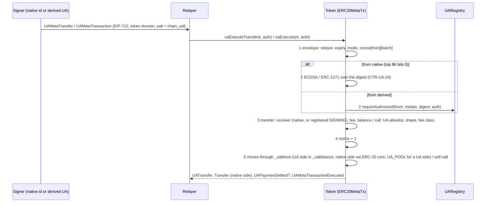

# UA-4 — the UA ledger (UA F2): `_uaBalance` and `UA_POOL` in the token base, `UATransfer`, the `ua*` functions with `UAMetaTransaction` / `UAMetaTransfer`, one `bytes32` nonce map, `metatx3.json` — Implementation Plan

> **For agentic workers:** REQUIRED SUB-SKILL: Use superpowers:subagent-driven-development (recommended) or superpowers:executing-plans to implement this plan task-by-task. Steps use checkbox (`- [ ]`) syntax for tracking.

**Goal:** the UA-4 row of the [UA roadmap](2026-10-12-ua-roadmap.md): the UA ledger of every SCaaS token
(accounts.md CTR-UA-18, CTR-UA-19, CTR-UA-26) — balances of derived UAs by `bytes32` id, shown to ERC-20 observers as the
one holder `UA_POOL`, `UATransfer`, `transferToUA`, the generic `UAMetaTransaction` path (`uaExecute`, `uaBatch`,
`uaUnwrap`) and the typed `UAMetaTransfer` path (`uaExecuteTransfer`, `uaBatchTransfer`, `uaTransfer`,
`uaTransferWithFee`, `uaPay`), `uaCancelNonce`, the one nonce map shared with the address path, the v3 KAT
`metatx3.json`; this closes MT-2's UA path. Gate: T-V3-1, T-V3-2, T-V3-3, T-V3-3b (T-V3-4 deferred, owner: Glamsterdam).
Not here: P6c (PQ kinds), the template library, SCaaS Chain 22776, the node's `ua_metatx` jobs (UA F5).

**Architecture:** Everything sits in the one token base, so every kind gets it. `MetaTxBase` keys its one nonce map by
`bytes32` (a native address zero-padded: the storage slots of native ids do not move) and carries the signer of a
self-call as a 32-byte id in the transient sender slot; a derived id makes `_msgSender()` return `UA_POOL`.
`ERC20MetaTx` holds the registry (an implementation immutable, moved there from `ZetherLayer`; 0 = ledger off), the
`bytes32` balances (ERC-7201 `scaas.ua.ledger`) and both UA pipelines. `UA_POOL`'s own ERC-20 slot is Σ of the UA
balances: every UA-ledger move goes through the ERC-20 core with `UA_POOL` standing for the derived side, so `Transfer`
events, `totalSupply` and `balanceOf(UA_POOL)` come out right by construction, and `_update` refuses every other move to
or from `UA_POOL` except the burn of a self-call under a derived UA (`unwrap`), which debits that UA. A native `from`
signs the v3 digest itself (ECDSA, or ERC-1271 with the CTR-UA-24 7702 rule, `SigCheck.isValid7702`); a derived `from`
is the registry's `requireAuthorized(from, metatx, digest, auth)`. The named functions live in `MetaTokenBase` beside the
`mtx*` ones. clientkeys builds the two typed-data shapes; `ua-sig-vectors.mjs` signs them with every classical kind
into `metatx3.json`; Foundry recomputes the digests and verifies with the real verifiers.



**Tech Stack:** Solidity 0.8.37, Foundry (forge 1.3.5, osaka, OpenZeppelin 5.2), the UA registry gen 1 (UA-2a…UA-3);
Node 22 (`clients/clientkeys`, `@noble/*` as pinned); anvil, cast for the deploy checks; Rust only to run the scaas-node
e2e (no Rust source change).

**Spec:** `docs/contracts/accounts.md` §1 — CTR-UA-14 (who is accepted where), CTR-UA-18 (ledger, `UA_POOL`, events),
CTR-UA-19 (structs, domain, `initialize` check), CTR-UA-24 (native classification), CTR-UA-26 (the split, function
table, rules, fees, events), §1.5 purposes (`metatx`, `metatx-cancel`), §1.16 (`metatx3.json`, T-V3-1…4);
`docs/contracts/metatx.md` CTR-MTX-02, -07, -08, -09, -11, -13, -15, -17, -18, -19, -20, -22, -23, -24 and §6 (lanes);
`docs/contracts/token-wrappers.md` CTR-TOK-21…24 (tree, kinds, size gate); design record
`docs/history/specs/2026-10-06-universal-account-design.md` §16 (F2 = MetaToken v3; F5 = node).

**Base:** `main` at the commit that adds this plan (parent `811fb8b`: UA-1, UA-1b, UA-2a/2b/2c, UA-3, the UA client dirs
rename and the license rename merged; forge 1047 passed / 10 skipped; clientkeys `node --test` 94 / 92 / 2 skipped).
**Spiked 2026-10-12:** every task was built in a scratch worktree from `811fb8b`, in this order, and run green; the diffs
below are that worktree's commits (each checked with `git apply --check --whitespace=error` on a clean `main` copy, in
sequence, Task 6 after the roadmap link this plan's commit adds; Task 4's regenerated `metatx3.json` byte-identical,
sha256 `de2604bc903f6b5f598a0331659ddb01a47008bfe6d4aa8b66c1d4a1b898217a`). Measured there: Task 1 forge 1051 passed /
10 skipped, size gate 0 errors after the baseline update; Task 2 forge 1072 / 10 (`UALedger` 21), size gate 0 errors;
Task 3 forge 1082 / 10 (`UALedgerNamed` 7, `UALedgerInvariant` 3 × 64 runs × 32 calls, 0 reverts); Task 4 forge 1085 /
10 (`UAMetaTx3Vectors` 3), clientkeys 97 / 95 / 2 skipped, the generator reproduces `signatures.json` and
`ed25519_fuzz.json` byte for byte; Task 5 `Deploy.s.sol` on an anvil 31901 refused without the flag (`is above the
contract size limit (31719 > 24576)`) and green with it, `DeployHedera.s.sol` on an anvil 298 green,
`scripts/e2e-zether.sh` 3/3 (a first attempt hung at block 0 with a leftover anvil on port 18545; rerun green),
scaas-node `cargo test --test e2e -- --ignored` 4 passed and `--test e2e_hedera -- --ignored` 1 passed; Task 6 docs
checker 0 errors (the 1 warning is the pre-existing `token-wrappers.md` budget), facts 8852 / 0 misses. Sizes (runtime /
init, B): `NoUnderlyingToken` 23,042 → 31,719 / 33,225; `UnderlyingToken` 30,142 → 39,138 / 40,651;
`NoUnderlyingZetherToken` 31,412 → 40,016 / 41,676; `UnderlyingZetherToken` 40,951 → 49,727 / 51,422 (over EIP-3860's
49,152). Gas of one `uaExecuteTransfer` (a payment to a native payee with a FIXED fee, fresh pay lane, real verifiers,
`test/ua/UAMetaTx3Vectors.t.sol -vv`, measured inside one test so only the first row is cold): native 119,788 (cold),
`webauthn-p256` 126,134, `p256` 109,056, `bip340` 109,406, `schnorr-bn254` 128,014, `schnorr-bls12381` 141,327,
`bls12381-minsig` 260,733, `bls-bn254-minsig` 224,925, `ed25519` 267,680. **Not run in scratch:** the merged tree, CI.

## Global Constraints

- Paths relative to `/home/ha/work/ainative/scaas`; work in a worktree `.claude/worktrees/ua4` on branch `ua4-ledger`
  from `main` (symlink `smartcontracts/evm/lib` and `clients/clientkeys/node_modules` from the main checkout). Heavy
  commands (forge, cargo, node tests, anvil runs) only through `scripts/capped`, one at a time machine-wide (it takes a
  machine-wide lock: a second capped command waits; after any capped `dotnet` command run `dotnet build-server
  shutdown` — none is needed here); `/usr/bin/git`, `/usr/bin/grep`; forge in `smartcontracts/evm`.
- Task order is fixed: 1 plumbing → 2 ledger → 3 named functions + invariants → 4 vectors → 5 deploy → 6 docs. The
  branch merges as a whole after Task 6.
- Each code step applies the task's diff verbatim: save the fenced block to `/tmp/ua4-tN.patch`, then
  `/usr/bin/git apply --check --whitespace=error /tmp/ua4-tN.patch && /usr/bin/git apply /tmp/ua4-tN.patch` (no output).
  `smartcontracts/vectors/ua/metatx3.json` is never edited by hand: `ua-sig-vectors.mjs` writes it (Task 4).
- `kinds.json`, `structures.json`, `signatures.json`, `groups.json`, `ed25519_fuzz.json` and the PQ vectors must not
  change (the generator rewrites `signatures.json` and `ed25519_fuzz.json` byte-identically); `clients/ua-*` and the
  bindings are not touched; the existing KATs (`metatx_kat.json`, `metatransfer_kat.json`, …) do not change.
- No SCaaS testnet or real/public-chain action and no change to chain docker/chainspec files: every deploy check runs on a
  local anvil. Before an anvil run, make sure its port (18545, 18546) is free (`cast chain-id --rpc-url …` fails).
- No size optimisation (owner: wait for Glamsterdam); the size gate must pass — record new sizes in
  `smartcontracts/evm/size-baseline.json` (Tasks 1–3) instead of optimising. Test chains run 64 KiB code.
- Superseded code goes to `legacy/` (owner: backup, not delete) — nothing is superseded here; every chain is a test chain:
  redeploy, no migration.
- SPDX header of every new Solidity file: `// SPDX-License-Identifier: LicenseRef-Vegan-Community-1.0`.
- Commit trailer: the model that wrote the commit, e.g. `Co-Authored-By: Claude Opus 5.5 <noreply@anthropic.com>`. Never
  `git add` `claude-code-api.txt`, `out/`, `cache/`, `target/`, `node_modules/`, `smartcontracts/evm/lib/`,
  `smartcontracts/evm/deployments/`, `broadcast/`. Delete `smartcontracts/evm/deployments/*.json` and `broadcast/` that
  the deploy checks write.
- Stop every background shell and anvil you started before reporting.

## Review Focus

- **`UA_POOL`'s slot stays Σ of the UA balances:** no native transfer, `transferFrom`, mint, burn, fee (either path),
  Zether unshield or DEX leg may credit or debit `UA_POOL` (all revert `UAPoolNotPayable` in `_update` or before), and
  no one can sign as `pad(UA_POOL)` — `test_T_V3_3b_poolNotPayable`, `test_T_V3_3_feeRecipientIsPayee`, the
  `UALedgerInvariant` replay.
- **A self-call under a derived UA spends only that UA:** only the UA allowlist runs (`unwrap`), `_msgSender()` is
  `UA_POOL`, the burn debits the subject and fails `UAInsufficientBalance` past its balance; `approve`, `transfer`,
  `mtxTrade` under a UA (or a native id) are `MetaTxUnknownOp` — `test_uaExecute_unwrapUnderUA`,
  `test_T_V3_3_approveAndTradeRefused`.
- **One lane, one nonce:** an address-path signature and a UA-path signature on the same lane consume one sequence;
  `cancelNonce` and `uaCancelNonce` bump the same map; a named function and its struct entry share digest and nonce —
  `test_T_V3_1_sharedNonceMap`, `test_T_V3_1_*`.
- **Native signature confusion:** the UA path's native signature is over the v3 digest (never the `UAAuth` wrapper the
  registry uses), a 7702 delegate's ERC-1271 passes here and not on v2's `_isContract` rule — `test_nativePath`,
  `test_7702_nativeFrom`, `test_isValid7702`.
- **Cancel replay and purpose:** a `metatx-cancel` signature cancels once, never as `metatx`, never after
  `validUntil`, never for a native id; a registry of another `chain_uid` cannot be bound — `test_uaCancelNonce`,
  `test_T_V3_3b_cancelNative_refused`, `test_initialize_registryChainUid`.

## Rulings (docs vs code) and defaults taken

- **L4-1 Registry binding.** The UA registry is an implementation immutable `_REGISTRY` of `ERC20MetaTx` (moved from
  `ZetherLayer`, which keeps its `BadInit` check on it), a constructor argument of every kind after `chainUid_`:
  `(factory, smartKeyAccountImpl, chainUid, registry, isHedera)`; the Zether kinds' constructors are unchanged.
  `initialize` reverts `UARegistryChainUid(registryUid, tokenUid)` unless `registry.chainUid() == CHAIN_UID` (CTR-UA-19,
  "checked at initialize"). `registry = 0` turns the ledger off: every `ua*` and `transferToUA` reverts `UALedgerOff`,
  `supportsInterface(IUALedger)` is false (the gateway's "v3: `registry() ≠ 0`"). `DeployBase` deploys the registry
  first and passes it to `NONE`; tests that need no ledger pass 0.
- **L4-2 The pool's slot is the total.** CTR-UA-18 says `balanceOf(UA_POOL)` returns `_uaTotal` and "the native slot of
  `UA_POOL` is never written". Built: `_uaTotal` *is* that ERC-20 slot, written only by UA-ledger moves through
  OpenZeppelin's `_update` with `UA_POOL` standing for the derived side; the observable rules (balance, `totalSupply`,
  `Transfer(sender, UA_POOL)` / `Transfer(UA_POOL, to)`, no `Transfer` for UA → UA) hold by construction and no
  `balanceOf` override is needed. Every other move to or from `UA_POOL` reverts `UAPoolNotPayable`. Spec text updated.
- **L4-3 Self-call under a derived UA.** The transient sender slot carries the signer as a 32-byte id; a derived id makes
  `_msgSender()` return `UA_POOL` and `_ticketSubject()` the id. `_update(from = UA_POOL)` inside such a self-call debits
  that UA (`UAInsufficientBalance` past its balance) and emits `UATransfer(ua, pad(to))`; with no live derived subject it
  reverts. So `unwrap` runs unchanged and a burn under a UA emits `UATransfer(ua, 0, v)` + `Transfer(UA_POOL, 0, v)`.
- **L4-4 UA allowlist.** `_uaAllowed(bytes4)` (virtual, false on the base and `NONE`; `UnderlyingToken` and so
  `UNDERLYING_ZETHER`: `unwrap(uint256,address,uint256)` and `unwrap(address,uint256,address,uint256)`). Any other
  selector — `approve`, `mtxTrade`, `transfer`, … — reverts `MetaTxUnknownOp(selector)` at step 3 (after the signature,
  as the address path's shape errors), for native and derived `from`; then the address path's shape and fee-class rules
  apply. PQZ selectors come with `PqzToken` (P6+). The UA envelope binding is 0 (no confidential selector is on it).
- **L4-5 Native signer on the UA path.** CTR-UA-24 by code at verify time: `SigCheck.isValid7702` (no code ⇒ ECDSA; the
  23-byte designator ⇒ ECDSA, else ERC-1271 through the delegate; other code ⇒ ERC-1271; same caps, the 400 k
  `SmartKeyAccount` clone cap included) over the v3 digest itself; Hedera's HIP-632 branch as on the address path
  (`MetaTokenBase._requireNativeUASignature`); `from = pad(UA_POOL)` reverts `UAPoolNotPayable`. v2's `SigCheck.isValid`
  is unchanged (spec: "stays unchanged").
- **L4-6 Receivers and fee recipients.** `to` native: ≠ 0 (`PayToZero`), ≠ the token (`TransferToSelf`), ≠ `UA_POOL`
  (`UAPoolNotPayable`); `to` derived: `kindOf ≠ 0` (else `UANotRegistered`, predecessor included) and SIGNING (else
  `UAKindNotAccepted(to, kind)`: every Zether kind, `pqz-mlwe` included). `transferToUA` takes a derived `to` only
  (native ⇒ `UANotRegistered`). A fee recipient `UA_POOL` reverts on both UA paths and on the address path's self-call
  fee (`_callFee`); the payee check compares `pad(feeRecipient)` with `t.to` (CTR-UA-26).
- **L4-7 Events.** `UATransfer(bytes32 indexed from, bytes32 indexed to, uint256 value)` (indexing unspecified; indexed
  like `Transfer`); a UA payment emits `UAPaymentSettled(bytes32 indexed from, bytes32 indexed to, uint256 amount,
  uint256 feeAmount, address feeRecipient, bytes32 indexed entryRef)` (`PaymentSettled` is address-typed);
  `uaCancelNonce` emits `UANonceCancelled(bytes32 indexed ua, uint256 indexed batch, uint256 newNonce)`.
- **L4-8 `metatx-cancel`.** The spec's `CANCEL_TAG` is never defined: it is `PURPOSE_METATX_CANCEL` itself (no new
  constant in six libraries). The digest has no nonce, so a replay inside `validUntil` would bump the lane again and
  kill intents signed after the cancel: each digest works once (`UACancelUsed`, stored in `scaas.ua.ledger`). View
  `uaCancelDigest(ua, batch, validUntil)`. A native `ua` reverts `UAKindNotAccepted(ua, 0)` (natives use `cancelNonce`).
- **L4-9 Errors.** `IUALedger`: `UALedgerOff`, `UARegistryChainUid(bytes32, bytes32)`, `UAPoolNotPayable`,
  `UANotRegistered(bytes32)`, `UAKindNotAccepted(bytes32, uint16)`, `UAInsufficientBalance(bytes32, uint256, uint256)`,
  `UACancelUsed`, `MetaTxUnknownOp(bytes4)`. A derived signer's failure is the registry's `UAUnauthorized(ua)`, bubbled.
- **L4-10 Interfaces.** `IUALedger` (implemented by `ERC20MetaTx`): events, errors, `registry`, `balanceOfUA`,
  `uaNonce`, `uaDigest`, `uaTransferDigest`, `uaCancelDigest`, `transferToUA`, `uaExecute`, `uaBatch`,
  `uaExecuteTransfer`, `uaBatchTransfer`, `uaCancelNonce`. The named `uaTransfer`, `uaTransferWithFee`, `uaPay`,
  `uaUnwrap` join `IMetaTokenV2` (`MetaTokenBase`, beside the `mtx*` named functions, CTR-MTX-09). `IZetherToken is
  IUALedger` (its `registry()` is the ledger's).
- **L4-11 Named functions.** Mode shapes as their `mtx*` mirrors (`uaTransfer`: `mode & ~RESTRICT_RELAYER == 0`;
  `uaTransferWithFee`: `_requireFeeShape`); `uaPay` needs `PAYABLE` like `mtxPay` (a `UAMetaTransfer` with `entryRef` is
  never gated); `uaUnwrap` builds `unwrap(address,uint256,address,uint256)` with fee `NONE` (the flat ABI has no fee
  fields; a fee goes through `uaExecute`) and returns the inner call's bytes.
- **L4-12 One nonce map.** `MetaTxStorage.nonce` is keyed by `bytes32`; native ids are `MetaTxLib.pad(address)`, whose
  mapping slots equal the earlier `address` keys (no layout change). `_checkEnvelope`, `_useNonce` take the id;
  `_bumpNonce`, `_nonce` are shared by `cancelNonce` / `uaCancelNonce` / `uaNonce`. `MandateWallet` and
  `SmartKeyAccount` are unaffected (they pad).
- **L4-13 Size.** No size work (owner): sizes recorded per task in `size-baseline.json`; `UnderlyingZetherToken`'s init
  code passes EIP-3860, so `scripts/size_gate.py` learns `<name>.init` ratchet entries (self-test extended). T-V3-4 and
  CTR-UA-26's "fallback decoder above 24 576 B" are deferred to Glamsterdam; `test_sizes` bounds become 32,768 / 40,960.
- **L4-14 Deploy.** `NoUnderlyingToken` no longer fits 24,576 B, so `deploy.sh` (evm and hedera) and the scaas-node e2e
  pass `--code-size-limit 65536` to `forge script` always; chains need 64 KiB code (anvil, SCaaS testnet). Real public chains
  cannot take a token implementation until Glamsterdam (noted, not fixed).
- **L4-15 `metatx3.json`.** Generated by `clients/clientkeys/scripts/ua-sig-vectors.mjs` (the UA signature generator,
  which holds every classical signer; the spec's `ua-vectors.mjs` writes the identity layer), from clientkeys' new
  `uaMetaTxTypedData` / `uaMetaTransferTypedData` on context A of `structures.json`, with the native key and the eight
  derived keys of `signatures.json` (their PoPs register them): one `UAMetaTransaction` row (`unwrap` with a PERCENT
  fee) and one `UAMetaTransfer` row (a payment with a FIXED fee) per signer, each with typed data, struct hash, digest,
  auth. Foundry (`test/ua/UAMetaTx3Vectors.t.sol`) is the independent side: it recomputes every digest on a token clone at
  the vector address, verifies every auth with the real verifiers, executes every transfer. Group kinds and `msig`
  (signers in Rust, UA F3) and PQ (P6c) rows come later.
- **L4-16 Libraries.** The UA libraries (`clients/ua-*`, bindings) carry the identity layer, not meta-transaction
  digests (the v1/v2 structs are not in them either): unchanged. clientkeys exports the builders and `padId` (also from
  `passkey-signer.js`).
- **L4-17 Node.** `ua_metatx` jobs, the mesh body `evm.ua_meta_tx`, the indexer's `UATransfer` / `UA_POOL` pairing are UA
  F5 (design §16 stream table): not here; the node gets only the deploy flag in its e2e. MT-2 closes (its UA path is the
  contract and the vectors); MT-8's UA part stays with F5 (TODO).
- **L4-18 A native `from` through `uaExecute`** runs exactly as `mtxExecute` (the subject is the padded address, the
  self-call sees the address), but only for UA-allowlisted selectors.
- **L4-19 Carry-overs.** None of the open TODO / HANDOFF items belongs here: the UA-2c and UA-3 follow-ups are UA F3 /
  P6c, the P1d parked gaps stay parked, the prover gas cap is Zether. bamboo-dms needs nothing (no KAT changes). TODO's
  UA-3 entry, still "not merged", is marked merged in Task 6.
- **L4-20 Gas.** Logged, not asserted (as P1c): the `UAMetaTx3Vectors` per-kind figures in the header; the ledger adds
  one `kindOf` for a derived `to`, one registry call for a derived `from`, and a `UATransfer` per derived side.

## Open questions (not blocking)

- Reconciliation: whether a UA payment between two native ids should also emit `PaymentSettled` (today: only
  `UAPaymentSettled`; the address path covers native payers).
- CI job for `scripts/e2e-zether.sh` and the scaas-node e2e (both need anvil, forge and node in one job).
- The node's view of `UAPaymentSettled` and `UANonceCancelled` (UA F5 normaliser).

## Out of scope (next)

P6c (PQ kinds, `pqz-mlwe`, `PqzToken`'s UA selectors), UA F3 (JS signers for the group kinds, `metatx3.json` group and
`msig` rows), UA F5 (node `ua_metatx`, mesh, indexer), DEX v2 with a UA-ledger allowance (`uaApprove`), the template
library, SCaaS Chain 22776, the size work (Glamsterdam).

---

### Task 1: Plumbing — the UA structs, `UA_POOL`, one `bytes32` nonce map, the signer as an id, `SigCheck.isValid7702`

No behaviour change for any existing path; it gives Tasks 2–4 their names.

**Files:**
- Modify: `smartcontracts/evm/src/common/MetaTxLib.sol` (`UA_POOL`, `pad`, `UAMetaTransaction`, `UAMetaTransfer`, their
  typehashes and `hashStruct`), `smartcontracts/evm/src/metatx/MetaTxBase.sol` (nonce map by `bytes32`, `_nonce`,
  `_bumpNonce`, `_checkEnvelope(bytes32 …)`, `_useNonce(bytes32, …)`, `_checkCall(bytes, uint32)`, `_selfCall(bytes32
  subject, bytes data, bytes32 binding)` internal, `_msgSender()` → `UA_POOL` for a derived subject, `_ticketSubject()`),
  `smartcontracts/evm/src/common/SigCheck.sol` (`isValid7702`; `isValid` split into `_ecdsa` / `_erc1271`, unchanged),
  `smartcontracts/evm/src/metatx/ERC20MetaTx.sol` (the typed path pads `t.from`), `smartcontracts/evm/size-baseline.json`
- Test: `smartcontracts/evm/test/metatx/MetaTxLib.t.sol` (+3), `smartcontracts/evm/test/metatx/SigCheck.t.sol` (+1),
  `smartcontracts/evm/test/metatx/MetaTxBaseLane.t.sol` (pads), `smartcontracts/evm/test/metatx/MsgSenderLint.t.sol`
  (`MetaTxBase` 8 → 9 reads: `_ticketSubject`)

**Interfaces:**
- Consumes: `main` (`MetaTxBase`, `ERC20MetaTx`, `SigCheck`, OpenZeppelin `ECDSA`).
- Produces: `MetaTxLib.UA_POOL = 0x41a67Ed99B9DC0332Eecb4D680667CCfc17A5c56`; `MetaTxLib.pad(address) → bytes32`;
  `struct UAMetaTransaction {bytes32 from; bytes data; uint256 batch; uint256 nonce; uint256 validUntil; uint32 mode;
  address relayer; uint256 fee; address feeRecipient;}`; `struct UAMetaTransfer {bytes32 from; bytes32 to; uint256
  value; bytes32 entryRef; uint256 batch; uint256 nonce; uint256 validUntil; uint32 mode; address relayer; uint256 fee;
  address feeRecipient;}`; `UAMETATX_TYPEHASH = 0xd9c5f787…c2b859`, `UAMETATRANSFER_TYPEHASH = 0xae67b40d…7f250e`;
  `hashStruct(UAMetaTransaction)`, `hashStruct(UAMetaTransfer)`. `MetaTxBase` internals: `_nonce(bytes32, uint256)`,
  `_bumpNonce(bytes32, uint256) returns (uint256)`, `_checkEnvelope(bytes32 from, uint256 batch, uint256 nonce, uint256
  validUntil, uint32 mode, address relayer)`, `_useNonce(bytes32, uint256)`, `_checkCall(bytes memory data, uint32 mode)
  returns (uint256 basis)`, `_selfCall(bytes32 subject, bytes memory data, bytes32 binding) returns (bytes memory)`,
  `_ticketSubject() returns (bytes32)`. `SigCheck.isValid7702(address, bytes32, bytes memory, uint256) returns (bool)`.

- [ ] **Step 1: Apply the diff** below (`/tmp/ua4-t1.patch`; Global Constraints).
- [ ] **Step 2: Test.** In `smartcontracts/evm`: `../../scripts/capped forge test --match-path 'test/metatx/*'` —
  `Ran 12 test suites …: 123 tests passed, 0 failed, 0 skipped` (new: `test_uaTypehashesArePinned`,
  `test_uaPoolAndPad`, `test_uaHashStruct_encodingAndZeroing`, `test_isValid7702`).
- [ ] **Step 3: No regression.** `../../scripts/capped forge test` — `1051 tests passed, 0 failed, 10 skipped`.
- [ ] **Step 4: Size gate.** `../../scripts/capped forge build src --sizes --json > /tmp/ua4-sizes.json; python3
  ../../scripts/size_gate.py /tmp/ua4-sizes.json size-baseline.json` — `size gate: 0 error(s), 83 contracts` (the
  baseline in the diff: `NoUnderlyingToken` 23,198, `UnderlyingToken` 30,293, `NoUnderlyingZetherToken` 31,517,
  `UnderlyingZetherToken` 41,048 — the subject logic in `MetaTxBase`).
- [ ] **Step 5: Commit.**
```bash
/usr/bin/git add smartcontracts/evm/src/common/MetaTxLib.sol smartcontracts/evm/src/common/SigCheck.sol \
  smartcontracts/evm/src/metatx/MetaTxBase.sol smartcontracts/evm/src/metatx/ERC20MetaTx.sol \
  smartcontracts/evm/size-baseline.json smartcontracts/evm/test/metatx
/usr/bin/git commit -m "UA-4 T1: the UA structs and UA_POOL in MetaTxLib, one bytes32 nonce map and the signer as an id in MetaTxBase, SigCheck.isValid7702" \
  -m "Co-Authored-By: Claude Opus 5.5 <noreply@anthropic.com>"
```

`/tmp/ua4-t1.patch`:

````diff
diff --git a/smartcontracts/evm/size-baseline.json b/smartcontracts/evm/size-baseline.json
index a1de752..583d39d 100644
--- a/smartcontracts/evm/size-baseline.json
+++ b/smartcontracts/evm/size-baseline.json
@@ -1,7 +1,7 @@
 {
   "_comment": "CTR-TOK-24 size gate (scripts/size_gate.py). Contracts allowed over their limit, with the measured runtime size they may not exceed. Owner 2026-10-11: size optimised later; remove an entry once the contract fits.",
-  "NoUnderlyingToken": 23042,
-  "UnderlyingToken": 30142,
-  "NoUnderlyingZetherToken": 31412,
-  "UnderlyingZetherToken": 40951
+  "NoUnderlyingToken": 23198,
+  "UnderlyingToken": 30293,
+  "NoUnderlyingZetherToken": 31517,
+  "UnderlyingZetherToken": 41048
 }
diff --git a/smartcontracts/evm/src/common/MetaTxLib.sol b/smartcontracts/evm/src/common/MetaTxLib.sol
index 307320c..0f2aa03 100644
--- a/smartcontracts/evm/src/common/MetaTxLib.sol
+++ b/smartcontracts/evm/src/common/MetaTxLib.sol
@@ -133,6 +133,71 @@ library MetaTxLib {
         ));
     }
 
+    // ------------------------------------------------------------------ the UA ledger (accounts.md CTR-UA-18/19/26)
+
+    /// @notice CTR-UA-18: the one address ERC-20 observers see for the whole UA ledger; `balanceOf(UA_POOL)` = Σ of the
+    ///         derived UAs' balances. Nobody holds its key.
+    address internal constant UA_POOL = address(uint160(uint256(keccak256("scaas.ua.pool.v1"))));
+
+    /// @notice A native id as a UA-ledger id: the address zero-padded (top 96 bits zero, accounts.md §1.3).
+    function pad(address a) internal pure returns (bytes32) {
+        return bytes32(uint256(uint160(a)));
+    }
+
+    /// @notice CTR-UA-19/26: an allowlisted call of this token under a UA (`from` a native id or a registered
+    ///         SIGNING UA); the fields after `from` are those of `MetaTransaction`.
+    struct UAMetaTransaction {
+        bytes32 from;
+        bytes   data;
+        uint256 batch;
+        uint256 nonce;
+        uint256 validUntil;
+        uint32  mode;
+        address relayer;
+        uint256 fee;
+        address feeRecipient;
+    }
+
+    /// @dev Pinned by `test_uaTypehashesArePinned` (test/metatx/MetaTxLib.t.sol).
+    bytes32 internal constant UAMETATX_TYPEHASH = keccak256(
+        "UAMetaTransaction(bytes32 from,bytes data,uint256 batch,uint256 nonce,uint256 validUntil,uint32 mode,address relayer,uint256 fee,address feeRecipient)"
+    );
+
+    /// @notice CTR-UA-26: the typed transfer (`entryRef == 0`) or payment of the UA ledger; `from` and `to` are ids.
+    struct UAMetaTransfer {
+        bytes32 from;
+        bytes32 to;
+        uint256 value;
+        bytes32 entryRef;
+        uint256 batch;
+        uint256 nonce;
+        uint256 validUntil;
+        uint32  mode;
+        address relayer;
+        uint256 fee;
+        address feeRecipient;
+    }
+
+    bytes32 internal constant UAMETATRANSFER_TYPEHASH = keccak256(
+        "UAMetaTransfer(bytes32 from,bytes32 to,uint256 value,bytes32 entryRef,uint256 batch,uint256 nonce,uint256 validUntil,uint32 mode,address relayer,uint256 fee,address feeRecipient)"
+    );
+
+    function hashStruct(UAMetaTransaction memory m) internal pure returns (bytes32) {
+        address r = (m.mode & MODE_RESTRICT_RELAYER) != 0 ? m.relayer : address(0);
+        address f = (m.mode & MODE_RESTRICT_FEE_RECIPIENT) != 0 ? m.feeRecipient : address(0);
+        return keccak256(abi.encode(
+            UAMETATX_TYPEHASH, m.from, keccak256(m.data), m.batch, m.nonce, m.validUntil, m.mode, r, m.fee, f
+        ));
+    }
+
+    function hashStruct(UAMetaTransfer memory t) internal pure returns (bytes32) {
+        address r = (t.mode & MODE_RESTRICT_RELAYER) != 0 ? t.relayer : address(0);
+        address f = (t.mode & MODE_RESTRICT_FEE_RECIPIENT) != 0 ? t.feeRecipient : address(0);
+        return keccak256(abi.encode(
+            UAMETATRANSFER_TYPEHASH, t.from, t.to, t.value, t.entryRef, t.batch, t.nonce, t.validUntil, t.mode, r, t.fee, f
+        ));
+    }
+
     /// @notice Đọc cách tính phí từ nửa byte sau của `mode`.
     /// @dev Trả về `FeeMode` để `FeePolicy` dùng nguyên như cũ — enum vẫn là kiểu
     ///      chuẩn tắc của tầng phí, chỉ không còn là một trường riêng trong struct.
diff --git a/smartcontracts/evm/src/common/SigCheck.sol b/smartcontracts/evm/src/common/SigCheck.sol
index 9c05d1e..df99185 100644
--- a/smartcontracts/evm/src/common/SigCheck.sol
+++ b/smartcontracts/evm/src/common/SigCheck.sol
@@ -36,10 +36,28 @@ library SigCheck {
     function isValid(address signer, bytes32 digest, bytes memory sig, uint256 cap1271)
         internal view returns (bool ok)
     {
-        if (!isContract(signer)) {
-            (address rec, ECDSA.RecoverError err,) = ECDSA.tryRecover(digest, sig);
-            return err == ECDSA.RecoverError.NoError && rec == signer;
-        }
+        if (!isContract(signer)) return _ecdsa(signer, digest, sig);
+        return _erc1271(signer, digest, sig, cap1271);
+    }
+
+    /// @notice accounts.md CTR-UA-24 (the UA ledger's native path, like the UA registry): no code ⇒ ECDSA; the 23-byte
+    ///         EIP-7702 designator ⇒ ECDSA by the base key, else ERC-1271 through the delegate; other code ⇒ ERC-1271.
+    function isValid7702(address signer, bytes32 digest, bytes memory sig, uint256 cap1271)
+        internal view returns (bool)
+    {
+        if (signer.code.length == 0) return _ecdsa(signer, digest, sig);
+        if (!isContract(signer) && _ecdsa(signer, digest, sig)) return true;
+        return _erc1271(signer, digest, sig, cap1271);
+    }
+
+    function _ecdsa(address signer, bytes32 digest, bytes memory sig) private pure returns (bool) {
+        (address rec, ECDSA.RecoverError err,) = ECDSA.tryRecover(digest, sig);
+        return err == ECDSA.RecoverError.NoError && rec == signer;
+    }
+
+    function _erc1271(address signer, bytes32 digest, bytes memory sig, uint256 cap1271)
+        private view returns (bool ok)
+    {
         bytes memory payload = abi.encodeCall(IERC1271.isValidSignature, (digest, sig));
         uint256 left = gasleft();
         if (left < cap1271 * 64 / 63 + GAS_MARGIN) revert SigCheckGasStarved(cap1271, left);
diff --git a/smartcontracts/evm/src/metatx/ERC20MetaTx.sol b/smartcontracts/evm/src/metatx/ERC20MetaTx.sol
index abe9743..3944228 100644
--- a/smartcontracts/evm/src/metatx/ERC20MetaTx.sol
+++ b/smartcontracts/evm/src/metatx/ERC20MetaTx.sol
@@ -108,11 +108,11 @@ abstract contract ERC20MetaTx is ERC20, MetaTxBase, IERC20Payment, ITradeToken {
     function _executeTransfer(MetaTxLib.MetaTransfer memory t, bytes calldata signature)
         internal returns (bytes32 digest)
     {
-        _checkEnvelope(t.from, t.batch, t.nonce, t.validUntil, t.mode, t.relayer);              // 1
+        _checkEnvelope(MetaTxLib.pad(t.from), t.batch, t.nonce, t.validUntil, t.mode, t.relayer); // 1
         digest = _hashTypedDataV4(t.hashStruct());                                              // 2
         _requireValidSignature(t.from, digest, signature);
         (uint256 fee, address feeTo) = _checkTransfer(t);                                       // 3
-        _useNonce(t.from, t.batch);                                                             // 4
+        _useNonce(MetaTxLib.pad(t.from), t.batch);                                              // 4
         if (fee != 0) _transfer(t.from, feeTo, fee);                                            // 5
         _transfer(t.from, t.to, t.value);
         if (t.entryRef != 0) emit PaymentSettled(t.from, t.to, t.value, fee, feeTo, t.entryRef);
diff --git a/smartcontracts/evm/src/metatx/MetaTxBase.sol b/smartcontracts/evm/src/metatx/MetaTxBase.sol
index 221ca43..f6b99e4 100644
--- a/smartcontracts/evm/src/metatx/MetaTxBase.sol
+++ b/smartcontracts/evm/src/metatx/MetaTxBase.sol
@@ -39,8 +39,11 @@ abstract contract MetaTxBase is Context, SaltedEIP712, IMetaTx {
     bytes32 private constant _BINDING = 0x7a352a4ca0b7d094432a2dbe626c3b7c08a75c6b3464420d2516ca3859c7c12e; // keccak256("scaas.mtx.binding")
 
     /// @custom:storage-location erc7201:scaas.metatx
+    /// @dev One nonce map for every path, keyed by id (CTR-UA-26): a native address zero-padded (`MetaTxLib.pad`), a
+    ///      derived UA as itself. A mapping hashes an `address` key as the padded word, so the slots of native ids are
+    ///      those of the earlier `address`-keyed map.
     struct MetaTxStorage {
-        mapping(address from => mapping(uint256 batch => uint256)) nonce;
+        mapping(bytes32 from => mapping(uint256 batch => uint256)) nonce;
     }
 
     // keccak256(abi.encode(uint256(keccak256("scaas.metatx")) - 1)) & ~bytes32(uint256(0xff))
@@ -66,7 +69,7 @@ abstract contract MetaTxBase is Context, SaltedEIP712, IMetaTx {
     // ------------------------------------------------------------------ views
 
     function mtxNonce(address from, uint256 batch) public view returns (uint256) {
-        return _mtxStorage().nonce[from][batch];
+        return _nonce(MetaTxLib.pad(from), batch);
     }
 
     function mtxDigest(MetaTxLib.MetaTransaction calldata m) external view returns (bytes32) {
@@ -123,9 +126,7 @@ abstract contract MetaTxBase is Context, SaltedEIP712, IMetaTx {
     /// @notice Direct, or signed through `mtxExecute` on another lane (a subject without gas can cancel).
     function cancelNonce(uint256 batch) external nonReentrant {
         address from = _msgSender();
-        uint256 n;
-        unchecked { n = ++_mtxStorage().nonce[from][batch]; }
-        emit MetaNonceCancelled(from, batch, n);
+        emit MetaNonceCancelled(from, batch, _bumpNonce(MetaTxLib.pad(from), batch));
     }
 
     // ------------------------------------------------------------------ pipeline (CTR-MTX-17)
@@ -135,9 +136,9 @@ abstract contract MetaTxBase is Context, SaltedEIP712, IMetaTx {
         internal returns (bytes memory ret)
     {
         bytes32 digest = _checkIntent(m, signature);            // 1, 2
-        uint256 basis = _checkCall(m);                          // 3
-        _useNonce(m.from, m.batch);                             // 4
-        ret = _selfCall(m);                                     // 5
+        uint256 basis = _checkCall(m.data, m.mode);             // 3
+        _useNonce(MetaTxLib.pad(m.from), m.batch);              // 4
+        ret = _selfCall(MetaTxLib.pad(m.from), m.data, _envelopeBinding(m)); // 5
         uint256 fee = _chargeFee(m.from, basis, m);             // 6
         emit MetaTransactionExecuted(m.from, msg.sender, m.batch, m.nonce, digest, _feeRecipientOf(m), fee); // 7
     }
@@ -146,15 +147,16 @@ abstract contract MetaTxBase is Context, SaltedEIP712, IMetaTx {
     function _checkIntent(MetaTxLib.MetaTransaction memory m, bytes calldata signature)
         internal view returns (bytes32 digest)
     {
-        _checkEnvelope(m.from, m.batch, m.nonce, m.validUntil, m.mode, m.relayer);
+        _checkEnvelope(MetaTxLib.pad(m.from), m.batch, m.nonce, m.validUntil, m.mode, m.relayer);
         digest = _hashTypedDataV4(m.hashStruct());
         _requireValidSignature(m.from, digest, signature);
     }
 
-    /// @dev Step 1 on the shared lane space (CTR-MTX-15): the common envelope of every signed struct
-    ///      (`MetaTransaction`, and P1b's `MetaTransfer`). Not virtual: one lane, one nonce sequence.
+    /// @dev Step 1 on the shared lane space (CTR-MTX-15, CTR-UA-26): the common envelope of every signed struct
+    ///      (`MetaTransaction`, `MetaTransfer` and the UA ledger's two), `from` as an id. Not virtual: one lane, one
+    ///      nonce sequence.
     function _checkEnvelope(
-        address from, uint256 batch, uint256 nonce, uint256 validUntil, uint32 mode, address relayer
+        bytes32 from, uint256 batch, uint256 nonce, uint256 validUntil, uint32 mode, address relayer
     ) internal view {
         if (mode & MetaTxLib.MODE_RESTRICT_RELAYER != 0 && relayer != msg.sender) {
             revert MetaTxUnauthorizedRelayer(relayer, msg.sender);
@@ -163,19 +165,27 @@ abstract contract MetaTxBase is Context, SaltedEIP712, IMetaTx {
         if (mode & ~MetaTxLib.MODE_KNOWN_MASK != 0 || mode & MetaTxLib.MODE_FEE_MASK > MetaTxLib.MODE_FEE_FIXED) {
             revert MetaTxUnknownMode(mode);
         }
-        uint256 expected = _mtxStorage().nonce[from][batch];
+        uint256 expected = _nonce(from, batch);
         if (expected != nonce) revert MetaTxBadNonce(expected, nonce);
-        if (from == address(this)) _selfSender();
+        if (from == MetaTxLib.pad(address(this))) _selfSender();
+    }
+
+    function _nonce(bytes32 from, uint256 batch) internal view returns (uint256) {
+        return _mtxStorage().nonce[from][batch];
     }
 
     /// @dev Step 4: consume the lane's current nonce (call after `_checkEnvelope` passed).
-    function _useNonce(address from, uint256 batch) internal {
+    function _useNonce(bytes32 from, uint256 batch) internal {
         unchecked { ++_mtxStorage().nonce[from][batch]; }
     }
 
+    /// @dev `cancelNonce` and the UA ledger's `uaCancelNonce`: the lane's next nonce, returned.
+    function _bumpNonce(bytes32 from, uint256 batch) internal returns (uint256 n) {
+        unchecked { n = ++_mtxStorage().nonce[from][batch]; }
+    }
+
     /// @dev Step 3: shape, allowlist, fee class, `supportedModes()`. Returns the fee basis.
-    function _checkCall(MetaTxLib.MetaTransaction memory m) internal view returns (uint256 basis) {
-        bytes memory data = m.data;
+    function _checkCall(bytes memory data, uint32 mode) internal view returns (uint256 basis) {
         bytes4 sel = bytes4(data);
         if (data.length < 4) revert MtxDataShape(sel);
         MtxRule memory r = _mtxRule(sel);
@@ -183,10 +193,10 @@ abstract contract MetaTxBase is Context, SaltedEIP712, IMetaTx {
         uint256 basisEnd = 36 + 32 * uint256(r.amountArg);
         if ((r.staticLen != 0 && data.length != r.staticLen)
             || (r.feeClass == FEE_CLASS_AMOUNT && data.length < basisEnd)) revert MtxDataShape(sel);
-        if (r.feeClass == FEE_CLASS_ABSOLUTE && MetaTxLib.feeModeOf(m.mode) == FeeMode.PERCENT) {
-            revert MtxFeeClass(sel, m.mode);
+        if (r.feeClass == FEE_CLASS_ABSOLUTE && MetaTxLib.feeModeOf(mode) == FeeMode.PERCENT) {
+            revert MtxFeeClass(sel, mode);
         }
-        if (m.mode & ~supportedModes() != 0) revert MetaTxUnknownMode(m.mode);
+        if (mode & ~supportedModes() != 0) revert MetaTxUnknownMode(mode);
         if (r.feeClass == FEE_CLASS_AMOUNT) {
             assembly ("memory-safe") { basis := mload(add(data, basisEnd)) }
         }
@@ -194,14 +204,15 @@ abstract contract MetaTxBase is Context, SaltedEIP712, IMetaTx {
 
     /// @dev Step 5: store the ticket (and the envelope binding, when the contract has one), call self, clear the ticket;
     ///      a failed call reverts with its own revert data. The binding is read only under a live ticket, and every
-    ///      self-call of a contract that has one writes it first, so it needs no clearing.
-    function _selfCall(MetaTxLib.MetaTransaction memory m) private returns (bytes memory ret) {
-        _tstore(_SENDER, uint256(uint160(m.from)));
+    ///      self-call of a contract that has one writes it first, so it needs no clearing. `subject` is the signer as
+    ///      an id: a native address padded, or a derived UA (the UA ledger, CTR-UA-26), which the body sees as
+    ///      `_msgSender() == UA_POOL` and `_ticketSubject() == subject`.
+    function _selfCall(bytes32 subject, bytes memory data, bytes32 binding) internal returns (bytes memory ret) {
+        _tstore(_SENDER, uint256(subject));
         _tstore(_TICKET, 1);
-        bytes32 binding = _envelopeBinding(m);
         if (binding != bytes32(0)) _tstore(_BINDING, uint256(binding));
         bool ok;
-        (ok, ret) = address(this).call(m.data);
+        (ok, ret) = address(this).call(data);
         bool guarded = _tload(_TICKET) == 2;    // the target was `nonReentrant` and consumed the ticket
         _tstore(_TICKET, 0);
         _tstore(_SENDER, 0);
@@ -254,12 +265,22 @@ abstract contract MetaTxBase is Context, SaltedEIP712, IMetaTx {
         return bytes32(0);
     }
 
-    /// @notice The signer inside the one self-call of step 5 (live ticket), else `msg.sender` (CTR-MTX-18).
+    /// @notice The signer inside the one self-call of step 5 (live ticket), else `msg.sender` (CTR-MTX-18). A derived
+    ///         UA signer (top 96 bits non-zero) is `UA_POOL`: its balance is the pool's sub-ledger (CTR-UA-18).
     function _msgSender() internal view virtual override returns (address) {
-        if (msg.sender == address(this) && _tload(_TICKET) != 0) return address(uint160(_tload(_SENDER)));
+        if (msg.sender == address(this) && _tload(_TICKET) != 0) {
+            uint256 s = _tload(_SENDER);
+            return s >> 160 == 0 ? address(uint160(s)) : MetaTxLib.UA_POOL;
+        }
         return msg.sender;
     }
 
+    /// @notice The signer as an id inside the one self-call of step 5, else 0.
+    function _ticketSubject() internal view returns (bytes32) {
+        if (msg.sender == address(this) && _tload(_TICKET) != 0) return bytes32(_tload(_SENDER));
+        return bytes32(0);
+    }
+
     /// @dev `m.feeRecipient`, or `msg.sender` when 0 (CTR-MTX-13).
     function _feeRecipientOf(MetaTxLib.MetaTransaction memory m) internal view returns (address) {
         return m.feeRecipient == address(0) ? msg.sender : m.feeRecipient;
diff --git a/smartcontracts/evm/test/metatx/MetaTxBaseLane.t.sol b/smartcontracts/evm/test/metatx/MetaTxBaseLane.t.sol
index 20c57be..59689e4 100644
--- a/smartcontracts/evm/test/metatx/MetaTxBaseLane.t.sol
+++ b/smartcontracts/evm/test/metatx/MetaTxBaseLane.t.sol
@@ -12,8 +12,8 @@ contract LaneHarness is MetaTxBase {
     constructor() MetaTxBase("SCaaS Lane", bytes32(uint256(1))) {}
 
     function consume(address from, uint256 batch, uint256 nonce) external {
-        _checkEnvelope(from, batch, nonce, block.timestamp + 1, MetaTxLib.MODE_OPEN, address(0));
-        _useNonce(from, batch);
+        _checkEnvelope(MetaTxLib.pad(from), batch, nonce, block.timestamp + 1, MetaTxLib.MODE_OPEN, address(0));
+        _useNonce(MetaTxLib.pad(from), batch);
     }
 
     function unguarded() external {}
diff --git a/smartcontracts/evm/test/metatx/MetaTxLib.t.sol b/smartcontracts/evm/test/metatx/MetaTxLib.t.sol
index 180b996..ac16f94 100644
--- a/smartcontracts/evm/test/metatx/MetaTxLib.t.sol
+++ b/smartcontracts/evm/test/metatx/MetaTxLib.t.sol
@@ -7,6 +7,8 @@ import {MetaTxLib} from "../../src/common/MetaTxLib.sol";
 /// CTR-MTX-15: the generic `MetaTransaction` and its pinned typehash; canonical zeroing; `data` hashed.
 contract MetaTxLibTest is Test {
     using MetaTxLib for MetaTxLib.MetaTransaction;
+    using MetaTxLib for MetaTxLib.UAMetaTransaction;
+    using MetaTxLib for MetaTxLib.UAMetaTransfer;
 
     function _m(uint32 mode) internal pure returns (MetaTxLib.MetaTransaction memory) {
         return MetaTxLib.MetaTransaction({
@@ -78,4 +80,42 @@ contract MetaTxLibTest is Test {
             keccak256("MetaTransfer(address from,address to,uint256 value,bytes32 entryRef,uint256 batch,uint256 nonce,uint256 validUntil,uint32 mode,address relayer,uint256 fee,address feeRecipient)")
         );
     }
+
+    /// accounts.md CTR-UA-19/26: the UA ledger's two structs (ids as `bytes32`), pinned like their address siblings.
+    function test_uaTypehashesArePinned() public pure {
+        assertEq(MetaTxLib.UAMETATX_TYPEHASH, 0xd9c5f787db2511a7b745f9724e79bd1dc2549a3281be59336a079e9951c2b859);
+        assertEq(
+            MetaTxLib.UAMETATX_TYPEHASH,
+            keccak256("UAMetaTransaction(bytes32 from,bytes data,uint256 batch,uint256 nonce,uint256 validUntil,uint32 mode,address relayer,uint256 fee,address feeRecipient)")
+        );
+        assertEq(MetaTxLib.UAMETATRANSFER_TYPEHASH, 0xae67b40deb42316e170d67070edffa306de0ded5295d209b1118e70cb47f250e);
+        assertEq(
+            MetaTxLib.UAMETATRANSFER_TYPEHASH,
+            keccak256("UAMetaTransfer(bytes32 from,bytes32 to,uint256 value,bytes32 entryRef,uint256 batch,uint256 nonce,uint256 validUntil,uint32 mode,address relayer,uint256 fee,address feeRecipient)")
+        );
+    }
+
+    /// CTR-UA-18: the pool address; a native id is the address zero-padded.
+    function test_uaPoolAndPad() public pure {
+        assertEq(MetaTxLib.UA_POOL, 0x41a67Ed99B9DC0332Eecb4D680667CCfc17A5c56);
+        assertEq(MetaTxLib.UA_POOL, address(uint160(uint256(keccak256("scaas.ua.pool.v1")))));
+        assertEq(MetaTxLib.pad(address(0xBEEF)), bytes32(uint256(0xBEEF)));
+    }
+
+    /// The UA structs hash like their address siblings: `data` hashed, `relayer`/`feeRecipient` zero unless bound.
+    function test_uaHashStruct_encodingAndZeroing() public pure {
+        MetaTxLib.UAMetaTransaction memory m = MetaTxLib.UAMetaTransaction({
+            from: keccak256("ua"), data: hex"01020304", batch: 1, nonce: 2, validUntil: 3,
+            mode: MetaTxLib.MODE_RESTRICT_RELAYER, relayer: address(0xB), fee: 4, feeRecipient: address(0xC)
+        });
+        assertEq(m.hashStruct(), keccak256(abi.encode(MetaTxLib.UAMETATX_TYPEHASH, m.from, keccak256(m.data), m.batch,
+            m.nonce, m.validUntil, m.mode, address(0xB), m.fee, address(0))));
+        MetaTxLib.UAMetaTransfer memory t = MetaTxLib.UAMetaTransfer({
+            from: keccak256("ua"), to: MetaTxLib.pad(address(0xD)), value: 5, entryRef: bytes32(uint256(6)), batch: 1,
+            nonce: 2, validUntil: 3, mode: MetaTxLib.MODE_RESTRICT_FEE_RECIPIENT, relayer: address(0xB), fee: 4,
+            feeRecipient: address(0xC)
+        });
+        assertEq(t.hashStruct(), keccak256(abi.encode(MetaTxLib.UAMETATRANSFER_TYPEHASH, t.from, t.to, t.value,
+            t.entryRef, t.batch, t.nonce, t.validUntil, t.mode, address(0), t.fee, address(0xC))));
+    }
 }
diff --git a/smartcontracts/evm/test/metatx/MsgSenderLint.t.sol b/smartcontracts/evm/test/metatx/MsgSenderLint.t.sol
index 5d188f6..7ed22f5 100644
--- a/smartcontracts/evm/test/metatx/MsgSenderLint.t.sol
+++ b/smartcontracts/evm/test/metatx/MsgSenderLint.t.sol
@@ -4,8 +4,9 @@ pragma solidity ^0.8.24;
 import {Test} from "forge-std/Test.sol";
 
 /// CTR-MTX-18: authority and balance owners are read through `_msgSender()`; the reads that stay `msg.sender`
-/// are exactly: the reentrancy guard and `_msgSender()` itself, the relayer binding, the default fee recipient and
-/// the event `relayer` (both pipelines), and the factory check in `initialize`. Lines whose first non-blank characters
+/// are exactly: the reentrancy guard, `_msgSender()` and `_ticketSubject()` themselves, the relayer binding, the
+/// default fee recipient and the event `relayer` (every pipeline, the UA ledger's two included), and the factory check
+/// in `initialize`. Lines whose first non-blank characters
 /// are `//` are skipped (block comments are not). A change here is deliberate: update the pin in the same commit and
 /// say why.
 contract MsgSenderLintTest is Test {
@@ -53,8 +54,8 @@ contract MsgSenderLintTest is Test {
     }
 
     function test_msgSenderReadsArePinned() public view {
-        assertEq(_count("src/metatx/MetaTxBase.sol", "msg.sender", false), 8,
-            "MetaTxBase: guard, event, relayer binding x2, _msgSender x2, fee default, ticket binding (CTR-ZTH-34)");
+        assertEq(_count("src/metatx/MetaTxBase.sol", "msg.sender", false), 9,
+            "MetaTxBase: guard, event, relayer binding x2, _msgSender x2, fee default, ticket binding (CTR-ZTH-34), _ticketSubject");
         assertEq(_count("src/metatx/ERC20MetaTx.sol", "msg.sender", false), 3, "ERC20MetaTx: event relayer, fee default, mtxTrade caller (CTR-DEX-15)");
         assertEq(_count("src/metatx/MetaTokenBase.sol", "msg.sender", false), 1, "MetaTokenBase: factory check in initialize");
         assertEq(_count("src/metatx/NoUnderlyingToken.sol", "msg.sender", false), 0, "NoUnderlyingToken");
diff --git a/smartcontracts/evm/test/metatx/SigCheck.t.sol b/smartcontracts/evm/test/metatx/SigCheck.t.sol
index a1d056b..5c57514 100644
--- a/smartcontracts/evm/test/metatx/SigCheck.t.sol
+++ b/smartcontracts/evm/test/metatx/SigCheck.t.sol
@@ -11,6 +11,10 @@ contract SigCheckHarness {
         return SigCheck.isValid(signer, digest, sig, cap);
     }
 
+    function isValid7702(address signer, bytes32 digest, bytes calldata sig, uint256 cap) external view returns (bool) {
+        return SigCheck.isValid7702(signer, digest, sig, cap);
+    }
+
     function isContract(address a) external view returns (bool) {
         return SigCheck.isContract(a);
     }
@@ -66,6 +70,24 @@ contract SigCheckTest is Test {
         assertTrue(h.isContract(address(wallet)));
     }
 
+    /// accounts.md CTR-UA-24 (`isValid7702`, the UA ledger's native path): a 7702-delegated EOA signs with its base
+    /// key or through its delegate's ERC-1271 (v2's `isValid` takes the base key only); empty code is ECDSA only; other
+    /// code is ERC-1271 only.
+    function test_isValid7702() public {
+        address delegated = vm.addr(0xD7702);
+        Mock1271Wallet delegate = new Mock1271Wallet(signer); // answers for ECDSA by `signer` over the hash
+        vm.signAndAttachDelegation(address(delegate), 0xD7702);
+        assertTrue(h.isValid7702(delegated, D, _sig(0xD7702, D), SigCheck.ERC1271_GAS));
+        assertEq(delegated.code.length, 23);
+        assertTrue(h.isValid7702(delegated, D, _sig(PK, D), SigCheck.ERC1271_GAS));
+        assertFalse(h.isValid(delegated, D, _sig(PK, D), SigCheck.ERC1271_GAS));
+        assertFalse(h.isValid7702(delegated, D, _sig(0xB0B, D), SigCheck.ERC1271_GAS));
+        assertTrue(h.isValid7702(signer, D, _sig(PK, D), SigCheck.ERC1271_GAS));
+        assertFalse(h.isValid7702(signer, D, _sig(0xB0B, D), SigCheck.ERC1271_GAS));
+        assertTrue(h.isValid7702(address(wallet), D, _sig(PK, D), SigCheck.ERC1271_GAS));
+        assertFalse(h.isValid7702(address(wallet), D, _sig(0xB0B, D), SigCheck.ERC1271_GAS));
+    }
+
     function test_1271_valid() public view {
         assertTrue(h.isValid(address(wallet), D, _sig(PK, D), SigCheck.ERC1271_GAS));
     }
````

### Task 2: The UA ledger in the token base — registry binding, `_uaBalance` and `UA_POOL`, `transferToUA`, both UA pipelines, `uaCancelNonce`

**Files:**
- Create: `smartcontracts/evm/src/metatx/IUALedger.sol`, `smartcontracts/evm/test/ua/UALedgerBase.sol`,
  `smartcontracts/evm/test/ua/UALedger.t.sol`
- Modify: `smartcontracts/evm/src/metatx/ERC20MetaTx.sol` (registry immutable, storage `scaas.ua.ledger`, views,
  `_update` pool rule, `transferToUA`, `uaExecute`, `uaBatch`, `uaExecuteTransfer`, `uaBatchTransfer`, `uaCancelNonce`,
  `_uaExecute`, `_uaExecuteTransfer`, `_uaMove`, `_uaAllowed`, `_requireNativeUASignature`, `_callFee`),
  `smartcontracts/evm/src/metatx/MetaTokenBase.sol` (constructor `registry_`, the `initialize` check,
  `supportsInterface(IUALedger)`, the Hedera branch of `_requireNativeUASignature`),
  `smartcontracts/evm/src/metatx/NoUnderlyingToken.sol`, `smartcontracts/evm/src/metatx/UnderlyingToken.sol`
  (constructors; `_uaAllowed` = the two `unwrap`s), `smartcontracts/evm/src/zether/ZetherLayer.sol` (registry from the
  base), `NoUnderlyingZetherToken.sol`, `UnderlyingZetherToken.sol` (constructor wiring, `_uaAllowed` override),
  `IZetherToken.sol` (`is IUALedger`), `smartcontracts/evm/script/DeployBase.sol` (registry first, passed to `NONE`),
  `scripts/size_gate.py` (`<name>.init` ratchet), `smartcontracts/evm/size-baseline.json`; every test that constructs a
  kind (registry `address(0)`), `test/metatx/helpers/ERC20MetaTxHarness.sol`, `test/v2/helpers/V2Fixture.sol`,
  `test/v2/FactoryZether.t.sol`, the size bounds in `test/v2/Factory.t.sol` and `test/hedera/HederaV2.t.sol`
  (32,768 / 40,960), `test/metatx/MsgSenderLint.t.sol` (`ERC20MetaTx` 3 → 7 reads)

**Interfaces:**
- Consumes: Task 1 (`MetaTxLib.UA_POOL`, `pad`, the two structs and `hashStruct`, `_checkEnvelope`, `_useNonce`,
  `_bumpNonce`, `_nonce`, `_checkCall`, `_selfCall`, `_ticketSubject`, `SigCheck.isValid7702`); the registry
  (`IUARegistry.kindOf`, `requireAuthorized`, `chainUid`; `UAKinds.inNativeSpace`, `isSigning`, `PURPOSE_METATX`,
  `PURPOSE_METATX_CANCEL`); test helpers `UARegistryBase` (`_deploy`, `_register`, `_auth`, `_key`, `_pad`, `_ecdsa`,
  `MockVerifier`, `MockWallet`), `ZetherKeys.pub`, `noneInit`, `underlyingInit`, `Rate`, `MockERC20`.
- Produces: `IUALedger` (events `UATransfer`, `UAMetaTransactionExecuted`, `UAPaymentSettled`, `UANonceCancelled`;
  errors of L4-9; `registry()`, `balanceOfUA(bytes32)`, `uaNonce(bytes32, uint256)`, `uaDigest(UAMetaTransaction)`,
  `uaTransferDigest(UAMetaTransfer)`, `uaCancelDigest(bytes32, uint256, uint256)`, `transferToUA(bytes32, uint256)
  returns (bool)`, `uaExecute(UAMetaTransaction, bytes) returns (bytes)`, `uaBatch(UAMetaTransaction[], bytes[]) returns
  (bool)`, `uaExecuteTransfer(UAMetaTransfer, bytes) returns (bool)`, `uaBatchTransfer(UAMetaTransfer[], bytes[]) returns
  (bool)`, `uaCancelNonce(bytes32, uint256, uint256, bytes)`). Internals for Task 3: `ERC20MetaTx._uaExecute(
  UAMetaTransaction memory, bytes calldata) returns (bytes memory)`, `_uaExecuteTransfer(UAMetaTransfer memory, bytes
  calldata) returns (bytes32 digest)`, `_uaAllowed(bytes4) virtual`, `_REGISTRY`. Constructors
  `NoUnderlyingToken(address factory, address smartKeyAccountImpl, bytes32 chainUid, address registry, bool isHedera)`,
  same for `UnderlyingToken` and `MetaTokenBase`; `ERC20MetaTx(bytes32 chainUid, address registry)`. Fixture
  `UALedgerBase` (registry `REG_L = 0x5Ca0…0003` with the stand-in verifier for the eight classical kinds and
  `zether-bn254`; `tok` (`NONE`), `wrp` (one-leg 1:1 `UNDERLYING` on `und`); `uaP` p256, `uaB` bip340, `uaZ`
  zether-bn254; helpers `_t`, `_m`, `_authFor`, `_authT`, `_authM`, `_xfer`, `_xferReverts`, `_fund`, `_wrapFor`).

- [ ] **Step 1: Apply the diff** below (`/tmp/ua4-t2.patch`).
- [ ] **Step 2: Test.** In `smartcontracts/evm`: `../../scripts/capped forge test --match-path test/ua/UALedger.t.sol` —
  `21 passed; 0 failed` (T-V3-1 shared nonce map, T-V3-3, T-V3-3b, `transferToUA`, events, unwrap under a UA and under
  a native id, batches, `uaCancelNonce`, 7702, registry off, `initialize` check, digests).
- [ ] **Step 3: No regression.** `../../scripts/capped forge test` — `1072 tests passed, 0 failed, 10 skipped`
  (the Zether suites green with the registry now in the base).
- [ ] **Step 4: Size gate.** `python3 ../../scripts/size_gate.py --self-test` — `size gate self-test ok`; then as Task 1
  Step 4 — `size gate: 0 error(s), 83 contracts` (baseline: 29,855 / 37,143 / 38,092 / 47,762 and
  `UnderlyingZetherToken.init` 49,457).
- [ ] **Step 5: Commit.**
```bash
/usr/bin/git add scripts/size_gate.py smartcontracts/evm/src smartcontracts/evm/script/DeployBase.sol \
  smartcontracts/evm/size-baseline.json smartcontracts/evm/test
/usr/bin/git commit -m "UA-4 T2: the UA ledger in ERC20MetaTx — registry binding, _uaBalance and UA_POOL, transferToUA, uaExecute/uaExecuteTransfer and batches, uaCancelNonce; T-V3-3/3b" \
  -m "Co-Authored-By: Claude Opus 5.5 <noreply@anthropic.com>"
```

`/tmp/ua4-t2.patch`:

````diff
diff --git a/scripts/size_gate.py b/scripts/size_gate.py
index b152edd..749b59c 100755
--- a/scripts/size_gate.py
+++ b/scripts/size_gate.py
@@ -3,7 +3,7 @@
 
 Limits: token implementations (TOKENS) 20,480 B, every other contract 24,576 B (EIP-170), init code 49,152 B
 (EIP-3860). A contract named in the baseline may exceed its limit but never its recorded size (a ratchet: it can only
-shrink). A baseline entry that now fits is reported, so it gets removed.
+shrink); `<name>.init` does the same for the init code. A baseline entry that now fits is reported, so it gets removed.
 
 usage: size_gate.py <sizes.json> <size-baseline.json>     exit 1 on a violation
 """
@@ -20,8 +20,13 @@ def check(sizes, baseline):
         rt, init = s['runtime_size'], s['init_size']
         limit = TOKEN_LIMIT if name in TOKENS else EIP170
         allowed = baseline.get(name)
-        if init > EIP3860:
+        allowed_init = baseline.get(f'{name}.init')
+        if init > EIP3860 and allowed_init is None:
             errs.append(f'{name}: init {init} > {EIP3860} (EIP-3860)')
+        elif allowed_init is not None and init > allowed_init:
+            errs.append(f'{name}: init {init} > baseline {allowed_init} (it may only shrink)')
+        elif allowed_init is not None and init <= EIP3860:
+            notes.append(f'{name}: init fits ({init} <= {EIP3860}); remove {name}.init from the baseline')
         if rt > limit and allowed is None:
             errs.append(f'{name}: runtime {rt} > {limit}')
         elif allowed is not None and rt > allowed:
@@ -54,6 +59,9 @@ if __name__ == '__main__':
         assert check({'X': s(26_001)}, {'X': 26_000})[0]
         assert check({'X': s(20_000)}, {'X': 26_000})[1]
         assert check({'A': s(1, 49_153)}, {})[0]
+        assert check({'A': s(1, 50_000)}, {'A.init': 50_000}) == ([], [])
+        assert check({'A': s(1, 50_001)}, {'A.init': 50_000})[0]
+        assert check({'A': s(1, 40_000)}, {'A.init': 50_000})[1]
         print('size gate self-test ok')
         sys.exit(0)
     sys.exit(main(sys.argv))
diff --git a/smartcontracts/evm/script/DeployBase.sol b/smartcontracts/evm/script/DeployBase.sol
index 388c622..0cb639e 100644
--- a/smartcontracts/evm/script/DeployBase.sol
+++ b/smartcontracts/evm/script/DeployBase.sol
@@ -76,8 +76,9 @@ abstract contract DeployBase is Script {
         require(u != bytes32(0), "RPC gave no block 0 hash");
     }
 
-    /// @notice The token factory, the `NONE` implementation and the `SCaaSDex` implementation by CREATE2, each
-    ///         registered as version 1 when the deployer is the registrar, and the UA registry (`_deployUARegistry`);
+    /// @notice The UA registry (`_deployUARegistry`), then the token factory, the `NONE` implementation (on that
+    ///         registry: the UA ledger, CTR-UA-18) and the `SCaaSDex` implementation by CREATE2, each
+    ///         registered as version 1 when the deployer is the registrar;
     ///         writes `token_factory`, `implementation_none`, `dex_implementation`, `ua_registry`, `chain_uid` into the
     ///         JSON object `"deploy"`; with `DEPLOY_ZETHER`
     ///         also the Zether stack (`_deployZether`, dev chains only). `UNDERLYING` is not deployed: over EIP-170 on real chains
@@ -86,7 +87,8 @@ abstract contract DeployBase is Script {
         internal returns (OpenFactory f)
     {
         f = new OpenFactory{salt: salt}(registrar, uid);
-        NoUnderlyingToken none = new NoUnderlyingToken{salt: salt}(address(f), smartKeyAccountImpl, uid, isHedera);
+        UARegistry reg = _deployUARegistry(smartKeyAccountImpl, isHedera);
+        NoUnderlyingToken none = new NoUnderlyingToken{salt: salt}(address(f), smartKeyAccountImpl, uid, address(reg), isHedera);
         if (register) f.registerImplementation(IOpenFactory.TokenKind.NONE, 1, address(none));
         _gate(address(f));
         _gate(address(none));
@@ -99,7 +101,6 @@ abstract contract DeployBase is Script {
         _gate(address(dexImpl));
         vm.serializeAddress("deploy", "dex_implementation", address(dexImpl));
         if (deployZether) require(ZetherSafety.isDevChain(), "DEPLOY_ZETHER: dev chains only (CTR-ZTH-02)");
-        UARegistry reg = _deployUARegistry(smartKeyAccountImpl, isHedera);
         if (deployZether) _deployZether(f, register, smartKeyAccountImpl, address(reg));
         vm.serializeBytes32("deploy", "chain_uid", uid);
     }
diff --git a/smartcontracts/evm/size-baseline.json b/smartcontracts/evm/size-baseline.json
index 583d39d..62408ae 100644
--- a/smartcontracts/evm/size-baseline.json
+++ b/smartcontracts/evm/size-baseline.json
@@ -1,7 +1,8 @@
 {
-  "_comment": "CTR-TOK-24 size gate (scripts/size_gate.py). Contracts allowed over their limit, with the measured runtime size they may not exceed. Owner 2026-10-11: size optimised later; remove an entry once the contract fits.",
-  "NoUnderlyingToken": 23198,
-  "UnderlyingToken": 30293,
-  "NoUnderlyingZetherToken": 31517,
-  "UnderlyingZetherToken": 41048
+  "_comment": "CTR-TOK-24 size gate (scripts/size_gate.py). Contracts allowed over their limit, with the measured runtime size they may not exceed; `<name>.init` likewise for init code over EIP-3860. Owner 2026-10-11: size optimised later (Glamsterdam); remove an entry once the contract fits. UA-4: + the UA ledger.",
+  "NoUnderlyingToken": 29855,
+  "UnderlyingToken": 37143,
+  "NoUnderlyingZetherToken": 38092,
+  "UnderlyingZetherToken": 47762,
+  "UnderlyingZetherToken.init": 49457
 }
diff --git a/smartcontracts/evm/src/metatx/ERC20MetaTx.sol b/smartcontracts/evm/src/metatx/ERC20MetaTx.sol
index 3944228..0115235 100644
--- a/smartcontracts/evm/src/metatx/ERC20MetaTx.sol
+++ b/smartcontracts/evm/src/metatx/ERC20MetaTx.sol
@@ -12,17 +12,38 @@ import {FeePolicy, FeeMode} from "../common/FeePolicy.sol";
 import {SigCheck} from "../common/SigCheck.sol";
 import {ITradeToken} from "../trade/ITradeToken.sol";
 import {TradeLib} from "../trade/TradeLib.sol";
+import {IUALedger} from "./IUALedger.sol";
+import {IUARegistry} from "../ua/IUARegistry.sol";
+import {UAKinds} from "../ua/UAKinds.sol";
 
 /// @title The token base of every SCaaS token (CTR-MTX-07): ERC-20 on `MetaTxBase`.
 /// @notice Adds to the generic base: the fee in this token (`_chargeFee` by fee class, CTR-MTX-20), the typed
 ///         `MetaTransfer` path (`mtxExecuteTransfer`, `mtxBatchTransfer`, CTR-MTX-23/24) on the same lanes, the
 ///         allowance rule (CTR-TOK-01) and "no tokens at the token's own address" (CTR-MTX-18). Domain
 ///         `("SCaaS MetaToken", "1", chainId, clone, chain_uid)` for every kind (CTR-MTX-02). The sell side of a
-///         `TradeOrder` (CTR-DEX-15) through `TradeLib`.
-abstract contract ERC20MetaTx is ERC20, MetaTxBase, IERC20Payment, ITradeToken {
+///         `TradeOrder` (CTR-DEX-15) through `TradeLib`. The UA ledger (CTR-UA-18/19/26): `bytes32` balances of derived
+///         UAs, shown as the holder `UA_POOL`, and the `ua*` pipelines on the same lanes; signatures of derived UAs
+///         are checked by the UA registry (`requireAuthorized`), never here.
+abstract contract ERC20MetaTx is ERC20, MetaTxBase, IERC20Payment, ITradeToken, IUALedger {
     using MetaTxLib for MetaTxLib.MetaTransfer;
+    using MetaTxLib for MetaTxLib.UAMetaTransaction;
+    using MetaTxLib for MetaTxLib.UAMetaTransfer;
 
-    constructor(bytes32 chainUid_) ERC20("", "") MetaTxBase(_domainName(), chainUid_) {}
+    /// @notice The UA registry of this chain (an implementation immutable; 0 = the UA ledger is off).
+    address internal immutable _REGISTRY;
+
+    /// @custom:storage-location erc7201:scaas.ua.ledger
+    struct UALedgerStorage {
+        mapping(bytes32 ua => uint256) balance;
+        mapping(bytes32 digest => bool) cancelUsed;
+    }
+
+    // keccak256(abi.encode(uint256(keccak256("scaas.ua.ledger")) - 1)) & ~bytes32(uint256(0xff))
+    bytes32 private constant _UA_STORAGE = 0x9e2def943e5a7ec3982e5d00524104579a6b98ce8b31343ac0092718cc04e900;
+
+    constructor(bytes32 chainUid_, address registry_) ERC20("", "") MetaTxBase(_domainName(), chainUid_) {
+        _REGISTRY = registry_;
+    }
 
     /// @notice The EIP-712 domain name (CTR-MTX-02): `"SCaaS MetaToken"`; a confidential kind overrides it.
     function _domainName() internal pure virtual returns (string memory) {
@@ -40,6 +61,35 @@ abstract contract ERC20MetaTx is ERC20, MetaTxBase, IERC20Payment, ITradeToken {
         return _hashTypedDataV4(t.hashStruct());
     }
 
+    function registry() public view returns (address) {
+        return _REGISTRY;
+    }
+
+    /// @notice A native id reads the ERC-20 balance of its address; a derived UA its UA-ledger balance.
+    function balanceOfUA(bytes32 ua) public view returns (uint256) {
+        return UAKinds.inNativeSpace(ua) ? balanceOf(address(uint160(uint256(ua)))) : _ua().balance[ua];
+    }
+
+    /// @notice The one nonce map (CTR-UA-26): `uaNonce(pad(a), b) == mtxNonce(a, b)`.
+    function uaNonce(bytes32 ua, uint256 batch) external view returns (uint256) {
+        return _nonce(ua, batch);
+    }
+
+    function uaDigest(MetaTxLib.UAMetaTransaction calldata m) external view returns (bytes32) {
+        return _hashTypedDataV4(m.hashStruct());
+    }
+
+    function uaTransferDigest(MetaTxLib.UAMetaTransfer calldata t) external view returns (bytes32) {
+        return _hashTypedDataV4(t.hashStruct());
+    }
+
+    /// @notice The `metatx-cancel` digest (accounts.md §1.5): `CANCEL_TAG` is the purpose tag itself.
+    function uaCancelDigest(bytes32 ua, uint256 batch, uint256 validUntil) public view returns (bytes32) {
+        return keccak256(abi.encode(
+            UAKinds.PURPOSE_METATX_CANCEL, block.chainid, CHAIN_UID, address(this), ua, batch, validUntil
+        ));
+    }
+
     // ------------------------------------------------------------------ trade orders (CTR-DEX-15, CTR-DEX-02)
 
     function tradeOrderDigest(TradeOrder calldata o) public view returns (bytes32) {
@@ -144,15 +194,24 @@ abstract contract ERC20MetaTx is ERC20, MetaTxBase, IERC20Payment, ITradeToken {
     function _chargeFee(address from, uint256 basis, MetaTxLib.MetaTransaction memory m)
         internal override returns (uint256 fee)
     {
-        FeeMode fm = MetaTxLib.feeModeOf(m.mode);
-        if (fm == FeeMode.NONE) return 0;
-        bool absoluteFixed = fm == FeeMode.FIXED && _mtxRule(bytes4(m.data)).feeClass == FEE_CLASS_ABSOLUTE;
-        fee = absoluteFixed ? m.fee : FeePolicy.compute(fm, basis, m.fee);
-        address feeTo = _feeRecipientOf(m);
-        FeePolicy.validateRecipient(fm, feeTo);
+        address feeTo;
+        (fee, feeTo) = _callFee(m.data, basis, m.mode, m.fee, _feeRecipientOf(m));
         if (fee != 0) _transfer(from, feeTo, fee);
     }
 
+    /// @dev The fee of a self-call (both paths), after the call; a `UA_POOL` recipient would credit the pool's slot.
+    function _callFee(bytes memory data, uint256 basis, uint32 mode, uint256 signed, address feeTo)
+        private view returns (uint256 fee, address)
+    {
+        FeeMode fm = MetaTxLib.feeModeOf(mode);
+        if (fm == FeeMode.NONE) return (0, feeTo);
+        bool absoluteFixed = fm == FeeMode.FIXED && _mtxRule(bytes4(data)).feeClass == FEE_CLASS_ABSOLUTE;
+        fee = absoluteFixed ? signed : FeePolicy.compute(fm, basis, signed);
+        FeePolicy.validateRecipient(fm, feeTo);
+        if (fee != 0 && feeTo == MetaTxLib.UA_POOL) revert UAPoolNotPayable();
+        return (fee, feeTo);
+    }
+
     // ------------------------------------------------------------------ allowance (CTR-TOK-01)
 
     /// @notice Caller and spender must both be contracts: no EOA grants or holds an allowance.
@@ -174,12 +233,200 @@ abstract contract ERC20MetaTx is ERC20, MetaTxBase, IERC20Payment, ITradeToken {
 
     // ------------------------------------------------------------------ internals
 
-    /// @dev Tokens parked at the token's own address are what a spoofed self-call would spend (CTR-MTX-18).
+    /// @dev Tokens parked at the token's own address are what a spoofed self-call would spend (CTR-MTX-18). `UA_POOL`'s
+    ///      slot is Σ of the UA balances and only `_uaMove` writes it (CTR-UA-18): no native move, mint or burn reaches
+    ///      it, except a self-call under a derived UA (`uaExecute`), which spends that UA's own balance through it.
     function _update(address from, address to, uint256 value) internal virtual override {
         if (to == address(this)) revert TransferToSelf();
+        if (to == MetaTxLib.UA_POOL) revert UAPoolNotPayable();
+        if (from == MetaTxLib.UA_POOL) {
+            bytes32 ua = _ticketSubject();
+            if (UAKinds.inNativeSpace(ua)) revert UAPoolNotPayable();
+            _uaDebit(ua, value);
+            emit UATransfer(ua, MetaTxLib.pad(to), value);
+        }
         super._update(from, to, value);
     }
 
+    // ------------------------------------------------------------------ the UA ledger (CTR-UA-18, CTR-UA-19, CTR-UA-26)
+
+    /// @notice Native `msg.sender` → a registered SIGNING UA: `Transfer(sender, UA_POOL)` and `UATransfer`.
+    function transferToUA(bytes32 to, uint256 amount) external nonReentrant returns (bool) {
+        _uaOn();
+        if (UAKinds.inNativeSpace(to)) revert UANotRegistered(to);
+        _checkTo(to);
+        _uaMove(MetaTxLib.pad(_msgSender()), to, amount);
+        return true;
+    }
+
+    function uaExecute(MetaTxLib.UAMetaTransaction calldata m, bytes calldata auth)
+        external nonReentrant returns (bytes memory)
+    {
+        return _uaExecute(m, auth);
+    }
+
+    /// @notice Atomic, items in order, each with a fresh ticket (as `mtxBatch`).
+    function uaBatch(MetaTxLib.UAMetaTransaction[] calldata ms, bytes[] calldata auths)
+        external nonReentrant returns (bool)
+    {
+        uint256 n = ms.length;
+        if (n == 0) revert MtxBatchEmpty();
+        if (n != auths.length) revert MtxBatchLengthMismatch();
+        for (uint256 i; i < n; ++i) _uaExecute(ms[i], auths[i]);
+        return true;
+    }
+
+    function uaExecuteTransfer(MetaTxLib.UAMetaTransfer calldata t, bytes calldata auth)
+        external nonReentrant returns (bool)
+    {
+        _uaExecuteTransfer(t, auth);
+        return true;
+    }
+
+    /// @notice Atomic, items in order; never mixed with `UAMetaTransaction`s (as `mtxBatchTransfer`).
+    function uaBatchTransfer(MetaTxLib.UAMetaTransfer[] calldata ts, bytes[] calldata auths)
+        external nonReentrant returns (bool)
+    {
+        uint256 n = ts.length;
+        if (n == 0) revert MtxBatchEmpty();
+        if (n != auths.length) revert MtxBatchLengthMismatch();
+        for (uint256 i; i < n; ++i) _uaExecuteTransfer(ts[i], auths[i]);
+        return true;
+    }
+
+    /// @notice A derived UA's `cancelNonce`, signed under purpose `metatx-cancel`; each signature works once. Native ids
+    ///         use `cancelNonce` (the same map, `pad(sender)`).
+    function uaCancelNonce(bytes32 ua, uint256 batch, uint256 validUntil, bytes calldata auth) external nonReentrant {
+        _uaOn();
+        if (UAKinds.inNativeSpace(ua)) revert UAKindNotAccepted(ua, 0);
+        if (block.timestamp > validUntil) revert MetaTxExpired(validUntil, block.timestamp);
+        bytes32 d = uaCancelDigest(ua, batch, validUntil);
+        UALedgerStorage storage $ = _ua();
+        if ($.cancelUsed[d]) revert UACancelUsed();
+        IUARegistry(_REGISTRY).requireAuthorized(ua, UAKinds.PURPOSE_METATX_CANCEL, d, auth);
+        $.cancelUsed[d] = true;
+        emit UANonceCancelled(ua, batch, _bumpNonce(ua, batch));
+    }
+
+    /// @dev The generic UA pipeline (CTR-MTX-17 on a `bytes32` signer): 1 envelope, 2 authorization, 3 the UA allowlist
+    ///      (`MetaTxUnknownOp`) then the address path's shape and fee class, 4 nonce, 5 self-call under the id, 6 fee
+    ///      from the signer's ledger after the call, 7 event.
+    function _uaExecute(MetaTxLib.UAMetaTransaction memory m, bytes calldata auth) internal returns (bytes memory ret) {
+        _uaOn();
+        _checkEnvelope(m.from, m.batch, m.nonce, m.validUntil, m.mode, m.relayer);                    // 1
+        bytes32 digest = _hashTypedDataV4(m.hashStruct());                                             // 2
+        _uaAuthorize(m.from, digest, auth);
+        bytes4 sel = bytes4(m.data);                                                                   // 3
+        if (m.data.length < 4 || !_uaAllowed(sel)) revert MetaTxUnknownOp(sel);
+        uint256 basis = _checkCall(m.data, m.mode);
+        _useNonce(m.from, m.batch);                                                                    // 4
+        ret = _selfCall(m.from, m.data, bytes32(0));                                                   // 5
+        (uint256 fee, address feeTo) =                                                                 // 6
+            _callFee(m.data, basis, m.mode, m.fee, m.feeRecipient == address(0) ? msg.sender : m.feeRecipient);
+        if (fee != 0) _uaMove(m.from, MetaTxLib.pad(feeTo), fee);
+        emit UAMetaTransactionExecuted(m.from, msg.sender, m.batch, m.nonce, digest, feeTo, fee);      // 7
+    }
+
+    /// @dev The typed UA pipeline (CTR-MTX-23 on ids): everything is checked before the nonce and the moves.
+    function _uaExecuteTransfer(MetaTxLib.UAMetaTransfer memory t, bytes calldata auth)
+        internal returns (bytes32 digest)
+    {
+        _uaOn();
+        _checkEnvelope(t.from, t.batch, t.nonce, t.validUntil, t.mode, t.relayer);                    // 1
+        digest = _hashTypedDataV4(t.hashStruct());                                                     // 2
+        _uaAuthorize(t.from, digest, auth);
+        (uint256 fee, address feeTo) = _checkUATransfer(t);                                           // 3
+        _useNonce(t.from, t.batch);                                                                    // 4
+        if (fee != 0) _uaMove(t.from, MetaTxLib.pad(feeTo), fee);                                     // 5
+        _uaMove(t.from, t.to, t.value);
+        if (t.entryRef != 0) emit UAPaymentSettled(t.from, t.to, t.value, fee, feeTo, t.entryRef);
+        emit UAMetaTransactionExecuted(t.from, msg.sender, t.batch, t.nonce, digest, feeTo, fee);      // 6
+    }
+
+    /// @dev Step 3 of the typed path: receiver, fee on `value` (capped), the payee check on the padded recipient,
+    ///      balance.
+    function _checkUATransfer(MetaTxLib.UAMetaTransfer memory t) private view returns (uint256 fee, address feeTo) {
+        _checkTo(t.to);
+        FeeMode fm = MetaTxLib.feeModeOf(t.mode);
+        feeTo = t.feeRecipient == address(0) ? msg.sender : t.feeRecipient;
+        fee = FeePolicy.compute(fm, t.value, t.fee);
+        FeePolicy.validateRecipient(fm, feeTo);
+        if (fee != 0) {
+            if (MetaTxLib.pad(feeTo) == t.to) revert FeeRecipientIsPayee();
+            if (feeTo == address(this)) revert TransferToSelf();
+            if (feeTo == MetaTxLib.UA_POOL) revert UAPoolNotPayable();
+        }
+        uint256 need = t.value + fee;
+        uint256 have = balanceOfUA(t.from);
+        if (have < need) revert MetaTxInsufficientForFee(need, have);
+    }
+
+    /// @dev A receiver: a native id other than 0, the token and `UA_POOL`; or a registered SIGNING UA (never Zether).
+    function _checkTo(bytes32 to) private view {
+        if (UAKinds.inNativeSpace(to)) {
+            address a = address(uint160(uint256(to)));
+            if (a == address(0)) revert PayToZero();
+            if (a == address(this)) revert TransferToSelf();
+            if (a == MetaTxLib.UA_POOL) revert UAPoolNotPayable();
+            return;
+        }
+        uint16 kind = IUARegistry(_REGISTRY).kindOf(to);
+        if (kind == 0) revert UANotRegistered(to);
+        if (!UAKinds.isSigning(kind)) revert UAKindNotAccepted(to, kind);
+    }
+
+    /// @dev Step 2: a native id is checked here over the v3 digest (CTR-UA-24: no code ⇒ ECDSA; an EIP-7702 designator
+    ///      ⇒ ECDSA, else ERC-1271 through the delegate; other code ⇒ ERC-1271; Hedera's HIP-632 as on the address
+    ///      path); a derived one by the registry under purpose `metatx`.
+    function _uaAuthorize(bytes32 from, bytes32 digest, bytes calldata auth) private view {
+        if (!UAKinds.inNativeSpace(from)) {
+            return IUARegistry(_REGISTRY).requireAuthorized(from, UAKinds.PURPOSE_METATX, digest, auth);
+        }
+        address a = address(uint160(uint256(from)));
+        if (a == MetaTxLib.UA_POOL) revert UAPoolNotPayable();
+        _requireNativeUASignature(a, digest, auth);
+    }
+
+    /// @notice The native signature of the UA path; `MetaTokenBase` adds the Hedera HIP-632 branch.
+    function _requireNativeUASignature(address from, bytes32 digest, bytes calldata sig) internal view virtual {
+        if (!SigCheck.isValid7702(from, digest, sig, _erc1271Gas(from))) revert MetaTxBadSignature();
+    }
+
+    /// @notice The UA allowlist (CTR-UA-26): selectors a `UAMetaTransaction` may call; none on the base, the wrapper
+    ///         kinds add their `unwrap`s. `approve`, `trade` and transfers are never on it (`MetaTxUnknownOp`).
+    function _uaAllowed(bytes4) internal view virtual returns (bool) {
+        return false;
+    }
+
+    /// @dev Every UA-ledger move: derived sides in `balance`, native sides (or `UA_POOL` for a derived side) through
+    ///      the ERC-20 core, so `Transfer` is emitted iff a native balance changes and `UATransfer` iff a side is derived.
+    function _uaMove(bytes32 from, bytes32 to, uint256 value) internal {
+        bool fromUA = !UAKinds.inNativeSpace(from);
+        bool toUA = !UAKinds.inNativeSpace(to);
+        if (fromUA) _uaDebit(from, value);
+        if (toUA) _ua().balance[to] += value;
+        if (!(fromUA && toUA)) {
+            ERC20._update(fromUA ? MetaTxLib.UA_POOL : address(uint160(uint256(from))),
+                toUA ? MetaTxLib.UA_POOL : address(uint160(uint256(to))), value);
+        }
+        if (fromUA || toUA) emit UATransfer(from, to, value);
+    }
+
+    function _uaDebit(bytes32 ua, uint256 value) private {
+        UALedgerStorage storage $ = _ua();
+        uint256 b = $.balance[ua];
+        if (b < value) revert UAInsufficientBalance(ua, b, value);
+        unchecked { $.balance[ua] = b - value; }
+    }
+
+    function _uaOn() private view {
+        if (_REGISTRY == address(0)) revert UALedgerOff();
+    }
+
+    function _ua() private pure returns (UALedgerStorage storage $) {
+        assembly ("memory-safe") { $.slot := _UA_STORAGE }
+    }
+
     function _isContract(address a) internal view returns (bool) {
         return SigCheck.isContract(a);
     }
diff --git a/smartcontracts/evm/src/metatx/IUALedger.sol b/smartcontracts/evm/src/metatx/IUALedger.sol
new file mode 100644
index 0000000..4dc92b8
--- /dev/null
+++ b/smartcontracts/evm/src/metatx/IUALedger.sol
@@ -0,0 +1,43 @@
+// SPDX-License-Identifier: LicenseRef-Vegan-Community-1.0
+pragma solidity ^0.8.24;
+
+import {MetaTxLib} from "../common/MetaTxLib.sol";
+
+/// @title The UA ledger of every SCaaS token (accounts.md CTR-UA-18, CTR-UA-19, CTR-UA-26): balances of derived UAs by
+///        `bytes32` id, shown to ERC-20 observers as the one holder `UA_POOL`, and the `ua*` meta-transactions whose
+///        `from` (and `to`) is a native id (address zero-padded) or a registered SIGNING UA.
+/// @notice Off (every `ua*` and `transferToUA` reverts `UALedgerOff`) while `registry()` is 0.
+interface IUALedger {
+    /// @notice Every movement with a derived side (a burn under a UA has `to = 0`).
+    event UATransfer(bytes32 indexed from, bytes32 indexed to, uint256 value);
+    /// @notice Per executed `UAMetaTransaction` / `UAMetaTransfer`; `digest` is the mesh `intent_id`.
+    event UAMetaTransactionExecuted(bytes32 indexed from, address indexed relayer, uint256 indexed batch, uint256 nonce,
+                                    bytes32 digest, address feeRecipient, uint256 fee);
+    /// @notice A `UAMetaTransfer` with `entryRef ≠ 0` (the UA ledger's `PaymentSettled`).
+    event UAPaymentSettled(bytes32 indexed from, bytes32 indexed to, uint256 amount, uint256 feeAmount,
+                           address feeRecipient, bytes32 indexed entryRef);
+    event UANonceCancelled(bytes32 indexed ua, uint256 indexed batch, uint256 newNonce);
+
+    error UALedgerOff();
+    error UARegistryChainUid(bytes32 registryUid, bytes32 tokenUid);
+    error UAPoolNotPayable();
+    error UANotRegistered(bytes32 ua);
+    error UAKindNotAccepted(bytes32 ua, uint16 kind);
+    error UAInsufficientBalance(bytes32 ua, uint256 balance, uint256 needed);
+    error UACancelUsed();
+    error MetaTxUnknownOp(bytes4 selector);
+
+    function registry() external view returns (address);
+    function balanceOfUA(bytes32 ua) external view returns (uint256);
+    function uaNonce(bytes32 ua, uint256 batch) external view returns (uint256);
+    function uaDigest(MetaTxLib.UAMetaTransaction calldata m) external view returns (bytes32);
+    function uaTransferDigest(MetaTxLib.UAMetaTransfer calldata t) external view returns (bytes32);
+    function uaCancelDigest(bytes32 ua, uint256 batch, uint256 validUntil) external view returns (bytes32);
+
+    function transferToUA(bytes32 to, uint256 amount) external returns (bool);
+    function uaExecute(MetaTxLib.UAMetaTransaction calldata m, bytes calldata auth) external returns (bytes memory);
+    function uaBatch(MetaTxLib.UAMetaTransaction[] calldata ms, bytes[] calldata auths) external returns (bool);
+    function uaExecuteTransfer(MetaTxLib.UAMetaTransfer calldata t, bytes calldata auth) external returns (bool);
+    function uaBatchTransfer(MetaTxLib.UAMetaTransfer[] calldata ts, bytes[] calldata auths) external returns (bool);
+    function uaCancelNonce(bytes32 ua, uint256 batch, uint256 validUntil, bytes calldata auth) external;
+}
diff --git a/smartcontracts/evm/src/metatx/MetaTokenBase.sol b/smartcontracts/evm/src/metatx/MetaTokenBase.sol
index 848541a..7e5a921 100644
--- a/smartcontracts/evm/src/metatx/MetaTokenBase.sol
+++ b/smartcontracts/evm/src/metatx/MetaTokenBase.sol
@@ -11,6 +11,8 @@ import {IERC20MetaTx} from "./IERC20MetaTx.sol";
 import {IERC20Payment} from "./IERC20Payment.sol";
 import {HederaLib} from "../hedera/HederaLib.sol";
 import {IMetaTokenV2} from "./IMetaTokenV2.sol";
+import {IUALedger} from "./IUALedger.sol";
+import {IUARegistry} from "../ua/IUARegistry.sol";
 import {IFactoryToken} from "../factory/IFactoryToken.sol";
 import {MetaTxLib} from "../common/MetaTxLib.sol";
 import {FeePolicy, FeeMode} from "../common/FeePolicy.sol";
@@ -44,9 +46,10 @@ abstract contract MetaTokenBase is ERC20MetaTx, IMetaTokenV2, IFactoryToken, IER
     /// @notice Wrong underlying count for the tier (0 / 1 / 2–8).
     error UnderlyingCountInvalid(uint256 n);
 
-    /// @dev Runs ONCE on the implementation and locks it, so nobody can `initialize` it.
-    constructor(address factory_, address smartKeyAccountImpl_, bytes32 chainUid_, bool isHedera_)
-        ERC20MetaTx(chainUid_)
+    /// @dev Runs ONCE on the implementation and locks it, so nobody can `initialize` it. `registry_` is the chain's UA
+    ///      registry (0 = no UA ledger).
+    constructor(address factory_, address smartKeyAccountImpl_, bytes32 chainUid_, address registry_, bool isHedera_)
+        ERC20MetaTx(chainUid_, registry_)
     {
         FACTORY = factory_;
         _SELF = address(this);
@@ -57,9 +60,14 @@ abstract contract MetaTokenBase is ERC20MetaTx, IMetaTokenV2, IFactoryToken, IER
         AdminLib.$().initialized = true;
     }
 
-    /// @notice The factory calls it in the SAME call as CREATE2 (CTR-TOK-25).
+    /// @notice The factory calls it in the SAME call as CREATE2 (CTR-TOK-25). A UA registry must name this chain's
+    ///         `chain_uid` (CTR-UA-19).
     function initialize(address creator_, uint64 version_, TokenConfig calldata cfg) external {
         if (msg.sender != FACTORY) revert NotFactory();
+        if (_REGISTRY != address(0)) {
+            bytes32 u = IUARegistry(_REGISTRY).chainUid();
+            if (u != CHAIN_UID) revert UARegistryChainUid(u, CHAIN_UID);
+        }
         AdminLib.TokenStorage storage t = AdminLib.$();
         if (t.initialized) revert AlreadyInitialized();
         t.initialized = true;
@@ -121,7 +129,8 @@ abstract contract MetaTokenBase is ERC20MetaTx, IMetaTokenV2, IFactoryToken, IER
     function supportsInterface(bytes4 id) external view returns (bool) {
         return id == type(IERC165).interfaceId || id == type(IERC20).interfaceId || id == type(IMetaTx).interfaceId
             || id == type(IERC20MetaTx).interfaceId
-            || (id == type(IERC20Payment).interfaceId && AdminLib.hasFeature(AdminLib.PAYABLE));
+            || (id == type(IERC20Payment).interfaceId && AdminLib.hasFeature(AdminLib.PAYABLE))
+            || (id == type(IUALedger).interfaceId && _REGISTRY != address(0));
     }
 
     function payLane(bytes32 payId) public pure returns (uint256) {
@@ -260,6 +269,11 @@ abstract contract MetaTokenBase is ERC20MetaTx, IMetaTokenV2, IFactoryToken, IER
         super._requireValidSignature(from, digest, sig);
     }
 
+    function _requireNativeUASignature(address from, bytes32 digest, bytes calldata sig) internal view override {
+        if (IS_HEDERA && sig.length == 64 && !_isContract(from)) return HederaLib.requireValid(from, digest, sig);
+        super._requireNativeUASignature(from, digest, sig);
+    }
+
     function _erc1271Gas(address from) internal view override returns (uint256) {
         bytes32 h = _SMART_KEY_CLONE_CODEHASH;
         return h != bytes32(0) && from.codehash == h ? 400_000 : 50_000;
diff --git a/smartcontracts/evm/src/metatx/NoUnderlyingToken.sol b/smartcontracts/evm/src/metatx/NoUnderlyingToken.sol
index 4b852b8..bbae93c 100644
--- a/smartcontracts/evm/src/metatx/NoUnderlyingToken.sol
+++ b/smartcontracts/evm/src/metatx/NoUnderlyingToken.sol
@@ -11,8 +11,8 @@ import {IMetaTx} from "./IMetaTx.sol";
 ///         rate limit, if an issuer needs one, lives in its minter contract. Built by `OpenFactory.createToken`
 ///         (CTR-TOK-25): `initialSupply` is minted to `initialHolder`; `legs`, `rate`, `conf` must be empty.
 contract NoUnderlyingToken is MetaTokenBase {
-    constructor(address factory_, address smartKeyAccountImpl_, bytes32 chainUid_, bool isHedera_)
-        MetaTokenBase(factory_, smartKeyAccountImpl_, chainUid_, isHedera_)
+    constructor(address factory_, address smartKeyAccountImpl_, bytes32 chainUid_, address registry_, bool isHedera_)
+        MetaTokenBase(factory_, smartKeyAccountImpl_, chainUid_, registry_, isHedera_)
     {}
 
     function kind() public pure virtual override returns (uint8) {
diff --git a/smartcontracts/evm/src/metatx/UnderlyingToken.sol b/smartcontracts/evm/src/metatx/UnderlyingToken.sol
index 30e7283..cee6318 100644
--- a/smartcontracts/evm/src/metatx/UnderlyingToken.sol
+++ b/smartcontracts/evm/src/metatx/UnderlyingToken.sol
@@ -25,8 +25,8 @@ contract UnderlyingToken is MetaTokenBase, IUnderlyingToken {
     bytes4 internal constant SEL_UNWRAP_LEG = bytes4(keccak256("unwrap(address,uint256,address,uint256)"));
     bytes4 internal constant SEL_ADD_RESERVE = bytes4(keccak256("addReserve(address,uint256)"));
 
-    constructor(address factory_, address smartKeyAccountImpl_, bytes32 chainUid_, bool isHedera_)
-        MetaTokenBase(factory_, smartKeyAccountImpl_, chainUid_, isHedera_)
+    constructor(address factory_, address smartKeyAccountImpl_, bytes32 chainUid_, address registry_, bool isHedera_)
+        MetaTokenBase(factory_, smartKeyAccountImpl_, chainUid_, registry_, isHedera_)
     {}
 
     function kind() public pure virtual override returns (uint8) {
@@ -147,6 +147,11 @@ contract UnderlyingToken is MetaTokenBase, IUnderlyingToken {
         (s[5], c[5]) = (SEL_ADD_RESERVE, FEE_CLASS_ABSOLUTE);
     }
 
+    /// @notice The UA allowlist (CTR-UA-26): the two `unwrap`s with `minOut` (a derived signer burns its UA balance).
+    function _uaAllowed(bytes4 sel) internal view virtual override returns (bool) {
+        return sel == SEL_UNWRAP_MIN || sel == SEL_UNWRAP_LEG;
+    }
+
     function _mtxRule(bytes4 sel) internal view virtual override returns (MtxRule memory) {
         if (sel == SEL_WRAP) return MtxRule(FEE_CLASS_ABSOLUTE, 0, 36);
         if (sel == SEL_UNWRAP_MIN) return MtxRule(FEE_CLASS_AMOUNT, 0, 100);
diff --git a/smartcontracts/evm/src/zether/IZetherToken.sol b/smartcontracts/evm/src/zether/IZetherToken.sol
index 18afe33..1384f91 100644
--- a/smartcontracts/evm/src/zether/IZetherToken.sol
+++ b/smartcontracts/evm/src/zether/IZetherToken.sol
@@ -5,6 +5,7 @@ import {MetaTxLib} from "../common/MetaTxLib.sol";
 import {ZetherTypes} from "./ZetherTypes.sol";
 import {IZetherVerifier} from "./IZetherVerifier.sol";
 import {ITransferDisclosure} from "./ITransferDisclosure.sol";
+import {IUALedger} from "../metatx/IUALedger.sol";
 
 /// @title The confidential layer of the kinds `NONE_ZETHER` and `UNDERLYING_ZETHER` (CTR-ZTH-44, CTR-ZTH-45): ElGamal
 ///        `acc`/`pending` balances over the token's public ERC-20 balance.
@@ -13,7 +14,7 @@ import {ITransferDisclosure} from "./ITransferDisclosure.sol";
 ///         direct call (statement `ZTX_V1_DIRECT`, binding 0) or an allowlisted self-call of `mtxExecute` whose envelope
 ///         binding the statement carries (`ZTX_V1_RELAYED`, CTR-ZTH-34). `zetherWrapShield` and `zetherUnshieldUnwrap`
 ///         are on `UNDERLYING_ZETHER` only; the prover views are in `ZetherStatements` (CTR-ZTH-46).
-interface IZetherToken {
+interface IZetherToken is IUALedger {
     /// @notice One account at one block. An unset point is `O`.
     struct AccountState {
         bytes accC;
@@ -105,8 +106,7 @@ interface IZetherToken {
     /// @notice The canonical `ZetherDisclosure` (stateless, shared), an implementation immutable (CTR-ZTH-43).
     function disclosure() external view returns (ITransferDisclosure);
     function verifier() external view returns (IZetherVerifier);
-    /// @notice The account registry, an implementation immutable (CTR-ZTH-44).
-    function registry() external view returns (address);
+    // `registry()` (the account registry, an implementation immutable, CTR-ZTH-44) is the UA ledger's (`IUALedger`).
 
     // ------------------------------------------------------------------ state
 
diff --git a/smartcontracts/evm/src/zether/NoUnderlyingZetherToken.sol b/smartcontracts/evm/src/zether/NoUnderlyingZetherToken.sol
index 1bbb3c2..1750015 100644
--- a/smartcontracts/evm/src/zether/NoUnderlyingZetherToken.sol
+++ b/smartcontracts/evm/src/zether/NoUnderlyingZetherToken.sol
@@ -20,8 +20,8 @@ import {MetaTxLib} from "../common/MetaTxLib.sol";
 contract NoUnderlyingZetherToken is NoUnderlyingToken, ZetherLayer {
     constructor(address factory_, address smartKeyAccountImpl_, bytes32 chainUid_, address registry_,
         ITransferDisclosure disclosure_)
-        NoUnderlyingToken(factory_, smartKeyAccountImpl_, chainUid_, false)
-        ZetherLayer(registry_, disclosure_)
+        NoUnderlyingToken(factory_, smartKeyAccountImpl_, chainUid_, registry_, false)
+        ZetherLayer(disclosure_)
     {}
 
     function kind() public pure override(NoUnderlyingToken, MetaTokenBase) returns (uint8) {
diff --git a/smartcontracts/evm/src/zether/UnderlyingZetherToken.sol b/smartcontracts/evm/src/zether/UnderlyingZetherToken.sol
index 76a3245..cb205b8 100644
--- a/smartcontracts/evm/src/zether/UnderlyingZetherToken.sol
+++ b/smartcontracts/evm/src/zether/UnderlyingZetherToken.sol
@@ -26,8 +26,8 @@ import {ZetherLib} from "./ZetherLib.sol";
 contract UnderlyingZetherToken is UnderlyingToken, ZetherLayer {
     constructor(address factory_, address smartKeyAccountImpl_, bytes32 chainUid_, address registry_,
         ITransferDisclosure disclosure_)
-        UnderlyingToken(factory_, smartKeyAccountImpl_, chainUid_, false)
-        ZetherLayer(registry_, disclosure_)
+        UnderlyingToken(factory_, smartKeyAccountImpl_, chainUid_, registry_, false)
+        ZetherLayer(disclosure_)
     {}
 
     function kind() public pure override(UnderlyingToken, MetaTokenBase) returns (uint8) {
@@ -151,4 +151,8 @@ contract UnderlyingZetherToken is UnderlyingToken, ZetherLayer {
         if (sel == this.zetherWrapShield.selector) return MtxRule(FEE_CLASS_ABSOLUTE, 0, 100);
         return UnderlyingToken._mtxRule(sel);
     }
+
+    function _uaAllowed(bytes4 sel) internal view override(UnderlyingToken, ERC20MetaTx) returns (bool) {
+        return UnderlyingToken._uaAllowed(sel);
+    }
 }
diff --git a/smartcontracts/evm/src/zether/ZetherLayer.sol b/smartcontracts/evm/src/zether/ZetherLayer.sol
index c3ed543..f58f824 100644
--- a/smartcontracts/evm/src/zether/ZetherLayer.sol
+++ b/smartcontracts/evm/src/zether/ZetherLayer.sol
@@ -14,16 +14,15 @@ import {ZetherLib} from "./ZetherLib.sol";
 ///        CTR-ZTH-45 and the views; the state and the logic are `ZetherLib` (`scaas.zether`).
 /// @notice **UNAUDITED — NOT FOR PRODUCTION FUNDS.** Dev chains only (`ZetherSafety`, CTR-ZTH-02). A layer over the
 ///         public ERC-20 balance: `zetherShield` burns public units, `zetherUnshield` mints them; the confidential layer
-///         keeps no underlying of its own. The registry and the disclosure contract are implementation immutables; the
+///         keeps no underlying of its own. The registry (the base's, `ERC20MetaTx`) and the disclosure contract are implementation immutables; the
 ///         verifier (the curve), the auditor key and the two modes (`disclosureMode`, `auditorMode`) are chosen at
 ///         creation and never change. Every entry point is `nonReentrant`.
 abstract contract ZetherLayer is MetaTokenBase, IZetherToken {
-    address internal immutable _REGISTRY;
     ITransferDisclosure private immutable _DISCLOSURE;
 
-    constructor(address registry_, ITransferDisclosure disclosure_) {
-        if (registry_.code.length == 0 || address(disclosure_).code.length == 0) revert BadInit();
-        _REGISTRY = registry_;
+    /// @dev Runs after `MetaTokenBase`'s constructor, which set `_REGISTRY`: a Zether kind needs a registry.
+    constructor(ITransferDisclosure disclosure_) {
+        if (_REGISTRY.code.length == 0 || address(disclosure_).code.length == 0) revert BadInit();
         _DISCLOSURE = disclosure_;
     }
 
@@ -35,7 +34,6 @@ abstract contract ZetherLayer is MetaTokenBase, IZetherToken {
     // ------------------------------------------------------------------ views
 
     function verifier() external view returns (IZetherVerifier) { return ZetherLib.$().verifier; }
-    function registry() external view returns (address) { return _REGISTRY; }
     function disclosure() external view returns (ITransferDisclosure) { return _DISCLOSURE; }
     function shieldScale() external view returns (uint256) { return ZetherLib.$().shieldScale; }
     function maxDecryptableShielded() external view returns (uint256) { return ZetherLib.$().maxShielded; }
diff --git a/smartcontracts/evm/test/account/AccountKat.t.sol b/smartcontracts/evm/test/account/AccountKat.t.sol
index 914d730..01af656 100644
--- a/smartcontracts/evm/test/account/AccountKat.t.sol
+++ b/smartcontracts/evm/test/account/AccountKat.t.sol
@@ -104,7 +104,7 @@ contract MandateWalletKatTest is MtxKatBase {
         vm.chainId(7622);
         vm.warp(1_800_000_000);
         NoUnderlyingToken tok =
-            NoUnderlyingToken(Clones.clone(address(new NoUnderlyingToken(address(this), address(0), UID, false))));
+            NoUnderlyingToken(Clones.clone(address(new NoUnderlyingToken(address(this), address(0), UID, address(0), false))));
         tok.initialize(address(this), 1, noneInit("Points", "PTS", 6, 0, address(this), address(this)));
         MandateWallet w = new MandateWallet(vm.addr(OWNER_PK), UID);
         tok.mint(address(w), 1_000e6);
diff --git a/smartcontracts/evm/test/account/SmartKeyAccount.t.sol b/smartcontracts/evm/test/account/SmartKeyAccount.t.sol
index b4f8391..7f64e89 100644
--- a/smartcontracts/evm/test/account/SmartKeyAccount.t.sol
+++ b/smartcontracts/evm/test/account/SmartKeyAccount.t.sol
@@ -103,7 +103,7 @@ contract SmartKeyAccountTest is WebAuthnSoft {
         vm.chainId(7622);
         vm.warp(1_800_000_000);
         fac = new SmartKeyAccountFactory(UID_);
-        NoUnderlyingToken impl = new NoUnderlyingToken(address(this), fac.IMPLEMENTATION(), UID_, false);
+        NoUnderlyingToken impl = new NoUnderlyingToken(address(this), fac.IMPLEMENTATION(), UID_, address(0), false);
         t = NoUnderlyingToken(_clone(address(impl), address(this), new address[](0),
             abi.encode(noneInit("Points", "PTS", 0, 0, address(this), address(this)))));
         acct = SmartKeyAccount(payable(fac.deploy(_passkey(PASSKEY), GUARDIAN)));
diff --git a/smartcontracts/evm/test/hedera/HederaKat.t.sol b/smartcontracts/evm/test/hedera/HederaKat.t.sol
index 75bac75..0143485 100644
--- a/smartcontracts/evm/test/hedera/HederaKat.t.sol
+++ b/smartcontracts/evm/test/hedera/HederaKat.t.sol
@@ -24,7 +24,7 @@ contract HederaKatTest is Test {
     function test_hederaKat() public {
         vm.chainId(296);
         NoUnderlyingToken tok =
-            NoUnderlyingToken(Clones.clone(address(new NoUnderlyingToken(address(this), address(0), UID, true))));
+            NoUnderlyingToken(Clones.clone(address(new NoUnderlyingToken(address(this), address(0), UID, address(0), true))));
         tok.initialize(address(this), 1, noneInit("HBUSD", "HBUSD", 6, 0, address(this), address(0)));
         bytes32 ref = bytes32(uint256(0x42));
         MetaTxLib.MetaTransfer memory t = MetaTxLib.MetaTransfer({
diff --git a/smartcontracts/evm/test/hedera/HederaV2.t.sol b/smartcontracts/evm/test/hedera/HederaV2.t.sol
index 1efc065..4220d2a 100644
--- a/smartcontracts/evm/test/hedera/HederaV2.t.sol
+++ b/smartcontracts/evm/test/hedera/HederaV2.t.sol
@@ -42,9 +42,9 @@ contract HederaV2Test is Test {
         f = new OpenFactory(registrar, UID);
         vm.startPrank(registrar);
         f.registerImplementation(IOpenFactory.TokenKind.NONE, 1,
-            address(new NoUnderlyingToken(address(f), address(0), UID, true)));
+            address(new NoUnderlyingToken(address(f), address(0), UID, address(0), true)));
         f.registerImplementation(IOpenFactory.TokenKind.UNDERLYING, 1,
-            address(new UnderlyingToken(address(f), address(0), UID, true)));
+            address(new UnderlyingToken(address(f), address(0), UID, address(0), true)));
         vm.stopPrank();
         usdc = new MockERC20("USD Coin", "USDC", 6);
         plain = new MockERC20("Plain", "PLN", 6);
@@ -52,9 +52,10 @@ contract HederaV2Test is Test {
     }
 
     function test_implementationSizes() public view {
-        assertLe(f.implementationOf(IOpenFactory.TokenKind.NONE, 1).code.length, 23_552); // owner: size later; budget 20,480 (P2a ruling)
+        // owner: size later (Glamsterdam); budget 20,480 (P2a ruling); +8.7 KB for the UA ledger (UA-4)
+        assertLe(f.implementationOf(IOpenFactory.TokenKind.NONE, 1).code.length, 32_768);
         // Transitional (P1d D2): over EIP-170 until the size work
-        assertLe(f.implementationOf(IOpenFactory.TokenKind.UNDERLYING, 1).code.length, 30_720);
+        assertLe(f.implementationOf(IOpenFactory.TokenKind.UNDERLYING, 1).code.length, 40_960);
     }
 
     function _edSign(bytes32 digest) internal pure returns (bytes memory) {
diff --git a/smartcontracts/evm/test/metatx/MsgSenderLint.t.sol b/smartcontracts/evm/test/metatx/MsgSenderLint.t.sol
index 7ed22f5..214ef67 100644
--- a/smartcontracts/evm/test/metatx/MsgSenderLint.t.sol
+++ b/smartcontracts/evm/test/metatx/MsgSenderLint.t.sol
@@ -56,7 +56,8 @@ contract MsgSenderLintTest is Test {
     function test_msgSenderReadsArePinned() public view {
         assertEq(_count("src/metatx/MetaTxBase.sol", "msg.sender", false), 9,
             "MetaTxBase: guard, event, relayer binding x2, _msgSender x2, fee default, ticket binding (CTR-ZTH-34), _ticketSubject");
-        assertEq(_count("src/metatx/ERC20MetaTx.sol", "msg.sender", false), 3, "ERC20MetaTx: event relayer, fee default, mtxTrade caller (CTR-DEX-15)");
+        assertEq(_count("src/metatx/ERC20MetaTx.sol", "msg.sender", false), 7,
+            "ERC20MetaTx: event relayer x3, fee default x3 (MetaTransfer, UAMetaTransaction, UAMetaTransfer), mtxTrade caller (CTR-DEX-15)");
         assertEq(_count("src/metatx/MetaTokenBase.sol", "msg.sender", false), 1, "MetaTokenBase: factory check in initialize");
         assertEq(_count("src/metatx/NoUnderlyingToken.sol", "msg.sender", false), 0, "NoUnderlyingToken");
         assertEq(_count("src/metatx/UnderlyingToken.sol", "msg.sender", false), 2, "UnderlyingToken: mtxWrap submitter x2 (CTR-TOK-20)");
diff --git a/smartcontracts/evm/test/metatx/TokenKat.t.sol b/smartcontracts/evm/test/metatx/TokenKat.t.sol
index 3655071..e33235f 100644
--- a/smartcontracts/evm/test/metatx/TokenKat.t.sol
+++ b/smartcontracts/evm/test/metatx/TokenKat.t.sol
@@ -28,7 +28,7 @@ contract TokenKatTest is Test {
     function setUp() public {
         vm.chainId(7622);
         vm.warp(1_800_000_000);
-        tok = NoUnderlyingToken(Clones.clone(address(new NoUnderlyingToken(address(this), address(0), UID, false))));
+        tok = NoUnderlyingToken(Clones.clone(address(new NoUnderlyingToken(address(this), address(0), UID, address(0), false))));
         tok.initialize(address(this), 1, noneInit("Points", "PTS", 6, 0, address(this), address(this)));
         tok.mint(vm.addr(ALICE_PK), 1_000e6);
     }
diff --git a/smartcontracts/evm/test/metatx/TradeKat.t.sol b/smartcontracts/evm/test/metatx/TradeKat.t.sol
index f2aaf2b..72eb04a 100644
--- a/smartcontracts/evm/test/metatx/TradeKat.t.sol
+++ b/smartcontracts/evm/test/metatx/TradeKat.t.sol
@@ -22,7 +22,7 @@ contract TradeKatTest is Test {
     function setUp() public {
         vm.chainId(7622);
         vm.warp(1_800_000_000);
-        tok = NoUnderlyingToken(Clones.clone(address(new NoUnderlyingToken(address(this), address(0), UID, false))));
+        tok = NoUnderlyingToken(Clones.clone(address(new NoUnderlyingToken(address(this), address(0), UID, address(0), false))));
         tok.initialize(address(this), 1, noneInit("Points", "PTS", 6, 0, address(this), address(this)));
     }
 
diff --git a/smartcontracts/evm/test/metatx/helpers/ERC20MetaTxHarness.sol b/smartcontracts/evm/test/metatx/helpers/ERC20MetaTxHarness.sol
index 55f8c77..b104369 100644
--- a/smartcontracts/evm/test/metatx/helpers/ERC20MetaTxHarness.sol
+++ b/smartcontracts/evm/test/metatx/helpers/ERC20MetaTxHarness.sol
@@ -10,7 +10,7 @@ import {FeeMode} from "../../../src/common/FeePolicy.sol";
 contract ERC20MetaTxHarness is ERC20MetaTx {
     event Touched(address who);
 
-    constructor(bytes32 chainUid_) ERC20MetaTx(chainUid_) {}
+    constructor(bytes32 chainUid_) ERC20MetaTx(chainUid_, address(0)) {}
 
     function mint(address to, uint256 v) external { _mint(to, v); }
 
diff --git a/smartcontracts/evm/test/ua/UALedger.t.sol b/smartcontracts/evm/test/ua/UALedger.t.sol
new file mode 100644
index 0000000..8f46690
--- /dev/null
+++ b/smartcontracts/evm/test/ua/UALedger.t.sol
@@ -0,0 +1,395 @@
+// SPDX-License-Identifier: LicenseRef-Vegan-Community-1.0
+pragma solidity ^0.8.24;
+
+import {Vm} from "forge-std/Vm.sol";
+import {Clones} from "@openzeppelin/contracts/proxy/Clones.sol";
+import {IERC20} from "@openzeppelin/contracts/token/ERC20/IERC20.sol";
+import {IUARegistry} from "../../src/ua/IUARegistry.sol";
+import {UAKinds} from "../../src/ua/UAKinds.sol";
+import {IMetaTx} from "../../src/metatx/IMetaTx.sol";
+import {IERC20MetaTx} from "../../src/metatx/IERC20MetaTx.sol";
+import {IUALedger} from "../../src/metatx/IUALedger.sol";
+import {ITradeToken} from "../../src/trade/ITradeToken.sol";
+import {NoUnderlyingToken} from "../../src/metatx/NoUnderlyingToken.sol";
+import {MetaTxLib} from "../../src/common/MetaTxLib.sol";
+import {noneInit} from "../v2/helpers/V2Fixture.sol";
+import {MockWallet} from "./UARegistryBase.sol";
+import {UALedgerBase} from "./UALedgerBase.sol";
+
+/// accounts.md CTR-UA-18 (the ledger, `UA_POOL`, events), CTR-UA-19 (structs, domain, `initialize` check), CTR-UA-24
+/// (the native path), CTR-UA-26 (pipelines, receivers, allowlist, one nonce map, `uaCancelNonce`); T-V3-1 (the shared
+/// nonce map), T-V3-3, T-V3-3b.
+contract UALedgerTest is UALedgerBase {
+    bytes32 internal constant TRANSFER_SIG = keccak256("Transfer(address,address,uint256)");
+    bytes32 internal constant UATRANSFER_SIG = keccak256("UATransfer(bytes32,bytes32,uint256)");
+
+    // ----- CTR-UA-18: transferToUA, the pool, events -----
+
+    function test_transferToUA() public {
+        uint256 supply = tok.totalSupply();
+        vm.expectEmit(address(tok));
+        emit IERC20.Transfer(alice, POOL, 400);
+        vm.expectEmit(address(tok));
+        emit IUALedger.UATransfer(_pad(alice), uaP, 400);
+        _fund(uaP, 400);
+        assertEq(tok.balanceOfUA(uaP), 400);
+        assertEq(tok.balanceOf(POOL), 400);
+        assertEq(tok.balanceOf(alice), 1_000_000 - 400);
+        assertEq(tok.balanceOfUA(_pad(alice)), 1_000_000 - 400);
+        assertEq(tok.totalSupply(), supply);
+    }
+
+    function test_transferToUA_refusesNonSigningReceivers() public {
+        vm.startPrank(alice);
+        vm.expectRevert(abi.encodeWithSelector(IUALedger.UANotRegistered.selector, _pad(bob)));
+        tok.transferToUA(_pad(bob), 1);
+        bytes32 unknown = keccak256("unregistered");
+        vm.expectRevert(abi.encodeWithSelector(IUALedger.UANotRegistered.selector, unknown));
+        tok.transferToUA(unknown, 1);
+        vm.expectRevert(abi.encodeWithSelector(IUALedger.UAKindNotAccepted.selector, uaZ, UAKinds.ZETHER_BN254));
+        tok.transferToUA(uaZ, 1);
+        vm.stopPrank();
+    }
+
+    /// UA → UA: `UATransfer` only, the pool's slot and every native balance unchanged.
+    function test_uaToUA_emitsNoTransfer() public {
+        _fund(uaP, 500);
+        MetaTxLib.UAMetaTransfer memory t = _t(uaP, uaB, 200);
+        vm.recordLogs();
+        _xfer(t);
+        (uint256 transfers, uint256 uaTransfers) = _count(vm.getRecordedLogs());
+        assertEq(transfers, 0);
+        assertEq(uaTransfers, 1);
+        assertEq(tok.balanceOfUA(uaP), 300);
+        assertEq(tok.balanceOfUA(uaB), 200);
+        assertEq(tok.balanceOf(POOL), 500);
+        assertEq(tok.uaNonce(uaP, 1), 1);
+    }
+
+    /// UA → native with a bound fee: `Transfer(UA_POOL, feeRecipient)` and `Transfer(UA_POOL, to)`, each with its
+    /// `UATransfer`; then the executed event.
+    function test_uaToNative_withFee() public {
+        _fund(uaP, 1_000);
+        MetaTxLib.UAMetaTransfer memory t = _t(uaP, _pad(bob), 500);
+        (t.mode, t.fee, t.feeRecipient) = (RR | RF | FIX, 5, FEE_TO);
+        bytes32 digest = tok.uaTransferDigest(t);
+        vm.expectEmit(address(tok));
+        emit IERC20.Transfer(POOL, FEE_TO, 5);
+        vm.expectEmit(address(tok));
+        emit IUALedger.UATransfer(uaP, _pad(FEE_TO), 5);
+        vm.expectEmit(address(tok));
+        emit IERC20.Transfer(POOL, bob, 500);
+        vm.expectEmit(address(tok));
+        emit IUALedger.UATransfer(uaP, _pad(bob), 500);
+        vm.expectEmit(address(tok));
+        emit IUALedger.UAMetaTransactionExecuted(uaP, RELAYER, 1, 0, digest, FEE_TO, 5);
+        _xfer(t);
+        assertEq(tok.balanceOfUA(uaP), 495);
+        assertEq(tok.balanceOf(bob), 500);
+        assertEq(tok.balanceOf(FEE_TO), 5);
+        assertEq(tok.balanceOf(POOL), 495);
+    }
+
+    /// Native → native through the UA path: plain `Transfer`s, no `UATransfer`; the signature is ECDSA over the v3
+    /// digest (never the `UAAuth` wrapper), a payment emits `UAPaymentSettled`.
+    function test_nativePath() public {
+        MetaTxLib.UAMetaTransfer memory t = _t(_pad(alice), _pad(bob), 70);
+        t.entryRef = keccak256("invoice-1");
+        vm.recordLogs();
+        _xfer(t);
+        (uint256 transfers, uint256 uaTransfers) = _count(vm.getRecordedLogs());
+        assertEq(transfers, 1);
+        assertEq(uaTransfers, 0);
+        assertEq(tok.balanceOf(bob), 70);
+        t = _t(_pad(alice), uaP, 30);
+        bytes memory wrapped = _ecdsa(ALICE_PK, lreg.uaAuthDigest(_pad(alice), UAKinds.PURPOSE_METATX, tok.uaTransferDigest(t)));
+        vm.expectRevert(IMetaTx.MetaTxBadSignature.selector);
+        vm.prank(RELAYER);
+        tok.uaExecuteTransfer(t, wrapped);
+        vm.expectEmit(address(tok));
+        emit IUALedger.UAPaymentSettled(_pad(alice), uaP, 30, 0, RELAYER, keccak256("invoice-2"));
+        t.entryRef = keccak256("invoice-2");
+        _xfer(t);
+    }
+
+    /// A derived `from` is authorized by the registry under `metatx` only.
+    function test_derivedFrom_registryDecides() public {
+        _fund(uaP, 100);
+        MetaTxLib.UAMetaTransfer memory t = _t(uaP, _pad(bob), 10);
+        bytes memory wrongPurpose =
+            _auth(lreg, UAKinds.P256, _key(UAKinds.P256), UAKinds.PURPOSE_MEMBER, tok.uaTransferDigest(t));
+        vm.expectRevert(abi.encodeWithSelector(IUARegistry.UAUnauthorized.selector, uaP));
+        vm.prank(RELAYER);
+        tok.uaExecuteTransfer(t, wrongPurpose);
+        bytes32 stranger = keccak256("not registered");
+        t = _t(stranger, _pad(bob), 0);
+        vm.expectRevert(abi.encodeWithSelector(IUARegistry.UAUnauthorized.selector, stranger));
+        vm.prank(RELAYER);
+        tok.uaExecuteTransfer(t, abi.encode(bytes(""), bytes("")));
+    }
+
+    // ----- T-V3-1: one nonce map for both paths -----
+
+    function test_T_V3_1_sharedNonceMap() public {
+        MetaTxLib.MetaTransfer memory v2 = MetaTxLib.MetaTransfer({
+            from: alice, to: bob, value: 1, entryRef: 0, batch: 1, nonce: 0, validUntil: block.timestamp + 300,
+            mode: RR, relayer: RELAYER, fee: 0, feeRecipient: address(0)
+        });
+        MetaTxLib.UAMetaTransfer memory v3 = _t(_pad(alice), _pad(bob), 1);
+        bytes memory a3 = _authT(address(tok), v3);
+        bytes memory a2 = _ecdsa(ALICE_PK, tok.mtxTransferDigest(v2));
+        vm.prank(RELAYER);
+        tok.mtxExecuteTransfer(v2, a2);
+        assertEq(tok.uaNonce(_pad(alice), 1), 1);
+        vm.expectRevert(abi.encodeWithSelector(IMetaTx.MetaTxBadNonce.selector, 1, 0));
+        vm.prank(RELAYER);
+        tok.uaExecuteTransfer(v3, a3);
+        v3.nonce = 1;
+        _xfer(v3);
+        assertEq(tok.mtxNonce(alice, 1), 2);
+        vm.prank(alice);
+        tok.cancelNonce(1);
+        assertEq(tok.uaNonce(_pad(alice), 1), 3);
+    }
+
+    // ----- T-V3-3: receivers, allowlist, fee recipient -----
+
+    function test_T_V3_3_unregisteredReceiver() public {
+        _fund(uaP, 10);
+        bytes32 unknown = keccak256("unregistered");
+        _xferReverts(_t(uaP, unknown, 1), abi.encodeWithSelector(IUALedger.UANotRegistered.selector, unknown));
+        _xferReverts(_t(uaP, bytes32(0), 1), abi.encodeWithSelector(IERC20MetaTx.PayToZero.selector));
+        _xferReverts(_t(uaP, _pad(address(tok)), 1), abi.encodeWithSelector(IERC20MetaTx.TransferToSelf.selector));
+    }
+
+    /// `approve` and `trade` are refused in every `ua*` function, for a native `from` too (natives use the address
+    /// path); so is any selector off the UA allowlist.
+    function test_T_V3_3_approveAndTradeRefused() public {
+        _fund(uaP, 10);
+        bytes[3] memory calls = [
+            abi.encodeCall(IERC20.approve, (address(this), 1)),
+            abi.encodeWithSelector(ITradeToken.mtxTrade.selector),
+            abi.encodeCall(IERC20.transfer, (bob, 1))
+        ];
+        bytes32[2] memory froms = [_pad(alice), uaP];
+        for (uint256 f; f < 2; ++f) {
+            for (uint256 i; i < 3; ++i) {
+                MetaTxLib.UAMetaTransaction memory m = _m(address(tok), froms[f], calls[i]);
+                bytes memory a = _authM(address(tok), m);
+                vm.expectRevert(abi.encodeWithSelector(IUALedger.MetaTxUnknownOp.selector, bytes4(calls[i])));
+                vm.prank(RELAYER);
+                tok.uaExecute(m, a);
+            }
+        }
+    }
+
+    /// `FeeRecipientIsPayee` compares the padded `feeRecipient` with `to`; a fee to `UA_POOL` is refused.
+    function test_T_V3_3_feeRecipientIsPayee() public {
+        _fund(uaP, 1_000);
+        MetaTxLib.UAMetaTransfer memory t = _t(uaP, _pad(bob), 100);
+        (t.mode, t.fee, t.feeRecipient) = (RR | RF | FIX, 1, bob);
+        _xferReverts(t, abi.encodeWithSelector(IERC20MetaTx.FeeRecipientIsPayee.selector));
+        t.feeRecipient = POOL;
+        _xferReverts(t, abi.encodeWithSelector(IUALedger.UAPoolNotPayable.selector));
+        t = _t(uaP, _pad(bob), 100);
+        t.relayer = bob; // unbound fee recipient = the relayer: a payee relaying its own payment with a fee
+        (t.mode, t.fee) = (RR | FIX, 1);
+        bytes memory a = _authT(address(tok), t);
+        vm.expectRevert(IERC20MetaTx.FeeRecipientIsPayee.selector);
+        vm.prank(bob);
+        tok.uaExecuteTransfer(t, a);
+    }
+
+    // ----- T-V3-3b: Zether receivers, UA_POOL, native cancel -----
+
+    function test_T_V3_3b_zetherReceiverRefused() public {
+        _fund(uaP, 10);
+        _xferReverts(_t(uaP, uaZ, 1),
+            abi.encodeWithSelector(IUALedger.UAKindNotAccepted.selector, uaZ, UAKinds.ZETHER_BN254));
+    }
+
+    function test_T_V3_3b_poolNotPayable() public {
+        _fund(uaP, 10);
+        _xferReverts(_t(uaP, _pad(POOL), 1), abi.encodeWithSelector(IUALedger.UAPoolNotPayable.selector));
+        vm.startPrank(alice);
+        vm.expectRevert(IUALedger.UAPoolNotPayable.selector);
+        tok.transfer(POOL, 1);
+        vm.stopPrank();
+        vm.expectRevert(IUALedger.UAPoolNotPayable.selector);
+        tok.mint(POOL, 1);
+        // the pool's balance is never spent outside a UA self-call, nor signed for
+        vm.expectRevert(IUALedger.UAPoolNotPayable.selector);
+        vm.prank(POOL);
+        tok.transfer(bob, 1);
+        MetaTxLib.UAMetaTransfer memory t = _t(_pad(POOL), _pad(bob), 1);
+        vm.expectRevert(IUALedger.UAPoolNotPayable.selector);
+        vm.prank(RELAYER);
+        tok.uaExecuteTransfer(t, new bytes(65));
+    }
+
+    function test_T_V3_3b_cancelNative_refused() public {
+        vm.expectRevert(abi.encodeWithSelector(IUALedger.UAKindNotAccepted.selector, _pad(alice), uint16(0)));
+        tok.uaCancelNonce(_pad(alice), 1, block.timestamp + 60, "");
+    }
+
+    // ----- uaCancelNonce -----
+
+    function test_uaCancelNonce() public {
+        uint256 until = block.timestamp + 60;
+        bytes32 d = tok.uaCancelDigest(uaP, 9, until);
+        assertEq(d, keccak256(abi.encode(UAKinds.PURPOSE_METATX_CANCEL, block.chainid, chainUidA, address(tok), uaP, uint256(9), until)));
+        bytes memory a = _auth(lreg, UAKinds.P256, _key(UAKinds.P256), UAKinds.PURPOSE_METATX_CANCEL, d);
+        vm.expectEmit(address(tok));
+        emit IUALedger.UANonceCancelled(uaP, 9, 1);
+        tok.uaCancelNonce(uaP, 9, until, a);
+        assertEq(tok.uaNonce(uaP, 9), 1);
+        vm.expectRevert(IUALedger.UACancelUsed.selector); // one signature, one cancel
+        tok.uaCancelNonce(uaP, 9, until, a);
+        bytes memory asMetatx = _auth(lreg, UAKinds.P256, _key(UAKinds.P256), UAKinds.PURPOSE_METATX, d);
+        vm.expectRevert(abi.encodeWithSelector(IUARegistry.UAUnauthorized.selector, uaP));
+        tok.uaCancelNonce(uaP, 9, until + 1, asMetatx);
+        vm.warp(until + 1);
+        vm.expectRevert(abi.encodeWithSelector(IMetaTx.MetaTxExpired.selector, until, until + 1));
+        tok.uaCancelNonce(uaP, 9, until, a);
+    }
+
+    // ----- uaExecute: the UA allowlist (`unwrap`), a derived signer spends its own UA balance -----
+
+    function test_uaExecute_unwrapUnderUA() public {
+        _wrapFor(alice, 10_000);
+        vm.prank(alice);
+        wrp.transferToUA(uaP, 10_000);
+        bytes memory data = abi.encodeWithSignature("unwrap(address,uint256,address,uint256)", address(und), 4_000, bob, 4_000);
+        MetaTxLib.UAMetaTransaction memory m = _m(address(wrp), uaP, data);
+        (m.mode, m.fee, m.feeRecipient) = (RR | RF | PCT, 10_000, FEE_TO); // 1 % of the wrapped amount, after the call
+        bytes memory a = _authM(address(wrp), m);
+        vm.expectEmit(address(wrp));
+        emit IUALedger.UATransfer(uaP, bytes32(0), 4_000);
+        vm.expectEmit(address(wrp));
+        emit IERC20.Transfer(POOL, address(0), 4_000);
+        vm.prank(RELAYER);
+        wrp.uaExecute(m, a);
+        assertEq(und.balanceOf(bob), 4_000);
+        assertEq(wrp.balanceOfUA(uaP), 10_000 - 4_000 - 40);
+        assertEq(wrp.balanceOf(FEE_TO), 40);
+        assertEq(wrp.balanceOf(POOL), 10_000 - 4_040);
+        assertEq(wrp.totalSupply(), 10_000 - 4_000);
+        // more than the UA holds: the burn through the pool refuses
+        data = abi.encodeWithSignature("unwrap(address,uint256,address,uint256)", address(und), 6_000, bob, 0);
+        m = _m(address(wrp), uaP, data);
+        a = _authM(address(wrp), m);
+        vm.expectRevert(abi.encodeWithSelector(IUALedger.UAInsufficientBalance.selector, uaP, 5_960, 6_000));
+        vm.prank(RELAYER);
+        wrp.uaExecute(m, a);
+    }
+
+    /// The same allowlisted call under a native `from` is `mtxExecute` on the ids path.
+    function test_uaExecute_unwrapNative() public {
+        _wrapFor(alice, 500);
+        bytes memory data = abi.encodeWithSignature("unwrap(uint256,address,uint256)", 200, bob, 200);
+        MetaTxLib.UAMetaTransaction memory m = _m(address(wrp), _pad(alice), data);
+        bytes memory a = _authM(address(wrp), m);
+        vm.prank(RELAYER);
+        wrp.uaExecute(m, a);
+        assertEq(und.balanceOf(bob), 200);
+        assertEq(wrp.balanceOf(alice), 300);
+        // no `unwrap` on the NONE kind's UA allowlist
+        m = _m(address(tok), _pad(alice), data);
+        a = _authM(address(tok), m);
+        vm.expectRevert(abi.encodeWithSelector(IUALedger.MetaTxUnknownOp.selector, bytes4(data)));
+        vm.prank(RELAYER);
+        tok.uaExecute(m, a);
+    }
+
+    // ----- batches -----
+
+    function test_uaBatchTransfer_atomic() public {
+        _fund(uaP, 100);
+        MetaTxLib.UAMetaTransfer[] memory ts = new MetaTxLib.UAMetaTransfer[](2);
+        bytes[] memory as_ = new bytes[](2);
+        ts[0] = _t(uaP, uaB, 60);
+        ts[1] = _t(uaP, _pad(bob), 60);
+        ts[1].nonce = 1;
+        (as_[0], as_[1]) = (_authT(address(tok), ts[0]), _authT(address(tok), ts[1]));
+        vm.expectRevert(abi.encodeWithSelector(IERC20MetaTx.MetaTxInsufficientForFee.selector, 60, 40));
+        vm.prank(RELAYER);
+        tok.uaBatchTransfer(ts, as_);
+        ts[1].value = 40;
+        as_[1] = _authT(address(tok), ts[1]);
+        vm.prank(RELAYER);
+        tok.uaBatchTransfer(ts, as_);
+        assertEq(tok.balanceOfUA(uaB), 60);
+        assertEq(tok.balanceOf(bob), 40);
+        vm.expectRevert(IMetaTx.MtxBatchEmpty.selector);
+        tok.uaBatchTransfer(new MetaTxLib.UAMetaTransfer[](0), new bytes[](0));
+        vm.expectRevert(IMetaTx.MtxBatchLengthMismatch.selector);
+        tok.uaBatch(new MetaTxLib.UAMetaTransaction[](1), new bytes[](0));
+    }
+
+    // ----- CTR-UA-24: an EIP-7702 delegated native `from` -----
+
+    /// The base key's ECDSA passes; a delegate's ERC-1271 passes on the UA path (not on v2's `_isContract` rule).
+    function test_7702_nativeFrom() public {
+        MockWallet delegate = new MockWallet(bob, 0, 0, address(0)); // ERC-1271: ECDSA by bob over the hash
+        vm.signAndAttachDelegation(address(delegate), ALICE_PK);
+        MetaTxLib.UAMetaTransfer memory t = _t(_pad(alice), uaP, 5);
+        _xfer(t); // alice's own key
+        t = _t(_pad(alice), uaP, 5);
+        bytes memory bySession = _ecdsa(BOB_PK, tok.uaTransferDigest(t));
+        vm.prank(RELAYER);
+        tok.uaExecuteTransfer(t, bySession); // through the delegate's isValidSignature
+        assertEq(tok.balanceOfUA(uaP), 10);
+        MetaTxLib.MetaTransfer memory v2 = MetaTxLib.MetaTransfer({
+            from: alice, to: bob, value: 1, entryRef: 0, batch: 1, nonce: 2, validUntil: block.timestamp + 300,
+            mode: RR, relayer: RELAYER, fee: 0, feeRecipient: address(0)
+        });
+        bytes memory v2Session = _ecdsa(BOB_PK, tok.mtxTransferDigest(v2));
+        vm.expectRevert(IMetaTx.MetaTxBadSignature.selector);
+        vm.prank(RELAYER);
+        tok.mtxExecuteTransfer(v2, v2Session);
+    }
+
+    // ----- registry binding (CTR-UA-19) -----
+
+    function test_registryOff() public {
+        NoUnderlyingToken off = NoUnderlyingToken(Clones.clone(address(new NoUnderlyingToken(address(this), address(0), chainUidA, address(0), false))));
+        off.initialize(address(this), 1, noneInit("Off", "OFF", 6, 100, alice, address(this)));
+        assertEq(off.registry(), address(0));
+        assertFalse(off.supportsInterface(type(IUALedger).interfaceId));
+        assertTrue(tok.supportsInterface(type(IUALedger).interfaceId));
+        vm.expectRevert(IUALedger.UALedgerOff.selector);
+        vm.prank(alice);
+        off.transferToUA(uaP, 1);
+        MetaTxLib.UAMetaTransfer memory t = _t(_pad(alice), _pad(bob), 1);
+        vm.expectRevert(IUALedger.UALedgerOff.selector);
+        off.uaExecuteTransfer(t, "");
+    }
+
+    function test_initialize_registryChainUid() public {
+        bytes32 other = keccak256("other genesis");
+        address impl = address(new NoUnderlyingToken(address(this), address(0), other, REG_L, false));
+        NoUnderlyingToken c = NoUnderlyingToken(Clones.clone(impl));
+        vm.expectRevert(abi.encodeWithSelector(IUALedger.UARegistryChainUid.selector, chainUidA, other));
+        c.initialize(address(this), 1, noneInit("X", "X", 6, 0, address(0), address(this)));
+    }
+
+    function test_uaDigest_domainAndTypehash() public view {
+        MetaTxLib.UAMetaTransfer memory t = _t(uaP, uaB, 1);
+        bytes32 domain = keccak256(abi.encode(
+            keccak256("EIP712Domain(string name,string version,uint256 chainId,address verifyingContract,bytes32 salt)"),
+            keccak256("SCaaS MetaToken"), keccak256("1"), block.chainid, address(tok), chainUidA));
+        assertEq(tok.uaTransferDigest(t), keccak256(abi.encodePacked(hex"1901", domain, MetaTxLib.hashStruct(t))));
+        MetaTxLib.UAMetaTransaction memory m = _m(address(tok), uaP, hex"01020304");
+        assertEq(tok.uaDigest(m), keccak256(abi.encodePacked(hex"1901", domain, MetaTxLib.hashStruct(m))));
+    }
+
+    // ----- helpers -----
+
+    function _count(Vm.Log[] memory logs) internal view returns (uint256 transfers, uint256 uaTransfers) {
+        for (uint256 i; i < logs.length; ++i) {
+            if (logs[i].emitter != address(tok)) continue;
+            if (logs[i].topics[0] == TRANSFER_SIG) ++transfers;
+            if (logs[i].topics[0] == UATRANSFER_SIG) ++uaTransfers;
+        }
+    }
+}
diff --git a/smartcontracts/evm/test/ua/UALedgerBase.sol b/smartcontracts/evm/test/ua/UALedgerBase.sol
new file mode 100644
index 0000000..e42e746
--- /dev/null
+++ b/smartcontracts/evm/test/ua/UALedgerBase.sol
@@ -0,0 +1,127 @@
+// SPDX-License-Identifier: LicenseRef-Vegan-Community-1.0
+pragma solidity ^0.8.24;
+
+import {Clones} from "@openzeppelin/contracts/proxy/Clones.sol";
+import {UARegistry} from "../../src/ua/UARegistry.sol";
+import {UAKinds} from "../../src/ua/UAKinds.sol";
+import {NoUnderlyingToken} from "../../src/metatx/NoUnderlyingToken.sol";
+import {UnderlyingToken} from "../../src/metatx/UnderlyingToken.sol";
+import {MetaTxLib} from "../../src/common/MetaTxLib.sol";
+import {MockERC20} from "../helpers/Mocks.sol";
+import {ZetherKeys} from "../zether/helpers/ZetherKeys.sol";
+import {noneInit, underlyingInit, Rate} from "../v2/helpers/V2Fixture.sol";
+import {UARegistryBase} from "./UARegistryBase.sol";
+
+/// The UA ledger fixture (accounts.md CTR-UA-18/19/26): a registry at `REG_L` on context A (chain 31337, `chainUidA`)
+/// with the stand-in verifier for the eight classical kinds and `zether-bn254`; a `NONE` clone and a one-leg 1:1
+/// `UNDERLYING` clone bound to it; two registered SIGNING UAs (`p256`, `bip340`) and a registered Zether UA.
+abstract contract UALedgerBase is UARegistryBase {
+    using MetaTxLib for MetaTxLib.UAMetaTransfer;
+    using MetaTxLib for MetaTxLib.UAMetaTransaction;
+
+    address internal constant REG_L = 0x5Ca0000000000000000000000000000000000003;
+    uint256 internal constant ALICE_PK = 0xA11CE;
+    uint256 internal constant BOB_PK = 0xB0B;
+    address internal constant RELAYER = address(0xBEEF);
+    address internal constant FEE_TO = address(0xFEE);
+    uint32 internal constant RR = MetaTxLib.MODE_RESTRICT_RELAYER;
+    uint32 internal constant RF = MetaTxLib.MODE_RESTRICT_FEE_RECIPIENT;
+    uint32 internal constant PCT = MetaTxLib.MODE_FEE_PERCENT;
+    uint32 internal constant FIX = MetaTxLib.MODE_FEE_FIXED;
+    address internal constant POOL = MetaTxLib.UA_POOL;
+
+    UARegistry internal lreg;
+    NoUnderlyingToken internal tok;
+    UnderlyingToken internal wrp;
+    MockERC20 internal und;
+    address internal alice;
+    address internal bob;
+    bytes32 internal uaP; // p256 (0x0101)
+    bytes32 internal uaB; // bip340 (0x0103)
+    bytes32 internal uaZ; // zether-bn254 (0x0140)
+
+    function setUp() public virtual override {
+        super.setUp();
+        UARegistry.KindConfig[] memory base = _cfgs(address(mock));
+        UARegistry.KindConfig[] memory c = new UARegistry.KindConfig[](base.length + 1);
+        for (uint256 i; i < base.length; ++i) c[i] = base[i];
+        c[base.length] = UARegistry.KindConfig(UAKinds.ZETHER_BN254, address(mock), 50_000);
+        lreg = _deploy(REG_L, chainUidA, address(0), false, BUDGET, address(0), true, c);
+        uaP = _register(lreg, UAKinds.P256, _key(UAKinds.P256));
+        uaB = _register(lreg, UAKinds.BIP340, _key(UAKinds.BIP340));
+        uaZ = _register(lreg, UAKinds.ZETHER_BN254, ZetherKeys.pub(0xA11CE5, false));
+        (alice, bob) = (vm.addr(ALICE_PK), vm.addr(BOB_PK));
+        vm.warp(1_800_000_000);
+        tok = NoUnderlyingToken(Clones.clone(address(new NoUnderlyingToken(address(this), address(0), chainUidA, REG_L, false))));
+        tok.initialize(address(this), 1, noneInit("Points", "PTS", 6, 1_000_000, alice, address(this)));
+        und = new MockERC20("Und", "UND", 6);
+        wrp = UnderlyingToken(Clones.clone(address(new UnderlyingToken(address(this), address(0), chainUidA, REG_L, false))));
+        address[] memory us = new address[](1);
+        uint256[] memory one = new uint256[](1);
+        (us[0], one[0]) = (address(und), 1);
+        Rate memory fixedRate;
+        wrp.initialize(address(this), 1, underlyingInit(us, one, one, 6, fixedRate, address(0), address(0)));
+    }
+
+    // ----- structs -----
+
+    function _t(bytes32 from, bytes32 to, uint256 value) internal view returns (MetaTxLib.UAMetaTransfer memory t) {
+        t = MetaTxLib.UAMetaTransfer({
+            from: from, to: to, value: value, entryRef: 0, batch: 1, nonce: tok.uaNonce(from, 1),
+            validUntil: block.timestamp + 300, mode: RR, relayer: RELAYER, fee: 0, feeRecipient: address(0)
+        });
+    }
+
+    function _m(address token, bytes32 from, bytes memory data) internal view returns (MetaTxLib.UAMetaTransaction memory m) {
+        m = MetaTxLib.UAMetaTransaction({
+            from: from, data: data, batch: 1, nonce: NoUnderlyingToken(token).uaNonce(from, 1),
+            validUntil: block.timestamp + 300, mode: RR, relayer: RELAYER, fee: 0, feeRecipient: address(0)
+        });
+    }
+
+    // ----- authorization: a native id signs the v3 digest itself; a derived UA through the registry (`metatx`) -----
+
+    function _authFor(bytes32 from, bytes32 digest) internal view returns (bytes memory) {
+        if (from == _pad(alice)) return _ecdsa(ALICE_PK, digest);
+        if (from == _pad(bob)) return _ecdsa(BOB_PK, digest);
+        uint16 kind = lreg.kindOf(from);
+        bytes memory k = kind == UAKinds.P256 ? _key(UAKinds.P256) : _key(UAKinds.BIP340);
+        return _auth(lreg, kind, k, UAKinds.PURPOSE_METATX, digest);
+    }
+
+    function _authT(address token, MetaTxLib.UAMetaTransfer memory t) internal view returns (bytes memory) {
+        return _authFor(t.from, NoUnderlyingToken(token).uaTransferDigest(t));
+    }
+
+    function _authM(address token, MetaTxLib.UAMetaTransaction memory m) internal view returns (bytes memory) {
+        return _authFor(m.from, NoUnderlyingToken(token).uaDigest(m));
+    }
+
+    function _xfer(MetaTxLib.UAMetaTransfer memory t) internal {
+        bytes memory a = _authT(address(tok), t);
+        vm.prank(RELAYER);
+        tok.uaExecuteTransfer(t, a);
+    }
+
+    function _xferReverts(MetaTxLib.UAMetaTransfer memory t, bytes memory err) internal {
+        bytes memory a = _authT(address(tok), t);
+        vm.expectRevert(err);
+        vm.prank(RELAYER);
+        tok.uaExecuteTransfer(t, a);
+    }
+
+    /// `amount` of alice's native balance into `ua`.
+    function _fund(bytes32 ua, uint256 amount) internal {
+        vm.prank(alice);
+        tok.transferToUA(ua, amount);
+    }
+
+    /// One-leg 1:1 wrapper units for `who`, by a direct wrap.
+    function _wrapFor(address who, uint256 amount) internal {
+        und.mint(who, amount);
+        vm.startPrank(who);
+        und.approve(address(wrp), amount);
+        wrp.wrap(amount);
+        vm.stopPrank();
+    }
+}
diff --git a/smartcontracts/evm/test/v2/Allowlist.t.sol b/smartcontracts/evm/test/v2/Allowlist.t.sol
index 1a58752..64c2159 100644
--- a/smartcontracts/evm/test/v2/Allowlist.t.sol
+++ b/smartcontracts/evm/test/v2/Allowlist.t.sol
@@ -48,10 +48,10 @@ contract AllowlistTest is Test {
         vm.warp(1_800_000_000);
         u = new MockERC20("U", "U", 6);
         u2 = new MockERC20("U2", "U2", 6);
-        none = NoUnderlyingToken(Clones.clone(address(new NoUnderlyingToken(address(this), address(0), UID, false))));
+        none = NoUnderlyingToken(Clones.clone(address(new NoUnderlyingToken(address(this), address(0), UID, address(0), false))));
         none.initialize(address(this), 1, noneInit("P", "P", 6, 0, address(this), address(this)));
         single = UnderlyingToken(
-            Clones.clone(address(new UnderlyingToken(address(this), address(0), UID, false))));
+            Clones.clone(address(new UnderlyingToken(address(this), address(0), UID, address(0), false))));
         Rate memory cfg;
         address[] memory one = new address[](1);
         one[0] = address(u);
@@ -59,7 +59,7 @@ contract AllowlistTest is Test {
         r1[0] = 1;
         single.initialize(address(this), 1, underlyingInit(one, r1, r1, 6, cfg, address(0), address(0)));
         multi = UnderlyingToken(
-            Clones.clone(address(new UnderlyingToken(address(this), address(0), UID, false))));
+            Clones.clone(address(new UnderlyingToken(address(this), address(0), UID, address(0), false))));
         address[] memory two = new address[](2);
         (two[0], two[1]) = (address(u), address(u2));
         uint256[] memory r = new uint256[](2);
@@ -298,7 +298,7 @@ contract AllowlistTest is Test {
     function test_reentryFromUnderlyingHook_reverts() public {
         ReenteringERC20 bad = new ReenteringERC20();
         UnderlyingToken w = UnderlyingToken(
-            Clones.clone(address(new UnderlyingToken(address(this), address(0), UID, false))));
+            Clones.clone(address(new UnderlyingToken(address(this), address(0), UID, address(0), false))));
         Rate memory cfg;
         address[] memory one = new address[](1);
         one[0] = address(bad);
diff --git a/smartcontracts/evm/test/v2/Dex.t.sol b/smartcontracts/evm/test/v2/Dex.t.sol
index 1dd4d0b..e594522 100644
--- a/smartcontracts/evm/test/v2/Dex.t.sol
+++ b/smartcontracts/evm/test/v2/Dex.t.sol
@@ -45,7 +45,7 @@ contract DexTest is Test {
 
     function setUp() public {
         f = new OpenFactory(registrar, UID_);
-        address noneImpl = address(new NoUnderlyingToken(address(f), address(0), UID_, false));
+        address noneImpl = address(new NoUnderlyingToken(address(f), address(0), UID_, address(0), false));
         dexImpl = new SCaaSDex(address(f), UID_, address(0));
         vm.startPrank(registrar);
         f.registerImplementation(IOpenFactory.TokenKind.NONE, 1, noneImpl);
@@ -435,7 +435,7 @@ contract DexTest is Test {
     }
 
     function test_classification_deprecatedAndUnregisteredAreOutside() public {
-        address impl = address(new NoUnderlyingToken(address(f), address(0), UID_, false));
+        address impl = address(new NoUnderlyingToken(address(f), address(0), UID_, address(0), false));
         address u = f.createTokenUnregistered(
             IOpenFactory.TokenKind.NONE, impl, noneInit("C", "C", 0, 1e6, alice, address(0)), "c");
         vm.startPrank(admin);
diff --git a/smartcontracts/evm/test/v2/DexExchange.t.sol b/smartcontracts/evm/test/v2/DexExchange.t.sol
index 97228ce..a1d01a6 100644
--- a/smartcontracts/evm/test/v2/DexExchange.t.sol
+++ b/smartcontracts/evm/test/v2/DexExchange.t.sol
@@ -150,7 +150,7 @@ contract DexExchangeTest is Test {
     function setUp() public {
         f = new OpenFactory(address(this), UID_);
         f.registerImplementation(IOpenFactory.TokenKind.NONE, 1,
-            address(new NoUnderlyingToken(address(f), address(0), UID_, false)));
+            address(new NoUnderlyingToken(address(f), address(0), UID_, address(0), false)));
         f.registerDexImplementation(1, address(new SCaaSDex(address(f), UID_, address(0))));
         a = NoUnderlyingToken(f.createToken(IOpenFactory.TokenKind.NONE, 1,
             noneInit("A", "A", 0, 1e6, alice, address(0)), "a"));
diff --git a/smartcontracts/evm/test/v2/DexKat.t.sol b/smartcontracts/evm/test/v2/DexKat.t.sol
index 833f5e0..4177b71 100644
--- a/smartcontracts/evm/test/v2/DexKat.t.sol
+++ b/smartcontracts/evm/test/v2/DexKat.t.sol
@@ -35,7 +35,7 @@ contract DexKatTest is Test {
         vm.warp(1_800_000_000);
         OpenFactory f = new OpenFactory(address(this), UID_);
         f.registerImplementation(IOpenFactory.TokenKind.NONE, 1,
-            address(new NoUnderlyingToken(address(f), address(0), UID_, false)));
+            address(new NoUnderlyingToken(address(f), address(0), UID_, address(0), false)));
         f.registerDexImplementation(1, address(new SCaaSDex(address(f), UID_, address(0))));
         a = NoUnderlyingToken(f.createToken(IOpenFactory.TokenKind.NONE, 1,
             noneInit("A", "A", 6, 1e9, alice, address(0)), "a"));
diff --git a/smartcontracts/evm/test/v2/DexOutside.t.sol b/smartcontracts/evm/test/v2/DexOutside.t.sol
index 21608e3..d3cce56 100644
--- a/smartcontracts/evm/test/v2/DexOutside.t.sol
+++ b/smartcontracts/evm/test/v2/DexOutside.t.sol
@@ -117,7 +117,7 @@ contract DexOutsideTest is Test {
         work = address(new Work1271());
         f = new OpenFactory(address(this), UID_);
         f.registerImplementation(IOpenFactory.TokenKind.NONE, 1,
-            address(new NoUnderlyingToken(address(f), work, UID_, false)));
+            address(new NoUnderlyingToken(address(f), work, UID_, address(0), false)));
         f.registerDexImplementation(1, address(new SCaaSDex(address(f), UID_, work)));
         a = NoUnderlyingToken(f.createToken(IOpenFactory.TokenKind.NONE, 1,
             noneInit("A", "A", 0, 1e6, alice, address(0)), "a"));
diff --git a/smartcontracts/evm/test/v2/Factory.t.sol b/smartcontracts/evm/test/v2/Factory.t.sol
index 823e6c9..6ca98bf 100644
--- a/smartcontracts/evm/test/v2/Factory.t.sol
+++ b/smartcontracts/evm/test/v2/Factory.t.sol
@@ -52,8 +52,8 @@ contract FactoryTest is Test {
 
     function setUp() public {
         f = new OpenFactory(registrar, UID_);
-        noneImpl = new NoUnderlyingToken(address(f), address(0), UID_, false);
-        underlyingImpl = new UnderlyingToken(address(f), address(0), UID_, false);
+        noneImpl = new NoUnderlyingToken(address(f), address(0), UID_, address(0), false);
+        underlyingImpl = new UnderlyingToken(address(f), address(0), UID_, address(0), false);
         vm.startPrank(registrar);
         f.registerImplementation(NONE, 1, address(noneImpl));
         f.registerImplementation(UNDERLYING, 1, address(underlyingImpl));
@@ -90,11 +90,11 @@ contract FactoryTest is Test {
         vm.startPrank(registrar);
         vm.expectRevert(abi.encodeWithSelector(IOpenFactory.VersionKindMismatch.selector, UNDERLYING, 0));
         f.registerImplementation(UNDERLYING, 2, address(noneImpl));
-        address otherFactory = address(new NoUnderlyingToken(address(0xFAC), address(0), UID_, false));
+        address otherFactory = address(new NoUnderlyingToken(address(0xFAC), address(0), UID_, address(0), false));
         vm.expectRevert(abi.encodeWithSelector(IOpenFactory.ImplementationFactoryMismatch.selector, otherFactory));
         f.registerImplementation(NONE, 2, otherFactory);
         bytes32 otherUid = keccak256("other chain");
-        address otherChain = address(new NoUnderlyingToken(address(f), address(0), otherUid, false));
+        address otherChain = address(new NoUnderlyingToken(address(f), address(0), otherUid, address(0), false));
         vm.expectRevert(abi.encodeWithSelector(IOpenFactory.ChainUidMismatch.selector, UID_, otherUid));
         f.registerImplementation(NONE, 2, otherChain);
         vm.expectRevert(abi.encodeWithSelector(IOpenFactory.ImplementationNotAContract.selector, address(0xDEAD)));
@@ -239,13 +239,13 @@ contract FactoryTest is Test {
     }
 
     function test_createTokenUnregistered_isCheckedAndRecordedAsVersion0() public {
-        NoUnderlyingToken mine = new NoUnderlyingToken(address(f), address(0), UID_, false);
+        NoUnderlyingToken mine = new NoUnderlyingToken(address(f), address(0), UID_, address(0), false);
         vm.prank(alice);
         address t = f.createTokenUnregistered(NONE, address(mine), _none(alice), "u");
         (, uint64 v) = f.versionOf(t);
         assertEq(v, 0);
         assertEq(NoUnderlyingToken(t).version(), 0);
-        NoUnderlyingToken other = new NoUnderlyingToken(address(f), address(0), keccak256("x"), false);
+        NoUnderlyingToken other = new NoUnderlyingToken(address(f), address(0), keccak256("x"), address(0), false);
         vm.expectRevert(abi.encodeWithSelector(IOpenFactory.ChainUidMismatch.selector, UID_, keccak256("x")));
         f.createTokenUnregistered(NONE, address(other), _none(alice), "u2");
         vm.expectRevert(abi.encodeWithSelector(IOpenFactory.VersionKindMismatch.selector, UNDERLYING, 0));
@@ -300,9 +300,10 @@ contract FactoryTest is Test {
     }
 
     function test_sizes() public view {
-        assertLe(address(noneImpl).code.length, 23_552); // owner: size later; budget 20,480 (P2a ruling)
+        // owner: size later (Glamsterdam); budget 20,480 (P2a ruling); +8.7 KB for the UA ledger (UA-4)
+        assertLe(address(noneImpl).code.length, 32_768);
         assertLe(address(f).code.length, 24_576);
         // Transitional (P1d D2): over EIP-170 until the size work
-        assertLe(address(underlyingImpl).code.length, 30_720);
+        assertLe(address(underlyingImpl).code.length, 40_960);
     }
 }
diff --git a/smartcontracts/evm/test/v2/FactoryZether.t.sol b/smartcontracts/evm/test/v2/FactoryZether.t.sol
index a271329..11050bb 100644
--- a/smartcontracts/evm/test/v2/FactoryZether.t.sol
+++ b/smartcontracts/evm/test/v2/FactoryZether.t.sol
@@ -17,7 +17,7 @@ import {UID_, noneInit} from "./helpers/V2Fixture.sol";
 /// Kind 2 stand-in: the public `NONE` kind under the confidential id and domain name, accepting `conf` (the factory's
 /// side only; the Zether layer is tested in `test/zether`).
 contract MockNoneZether is NoUnderlyingToken {
-    constructor(address f) NoUnderlyingToken(f, address(0), UID_, false) {}
+    constructor(address f) NoUnderlyingToken(f, address(0), UID_, address(0), false) {}
 
     function kind() public pure override returns (uint8) { return AdminLib.KIND_NONE_ZETHER; }
 
@@ -32,7 +32,7 @@ contract MockNoneZether is NoUnderlyingToken {
 
 /// Kind 3 stand-in: the public `UNDERLYING` kind under the confidential id, its flags validated for kind 3.
 contract MockUnderlyingZether is UnderlyingToken {
-    constructor(address f) UnderlyingToken(f, address(0), UID_, false) {}
+    constructor(address f) UnderlyingToken(f, address(0), UID_, address(0), false) {}
 
     function kind() public pure override returns (uint8) { return AdminLib.KIND_UNDERLYING_ZETHER; }
 
@@ -158,7 +158,7 @@ contract FactoryZetherTest is Test {
         address w = f.createToken(UZ, 1, _underlying(address(okVer)), "ok");
         assertEq(f.getWrapper(address(this), address(usd)), w);
         // the public kinds never pass through the gate (no flag, no verifier)
-        NoUnderlyingToken none = new NoUnderlyingToken(address(f), address(0), UID_, false);
+        NoUnderlyingToken none = new NoUnderlyingToken(address(f), address(0), UID_, address(0), false);
         vm.prank(registrar);
         f.registerImplementation(IOpenFactory.TokenKind.NONE, 1, address(none));
         vm.prank(registrar);
@@ -181,7 +181,7 @@ contract FactoryZetherTest is Test {
     /// A public kind refuses every `conf` field, the two modes included.
     function test_publicKinds_refuseEveryConfField() public {
         OpenFactory g = new OpenFactory(registrar, UID_);
-        NoUnderlyingToken none = new NoUnderlyingToken(address(g), address(0), UID_, false);
+        NoUnderlyingToken none = new NoUnderlyingToken(address(g), address(0), UID_, address(0), false);
         vm.prank(registrar);
         g.registerImplementation(IOpenFactory.TokenKind.NONE, 1, address(none));
         IFactoryToken.TokenConfig memory c = noneInit("P", "P", 0, 0, address(0), address(0));
diff --git a/smartcontracts/evm/test/v2/Features.t.sol b/smartcontracts/evm/test/v2/Features.t.sol
index b2e43b4..8eceaf8 100644
--- a/smartcontracts/evm/test/v2/Features.t.sol
+++ b/smartcontracts/evm/test/v2/Features.t.sol
@@ -35,7 +35,7 @@ contract FeaturesTest is Test {
     function setUp() public {
         vm.chainId(7622);
         vm.warp(1_800_000_000);
-        impl = address(new NoUnderlyingToken(address(this), address(0), UID, false));
+        impl = address(new NoUnderlyingToken(address(this), address(0), UID, address(0), false));
     }
 
     function _cfg(uint256 features, uint256 locked, address owner_, address minter_, uint256 supply)
@@ -254,7 +254,7 @@ contract FeaturesTest is Test {
         uint256 edKey = 0xA11CE5;
         address native = address(uint160(1_234_567));
         MockHederaAccountService(has).setEdKey(native, vm.addr(edKey));
-        address hImpl = address(new NoUnderlyingToken(address(this), address(0), UID, true));
+        address hImpl = address(new NoUnderlyingToken(address(this), address(0), UID, address(0), true));
         IFactoryToken.TokenConfig memory cfg;
         (cfg.name, cfg.symbol, cfg.initialSupply, cfg.initialHolder) = ("P", "P", 100, native);
         NoUnderlyingToken h = _token(hImpl, cfg);
diff --git a/smartcontracts/evm/test/v2/MetaTxGasV2.t.sol b/smartcontracts/evm/test/v2/MetaTxGasV2.t.sol
index 6eb4ba3..dded5b6 100644
--- a/smartcontracts/evm/test/v2/MetaTxGasV2.t.sol
+++ b/smartcontracts/evm/test/v2/MetaTxGasV2.t.sol
@@ -59,9 +59,9 @@ contract MetaTxGasV2Test is Test {
         signer = vm.addr(PK);
         OpenFactory f2 = new OpenFactory(address(this), UID);
         f2.registerImplementation(IOpenFactory.TokenKind.NONE, 1,
-            address(new NoUnderlyingToken(address(f2), address(0), UID, false)));
+            address(new NoUnderlyingToken(address(f2), address(0), UID, address(0), false)));
         f2.registerImplementation(IOpenFactory.TokenKind.UNDERLYING, 1,
-            address(new UnderlyingToken(address(f2), address(0), UID, false)));
+            address(new UnderlyingToken(address(f2), address(0), UID, address(0), false)));
         acct = new Always1271();
         v2 = _v2(f2, "a");
         v2b = _v2(f2, "b");
diff --git a/smartcontracts/evm/test/v2/NativeLeg.t.sol b/smartcontracts/evm/test/v2/NativeLeg.t.sol
index 14ee28c..13480ec 100644
--- a/smartcontracts/evm/test/v2/NativeLeg.t.sol
+++ b/smartcontracts/evm/test/v2/NativeLeg.t.sol
@@ -206,7 +206,7 @@ contract NativeLegTest is V2Fixture {
     }
 
     function test_native_decimalsOnHederaAre8() public {
-        UnderlyingToken h = UnderlyingToken(_clone(address(new UnderlyingToken(address(this), address(0), UID_, true)),
+        UnderlyingToken h = UnderlyingToken(_clone(address(new UnderlyingToken(address(this), address(0), UID_, address(0), true)),
             address(this), _one(address(0)), _singleInit(address(0), 8, 1, 1, _fixedRate())));
         (,,, uint8 dec,) = h.legOf(address(0));
         assertEq(dec, 8);
diff --git a/smartcontracts/evm/test/v2/ReceiverPays.t.sol b/smartcontracts/evm/test/v2/ReceiverPays.t.sol
index 5be5a32..8436ec9 100644
--- a/smartcontracts/evm/test/v2/ReceiverPays.t.sol
+++ b/smartcontracts/evm/test/v2/ReceiverPays.t.sol
@@ -29,7 +29,7 @@ contract ReceiverPaysTest is Test {
     function setUp() public {
         vm.chainId(7622);
         vm.warp(1_800_000_000);
-        address impl = address(new NoUnderlyingToken(address(this), address(0), UID, false));
+        address impl = address(new NoUnderlyingToken(address(this), address(0), UID, address(0), false));
         t = NoUnderlyingToken(Clones.clone(impl));
         t.initialize(address(this), 1, noneInit("Points", "PTS", 6, 0, address(this), address(this)));
         t.mint(payer, 1_000e6);
diff --git a/smartcontracts/evm/test/v2/Tier1.t.sol b/smartcontracts/evm/test/v2/Tier1.t.sol
index 88ab50e..33f7ff5 100644
--- a/smartcontracts/evm/test/v2/Tier1.t.sol
+++ b/smartcontracts/evm/test/v2/Tier1.t.sol
@@ -41,7 +41,7 @@ contract Tier1Test is V2Fixture {
 
     /// P1c: "zero minter means fixed supply" is now "no `MINTABLE` flag".
     function test_noMintableMeansFixedSupply() public {
-        noneImpl = address(new NoUnderlyingToken(address(this), address(0), UID_, false));
+        noneImpl = address(new NoUnderlyingToken(address(this), address(0), UID_, address(0), false));
         IFactoryToken.TokenConfig memory c = noneInit("Points", "PTS", 0, 100, address(this), address(0));
         c.features &= ~uint256(1 << 1); // no MINTABLE
         NoUnderlyingToken t = NoUnderlyingToken(_clone(noneImpl, address(this), new address[](0), abi.encode(c)));
@@ -94,7 +94,7 @@ contract Tier1Test is V2Fixture {
     }
 
     function test_initRefusesUnderlyings() public {
-        noneImpl = address(new NoUnderlyingToken(address(this), address(0), UID_, false));
+        noneImpl = address(new NoUnderlyingToken(address(this), address(0), UID_, address(0), false));
         address[] memory us = new address[](1);
         us[0] = address(0x1234);
         // E5/E6: the underlyings are the config's `legs`, a field of another kind for NONE
diff --git a/smartcontracts/evm/test/v2/helpers/V2Fixture.sol b/smartcontracts/evm/test/v2/helpers/V2Fixture.sol
index 0e23ddc..b39ec3e 100644
--- a/smartcontracts/evm/test/v2/helpers/V2Fixture.sol
+++ b/smartcontracts/evm/test/v2/helpers/V2Fixture.sol
@@ -15,7 +15,7 @@ bytes32 constant UID_ = 0x24e43dcbfc9624b23bf89409acd104d6e5671e2c41d8c192373d65
 /// Minimal kind on `MetaTokenBase` for the base tests: name, symbol, decimals, `initialSupply` to `initialHolder`;
 /// `PAYABLE` set as built (P1c), whatever `cfg.features` says.
 contract BaseHarness is MetaTokenBase {
-    constructor(address f, address s) MetaTokenBase(f, s, UID_, false) {}
+    constructor(address f, address s) MetaTokenBase(f, s, UID_, address(0), false) {}
 
     function kind() public pure override returns (uint8) {
         return AdminLib.KIND_NONE;
@@ -115,7 +115,7 @@ abstract contract V2Fixture is Test {
 
     function _none(address creator_, uint256 supply, address minter) internal returns (NoUnderlyingToken) {
         if (noneImpl == address(0)) {
-            noneImpl = address(new NoUnderlyingToken(address(this), address(0), UID_, false));
+            noneImpl = address(new NoUnderlyingToken(address(this), address(0), UID_, address(0), false));
         }
         return NoUnderlyingToken(_clone(noneImpl, creator_, new address[](0),
             abi.encode(noneInit("Points", "PTS", 0, supply, creator_, minter))));
@@ -146,7 +146,7 @@ abstract contract V2Fixture is Test {
 
     function _underlyingImpl() internal returns (address) {
         if (underlyingImpl == address(0)) {
-            underlyingImpl = address(new UnderlyingToken(address(this), address(0), UID_, false));
+            underlyingImpl = address(new UnderlyingToken(address(this), address(0), UID_, address(0), false));
         }
         return underlyingImpl;
     }
diff --git a/smartcontracts/evm/test/zether/ZetherUnderlying.t.sol b/smartcontracts/evm/test/zether/ZetherUnderlying.t.sol
index aec8800..b99c462 100644
--- a/smartcontracts/evm/test/zether/ZetherUnderlying.t.sol
+++ b/smartcontracts/evm/test/zether/ZetherUnderlying.t.sol
@@ -378,7 +378,7 @@ contract ZetherUnderlyingTest is ZetherFixture {
     /// An EOA holding a SCaaS underlying cannot approve (CTR-TOK-01): it wraps by signature (`mtxWrap`, inherited) and
     /// shields through `mtxExecute`, paying no gas.
     function test_mtxWrapThenRelayedShield_noApproveAnywhere() public {
-        NoUnderlyingToken pImpl = new NoUnderlyingToken(address(factory), address(0), ZUID, false);
+        NoUnderlyingToken pImpl = new NoUnderlyingToken(address(factory), address(0), ZUID, address(0), false);
         vm.prank(registrar);
         factory.registerImplementation(IOpenFactory.TokenKind.NONE, 1, address(pImpl));
         IFactoryToken.TokenConfig memory pc;
````

### Task 3: Named UA functions and the ledger invariants — `uaTransfer`, `uaTransferWithFee`, `uaPay`, `uaUnwrap`; T-V3-1, T-V3-2

**Files:**
- Modify: `smartcontracts/evm/src/metatx/MetaTokenBase.sol` (the four builders, `SEL_UA_UNWRAP`),
  `smartcontracts/evm/src/metatx/IMetaTokenV2.sol` (their declarations), `smartcontracts/evm/size-baseline.json`
- Create: `smartcontracts/evm/test/ua/UALedgerNamed.t.sol`, `smartcontracts/evm/test/ua/UALedgerInvariant.t.sol`

**Interfaces:**
- Consumes: Task 2 (`_uaExecute`, `_uaExecuteTransfer`, `_requireFeeShape`, `payLane`, `AdminLib.PAYABLE`,
  `UALedgerBase`).
- Produces: `uaTransfer(bytes32 from, bytes32 to, uint256 amount, uint256 batch, uint256 nonce, uint256 validUntil,
  uint32 mode, address relayer, bytes auth) returns (bool)`; `uaTransferWithFee(bytes32 from, bytes32 to, uint256 amount, uint256 batch,
  uint256 nonce, uint256 validUntil, uint32 mode, address relayer, uint256 fee, address feeRecipient, bytes auth) returns
  (bool)`; `uaPay(bytes32 from, bytes32 to, uint256 amount, bytes32
  payId, uint256 validUntil, uint32 mode, address relayer, uint256 fee, address feeRecipient, bytes auth) returns
  (bool)`; `uaUnwrap(bytes32 from, address underlying, uint256 wrapped, address recipient, uint256 minOut, uint256 batch,
  uint256 nonce, uint256 validUntil, uint32 mode, address relayer, bytes auth) returns (bytes)` — the final ABI.

- [ ] **Step 1: Apply the diff** below (`/tmp/ua4-t3.patch`).
- [ ] **Step 2: Test.** In `smartcontracts/evm`: `../../scripts/capped forge test --match-path 'test/ua/UALedger*'` —
  `Ran 3 test suites …: 31 tests passed, 0 failed, 0 skipped` (`UALedgerNamed` 7: the equivalences and mode shapes;
  `UALedgerInvariant` 3, each `runs: 64, calls: 2048, reverts: 0`).
- [ ] **Step 3: No regression.** `../../scripts/capped forge test` — `1082 tests passed, 0 failed, 10 skipped`.
- [ ] **Step 4: Size gate** as Task 1 Step 4 — 0 errors (baseline: `NoUnderlyingToken` 31,719, `UnderlyingToken`
  39,138, `NoUnderlyingZetherToken` 40,016, `UnderlyingZetherToken` 49,727, its init 51,422).
- [ ] **Step 5: Commit.**
```bash
/usr/bin/git add smartcontracts/evm/src/metatx/MetaTokenBase.sol smartcontracts/evm/src/metatx/IMetaTokenV2.sol \
  smartcontracts/evm/size-baseline.json smartcontracts/evm/test/ua/UALedgerNamed.t.sol \
  smartcontracts/evm/test/ua/UALedgerInvariant.t.sol
/usr/bin/git commit -m "UA-4 T3: the named ua* functions (uaTransfer, uaTransferWithFee, uaPay, uaUnwrap); T-V3-1 equivalences, T-V3-2 invariants" \
  -m "Co-Authored-By: Claude Opus 5.5 <noreply@anthropic.com>"
```

`/tmp/ua4-t3.patch`:

````diff
diff --git a/smartcontracts/evm/size-baseline.json b/smartcontracts/evm/size-baseline.json
index 62408ae..bdb5678 100644
--- a/smartcontracts/evm/size-baseline.json
+++ b/smartcontracts/evm/size-baseline.json
@@ -1,8 +1,8 @@
 {
   "_comment": "CTR-TOK-24 size gate (scripts/size_gate.py). Contracts allowed over their limit, with the measured runtime size they may not exceed; `<name>.init` likewise for init code over EIP-3860. Owner 2026-10-11: size optimised later (Glamsterdam); remove an entry once the contract fits. UA-4: + the UA ledger.",
-  "NoUnderlyingToken": 29855,
-  "UnderlyingToken": 37143,
-  "NoUnderlyingZetherToken": 38092,
-  "UnderlyingZetherToken": 47762,
-  "UnderlyingZetherToken.init": 49457
+  "NoUnderlyingToken": 31719,
+  "UnderlyingToken": 39138,
+  "NoUnderlyingZetherToken": 40016,
+  "UnderlyingZetherToken": 49727,
+  "UnderlyingZetherToken.init": 51422
 }
diff --git a/smartcontracts/evm/src/metatx/IMetaTokenV2.sol b/smartcontracts/evm/src/metatx/IMetaTokenV2.sol
index b7583bc..67a7a61 100644
--- a/smartcontracts/evm/src/metatx/IMetaTokenV2.sol
+++ b/smartcontracts/evm/src/metatx/IMetaTokenV2.sol
@@ -4,7 +4,8 @@ pragma solidity ^0.8.24;
 import {IERC20Payment} from "./IERC20Payment.sol";
 import {MetaTxLib} from "../common/MetaTxLib.sol";
 
-/// @title Named functions of every v2 tier (`MetaTokenBase`, metatx.md Interfaces; CTR-MTX-09, CTR-MTX-05).
+/// @title Named functions of every v2 tier (`MetaTokenBase`, metatx.md Interfaces; CTR-MTX-09, CTR-MTX-05), and those of
+///        the UA ledger (accounts.md CTR-UA-26: each builds its `UAMetaTransfer` / `UAMetaTransaction`).
 interface IMetaTokenV2 is IERC20Payment {
     event ReceiverFeePaid(bytes32 indexed paymentDigest, address indexed payee, address indexed feeRecipient,
                           uint256 fee);
@@ -40,4 +41,15 @@ interface IMetaTokenV2 is IERC20Payment {
         external view returns (bytes32);
 
     function payLane(bytes32 payId) external pure returns (uint256);
+
+    function uaTransfer(bytes32 from, bytes32 to, uint256 amount, uint256 batch, uint256 nonce, uint256 validUntil,
+                        uint32 mode, address relayer, bytes calldata auth) external returns (bool);
+    function uaTransferWithFee(bytes32 from, bytes32 to, uint256 amount, uint256 batch, uint256 nonce,
+                               uint256 validUntil, uint32 mode, address relayer, uint256 fee, address feeRecipient,
+                               bytes calldata auth) external returns (bool);
+    function uaPay(bytes32 from, bytes32 to, uint256 amount, bytes32 payId, uint256 validUntil, uint32 mode,
+                   address relayer, uint256 fee, address feeRecipient, bytes calldata auth) external returns (bool);
+    function uaUnwrap(bytes32 from, address underlying, uint256 wrapped, address recipient, uint256 minOut,
+                      uint256 batch, uint256 nonce, uint256 validUntil, uint32 mode, address relayer,
+                      bytes calldata auth) external returns (bytes memory);
 }
diff --git a/smartcontracts/evm/src/metatx/MetaTokenBase.sol b/smartcontracts/evm/src/metatx/MetaTokenBase.sol
index 7e5a921..e5e07a8 100644
--- a/smartcontracts/evm/src/metatx/MetaTokenBase.sol
+++ b/smartcontracts/evm/src/metatx/MetaTokenBase.sol
@@ -26,6 +26,9 @@ import {FeePolicy, FeeMode} from "../common/FeePolicy.sol";
 abstract contract MetaTokenBase is ERC20MetaTx, IMetaTokenV2, IFactoryToken, IERC165, ITokenAdmin {
     using MetaTxLib for MetaTxLib.MetaTransfer;
 
+    /// @notice The single-leg-or-any `unwrap` that `uaUnwrap` builds (accounts.md CTR-UA-26).
+    bytes4 internal constant SEL_UA_UNWRAP = bytes4(keccak256("unwrap(address,uint256,address,uint256)"));
+
     bytes32 internal constant RECEIVER_FEE_TYPEHASH =
         keccak256("ReceiverFee(bytes32 paymentDigest,uint256 fee,address feeRecipient,uint256 validUntil)");
 
@@ -206,6 +209,87 @@ abstract contract MetaTokenBase is ERC20MetaTx, IMetaTokenV2, IFactoryToken, IER
         return true;
     }
 
+    // ------------------------------------------------------------------ named UA functions (CTR-UA-26)
+
+    /// @notice `uaExecuteTransfer(UAMetaTransfer{from, to, amount, 0, batch, nonce, validUntil, mode, relayer, 0, 0})`.
+    function uaTransfer(
+        bytes32 from, bytes32 to, uint256 amount, uint256 batch, uint256 nonce, uint256 validUntil,
+        uint32 mode, address relayer, bytes calldata auth
+    ) external nonReentrant returns (bool) {
+        if (mode & ~MetaTxLib.MODE_RESTRICT_RELAYER != 0) revert MtxModeShape(mode);
+        MetaTxLib.UAMetaTransfer memory t;
+        t.from = from;
+        t.to = to;
+        t.value = amount;
+        t.batch = batch;
+        t.nonce = nonce;
+        t.validUntil = validUntil;
+        t.mode = mode;
+        t.relayer = relayer;
+        _uaExecuteTransfer(t, auth);
+        return true;
+    }
+
+    function uaTransferWithFee(
+        bytes32 from, bytes32 to, uint256 amount, uint256 batch, uint256 nonce, uint256 validUntil,
+        uint32 mode, address relayer, uint256 fee, address feeRecipient, bytes calldata auth
+    ) external nonReentrant returns (bool) {
+        _requireFeeShape(mode, feeRecipient);
+        MetaTxLib.UAMetaTransfer memory t;
+        t.from = from;
+        t.to = to;
+        t.value = amount;
+        t.batch = batch;
+        t.nonce = nonce;
+        t.validUntil = validUntil;
+        t.mode = mode;
+        t.relayer = relayer;
+        t.fee = fee;
+        t.feeRecipient = feeRecipient;
+        _uaExecuteTransfer(t, auth);
+        return true;
+    }
+
+    /// @notice Payment `payId` on its lane `payLane(payId)`, nonce 0, as `mtxPay`.
+    function uaPay(
+        bytes32 from, bytes32 to, uint256 amount, bytes32 payId, uint256 validUntil,
+        uint32 mode, address relayer, uint256 fee, address feeRecipient, bytes calldata auth
+    ) external nonReentrant returns (bool) {
+        AdminLib.requireFeature(AdminLib.PAYABLE);
+        MetaTxLib.UAMetaTransfer memory t;
+        t.from = from;
+        t.to = to;
+        t.value = amount;
+        t.entryRef = payId;
+        t.batch = payLane(payId);
+        t.validUntil = validUntil;
+        t.mode = mode;
+        t.relayer = relayer;
+        t.fee = fee;
+        t.feeRecipient = feeRecipient;
+        _uaExecuteTransfer(t, auth);
+        return true;
+    }
+
+    /// @notice `uaExecute(UAMetaTransaction{from, unwrap(underlying, wrapped, recipient, minOut), …, fee 0})`: the
+    ///         gasless unwrap of a UA (CTR-MTX-12); fee `NONE` (as `mtxTransfer`). Only on kinds whose UA allowlist
+    ///         has that `unwrap` (else `MetaTxUnknownOp`).
+    function uaUnwrap(
+        bytes32 from, address underlying, uint256 wrapped, address recipient, uint256 minOut,
+        uint256 batch, uint256 nonce, uint256 validUntil, uint32 mode, address relayer, bytes calldata auth
+    ) external nonReentrant returns (bytes memory) {
+        if (mode & ~MetaTxLib.MODE_RESTRICT_RELAYER != 0) revert MtxModeShape(mode);
+        MetaTxLib.UAMetaTransaction memory m;
+        m.from = from;
+        m.data = abi.encodeWithSelector(SEL_UA_UNWRAP, underlying, wrapped, recipient, minOut);
+        m.batch = batch;
+        m.nonce = nonce;
+        m.validUntil = validUntil;
+        m.mode = mode;
+        m.relayer = relayer;
+        return _uaExecute(m, auth);
+    }
+
     // ------------------------------------------------------------------ receiver-pays (CTR-MTX-05, CTR-MTX-06)
 
     function receiverFeeDigest(bytes32 paymentDigest, uint256 fee, address feeRecipient, uint256 validUntil)
diff --git a/smartcontracts/evm/test/ua/UALedgerInvariant.t.sol b/smartcontracts/evm/test/ua/UALedgerInvariant.t.sol
new file mode 100644
index 0000000..1b9a236
--- /dev/null
+++ b/smartcontracts/evm/test/ua/UALedgerInvariant.t.sol
@@ -0,0 +1,172 @@
+// SPDX-License-Identifier: LicenseRef-Vegan-Community-1.0
+pragma solidity ^0.8.24;
+
+import {Test} from "forge-std/Test.sol";
+import {Vm} from "forge-std/Vm.sol";
+import {UAKinds} from "../../src/ua/UAKinds.sol";
+import {UARegistry} from "../../src/ua/UARegistry.sol";
+import {NoUnderlyingToken} from "../../src/metatx/NoUnderlyingToken.sol";
+import {MetaTxLib} from "../../src/common/MetaTxLib.sol";
+import {UALedgerBase} from "./UALedgerBase.sol";
+
+/// Random mixes of native moves, mints, burns, `transferToUA` and `uaExecuteTransfer` (any side native or derived,
+/// with or without a fee). After every call the handler replays the token's `Transfer` logs per native holder and
+/// checks `UATransfer` is emitted exactly for the moves with a derived side.
+contract UALedgerHandler is Test {
+    bytes32 internal constant TRANSFER_SIG = keccak256("Transfer(address,address,uint256)");
+    bytes32 internal constant UATRANSFER_SIG = keccak256("UATransfer(bytes32,bytes32,uint256)");
+    address internal constant RELAYER = address(0xBEEF);
+    address internal constant FEE_TO = address(0xFEE);
+
+    NoUnderlyingToken internal immutable tok;
+    UARegistry internal immutable reg;
+    address internal immutable minter;
+    uint256[3] internal pks = [uint256(0xA11CE), 0xB0B, 0xCA401];
+    bytes32[2] public uas;
+    bytes[2] internal keys;
+    uint16[2] internal kinds;
+    mapping(address => int256) public replay;
+
+    constructor(
+        NoUnderlyingToken tok_, UARegistry reg_, address minter_, bytes32[2] memory uas_, bytes[2] memory keys_,
+        uint16[2] memory kinds_
+    ) {
+        (tok, reg, minter) = (tok_, reg_, minter_);
+        (uas, keys, kinds) = (uas_, keys_, kinds_);
+        replay[vm.addr(pks[0])] = int256(tok_.balanceOf(vm.addr(pks[0])));
+        vm.recordLogs();
+    }
+
+    function natives() public view returns (address[6] memory a) {
+        a = [vm.addr(pks[0]), vm.addr(pks[1]), vm.addr(pks[2]), RELAYER, FEE_TO, MetaTxLib.UA_POOL];
+    }
+
+    // ----- ops -----
+
+    function mint(uint256 who, uint256 amount) external {
+        amount = bound(amount, 0, 1e12);
+        vm.prank(minter);
+        tok.mint(vm.addr(pks[who % 3]), amount);
+        _settle(0, 1);
+    }
+
+    function burn(uint256 who, uint256 amount) external {
+        address a = vm.addr(pks[who % 3]);
+        amount = bound(amount, 0, tok.balanceOf(a));
+        vm.prank(a);
+        tok.burn(amount);
+        _settle(0, 1);
+    }
+
+    function nativeTransfer(uint256 from, uint256 to, uint256 amount) external {
+        address a = vm.addr(pks[from % 3]);
+        amount = bound(amount, 0, tok.balanceOf(a));
+        vm.prank(a);
+        tok.transfer(vm.addr(pks[to % 3]), amount);
+        _settle(0, 1);
+    }
+
+    function transferToUA(uint256 from, uint256 ua, uint256 amount) external {
+        address a = vm.addr(pks[from % 3]);
+        amount = bound(amount, 0, tok.balanceOf(a));
+        vm.prank(a);
+        tok.transferToUA(uas[ua % 2], amount);
+        _settle(1, 1);
+    }
+
+    /// `from`/`to` index 0–2 a native holder, 3–4 a UA; `withFee` adds a FIXED fee to `FEE_TO` (1 % cap).
+    function uaTransfer(uint256 from, uint256 to, uint256 amount, bool withFee) external {
+        bytes32 f = _id(from % 5);
+        bytes32 t = _id(to % 5);
+        uint256 have = tok.balanceOfUA(f);
+        MetaTxLib.UAMetaTransfer memory x = MetaTxLib.UAMetaTransfer({
+            from: f, to: t, value: bound(amount, 0, have), entryRef: 0, batch: 1, nonce: tok.uaNonce(f, 1),
+            validUntil: block.timestamp + 300, mode: MetaTxLib.MODE_RESTRICT_RELAYER, relayer: RELAYER, fee: 0,
+            feeRecipient: address(0)
+        });
+        uint256 fee = withFee ? x.value / 100 : 0;
+        if (fee != 0 && x.value + fee <= have) {
+            x.mode |= MetaTxLib.MODE_RESTRICT_FEE_RECIPIENT | MetaTxLib.MODE_FEE_FIXED;
+            (x.fee, x.feeRecipient) = (fee, FEE_TO);
+        } else {
+            fee = 0;
+        }
+        bytes memory auth = _auth(from % 5, tok.uaTransferDigest(x));
+        vm.prank(RELAYER);
+        tok.uaExecuteTransfer(x, auth);
+        bool fromUA = from % 5 > 2;
+        bool toUA = to % 5 > 2;
+        uint256 moves = fee != 0 ? 2 : 1;
+        // derived side ⇒ UATransfer per move; a native side ⇒ Transfer per move (the fee always lands natively)
+        _settle(fromUA || toUA ? (fromUA ? moves : 1) : 0, fromUA && toUA ? moves - 1 : moves);
+    }
+
+    // ----- helpers -----
+
+    function _id(uint256 i) internal view returns (bytes32) {
+        return i < 3 ? bytes32(uint256(uint160(vm.addr(pks[i])))) : uas[i - 3];
+    }
+
+    function _auth(uint256 i, bytes32 digest) internal view returns (bytes memory) {
+        if (i < 3) {
+            (uint8 v, bytes32 r, bytes32 s) = vm.sign(pks[i], digest);
+            return abi.encodePacked(r, s, v);
+        }
+        bytes memory k = keys[i - 3];
+        bytes32 message = reg.uaMessage(kinds[i - 3], UAKinds.PURPOSE_METATX, digest);
+        return abi.encode(k, abi.encodePacked(keccak256(abi.encode(k, message))));
+    }
+
+    /// Replays this call's `Transfer` logs and checks the event counts.
+    function _settle(uint256 wantUATransfers, uint256 wantTransfers) internal {
+        Vm.Log[] memory logs = vm.getRecordedLogs();
+        uint256 transfers;
+        uint256 uaTransfers;
+        for (uint256 i; i < logs.length; ++i) {
+            if (logs[i].emitter != address(tok)) continue;
+            if (logs[i].topics[0] == UATRANSFER_SIG) ++uaTransfers;
+            if (logs[i].topics[0] != TRANSFER_SIG) continue;
+            ++transfers;
+            address from = address(uint160(uint256(logs[i].topics[1])));
+            address to = address(uint160(uint256(logs[i].topics[2])));
+            int256 v = int256(abi.decode(logs[i].data, (uint256)));
+            if (from != address(0)) replay[from] -= v;
+            if (to != address(0)) replay[to] += v;
+        }
+        assertEq(uaTransfers, wantUATransfers, "UATransfer iff a side is derived");
+        assertEq(transfers, wantTransfers, "Transfer iff a native balance changes");
+        vm.recordLogs();
+    }
+}
+
+/// T-V3-2: `totalSupply == Σ balanceOf(native incl. UA_POOL)`, `balanceOf(UA_POOL) == Σ _uaBalance`, replaying
+/// `Transfer` logs equals `balanceOf` for every native holder (`UA_POOL` included); `UATransfer` iff a side is derived
+/// (checked per call by the handler).
+contract UALedgerInvariantTest is UALedgerBase {
+    UALedgerHandler internal h;
+
+    function setUp() public override {
+        super.setUp();
+        bytes32[2] memory u = [uaP, uaB];
+        bytes[2] memory k = [_key(UAKinds.P256), _key(UAKinds.BIP340)];
+        uint16[2] memory kd = [UAKinds.P256, UAKinds.BIP340];
+        h = new UALedgerHandler(tok, lreg, address(this), u, k, kd); // this fixture is the token's minter
+        targetContract(address(h));
+    }
+
+    function invariant_T_V3_2_supply() public view {
+        address[6] memory a = h.natives();
+        uint256 sum;
+        for (uint256 i; i < a.length; ++i) sum += tok.balanceOf(a[i]);
+        assertEq(tok.totalSupply(), sum);
+    }
+
+    function invariant_T_V3_2_pool() public view {
+        assertEq(tok.balanceOf(POOL), tok.balanceOfUA(h.uas(0)) + tok.balanceOfUA(h.uas(1)));
+    }
+
+    function invariant_T_V3_2_replay() public view {
+        address[6] memory a = h.natives();
+        for (uint256 i; i < a.length; ++i) assertEq(h.replay(a[i]), int256(tok.balanceOf(a[i])));
+    }
+}
diff --git a/smartcontracts/evm/test/ua/UALedgerNamed.t.sol b/smartcontracts/evm/test/ua/UALedgerNamed.t.sol
new file mode 100644
index 0000000..2c2ae7b
--- /dev/null
+++ b/smartcontracts/evm/test/ua/UALedgerNamed.t.sol
@@ -0,0 +1,122 @@
+// SPDX-License-Identifier: LicenseRef-Vegan-Community-1.0
+pragma solidity ^0.8.24;
+
+import {IMetaTx} from "../../src/metatx/IMetaTx.sol";
+import {IUALedger} from "../../src/metatx/IUALedger.sol";
+import {MetaTokenBase} from "../../src/metatx/MetaTokenBase.sol";
+import {AdminLib} from "../../src/metatx/AdminLib.sol";
+import {MetaTxLib} from "../../src/common/MetaTxLib.sol";
+import {Clones} from "@openzeppelin/contracts/proxy/Clones.sol";
+import {NoUnderlyingToken} from "../../src/metatx/NoUnderlyingToken.sol";
+import {ITokenAdmin} from "../../src/metatx/ITokenAdmin.sol";
+import {IFactoryToken} from "../../src/factory/IFactoryToken.sol";
+import {noneInit} from "../v2/helpers/V2Fixture.sol";
+import {UALedgerBase} from "./UALedgerBase.sol";
+
+/// T-V3-1: the named `ua*` functions build their struct and run its pipeline (CTR-UA-26 mirroring CTR-MTX-09) —
+/// same digest, same events, one lane consumed once — and enforce only their mode shape. Gas of each path is logged
+/// (`-vv`; stand-in verifier, warm lane).
+contract UALedgerNamedTest is UALedgerBase {
+    function setUp() public override {
+        super.setUp();
+        _fund(uaP, 100_000);
+    }
+
+    /// `uaTransfer(f,t,a,b,n,v,mode,r,s) ≡ uaExecuteTransfer({f,t,a,0,b,n,v,mode,r,0,0}, s)`: one signature, either
+    /// entry, once.
+    function test_T_V3_1_uaTransfer() public {
+        MetaTxLib.UAMetaTransfer memory t = _t(uaP, uaB, 10);
+        bytes memory a = _authT(address(tok), t);
+        vm.expectEmit(address(tok));
+        emit IUALedger.UAMetaTransactionExecuted(uaP, RELAYER, 1, 0, tok.uaTransferDigest(t), RELAYER, 0);
+        vm.prank(RELAYER);
+        tok.uaTransfer(uaP, uaB, 10, 1, 0, t.validUntil, RR, RELAYER, a);
+        vm.expectRevert(abi.encodeWithSelector(IMetaTx.MetaTxBadNonce.selector, 1, 0));
+        vm.prank(RELAYER);
+        tok.uaExecuteTransfer(t, a);
+        t = _t(uaP, uaB, 10);
+        a = _authT(address(tok), t);
+        vm.prank(RELAYER);
+        tok.uaExecuteTransfer(t, a);
+        vm.expectRevert(abi.encodeWithSelector(IMetaTx.MetaTxBadNonce.selector, 2, 1));
+        vm.prank(RELAYER);
+        tok.uaTransfer(uaP, uaB, 10, 1, 1, t.validUntil, RR, RELAYER, a);
+        assertEq(tok.balanceOfUA(uaB), 20);
+    }
+
+    function test_T_V3_1_uaTransferWithFee() public {
+        MetaTxLib.UAMetaTransfer memory t = _t(uaP, _pad(bob), 1_000);
+        (t.mode, t.fee, t.feeRecipient) = (RR | RF | PCT, 5_000, FEE_TO);
+        bytes memory a = _authT(address(tok), t);
+        vm.prank(RELAYER);
+        tok.uaTransferWithFee(uaP, _pad(bob), 1_000, 1, 0, t.validUntil, t.mode, RELAYER, 5_000, FEE_TO, a);
+        assertEq(tok.balanceOf(FEE_TO), 5);
+        assertEq(tok.balanceOf(bob), 1_000);
+        // the fee shape: a fee mode and a bound, non-zero recipient
+        vm.expectRevert(abi.encodeWithSelector(MetaTokenBase.MtxModeShape.selector, RR | PCT));
+        tok.uaTransferWithFee(uaP, _pad(bob), 1, 1, 1, t.validUntil, RR | PCT, RELAYER, 1, FEE_TO, a);
+    }
+
+    /// `uaPay(f,t,a,p,v,mode,r,x,R,s) ≡ uaExecuteTransfer({f,t,a,p,payLane(p),0,v,mode,r,x,R}, s)`: the payment is
+    /// payable once through either entry.
+    function test_T_V3_1_uaPay() public {
+        bytes32 payId = keccak256("request-7");
+        MetaTxLib.UAMetaTransfer memory t = _t(uaP, uaB, 300);
+        (t.entryRef, t.batch, t.nonce) = (payId, tok.payLane(payId), 0);
+        bytes memory a = _authT(address(tok), t);
+        vm.expectEmit(address(tok));
+        emit IUALedger.UAPaymentSettled(uaP, uaB, 300, 0, RELAYER, payId);
+        vm.prank(RELAYER);
+        tok.uaPay(uaP, uaB, 300, payId, t.validUntil, RR, RELAYER, 0, address(0), a);
+        vm.expectRevert(abi.encodeWithSelector(IMetaTx.MetaTxBadNonce.selector, 1, 0));
+        vm.prank(RELAYER);
+        tok.uaExecuteTransfer(t, a);
+    }
+
+    /// `uaPay` is pay: it needs `PAYABLE`, like `mtxPay`; a `UAMetaTransfer` with `entryRef` set is never gated.
+    function test_uaPay_needsPayable() public {
+        IFactoryToken.TokenConfig memory c = noneInit("NoPay", "NP", 6, 0, address(0), address(this));
+        c.features = 1 << AdminLib.MINTABLE;
+        NoUnderlyingToken np = NoUnderlyingToken(Clones.clone(address(new NoUnderlyingToken(address(this), address(0), chainUidA, REG_L, false))));
+        np.initialize(address(this), 1, c);
+        vm.expectRevert(abi.encodeWithSelector(ITokenAdmin.FeatureNotSet.selector, AdminLib.PAYABLE));
+        np.uaPay(uaP, uaB, 1, keccak256("p"), block.timestamp + 1, RR, RELAYER, 0, address(0), "");
+    }
+
+    /// `uaUnwrap(f,u,w,r,min,b,n,v,mode,rel,s) ≡ uaExecute({f, unwrap(u,w,r,min), b,n,v,mode,rel,0,0}, s)`.
+    function test_T_V3_1_uaUnwrap() public {
+        _wrapFor(alice, 1_000);
+        vm.prank(alice);
+        wrp.transferToUA(uaP, 1_000);
+        bytes memory data = abi.encodeWithSignature("unwrap(address,uint256,address,uint256)", address(und), 250, bob, 250);
+        MetaTxLib.UAMetaTransaction memory m = _m(address(wrp), uaP, data);
+        bytes memory a = _authM(address(wrp), m);
+        vm.prank(RELAYER);
+        bytes memory ret = wrp.uaUnwrap(uaP, address(und), 250, bob, 250, 1, 0, m.validUntil, RR, RELAYER, a);
+        (uint256 out, uint256 burned) = abi.decode(ret, (uint256, uint256));
+        assertEq(out, 250);
+        assertEq(burned, 250);
+        vm.expectRevert(abi.encodeWithSelector(IMetaTx.MetaTxBadNonce.selector, 1, 0));
+        vm.prank(RELAYER);
+        wrp.uaExecute(m, a);
+        assertEq(und.balanceOf(bob), 250);
+        assertEq(wrp.balanceOfUA(uaP), 750);
+    }
+
+    /// No fee in the named form; on the NONE kind no `unwrap` is on the UA allowlist.
+    function test_uaUnwrap_refusals() public {
+        uint256 until = block.timestamp + 300;
+        vm.expectRevert(abi.encodeWithSelector(MetaTokenBase.MtxModeShape.selector, RR | FIX));
+        wrp.uaUnwrap(uaP, address(und), 1, bob, 0, 1, 0, until, RR | FIX, RELAYER, "");
+        bytes memory data = abi.encodeWithSignature("unwrap(address,uint256,address,uint256)", address(und), 1, bob, 0);
+        bytes memory a = _authM(address(tok), _m(address(tok), uaP, data));
+        vm.expectRevert(abi.encodeWithSelector(IUALedger.MetaTxUnknownOp.selector, bytes4(data)));
+        vm.prank(RELAYER);
+        tok.uaUnwrap(uaP, address(und), 1, bob, 0, 1, 0, until, RR, RELAYER, a);
+    }
+
+    function test_uaTransfer_modeShape() public {
+        vm.expectRevert(abi.encodeWithSelector(MetaTokenBase.MtxModeShape.selector, RR | RF));
+        tok.uaTransfer(uaP, uaB, 1, 1, 0, block.timestamp + 1, RR | RF, RELAYER, "");
+    }
+}
````

### Task 4: `metatx3.json` — clientkeys typed data for the two UA structs, the generated KAT, Foundry on the real verifiers

**Files:**
- Modify: `clients/clientkeys/src/evm.js` (`uaMetaTxTypedData`, `uaMetaTransferTypedData`, `padId`),
  `clients/clientkeys/src/passkey-signer.js` (re-exports), `clients/clientkeys/scripts/ua-sig-vectors.mjs` (writes
  `metatx3.json` too), `clients/clientkeys/test/ua-sig.test.js` (the byte-for-byte check covers `metatx3.json`)
- Create: `clients/clientkeys/test/ua-metatx3.test.js`, `smartcontracts/evm/test/ua/UAMetaTx3Vectors.t.sol`,
  `smartcontracts/vectors/ua/metatx3.json` (generated, Step 2)

**Interfaces:**
- Consumes: Task 3's final ABI (`uaDigest`, `uaTransferDigest`, `uaExecuteTransfer`, `transferToUA`, `mint`),
  `MetaTxLib.UAMETATX_TYPEHASH` / `UAMETATRANSFER_TYPEHASH`; `signatures.json` (derived keys, secrets, context-A PoPs,
  the native key) and `structures.json` context A; clientkeys `hashStruct`, `hashTypedData`, `payLane`, `ua.uaMessage`.
- Produces: `uaMetaTxTypedData({name = 'SCaaS MetaToken', contract, chainId, chainUid, message})` and
  `uaMetaTransferTypedData({…})` → `{types, primaryType, domain, message}` (canonical zeroing as the contract);
  `padId(address) → '0x…'` (32 bytes); `smartcontracts/vectors/ua/metatx3.json` = `{note, version, context: 'A',
  chainId, chainUid, registry, token: 0x5ca0…00a1, typeHashes, domainSeparator, call: [9 rows], transfer: [9 rows]}`,
  each row `{name, kind, from, typedData, structHash, digest, auth}` (rows: native, then the eight derived kinds in
  `signatures.json` order).

- [ ] **Step 1: Apply the diff** below (`/tmp/ua4-t4.patch`).
- [ ] **Step 2: Generate.** `cd clients/clientkeys && ../../scripts/capped node scripts/ua-sig-vectors.mjs` — ends with
  `metatx3.json: 9 + 9 rows; written to …/smartcontracts/vectors/ua/`; `/usr/bin/git status --short ../../smartcontracts/vectors`
  shows only `?? smartcontracts/vectors/ua/metatx3.json`; `sha256sum ../../smartcontracts/vectors/ua/metatx3.json` —
  `de2604bc903f6b5f598a0331659ddb01a47008bfe6d4aa8b66c1d4a1b898217a`.
- [ ] **Step 3: Test (JS).** Still in `clients/clientkeys`: `../../scripts/capped node --test test/` — `ℹ tests 97 …
  ℹ pass 95 … ℹ fail 0 … ℹ skipped 2` (`ua-metatx3.test.js` 3; the generator test now also reproduces `metatx3.json`).
- [ ] **Step 4: Test (forge).** In `smartcontracts/evm`: `../../scripts/capped forge test --match-path
  test/ua/UAMetaTx3Vectors.t.sol -vv` — `3 passed; 0 failed`, logs `uaExecuteTransfer native` … `ed25519` (the gas of the
  header); then `../../scripts/capped forge test` — `1085 tests passed, 0 failed, 10 skipped`.
- [ ] **Step 5: Commit.**
```bash
/usr/bin/git add clients/clientkeys/src/evm.js clients/clientkeys/src/passkey-signer.js \
  clients/clientkeys/scripts/ua-sig-vectors.mjs clients/clientkeys/test/ua-sig.test.js \
  clients/clientkeys/test/ua-metatx3.test.js smartcontracts/vectors/ua/metatx3.json \
  smartcontracts/evm/test/ua/UAMetaTx3Vectors.t.sol
/usr/bin/git commit -m "UA-4 T4: metatx3.json — clientkeys UAMetaTransaction/UAMetaTransfer typed data, signed by the native key and the eight classical kinds, recomputed and verified by forge" \
  -m "Co-Authored-By: Claude Opus 5.5 <noreply@anthropic.com>"
```

`/tmp/ua4-t4.patch`:

````diff
diff --git a/clients/clientkeys/scripts/ua-sig-vectors.mjs b/clients/clientkeys/scripts/ua-sig-vectors.mjs
index fcc3d35..2864059 100644
--- a/clients/clientkeys/scripts/ua-sig-vectors.mjs
+++ b/clients/clientkeys/scripts/ua-sig-vectors.mjs
@@ -5,6 +5,9 @@
 // Nonces: RFC 6979 (P-256, secp256k1 ECDSA), zero aux_rand (BIP-340), keccak256(secret ‖ message ‖ "scaas.ua.vectors.nonce")
 // (scaas Schnorr), RFC 8032 (ed25519). test/ua-sig.test.js re-verifies every row with noble; clients/ua-rs
 // (tests/signatures.rs) with p256 / k256 / arkworks / ed25519-dalek.
+// Also writes metatx3.json (UA-4, accounts.md §1.16): the UA ledger's UAMetaTransaction and UAMetaTransfer on context A
+// (typed data from src/evm.js, digest, the auth blob of the native key and of every derived kind above); Foundry
+// (test/ua/UAMetaTx3Vectors.t.sol) recomputes each digest on a token and verifies each auth with the real verifiers.
 // Also writes ed25519_fuzz.json (UA-2b T-FUZZ, accounts.md §1.16): mutated / crafted ed25519 cases from a fixed seed, each
 // with its strict verdict (ed25519-dalek verify_strict, re-checked by clients/ua-rs tests/ed25519_fuzz.rs).
 //   node scripts/ua-sig-vectors.mjs [outDir]
@@ -19,6 +22,7 @@ import { ed25519, ED25519_TORSION_SUBGROUP } from '@noble/curves/ed25519.js';
 import { sha256, sha512 } from '@noble/hashes/sha2.js';
 import { hex, fromHex, keccak_256, utf8ToBytes, concatBytes, b64url, abiEncode, word } from '../src/bytes.js';
 import * as ua from '../src/ua.js';
+import { hashStruct, hashTypedData, padId, payLane, uaMetaTxTypedData, uaMetaTransferTypedData } from '../src/evm.js';
 
 const VECTORS = fileURLToPath(new URL('../../../smartcontracts/vectors/ua/', import.meta.url));
 const OUT = process.argv[2] ?? VECTORS;
@@ -476,6 +480,50 @@ const fuzzNote = 'Generated by clients/clientkeys/scripts/ua-sig-vectors.mjs (@n
   + 'in the classes listed in nobleDiffers (R small order with S = k·a, R or A with a torsion component).';
 const fuzzOut = { note: fuzzNote, version: 1, seed: FUZZ_SEED, nobleDiffers: NOBLE_DIFFERS, counts: fuzzCounts, cases: fuzzCases };
 
+// --- metatx3.json (UA-4): the UA ledger's two structs on context A, one row per signer ---
+const M3 = { name: 'SCaaS MetaToken', contract: '0x5ca00000000000000000000000000000000000a1', chainId: contexts.A.chainId,
+  chainUid: contexts.A.chainUid };
+const M3_UNDERLYING = '0x5ca00000000000000000000000000000000000b1';
+const M3_RELAYER = '0x000000000000000000000000000000000000beef';
+const M3_FEE_TO = '0x0000000000000000000000000000000000000fee';
+const M3_PAYEE = '0x0000000000000000000000000000000000005409';
+const M3_REF = keccak_256(utf8ToBytes('scaas.metatx3.entryRef'));
+const M3_DATA = concatBytes(keccak_256(utf8ToBytes('unwrap(address,uint256,address,uint256)')).subarray(0, 4),
+  abiEncode(['address', 'uint256', 'address', 'uint256'], [M3_UNDERLYING, 1000000n, M3_PAYEE, 990000n]));
+const m3Call = (from) => uaMetaTxTypedData({ ...M3, message: { from, data: hex(M3_DATA), batch: 7, nonce: 0,
+  validUntil: 1800000300, mode: 0x13, relayer: M3_RELAYER, fee: 5000, feeRecipient: M3_FEE_TO } });
+const m3Transfer = (from) => uaMetaTransferTypedData({ ...M3, message: { from, to: padId(M3_PAYEE), value: 100000000,
+  entryRef: hex(M3_REF), batch: payLane(M3_REF), nonce: 0, validUntil: 1800000300, mode: 0x23, relayer: M3_RELAYER,
+  fee: 100000, feeRecipient: M3_FEE_TO } });
+const m3Signers = [{ name: 'native', kind: 0x0001, id: nativeUa, keyData: null, sign: (d) => ecdsa(nativeSk, d) },
+  ...derivedRows.map((r) => ({ name: r.name, kind: r.kind, id: fromHex(r.ua), keyData: fromHex(r.keyData),
+    sign: (d) => SCHEMES[r.name].sign(int(fromHex(r.secret)), ua.uaMessage(r.kind, tag('metatx'), d)) }))];
+/** Native: 65-byte ECDSA over the v3 digest itself; derived: abi.encode(keyData, sig over ua_msg(kind, metatx, digest)). */
+const m3Rows = (build) => m3Signers.map((s) => {
+  const typedData = build(s.id);
+  const digest = hashTypedData(typedData);
+  const sig = s.sign(digest);
+  return { name: s.name, kind: s.kind, from: hex(s.id), typedData,
+    structHash: hex(hashStruct(typedData.types, typedData.primaryType, typedData.message)), digest: hex(digest),
+    auth: hex(s.keyData ? abiEncode(['bytes', 'bytes'], [s.keyData, sig]) : sig) };
+});
+const m3Out = {
+  note: 'Generated by clients/clientkeys/scripts/ua-sig-vectors.mjs (src/evm.js typed data, src/ua.js, @noble/curves 2.4.0); '
+    + 'never edit by hand. accounts.md CTR-UA-19/26: domain ("SCaaS MetaToken", "1", chainId, token, salt = chain_uid) of '
+    + 'context A; keys, PoPs and the registry are those of signatures.json (context A). Native auth = ECDSA over the digest '
+    + '(CTR-UA-24); derived auth = abi.encode(bytes keyData, bytes sig) for requireAuthorized(from, metatx, digest, auth).',
+  version: 1, context: 'A', chainId: M3.chainId, chainUid: M3.chainUid, registry: contexts.A.registry, token: M3.contract,
+  typeHashes: {
+    UAMetaTransaction: hex(keccak_256(utf8ToBytes('UAMetaTransaction(bytes32 from,bytes data,uint256 batch,uint256 nonce,'
+      + 'uint256 validUntil,uint32 mode,address relayer,uint256 fee,address feeRecipient)'))),
+    UAMetaTransfer: hex(keccak_256(utf8ToBytes('UAMetaTransfer(bytes32 from,bytes32 to,uint256 value,bytes32 entryRef,'
+      + 'uint256 batch,uint256 nonce,uint256 validUntil,uint32 mode,address relayer,uint256 fee,address feeRecipient)'))),
+  },
+  domainSeparator: hex(hashStruct(m3Call(nativeUa).types, 'EIP712Domain', m3Call(nativeUa).domain)),
+  call: m3Rows(m3Call),
+  transfer: m3Rows(m3Transfer),
+};
+
 // --- write ---
 const note = 'Generated by clients/clientkeys/scripts/ua-sig-vectors.mjs (src/ua.js on @noble/curves 2.4.0); never edit by hand. '
   + 'Every positive must verify and every negative must fail (verifyPop: which verifier entry point is asked). '
@@ -496,8 +544,10 @@ writeFileSync(join(OUT, 'signatures.json'), `${JSON.stringify(out, null, 2)}\n`)
 const fuzzJson = JSON.stringify({ ...fuzzOut, cases: [] }, null, 2)
   .replace('"cases": []', `"cases": [\n${fuzzCases.map((c) => `    ${JSON.stringify(c)}`).join(',\n')}\n  ]`);
 writeFileSync(join(OUT, 'ed25519_fuzz.json'), `${fuzzJson}\n`);
+writeFileSync(join(OUT, 'metatx3.json'), `${JSON.stringify(m3Out, null, 2)}\n`);
 const fuzzValid = fuzzCases.filter((c) => c.valid).length;
 const fuzzDiff = fuzzCases.filter((c) => c.noble !== c.valid).length;
 const negs = derivedRows.reduce((n, r) => n + r.negatives.length, 0);
 console.log(`signatures.json: ${derivedRows.length} derived kinds (${negs} negatives), native ${nativeSigs.length}+${nativeNegatives.length}, msig ${sets.length} sets, ${bip340Official.length} BIP-340 official, ${ed25519Rfc8032.length} ed25519Rfc8032; `
-  + `ed25519_fuzz.json: ${fuzzCases.length} cases (${fuzzValid} valid, noble zip215:false alone differs on ${fuzzDiff}); written to ${OUT}`);
+  + `ed25519_fuzz.json: ${fuzzCases.length} cases (${fuzzValid} valid, noble zip215:false alone differs on ${fuzzDiff}); `
+  + `metatx3.json: ${m3Out.call.length} + ${m3Out.transfer.length} rows; written to ${OUT}`);
diff --git a/clients/clientkeys/src/evm.js b/clients/clientkeys/src/evm.js
index 2bac521..ba4cd53 100644
--- a/clients/clientkeys/src/evm.js
+++ b/clients/clientkeys/src/evm.js
@@ -247,6 +247,46 @@ export function metaTransferTypedData({ name = 'SCaaS MetaToken', contract, chai
   };
 }
 
+// The UA ledger's two structs (accounts.md CTR-UA-19, CTR-UA-26): ids as bytes32 (a native address zero-padded), the
+// token's own salted domain; the typehash separates them from `MetaTransaction` / `MetaTransfer`.
+const UA_TX_TYPES = { EIP712Domain: SALTED_DOMAIN_TYPE, UAMetaTransaction: fields(['from:bytes32', 'data:bytes',
+  'batch:uint256', 'nonce:uint256', 'validUntil:uint256', 'mode:uint32', 'relayer:address', 'fee:uint256',
+  'feeRecipient:address']) };
+const UA_TRANSFER_TYPES = { EIP712Domain: SALTED_DOMAIN_TYPE, UAMetaTransfer: fields(['from:bytes32', 'to:bytes32',
+  'value:uint256', 'entryRef:bytes32', 'batch:uint256', 'nonce:uint256', 'validUntil:uint256', 'mode:uint32',
+  'relayer:address', 'fee:uint256', 'feeRecipient:address']) };
+const ZERO_ID = '0x' + '00'.repeat(32);
+
+/** A native address as a UA-ledger id: the address zero-padded to 32 bytes (accounts.md §1.3). */
+export const padId = (address) => hex(addressWord(address));
+
+/** A token's `UAMetaTransaction` (an allowlisted call under a UA) in its salted domain; unset fields 0; canonical
+ *  zeroing as `metaTxTypedData`. `from` is a 32-byte id. */
+export function uaMetaTxTypedData({ name = 'SCaaS MetaToken', contract, chainId, chainUid, message }) {
+  const m = { from: ZERO_ID, data: '0x', batch: '0', nonce: '0', validUntil: '0', mode: 0, relayer: ZERO_ADDRESS,
+    fee: '0', feeRecipient: ZERO_ADDRESS, ...message };
+  const mode = BigInt(m.mode);
+  return {
+    types: UA_TX_TYPES, primaryType: 'UAMetaTransaction', domain: salted({ name, contract, chainId, chainUid }),
+    message: { ...m, from: hex(bytes32(m.from)), data: typeof m.data === 'string' ? m.data : hex(m.data),
+      batch: String(m.batch), nonce: String(m.nonce), validUntil: String(m.validUntil), fee: String(m.fee),
+      relayer: mode & 1n ? m.relayer : ZERO_ADDRESS, feeRecipient: mode & 2n ? m.feeRecipient : ZERO_ADDRESS },
+  };
+}
+
+/** A token's `UAMetaTransfer` (transfer or payment between ids) in its salted domain; as `metaTransferTypedData`. */
+export function uaMetaTransferTypedData({ name = 'SCaaS MetaToken', contract, chainId, chainUid, message }) {
+  const m = { from: ZERO_ID, to: ZERO_ID, value: '0', entryRef: ZERO_ID, batch: '0', nonce: '0', validUntil: '0', mode: 0,
+    relayer: ZERO_ADDRESS, fee: '0', feeRecipient: ZERO_ADDRESS, ...message };
+  const mode = BigInt(m.mode);
+  return {
+    types: UA_TRANSFER_TYPES, primaryType: 'UAMetaTransfer', domain: salted({ name, contract, chainId, chainUid }),
+    message: { ...m, from: hex(bytes32(m.from)), to: hex(bytes32(m.to)), value: String(m.value), batch: String(m.batch),
+      nonce: String(m.nonce), validUntil: String(m.validUntil), fee: String(m.fee),
+      relayer: mode & 1n ? m.relayer : ZERO_ADDRESS, feeRecipient: mode & 2n ? m.feeRecipient : ZERO_ADDRESS },
+  };
+}
+
 /** The lane of a payment request, `keccak256("scaas.pay.lane" ‖ entryRef)` with nonce 0 (CTR-MTX-03; on chain `payLane`). */
 export function payLane(entryRef) {
   return BigInt(hex(keccak_256(concatBytes(utf8ToBytes('scaas.pay.lane'), bytes32(entryRef)))));
diff --git a/clients/clientkeys/src/passkey-signer.js b/clients/clientkeys/src/passkey-signer.js
index 203f03b..dba4977 100644
--- a/clients/clientkeys/src/passkey-signer.js
+++ b/clients/clientkeys/src/passkey-signer.js
@@ -3,5 +3,6 @@ export * from './webauthn.js';
 export {
   hashTypedData, passkeySubjectKey, secpSubjectKey, accountSignature, merkleBatch, checkOwnerCall, checkPayment, keyProofMessage,
   checkCall, checkTradeOrder, checkCancel, payLane, metaTransferTypedData, tradeOrderTypedData, orderCancelTypedData,
+  uaMetaTxTypedData, uaMetaTransferTypedData, padId,
 } from './evm.js';
 export { b64url, fromB64url, hex, fromHex } from './bytes.js';
diff --git a/clients/clientkeys/test/ua-metatx3.test.js b/clients/clientkeys/test/ua-metatx3.test.js
new file mode 100644
index 0000000..85cdf90
--- /dev/null
+++ b/clients/clientkeys/test/ua-metatx3.test.js
@@ -0,0 +1,46 @@
+// smartcontracts/vectors/ua/metatx3.json (UA-4): the UA ledger's typed data. Each row's typed data hashes to its digest,
+// the builders rebuild it from the message alone, the type strings give the pinned typehashes, and the native rows'
+// signatures recover the native key of signatures.json (derived auth blobs are verified on chain by
+// test/ua/UAMetaTx3Vectors.t.sol with the real verifiers).
+import { test } from 'node:test';
+import assert from 'node:assert/strict';
+import { readFileSync } from 'node:fs';
+import { secp256k1 } from '@noble/curves/secp256k1.js';
+import { hex, fromHex, keccak_256, utf8ToBytes } from '../src/bytes.js';
+import { hashTypedData, padId, uaMetaTxTypedData, uaMetaTransferTypedData } from '../src/evm.js';
+
+const dir = new URL('../../../smartcontracts/vectors/ua/', import.meta.url);
+const V = JSON.parse(readFileSync(new URL('metatx3.json', dir)));
+const S = JSON.parse(readFileSync(new URL('signatures.json', dir)));
+const domain = { name: 'SCaaS MetaToken', contract: V.token, chainId: V.chainId, chainUid: V.chainUid };
+
+test('every row: typed data → digest, and the builder rebuilds the typed data from its message', () => {
+  for (const [rows, build] of [[V.call, uaMetaTxTypedData], [V.transfer, uaMetaTransferTypedData]]) {
+    assert.equal(rows.length, 9);
+    for (const r of rows) {
+      assert.equal(hex(hashTypedData(r.typedData)), r.digest, r.name);
+      assert.deepEqual(build({ ...domain, message: r.typedData.message }), r.typedData, r.name);
+      assert.equal(r.typedData.message.from, r.from);
+    }
+  }
+});
+
+test('typehashes and the signer set match signatures.json', () => {
+  const th = (t) => hex(keccak_256(utf8ToBytes(t)));
+  const fields = (td) => td.types[td.primaryType].map((f) => `${f.type} ${f.name}`).join(',');
+  assert.equal(th(`UAMetaTransaction(${fields(V.call[0].typedData)})`), V.typeHashes.UAMetaTransaction);
+  assert.equal(th(`UAMetaTransfer(${fields(V.transfer[0].typedData)})`), V.typeHashes.UAMetaTransfer);
+  assert.deepEqual(V.call.slice(1).map((r) => r.from), S.derived.map((d) => d.ua));
+  assert.equal(V.call[0].from, S.native.ua);
+  assert.equal(padId(S.native.address), S.native.ua);
+});
+
+test('the native rows are ECDSA over the v3 digest itself (CTR-UA-24), not the UAAuth wrapper', () => {
+  for (const r of [V.call[0], V.transfer[0]]) {
+    const sig = fromHex(r.auth);
+    assert.equal(sig.length, 65);
+    const rec = secp256k1.Signature.fromBytes(sig.subarray(0, 64), 'compact').addRecoveryBit(sig[64] - 27);
+    const pub = rec.recoverPublicKey(fromHex(r.digest)).toBytes(false);
+    assert.equal(hex(keccak_256(pub.subarray(1)).subarray(12)), S.native.address);
+  }
+});
diff --git a/clients/clientkeys/test/ua-sig.test.js b/clients/clientkeys/test/ua-sig.test.js
index b9c2810..4bff61b 100644
--- a/clients/clientkeys/test/ua-sig.test.js
+++ b/clients/clientkeys/test/ua-sig.test.js
@@ -28,12 +28,12 @@ const eq = (a, b) => a.length === b.length && a.every((x, i) => x === b[i]);
 const tag = (p) => ua.purposeTag(p);
 const attempt = (f) => { try { return f(); } catch { return false; } };
 
-test('the generator reproduces signatures.json and ed25519_fuzz.json byte for byte', () => {
+test('the generator reproduces signatures.json, ed25519_fuzz.json and metatx3.json byte for byte', () => {
   const out = mkdtempSync(join(tmpdir(), 'ua-sig-vectors-'));
   try {
     const r = spawnSync(process.execPath, [fileURLToPath(new URL('../scripts/ua-sig-vectors.mjs', import.meta.url)), out], { encoding: 'utf8' });
     assert.equal(r.status, 0, r.stderr);
-    for (const f of ['signatures.json', 'ed25519_fuzz.json']) assert.equal(readFileSync(join(out, f), 'utf8'), readFileSync(new URL(f, dir), 'utf8'), f);
+    for (const f of ['signatures.json', 'ed25519_fuzz.json', 'metatx3.json']) assert.equal(readFileSync(join(out, f), 'utf8'), readFileSync(new URL(f, dir), 'utf8'), f);
   } finally {
     rmSync(out, { recursive: true, force: true });
   }
diff --git a/smartcontracts/evm/test/ua/UAMetaTx3Vectors.t.sol b/smartcontracts/evm/test/ua/UAMetaTx3Vectors.t.sol
new file mode 100644
index 0000000..f9c4189
--- /dev/null
+++ b/smartcontracts/evm/test/ua/UAMetaTx3Vectors.t.sol
@@ -0,0 +1,170 @@
+// SPDX-License-Identifier: LicenseRef-Vegan-Community-1.0
+pragma solidity ^0.8.24;
+
+import {ECDSA} from "@openzeppelin/contracts/utils/cryptography/ECDSA.sol";
+import {UARegistry} from "../../src/ua/UARegistry.sol";
+import {UAKinds} from "../../src/ua/UAKinds.sol";
+import {P256Verifier} from "../../src/ua/verifiers/P256Verifier.sol";
+import {WebAuthnP256Verifier} from "../../src/ua/verifiers/WebAuthnP256Verifier.sol";
+import {Bip340Verifier} from "../../src/ua/verifiers/Bip340Verifier.sol";
+import {Ed25519Verifier} from "../../src/ua/verifiers/Ed25519Verifier.sol";
+import {
+    SchnorrBn254Verifier,
+    SchnorrBls12381Verifier,
+    BlsMinSigBls12381Verifier,
+    BlsMinSigBn254Verifier
+} from "../../src/ua/verifiers/PairingVerifiers.sol";
+import {NoUnderlyingToken} from "../../src/metatx/NoUnderlyingToken.sol";
+import {MetaTxLib} from "../../src/common/MetaTxLib.sol";
+import {noneInit} from "../v2/helpers/V2Fixture.sol";
+import {UARegistryBase} from "./UARegistryBase.sol";
+
+/// smartcontracts/vectors/ua/metatx3.json (accounts.md §1.16, the v3 KAT): a `NONE` clone at the vector's token
+/// address on context A with the real UA-2a/UA-2b verifiers. Every row's struct (built from the file's typed data)
+/// hashes to the file's digest here, every auth passes (native: ECDSA over the digest; derived: `requireAuthorized`
+/// under `metatx`), and every `UAMetaTransfer` row really executes. Gas of `uaExecuteTransfer` per signer is logged.
+contract UAMetaTx3VectorsTest is UARegistryBase {
+    string internal sj;
+    string internal vj;
+    NoUnderlyingToken internal tok;
+
+    function setUp() public override {
+        super.setUp();
+        sj = vm.readFile("../vectors/ua/signatures.json");
+        vj = vm.readFile("../vectors/ua/metatx3.json");
+        assertEq(vm.parseJsonAddress(vj, ".registry"), REG_A);
+        assertEq(vm.parseJsonBytes32(vj, ".chainUid"), chainUidA);
+        reg = _deploy(REG_A, chainUidA, address(0), false, BUDGET, address(0), true, _realCfgs());
+        for (uint256 i; i < 8; ++i) {
+            string memory d = string.concat(".derived[", vm.toString(i), "].");
+            reg.register(
+                uint16(vm.parseJsonUint(sj, string.concat(d, "kind"))),
+                vm.parseJsonBytes(sj, string.concat(d, "keyData")),
+                vm.parseJsonBytes(sj, string.concat(d, "pop.sig")),
+                0,
+                ""
+            );
+        }
+        address token = vm.parseJsonAddress(vj, ".token");
+        address impl = address(new NoUnderlyingToken(address(this), address(0), chainUidA, REG_A, false));
+        vm.etch(token, abi.encodePacked(hex"363d3d373d3d3d363d73", impl, hex"5af43d82803e903d91602b57fd5bf3"));
+        tok = NoUnderlyingToken(token);
+        tok.initialize(address(this), 1, noneInit("Points", "PTS", 6, 0, address(0), address(this)));
+        vm.warp(1_800_000_000);
+    }
+
+    function _realCfgs() internal returns (UARegistry.KindConfig[] memory c) {
+        address[8] memory v = [
+            address(new WebAuthnP256Verifier()),
+            address(new P256Verifier()),
+            address(new Ed25519Verifier()),
+            address(new Bip340Verifier()),
+            address(new SchnorrBn254Verifier()),
+            address(new SchnorrBls12381Verifier()),
+            address(new BlsMinSigBls12381Verifier()),
+            address(new BlsMinSigBn254Verifier())
+        ];
+        c = new UARegistry.KindConfig[](8);
+        for (uint256 i; i < 8; ++i) {
+            c[i] = UARegistry.KindConfig(KINDS[i], v[i], _cap(KINDS[i]));
+        }
+    }
+
+    function _f(string memory row, string memory field) internal pure returns (string memory) {
+        return string.concat(row, "typedData.message.", field);
+    }
+
+    function _call(string memory r) internal view returns (MetaTxLib.UAMetaTransaction memory m) {
+        m.from = vm.parseJsonBytes32(vj, _f(r, "from"));
+        m.data = vm.parseJsonBytes(vj, _f(r, "data"));
+        m.batch = vm.parseJsonUint(vj, _f(r, "batch"));
+        m.nonce = vm.parseJsonUint(vj, _f(r, "nonce"));
+        m.validUntil = vm.parseJsonUint(vj, _f(r, "validUntil"));
+        m.mode = uint32(vm.parseJsonUint(vj, _f(r, "mode")));
+        m.relayer = vm.parseJsonAddress(vj, _f(r, "relayer"));
+        m.fee = vm.parseJsonUint(vj, _f(r, "fee"));
+        m.feeRecipient = vm.parseJsonAddress(vj, _f(r, "feeRecipient"));
+    }
+
+    function _transfer(string memory r) internal view returns (MetaTxLib.UAMetaTransfer memory t) {
+        t.from = vm.parseJsonBytes32(vj, _f(r, "from"));
+        t.to = vm.parseJsonBytes32(vj, _f(r, "to"));
+        t.value = vm.parseJsonUint(vj, _f(r, "value"));
+        t.entryRef = vm.parseJsonBytes32(vj, _f(r, "entryRef"));
+        t.batch = vm.parseJsonUint(vj, _f(r, "batch"));
+        t.nonce = vm.parseJsonUint(vj, _f(r, "nonce"));
+        t.validUntil = vm.parseJsonUint(vj, _f(r, "validUntil"));
+        t.mode = uint32(vm.parseJsonUint(vj, _f(r, "mode")));
+        t.relayer = vm.parseJsonAddress(vj, _f(r, "relayer"));
+        t.fee = vm.parseJsonUint(vj, _f(r, "fee"));
+        t.feeRecipient = vm.parseJsonAddress(vj, _f(r, "feeRecipient"));
+    }
+
+    function test_typeHashesAndDomain() public view {
+        assertEq(vm.parseJsonBytes32(vj, ".typeHashes.UAMetaTransaction"), MetaTxLib.UAMETATX_TYPEHASH);
+        assertEq(vm.parseJsonBytes32(vj, ".typeHashes.UAMetaTransfer"), MetaTxLib.UAMETATRANSFER_TYPEHASH);
+        (,,,,, bytes32 salt,) = tok.eip712Domain();
+        assertEq(salt, chainUidA);
+        bytes32 ds = keccak256(abi.encode(
+            keccak256("EIP712Domain(string name,string version,uint256 chainId,address verifyingContract,bytes32 salt)"),
+            keccak256("SCaaS MetaToken"), keccak256("1"), block.chainid, address(tok), chainUidA));
+        assertEq(vm.parseJsonBytes32(vj, ".domainSeparator"), ds);
+    }
+
+    /// `UAMetaTransaction` rows: digest and auth (the `unwrap` itself is not on the `NONE` kind's allowlist).
+    function test_callRows() public view {
+        uint256 n;
+        for (uint256 i; vm.keyExistsJson(vj, string.concat(".call[", vm.toString(i), "]")); ++i) {
+            string memory r = string.concat(".call[", vm.toString(i), "].");
+            MetaTxLib.UAMetaTransaction memory m = _call(r);
+            bytes32 digest = vm.parseJsonBytes32(vj, string.concat(r, "digest"));
+            assertEq(MetaTxLib.hashStruct(m), vm.parseJsonBytes32(vj, string.concat(r, "structHash")));
+            assertEq(tok.uaDigest(m), digest);
+            _authorized(m.from, digest, vm.parseJsonBytes(vj, string.concat(r, "auth")));
+            ++n;
+        }
+        assertEq(n, 9);
+    }
+
+    /// `UAMetaTransfer` rows: a payment with a FIXED fee from each signer to a native payee, executed.
+    function test_transferRows() public {
+        uint256 n;
+        for (uint256 i; vm.keyExistsJson(vj, string.concat(".transfer[", vm.toString(i), "]")); ++i) {
+            string memory r = string.concat(".transfer[", vm.toString(i), "].");
+            MetaTxLib.UAMetaTransfer memory t = _transfer(r);
+            bytes32 digest = vm.parseJsonBytes32(vj, string.concat(r, "digest"));
+            assertEq(MetaTxLib.hashStruct(t), vm.parseJsonBytes32(vj, string.concat(r, "structHash")));
+            assertEq(tok.uaTransferDigest(t), digest);
+            bytes memory auth = vm.parseJsonBytes(vj, string.concat(r, "auth"));
+            _fund(t.from, t.value + t.fee);
+            vm.prank(t.relayer);
+            uint256 g = gasleft();
+            tok.uaExecuteTransfer(t, auth);
+            g -= gasleft();
+            emit log_named_uint(string.concat("uaExecuteTransfer ", vm.parseJsonString(vj, string.concat(r, "name"))), g);
+            assertEq(tok.balanceOfUA(t.from), 0);
+            ++n;
+        }
+        assertEq(n, 9);
+        assertEq(tok.balanceOf(address(0x5409)), 9 * 100_000_000);
+        assertEq(tok.balanceOf(address(0xFEE)), 9 * 100_000);
+        assertEq(tok.balanceOf(MetaTxLib.UA_POOL), 0);
+    }
+
+    function _authorized(bytes32 from, bytes32 digest, bytes memory auth) internal view {
+        if (UAKinds.inNativeSpace(from)) {
+            assertEq(ECDSA.recover(digest, auth), address(uint160(uint256(from))));
+        } else {
+            reg.requireAuthorized(from, UAKinds.PURPOSE_METATX, digest, auth);
+        }
+    }
+
+    function _fund(bytes32 id, uint256 amount) internal {
+        if (UAKinds.inNativeSpace(id)) {
+            tok.mint(address(uint160(uint256(id))), amount);
+        } else {
+            tok.mint(address(this), amount);
+            tok.transferToUA(id, amount);
+        }
+    }
+}
````

### Task 5: Deploy — `--code-size-limit 65536` everywhere `forge script` deploys; the deploy and e2e checks

**Files:**
- Modify: `smartcontracts/scripts/deploy.sh` (evm: always `--code-size-limit 65536`, Zether adds the gas multiplier;
  hedera: the flag), `scaas-node/tests/e2e.rs`, `scaas-node/tests/e2e_hedera.rs` (the flag in their `forge script` call)

**Interfaces:**
- Consumes: Task 2's `DeployBase` (registry first, `NONE` on it); Tasks 1–4.
- Produces: deploys that take the 31,719 B `NONE` implementation; `deployments/<chainid>.json` unchanged in shape.

- [ ] **Step 1: Apply the diff** below (`/tmp/ua4-t5.patch`); `bash -n smartcontracts/scripts/deploy.sh` prints nothing.
- [ ] **Step 2: Plain deploy.** In `smartcontracts/evm`, with an anvil
  `anvil --chain-id 31901 --hardfork osaka --gas-limit 16777216 --code-size-limit 65536 --port 18545 --silent &`:
  `PRIVATE_KEY=0xac0974bec39a17e36ba4a6b4d238ff944bacb478cbed5efcae784d7bf4f2ff80 DEMO_SUPPLY=1000
  FOUNDRY_PROFILE=private7622 ../../scripts/capped forge script script/Deploy.s.sol --rpc-url http://127.0.0.1:18545
  --broadcast --slow --code-size-limit 65536 --sender 0xf39Fd6e51aad88F6F4ce6aB8827279cffFb92266` —
  `ONCHAIN EXECUTION COMPLETE & SUCCESSFUL`; `cast call $(jq -r .implementation_none deployments/31901.json)
  "registry()(address)" --rpc-url http://127.0.0.1:18545` equals `jq -r .ua_registry deployments/31901.json`. (Without
  `--code-size-limit 65536` forge stops: `is above the contract size limit (31719 > 24576)`.) Kill the anvil.
- [ ] **Step 3: Hedera deploy.** The same with an anvil `--chain-id 298 --hardfork osaka --gas-limit 16777216
  --code-size-limit 65536 --port 18546 --silent &` and
  `script/hedera/DeployHedera.s.sol --rpc-url http://127.0.0.1:18546 --broadcast --slow --silent --code-size-limit 65536
  --sender 0xf39Fd6e51aad88F6F4ce6aB8827279cffFb92266` (same env) — exit 0, `deployments/hedera-298.json` has `ua_registry` and `implementation_none`. Kill the
  anvil; `rm -rf deployments/*.json broadcast`.
- [ ] **Step 4: e2e (dev chain).** From the repo root: `scripts/capped scripts/e2e-zether.sh` — `e2e-zether: 3/3 passed`
  (port 18545 must be free).
- [ ] **Step 5: e2e (node).** In `scaas-node`: `../scripts/capped cargo test --test e2e -- --ignored` — `4 passed`;
  `../scripts/capped cargo test --test e2e_hedera -- --ignored` — `1 passed`. Then `rm -rf
  ../smartcontracts/evm/deployments/*.json ../smartcontracts/evm/broadcast`.
- [ ] **Step 6: Commit.**
```bash
/usr/bin/git add smartcontracts/scripts/deploy.sh scaas-node/tests/e2e.rs scaas-node/tests/e2e_hedera.rs
/usr/bin/git commit -m "UA-4 T5: deploy with --code-size-limit 65536 (every token implementation carries the UA ledger)" \
  -m "Co-Authored-By: Claude Opus 5.5 <noreply@anthropic.com>"
```

`/tmp/ua4-t5.patch`:

````diff
diff --git a/scaas-node/tests/e2e.rs b/scaas-node/tests/e2e.rs
index cc4bb5f..d7ecc8f 100644
--- a/scaas-node/tests/e2e.rs
+++ b/scaas-node/tests/e2e.rs
@@ -84,7 +84,7 @@ fn deploy(rpc: &str, chain_id: u64, holder: Address) -> Value {
     let sc = concat!(env!("CARGO_MANIFEST_DIR"), "/../smartcontracts/evm");
     let status = Command::new("forge")
         .current_dir(sc)
-        .args(["script", "script/Deploy.s.sol", "--rpc-url", rpc, "--broadcast", "--slow", "--silent", "--sender", DEPLOYER_ADDRESS])
+        .args(["script", "script/Deploy.s.sol", "--rpc-url", rpc, "--broadcast", "--slow", "--silent", "--code-size-limit", "65536", "--sender", DEPLOYER_ADDRESS])
         .env("PRIVATE_KEY", DEPLOYER)
         .env("DEMO_SUPPLY", "1000000000000")
         .env("DEMO_HOLDER", format!("{holder:#x}"))
diff --git a/scaas-node/tests/e2e_hedera.rs b/scaas-node/tests/e2e_hedera.rs
index 3431dc2..6a49b6d 100644
--- a/scaas-node/tests/e2e_hedera.rs
+++ b/scaas-node/tests/e2e_hedera.rs
@@ -80,7 +80,7 @@ async fn start_anvil() -> (Anvil, String) {
 fn deploy(rpc: &str) -> Value {
     let status = Command::new("forge")
         .current_dir(sc())
-        .args(["script", "script/hedera/DeployHedera.s.sol", "--rpc-url", rpc, "--broadcast", "--slow", "--silent", "--sender", DEPLOYER_ADDRESS])
+        .args(["script", "script/hedera/DeployHedera.s.sol", "--rpc-url", rpc, "--broadcast", "--slow", "--silent", "--code-size-limit", "65536", "--sender", DEPLOYER_ADDRESS])
         .env("PRIVATE_KEY", DEPLOYER)
         .env("DEMO_SUPPLY", "1000000000000")
         .env("FOUNDRY_PROFILE", "private7622")
diff --git a/smartcontracts/scripts/deploy.sh b/smartcontracts/scripts/deploy.sh
index 8a693a3..4934c5a 100755
--- a/smartcontracts/scripts/deploy.sh
+++ b/smartcontracts/scripts/deploy.sh
@@ -8,9 +8,11 @@
 #                            CREATE2 deployer on the chain (NET-EVM-05). Writes evm/deployments/<chainid>.json (the
 #                            previous file is put back if the broadcast fails). Every chain gets the UA registry
 #                            (`ua_registry`; its EIP-2537 / bn254-G2 kinds by an eth_call precompile probe, the Zether
-#                            kinds on dev chains only). DEPLOY_ZETHER=1 (dev chains only) adds
-#                            the Zether stack and the forge flags it needs: --code-size-limit 65536
-#                            --gas-estimate-multiplier 105 (the anvil needs --code-size-limit 65536 too).
+#                            kinds on dev chains only). Always --code-size-limit 65536: every token implementation
+#                            exceeds EIP-170 since the UA ledger (UA-4; owner: wait for Glamsterdam), so the chain needs
+#                            64 KiB code (anvil --code-size-limit 65536, chain 7622 maxCodeSize 0x10000); a chain at
+#                            24,576 refuses the deploy. DEPLOY_ZETHER=1 (dev chains only) adds the Zether stack and
+#                            --gas-estimate-multiplier 105.
 #   hedera  <relay-url>      same, script/hedera/DeployHedera.s.sol --slow (writes deployments/hedera-<chainid>.json)
 #   aptos   <cli-profile>    aptos move deploy-object --address-name scaas
 #   sui     <client-env>     sui client --client.env <env> publish
@@ -20,14 +22,14 @@ set -euo pipefail
 SC="$(cd "$(dirname "${BASH_SOURCE[0]}")/.." && pwd)"
 FAMILY="${1:?usage: $0 <family> <network> [args…]}"; NET="${2:?network}"; shift 2
 case "$FAMILY" in
-  evm)     cd "$SC/evm"; Z=()
-           case "${DEPLOY_ZETHER:-}" in 1|true|TRUE|True) Z=(--code-size-limit 65536 --gas-estimate-multiplier 105) ;; esac
+  evm)     cd "$SC/evm"; Z=(--code-size-limit 65536)
+           case "${DEPLOY_ZETHER:-}" in 1|true|TRUE|True) Z+=(--gas-estimate-multiplier 105) ;; esac
            # forge writes the JSON in the simulation, before the broadcast: keep the previous one until it succeeds
            J="deployments/$(cast chain-id --rpc-url "$NET").json"; [ -f "$J" ] && cp "$J" "$J.prev"
            if forge script script/Deploy.s.sol --rpc-url "$NET" --broadcast "${Z[@]}" \
                --sender "$(cast wallet address --private-key "$PRIVATE_KEY")" "$@"; then rm -f "$J.prev"
            else [ -f "$J.prev" ] && mv "$J.prev" "$J" || rm -f "$J"; exit 1; fi ;;
-  hedera)  cd "$SC/evm" && exec forge script script/hedera/DeployHedera.s.sol --rpc-url "$NET" --broadcast --slow \
+  hedera)  cd "$SC/evm" && exec forge script script/hedera/DeployHedera.s.sol --rpc-url "$NET" --broadcast --slow --code-size-limit 65536 \
              --sender "$(cast wallet address --private-key "$PRIVATE_KEY")" "$@" ;;
   aptos)   exec aptos move deploy-object --package-dir "$SC/move/aptos" --address-name scaas --profile "$NET" "$@" ;;
   sui)     exec sui client --client.env "$NET" publish "$@" "$SC/move/sui" ;;
````

### Task 6: Docs — the UA ledger BUILT in the spec, the rulings, sizes and deploy; TODO

**Files:**
- Modify: `docs/contracts/accounts.md` (status line; §1.5 `metatx-cancel`; CTR-UA-18 the pool slot (L4-2), indexed
  `UATransfer`; CTR-UA-19 storage, registry; CTR-UA-26 events, errors, allowlist, size; §1.16 `metatx3.json` BUILT,
  T-V3-1…3b BUILT, T-V3-4 deferred), `docs/contracts/metatx.md` (§6 the `bytes32` map), `docs/contracts/token-wrappers.md`
  (CTR-TOK-24 sizes, init entry, the deploy flag), `docs/networks/evm.md` (deploy: registry first, the flag),
  `docs/clients/signers-clientkeys.md` (the builders), `TODO.md` (MT-2 done; UA-3 merged; UA-4 with its open items)

**Interfaces:**
- Consumes: Tasks 1–5 (names, rulings L4-1…L4-20, the measured sizes of the plan header).
- Produces: the spec and project state after UA-4. (The UA roadmap's UA-4 row already links this plan.)

- [ ] **Step 1: Apply the diff** below (`/tmp/ua4-t6.patch`).
- [ ] **Step 2: Checks.** `python3 scripts/docs_check.py check` — `check: 0 error(s), 1 warning(s), 14 note(s)` (the
  warning is the pre-existing `token-wrappers.md` budget); `python3 scripts/docs_check.py facts check` — `facts check:
  8852 facts, 0 miss(es), 0 pending` (the load-bearing `UATransfer(bytes32 from, bytes32 to, uint256 value)` stays
  verbatim); `python3 scripts/test_docs_check.py` — `test_docs_check: ok`.
- [ ] **Step 3: Commit.**
```bash
/usr/bin/git add docs TODO.md
/usr/bin/git commit -m "UA-4 T6: docs — the UA ledger BUILT (pool slot, events, cancel, errors, sizes, deploy flag), metatx3.json; TODO" \
  -m "Co-Authored-By: Claude Opus 5.5 <noreply@anthropic.com>"
```

`/tmp/ua4-t6.patch`:

````diff
diff --git a/TODO.md b/TODO.md
index e0881b4..c0579b7 100644
--- a/TODO.md
+++ b/TODO.md
@@ -42,7 +42,7 @@ phases P1–P5 (P0 = the docs, done); each phase ends with the size gate (CTR-TO
       `createToken` (CTR-TOK-25). Back up what token-tree spec §8 deletes (the v1 names are in `legacy/p5/`): `ERC20MetaTx`(v1), `MetaToken`, `HederaMetaToken`,
       v1 `OpenFactory`, `MetaTxDex`, `MetaTxCore`, `Single`/`MultiUnderlyingToken` (merged), the `Hedera*UnderlyingToken`
       children, `SigLib`, `OpenFactoryV2.createMetaToken` (gone with factory v2, P1e), the regulated children (flags instead, CTR-AS-17).
-- [ ] **MT-2** (P1b built all but the UA split and `mtxWrap`; open: UA path, see UA F1) Two structs, one lane space (CTR-MTX-15): `MetaTransaction{from, data, …}` + `mtxExecute` (+ alias), `mtxBatch`;
+- [x] **MT-2** (P1b built all but the UA split and `mtxWrap`; `mtxWrap` P2a; the UA path built in UA-4: `UAMetaTransaction`/`UAMetaTransfer`, `ua*`, the one `bytes32` nonce map, `metatx3.json`) Two structs, one lane space (CTR-MTX-15): `MetaTransaction{from, data, …}` + `mtxExecute` (+ alias), `mtxBatch`;
       tokens' typed `MetaTransfer{from, to, value, entryRef, …}` + `mtxExecuteTransfer`, `mtxBatchTransfer` (CTR-MTX-23/24);
       named functions keep their signatures and build their struct (CTR-MTX-09); receiver-pays on `MetaTransfer`;
       transient sender and one-shot ticket, per-implementation allowlist + `mtxSelectors()`, fee classes,
@@ -210,5 +210,8 @@ Owner/operator gates from `docs/history/HANDOFF-blockchain.md` §1 (O1–O8 are
     - Local Qt builds of `clients/ua-qt` need `QMAKE=~/usr/Qt/6.8.2/gcc_64/bin/qmake6`.
 - [x] **UA client dirs rename** (owner 2026-10-12, option a; done 2026-10-12): `clients/scaas-ua` → `ua-rs` (crate name unchanged), `scaas-ua-cxx` → `ua-cxx`, `scaas-ua-qt` → `ua-qt`, `scaas-ua-frb` → `ua-dart-frb`; `ua-py`, `ua-go`, `ua-cs`, `ua-dart` stay. One commit after UA-2c merges: CI, Cargo/CMake/FRB paths, docs (`ua-libraries.md`: binding vs port), every suite re-run.
 - [ ] P5 leftovers: an EVM chain whose RPC errors on block 0 at boot still fails `Submitter::start` (adapter lanes retry with backoff); a guard-refused job rebuilt after a restart whose nonce was taken by a transaction the node no longer holds gets no report.
-- [~] **UA-3** Zether re-point (UA F1, CTR-UA-22; plan `docs/superpowers/plans/2026-10-12-ua3-zether.md`): `zether-bn254` / `zether-bls12381` in `UARegistry` (stored `Y`, `keyOf`, `authRef` co-sign, `requireZetherAuthorized`, `ZetherSchnorr*Verifier`), `ZetherTypes.toUA` tagged, `registered` by `kindOf`, prover (`zether_pop`, `owner_auth`, vectors) and clientkeys (`zetherPop`, `zetherOwnerAuth`) in one change set, the old registry and `AuthScheme` in `legacy/ua3/`, `DeployBase` deploys the UA registry on every chain (`UAPrecompileProbe`), e2e `scripts/e2e-zether.sh`: built on branch `ua3-zether`, not merged. Next: UA-4 (UA ledger) or P6c.
+- [x] **UA-3** Zether re-point (UA F1, CTR-UA-22; plan `docs/superpowers/plans/2026-10-12-ua3-zether.md`): `zether-bn254` / `zether-bls12381` in `UARegistry` (stored `Y`, `keyOf`, `authRef` co-sign, `requireZetherAuthorized`, `ZetherSchnorr*Verifier`), `ZetherTypes.toUA` tagged, `registered` by `kindOf`, prover (`zether_pop`, `owner_auth`, vectors) and clientkeys (`zetherPop`, `zetherOwnerAuth`) in one change set, the old registry and `AuthScheme` in `legacy/ua3/`, `DeployBase` deploys the UA registry on every chain (`UAPrecompileProbe`), e2e `scripts/e2e-zether.sh`: merged 2026-10-12 (`520642c`, branch `ua3-zether` kept). Next: UA-4 (UA ledger) or P6c.
+- [~] **UA-4** UA ledger (UA F2, CTR-UA-18/19/26; plan `docs/superpowers/plans/2026-10-12-ua4-ledger.md`): `_uaBalance` and `UA_POOL` in `ERC20MetaTx` (the registry an implementation immutable of every kind, checked against `chainUid` at `initialize`), `UATransfer`, `transferToUA`, `uaExecute`/`uaBatch`/`uaExecuteTransfer`/`uaBatchTransfer`/`uaCancelNonce` and the named `uaTransfer`/`uaTransferWithFee`/`uaPay`/`uaUnwrap`, the one `bytes32` nonce map in `MetaTxBase`, `SigCheck.isValid7702` (CTR-UA-24), clientkeys `uaMetaTxTypedData`/`uaMetaTransferTypedData`, `smartcontracts/vectors/ua/metatx3.json`, T-V3-1…3b; sizes recorded (init ratchet in `size_gate.py`), `--code-size-limit 65536` in `deploy.sh` and the node e2e: built on branch `ua4-ledger`, not merged.
+  - Open (UA F5): node `ua_metatx` jobs, mesh `evm.ua_meta_tx`, indexer pairing of `Transfer` to/from `UA_POOL` with `UATransfer`, `UAPaymentSettled` in payment reconciliation.
+  - Open: T-V3-4 and the `ua*` fallback decoder wait for Glamsterdam (owner); real chains at 24,576 cannot take any token implementation until then. `metatx3.json` rows for the group kinds and `msig` (UA F3) and the PQ kinds (P6c).
 - [ ] Zether prover gas cap: add an authorization allowance by `authRef` kind (UA-3: the `AuthScheme`s below map to `authRef` kinds, accounts.md §1.13) to `check_gas` (re-review of P3b: a BLS_12381 UA authorization adds ≈ 186 k direct / 192 k relayed, a passkey/1271 envelope payer ≈ +48 k; the tightest edge, bn254 NONE no-auditor relayed M = 9, has 218 k of room); proposed: 0 SELF_SCHNORR/PQ, 50 k FROST/MuSig2, 70 k 1271, 160 k BLS_BN254, 200 k BLS_12381, 10 k per multisig signature, +60 k contract payer when relayed; the node cap note likewise (≈ 4.7 M for a BLS UA on a BLS12-381 relay).
diff --git a/docs/clients/signers-clientkeys.md b/docs/clients/signers-clientkeys.md
index 1f9f218..5fddba1 100644
--- a/docs/clients/signers-clientkeys.md
+++ b/docs/clients/signers-clientkeys.md
@@ -703,7 +703,7 @@ Built entry points (BUILT; load only what the chosen signer needs):
 
 | Entry | Exports (main) | Use |
 |---|---|---|
-| `passkey-signer.js` | `passkeySupported`, `creationOptions` (PRF on), `requestOptions`, `publicKeyFromSpki`, `derToRS`, `encodeAssertion`, `hashTypedData`, `passkeySubjectKey`, `accountSignature`, `merkleBatch`, `checkOwnerCall`, `checkPayment`, `checkCall`, `checkTradeOrder`, `checkCancel`, `payLane`, `metaTransferTypedData`, `tradeOrderTypedData`, `orderCancelTypedData` (both bundles) | create a passkey, sign `challenge = digest`, encode for `SmartKeyAccount.isValidSignature` |
+| `passkey-signer.js` | `passkeySupported`, `creationOptions` (PRF on), `requestOptions`, `publicKeyFromSpki`, `derToRS`, `encodeAssertion`, `hashTypedData`, `passkeySubjectKey`, `accountSignature`, `merkleBatch`, `checkOwnerCall`, `checkPayment`, `checkCall`, `checkTradeOrder`, `checkCancel`, `payLane`, `metaTransferTypedData`, `tradeOrderTypedData`, `orderCancelTypedData`, the UA ledger's `uaMetaTxTypedData`, `uaMetaTransferTypedData` and `padId` (UA-4, accounts.md CTR-UA-26) (both bundles) | create a passkey, sign `challenge = digest`, encode for `SmartKeyAccount.isValidSignature` |
 | `seed-signer.js` | `normalizeMnemonic`, `wordsToEntropy`, `seedFromEntropy`, `deriveKey`, `signDigest`, `NETWORKS`, `createVault`, `openVault`, `enablePrf`, `rewrapPin`, `SeedBackup`, `wipe` | 24-word vault: generate, back up (3-word challenge), unlock by PRF or PIN, derive per family, sign digests |
 | `zether-keys.js` (`zether.js`) | `deriveConfKey`, `confPublic` (the tagged UA, `zetherKind`), `zetherPop` (the UA registry PoP, CTR-UA-07; `popMessage` removed in UA-3), `zetherOwnerAuth` (a self account's roll-over / mode signature), `sealConfKey`/`openConfKey`, `checkBalance`, cache helpers, `readBalance` | confidential keys and balance cache; proofs via the prover WASM `zetherCall(cmd, json)` (`keygen`, `encrypt`, `decrypt`, `decryptPending`, `checkBalance`, `proveTransfer`, `proveBurn`, `verifyTransfer`, `verifyBurn`, `pop`, `ownerAuth`, `fundCalldata`, `envelope`) |
 
diff --git a/docs/contracts/accounts.md b/docs/contracts/accounts.md
index ec89c68..039ada9 100644
--- a/docs/contracts/accounts.md
+++ b/docs/contracts/accounts.md
@@ -44,7 +44,9 @@ Passkeys can serve either way: as a `webauthn-p256` Universal Account, or as a k
 A Universal Account is an account identifier for every signature scheme SCaaS supports: a native account of a chain,
 or a 32-byte id derived from key data or from a policy (a multisig structure). A per-chain, admin-free registry stores
 what the chain needs to verify derived ids; per-kind verifiers check signatures; tokens accept exactly the kinds each
-function needs. An optional verifiable-credential layer sits on top. Status: **SPECIFIED**; the identity layer (kind table, ids, keyHash, purpose tags, digests, key-data validation) is BUILT in six libraries ([ua-libraries.md](../clients/ua-libraries.md)). The
+function needs. An optional verifiable-credential layer sits on top. Status: **SPECIFIED**; the identity layer (kind table, ids, keyHash, purpose tags, digests, key-data validation) is BUILT in six libraries ([ua-libraries.md](../clients/ua-libraries.md)); the UA ledger ([CTR-UA-18](#CTR-UA-18),
+[CTR-UA-19](#CTR-UA-19), [CTR-UA-26](#CTR-UA-26)) is BUILT in the token base (UA-4, plan
+`docs/superpowers/plans/2026-10-12-ua4-ledger.md`). The
 Zether-only registry it replaced is backed up in `smartcontracts/evm/legacy/ua3/` (UA-3; [legacy registry](#legacy-registry), [migration](#migration)).
 
 ### 1.1 Scope
@@ -240,7 +242,7 @@ Layer 3 — purposes:
 | `pop` | `popDigest(ua, authRef)` ([CTR-UA-07](#CTR-UA-07)) |
 | `authref` | `popDigest(ua, authRef)`, signed by the authority `authRef` (consent to authorize that Zether `ua`) |
 | `metatx` | v3 EIP-712 digest of `UAMetaTransaction` or `UAMetaTransfer` |
-| `metatx-cancel` | `keccak256(abi.encode(CANCEL_TAG, chainid, chainUid, token, ua, batch, validUntil))` — derived `ua` only (natives use `cancelNonce`) |
+| `metatx-cancel` | `keccak256(abi.encode(CANCEL_TAG, chainid, chainUid, token, ua, batch, validUntil))` with `CANCEL_TAG` = this purpose tag (UA-4), the token's view `uaCancelDigest` — derived `ua` only (natives use `cancelNonce`); each signature cancels once |
 | `member` | `keccak256(structureUA ‖ ua_msg_of_structure)` (native members: inside `UAAuth`) |
 | `zether-auth` | the Zether `authDigest` ([zether.md](zether.md#registry)) |
 | `zether-owner` | the Zether rollOver/mode digests |
@@ -528,10 +530,13 @@ cannot rotate ([CTR-UA-13](#CTR-UA-13)); a timelocked `rotateZetherAuth` was the
 (owner; `_uaBalance[ua]`), never in an address projection; native ids in UA-ledger functions read and write the ERC-20
 ledger. To ERC-20 observers the UA ledger is the **sub-ledger of one sentinel address**
 `UA_POOL = address(uint160(uint256(keccak256("scaas.ua.pool.v1"))))`: `balanceOf(UA_POOL)` returns `_uaTotal` (= Σ
-`_uaBalance`, kept by every UA-ledger write; the native slot of `UA_POOL` is never written), so `totalSupply == Σ
-balanceOf(native incl. UA_POOL)`.
+`_uaBalance`, kept by every UA-ledger write), so `totalSupply == Σ
+balanceOf(native incl. UA_POOL)`. **BUILT (UA-4):** `_uaTotal` is the ERC-20 slot of `UA_POOL` itself, written only by
+UA-ledger moves through the ERC-20 core (so the `Transfer` events and `totalSupply` come from it unchanged); every other
+move, mint or burn to or from `UA_POOL` reverts `UAPoolNotPayable`, except a self-call of `uaExecute` under a derived UA,
+whose burn through `UA_POOL` debits that UA (`unwrap`: `UATransfer(ua, 0)` + `Transfer(UA_POOL, 0)`).
 
-Every movement emits `UATransfer(bytes32 from, bytes32 to, uint256 value)` when a side
+Every movement emits `UATransfer(bytes32 from, bytes32 to, uint256 value)` (BUILT with `from` and `to` indexed) when a side
 is derived, and every move that changes a native balance also emits ERC-20 `Transfer`: native → UA is
 `Transfer(sender, UA_POOL)`, UA → native (including a fee from a UA to `feeRecipient`) is `Transfer(UA_POOL, to)`; UA →
 UA emits `UATransfer` only. Native `transfer`/`transferFrom` and v3 `to` refuse `UA_POOL` (`UAPoolNotPayable`).
@@ -552,7 +557,9 @@ chainUid)` and copied `registry.chainUid()` into the clone at `initialize`; neit
 structs whose `from` cannot be an `address`. Clients build the UA struct shapes beside the address ones (vectors
 below).
 
-The `ua*` functions live in the one base, so every kind (built kinds `NONE`, `UNDERLYING`) has them. Storage adds `_uaBalance[bytes32]` and `_uaNonce[bytes32][batch]` (the v3 nonce map is keyed by `bytes32` for
+The `ua*` functions live in the one base, so every kind (built kinds `NONE`, `UNDERLYING`) has them. Storage adds `_uaBalance[bytes32]`, the used `metatx-cancel` digests (ERC-7201 `scaas.ua.ledger`) and
+`_uaNonce[bytes32][batch]` (BUILT: `MetaTxBase`'s one map, keyed by `bytes32`; the registry is an implementation
+immutable, 0 = the ledger is off: every `ua*` reverts `UALedgerOff` and `supportsInterface(IUALedger)` is false; the v3 nonce map is keyed by `bytes32` for
 both paths; native ids are zero-padded).
 
 <a id="CTR-UA-26"></a>**CTR-UA-26** — **The UA path splits like the address path** (owner): a generic
@@ -607,8 +614,15 @@ the `FeeRecipientIsPayee` check compares `bytes32(uint256(uint160(feeRecipient))
 structs):
 `UAMetaTransactionExecuted(bytes32 indexed from, address indexed relayer, uint256 indexed batch, uint256 nonce, bytes32
 digest, address feeRecipient, uint256 fee)`; its `digest` is the mesh `intent_id`
-([NODE-MESH-18](../node/mesh.md#NODE-MESH-18)). Code size: if `--sizes` exceeds 24 576 bytes the `ua*` wrappers move to a
-`fallback` decoder (as `mtxUnwrapWithFee`); verification code never lives in the token.
+([NODE-MESH-18](../node/mesh.md#NODE-MESH-18)). A payment (`entryRef ≠ 0`) also emits `UAPaymentSettled(bytes32 indexed
+from, bytes32 indexed to, uint256 amount, uint256 feeAmount, address feeRecipient, bytes32 indexed entryRef)`;
+`uaCancelNonce` emits `UANonceCancelled(bytes32 indexed ua, uint256 indexed batch, uint256 newNonce)`. A selector off
+the UA allowlist (today: the two `unwrap`s with `minOut` on the wrapper kinds) reverts `MetaTxUnknownOp(selector)` after
+the signature check; a fee recipient `UA_POOL` reverts `UAPoolNotPayable`. Errors: `UALedgerOff`,
+`UARegistryChainUid`, `UAPoolNotPayable`, `UANotRegistered`, `UAKindNotAccepted(ua, kind)` (kind 0: a native id where a
+derived one is required), `UAInsufficientBalance`, `UACancelUsed`, `MetaTxUnknownOp` (`IUALedger`). Code size: the
+fallback decoder is not built (owner: no size work before Glamsterdam); every token implementation exceeds 24 576 bytes
+(`size-baseline.json`), so chains need 64 KiB code until then; verification code never lives in the token.
 
 EVM DEX, mandates, accounts, registry:
 
@@ -1297,7 +1311,9 @@ private/PoA chains with zero gas price it is not money. EIP-7825 (16.78 M per tr
 
 <a id="vectors"></a>
 
-Cross-language vectors (`smartcontracts/vectors/ua/`; `kinds.json` and `structures.json` BUILT as the identity layer — `signatures.json` BUILT with the UA-2a verifiers (PoPs, `metatx` / `member` signatures and negatives for the seven classical kinds, native `UAAuth`, `msig` sets, the official BIP-340 vectors; re-verified by noble and by `scaas-ua::verify`); `groups.json` BUILT (UA-2c: 20 groups, the official BIP-327 and RFC 9591 E.5 vectors, ZF's DKG vector, 57 negatives, T-FROST rows; generated by the `scaas-ua` signers, the secp256k1 rows re-verified by noble), `metatx3.json` with the UA ledger, `derivation.json` with the signers):
+Cross-language vectors (`smartcontracts/vectors/ua/`; `kinds.json` and `structures.json` BUILT as the identity layer — `signatures.json` BUILT with the UA-2a verifiers (PoPs, `metatx` / `member` signatures and negatives for the seven classical kinds, native `UAAuth`, `msig` sets, the official BIP-340 vectors; re-verified by noble and by `scaas-ua::verify`); `groups.json` BUILT (UA-2c: 20 groups, the official BIP-327 and RFC 9591 E.5 vectors, ZF's DKG vector, 57 negatives, T-FROST rows; generated by the `scaas-ua` signers, the secp256k1 rows re-verified by noble), `metatx3.json` BUILT (UA-4: the native key and the eight classical kinds of `signatures.json` × both structs, generated by
+`ua-sig-vectors.mjs` with clientkeys' builders, recomputed and verified by `test/ua/UAMetaTx3Vectors.t.sol`; group,
+`msig` and PQ rows wait for UA F3 / P6c), `derivation.json` with the signers):
 
 `kinds.json` — for **every** kind (including native rows for member refs):
 
@@ -1323,7 +1339,7 @@ native kind, `hedera-native` in a non-Hedera profile, a top-96-nonzero native) a
 RFC 9591 Appendix E.5 FROST(secp256k1, SHA-256) vectors, DKG transcripts with PoKs from the ZF `frost-secp256k1` crate, a
 bad PoK, `Y ≠ Σ C_i0`; the FROST(bn254, keccak256) ciphersuite's vectors.
 
-`metatx3.json` — `UAMetaTransaction` and `UAMetaTransfer` typed data (one vector set per struct; domain `salt` = `chain_uid`), digests and auth blobs per kind (the v3 KAT,
+`metatx3.json` (BUILT, UA-4) — `UAMetaTransaction` and `UAMetaTransfer` typed data (one vector set per struct; domain `salt` = `chain_uid`), digests and auth blobs per kind (the v3 KAT,
 like `MetaTxKat`). `derivation.json` — seed → per-kind keys for the derivation paths (BIP-39 test mnemonic), including the
 role paths and the PQ HKDF.
 
@@ -1356,11 +1372,11 @@ EVM tests:
 | T-FROST | RFC 9591 vectors pass `UAFrostSecp256k1Verifier`; the same signatures fail the BIP-340 verifier and vice versa (BUILT, `test/ua/UAFrost.t.sol`) |
 | T-FUZZ | **differential fuzzing** (deterministic part BUILT in P6a: mutation sets with noble's verdicts, `test/ua/PqVectors.sol` `_uaVector`; for ed25519 in UA-2b: `smartcontracts/vectors/ua/ed25519_fuzz.json`, 2144 cases with ed25519-dalek `verify_strict` verdicts, noble cross-checked, Solidity parity in `test/ua/verifiers/Ed25519Verifier.t.sol`) of the pure-Solidity ML-DSA-44/65, FN-DSA-512, SLH-DSA and ed25519 (incl. SHA-512) verifiers against at least one independent implementation (e.g. the precompile's C core / `pqcrystals`, `ed25519-dalek` strict): accept/reject parity on mutated signatures, keys and messages; run before each generation is deployed (a permissive verifier is permanent, S15) |
 | T-ZET-1 | the Zether suite green with tagged UAs; `authRef` 0/native/derived; same-curve BLS refused; `zkCovered` rules (BUILT, UA-3: `test/ua/UARegistryZether.t.sol`, `test/zether/ZetherAuthRef.t.sol`, the Zether suites) |
-| T-V3-1 | v3 equivalences (`uaTransfer ≡ uaExecute`, …) as for the v2 named functions; the v2 address-typed path and the `ua*` path share `_uaNonce[pad(addr)]` |
-| T-V3-2 | invariants: `totalSupply == Σ balanceOf(native incl. UA_POOL)`, `balanceOf(UA_POOL) == Σ _uaBalance`, replaying `Transfer` logs equals `balanceOf` for every native holder; `UATransfer` emitted iff a side is derived |
-| T-V3-3 | `to` unregistered ⇒ revert; `approve`/`trade` in any `ua*` function, native or derived `from` ⇒ `MetaTxUnknownOp`; `FeeRecipientIsPayee` with a padded `feeRecipient` |
-| T-V3-3b | `to` = a Zether UA (`zether-*`, `pqz-mlwe`) ⇒ `UAKindNotAccepted`; `to` = `UA_POOL` ⇒ `UAPoolNotPayable`; `uaCancelNonce` with a native `ua` ⇒ refused |
-| T-V3-4 | `--sizes` ≤ 24 576 for every v3 implementation |
+| T-V3-1 | v3 equivalences (`uaTransfer ≡ uaExecute`, …) as for the v2 named functions; the v2 address-typed path and the `ua*` path share `_uaNonce[pad(addr)]` (BUILT, UA-4: `test/ua/UALedgerNamed.t.sol`, `UALedger.t.sol`) |
+| T-V3-2 | invariants: `totalSupply == Σ balanceOf(native incl. UA_POOL)`, `balanceOf(UA_POOL) == Σ _uaBalance`, replaying `Transfer` logs equals `balanceOf` for every native holder; `UATransfer` emitted iff a side is derived (BUILT, UA-4: `test/ua/UALedgerInvariant.t.sol`) |
+| T-V3-3 | `to` unregistered ⇒ revert; `approve`/`trade` in any `ua*` function, native or derived `from` ⇒ `MetaTxUnknownOp`; `FeeRecipientIsPayee` with a padded `feeRecipient` (BUILT, UA-4: `test/ua/UALedger.t.sol`) |
+| T-V3-3b | `to` = a Zether UA (`zether-*`, `pqz-mlwe`) ⇒ `UAKindNotAccepted`; `to` = `UA_POOL` ⇒ `UAPoolNotPayable`; `uaCancelNonce` with a native `ua` ⇒ refused (BUILT, UA-4: `test/ua/UALedger.t.sol`) |
+| T-V3-4 | `--sizes` ≤ 24 576 for every v3 implementation (deferred, owner: Glamsterdam; UA-4 records the sizes in `size-baseline.json` and the gate ratchets them) |
 | T-GAS | `UAGas.t.sol` replaces the estimates above and produces each chain profile's `verifyCap`s; every enabled kind's worst-case verify ≤ its cap ≤ `verifyBudget` (public chains ≤ ~50 %); register the PQ Zether default `authRef` shapes (`{mldsa65, p256} t=2`, `{mldsa65 ×3} t=2`) on chain 7622 and the hybrid on a precompile-less chain; the PQ treasury on a precompile-less chain is refused; a structure over the bound is refused |
 
 Off chain: clientkeys — `UAKey` cannot sign raw digests (API test); derivation paths disjoint from native paths (a
diff --git a/docs/contracts/metatx.md b/docs/contracts/metatx.md
index 79fa6fc..7e7850d 100644
--- a/docs/contracts/metatx.md
+++ b/docs/contracts/metatx.md
@@ -380,7 +380,8 @@ payments through it ([NODE-LANE-11](../node/submit-lanes.md#NODE-LANE-11)).
 
 ## 6. 2D nonces and lanes
 
-Storage `_metaNonce[from][batch]`; an intent — a `MetaTransaction` or a `MetaTransfer` — is valid iff its `nonce ==
+Storage `_metaNonce[from][batch]` (BUILT: keyed by `bytes32`, a native address zero-padded, shared with the UA
+ledger's `ua*` path, [CTR-UA-26](accounts.md#CTR-UA-26)); an intent — a `MetaTransaction` or a `MetaTransfer` — is valid iff its `nonce ==
 mtxNonce(from, batch)`; execution increments it. Both structs share the one map. Independent lanes remove head-of-line blocking between agents and between business flows of the same subject.
 
 | Lane derivation | Rule | Status |
diff --git a/docs/contracts/token-wrappers.md b/docs/contracts/token-wrappers.md
index 1ff446a..257de11 100644
--- a/docs/contracts/token-wrappers.md
+++ b/docs/contracts/token-wrappers.md
@@ -804,8 +804,10 @@ each library ≤ 24,576 B.
   contract exceeds its budget. **Transitional (BUILT, P1e):** `scripts/size_gate.py` runs in CI over
   `forge build src --sizes --json` as a ratchet (controller ruling, pending the owner): token implementations ≤ 20,480 B,
   other contracts ≤ 24,576 B, init code ≤ 49,152 B, and a contract named in `smartcontracts/evm/size-baseline.json`
-  may exceed its limit but never its recorded size (`NoUnderlyingToken` 22,978 B, `UnderlyingToken` 30,036 B, `NoUnderlyingZetherToken` 30,659 B, `UnderlyingZetherToken` 40,381 B; owner decision 2026-10-11: optimise
+  may exceed its limit but never its recorded size (UA-4, with the UA ledger: `NoUnderlyingToken` 31,719 B, `UnderlyingToken` 39,138 B, `NoUnderlyingZetherToken` 40,016 B, `UnderlyingZetherToken` 49,727 B, and its init code 51,422 B as the entry `UnderlyingZetherToken.init` over EIP-3860; owner decision 2026-10-11: optimise
   later, wait for the Glamsterdam fork, code size is not a concern); the baseline does not tighten itself, so a smaller contract's entry is lowered by hand.
+  Every token implementation now needs a chain with 64 KiB code (anvil `--code-size-limit 65536`, chain 7622), and
+  `deploy.sh` and the node e2e pass `--code-size-limit 65536` to `forge script`.
   **Flag:** with P2a `NoUnderlyingToken` is over its 20,480 B budget (still under EIP-170).
 
 **Transitional (BUILT, P1d).** `MetaTokenBase` state is in `scaas.token`, the legs in `scaas.underlying`
diff --git a/docs/networks/evm.md b/docs/networks/evm.md
index 77bf31d..059416c 100644
--- a/docs/networks/evm.md
+++ b/docs/networks/evm.md
@@ -171,10 +171,12 @@ block 0's hash; past block 256 `CHAIN_UID` is required). The script stops when t
 chain, deploy it first (the keyless presigned deployment transaction of that proxy, funded by a transfer to its signer)
 and re-run. `forge script … --broadcast` needs `--sender <deployer address>`, which `deploy.sh` and the e2e pass; forge
 places the linked libraries from that sender, not by CREATE2. It deploys `OpenFactory` with `NoUnderlyingToken` as
-version 1 of `NONE` (`UnderlyingToken` is over EIP-170 and is not deployed until the size work), the `SCaaSDex`
+version 1 of `NONE` on the UA registry (since UA-4 every token implementation carries the UA ledger and is over
+EIP-170, so `deploy.sh` always passes `--code-size-limit 65536` and the chain needs 64 KiB code; `UnderlyingToken` is not
+deployed until the size work), the `SCaaSDex`
 implementation as DEX version 1 (a DEX is a `createDex` clone) and `SmartKeyAccountFactory` (P4); with `DEMO_SUPPLY`, two
 kind-`NONE` demo tokens; the v1 line left the deploy in P5 (`legacy/p5/`) ([deploy](../contracts/README.md#build-ci-and-pins)).
-Since UA-3 it also deploys the UA registry generation 1 with its verifiers on every chain (`_deployUARegistry`; budget
+Since UA-3 it also deploys the UA registry generation 1 with its verifiers on every chain (first, since UA-4: the token implementations take its address; `_deployUARegistry`; budget
 12 M, Hedera 10.5 M): the EIP-2537 kinds and `bls-bn254-minsig` only where `script/UAPrecompileProbe.sol`, asked
 through an `eth_call` with no `to` (the node's own precompiles), passes; `bls-bn254-minsig` only on private chains, the
 Zether kinds only on dev chains ([accounts.md §1.9](../contracts/accounts.md#verifiers)).
@@ -183,7 +185,7 @@ It writes
 `deployments/<chainid>.json` (`token_factory`, `implementation_none`, `dex_implementation`, `ua_registry`, `chain_uid`, `smart_key_account_factory`,
 `smart_key_account_implementation`, `demo_token`, `demo_token_2`; `factory`, `implementation`, `dex`, `scaas_dex` are gone with v1),
 which seeds the client and the node configuration. forge writes it during the simulation, before the broadcast; `deploy.sh` puts the previous file back (or removes the new one) when the broadcast fails.
-Zether (built, P3; dev chains only, UNAUDITED): opt in with `DEPLOY_ZETHER=1` (default off, so a plain anvil deploys as before P3, every contract under EIP-170; on a non-dev chain the script refuses). It points the confidential implementations at the UA registry (whose Zether kinds it enables there) and adds `ZetherDisclosure`, `ZetherStatements`, both verifiers and the two confidential implementations (versions 1 of `NONE_ZETHER` and `UNDERLYING_ZETHER`, the factory's Zether gate on when the deployer is the registrar), and the keys `zether_registry` (= `ua_registry`), `zether_disclosure`, `zether_statements`, `zether_verifier_bn254`, `zether_verifier_bls12381`, `implementation_none_zether`, `implementation_underlying_zether`. The implementations exceed 24,576 B and the BLS verifier's deploy uses ~14.1 M gas (forge's estimate ~15.0 M), so `deploy.sh` then passes `--code-size-limit 65536 --gas-estimate-multiplier 105` to `forge script` (the default ×1.30 exceeds the Osaka per-transaction cap of 16,777,216, EIP-7825; ×1.13 or more fails) and the anvil needs `--code-size-limit 65536`; `ZetherDeploy.t` checks each deploy fits. `scripts/e2e-zether.sh` runs the
+Zether (built, P3; dev chains only, UNAUDITED): opt in with `DEPLOY_ZETHER=1` (default off; on a non-dev chain the script refuses). It points the confidential implementations at the UA registry (whose Zether kinds it enables there) and adds `ZetherDisclosure`, `ZetherStatements`, both verifiers and the two confidential implementations (versions 1 of `NONE_ZETHER` and `UNDERLYING_ZETHER`, the factory's Zether gate on when the deployer is the registrar), and the keys `zether_registry` (= `ua_registry`), `zether_disclosure`, `zether_statements`, `zether_verifier_bn254`, `zether_verifier_bls12381`, `implementation_none_zether`, `implementation_underlying_zether`. The implementations exceed 24,576 B and the BLS verifier's deploy uses ~14.1 M gas (forge's estimate ~15.0 M), so `deploy.sh` then adds `--gas-estimate-multiplier 105` to `forge script` (the default ×1.30 exceeds the Osaka per-transaction cap of 16,777,216, EIP-7825; ×1.13 or more fails) and the anvil needs `--code-size-limit 65536`; `ZetherDeploy.t` checks each deploy fits. `scripts/e2e-zether.sh` runs the
 dev-chain e2e (UA-3): a fresh anvil 31337, this deploy, two Zether UAs registered with clientkeys PoPs through a relayer
 (self, and a native `authRef` co-signed with `UAAuth`), and a `NONE_ZETHER` token shielding to one
 (`script/ZetherE2E.s.sol`).
````

### Final

- [ ] **Whole branch.** In `smartcontracts/evm`: `../../scripts/capped forge test` — 1085 passed, 0 failed, 10 skipped;
  `../../scripts/capped forge test --match-path 'test/ua/**'` — 213 passed; the size gate — 0 errors
  (self-test ok); `FOUNDRY_PROFILE=private7622 ../../scripts/capped forge build` compiles. `clients/clientkeys`:
  `node --test test/` 97 / 95 / 2 skipped; the generator leaves every vector file but `metatx3.json` unchanged.
  `scripts/e2e-zether.sh` 3/3; scaas-node e2e 4/4 and e2e_hedera 1/1. Docs checkers clean. `git status` clean apart from
  ignored files. `/usr/bin/grep -rn "_REGISTRY = registry_\|function registry()" smartcontracts/evm/src` prints three lines:
  `ERC20MetaTx.sol` (the assignment and the view) and `IUALedger.sol` (the registry lives in the base only).
- [ ] **Review** against the Review Focus; then merge to `main` (owner). Next: P6c (PQ kinds, `pqz-mlwe`) or UA F3 / F5.
