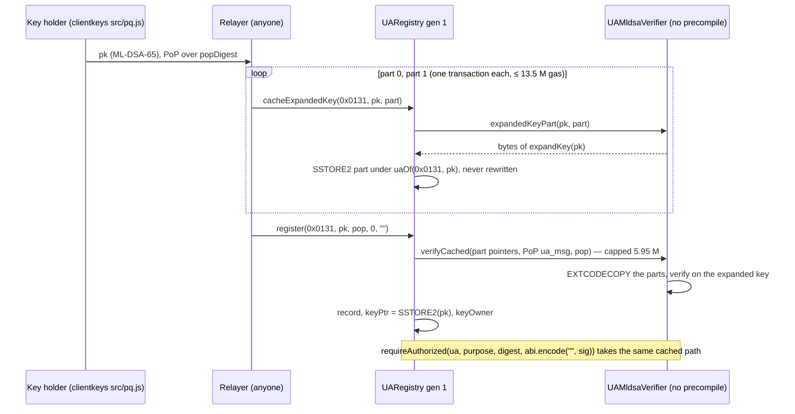

# P6c — the PQ kinds in UA registry generation 1: `mldsa44`, `mldsa65`, `fndsa512`, `slhdsa128s` (stored keys, the registry-computed ML-DSA expanded-key cache, measured caps), the `pqz-mlwe` slot and its `authRef` rule, `pq_signatures.json` — Implementation Plan

> **For agentic workers:** REQUIRED SUB-SKILL: Use superpowers:subagent-driven-development (recommended) or superpowers:executing-plans to implement this plan task-by-task. Steps use checkbox (`- [ ]`) syntax for tracking.

**Goal:** the P6c row of the [P6 roadmap](2026-10-12-p6-roadmap.md) (UA F9): the four PQ signing kinds 0x0130–0x0133
registrable and verifiable in `UARegistry` generation 1 on the P6a verifiers — stored keys (CTR-UA-17), the ML-DSA
EIP-8051 expanded key as a cache the registry derives itself and stores in SSTORE2 parts, one transaction per part
(owner 2026-10-12), measured `verifyCap`s ≤ 50 % of the budget (the carry-over: ML-DSA-65 below 6 M), the `msig` bound
with PQ caps, the `pqz-mlwe` 0x0142 registry slot with its PQ-only `authRef` rule (CTR-PQZ-12; its verifier is P6g's),
the UA ledger with PQ signers, the PQ vectors on a registry context, and the per-chain deploy set. Gate: T-REG, T-AUTH,
T-CHAIN, T-GAS green for the PQ kinds.
Not here: P6b/P6d+ (E-streams), `UAPqzVerifier` and the PQZ / ML-DSA precompiles (P6f/P6g), `PqzToken`, SCaaS Chain
22776, the template library.

**Architecture:** The registry gets five kind-table slots (14–18) and treats the PQ kinds as stored kinds: `keyPtr` =
SSTORE2(`pk`), `auth.keyData` empty. ML-DSA verifies in Solidity at 11.4 M / 18.9 M on the FIPS 204 key — over every
cap — but at 4.1 M / 5.8 M on the EIP-8051 expanded key, which must never come from a caller (universal forgery, P6a T4
review). So the registry computes it: `cacheExpandedKey(kind, pk, part)` asks the kind's own verifier for part `part`
of `expandKey(pk)` (`UAMldsaVerifier.expandedKeyPart`) and stores it with SSTORE2 under `uaOf(kind, pk)` — one part for
ML-DSA-44 (20,544 B), two for ML-DSA-65 (15,360 + 21,568 B), each under EIP-170 and one transaction under EIP-7825.
Once every part is stored, PoP and verify go through `UAMldsaVerifier.verifyCached(parts, ua_msg, sig)`, which reads
the parts by EXTCODECOPY in its own frame (so the copy is inside the measured cap) and verifies on them. The caps are
the cached-key bounds, so an uncached ML-DSA key fails its PoP (fails closed: never registrable but unusable); where
the verifier uses a precompile the cache is refused. `pqz-mlwe` gets its slot, the stored 16 KB `pk` and CTR-PQZ-12's
rule in step 5; no chain enables it before P6g. `DeployBase` enables the four kinds on the private chains only (the
dev chains and 7622) until the verifiers are audited.



**Tech Stack:** Solidity 0.8.37, Foundry (forge 1.3.5, osaka, OpenZeppelin 5.2); the P6a verifiers (`MlDsa.sol`,
`FnDsa.sol`, `SlhDsa.sol`, `Shake.sol`, `PqNtt.sol`, `PqUA.sol`); `src/common/SSTORE2.sol` (UA-2c); Node 22
(`clients/clientkeys`, `@noble/post-quantum` 0.7.1, `@noble/curves` 2.4.0); anvil and cast for the deploy checks; Rust
only to run the scaas-node e2e (no Rust source change).

**Spec:** `docs/contracts/accounts.md` §1 — §1.6 (the PQ rows 0x0130–0x0133 and 0x0142, the closed sets SIGNING /
MEMBER / ZETHER), CTR-UA-16 (Zether-family kinds), CTR-UA-17 (stored keys), CTR-UA-23 (PQ message, caps, per-chain
rule, the 50 % bound, audit before public chains), §1.8 (interface, register steps 1–8, generations), §1.9 (verifier
table, per-chain enablement), §1.15 (gas), §1.16 (vectors, T-REG / T-AUTH / T-GAS); `docs/contracts/pq-zero-knowledge.md`
CTR-PQZ-12 (PQ-only `authRef`), CTR-PQZ-13 (`pqz-mlwe`), §7.2 (register); `docs/research/pq-eips-vs-scaas.md` Q1–Q8
(EIP-8051 expanded key, EIP-8355 probe, EIP-8052); owner decisions of 2026-10-12 in `HANDOFF.md` (P6a session: stored
key = the FIPS 204 pk; the expanded key a registry-computed SSTORE2 cache, -44 one chunk, -65 two, several
transactions for -65; no hybrid kind; audit before any public chain) and the UA-3 plan's Z16 (P6c redeploys gen 1 on
7622 with the PQ kinds).

**Base:** `main` at the commit that adds this plan (parent `f6fc184`: P1–P5, P3b, P6a, UA-1…UA-4 merged; forge 1086
passed / 10 skipped, `test/ua` 214; clientkeys `node --test` 97 / 95 / 2 skipped). **Spiked 2026-10-13:** every task was
built in a scratch worktree from `f6fc184`, in this order, and run green; the diffs below are that worktree's commits,
each checked with `git apply --check --whitespace=error` on a clean `main` copy in sequence (after the plan commit's two
link edits), and the applied tree compared file by file with the spike. Measured there: Task 1 forge 1088 / 10
(`MlDsa`, `PqGas`, `FnDsa`, `SlhDsa`, `SSTORE2` 30 tests), size gate 0 errors; Task 2 clientkeys 101 / 99 / 2, the
generator leaves `signatures.json`, `metatx3.json` and `ed25519_fuzz.json` byte-identical and writes
`pq_signatures.json` (574,286 B, sha256 `2a7e1e1b887ed89c7bc5e1f6f80b3e221d2a6dd38ae4f5c97c75ad358aef214c`, the same on
a second run); Task 3 forge 1099 / 10 (`UARegistryPq` 11, `test/ua` 227; `--isolate` `UARegistryPq` 11 + `UAGas` 6),
size gate 0 errors; Task 4 forge 1101 / 10 (`UAMetaTx3Pq` 2, `test/ua` 229); Task 5 `UADeploy` 4, `Deploy.s.sol` on an
osaka anvil 31337 green with the four PQ kinds enabled at their caps and `pqz-mlwe` off, three `cacheExpandedKey`
transactions mined under a 16,777,216 gas limit (a limit of 16,777,217 is refused by that anvil), `scripts/e2e-zether.sh`
3/3, scaas-node `e2e` 4 + `e2e_hedera` 1, `FOUNDRY_PROFILE=private7622 forge build` ok; Task 6 docs checker 0 errors
(1 pre-existing warning), facts 8852 / 0 misses, `test_docs_check` ok. **Not run in scratch:** CI, anything on chain 7622.

Measured gas (forge, osaka, solc 0.8.37; execution gas of the call):

| Kind | `cacheExpandedKey` per part (forge / anvil tx `gasUsed`) | `register` | `requireAuthorized` | `uaExecuteTransfer` | cap |
|---|---|---|---|---|---|
| `mldsa44` | 12,716,914 / 12,761,198 | 4,485,024 | 4,117,867 (`verifyCached` 4,110,423) | 4,215,103 | 4,250,000 |
| `mldsa65` | 9,528,945 + 13,357,826 / 9,583,421 + 13,414,314 | 6,312,492 | 5,811,372 (`verifyCached` 5,803,139) | 5,872,187 | 5,950,000 |
| `fndsa512` | — | 2,746,484 | 2,343,443 (2,266,895 on `pq_kat.json`'s message) | 2,329,277 | 2,500,000 |
| `slhdsa128s` | — | 927,577 | 808,298 (worst case any input: 1,321,231) | 862,752 | 1,400,000 |

`expandedKeyPart`: 8,521,604 (ML-DSA-44, 20,544 B), 6,376,650 (-65 part 0, 15,360 B), 8,957,359 (-65 part 1,
21,568 B). `msig`: the hybrid `{mldsa65, p256} t=2` authorizes in 5,842,113; the treasury `{mldsa65 ×3} t=2` is refused
at the 5.95 M cap and, at 5,921,000, authorizes in 11,630,301 / 11,632,454 (both called with exactly 12,000,000).
`pqz-mlwe` register with mock verifiers (16 KB `pk` in SSTORE2): 3,721,139. Sizes (runtime / init, B): `UARegistry`
21,257 → 23,669 / 27,470 → 30,084 (under EIP-170: no baseline entry), `UAMldsaVerifier` 9,752 → 11,220,
`UAFndsaVerifier` 5,729 → 5,773, `UASlhdsaVerifier` 2,205 → 2,249.

## Global Constraints

- Paths relative to `/home/ha/work/ainative/scaas`; work in a worktree `.claude/worktrees/p6c` on branch
  `p6c-pq-kinds` from `main` (symlink `smartcontracts/evm/lib` and `clients/clientkeys/node_modules` from the main
  checkout). Heavy commands (forge, cargo, node tests, the vector generator, anvil runs) only through `scripts/capped`,
  one at a time machine-wide (it takes a machine-wide lock: a second capped command waits; after any capped `dotnet`
  command run `dotnet build-server shutdown` — none is needed here); `/usr/bin/git`, `/usr/bin/grep`; forge in
  `smartcontracts/evm`.
- Task order is fixed: 1 verifiers → 2 vectors → 3 registry → 4 ledger rows → 5 deploy → 6 docs. The branch merges as a
  whole after Task 6.
- Each code step applies the task's diff verbatim: save the fenced block to `/tmp/p6c-tN.patch`, then
  `/usr/bin/git apply --check --whitespace=error /tmp/p6c-tN.patch && /usr/bin/git apply /tmp/p6c-tN.patch` (no output).
  `smartcontracts/vectors/ua/pq_signatures.json` is never edited by hand: `ua-sig-vectors.mjs` writes it (Task 2).
- `kinds.json`, `structures.json`, `signatures.json`, `groups.json`, `metatx3.json`, `ed25519_fuzz.json`, `pq_kat.json`
  and `pq_external.json` must not change (the generator rewrites three of them byte-identically); `clients/ua-*` and the
  bindings are not touched.
- No chain-7622 or real/public-chain action and no change to chain docker/chainspec files (they live outside this repo):
  every deploy check runs on a local anvil; the 7622 redeploy is an owner step after the merge (Owner steps). Before an
  anvil run make sure its port (18545) is free (`cast chain-id --rpc-url http://127.0.0.1:18545` fails).
- No size optimisation (owner: wait for Glamsterdam); the size gate must pass — record a new size in
  `smartcontracts/evm/size-baseline.json` only if a contract crosses its limit (none does here). Test chains run 64 KiB
  code; deploys pass `--code-size-limit 65536` and `deploy.sh` runs `--slow`.
- Superseded code goes to `legacy/` (owner: backup, not delete) — nothing is superseded here; every chain is a test
  chain: redeploy, no migration.
- SPDX header of every new Solidity file: `// SPDX-License-Identifier: LicenseRef-Vegan-Community-1.0`.
- Commit trailer: the model that wrote the commit, e.g. `Co-Authored-By: Claude Opus 5.5 <noreply@anthropic.com>`. Never
  `git add` `claude-code-api.txt`, `out/`, `cache/`, `target/`, `node_modules/`, `smartcontracts/evm/lib/`,
  `smartcontracts/evm/deployments/`, `broadcast/`, `.superpowers/`. Delete `smartcontracts/evm/deployments/*.json` and
  `broadcast/` that the deploy checks and the e2e write.
- Stop every background shell and anvil you started before reporting.

## Review Focus

- **Never a caller-supplied expanded key.** `cacheExpandedKey` takes `pk`, derives the id from it and asks the kind's
  verifier for the bytes; `verifyCached` is called only with the registry's own part pointers, and a pointer set that is
  short, reordered, has an extra or code-less pointer, or one flipped byte verifies nothing —
  `test_expandedKeyParts_verifyCached`, `test_cacheRefusals`, `test_vectors_pq`.
- **Never registrable but unusable.** Without a complete cache an ML-DSA PoP runs the FIPS 204 path into the cap and
  `register` reverts `UAPoP`; a chain whose ML-DSA verifier answers through a precompile refuses the cache (a cached
  Solidity path would exceed the precompile's cap) — `test_vectors_pq` (`_popRefused` before `_cache`),
  `test_cacheRefusedWithPrecompile`, `test_gas_mldsaCache`.
- **Cache front-running and idempotence.** A part is keyed by the id that binds `pk`; a second call stores nothing and
  returns the same id; each part fits one EIP-7825 transaction with its calldata — `_cache` in `UARegistryPq.t.sol`, the
  anvil transactions of Task 5.
- **The `msig` bound with PQ caps.** The caller's 63/64 hold for a 5.95 M cap is 94 k, far beyond the 11 k
  `MSIG_MEMBER_GAS` assumed for a 400 k cap: members burning their whole cap authorize within `verifyBudget` at the
  largest cap the bound admits and the structure is refused one thousand gas above it; the classical at-budget cases
  keep their exact bound — `test_T_GAS_msigPqHold`, `test_T_GAS_pqTreasury`, `test_T_GAS_pqHybrid`,
  `test_T_GAS_msigAtBudget`.
- **`pqz-mlwe`'s `authRef`.** 0, a native id, a classical UA, an unregistered id, an `msig` whose classical members
  alone reach the threshold, and an `msig` named with another structure's key data are `UAAuthRef` before any signature
  is checked; the hybrid, a single `mldsa65` and a single `slhdsa128s` pass; the PQZ key never signs —
  `test_pqzAuthRef_refused`, `test_pqzAuthRef_hybrid`, `test_pqzAuthRef_pq`.

## Rulings (spec vs code) and defaults taken

- **C6-1 Scope.** P6c is the four PQ signing kinds 0x0130–0x0133 in registry generation 1 plus the `pqz-mlwe` 0x0142
  registry hook — its slot, the stored 16 KB `pk`, CTR-PQZ-12's `authRef` rule, the Zether-family paths — without its
  verifier. `pqz-mlwe`'s PoP is an `R_REG` lattice proof through the PQZ precompile op 3: no `R_REG` exists before P6e
  and no precompile before P6f, so `UAPqzVerifier` and enabling the kind are P6g's; chain 7622's gen 1 is redeployed
  then (every chain is a test chain). The roadmap's "the `pqz-mlwe` hook (E-S4 plugs `UAPqzVerifier`)" is exactly this.
- **C6-2 Stored keys.** Every PQ kind is stored (`keyPtr` = SSTORE2(`pk`), `auth.keyData` empty), `slhdsa128s`'s 32-byte
  key included: CTR-UA-17's "key data ≤ 256 bytes travels in calldata" and its "stored kinds — PQ kinds (public key)"
  disagree for SLH-DSA alone; §1.8 step 8 (`vk` = PQ `pk`) and the §1.9 row (`pk` from `keyPtr`) decide — one rule for
  the PQ kinds. Spec text updated (Task 6).
- **C6-3 The cache entry point.** `cacheExpandedKey(uint16 kind, bytes pk, uint256 part) returns (bytes32 ua)`,
  permissionless, keyed by `uaOf(kind, pk)` (before or after `register`: the PoP of an uncached key fails, so it comes
  first on a precompile-less chain); the bytes come from the kind's immutable verifier (`expandedKeyPart`), which the
  registry already trusts for every verdict, so the registry stays under EIP-170 (23,669 B) without linking the
  expansion code; a stored part is never rewritten (a second call returns the id: front-running stores the same bytes);
  `event UAKeyCached(bytes32 indexed ua, uint16 indexed kind, uint256 part, address ptr)`; `error UAKeyCache(uint16
  kind)` for another kind, a disabled kind, a part past the last, or a verifier with a precompile; view
  `expandedKeyOf(bytes32) returns (address[2])`, generation-local (a UA's cache lives where its record does: gen 2 never
  enables a group gen 1 enables). Not a CTR-UA-15 record change: the cache is derived data, write-once per part, and
  it changes no verdict (both paths verify the same predicate).
- **C6-4 Parts.** ML-DSA-44: one part (the whole 20,544 B key). ML-DSA-65: two, split at row 3 of the matrix (15,360 B,
  then rows 3–5 ‖ `tr` ‖ `NTT(t1·2^d)`, 21,568 B): each fits EIP-170 with SSTORE2's STOP byte and one Osaka
  transaction (13.41 M at most, measured; Hedera's 15 M too). An equal byte split would cut a polynomial; a per-row API
  is not needed.
- **C6-5 The verifier reads the parts.** `verifyCached(bytes parts, bytes32 message, bytes sig)` takes the 20-byte
  pointers, EXTCODECOPYs them in its own frame and calls `this.verifyExpanded(ek, …)`, so the 37 KB copy and its memory
  are inside the measured cap and the registry's per-member `msig` overhead stays the classical one; the registry
  passes pointers only. `verifyExpanded` is external on a stateless contract: its NatSpec says an answer on a key the
  caller did not derive means nothing (restricting it to self-calls would add nothing — `verifyCached` trusts its
  pointers the same way). A partial cache counts as none.
- **C6-6 Caps** (one per kind, `DeployBase`): ML-DSA without a precompile on the cached key — `mldsa44` 4,250,000,
  `mldsa65` 5,950,000 (measured valid `verifyCached` 4,110,423 / 5,803,139, + ~3 %: the only data-dependent work left is
  `SampleInBall`'s rejection loop, whose second SHAKE squeeze no honest `c̃` reaches) — this closes the carry-over
  "ML-DSA-65 below 6 M"; `fndsa512` 2,500,000 (2.27–2.35 M measured across messages); `slhdsa128s` 1,400,000 (above its
  1,321,231 worst case for any input). Each ≤ 50 % of 12 M. Consequence: on a precompile-less chain an ML-DSA UA must be
  cached before it registers — the owner's "optional" holds where a precompile exists, where the cache is refused.
- **C6-7 No cache behind a precompile.** `cacheExpandedKey` reverts `UAKeyCache` when the verifier's `PRECOMPILE() ≠ 0`:
  a cached key would switch that UA to the 5.8 M Solidity path under a precompile-sized cap and lock it.
- **C6-8 `msig` bound.** Register step 4 adds `(cap − 400 k) / 63` for the largest cap of this generation among the `c`
  chosen members (the caller's hold that `MSIG_MEMBER_GAS`'s 400 k assumption does not cover); members handed to gen 1
  keep their own `cap / 63 + 5 k` (the caps are tagged own / handed). The classical bound is unchanged
  (`test_T_GAS_msigAtBudget`). Result: the treasury `{mldsa65 ×3} t=2` is refused on a precompile-less chain at 5.95 M
  (as T-GAS and CTR-UA-23 say) and would register at ≤ 5,921,181.
- **C6-9 `pqz-mlwe` `authRef`.** "PQ" is 0x0130–0x0133: `fndsa512` because P6c enables it ("once the UA registry
  enables it"), `slhdsa128s` because it is a PQ signing kind of SIGNING that CTR-PQZ-12 predates. An `msig` is not
  stored, so its members come from `authPop`'s key data, which must hash to the id (step 7 then verifies the same
  data); classical weight ≥ threshold ⇒ `UAAuthRef`. All refusals precede any signature check.
- **C6-10 `pqz-mlwe` key validation** stays the length (16,384 B) in P6c: the coefficient encoding is frozen by E-S2
  (P6e); the `< q` check comes with `UAPqzVerifier` (P6g). The slot is disabled everywhere until then.
- **C6-11 Per-chain set.** `DeployBase` enables the four PQ kinds on the dev chains (31337, 1337) and 7622 — the same
  private set as `bls-bn254-minsig` — and nowhere else (Hedera, Gnosis, Celo, the draft chains, the e2e chain 31901):
  the verifiers are unaudited and CTR-UA-23 / the owner require an audit before a public chain enables them. Noted for
  that audit: on Hedera (10.5 M budget) `mldsa65`'s 5.95 M exceeds 50 %, so it stays off there without a precompile.
- **C6-12 Precompile carry-over.** "The chain-7622 deploy asserts `PRECOMPILE() != 0`" was written before the cache:
  with it ML-DSA-65 verifies in Solidity at 5.8 M, so the assertion would only block the 7622 deploy until P6f. The
  precompile candidate (chain 7622's `…0F10` or its moved address), its probe assertion and its cap move to P6g, where
  the precompile exists; P6c deploys with no candidate on every chain.
- **C6-13 Vectors.** A new `smartcontracts/vectors/ua/pq_signatures.json` from `ua-sig-vectors.mjs` (PoPs on contexts A
  and B, `metatx` / `member` signatures, 27 negatives, the treasury and hybrid with their member signature sets, one
  `UAMetaTransaction` and one `UAMetaTransfer` row per PQ kind), not rows in `signatures.json` / `metatx3.json`: their
  consumers (`clients/ua-rs` `verify`, the noble re-verification, the row counts in Foundry and node tests) have no PQ
  verifier, so those files stay byte-identical. Keys = `pq_kat.json`'s (SEP-0005 mnemonic, account 0 index 0; `mldsa65`
  indexes 1 and 2 for the treasury); deterministic signing (`extraEntropy: false`; Falcon's fixed `random`). The
  independent side is the Solidity verifiers (P6a's parity with noble on the KATs and ACVP).
- **C6-14 Clients.** No change to `clients/ua-*` (the identity layer already covers the PQ kinds through `kinds.json`),
  no Rust PQ verifier (node-side native verification is UA F5), no clientkeys transaction builder for the cache (a
  relayer submits it; UA F5).
- **C6-15 `verifyPop`.** Register step 6 calls `IUAPopVerifier.verifyPop` for every kind; the P6a PQ verifiers had only
  `verify`, so none could register. Each gets `verifyPop == verify`.
- **C6-16 SSTORE2.** The UA-2c follow-up guard `data.length > 0xfffe ⇒ SSTORE2WriteFailed` lands now (the PQ keys and
  parts are the first large SSTORE2 data; `pqz-mlwe`'s 16,384 B and the 21,568 B part are below it).
- **C6-17 Gas.** Asserted: `verifyCached` under its cap, every part's `expandedKeyPart` under 9 M and every
  `cacheExpandedKey` (+ intrinsic + floor-priced calldata) under 16,777,216, the treasury / hybrid / burn cases at
  exactly `verifyBudget`. Logged: everything else (the header table).
- **C6-18 Sizes.** `UARegistry` 23,669 B and the verifiers stay under EIP-170: no `size-baseline.json` change.
- **C6-19 Ledger.** The UA ledger needs no code change: a PQ `from` is a derived SIGNING id through `requireAuthorized`,
  a PQ `to` a registered SIGNING id. Task 4 pins it with the `metatx3` rows of `pq_signatures.json` (an ML-DSA-65
  payment: 5.87 M).

## Owner steps

1. **After the merge — redeploy UA registry gen 1 on chain 7622 with the PQ kinds** (UA-3 Z16; owner-gated: a
   deployment on 7622). Before it, read 7622's block gas limit (`cast block latest --field gasLimit --rpc-url <7622>`):
   an ML-DSA-65 cache part needs a 13.5 M transaction (with the EIP-7825 cap, 16,777,216); below that, ML-DSA cannot be
   cached there and only `fndsa512` / `slhdsa128s` are usable until the limit is raised (a chainspec change, the
   owner's). Then `FOUNDRY_PROFILE=private7622 DEPLOY_SALT=<new> CHAIN_UID=<7622 genesis> smartcontracts/scripts/deploy.sh
   evm <7622 RPC>`; the JSON's `ua_registry` is the new gen 1. P6g redeploys it again with `UAPqzVerifier`.
2. **Before any public chain enables a PQ kind:** the audit of the PQ verifiers and of the cache (CTR-UA-23; C6-11).

## Open questions (not blocking)

- A public L1 pays ≈ 23 M gas once per ML-DSA-65 UA for its cache (plus 6.3 M to register): worth showing next to the
  per-check cost in the app before a user picks ML-DSA on such a chain (accounts.md §1.15 already shows the check cost).
- FN-DSA's valid-signature bound is measured (2.27–2.35 M over the vector messages), not derived; T-FUZZ's continuous
  part (P6 roadmap §4) would widen the sample.
- Whether CTR-PQZ-12 should name `slhdsa128s` explicitly (ruled in, C6-9; pq-zero-knowledge.md updated to say so).

## Out of scope (next)

P6g (`UAPqzVerifier`, the PQZ and ML-DSA precompile candidates on 7622, enabling `pqz-mlwe`), P6b/P6d–P6f, the node's
`ua_metatx` and native PQ verification (UA F5), UA F3 (group / `msig` rows of `metatx3.json`), `PqzToken`, the template
library, SCaaS Chain 22776, size work (Glamsterdam).

---

### Task 1: The PQ verifiers registry-ready — `verifyPop`, the ML-DSA expanded key in parts, `verifyCached`; the SSTORE2 length guard

The P6a verifiers answer `verify` only; the registry asks `verifyPop` at registration and, for ML-DSA, needs the
expanded key in parts it can store and a path that verifies on the stored parts.

**Files:**
- Modify: `smartcontracts/evm/src/ua/MlDsa.sol` (`MlDsa.expandKeyRows`, `expandKey` on it; `UAMldsaVerifier is
  IUAPopVerifier`: `verifyPop`, `expandedKeyParts`, `expandedKeyPart`, `verifyCached`, `verifyExpanded`, `UAMldsaPart`),
  `smartcontracts/evm/src/ua/FnDsa.sol`, `smartcontracts/evm/src/ua/SlhDsa.sol` (`verifyPop`),
  `smartcontracts/evm/src/common/SSTORE2.sol` (length guard)
- Test: `smartcontracts/evm/test/ua/MlDsa.t.sol` (+1 `test_expandedKeyParts_verifyCached`),
  `smartcontracts/evm/test/ua/PqGas.t.sol` (+1 `test_gas_mldsaCache`), `smartcontracts/evm/test/ua/PqVectors.sol`
  (`_uaVector` checks `verifyPop` on every PQ verifier), `smartcontracts/evm/test/ua/SSTORE2.t.sol` (the guard)

**Interfaces:**
- Consumes: `main` (P6a `MlDsa`, `Falcon512`, `SlhDsaSha2128s`, `Shake.reserve`, `PqNtt`, `PqUA`; `IUAPopVerifier`).
- Produces: `MlDsa.expandKeyRows(Params memory P, bytes calldata pk, uint256 r0, uint256 r1, bool tail) returns (bytes
  memory)` (bytes `[r0·l·1024, …)` of `expandKey(pk)`); `contract UAMldsaVerifier is IUAPopVerifier` with
  `verifyPop(bytes keyData, bytes32 message, bytes sig) returns (bool)` (= `verify`), `expandedKeyParts() returns
  (uint256)` (1 for 0x0130, 2 for 0x0131), `expandedKeyPart(bytes pk, uint256 part) returns (bytes)` (reverts
  `UAMldsaPart(part)` past the last), `verifyCached(bytes chunks, bytes32 message, bytes sig) returns (bool)` (`chunks` =
  20-byte SSTORE2 pointers in order), `verifyExpanded(bytes ek, bytes32 message, bytes sig) returns (bool)`, `error
  UAMldsaPart(uint256 part)`; `UAFndsaVerifier` / `UASlhdsaVerifier is IUAPopVerifier` (`verifyPop` = `verify`);
  `SSTORE2.write` reverts `SSTORE2WriteFailed()` for data longer than 0xfffe bytes.

- [ ] **Step 1: Apply the diff** below (`/tmp/p6c-t1.patch`; Global Constraints).
- [ ] **Step 2: Test.** In `smartcontracts/evm`: `../../scripts/capped forge test --match-path
  'test/ua/{MlDsa,PqGas,FnDsa,SlhDsa,SSTORE2}.t.sol' -vv` — `Ran 5 test suites …: 30 tests passed, 0 failed, 0 skipped`;
  `test_gas_mldsaCache` logs `mldsa44 expandedKeyPart 0 bytes 20544` / `gas 8521604`, `mldsa65 expandedKeyPart 0 bytes
  15360` / `gas 6376650`, `mldsa65 expandedKeyPart 1 bytes 21568` / `gas 8957359`, `mldsa44 verifyCached (valid)
  4110423`, `mldsa65 verifyCached (valid) 5803139` (the caps of Task 5 are 4,250,000 and 5,950,000; the test asserts
  them as bounds).
- [ ] **Step 3: No regression.** `../../scripts/capped forge test` — `Ran 92 test suites …: 1088 tests passed, 0 failed,
  10 skipped`.
- [ ] **Step 4: Size gate.** `../../scripts/capped forge build src --sizes --json > /tmp/p6c-sizes.json 2>/dev/null;
  python3 ../../scripts/size_gate.py /tmp/p6c-sizes.json size-baseline.json` — `size gate: 0 error(s), 83 contracts`
  (`UAMldsaVerifier` 11,220 B).
- [ ] **Step 5: Commit.**
```bash
/usr/bin/git add smartcontracts/evm/src/ua/MlDsa.sol smartcontracts/evm/src/ua/FnDsa.sol smartcontracts/evm/src/ua/SlhDsa.sol \
  smartcontracts/evm/src/common/SSTORE2.sol smartcontracts/evm/test/ua/MlDsa.t.sol smartcontracts/evm/test/ua/PqGas.t.sol \
  smartcontracts/evm/test/ua/PqVectors.sol smartcontracts/evm/test/ua/SSTORE2.t.sol
/usr/bin/git commit -m "P6c T1: PQ verifiers registry-ready — verifyPop, ML-DSA expanded key in parts, verifyCached; SSTORE2 length guard" \
  -m "Co-Authored-By: Claude Opus 5.5 <noreply@anthropic.com>"
```

`/tmp/p6c-t1.patch`:

````diff
diff --git a/smartcontracts/evm/src/common/SSTORE2.sol b/smartcontracts/evm/src/common/SSTORE2.sol
index c526086..e99e577 100644
--- a/smartcontracts/evm/src/common/SSTORE2.sol
+++ b/smartcontracts/evm/src/common/SSTORE2.sol
@@ -9,6 +9,7 @@ library SSTORE2 {
 
     /// Deploys `0x00 ‖ data` with CREATE; reverts if the deployment fails (out of gas, data over the EIP-170 limit).
     function write(bytes memory data) internal returns (address ptr) {
+        if (data.length > 0xfffe) revert SSTORE2WriteFailed(); // PUSH2 len+1 below
         // init: PUSH2 len+1, DUP1, PUSH1 0x0c, PUSH1 0, CODECOPY, PUSH1 0, RETURN (12 bytes), then the runtime
         bytes memory init = abi.encodePacked(hex"61", uint16(data.length + 1), hex"80600c6000396000f3", hex"00", data);
         assembly ("memory-safe") {
diff --git a/smartcontracts/evm/src/ua/FnDsa.sol b/smartcontracts/evm/src/ua/FnDsa.sol
index a60b44d..76e575d 100644
--- a/smartcontracts/evm/src/ua/FnDsa.sol
+++ b/smartcontracts/evm/src/ua/FnDsa.sol
@@ -1,7 +1,7 @@
 // SPDX-License-Identifier: LicenseRef-Vegan-Community-1.0
 pragma solidity ^0.8.24;
 
-import {IUAKindVerifier} from "./IUAVerifier.sol";
+import {IUAPopVerifier} from "./IUAVerifier.sol";
 import {Shake} from "./Shake.sol";
 import {PqNtt} from "./PqNtt.sol";
 
@@ -154,9 +154,14 @@ library Falcon512 {
 /// @title `fndsa512` UA verifier (accounts.md CTR-UA-23, kind 0x0132): Falcon-512 over the 32-byte `ua_msg`, the message
 ///        size of EIP-8052 (Falcon has no context string; `ua_msg` already carries `TAG(kind)`). Pure Solidity: EIP-8052
 ///        has no addresses yet. **UNAUDITED.**
-contract UAFndsaVerifier is IUAKindVerifier {
-    function verify(bytes calldata keyData, bytes32 message, bytes calldata sig) external pure returns (bool) {
+contract UAFndsaVerifier is IUAPopVerifier {
+    function verify(bytes calldata keyData, bytes32 message, bytes calldata sig) public pure returns (bool) {
         Shake.reserve();
         return Falcon512.verify(keyData, abi.encodePacked(message), sig);
     }
+
+    /// The PoP is an ordinary signature over the PoP `ua_msg` (accounts.md §1.8 step 6).
+    function verifyPop(bytes calldata keyData, bytes32 message, bytes calldata sig) external pure returns (bool) {
+        return verify(keyData, message, sig);
+    }
 }
diff --git a/smartcontracts/evm/src/ua/MlDsa.sol b/smartcontracts/evm/src/ua/MlDsa.sol
index 1406031..947cc9a 100644
--- a/smartcontracts/evm/src/ua/MlDsa.sol
+++ b/smartcontracts/evm/src/ua/MlDsa.sol
@@ -1,7 +1,7 @@
 // SPDX-License-Identifier: LicenseRef-Vegan-Community-1.0
 pragma solidity ^0.8.24;
 
-import {IUAKindVerifier} from "./IUAVerifier.sol";
+import {IUAPopVerifier} from "./IUAVerifier.sol";
 import {PqUA} from "./PqUA.sol";
 import {Shake} from "./Shake.sol";
 import {PqNtt} from "./PqNtt.sol";
@@ -69,8 +69,17 @@ library MlDsa {
     /// The expanded key of a FIPS 204 public key (what EIP-8051's precompile and a stored-key verifier take).
     /// @dev The only trustworthy source of an expanded key: never accept one from a caller (see `verifyExpanded`).
     function expandKey(Params memory P, bytes calldata pk) internal pure returns (bytes memory ek) {
+        return expandKeyRows(P, pk, 0, P.k, true);
+    }
+
+    /// Bytes `[r0·l·1024, …)` of `expandKey(pk)`: rows `r0 … r1 − 1` of `Â`, then (iff `tail`) `tr ‖ NTT(t1·2^d)`. The
+    /// UA registry stores the expanded key in parts under EIP-170, each computed in its own transaction (P6c).
+    function expandKeyRows(Params memory P, bytes calldata pk, uint256 r0, uint256 r1, bool tail)
+        internal pure returns (bytes memory ek)
+    {
         require(pk.length == P.pkLen, "MlDsa: pk length");
-        ek = new bytes(expandedLen(P));
+        require(r0 <= r1 && r1 <= P.k, "MlDsa: rows");
+        ek = new bytes((r1 - r0) * P.l * 1024 + (tail ? 64 + P.k * 1024 : 0));
         uint256 dst;
         assembly ("memory-safe") {
             dst := add(ek, 32)
@@ -78,12 +87,13 @@ library MlDsa {
         uint256 z = PqNtt.table(ZETAS, 4);
         uint256 a = PqNtt.alloc(N);
         uint256 buf = PqNtt.alloc(6);
-        for (uint256 i; i < P.k; ++i) {
+        for (uint256 i = r0; i < r1; ++i) {
             for (uint256 j; j < P.l; ++j) {
                 _expandA(bytes32(pk[0:32]), j, i, a, buf);
                 dst = _put(a, dst);
             }
         }
+        if (!tail) return ek;
         // tr: `hash` writes a whole block (160 bytes) for these 64; the overrun lands in the t̂1 region, which the loop
         // below overwrites afterwards (correct only because of this write order).
         Shake.hash(Shake.SHAKE256, _copy(pk), pk.length, dst, 64);
@@ -435,13 +445,15 @@ library MlDsa {
 /// @title `mldsa44` / `mldsa65` UA verifier (accounts.md CTR-UA-23, kinds 0x0130 / 0x0131): FIPS 204 ML-DSA over
 ///        `pq_msg` with the empty context, on the FIPS 204 public key (`keyData`). An EIP-8355 precompile is used when
 ///        the constructor's probe of `candidate` passes (`pk ‖ sig ‖ pq_msg` ⇒ exactly the word 1, a flipped
-///        signature ⇒ exactly 0), else pure Solidity. **UNAUDITED.**
-contract UAMldsaVerifier is IUAKindVerifier {
+///        signature ⇒ exactly 0), else pure Solidity. Without a precompile the UA registry verifies on the EIP-8051
+///        expanded key it derived itself and stored in parts (`expandedKeyPart`, `verifyCached`; P6c). **UNAUDITED.**
+contract UAMldsaVerifier is IUAPopVerifier {
     uint16 public immutable KIND;
     bytes32 public immutable KIND_TAG;
     address public immutable PRECOMPILE; // 0 = pure Solidity
 
     error UAMldsaKind(uint16 kind);
+    error UAMldsaPart(uint256 part);
 
     /// @param probeValid an input `pk ‖ sig ‖ msg` in the EIP-8355 layout that verifies; `probeInvalid` one that does not.
     ///        Both must be exactly `pkLen + sigLen + 32` bytes of this level (the split `verify` sends), else pure Solidity.
@@ -455,18 +467,71 @@ contract UAMldsaVerifier is IUAKindVerifier {
         PRECOMPILE = exact && PqUA.probe(candidate, probeValid, probeInvalid) ? candidate : address(0);
     }
 
-    function verify(bytes calldata keyData, bytes32 message, bytes calldata sig) external view returns (bool) {
+    function verify(bytes calldata keyData, bytes32 message, bytes calldata sig) public view returns (bool) {
         Shake.reserve(); // first allocation of the frame
-        MlDsa.Params memory P = KIND == PqUA.MLDSA44 ? MlDsa.params44() : MlDsa.params65();
+        MlDsa.Params memory P = _params();
         if (keyData.length != P.pkLen || sig.length != P.sigLen) return false; // fixed split for the precompile too
         bytes32 pq = PqUA.pqMessage(KIND_TAG, message);
         if (PRECOMPILE != address(0)) return PqUA.callBool(PRECOMPILE, abi.encodePacked(keyData, sig, pq));
         return MlDsa.verify(P, keyData, PqUA.emptyContext(pq), sig);
     }
 
+    /// The PoP is an ordinary signature over the PoP `ua_msg` (accounts.md §1.8 step 6).
+    function verifyPop(bytes calldata keyData, bytes32 message, bytes calldata sig) external view returns (bool) {
+        return verify(keyData, message, sig);
+    }
+
     /// EIP-8051 expanded key of `pk` (FIPS 64-byte `tr`); see `MlDsa.verifyExpanded` on trusting one.
     function expandedKey(bytes calldata pk) external view returns (bytes memory) {
         Shake.reserve();
-        return MlDsa.expandKey(KIND == PqUA.MLDSA44 ? MlDsa.params44() : MlDsa.params65(), pk);
+        return MlDsa.expandKey(_params(), pk);
+    }
+
+    /// Number of parts the registry stores the expanded key in: one under EIP-170 for ML-DSA-44 (20,544 B), two for
+    /// ML-DSA-65 (36,928 B: `Â` rows 0–2, then rows 3–5 ‖ tr ‖ t̂1).
+    function expandedKeyParts() public view returns (uint256) {
+        return KIND == PqUA.MLDSA44 ? 1 : 2;
+    }
+
+    /// Part `part` of `expandedKey(pk)`; the parts in order concatenate to it. Reverts `UAMldsaPart` past the last.
+    function expandedKeyPart(bytes calldata pk, uint256 part) external view returns (bytes memory) {
+        Shake.reserve();
+        MlDsa.Params memory P = _params();
+        if (part >= expandedKeyParts()) revert UAMldsaPart(part);
+        if (KIND == PqUA.MLDSA44) return MlDsa.expandKeyRows(P, pk, 0, P.k, true);
+        return part == 0 ? MlDsa.expandKeyRows(P, pk, 0, 3, false) : MlDsa.expandKeyRows(P, pk, 3, P.k, true);
+    }
+
+    /// The registry's cached path: `chunks` = the 20-byte SSTORE2 pointers of the parts, in order (code = `0x00 ‖ part`).
+    /// Reads them by EXTCODECOPY and verifies on the result. **Trusts the pointers**: only the registry, which wrote the
+    /// parts from `expandedKeyPart` of an authenticated `pk`, may call this for a verdict (`MlDsa.verifyExpanded`).
+    function verifyCached(bytes calldata chunks, bytes32 message, bytes calldata sig) external view returns (bool) {
+        uint256 len = MlDsa.expandedLen(_params());
+        if (chunks.length != 20 * expandedKeyParts()) return false;
+        bytes memory ek = new bytes(len);
+        uint256 o;
+        for (uint256 i; i < chunks.length; i += 20) {
+            address ptr = address(bytes20(chunks[i:i + 20]));
+            uint256 n = ptr.code.length;
+            if (n < 2 || o + n - 1 > len) return false;
+            assembly ("memory-safe") {
+                extcodecopy(ptr, add(add(ek, 32), o), 1, sub(n, 1))
+            }
+            o += n - 1;
+        }
+        if (o != len) return false;
+        return this.verifyExpanded(ek, message, sig);
+    }
+
+    /// Verify on an expanded key. **Only on a key derived by `expandedKey` / `expandedKeyPart` from an authenticated
+    /// `pk`**: a caller-supplied expanded key allows universal forgery (`MlDsa.verifyExpanded`). Never trust this
+    /// contract's answer for a key you did not derive.
+    function verifyExpanded(bytes calldata ek, bytes32 message, bytes calldata sig) external view returns (bool) {
+        Shake.reserve();
+        return MlDsa.verifyExpanded(_params(), ek, PqUA.emptyContext(PqUA.pqMessage(KIND_TAG, message)), sig);
+    }
+
+    function _params() private view returns (MlDsa.Params memory) {
+        return KIND == PqUA.MLDSA44 ? MlDsa.params44() : MlDsa.params65();
     }
 }
diff --git a/smartcontracts/evm/src/ua/SlhDsa.sol b/smartcontracts/evm/src/ua/SlhDsa.sol
index 707a4d6..8656e2e 100644
--- a/smartcontracts/evm/src/ua/SlhDsa.sol
+++ b/smartcontracts/evm/src/ua/SlhDsa.sol
@@ -1,7 +1,7 @@
 // SPDX-License-Identifier: LicenseRef-Vegan-Community-1.0
 pragma solidity ^0.8.24;
 
-import {IUAKindVerifier} from "./IUAVerifier.sol";
+import {IUAPopVerifier} from "./IUAVerifier.sol";
 import {PqUA} from "./PqUA.sol";
 
 /// @title SLH-DSA-SHA2-128s verification (FIPS 205, Algorithms 8, 11, 13, 17, 20; SHA2 category 1, §11.2.1).
@@ -156,10 +156,15 @@ library SlhDsaSha2128s {
 
 /// @title `slhdsa128s` UA verifier (accounts.md CTR-UA-23, kind 0x0133): SLH-DSA-SHA2-128s over `pq_msg` with the empty
 ///        context, pure Solidity on SHA-256 `0x02` (no EIP proposes an SLH-DSA precompile). **UNAUDITED.**
-contract UASlhdsaVerifier is IUAKindVerifier {
+contract UASlhdsaVerifier is IUAPopVerifier {
     bytes32 public constant TAG = keccak256("scaas.ua.slhdsa128s.v1");
 
-    function verify(bytes calldata keyData, bytes32 message, bytes calldata sig) external view returns (bool) {
+    function verify(bytes calldata keyData, bytes32 message, bytes calldata sig) public view returns (bool) {
         return SlhDsaSha2128s.verify(keyData, PqUA.emptyContext(PqUA.pqMessage(TAG, message)), sig);
     }
+
+    /// The PoP is an ordinary signature over the PoP `ua_msg` (accounts.md §1.8 step 6).
+    function verifyPop(bytes calldata keyData, bytes32 message, bytes calldata sig) external view returns (bool) {
+        return verify(keyData, message, sig);
+    }
 }
diff --git a/smartcontracts/evm/test/ua/MlDsa.t.sol b/smartcontracts/evm/test/ua/MlDsa.t.sol
index f418d1c..e3ba280 100644
--- a/smartcontracts/evm/test/ua/MlDsa.t.sol
+++ b/smartcontracts/evm/test/ua/MlDsa.t.sol
@@ -109,6 +109,52 @@ contract MlDsaTest is PqVectors {
         }
     }
 
+    /// P6c: the parts the UA registry stores concatenate to the expanded key, each fits EIP-170 with its STOP byte;
+    /// `verifyCached` reads them by EXTCODECOPY and agrees with `verify`; a wrong count, order or byte fails; a part
+    /// past the last reverts; `verifyPop` is `verify`.
+    function test_expandedKeyParts_verifyCached() public {
+        string memory kat = _kat();
+        string[2] memory names = ["mldsa44", "mldsa65"];
+        uint16[2] memory kinds = [PqUA.MLDSA44, PqUA.MLDSA65];
+        for (uint256 i; i < 2; ++i) {
+            UAMldsaVerifier v = new UAMldsaVerifier(kinds[i], address(0), "", "");
+            bytes memory pk = _k(kat, names[i], "pk");
+            uint256 parts = v.expandedKeyParts();
+            assertEq(parts, i + 1, "parts");
+            bytes memory chunks;
+            bytes memory all;
+            for (uint256 p; p < parts; ++p) {
+                bytes memory part = v.expandedKeyPart(pk, p);
+                assertLt(part.length, 24_576, "EIP-170 with the STOP byte");
+                address ptr = address(uint160(0xc0de00 + 16 * i + p));
+                vm.etch(ptr, bytes.concat(hex"00", part));
+                chunks = bytes.concat(chunks, bytes20(ptr));
+                all = bytes.concat(all, part);
+            }
+            assertEq(all, _k(kat, names[i], "expanded_key"), names[i]);
+            vm.expectRevert(abi.encodeWithSelector(UAMldsaVerifier.UAMldsaPart.selector, parts));
+            v.expandedKeyPart(pk, parts);
+            bytes32 m = bytes32(_k(kat, names[i], "ua_msg"));
+            bytes memory sig = _k(kat, names[i], "sig");
+            assertTrue(v.verifyCached(chunks, m, sig), "cached");
+            assertTrue(v.verifyExpanded(all, m, sig), "expanded");
+            assertTrue(v.verifyPop(pk, m, sig), "verifyPop = verify");
+            assertFalse(v.verifyCached(chunks, ~m, sig), "other message");
+            assertFalse(v.verifyCached(bytes.concat(chunks, bytes20(address(0xc0de00))), m, sig), "extra pointer");
+            assertFalse(v.verifyCached(bytes.concat(bytes20(address(0xbad)), _slice(chunks, 20, chunks.length - 20)), m, sig),
+                "a pointer without code");
+            if (parts == 2) {
+                bytes memory swapped = bytes.concat(_slice(chunks, 20, 20), _slice(chunks, 0, 20));
+                assertFalse(v.verifyCached(swapped, m, sig), "parts out of order");
+            }
+            address last = address(bytes20(_slice(chunks, chunks.length - 20, 20)));
+            bytes memory code = last.code;
+            code[code.length - 1] ^= 0x01; // one t̂1 coefficient's low byte
+            vm.etch(last, code);
+            assertFalse(v.verifyCached(chunks, m, sig), "one flipped byte");
+        }
+    }
+
     function test_acvp_mldsa() public {
         vm.pauseGasMetering(); // 60 full verifications: correctness only
         string memory ext = _ext();
diff --git a/smartcontracts/evm/test/ua/PqGas.t.sol b/smartcontracts/evm/test/ua/PqGas.t.sol
index 6c6518c..8f93ef1 100644
--- a/smartcontracts/evm/test/ua/PqGas.t.sol
+++ b/smartcontracts/evm/test/ua/PqGas.t.sol
@@ -106,6 +106,41 @@ contract PqGasTest is Test {
         require(ok, "expanded");
     }
 
+    /// P6c (accounts.md CTR-UA-23, owner 2026-10-12): the registry's expanded-key cache. Gas of each `expandedKeyPart`
+    /// (the registry adds the SSTORE2 write, 200 gas per byte, measured with the registry in `UARegistryPq.t.sol`) and
+    /// of `verifyCached` on the parts (the kind's cap without a precompile; ≤ 50 % of the 12 M budget).
+    function test_gas_mldsaCache() public {
+        string memory kat = _kat();
+        string[2] memory names = ["mldsa44", "mldsa65"];
+        uint16[2] memory kinds = [PqUA.MLDSA44, PqUA.MLDSA65];
+        uint256[2] memory bound = [uint256(4_250_000), 5_950_000];
+        for (uint256 i; i < 2; ++i) {
+            UAMldsaVerifier v = new UAMldsaVerifier(kinds[i], address(0), "", "");
+            string memory k = string.concat(".kinds.", names[i]);
+            bytes memory pk = vm.parseJsonBytes(kat, string.concat(k, ".pk"));
+            bytes memory chunks;
+            for (uint256 p; p < v.expandedKeyParts(); ++p) {
+                uint256 g = gasleft();
+                bytes memory part = v.expandedKeyPart(pk, p);
+                g -= gasleft();
+                console2.log(string.concat(names[i], " expandedKeyPart ", vm.toString(p), " bytes"), part.length);
+                console2.log(string.concat(names[i], " expandedKeyPart ", vm.toString(p), " gas"), g);
+                assertLt(g, 9_000_000, "a part leaves room for its SSTORE2 write under the 16,777,216 tx cap");
+                address ptr = address(uint160(0xcace00 + 16 * i + p));
+                vm.etch(ptr, bytes.concat(hex"00", part));
+                chunks = bytes.concat(chunks, bytes20(ptr));
+            }
+            bytes32 m = bytes32(vm.parseJsonBytes(kat, string.concat(k, ".ua_msg")));
+            bytes memory sig = vm.parseJsonBytes(kat, string.concat(k, ".sig"));
+            uint256 g2 = gasleft();
+            bool ok = v.verifyCached(chunks, m, sig);
+            g2 -= gasleft();
+            assertTrue(ok);
+            console2.log(string.concat(names[i], " verifyCached (valid)"), g2);
+            assertLt(g2, bound[i], "cached verify: the cap without a precompile");
+        }
+    }
+
     function test_gas_mldsa() public {
         string memory kat = _kat();
         uint256 c44 = _one(kat, "mldsa44", address(new UAMldsaVerifier(PqUA.MLDSA44, address(0), "", "")));
diff --git a/smartcontracts/evm/test/ua/PqVectors.sol b/smartcontracts/evm/test/ua/PqVectors.sol
index 7dd13ba..ef2e9a2 100644
--- a/smartcontracts/evm/test/ua/PqVectors.sol
+++ b/smartcontracts/evm/test/ua/PqVectors.sol
@@ -6,6 +6,7 @@ import {PqUA} from "../../src/ua/PqUA.sol";
 
 interface IVerify {
     function verify(bytes calldata keyData, bytes32 message, bytes calldata sig) external view returns (bool);
+    function verifyPop(bytes calldata keyData, bytes32 message, bytes calldata sig) external view returns (bool);
 }
 
 /// Shared reader of the PQ vectors: `pq_kat.json` (SCaaS: keys from clientkeys `src/pq.js`, UA messages, a mutation set
@@ -49,6 +50,8 @@ abstract contract PqVectors is Test {
         bytes32 signed = kind == PqUA.FNDSA512 ? uaMsg : PqUA.pqMessage(tag, uaMsg);
         assertEq(signed, bytes32(_k(kat, name, "signed_message")), "signed message");
         assertTrue(IVerify(verifier).verify(pk, uaMsg, _k(kat, name, "sig")), "valid signature");
+        assertTrue(IVerify(verifier).verifyPop(pk, uaMsg, _k(kat, name, "sig")), "verifyPop = verify (P6c)");
+        assertFalse(IVerify(verifier).verifyPop(pk, ~uaMsg, _k(kat, name, "sig")), "verifyPop, other message");
         uint256 n;
         for (; vm.keyExistsJson(kat, string.concat(".kinds.", name, ".mutations[", vm.toString(n), "]")); ++n) {
             string memory m = string.concat(".kinds.", name, ".mutations[", vm.toString(n), "]");
diff --git a/smartcontracts/evm/test/ua/SSTORE2.t.sol b/smartcontracts/evm/test/ua/SSTORE2.t.sol
index 6c50f30..cf93dac 100644
--- a/smartcontracts/evm/test/ua/SSTORE2.t.sol
+++ b/smartcontracts/evm/test/ua/SSTORE2.t.sol
@@ -35,5 +35,8 @@ contract SSTORE2Test is Test {
         bytes memory kb = new bytes(1_000);
         vm.expectRevert(SSTORE2.SSTORE2WriteFailed.selector);
         h.write{gas: 100_000}(kb);
+        // P6c: data the 2-byte length of the init code cannot carry reverts instead of storing a truncated copy
+        vm.expectRevert(SSTORE2.SSTORE2WriteFailed.selector);
+        h.write(new bytes(0xffff));
     }
 }
````

### Task 2: `pq_signatures.json` — the PQ kinds on a registry context (PoPs, signatures, negatives, `msig` sets, `metatx3` rows)

**Files:**
- Modify: `clients/clientkeys/scripts/ua-sig-vectors.mjs` (a PQ section writing `pq_signatures.json`; the three files it
  already writes stay byte-identical)
- Create: `clients/clientkeys/test/pq-sig.test.js`; generated: `smartcontracts/vectors/ua/pq_signatures.json`

**Interfaces:**
- Consumes: `src/pq.js` (`PQ_KINDS`, `pqKeygen`, `pqMessage`), `src/ua.js`, `src/evm.js`, `src/seed.js`; `pq_kat.json`'s
  mnemonic; `structures.json` contexts A–D; the generator's `popOf`, `SCHEMES.p256`, `secretOf`, `encodeMemberSigs`,
  `m3Call`, `m3Transfer`, `row`, `cmp`.
- Produces: `smartcontracts/vectors/ua/pq_signatures.json` — `digest`, `contexts`, `mnemonic`;
  `kinds[0..3]` in the order `mldsa44`, `mldsa65`, `fndsa512`, `slhdsa128s`, each `{name, kind, keyData, ua, pop:
  {context, popDigest, message, sig}, popOther (context B), sigs[2] ({purpose: metatx | member, purposeTag, digest,
  message, sig}), negatives[] ({name, verifyPop, message, sig}: 7 / 7 / 6 / 7)}`; `extraKeys[0..1]` (`mldsa65` indexes
  1, 2 with PoPs); `msig.treasury` (`{mldsa65 ×3} t=2`, sets `members-0-1`, `members-1-2`, `below-threshold`) and
  `msig.hybrid` (`{mldsa65 #0, p256} t=2`, sets `both`, `below-threshold`), each `{keyData, ua, threshold, purpose,
  digest, memberDigest, members[], sets[{name, valid, indices, memberSigs, sig, auth}]}`; `metatx3.{token, call[4],
  transfer[4]}` rows as `metatx3.json`'s with `auth = abi.encode(bytes(""), sig)`.

- [ ] **Step 1: Apply the diff** below (`/tmp/p6c-t2.patch`).
- [ ] **Step 2: Generate.** In `clients/clientkeys`: `../../scripts/capped node scripts/ua-sig-vectors.mjs` (≈ 25 s;
  SLH-DSA signing dominates) — prints `signatures.json: 8 derived kinds (73 negatives), native 4+5, msig 9 sets, 15
  BIP-340 official, 11 ed25519Rfc8032; ed25519_fuzz.json: 2144 cases (291 valid, noble zip215:false alone differs on
  191); metatx3.json: 9 + 9 rows; pq_signatures.json: 4 kinds (27 negatives), msig 2 structures, metatx3 4 + 4; written
  to …/smartcontracts/vectors/ua/`. Then `/usr/bin/git status --short ../../smartcontracts/vectors` prints only `??
  smartcontracts/vectors/ua/pq_signatures.json`, and `sha256sum ../../smartcontracts/vectors/ua/pq_signatures.json` gives
  `2a7e1e1b887ed89c7bc5e1f6f80b3e221d2a6dd38ae4f5c97c75ad358aef214c` (574,286 bytes; a second run gives the same).
- [ ] **Step 3: Test.** `../../scripts/capped node --test test/` — `tests 101`, `pass 99`, `fail 0`, `skipped 2` (new:
  the four `pq-sig.test.js` tests).
- [ ] **Step 4: Commit.**
```bash
/usr/bin/git add clients/clientkeys/scripts/ua-sig-vectors.mjs clients/clientkeys/test/pq-sig.test.js \
  smartcontracts/vectors/ua/pq_signatures.json
/usr/bin/git commit -m "P6c T2: pq_signatures.json — PQ PoPs, signatures, negatives, msig treasury/hybrid, metatx3 rows (ua-sig-vectors.mjs)" \
  -m "Co-Authored-By: Claude Opus 5.5 <noreply@anthropic.com>"
```

`/tmp/p6c-t2.patch`:

````diff
diff --git a/clients/clientkeys/scripts/ua-sig-vectors.mjs b/clients/clientkeys/scripts/ua-sig-vectors.mjs
index 2864059..00b9d73 100644
--- a/clients/clientkeys/scripts/ua-sig-vectors.mjs
+++ b/clients/clientkeys/scripts/ua-sig-vectors.mjs
@@ -10,6 +10,10 @@
 // (test/ua/UAMetaTx3Vectors.t.sol) recomputes each digest on a token and verifies each auth with the real verifiers.
 // Also writes ed25519_fuzz.json (UA-2b T-FUZZ, accounts.md §1.16): mutated / crafted ed25519 cases from a fixed seed, each
 // with its strict verdict (ed25519-dalek verify_strict, re-checked by clients/ua-rs tests/ed25519_fuzz.rs).
+// Also writes pq_signatures.json (P6c, accounts.md §1.16): the PQ kinds (src/pq.js, the keys of pq_kat.json) on context A —
+// PoPs, metatx / member signatures and negatives, the msig treasury {mldsa65 ×3} t=2 and hybrid {mldsa65, p256} t=2
+// with their member signature sets, and their metatx3 rows; test/pq-sig.test.js re-verifies them with noble,
+// test/ua/UARegistryPq.t.sol and UAMetaTx3Pq.t.sol on chain.
 //   node scripts/ua-sig-vectors.mjs [outDir]
 import { readFileSync, writeFileSync, mkdirSync } from 'node:fs';
 import { join } from 'node:path';
@@ -23,6 +27,9 @@ import { sha256, sha512 } from '@noble/hashes/sha2.js';
 import { hex, fromHex, keccak_256, utf8ToBytes, concatBytes, b64url, abiEncode, word } from '../src/bytes.js';
 import * as ua from '../src/ua.js';
 import { hashStruct, hashTypedData, padId, payLane, uaMetaTxTypedData, uaMetaTransferTypedData } from '../src/evm.js';
+import { shake256 } from '@noble/hashes/sha3.js';
+import { seedFromWords } from '../src/seed.js';
+import { PQ_KINDS, pqKeygen, pqMessage } from '../src/pq.js';
 
 const VECTORS = fileURLToPath(new URL('../../../smartcontracts/vectors/ua/', import.meta.url));
 const OUT = process.argv[2] ?? VECTORS;
@@ -524,6 +531,97 @@ const m3Out = {
   transfer: m3Rows(m3Transfer),
 };
 
+// --- pq_signatures.json (P6c): the PQ kinds on context A; stored kinds, so every auth carries an empty keyData ---
+const PQ_MNEMONIC = 'bench hurt jump file august wise shallow faculty impulse spring exact slush thunder author '
+  + 'capable act festival slice deposit sauce coconut afford frown better'; // pq_kat.json's
+const pqSeedBytes = seedFromWords(PQ_MNEMONIC);
+const pqFixed = (n) => shake256(utf8ToBytes('scaas p6a falcon randomness'), { dkLen: n });
+const pqOpts = (name) => (name === 'fndsa512' ? { random: pqFixed } : { extraEntropy: false });
+/** Signs a 32-byte ua_msg the kind's way: pq_msg with the empty context (ML-DSA, SLH-DSA), ua_msg itself (Falcon). */
+const pqSignMsg = (name, sk, uaMsg, opts = pqOpts(name)) =>
+  PQ_KINDS[name].alg.sign(PQ_KINDS[name].pq ? pqMessage(name, uaMsg) : uaMsg, sk, opts);
+const PQ_OTHER = { mldsa44: 'mldsa65', mldsa65: 'mldsa44', fndsa512: 'slhdsa128s', slhdsa128s: 'fndsa512' };
+const pqKey = (name, index) => pqKeygen(pqSeedBytes, name, 0, index);
+const pqAuth = (sig) => hex(abiEncode(['bytes', 'bytes'], [new Uint8Array(0), sig]));
+const pqRows = Object.keys(PQ_KINDS).map((name) => {
+  const { kind } = PQ_KINDS[name];
+  const kp = pqKey(name, 0);
+  const sign = (m) => pqSignMsg(name, kp.secretKey, m);
+  const pop = (ctx) => { const p = popOf(kind, kp.ua, ctx); return { context: ctx, popDigest: hex(p.popDigest), message: hex(p.message), sig: hex(sign(p.message)) }; };
+  const metatx = ua.uaMessage(kind, tag('metatx'), DIGEST);
+  const member = ua.uaMessage(kind, tag('member'), DIGEST);
+  const metatxSig = sign(metatx);
+  const popA = popOf(kind, kp.ua, 'A').message;
+  const neg = (n, verifyPop, message, sig) => ({ name: n, verifyPop, message: hex(message), sig: hex(sig) });
+  const negatives = [
+    neg('wrong-purpose', false, member, metatxSig),
+    neg('wrong-kind-tag', false, metatx, sign(ua.uaMessage(PQ_KINDS[PQ_OTHER[name]].kind, tag('metatx'), DIGEST))),
+    neg('other-chain-uid', true, popOf(kind, kp.ua, 'B').message, sign(popOf(kind, kp.ua, 'C').message)),
+    neg('other-registry', true, popA, sign(popOf(kind, kp.ua, 'D').message)),
+    neg('pop-as-sig', false, metatx, sign(popA)),
+    neg('mutated', false, metatx, flip(metatxSig, metatxSig.length >> 1)),
+  ];
+  if (PQ_KINDS[name].pq) { // the transitional context form CTR-UA-23 dropped
+    negatives.push(neg('context-kind-tag', false, metatx,
+      PQ_KINDS[name].alg.sign(pqMessage(name, metatx), kp.secretKey, { context: utf8ToBytes(PQ_KINDS[name].tag), extraEntropy: false })));
+  }
+  return { name, kind, keyData: hex(kp.publicKey), ua: hex(kp.ua), pop: pop('A'), popOther: pop('B'),
+    sigs: [
+      { purpose: 'metatx', purposeTag: hex(tag('metatx')), digest: hex(DIGEST), message: hex(metatx), sig: hex(metatxSig) },
+      { purpose: 'member', purposeTag: hex(tag('member')), digest: hex(DIGEST), message: hex(member), sig: hex(sign(member)) },
+    ],
+    negatives };
+});
+// msig over PQ members (accounts.md §1.6 "Which kind for whom", CTR-PQZ-12): mldsa65 keys 0–2, the p256 key of signatures.json
+const pqMembers = [0, 1, 2].map((i) => ({ i, kp: pqKey('mldsa65', i) }));
+const pqExtra = pqMembers.slice(1).map(({ i, kp }) => {
+  const p = popOf(0x0131, kp.ua, 'A');
+  return { name: 'mldsa65', index: i, kind: 0x0131, keyData: hex(kp.publicKey), ua: hex(kp.ua),
+    pop: { context: 'A', popDigest: hex(p.popDigest), message: hex(p.message), sig: hex(pqSignMsg('mldsa65', kp.secretKey, p.message)) } };
+});
+const p256Sk = secretOf('p256', SCHEMES.p256.n);
+function pqMsig(name, list, threshold) {
+  const ms = list.map((m) => ({ ...m })).sort((a, b) => cmp(a.id, b.id)).map((m, index) => ({ ...m, index }));
+  const keyData = ua.encodeMsig(threshold, ms);
+  const id = ua.deriveUA(0x0120, keyData);
+  const md = ua.memberDigest(id, ua.uaMessage(0x0120, tag('metatx'), DIGEST));
+  const sigOf = (m) => (m.kind === 0x0101
+    ? { index: m.index, keyData: SCHEMES.p256.keyData(p256Sk), sig: SCHEMES.p256.sign(p256Sk, ua.uaMessage(0x0101, tag('member'), md)) }
+    : { index: m.index, keyData: new Uint8Array(0), sig: pqSignMsg('mldsa65', m.sk, ua.uaMessage(0x0131, tag('member'), md)) });
+  const set = (n, valid, picks) => {
+    const list = picks.map((k) => sigOf(ms[k]));
+    const sig = encodeMemberSigs(list);
+    return { name: n, valid, indices: picks,
+      memberSigs: list.map((x) => ({ index: x.index, keyData: hex(x.keyData), sig: hex(x.sig) })),
+      sig: hex(sig), auth: hex(abiEncode(['bytes', 'bytes'], [keyData, sig])) };
+  };
+  const sets = threshold === 2 && ms.length === 3
+    ? [set('members-0-1', true, [0, 1]), set('members-1-2', true, [1, 2]), set('below-threshold', false, [0])]
+    : [set('both', true, [0, 1]), set('below-threshold', false, [0])];
+  return { name, keyData: hex(keyData), ua: hex(id), threshold, purpose: 'metatx', digest: hex(DIGEST), memberDigest: hex(md),
+    members: ms.map((m) => ({ index: m.index, kind: m.kind, id: hex(m.id), weight: m.weight })), sets };
+}
+const pqTreasury = pqMsig('treasury', pqMembers.map(({ kp }) => ({ kind: 0x0131, id: kp.ua, weight: 1, sk: kp.secretKey })), 2);
+const pqHybrid = pqMsig('hybrid', [{ kind: 0x0131, id: pqMembers[0].kp.ua, weight: 1, sk: pqMembers[0].kp.secretKey },
+  { kind: 0x0101, id: fromHex(row('p256').ua), weight: 1 }], 2);
+const pqM3Rows = (build) => pqRows.map((r) => {
+  const typedData = build(fromHex(r.ua));
+  const digest = hashTypedData(typedData);
+  const sig = pqSignMsg(r.name, pqKey(r.name, 0).secretKey, ua.uaMessage(r.kind, tag('metatx'), digest));
+  return { name: r.name, kind: r.kind, from: r.ua, typedData,
+    structHash: hex(hashStruct(typedData.types, typedData.primaryType, typedData.message)), digest: hex(digest), auth: pqAuth(sig) };
+});
+const pqOut = {
+  note: 'Generated by clients/clientkeys/scripts/ua-sig-vectors.mjs (src/pq.js on @noble/post-quantum 0.7.1, the keys of '
+    + 'pq_kat.json: account 0, index 0; mldsa65 indexes 1 and 2 for the treasury); never edit by hand. Context A of '
+    + 'signatures.json. PQ kinds are stored (CTR-UA-17): every auth is abi.encode(bytes(""), sig). ML-DSA and SLH-DSA sign '
+    + 'pq_msg with the empty context, Falcon ua_msg (CTR-UA-23). Negatives: verifyPop = which registry entry point is asked. '
+    + 'metatx3 rows: the domain, structs and fields of metatx3.json, one per PQ signer.',
+  version: 1, context: 'A', contexts: { A: contexts.A, B: contexts.B, C: contexts.C, D: contexts.D }, digest: hex(DIGEST),
+  mnemonic: PQ_MNEMONIC, kinds: pqRows, extraKeys: pqExtra, msig: { treasury: pqTreasury, hybrid: pqHybrid },
+  metatx3: { token: M3.contract, call: pqM3Rows(m3Call), transfer: pqM3Rows(m3Transfer) },
+};
+
 // --- write ---
 const note = 'Generated by clients/clientkeys/scripts/ua-sig-vectors.mjs (src/ua.js on @noble/curves 2.4.0); never edit by hand. '
   + 'Every positive must verify and every negative must fail (verifyPop: which verifier entry point is asked). '
@@ -545,9 +643,12 @@ const fuzzJson = JSON.stringify({ ...fuzzOut, cases: [] }, null, 2)
   .replace('"cases": []', `"cases": [\n${fuzzCases.map((c) => `    ${JSON.stringify(c)}`).join(',\n')}\n  ]`);
 writeFileSync(join(OUT, 'ed25519_fuzz.json'), `${fuzzJson}\n`);
 writeFileSync(join(OUT, 'metatx3.json'), `${JSON.stringify(m3Out, null, 2)}\n`);
+writeFileSync(join(OUT, 'pq_signatures.json'), `${JSON.stringify(pqOut, null, 2)}\n`);
 const fuzzValid = fuzzCases.filter((c) => c.valid).length;
 const fuzzDiff = fuzzCases.filter((c) => c.noble !== c.valid).length;
 const negs = derivedRows.reduce((n, r) => n + r.negatives.length, 0);
 console.log(`signatures.json: ${derivedRows.length} derived kinds (${negs} negatives), native ${nativeSigs.length}+${nativeNegatives.length}, msig ${sets.length} sets, ${bip340Official.length} BIP-340 official, ${ed25519Rfc8032.length} ed25519Rfc8032; `
   + `ed25519_fuzz.json: ${fuzzCases.length} cases (${fuzzValid} valid, noble zip215:false alone differs on ${fuzzDiff}); `
-  + `metatx3.json: ${m3Out.call.length} + ${m3Out.transfer.length} rows; written to ${OUT}`);
+  + `metatx3.json: ${m3Out.call.length} + ${m3Out.transfer.length} rows; `
+  + `pq_signatures.json: ${pqRows.length} kinds (${pqRows.reduce((n, r) => n + r.negatives.length, 0)} negatives), msig 2 structures, `
+  + `metatx3 ${pqOut.metatx3.call.length} + ${pqOut.metatx3.transfer.length}; written to ${OUT}`);
diff --git a/clients/clientkeys/test/pq-sig.test.js b/clients/clientkeys/test/pq-sig.test.js
new file mode 100644
index 0000000..df8d26c
--- /dev/null
+++ b/clients/clientkeys/test/pq-sig.test.js
@@ -0,0 +1,96 @@
+// smartcontracts/vectors/ua/pq_signatures.json (P6c): the PQ kinds on context A. Keys = pq_kat.json's (same seed path),
+// ids and PoP digests rebuilt from src/ua.js, every signature re-verified with noble, every negative refused, the msig
+// structures re-encoded, the metatx3 rows' typed data hashed to their digests. On chain: test/ua/UARegistryPq.t.sol and
+// test/ua/UAMetaTx3Pq.t.sol with the real verifiers.
+import { test } from 'node:test';
+import assert from 'node:assert/strict';
+import { readFileSync } from 'node:fs';
+import { seedFromWords } from '../src/seed.js';
+import { PQ_KINDS, pqKeygen, pqMessage } from '../src/pq.js';
+import * as ua from '../src/ua.js';
+import { hex, fromHex, abiEncode } from '../src/bytes.js';
+import { hashTypedData } from '../src/evm.js';
+
+const dir = new URL('../../../smartcontracts/vectors/ua/', import.meta.url);
+const V = JSON.parse(readFileSync(new URL('pq_signatures.json', dir)));
+const K = JSON.parse(readFileSync(new URL('pq_kat.json', dir)));
+const seed = seedFromWords(V.mnemonic);
+const tag = (p) => ua.purposeTag(p);
+const nameOf = (kind) => Object.keys(PQ_KINDS).find((n) => PQ_KINDS[n].kind === kind);
+const ok = (kind, pk, uaMsg, sig) => {
+  const n = nameOf(kind);
+  const m = PQ_KINDS[n].pq ? pqMessage(n, fromHex(uaMsg)) : fromHex(uaMsg);
+  try { return PQ_KINDS[n].alg.verify(fromHex(sig), m, fromHex(pk)); } catch { return false; }
+};
+
+test('keys and ids: pq_kat.json\'s keys, ids from the kind table, PoP digests of contexts A and B', () => {
+  assert.equal(V.mnemonic, K.mnemonic);
+  assert.deepEqual(V.kinds.map((r) => r.name), Object.keys(PQ_KINDS));
+  for (const r of V.kinds) {
+    assert.equal(r.keyData, K.kinds[r.name].pk, r.name);
+    assert.equal(hex(ua.deriveUA(r.kind, fromHex(r.keyData))), r.ua, r.name);
+    for (const p of [r.pop, r.popOther]) {
+      const d = ua.popDigest({ ...V.contexts[p.context], ua: fromHex(r.ua) });
+      assert.equal(hex(d), p.popDigest);
+      assert.equal(hex(ua.uaMessage(r.kind, ua.POP_TAG, d)), p.message);
+    }
+  }
+  for (const x of V.extraKeys) {
+    const kp = pqKeygen(seed, x.name, 0, x.index);
+    assert.equal(hex(kp.publicKey), x.keyData);
+    assert.equal(hex(kp.ua), x.ua);
+  }
+});
+
+test('every PoP and signature verifies with noble; every negative is refused', () => {
+  let negs = 0;
+  for (const r of V.kinds) {
+    assert.ok(ok(r.kind, r.keyData, r.pop.message, r.pop.sig), `${r.name} pop A`);
+    assert.ok(ok(r.kind, r.keyData, r.popOther.message, r.popOther.sig), `${r.name} pop B`);
+    for (const s of r.sigs) {
+      assert.equal(hex(ua.uaMessage(r.kind, tag(s.purpose), fromHex(s.digest))), s.message);
+      assert.ok(ok(r.kind, r.keyData, s.message, s.sig), `${r.name} ${s.purpose}`);
+    }
+    for (const n of r.negatives) {
+      assert.equal(ok(r.kind, r.keyData, n.message, n.sig), false, `${r.name} ${n.name}`);
+      negs++;
+    }
+  }
+  assert.equal(negs, 27);
+  for (const x of V.extraKeys) assert.ok(ok(x.kind, x.keyData, x.pop.message, x.pop.sig), `extra ${x.index}`);
+});
+
+test('msig structures: key data, id, member digest; every member signature verifies; auth = abi.encode(keyData, sig)', () => {
+  const keyOf = Object.fromEntries([...V.kinds, ...V.extraKeys].map((r) => [r.ua, r.keyData]));
+  let pqSigs = 0;
+  for (const m of [V.msig.treasury, V.msig.hybrid]) {
+    const kd = ua.encodeMsig(m.threshold, m.members.map((x) => ({ kind: x.kind, id: fromHex(x.id), weight: x.weight })));
+    assert.equal(hex(kd), m.keyData, m.name);
+    assert.equal(hex(ua.deriveUA(0x0120, kd)), m.ua, m.name);
+    const md = ua.memberDigest(fromHex(m.ua), ua.uaMessage(0x0120, tag(m.purpose), fromHex(m.digest)));
+    assert.equal(hex(md), m.memberDigest, m.name);
+    for (const s of m.sets) {
+      assert.equal(s.auth, hex(abiEncode(['bytes', 'bytes'], [kd, fromHex(s.sig)])), s.name);
+      assert.deepEqual(s.memberSigs.map((x) => x.index), s.indices);
+      for (const x of s.memberSigs) {
+        const mem = m.members[x.index];
+        if (mem.kind !== 0x0131) continue; // the p256 member is signatures.json's key (re-verified in ua-sig.test.js)
+        assert.equal(x.keyData, '0x', 'stored kind: no key data');
+        assert.ok(ok(0x0131, keyOf[mem.id], hex(ua.uaMessage(0x0131, tag('member'), md)), x.sig), `${m.name} ${s.name} ${x.index}`);
+        pqSigs++;
+      }
+    }
+  }
+  assert.equal(pqSigs, 6);
+});
+
+test('metatx3 rows: typed data → digest, one call and one transfer per PQ kind, auth with empty key data', () => {
+  for (const rows of [V.metatx3.call, V.metatx3.transfer]) {
+    assert.deepEqual(rows.map((r) => r.from), V.kinds.map((k) => k.ua));
+    for (const r of rows) {
+      assert.equal(hex(hashTypedData(r.typedData)), r.digest, r.name);
+      assert.equal(r.typedData.domain.verifyingContract.toLowerCase(), V.metatx3.token);
+      assert.ok(r.auth.startsWith(`0x${'0'.repeat(62)}40`), 'abi.encode(bytes(""), sig)');
+    }
+  }
+});
````

### Task 3: The registry — PQ slots, stored keys, the ML-DSA expanded-key cache, the `msig` hold, the `pqz-mlwe` slot and `authRef` rule

**Files:**
- Modify: `smartcontracts/evm/src/ua/UARegistry.sol` (slots 14–18, `_vkLength` for the PQ kinds and `pqz-mlwe`,
  `_ekPtr`, `cacheExpandedKey`, `expandedKeyOf`, `_expanded`, the cached PoP and verify paths, `_checkMembers` hold,
  `_checkPqzAuthRef`, `_isPq`), `smartcontracts/evm/src/ua/IUARegistry.sol` (`UAKeyCached`, `UAKeyCache`,
  `cacheExpandedKey`, `expandedKeyOf`)
- Create: `smartcontracts/evm/test/ua/UARegistryPq.t.sol` (11 tests, `PrecompileStub`)
- Modify: `smartcontracts/evm/test/ua/UARegistry.t.sol` (`test_constructorConfig`: 0x0130 has a slot now, 0x0134 does
  not), `smartcontracts/evm/test/ua/UARegistryZether.t.sol` (`test_constructorZetherSlots`: `pqz-mlwe` has a slot)

**Interfaces:**
- Consumes: Task 1 (`UAMldsaVerifier.PRECOMPILE()`, `expandedKeyPart`, `verifyCached.selector`; `verifyPop` on the PQ
  verifiers), Task 2 (`pq_signatures.json`), `signatures.json` `derived[1]` (`p256`).
- Produces: `IUARegistry.cacheExpandedKey(uint16 kind, bytes calldata pk, uint256 part) external returns (bytes32 ua)`,
  `IUARegistry.expandedKeyOf(bytes32 ua) external view returns (address[2] memory)`, `event UAKeyCached(bytes32 indexed
  ua, uint16 indexed kind, uint256 part, address ptr)`, `error UAKeyCache(uint16 kind)`; the kind table accepts 0x0130–
  0x0133 and 0x0142 in `KindConfig`; PQ records have `keyPtr` = SSTORE2(`pk`) and `keyOf` returns `pk`;
  `requireAuthorized` on a PQ id takes `abi.encode(bytes(""), sig)`.

- [ ] **Step 1: Apply the diff** below (`/tmp/p6c-t3.patch`).
- [ ] **Step 2: Test.** In `smartcontracts/evm`: `../../scripts/capped forge test --match-path
  test/ua/UARegistryPq.t.sol -vv` — `11 tests passed, 0 failed`; `test_vectors_pq` logs `cacheExpandedKey mldsa44 part
  0: 12716914`, `register mldsa44: 4485024`, `requireAuthorized mldsa44 4117867`, `cacheExpandedKey mldsa65 part 0:
  9528945`, `… part 1: 13357826`, `register mldsa65: 6312492`, `requireAuthorized mldsa65 5811372`, `register fndsa512:
  2746484`, `requireAuthorized fndsa512 2343443`, `register slhdsa128s: 927577`, `requireAuthorized slhdsa128s 808298`;
  `test_T_GAS_pqHybrid` logs `requireAuthorized .msig.hybrid both: 5842113`; `test_T_GAS_pqTreasury` logs `… members-0-1:
  11630301` and `… members-1-2: 11632454`.
- [ ] **Step 3: The UA suites, cold.** `../../scripts/capped forge test --match-path 'test/ua/**'` — `Ran 22 test suites
  …: 227 tests passed, 0 failed, 0 skipped`; `../../scripts/capped forge test --isolate --match-path
  'test/ua/{UARegistryPq,UAGas}.t.sol'` — 17 passed (`UARegistryPq` 11, `UAGas` 6; `test_T_GAS_msigAtBudget` unchanged).
- [ ] **Step 4: No regression.** `../../scripts/capped forge test` — `Ran 93 test suites …: 1099 tests passed, 0 failed,
  10 skipped`.
- [ ] **Step 5: Size gate.** As Task 1 Step 4 — `size gate: 0 error(s), 83 contracts` (`UARegistry` 23,669 B, under
  EIP-170: no baseline entry).
- [ ] **Step 6: Commit.**
```bash
/usr/bin/git add smartcontracts/evm/src/ua/UARegistry.sol smartcontracts/evm/src/ua/IUARegistry.sol \
  smartcontracts/evm/test/ua/UARegistryPq.t.sol smartcontracts/evm/test/ua/UARegistry.t.sol \
  smartcontracts/evm/test/ua/UARegistryZether.t.sol
/usr/bin/git commit -m "P6c T3: PQ kinds in UARegistry gen 1 — stored keys, ML-DSA expanded-key cache, msig hold, pqz-mlwe slot and authRef rule" \
  -m "Co-Authored-By: Claude Opus 5.5 <noreply@anthropic.com>"
```

`/tmp/p6c-t3.patch`:

````diff
diff --git a/smartcontracts/evm/src/ua/IUARegistry.sol b/smartcontracts/evm/src/ua/IUARegistry.sol
index 2ba8a6e..8532ac0 100644
--- a/smartcontracts/evm/src/ua/IUARegistry.sol
+++ b/smartcontracts/evm/src/ua/IUARegistry.sol
@@ -7,7 +7,7 @@ import {IERC5267} from "@openzeppelin/contracts/interfaces/IERC5267.sol";
 ///        `requireAuthorized` that tokens call for every UA signature.
 /// @notice `eip712Domain()` (ERC-5267) comes from `IERC5267`: fields `0x1f`, name "SCaaS UARegistry", version = the
 ///         generation in decimal, salt = `chainUid`. The Zether kinds (UA-3) add `requireZetherAuthorized` and
-///         `keyOf`.
+///         `keyOf`; the PQ kinds (P6c) the ML-DSA expanded-key cache.
 interface IUARegistry is IERC5267 {
     struct Record {
         uint16 kind;
@@ -16,6 +16,8 @@ interface IUARegistry is IERC5267 {
     }
 
     event UARegistered(bytes32 indexed ua, uint16 indexed kind, bytes keyData, bytes32 authRef);
+    /// One part of an ML-DSA id's expanded key stored (P6c), at `ptr` (SSTORE2).
+    event UAKeyCached(bytes32 indexed ua, uint16 indexed kind, uint256 part, address ptr);
 
     error UAKindDisabled(uint16 kind); // not enabled in this generation (incl. kinds a predecessor offers)
     error UAKeyData(uint16 kind); // non-canonical, curve, subgroup, identity, ordering, threshold, cap bound
@@ -26,6 +28,7 @@ interface IUARegistry is IERC5267 {
     error UAAuthRef(bytes32 authRef); // Zether: not native/SIGNING, same-curve BLS, PQ rule; others: ≠ 0
     error UAPoP();
     error UAUnauthorized(bytes32 ua); // also: ua is ZETHER or unregistered
+    error UAKeyCache(uint16 kind); // not ML-DSA, disabled, part past the last, or the verifier uses a precompile
 
     function generation() external view returns (uint8); // 1 or 2
     function predecessor() external view returns (address);
@@ -49,9 +52,17 @@ interface IUARegistry is IERC5267 {
     function kindOf(bytes32 ua) external view returns (uint16); // 0 = not registered (native ids too)
     function isRegistered(bytes32 ua) external view returns (bool);
     function keyOwner(bytes32 keyHash) external view returns (bytes32);
-    /// The stored key of a stored kind (MuSig2 `Q`, FROST `Y`, Zether `Y`: zether.md CTR-ZTH-50), empty otherwise.
+    /// The stored key of a stored kind (MuSig2 `Q`, FROST `Y`, Zether `Y`: zether.md CTR-ZTH-50; PQ `pk`), empty
+    /// otherwise.
     function keyOf(bytes32 ua) external view returns (bytes memory);
 
+    /// ML-DSA without a precompile (P6c): stores part `part` (ML-DSA-44: 0; ML-DSA-65: 0, 1; one transaction each) of
+    /// the EIP-8051 expanded key the registry derives from `pk` under `uaOf(kind, pk)`; PoP and verify use it once
+    /// every part is stored. Anyone may call it, before or after `register`; a stored part is never rewritten.
+    function cacheExpandedKey(uint16 kind, bytes calldata pk, uint256 part) external returns (bytes32 ua);
+    /// The stored part pointers (0 = not yet), this generation only.
+    function expandedKeyOf(bytes32 ua) external view returns (address[2] memory);
+
     /// Reverts UAUnauthorized unless `auth` authorizes `digest` for `ua` under `purposeTag`.
     /// Native ids (ua >> 160 == 0): ECDSA low-s (EOA) or ERC-1271 (50 k cap; 400 k for SmartKeyAccount clones, by the
     ///   immutable clone codehash) over uaAuthDigest(ua, purposeTag, digest) — never over the raw digest.
diff --git a/smartcontracts/evm/src/ua/UARegistry.sol b/smartcontracts/evm/src/ua/UARegistry.sol
index 488a662..fd8818c 100644
--- a/smartcontracts/evm/src/ua/UARegistry.sol
+++ b/smartcontracts/evm/src/ua/UARegistry.sol
@@ -9,20 +9,20 @@ import {SSTORE2} from "../common/SSTORE2.sol";
 import {IUARegistry} from "./IUARegistry.sol";
 import {IUAKindVerifier, IUAPopVerifier} from "./IUAVerifier.sol";
 import {UAKinds} from "./UAKinds.sol";
+import {UAMldsaVerifier} from "./MlDsa.sol";
 
-/// @title UA registry, UA-2a/2c/3 scope (accounts.md §1.8): the single-key kinds 0x0100–0x0107, the group kinds
-///        0x0110–0x0113 (MuSig2/FROST, stored), the structure `msig`, the Zether kinds 0x0140–0x0141 (stored, with
-///        `authRef`), native EVM ids, generations.
+/// @title UA registry, UA-2a/2c/3 and P6c scope (accounts.md §1.8): the single-key kinds 0x0100–0x0107, the group
+///        kinds 0x0110–0x0113 (MuSig2/FROST, stored), the structure `msig`, the Zether kinds 0x0140–0x0141 (stored, with
+///        `authRef`), the PQ signing kinds 0x0130–0x0133 (stored) and `pqz-mlwe` 0x0142 (stored, PQ `authRef`), native
+///        EVM ids, generations.
 /// @notice Monotonic and admin-free (CTR-UA-15): no owner, no setter, no `payable`, a record never changes. `register`
 ///         derives every record field from `keyData` (CTR-UA-07), so anyone may relay it. Every verifier `staticcall` (group PoP: see below) is
 ///         capped at the kind's `verifyCap` and counts only exactly 32 bytes equal to 1; a caller that leaves too little
 ///         gas for the cap gets `UAVerifyGas`, never a pass (T-AUTH-4).
 ///
 ///         Kind table: one `uint256` immutable per kind this code can verify, `verifier | cap << 160` (0 = disabled):
-///         read with no SLOAD and no EXTCODECOPY. Kinds whose registry code is not written yet — PQ and `pqz-mlwe`
-///         (P6c) — are refused by the constructor; each later sub-plan adds its slot and code and redeploys (all chains
-///         are test chains). `ed25519` (0x0102) has its slot already: it is a plain single-key kind, so UA-2b only
-///         deploys its verifier and passes it here.
+///         read with no SLOAD and no EXTCODECOPY. Every kind of the table has its slot (P6c: the PQ kinds and
+///         `pqz-mlwe`); a kind without a verifier on a chain is disabled there.
 ///
 ///         Stored kinds (CTR-UA-17; UA-2c: MuSig2/FROST): `register` has the kind's verifier run the whole group check
 ///         in `verifyPop` (KeyAgg with hints / DKG PoKs, then one group signature; capped at `verifyBudget`, no hold:
@@ -40,6 +40,15 @@ import {UAKinds} from "./UAKinds.sol";
 ///         `requireAuthorized(authRef, …)`. Purpose: `zether-auth` for the proof-covered `authDigest`, `zether-owner`
 ///         for the roll-over / mode digests.
 ///
+///         PQ kinds (P6c; CTR-UA-17, CTR-UA-23): `pk` stored with SSTORE2 like a group key, `auth.keyData` empty. ML-DSA
+///         without a precompile verifies on the EIP-8051 expanded key the registry derives itself — never one from a
+///         caller — with `cacheExpandedKey(kind, pk, part)`: one part per transaction (ML-DSA-44 one, ML-DSA-65 two),
+///         each `UAMldsaVerifier.expandedKeyPart(pk, part)` stored once with SSTORE2 under its id (`uaOf(kind, pk)`,
+///         before or after `register`); once every part is there, PoP and verify go through `verifyCached` with the part
+///         pointers. Refused where the verifier uses a precompile (a cached Solidity path would exceed its cap).
+///         `pqz-mlwe` (CTR-PQZ-12/13): a Zether-family kind whose `authRef` must be a PQ signing UA or a PQ-dominant
+///         `msig`; its verifier (`UAPqzVerifier`, P6g) is not built, so no chain enables it yet.
+///
 ///         Gen 2 (`predecessor ≠ 0`) reads gen 1 for `UAAlreadyRegistered` / `UAKeyInUse` / `kindOf` / `keyOwner` /
 ///         `recordOf` and hands records it does not hold, and members whose kind it does not enable, to gen 1's
 ///         `requireAuthorized`. Its constructor refuses every single-key kind whose keyHash group gen 1 enables.
@@ -95,11 +104,17 @@ contract UARegistry is IUARegistry, SaltedEIP712 {
     uint256 private immutable _CFG11; // 0x0113 frost-bn254 (UA-2c, stored)
     uint256 private immutable _CFG12; // 0x0140 zether-bn254 (UA-3, stored, authRef)
     uint256 private immutable _CFG13; // 0x0141 zether-bls12381 (UA-3, stored, authRef)
+    uint256 private immutable _CFG14; // 0x0130 mldsa44 (P6c, stored, expanded-key cache)
+    uint256 private immutable _CFG15; // 0x0131 mldsa65 (P6c, stored, expanded-key cache)
+    uint256 private immutable _CFG16; // 0x0132 fndsa512 (P6c, stored)
+    uint256 private immutable _CFG17; // 0x0133 slhdsa128s (P6c, stored)
+    uint256 private immutable _CFG18; // 0x0142 pqz-mlwe (P6c slot, stored, PQ authRef; verifier P6g)
     uint256 private immutable _CFG_MSIG; // 0x0120: address(this) | verifyBudget << 160
 
     mapping(bytes32 ua => Record) private _records;
     mapping(bytes32 keyHash => bytes32) private _keyOwner;
     mapping(bytes32 ua => bytes32) private _authRef; // Zether kinds only, ≠ 0
+    mapping(bytes32 ua => address[2]) private _ekPtr; // ML-DSA expanded-key parts (SSTORE2), written once each
 
     /// @param chainUid_ the chain's genesis hash (≠ 0, `SaltedEIP712.ChainUidZero`).
     /// @param predecessor_ 0 for generation 1, else the chain's gen-1 registry.
@@ -125,12 +140,12 @@ contract UARegistry is IUARegistry, SaltedEIP712 {
                 revert UAConfig(0);
             }
         }
-        uint256[14] memory k;
+        uint256[19] memory k;
         for (uint256 i; i < kinds_.length; ++i) {
             KindConfig memory c = kinds_[i];
             uint256 slot = _slot(c.kind);
             if (
-                slot > 13 || k[slot] != 0 || c.verifier.code.length == 0 || c.cap == 0 || c.cap > verifyBudget_
+                slot > 18 || k[slot] != 0 || c.verifier.code.length == 0 || c.cap == 0 || c.cap > verifyBudget_
                     || (predecessor_ != address(0) && _groupInPredecessor(predecessor_, c.kind))
             ) revert UAConfig(c.kind);
             k[slot] = uint256(uint160(c.verifier)) | uint256(c.cap) << 160;
@@ -139,6 +154,7 @@ contract UARegistry is IUARegistry, SaltedEIP712 {
         (_CFG4, _CFG5, _CFG6, _CFG7) = (k[4], k[5], k[6], k[7]);
         (_CFG8, _CFG9, _CFG10, _CFG11) = (k[8], k[9], k[10], k[11]);
         (_CFG12, _CFG13) = (k[12], k[13]);
+        (_CFG14, _CFG15, _CFG16, _CFG17, _CFG18) = (k[14], k[15], k[16], k[17], k[18]);
         _CFG_MSIG = msig_ ? uint256(uint160(address(this))) | uint256(verifyBudget_) << 160 : 0;
 
         generation = predecessor_ == address(0) ? 1 : 2;
@@ -194,7 +210,7 @@ contract UARegistry is IUARegistry, SaltedEIP712 {
         authRef = _authRef[ua];
     }
 
-    /// The stored key of a stored kind (MuSig2 `Q`, FROST `Y`, Zether `Y`), empty for every other id.
+    /// The stored key of a stored kind (MuSig2 `Q`, FROST `Y`, Zether `Y`, PQ `pk`), empty for every other id.
     function keyOf(bytes32 ua) external view returns (bytes memory) {
         Record memory r = _records[ua];
         if (r.kind == 0 && predecessor != address(0)) return IUARegistry(predecessor).keyOf(ua);
@@ -215,6 +231,49 @@ contract UARegistry is IUARegistry, SaltedEIP712 {
         if (owner == 0 && predecessor != address(0)) owner = IUARegistry(predecessor).keyOwner(keyHash);
     }
 
+    /// The ML-DSA expanded-key parts stored for `ua` (0 = not yet; ML-DSA-44 uses the first only). This generation's
+    /// cache only.
+    function expandedKeyOf(bytes32 ua) external view returns (address[2] memory) {
+        return _ekPtr[ua];
+    }
+
+    // ----- ML-DSA expanded-key cache (P6c; owner 2026-10-12) -----
+
+    /// Stores part `part` of the expanded key of `pk` under `uaOf(kind, pk)`, computed by the kind's verifier
+    /// (`expandedKeyPart`) from the authenticated `pk` — never accepted from a caller (a caller-supplied expanded key
+    /// allows universal forgery). Anyone may call it, before or after `register`; a part already stored is left as it
+    /// is (a front-runner stored the same bytes). Each part is one transaction (ML-DSA-65 part 1: ≈ 13.4 M gas).
+    /// Reverts `UAKeyCache(kind)` for a kind other than ML-DSA, a disabled kind, a part past the last, or a verifier
+    /// that uses a precompile; `UAKeyData` for a key of the wrong length.
+    function cacheExpandedKey(uint16 kind, bytes calldata pk, uint256 part) external returns (bytes32 ua) {
+        address v = address(uint160(_cfg(kind)));
+        if (
+            (kind != UAKinds.MLDSA44 && kind != UAKinds.MLDSA65) || v == address(0) || part >= _ekParts(kind)
+                || UAMldsaVerifier(v).PRECOMPILE() != address(0)
+        ) revert UAKeyCache(kind);
+        bytes memory d = pk;
+        UAKinds.validateKeyData(kind, d, false);
+        ua = UAKinds.uaOf(kind, d);
+        if (_ekPtr[ua][part] != address(0)) return ua;
+        address ptr = SSTORE2.write(UAMldsaVerifier(v).expandedKeyPart(pk, part));
+        _ekPtr[ua][part] = ptr;
+        emit UAKeyCached(ua, kind, part, ptr);
+    }
+
+    /// The part pointers of a complete ML-DSA cache (20 bytes each, in order), else empty.
+    function _expanded(bytes32 ua, uint16 kind) private view returns (bytes memory) {
+        if (kind != UAKinds.MLDSA44 && kind != UAKinds.MLDSA65) return "";
+        address a = _ekPtr[ua][0];
+        if (a == address(0)) return "";
+        if (kind == UAKinds.MLDSA44) return abi.encodePacked(a);
+        address b = _ekPtr[ua][1];
+        return b == address(0) ? bytes("") : abi.encodePacked(a, b);
+    }
+
+    function _ekParts(uint16 kind) private pure returns (uint256) {
+        return kind == UAKinds.MLDSA44 ? 1 : 2;
+    }
+
     // ----- register (accounts.md §1.8 steps 1–8) -----
 
     function register(uint16 kind, bytes calldata keyData, bytes calldata pop, bytes32 authRef, bytes calldata authPop)
@@ -260,8 +319,10 @@ contract UARegistry is IUARegistry, SaltedEIP712 {
     }
 
     /// Step 5. Zether: `authRef` 0, a native id, or a registered SIGNING UA that is not a BLS UA on the curve of `Y`
-    /// (`[x]G2` would make DDH on G1 decidable); `authPop` empty iff `authRef == 0`. Other kinds: both empty.
+    /// (`[x]G2` would make DDH on G1 decidable); `authPop` empty iff `authRef == 0`. `pqz-mlwe`: `_checkPqzAuthRef`.
+    /// Other kinds: both empty.
     function _checkAuthRef(uint16 kind, bytes32 authRef, bytes calldata authPop) private view {
+        if (kind == UAKinds.PQZ_MLWE) return _checkPqzAuthRef(authRef, authPop);
         if (authRef == 0 || !UAKinds.isZether(kind)) {
             if (authRef != 0 || authPop.length != 0) revert UAAuthRef(authRef);
             return;
@@ -272,7 +333,29 @@ contract UARegistry is IUARegistry, SaltedEIP712 {
         if (!UAKinds.isSigning(k) || k == sameCurveBls) revert UAAuthRef(authRef);
     }
 
-    /// Stored kinds keep `vk` (`Q` / `Y`, the first bytes of the key data; Zether: all of it) as SSTORE2 code
+    /// CTR-PQZ-12: a registered PQ signing UA (0x0130–0x0133), or an `msig` whose members of other kinds weigh less
+    /// than its threshold (its key data from `authPop` = `abi.encode(keyData, sig)`, which step 7 verifies against the
+    /// id); never 0, a native id or any other kind — `UAAuthRef`.
+    function _checkPqzAuthRef(bytes32 authRef, bytes calldata authPop) private view {
+        uint16 k = authRef == 0 || UAKinds.inNativeSpace(authRef) ? 0 : kindOf(authRef);
+        if (_isPq(k)) return;
+        if (k != UAKinds.MSIG) revert UAAuthRef(authRef);
+        (bytes memory d,) = abi.decode(authPop, (bytes, bytes));
+        if (UAKinds.uaOf(UAKinds.MSIG, d) != authRef) revert UAAuthRef(authRef);
+        (uint256 threshold, uint256 count) = (_u16(d, 0), _u16(d, 2));
+        uint256 classical;
+        for (uint256 i; i < count; ++i) {
+            uint256 o = 4 + 36 * i;
+            if (!_isPq(uint16(_u16(d, o)))) classical += _u16(d, o + 34);
+        }
+        if (classical >= threshold) revert UAAuthRef(authRef);
+    }
+
+    function _isPq(uint16 kind) private pure returns (bool) {
+        return kind >= UAKinds.MLDSA44 && kind <= UAKinds.SLHDSA128S;
+    }
+
+    /// Stored kinds keep `vk` (`Q` / `Y`, the first bytes of the key data; Zether and PQ: all of it) as SSTORE2 code
     /// (CTR-UA-17); others: 0.
     function _keyPtr(uint16 kind, bytes calldata keyData) private returns (address) {
         uint256 len = _vkLength(kind);
@@ -285,7 +368,10 @@ contract UARegistry is IUARegistry, SaltedEIP712 {
         returns (bool)
     {
         bytes32 message = UAKinds.uaMessage(kind, UAKinds.PURPOSE_POP, popDigest(ua, authRef));
-        bytes memory data = abi.encodeWithSelector(IUAPopVerifier.verifyPop.selector, d, message, pop);
+        bytes memory ek = _expanded(ua, kind); // ML-DSA: a complete cache is the key the PoP verifies on
+        bytes memory data = ek.length != 0
+            ? abi.encodeWithSelector(UAMldsaVerifier.verifyCached.selector, ek, message, pop)
+            : abi.encodeWithSelector(IUAPopVerifier.verifyPop.selector, d, message, pop);
         // group kinds: the whole group check runs here, bounded by verifyBudget (§1.8 step 6), without the hold
         if (kind >= UAKinds.MUSIG2_SECP256K1 && kind <= UAKinds.FROST_BN254) {
             return _capped(address(uint160(cfg)), verifyBudget, data, 1, false);
@@ -294,27 +380,28 @@ contract UARegistry is IUARegistry, SaltedEIP712 {
     }
 
     /// Step 4 for `msig`: every member ∈ MEMBER of this profile and native or registered under its stated kind; the
-    /// worst case of a minimal authorizing set (the `c` largest caps + `c` × `MSIG_MEMBER_GAS`) fits `verifyBudget`.
+    /// worst case of a minimal authorizing set (the `c` largest caps + `c` × `MSIG_MEMBER_GAS`, + the caller's hold for
+    /// the largest of this generation's caps beyond the 400 k that `MSIG_MEMBER_GAS` covers) fits `verifyBudget`.
     function _checkMembers(bytes memory d) private view {
         (uint256 threshold, uint256 count) = (_u16(d, 0), _u16(d, 2));
         uint256[] memory weights = new uint256[](count);
-        uint256[] memory caps = new uint256[](count);
+        uint256[] memory caps = new uint256[](count); // cap << 1 | 1 when this generation's frame holds for it
         for (uint256 i; i < count; ++i) {
             uint256 o = 4 + 36 * i;
             uint16 kind = uint16(_u16(d, o));
             bytes32 id = bytes32(_word(d, o + 2));
             if (!UAKinds.isMember(kind, hederaNative)) revert UAMemberUnknown(id);
             if (UAKinds.isNative(kind)) {
-                caps[i] = _nativeCap();
+                caps[i] = _nativeCap() << 1 | 1;
             } else {
                 if (kindOf(id) != kind) revert UAMemberUnknown(id);
                 uint256 cfg = _cfg(kind);
                 if (uint160(cfg) != 0) {
-                    caps[i] = cfg >> 160;
+                    caps[i] = (cfg >> 160) << 1 | 1;
                 } else {
                     // handed to gen 1, which holds cap / 63 + GAS_MARGIN again inside the 63/64 gen 2 gives it
                     uint256 cap = IUARegistry(predecessor).verifyCap(kind);
-                    caps[i] = cap + cap / 63 + SigCheck.GAS_MARGIN;
+                    caps[i] = (cap + cap / 63 + SigCheck.GAS_MARGIN) << 1;
                 }
             }
             weights[i] = _u16(d, o + 34);
@@ -326,9 +413,13 @@ contract UARegistry is IUARegistry, SaltedEIP712 {
             acc += weights[c];
         }
         uint256 worst = c * MSIG_MEMBER_GAS;
+        uint256 held; // the largest cap among the c that this frame holds for (P6c: PQ caps exceed 400 k)
         for (uint256 i; i < c; ++i) {
-            worst += caps[count - 1 - i];
+            uint256 e = caps[count - 1 - i];
+            worst += e >> 1;
+            if (e & 1 == 1 && e >> 1 > held) held = e >> 1;
         }
+        if (held > SMART_KEY_1271_GAS) worst += (held - SMART_KEY_1271_GAS) / 63;
         if (worst > verifyBudget) revert UAKeyData(UAKinds.MSIG);
     }
 
@@ -373,6 +464,11 @@ contract UARegistry is IUARegistry, SaltedEIP712 {
             if (uint160(cfg) != 0) {
                 Record memory r = _records[id];
                 if (r.kind != kind) return false;
+                bytes memory ek = _expanded(id, kind);
+                if (ek.length != 0) {
+                    bytes32 m = UAKinds.uaMessage(kind, purposeTag, digest);
+                    return _verifierCall(cfg, UAMldsaVerifier.verifyCached.selector, ek, m, sig);
+                }
                 keyData = SSTORE2.read(r.keyPtr);
             }
         } else if (UAKinds.uaOf(kind, keyData) != id) {
@@ -530,28 +626,37 @@ contract UARegistry is IUARegistry, SaltedEIP712 {
     function _cfg(uint16 kind) private view returns (uint256) {
         if (kind == UAKinds.MSIG) return _CFG_MSIG;
         uint256 s = _slot(kind);
-        if (s > 13) return 0;
+        if (s > 18) return 0;
+        if (s > 13) return s < 16 ? (s == 14 ? _CFG14 : _CFG15) : (s < 18 ? (s == 16 ? _CFG16 : _CFG17) : _CFG18);
         if (s > 11) return s == 12 ? _CFG12 : _CFG13;
         if (s > 7) return s < 10 ? (s == 8 ? _CFG8 : _CFG9) : (s == 10 ? _CFG10 : _CFG11);
         if (s < 4) return s < 2 ? (s == 0 ? _CFG0 : _CFG1) : (s == 2 ? _CFG2 : _CFG3);
         return s < 6 ? (s == 4 ? _CFG4 : _CFG5) : (s == 6 ? _CFG6 : _CFG7);
     }
 
-    /// Kind-table slot: 0x0100–0x0107 → 0–7, 0x0110–0x0113 → 8–11, 0x0140–0x0141 → 12–13, anything else 14 (not in
-    /// this code's table).
+    /// Kind-table slot: 0x0100–0x0107 → 0–7, 0x0110–0x0113 → 8–11, 0x0140–0x0141 → 12–13, 0x0130–0x0133 → 14–17,
+    /// 0x0142 → 18, anything else 19 (not in this code's table).
     function _slot(uint16 kind) private pure returns (uint256) {
         if (kind >= 0x0100 && kind <= 0x0107) return kind - 0x0100;
         if (kind >= UAKinds.MUSIG2_SECP256K1 && kind <= UAKinds.FROST_BN254) return kind - 0x0110 + 8;
         if (kind == UAKinds.ZETHER_BN254 || kind == UAKinds.ZETHER_BLS12381) return kind - 0x0140 + 12;
-        return 14;
+        if (_isPq(kind)) return kind - 0x0130 + 14;
+        if (kind == UAKinds.PQZ_MLWE) return 18;
+        return 19;
     }
 
     /// Length of the stored `vk` of a stored kind (CTR-UA-17), 0 otherwise: `Q` / `Y` SEC1 compressed (secp256k1) or
-    /// EIP-196 uncompressed (bn254), the first bytes of the key data; Zether `Y` (64 / 128), the whole key data.
+    /// EIP-196 uncompressed (bn254), the first bytes of the key data; Zether `Y` (64 / 128) and the PQ `pk` (ML-DSA
+    /// 1,312 / 1,952, FN-DSA 897, SLH-DSA 32, `pqz-mlwe` 16,384), the whole key data.
     function _vkLength(uint16 kind) private pure returns (uint256) {
         if (kind == UAKinds.MUSIG2_SECP256K1 || kind == UAKinds.FROST_SECP256K1) return 33;
         if (kind == UAKinds.MUSIG2_BN254 || kind == UAKinds.FROST_BN254 || kind == UAKinds.ZETHER_BN254) return 64;
         if (kind == UAKinds.ZETHER_BLS12381) return 128;
+        if (kind == UAKinds.MLDSA44) return 1312;
+        if (kind == UAKinds.MLDSA65) return 1952;
+        if (kind == UAKinds.FNDSA512) return 897;
+        if (kind == UAKinds.SLHDSA128S) return 32;
+        if (kind == UAKinds.PQZ_MLWE) return 16384;
         return 0;
     }
 
diff --git a/smartcontracts/evm/test/ua/UARegistry.t.sol b/smartcontracts/evm/test/ua/UARegistry.t.sol
index a87c1f1..095323a 100644
--- a/smartcontracts/evm/test/ua/UARegistry.t.sol
+++ b/smartcontracts/evm/test/ua/UARegistry.t.sol
@@ -816,7 +816,7 @@ contract UARegistryTest is UARegistryBase {
 
     function test_constructorConfig() public {
         UARegistry.KindConfig[] memory c = new UARegistry.KindConfig[](1);
-        uint16[6] memory refused = [0x0001, 0x00ff, 0x0108, 0x0114, 0x0120, 0x0130];
+        uint16[6] memory refused = [0x0001, 0x00ff, 0x0108, 0x0114, 0x0120, 0x0134];
         for (uint256 i; i < refused.length; ++i) {
             c[0] = UARegistry.KindConfig(refused[i], address(mock), 50_000);
             vm.expectRevert(abi.encodeWithSelector(UARegistry.UAConfig.selector, refused[i]));
diff --git a/smartcontracts/evm/test/ua/UARegistryPq.t.sol b/smartcontracts/evm/test/ua/UARegistryPq.t.sol
new file mode 100644
index 0000000..456e72e
--- /dev/null
+++ b/smartcontracts/evm/test/ua/UARegistryPq.t.sol
@@ -0,0 +1,466 @@
+// SPDX-License-Identifier: LicenseRef-Vegan-Community-1.0
+pragma solidity ^0.8.24;
+
+import {IUARegistry} from "../../src/ua/IUARegistry.sol";
+import {UARegistry} from "../../src/ua/UARegistry.sol";
+import {UAKinds} from "../../src/ua/UAKinds.sol";
+import {UAMldsaVerifier} from "../../src/ua/MlDsa.sol";
+import {UAFndsaVerifier} from "../../src/ua/FnDsa.sol";
+import {UASlhdsaVerifier} from "../../src/ua/SlhDsa.sol";
+import {P256Verifier} from "../../src/ua/verifiers/P256Verifier.sol";
+import {console2} from "forge-std/Test.sol";
+import {MockVerifier, UARegistryBase} from "./UARegistryBase.sol";
+
+/// P6c: the PQ kinds in registry generation 1 (accounts.md CTR-UA-17, CTR-UA-23, §1.8, §1.9; pq-zero-knowledge.md CTR-PQZ-12,
+/// CTR-PQZ-13). Mock verifiers for the slots, the stored keys, the cache refusals and the `pqz-mlwe` `authRef` rule; the
+/// real verifiers on smartcontracts/vectors/ua/pq_signatures.json (context A) for T-REG-1/2, T-AUTH-1, the expanded-key
+/// cache and T-GAS. Gas is logged (`-vv`).
+contract UARegistryPqTest is UARegistryBase {
+    uint64 internal constant CAP_MLDSA44 = 4_250_000;
+    uint64 internal constant CAP_MLDSA65 = 5_950_000;
+    uint64 internal constant CAP_FNDSA = 2_500_000;
+    uint64 internal constant CAP_SLHDSA = 1_400_000;
+    uint256 internal constant TX_CAP = 16_777_216; // EIP-7825
+
+    /// Read per test into memory (a storage copy of the 0.5 MB file would cost millions of gas per access).
+    function _pj() internal view returns (string memory) {
+        return vm.readFile("../vectors/ua/pq_signatures.json");
+    }
+
+    // ----- configuration -----
+
+    function _realPq() internal returns (UARegistry.KindConfig[] memory c) {
+        c = new UARegistry.KindConfig[](5);
+        c[0] = UARegistry.KindConfig(0x0101, address(new P256Verifier()), 400_000);
+        c[1] = UARegistry.KindConfig(0x0130, address(new UAMldsaVerifier(0x0130, address(0), "", "")), CAP_MLDSA44);
+        c[2] = UARegistry.KindConfig(0x0131, address(new UAMldsaVerifier(0x0131, address(0), "", "")), CAP_MLDSA65);
+        c[3] = UARegistry.KindConfig(0x0132, address(new UAFndsaVerifier()), CAP_FNDSA);
+        c[4] = UARegistry.KindConfig(0x0133, address(new UASlhdsaVerifier()), CAP_SLHDSA);
+    }
+
+    /// Mock verifiers for 0x0101, the four PQ kinds and `pqz-mlwe`, PQ caps `pqCap`.
+    function _mockPq(address v, uint64 pqCap) internal pure returns (UARegistry.KindConfig[] memory c) {
+        uint16[6] memory ks = [uint16(0x0101), 0x0130, 0x0131, 0x0132, 0x0133, 0x0142];
+        c = new UARegistry.KindConfig[](6);
+        for (uint256 i; i < 6; ++i) c[i] = UARegistry.KindConfig(ks[i], v, i == 0 ? 400_000 : pqCap);
+    }
+
+    function _pk(uint16 kind, uint256 salt) internal pure returns (bytes memory pk) {
+        uint256 len = kind == 0x0130 ? 1312 : kind == 0x0131 ? 1952 : kind == 0x0132 ? 897 : kind == 0x0133 ? 32 : 16384;
+        pk = new bytes(len);
+        for (uint256 i; i < len; i += 32) {
+            bytes32 w = keccak256(abi.encode(kind, salt, i));
+            for (uint256 j; j < 32 && i + j < len; ++j) pk[i + j] = w[j];
+        }
+        if (kind == 0x0132) {
+            pk[0] = 0x09;
+            for (uint256 i = 1; i < len; ++i) pk[i] = 0; // every h_i = 0 < q
+        }
+    }
+
+    /// Slots: every PQ kind and `pqz-mlwe` configurable, with its cap; the neighbours are not in the table.
+    function test_pqSlots() public {
+        UARegistry r = _deploy(REG_A, chainUidA, address(0), false, BUDGET, address(0), true, _mockPq(address(mock), 1_000_000));
+        uint16[5] memory on = [uint16(0x0130), 0x0131, 0x0132, 0x0133, 0x0142];
+        for (uint256 i; i < 5; ++i) {
+            assertTrue(r.kindEnabled(on[i]));
+            assertEq(r.verifyCap(on[i]), 1_000_000);
+        }
+        UARegistry.KindConfig[] memory c = new UARegistry.KindConfig[](1);
+        uint16[4] memory refused = [uint16(0x012f), 0x0134, 0x0143, 0x0150];
+        for (uint256 i; i < 4; ++i) {
+            c[0] = UARegistry.KindConfig(refused[i], address(mock), 50_000);
+            vm.expectRevert(abi.encodeWithSelector(UARegistry.UAConfig.selector, refused[i]));
+            new UARegistry(chainUidA, address(0), false, BUDGET, address(0), true, c);
+        }
+    }
+
+    /// CTR-UA-17: PQ keys are stored (`keyPtr` = SSTORE2(pk), `keyOf`); `auth` carries the signature only.
+    function test_pqStored() public {
+        UARegistry r = _deploy(REG_A, chainUidA, address(0), false, BUDGET, address(0), true, _mockPq(address(mock), 1_000_000));
+        uint16[4] memory ks = [uint16(0x0130), 0x0131, 0x0132, 0x0133];
+        for (uint256 i; i < 4; ++i) {
+            bytes memory pk = _pk(ks[i], 1);
+            bytes32 ua = _register(r, ks[i], pk);
+            (IUARegistry.Record memory rec,) = r.recordOf(ua);
+            assertEq(rec.kind, ks[i]);
+            assertEq(rec.keyPtr.code, bytes.concat(hex"00", pk), "SSTORE2(pk)");
+            assertEq(r.keyOf(ua), pk);
+            bytes memory sig = _sig(pk, r.uaMessage(ks[i], UAKinds.PURPOSE_METATX, DIGEST));
+            r.requireAuthorized(ua, UAKinds.PURPOSE_METATX, DIGEST, abi.encode(bytes(""), sig));
+            vm.expectRevert(abi.encodeWithSelector(IUARegistry.UAUnauthorized.selector, ua));
+            r.requireAuthorized(ua, UAKinds.PURPOSE_METATX, DIGEST, abi.encode(pk, sig)); // key data in auth: refused
+            vm.expectRevert(abi.encodeWithSelector(IUARegistry.UAKeyData.selector, ks[i]));
+            r.register(ks[i], bytes.concat(pk, hex"00"), "", 0, "");
+        }
+    }
+
+    /// The cache's refusals: other kinds, a disabled kind, a part past the last, a verifier with a precompile; a wrong
+    /// key length.
+    function test_cacheRefusals() public {
+        UARegistry.KindConfig[] memory c = _realPq();
+        UARegistry r = _deploy(REG_A, chainUidA, address(0), false, BUDGET, address(0), true, c);
+        bytes memory pk44 = _pk(0x0130, 1);
+        uint16[3] memory others = [uint16(0x0132), 0x0133, 0x0101];
+        for (uint256 i; i < 3; ++i) {
+            vm.expectRevert(abi.encodeWithSelector(IUARegistry.UAKeyCache.selector, others[i]));
+            r.cacheExpandedKey(others[i], pk44, 0);
+        }
+        vm.expectRevert(abi.encodeWithSelector(IUARegistry.UAKeyCache.selector, uint16(0x0130)));
+        r.cacheExpandedKey(0x0130, pk44, 1);
+        vm.expectRevert(abi.encodeWithSelector(IUARegistry.UAKeyCache.selector, uint16(0x0131)));
+        r.cacheExpandedKey(0x0131, _pk(0x0131, 1), 2);
+        vm.expectRevert(abi.encodeWithSelector(IUARegistry.UAKeyData.selector, uint16(0x0130)));
+        r.cacheExpandedKey(0x0130, _pk(0x0131, 1), 0);
+        // a registry without ML-DSA
+        UARegistry none = _deploy(address(0x5ca3), chainUidA, address(0), false, BUDGET, address(0), true, _cfgs(address(mock)));
+        vm.expectRevert(abi.encodeWithSelector(IUARegistry.UAKeyCache.selector, uint16(0x0130)));
+        none.cacheExpandedKey(0x0130, pk44, 0);
+    }
+
+    /// Where the ML-DSA verifier answers through a probed precompile the cache is refused: a cached Solidity path
+    /// would exceed the precompile's cap and lock the UA.
+    function test_cacheRefusedWithPrecompile() public {
+        UARegistry.KindConfig[] memory c = _realPq();
+        PrecompileStub stub = new PrecompileStub();
+        string memory kat = vm.readFile("../vectors/ua/pq_kat.json");
+        bytes memory valid = vm.parseJsonBytes(kat, ".kinds.mldsa44.eip8355_probe_valid");
+        stub.set(keccak256(valid));
+        c[1].verifier = address(
+            new UAMldsaVerifier(0x0130, address(stub), valid, vm.parseJsonBytes(kat, ".kinds.mldsa44.eip8355_probe_invalid"))
+        );
+        assertEq(UAMldsaVerifier(c[1].verifier).PRECOMPILE(), address(stub));
+        c[1].cap = 50_000;
+        UARegistry pre = _deploy(address(0x5ca4), chainUidA, address(0), false, BUDGET, address(0), true, c);
+        vm.expectRevert(abi.encodeWithSelector(IUARegistry.UAKeyCache.selector, uint16(0x0130)));
+        pre.cacheExpandedKey(0x0130, _pk(0x0130, 1), 0);
+    }
+
+    // ----- the vectors (real verifiers, context A) -----
+
+    function _row(uint256 i, string memory f) internal pure returns (string memory) {
+        return string.concat(".kinds[", vm.toString(i), "].", f);
+    }
+
+    /// Stores every part of an ML-DSA key's expanded key, one call each (logged); every part fits one EIP-7825
+    /// transaction with its calldata at the EIP-7623 floor.
+    function _cache(UARegistry r, uint16 kind, bytes memory pk, string memory name) internal {
+        bytes32 ua = r.uaOf(kind, pk);
+        for (uint256 p; p < (kind == 0x0130 ? 1 : 2); ++p) {
+            uint256 g = gasleft();
+            assertEq(r.cacheExpandedKey(kind, pk, p), ua);
+            g -= gasleft();
+            emit log_named_uint(string.concat("cacheExpandedKey ", name, " part ", vm.toString(p)), g);
+            assertLt(g + 21_000 + 40 * (pk.length + 100), TX_CAP, "one Osaka transaction");
+            assertTrue(r.expandedKeyOf(ua)[p] != address(0));
+        }
+        // a second call stores nothing new (front-running gives the same bytes)
+        address first = r.expandedKeyOf(ua)[0];
+        r.cacheExpandedKey(kind, pk, 0);
+        assertEq(r.expandedKeyOf(ua)[0], first);
+    }
+
+    /// T-REG-1/2, T-AUTH-1 on pq_signatures.json: PoPs for another chain uid / registry refused; ML-DSA refused
+    /// before its cache is complete (the FIPS 204 key exceeds the cap), registered after; every signature passes with
+    /// an empty `keyData`; every verify-side negative is `UAUnauthorized`.
+    function test_vectors_pq() public {
+        string memory pj = _pj();
+        UARegistry r = _deploy(REG_A, chainUidA, address(0), false, BUDGET, address(0), true, _realPq());
+        uint256 rows;
+        uint256 sigs;
+        uint256 negs;
+        for (uint256 i; vm.keyExistsJson(pj, string.concat(".kinds[", vm.toString(i), "]")); ++i) {
+            bytes32 ua = _pqRegister(r, pj, i);
+            sigs += _pqSigs(r, pj, i, ua);
+            negs += _pqNegatives(r, pj, i, ua);
+            ++rows;
+        }
+        assertEq(rows, 4, "PQ kinds");
+        assertEq(sigs, 8, "PQ sigs");
+        assertEq(negs, 27, "PQ negatives");
+    }
+
+    /// PoP-side refusals, the ML-DSA cache (refused before it is complete), then `register` (logged).
+    function _pqRegister(UARegistry r, string memory pj, uint256 i) internal returns (bytes32 ua) {
+        uint16 kind = uint16(vm.parseJsonUint(pj, _row(i, "kind")));
+        string memory name = vm.parseJsonString(pj, _row(i, "name"));
+        bytes memory pk = vm.parseJsonBytes(pj, _row(i, "keyData"));
+        ua = vm.parseJsonBytes32(pj, _row(i, "ua"));
+        assertEq(r.popDigest(ua, 0), vm.parseJsonBytes32(pj, _row(i, "pop.popDigest")));
+        bytes memory pop = vm.parseJsonBytes(pj, _row(i, "pop.sig"));
+        if (kind == 0x0130 || kind == 0x0131) {
+            _popRefused(r, kind, pk, pop); // no cache yet: the FIPS 204 key exceeds the cap
+            _cache(r, kind, pk, name);
+        }
+        _popRefused(r, kind, pk, vm.parseJsonBytes(pj, _row(i, "popOther.sig")));
+        for (uint256 n; vm.keyExistsJson(pj, _row(i, string.concat("negatives[", vm.toString(n), "]"))); ++n) {
+            string memory ng = _row(i, string.concat("negatives[", vm.toString(n), "]."));
+            if (vm.parseJsonBool(pj, string.concat(ng, "verifyPop"))) {
+                _popRefused(r, kind, pk, vm.parseJsonBytes(pj, string.concat(ng, "sig")));
+            }
+        }
+        uint256 g = gasleft();
+        assertEq(r.register(kind, pk, pop, 0, ""), ua);
+        g -= gasleft();
+        emit log_named_uint(string.concat("register ", name), g);
+        assertEq(r.keyOf(ua), pk);
+    }
+
+    /// The `metatx` and `member` signatures pass with an empty `keyData` (logged).
+    function _pqSigs(UARegistry r, string memory pj, uint256 i, bytes32 ua) internal view returns (uint256 n) {
+        bytes32 digest = vm.parseJsonBytes32(pj, ".digest");
+        for (; n < 2; ++n) {
+            string memory sr = _row(i, string.concat("sigs[", vm.toString(n), "]."));
+            bytes32 p = keccak256(bytes(string.concat("scaas.ua.purpose.", vm.parseJsonString(pj, string.concat(sr, "purpose")), ".v1")));
+            bytes memory auth = abi.encode(bytes(""), vm.parseJsonBytes(pj, string.concat(sr, "sig")));
+            uint256 g = gasleft();
+            r.requireAuthorized(ua, p, digest, auth);
+            g -= gasleft();
+            if (n == 0) console2.log(string.concat("requireAuthorized ", vm.parseJsonString(pj, _row(i, "name"))), g);
+        }
+    }
+
+    /// Every verify-side negative: `UAUnauthorized` for exactly the message the row names.
+    function _pqNegatives(UARegistry r, string memory pj, uint256 i, bytes32 ua) internal returns (uint256 n) {
+        bytes32 digest = vm.parseJsonBytes32(pj, ".digest");
+        uint16 kind = uint16(vm.parseJsonUint(pj, _row(i, "kind")));
+        for (; vm.keyExistsJson(pj, _row(i, string.concat("negatives[", vm.toString(n), "]"))); ++n) {
+            string memory ng = _row(i, string.concat("negatives[", vm.toString(n), "]."));
+            if (vm.parseJsonBool(pj, string.concat(ng, "verifyPop"))) continue;
+            bytes32 m = vm.parseJsonBytes32(pj, string.concat(ng, "message"));
+            bytes32 p = m == UAKinds.uaMessage(kind, UAKinds.PURPOSE_MEMBER, digest)
+                ? UAKinds.PURPOSE_MEMBER
+                : UAKinds.PURPOSE_METATX;
+            assertEq(m, UAKinds.uaMessage(kind, p, digest), "a message the registry asks");
+            bytes memory auth = abi.encode(bytes(""), vm.parseJsonBytes(pj, string.concat(ng, "sig")));
+            vm.expectRevert(abi.encodeWithSelector(IUARegistry.UAUnauthorized.selector, ua));
+            r.requireAuthorized(ua, p, digest, auth);
+        }
+    }
+
+    function _popRefused(UARegistry r, uint16 kind, bytes memory pk, bytes memory sig) internal {
+        vm.expectRevert(IUARegistry.UAPoP.selector);
+        r.register(kind, pk, sig, 0, "");
+    }
+
+    /// Registers the three `mldsa65` keys (cache + PoP) and signatures.json's `p256` key on `r`.
+    function _members(UARegistry r, string memory pj) internal {
+        bytes memory pk = vm.parseJsonBytes(pj, _row(1, "keyData"));
+        _cache(r, 0x0131, pk, "mldsa65 #0");
+        r.register(0x0131, pk, vm.parseJsonBytes(pj, _row(1, "pop.sig")), 0, "");
+        for (uint256 i; i < 2; ++i) {
+            string memory x = string.concat(".extraKeys[", vm.toString(i), "].");
+            bytes memory k = vm.parseJsonBytes(pj, string.concat(x, "keyData"));
+            _cache(r, 0x0131, k, string.concat("mldsa65 #", vm.toString(i + 1)));
+            r.register(0x0131, k, vm.parseJsonBytes(pj, string.concat(x, "pop.sig")), 0, "");
+        }
+        string memory sj = vm.readFile("../vectors/ua/signatures.json");
+        assertEq(vm.parseJsonString(sj, ".derived[1].name"), "p256");
+        r.register(0x0101, vm.parseJsonBytes(sj, ".derived[1].keyData"), vm.parseJsonBytes(sj, ".derived[1].pop.sig"), 0, "");
+    }
+
+    /// T-GAS (accounts.md §1.16): on a precompile-less registry the hybrid {mldsa65, p256} t=2 registers and
+    /// authorizes within `verifyBudget`; the treasury {mldsa65 ×3} t=2 is refused (2 × 5.95 M + the hold > 12 M).
+    function test_T_GAS_pqHybrid() public {
+        string memory pj = _pj();
+        UARegistry r = _deploy(REG_A, chainUidA, address(0), false, BUDGET, address(0), true, _realPq());
+        _members(r, pj);
+        bytes32 hua = r.register(UAKinds.MSIG, vm.parseJsonBytes(pj, ".msig.hybrid.keyData"), "", 0, "");
+        assertEq(hua, vm.parseJsonBytes32(pj, ".msig.hybrid.ua"));
+        _sets(r, pj, ".msig.hybrid", hua, 1);
+        bytes memory tk = vm.parseJsonBytes(pj, ".msig.treasury.keyData");
+        vm.expectRevert(abi.encodeWithSelector(IUARegistry.UAKeyData.selector, UAKinds.MSIG));
+        r.register(UAKinds.MSIG, tk, "", 0, "");
+    }
+
+    /// T-GAS: at the largest `mldsa65` cap the bound admits for the treasury (5,921,000), it registers, and both of
+    /// its signing sets authorize within `verifyBudget` with the real verifiers on the cached keys.
+    function test_T_GAS_pqTreasury() public {
+        string memory pj = _pj();
+        UARegistry.KindConfig[] memory c = _realPq();
+        c[2].cap = 5_921_000;
+        UARegistry r = _deploy(REG_A, chainUidA, address(0), false, BUDGET, address(0), true, c);
+        _members(r, pj);
+        bytes32 tua = r.register(UAKinds.MSIG, vm.parseJsonBytes(pj, ".msig.treasury.keyData"), "", 0, "");
+        assertEq(tua, vm.parseJsonBytes32(pj, ".msig.treasury.ua"));
+        _sets(r, pj, ".msig.treasury", tua, 2);
+    }
+
+    /// Each valid set authorizes with exactly `verifyBudget` gas; the below-threshold set fails.
+    function _sets(UARegistry r, string memory pj, string memory m, bytes32 ua, uint256 valid) internal {
+        bytes32 digest = vm.parseJsonBytes32(pj, ".digest");
+        uint256 n;
+        for (uint256 s; vm.keyExistsJson(pj, string.concat(m, ".sets[", vm.toString(s), "]")); ++s) {
+            string memory sr = string.concat(m, ".sets[", vm.toString(s), "].");
+            bytes memory auth = vm.parseJsonBytes(pj, string.concat(sr, "auth"));
+            if (vm.parseJsonBool(pj, string.concat(sr, "valid"))) {
+                uint256 g = gasleft();
+                r.requireAuthorized{gas: BUDGET}(ua, UAKinds.PURPOSE_METATX, digest, auth);
+                g -= gasleft();
+                emit log_named_uint(string.concat("requireAuthorized ", m, " ", vm.parseJsonString(pj, string.concat(sr, "name"))), g);
+                ++n;
+            } else {
+                vm.expectRevert(abi.encodeWithSelector(IUARegistry.UAUnauthorized.selector, ua));
+                r.requireAuthorized(ua, UAKinds.PURPOSE_METATX, digest, auth);
+            }
+        }
+        assertEq(n, valid);
+    }
+
+    /// The msig bound with PQ caps (register step 4, P6c): members burning their whole cap authorize within
+    /// `verifyBudget` at the largest cap the bound admits; one more thousand gas of cap and the structure is refused.
+    function test_T_GAS_msigPqHold() public {
+        MockVerifier burner = new MockVerifier(0, 5_911_000);
+        (UARegistry r, bytes memory d) = _burnMembers(REG_A, address(burner), 5_921_000);
+        bytes32 ua = r.register(UAKinds.MSIG, d, "", 0, "");
+        r.requireAuthorized{gas: BUDGET}(ua, UAKinds.PURPOSE_METATX, DIGEST, _burnAuth(r, d, ua));
+        (UARegistry r2,) = _burnMembers(address(0x5ca6), address(burner), 5_922_000);
+        vm.expectRevert(abi.encodeWithSelector(IUARegistry.UAKeyData.selector, UAKinds.MSIG));
+        r2.register(UAKinds.MSIG, d, "", 0, "");
+    }
+
+    /// Three `mldsa65` UAs on mock verifiers with cap `cap` at `at`, and the treasury {×3, w1} t=2 over them.
+    function _burnMembers(address at, address burner, uint64 cap) internal returns (UARegistry r, bytes memory d) {
+        r = _deploy(at, chainUidA, address(0), false, BUDGET, address(0), true, _mockPq(burner, cap));
+        Member[] memory m = new Member[](3);
+        for (uint256 i; i < 3; ++i) m[i] = Member(0x0131, _register(r, 0x0131, _pk(0x0131, i)), 1);
+        d = _msigKey(2, m);
+    }
+
+    /// Members 0 and 1 sign (mock signatures, stored kind: no key data).
+    function _burnAuth(UARegistry r, bytes memory d, bytes32 ua) internal view returns (bytes memory) {
+        bytes32 md = _memberDigest(ua, UAKinds.PURPOSE_METATX, DIGEST);
+        UARegistry.MemberSig[] memory sigs = new UARegistry.MemberSig[](2);
+        for (uint256 i; i < 2; ++i) {
+            bytes memory pk = _pk(0x0131, _saltOf(r, d, i));
+            sigs[i] = UARegistry.MemberSig(uint16(i), "", _sig(pk, r.uaMessage(0x0131, UAKinds.PURPOSE_MEMBER, md)));
+        }
+        return abi.encode(d, abi.encode(sigs));
+    }
+
+    /// The salt of the `_pk(0x0131, salt)` key that sits at member index `i` of `d` (members are sorted by id).
+    function _saltOf(UARegistry r, bytes memory d, uint256 i) internal view returns (uint256) {
+        for (uint256 s; s < 3; ++s) if (_indexOf(d, r.uaOf(0x0131, _pk(0x0131, s))) == i) return s;
+        revert("member");
+    }
+
+    // ----- pqz-mlwe (CTR-PQZ-12/13; its verifier is P6g's: mocks here) -----
+
+    function _pqzPop(UARegistry r, bytes memory pk, bytes32 authRef) internal view returns (bytes memory) {
+        bytes32 ua = r.uaOf(0x0142, pk);
+        return _sig(pk, r.uaMessage(0x0142, UAKinds.PURPOSE_POP, r.popDigest(ua, authRef)));
+    }
+
+    UARegistry internal zr;
+    bytes internal zpk;
+    bytes32 internal zua;
+    bytes internal p256Key;
+    bytes32 internal p256Ua;
+    bytes internal mlKey;
+    bytes32 internal mlUa;
+
+    /// A registry with mock verifiers, a `pqz-mlwe` key and its id, a registered `p256` and `mldsa65` UA.
+    function _pqzSetup() internal {
+        zr = _deploy(REG_A, chainUidA, address(0), false, BUDGET, address(0), true, _mockPq(address(mock), 1_000_000));
+        zpk = _pk(0x0142, 1);
+        zua = zr.uaOf(0x0142, zpk);
+        p256Key = _key(0x0101);
+        p256Ua = _register(zr, 0x0101, p256Key);
+        mlKey = _pk(0x0131, 1);
+        mlUa = _register(zr, 0x0131, mlKey);
+    }
+
+    /// An `msig` over the `mldsa65` (weight `wm`) and `p256` (weight `wp`) UAs with `threshold`, registered.
+    function _pqzMsig(uint16 threshold, uint16 wm, uint16 wp) internal returns (bytes memory d, bytes32 ua) {
+        Member[] memory m = new Member[](2);
+        m[0] = Member(0x0131, mlUa, wm);
+        m[1] = Member(0x0101, p256Ua, wp);
+        d = _msigKey(threshold, m);
+        ua = zr.register(UAKinds.MSIG, d, "", 0, "");
+    }
+
+    /// CTR-PQZ-12 refusals (`UAAuthRef`, before any signature is checked): self, a native id, a classical UA, an
+    /// unregistered id, an `msig` whose classical members alone reach the threshold, an `msig` named with another
+    /// structure's key data.
+    function test_pqzAuthRef_refused() public {
+        _pqzSetup();
+        bytes32[4] memory bad = [bytes32(0), _pad(address(0xbeef)), p256Ua, keccak256("unregistered")];
+        for (uint256 i; i < 4; ++i) {
+            bytes memory pop = _pqzPop(zr, zpk, bad[i]);
+            vm.expectRevert(abi.encodeWithSelector(IUARegistry.UAAuthRef.selector, bad[i]));
+            zr.register(0x0142, zpk, pop, bad[i], i == 0 ? bytes("") : bytes(hex"00"));
+        }
+        (bytes memory weak, bytes32 weakUa) = _pqzMsig(1, 1, 1); // p256 alone reaches t = 1
+        (bytes memory heavy, bytes32 heavyUa) = _pqzMsig(2, 1, 2); // p256 alone reaches t = 2
+        (, bytes32 hybridUa) = _pqzMsig(2, 1, 1);
+        _pqzRefused(weakUa, abi.encode(weak, bytes("")));
+        _pqzRefused(heavyUa, abi.encode(heavy, bytes("")));
+        _pqzRefused(hybridUa, abi.encode(weak, bytes(""))); // the hybrid's id with the weak structure's key data
+    }
+
+    function _pqzRefused(bytes32 authRef, bytes memory authPop) internal {
+        bytes memory pop = _pqzPop(zr, zpk, authRef);
+        vm.expectRevert(abi.encodeWithSelector(IUARegistry.UAAuthRef.selector, authRef));
+        zr.register(0x0142, zpk, pop, authRef, authPop);
+    }
+
+    /// The hybrid {mldsa65 w1, p256 w1} t=2 is accepted: both members co-sign the PoP digest (purpose `authref`).
+    function test_pqzAuthRef_hybrid() public {
+        _pqzSetup();
+        (bytes memory hybrid, bytes32 hybridUa) = _pqzMsig(2, 1, 1);
+        bytes32 md = UAKinds.memberDigest(
+            hybridUa, zr.uaMessage(UAKinds.MSIG, UAKinds.PURPOSE_AUTHREF, zr.popDigest(zua, hybridUa))
+        );
+        UARegistry.MemberSig[] memory sigs = new UARegistry.MemberSig[](2);
+        uint16 mi = _indexOf(hybrid, mlUa);
+        uint16 pi = _indexOf(hybrid, p256Ua);
+        sigs[mi < pi ? 0 : 1] = UARegistry.MemberSig(mi, "", _sig(mlKey, zr.uaMessage(0x0131, UAKinds.PURPOSE_MEMBER, md)));
+        sigs[mi < pi ? 1 : 0] =
+            UARegistry.MemberSig(pi, p256Key, _sig(p256Key, zr.uaMessage(0x0101, UAKinds.PURPOSE_MEMBER, md)));
+        bytes memory pop = _pqzPop(zr, zpk, hybridUa);
+        assertEq(zr.register(0x0142, zpk, pop, hybridUa, abi.encode(hybrid, abi.encode(sigs))), zua);
+        (, bytes32 ar) = zr.recordOf(zua);
+        assertEq(ar, hybridUa);
+    }
+
+    /// A single PQ signing UA (`slhdsa128s` too) is accepted; the key is stored (16,384 B); the authority spends
+    /// (`zkCovered`, purpose `zether-auth`); an owner op needs `zether-owner`; the PQZ key itself never signs.
+    function test_pqzAuthRef_pq() public {
+        _pqzSetup();
+        bytes memory slhKey = _pk(0x0133, 1);
+        bytes32 slhUa = _register(zr, 0x0133, slhKey);
+        uint256 snap = vm.snapshotState();
+        bytes memory authPop =
+            abi.encode(bytes(""), _sig(slhKey, zr.uaMessage(0x0133, UAKinds.PURPOSE_AUTHREF, zr.popDigest(zua, slhUa))));
+        assertEq(zr.register(0x0142, zpk, _pqzPop(zr, zpk, slhUa), slhUa, authPop), zua);
+        vm.revertToState(snap);
+        authPop = abi.encode(bytes(""), _sig(mlKey, zr.uaMessage(0x0131, UAKinds.PURPOSE_AUTHREF, zr.popDigest(zua, mlUa))));
+        bytes memory pop = _pqzPop(zr, zpk, mlUa);
+        uint256 g = gasleft();
+        zr.register(0x0142, zpk, pop, mlUa, authPop);
+        emit log_named_uint("register pqz-mlwe (16 KB key, mock R_REG, mock co-sign)", g - gasleft());
+        (IUARegistry.Record memory rec, bytes32 ar) = zr.recordOf(zua);
+        assertEq(ar, mlUa);
+        assertEq(rec.kind, UAKinds.PQZ_MLWE);
+        assertEq(zr.keyOf(zua), zpk);
+        bytes memory auth = abi.encode(bytes(""), _sig(mlKey, zr.uaMessage(0x0131, UAKinds.PURPOSE_ZETHER_AUTH, DIGEST)));
+        zr.requireZetherAuthorized(zua, DIGEST, auth, true);
+        vm.expectRevert(abi.encodeWithSelector(IUARegistry.UAUnauthorized.selector, zua));
+        zr.requireZetherAuthorized(zua, DIGEST, auth, false);
+        vm.expectRevert(abi.encodeWithSelector(IUARegistry.UAUnauthorized.selector, zua));
+        zr.requireAuthorized(zua, UAKinds.PURPOSE_METATX, DIGEST, abi.encode(bytes(""), _sig(zpk, DIGEST)));
+    }
+}
+
+/// A precompile stand-in for the probe: the word 1 for the one input whose hash is set, else the word 0.
+contract PrecompileStub {
+    bytes32 public good;
+
+    function set(bytes32 h) external {
+        good = h;
+    }
+
+    fallback(bytes calldata input) external returns (bytes memory) {
+        return abi.encode(keccak256(input) == good ? uint256(1) : uint256(0));
+    }
+}
diff --git a/smartcontracts/evm/test/ua/UARegistryZether.t.sol b/smartcontracts/evm/test/ua/UARegistryZether.t.sol
index efc8b11..ae35351 100644
--- a/smartcontracts/evm/test/ua/UARegistryZether.t.sol
+++ b/smartcontracts/evm/test/ua/UARegistryZether.t.sol
@@ -300,12 +300,12 @@ contract UARegistryZetherTest is UARegistryBase {
 
     // ----- constructor, verifiers -----
 
-    /// 0x0140/0x0141 have slots; `pqz-mlwe` (P6c) and the neighbours do not.
+    /// 0x0140/0x0141 have slots (and `pqz-mlwe` since P6c, `UARegistryPq.t.sol`); the neighbours do not.
     function test_constructorZetherSlots() public {
         assertTrue(zreg.kindEnabled(UAKinds.ZETHER_BN254));
         assertEq(zreg.verifyCap(UAKinds.ZETHER_BLS12381), 70_000);
         UARegistry.KindConfig[] memory c = new UARegistry.KindConfig[](1);
-        uint16[3] memory refused = [0x013f, UAKinds.PQZ_MLWE, 0x0143];
+        uint16[3] memory refused = [0x013f, 0x0143, 0x0144];
         for (uint256 i; i < refused.length; ++i) {
             c[0] = UARegistry.KindConfig(refused[i], address(mock), 50_000);
             vm.expectRevert(abi.encodeWithSelector(UARegistry.UAConfig.selector, refused[i]));
````

### Task 4: The UA ledger with PQ signers — `pq_signatures.json`'s `metatx3` rows on a token

**Files:**
- Create: `smartcontracts/evm/test/ua/UAMetaTx3Pq.t.sol` (no source change: C6-19)

**Interfaces:**
- Consumes: Task 3 (the registry with the PQ kinds and the cache), Task 2 (`metatx3.call` / `metatx3.transfer` of
  `pq_signatures.json`), UA-4's `NoUnderlyingToken` (`uaDigest`, `uaTransferDigest`, `transferToUA`,
  `uaExecuteTransfer`, `balanceOfUA`), `test/v2/helpers/V2Fixture.sol` `noneInit`.
- Produces: the measured `uaExecuteTransfer` gas per PQ kind (header table).

- [ ] **Step 1: Apply the diff** below (`/tmp/p6c-t4.patch`).
- [ ] **Step 2: Test.** `../../scripts/capped forge test --match-path test/ua/UAMetaTx3Pq.t.sol -vv` — `2 tests passed`;
  logs `uaExecuteTransfer mldsa44: 4215103`, `uaExecuteTransfer mldsa65: 5872187`, `uaExecuteTransfer fndsa512:
  2329277`, `uaExecuteTransfer slhdsa128s: 862752`.
- [ ] **Step 3: No regression.** `../../scripts/capped forge test --match-path 'test/ua/**'` — 229 passed;
  `../../scripts/capped forge test` — `Ran 94 test suites …: 1101 tests passed, 0 failed, 10 skipped`.
- [ ] **Step 4: Commit.**
```bash
/usr/bin/git add smartcontracts/evm/test/ua/UAMetaTx3Pq.t.sol
/usr/bin/git commit -m "P6c T4: the UA ledger with PQ signers — pq_signatures.json metatx3 rows executed on a NONE clone" \
  -m "Co-Authored-By: Claude Opus 5.5 <noreply@anthropic.com>"
```

`/tmp/p6c-t4.patch`:

````diff
diff --git a/smartcontracts/evm/test/ua/UAMetaTx3Pq.t.sol b/smartcontracts/evm/test/ua/UAMetaTx3Pq.t.sol
new file mode 100644
index 0000000..031351c
--- /dev/null
+++ b/smartcontracts/evm/test/ua/UAMetaTx3Pq.t.sol
@@ -0,0 +1,121 @@
+// SPDX-License-Identifier: LicenseRef-Vegan-Community-1.0
+pragma solidity ^0.8.24;
+
+import {UARegistry} from "../../src/ua/UARegistry.sol";
+import {UAKinds} from "../../src/ua/UAKinds.sol";
+import {UAMldsaVerifier} from "../../src/ua/MlDsa.sol";
+import {UAFndsaVerifier} from "../../src/ua/FnDsa.sol";
+import {UASlhdsaVerifier} from "../../src/ua/SlhDsa.sol";
+import {NoUnderlyingToken} from "../../src/metatx/NoUnderlyingToken.sol";
+import {MetaTxLib} from "../../src/common/MetaTxLib.sol";
+import {noneInit} from "../v2/helpers/V2Fixture.sol";
+import {UARegistryBase} from "./UARegistryBase.sol";
+
+/// The UA ledger with PQ signers (P6c; accounts.md CTR-UA-26, §1.16): pq_signatures.json's `metatx3` rows — the
+/// metatx3.json structs and domain, one row per PQ kind — on a `NONE` clone at the vector token address, context A,
+/// the real PQ verifiers (ML-DSA on its cached expanded key). Every digest is recomputed by the token, every auth passes
+/// `requireAuthorized` under `metatx`, every `UAMetaTransfer` row executes. Gas of `uaExecuteTransfer` per kind is logged.
+contract UAMetaTx3PqTest is UARegistryBase {
+    NoUnderlyingToken internal tok;
+
+    function _pj() internal view returns (string memory) {
+        return vm.readFile("../vectors/ua/pq_signatures.json");
+    }
+
+    function setUp() public override {
+        super.setUp();
+        string memory pj = _pj();
+        UARegistry.KindConfig[] memory c = new UARegistry.KindConfig[](4);
+        c[0] = UARegistry.KindConfig(0x0130, address(new UAMldsaVerifier(0x0130, address(0), "", "")), 4_250_000);
+        c[1] = UARegistry.KindConfig(0x0131, address(new UAMldsaVerifier(0x0131, address(0), "", "")), 5_950_000);
+        c[2] = UARegistry.KindConfig(0x0132, address(new UAFndsaVerifier()), 2_500_000);
+        c[3] = UARegistry.KindConfig(0x0133, address(new UASlhdsaVerifier()), 1_400_000);
+        reg = _deploy(REG_A, chainUidA, address(0), false, BUDGET, address(0), true, c);
+        for (uint256 i; i < 4; ++i) {
+            string memory k = string.concat(".kinds[", vm.toString(i), "].");
+            uint16 kind = uint16(vm.parseJsonUint(pj, string.concat(k, "kind")));
+            bytes memory pk = vm.parseJsonBytes(pj, string.concat(k, "keyData"));
+            for (uint256 p; kind <= 0x0131 && p < (kind == 0x0130 ? 1 : 2); ++p) reg.cacheExpandedKey(kind, pk, p);
+            reg.register(kind, pk, vm.parseJsonBytes(pj, string.concat(k, "pop.sig")), 0, "");
+        }
+        address token = vm.parseJsonAddress(pj, ".metatx3.token");
+        address impl = address(new NoUnderlyingToken(address(this), address(0), chainUidA, REG_A, false));
+        vm.etch(token, abi.encodePacked(hex"363d3d373d3d3d363d73", impl, hex"5af43d82803e903d91602b57fd5bf3"));
+        tok = NoUnderlyingToken(token);
+        tok.initialize(address(this), 1, noneInit("Points", "PTS", 6, 0, address(0), address(this)));
+        vm.warp(1_800_000_000);
+    }
+
+    function _f(string memory row, string memory field) internal pure returns (string memory) {
+        return string.concat(row, "typedData.message.", field);
+    }
+
+    function _call(string memory pj, string memory r) internal pure returns (MetaTxLib.UAMetaTransaction memory m) {
+        m.from = vm.parseJsonBytes32(pj, _f(r, "from"));
+        m.data = vm.parseJsonBytes(pj, _f(r, "data"));
+        m.batch = vm.parseJsonUint(pj, _f(r, "batch"));
+        m.nonce = vm.parseJsonUint(pj, _f(r, "nonce"));
+        m.validUntil = vm.parseJsonUint(pj, _f(r, "validUntil"));
+        m.mode = uint32(vm.parseJsonUint(pj, _f(r, "mode")));
+        m.relayer = vm.parseJsonAddress(pj, _f(r, "relayer"));
+        m.fee = vm.parseJsonUint(pj, _f(r, "fee"));
+        m.feeRecipient = vm.parseJsonAddress(pj, _f(r, "feeRecipient"));
+    }
+
+    function _transfer(string memory pj, string memory r) internal pure returns (MetaTxLib.UAMetaTransfer memory t) {
+        t.from = vm.parseJsonBytes32(pj, _f(r, "from"));
+        t.to = vm.parseJsonBytes32(pj, _f(r, "to"));
+        t.value = vm.parseJsonUint(pj, _f(r, "value"));
+        t.entryRef = vm.parseJsonBytes32(pj, _f(r, "entryRef"));
+        t.batch = vm.parseJsonUint(pj, _f(r, "batch"));
+        t.nonce = vm.parseJsonUint(pj, _f(r, "nonce"));
+        t.validUntil = vm.parseJsonUint(pj, _f(r, "validUntil"));
+        t.mode = uint32(vm.parseJsonUint(pj, _f(r, "mode")));
+        t.relayer = vm.parseJsonAddress(pj, _f(r, "relayer"));
+        t.fee = vm.parseJsonUint(pj, _f(r, "fee"));
+        t.feeRecipient = vm.parseJsonAddress(pj, _f(r, "feeRecipient"));
+    }
+
+    /// `UAMetaTransaction` rows: digest and auth (the `unwrap` itself is not on the `NONE` kind's allowlist).
+    function test_callRows() public view {
+        string memory pj = _pj();
+        uint256 n;
+        for (uint256 i; vm.keyExistsJson(pj, string.concat(".metatx3.call[", vm.toString(i), "]")); ++i) {
+            string memory r = string.concat(".metatx3.call[", vm.toString(i), "].");
+            MetaTxLib.UAMetaTransaction memory m = _call(pj, r);
+            bytes32 digest = vm.parseJsonBytes32(pj, string.concat(r, "digest"));
+            assertEq(MetaTxLib.hashStruct(m), vm.parseJsonBytes32(pj, string.concat(r, "structHash")));
+            assertEq(tok.uaDigest(m), digest);
+            reg.requireAuthorized(m.from, UAKinds.PURPOSE_METATX, digest, vm.parseJsonBytes(pj, string.concat(r, "auth")));
+            ++n;
+        }
+        assertEq(n, 4);
+    }
+
+    /// `UAMetaTransfer` rows: a payment with a FIXED fee from each PQ UA to a native payee, executed.
+    function test_transferRows() public {
+        string memory pj = _pj();
+        uint256 n;
+        for (uint256 i; vm.keyExistsJson(pj, string.concat(".metatx3.transfer[", vm.toString(i), "]")); ++i) {
+            string memory r = string.concat(".metatx3.transfer[", vm.toString(i), "].");
+            MetaTxLib.UAMetaTransfer memory t = _transfer(pj, r);
+            bytes32 digest = vm.parseJsonBytes32(pj, string.concat(r, "digest"));
+            assertEq(MetaTxLib.hashStruct(t), vm.parseJsonBytes32(pj, string.concat(r, "structHash")));
+            assertEq(tok.uaTransferDigest(t), digest);
+            bytes memory auth = vm.parseJsonBytes(pj, string.concat(r, "auth"));
+            tok.mint(address(this), t.value + t.fee);
+            tok.transferToUA(t.from, t.value + t.fee);
+            vm.prank(t.relayer);
+            uint256 g = gasleft();
+            tok.uaExecuteTransfer(t, auth);
+            g -= gasleft();
+            emit log_named_uint(string.concat("uaExecuteTransfer ", vm.parseJsonString(pj, string.concat(r, "name"))), g);
+            assertEq(tok.balanceOfUA(t.from), 0);
+            ++n;
+        }
+        assertEq(n, 4);
+        assertEq(tok.balanceOf(address(0x5409)), 4 * 100_000_000);
+        assertEq(tok.balanceOf(address(0xFEE)), 4 * 100_000);
+        assertEq(tok.balanceOf(MetaTxLib.UA_POOL), 0);
+    }
+}
````

### Task 5: Deploy — the PQ kinds on the private chains with their caps; the anvil, e2e and node checks

**Files:**
- Modify: `smartcontracts/evm/script/DeployBase.sol` (`CAP_MLDSA44` … `CAP_SLHDSA128S`, the four PQ verifiers on the
  dev chains and 7622), `smartcontracts/evm/test/ua/UADeploy.t.sol` (`_pq`: enabled with the caps on 31337 and 7622, off
  on 31901 and Hedera 298), `smartcontracts/scripts/deploy.sh` (usage comment)

**Interfaces:**
- Consumes: Tasks 1 and 3 (the verifiers' constructors, `KindConfig` slots 14–17, `cacheExpandedKey`, `expandedKeyOf`).
- Produces: `DeployBase.CAP_MLDSA44 = 4_250_000`, `CAP_MLDSA65 = 5_950_000`, `CAP_FNDSA512 = 2_500_000`,
  `CAP_SLHDSA128S = 1_400_000`; `deployments/<chainid>.json` unchanged in shape (`ua_registry`).

- [ ] **Step 1: Apply the diff** below (`/tmp/p6c-t5.patch`).
- [ ] **Step 2: Test.** `../../scripts/capped forge test --match-path test/ua/UADeploy.t.sol` — 4 passed;
  `../../scripts/capped forge test` — 1101 passed, 10 skipped.
- [ ] **Step 3: Deploy on an osaka anvil (dev chain).** Port 18545 free; `anvil --chain-id 31337 --hardfork osaka --gas-limit 16777216 --code-size-limit 65536 --port 18545 --silent &`; then in `smartcontracts/evm`:
  `PRIVATE_KEY=0xac0974bec39a17e36ba4a6b4d238ff944bacb478cbed5efcae784d7bf4f2ff80 DEMO_SUPPLY=1000 FOUNDRY_PROFILE=private7622 ../../scripts/capped forge script script/Deploy.s.sol
  --rpc-url http://127.0.0.1:18545 --broadcast --slow --code-size-limit 65536 --sender
  0xf39Fd6e51aad88F6F4ce6aB8827279cffFb92266` — `ONCHAIN EXECUTION COMPLETE & SUCCESSFUL.` With
  `REG=$(jq -r .ua_registry deployments/31337.json)`: `for k in 0x0130 0x0131 0x0132 0x0133 0x0142; do echo $k $(cast
  call $REG "kindEnabled(uint16)(bool)" $k --rpc-url http://127.0.0.1:18545) $(cast call $REG "verifyCap(uint16)(uint64)"
  $k --rpc-url http://127.0.0.1:18545); done` prints `true 4250000`, `true 5950000`, `true 2500000`, `true 1400000`,
  `false 0`.
- [ ] **Step 4: The cache in real transactions.** With `PK=$(jq -r .kinds.mldsa65.pk ../vectors/ua/pq_kat.json)`,
  `UA=$(jq -r .kinds.mldsa65.ua ../vectors/ua/pq_kat.json)`, `PK4=$(jq -r .kinds.mldsa44.pk ../vectors/ua/pq_kat.json)`:
  `for p in 0 1; do cast send $REG "cacheExpandedKey(uint16,bytes,uint256)" 0x0131 $PK $p --gas-limit 16777216
  --private-key 0xac0974bec39a17e36ba4a6b4d238ff944bacb478cbed5efcae784d7bf4f2ff80 --rpc-url http://127.0.0.1:18545 --json | jq -r '"status \(.status) gasUsed \(.gasUsed)"'; done`
  — `status 0x1 gasUsed 0x923b3d` (9,583,421) and `status 0x1 gasUsed 0xccafaa` (13,414,314); `cast call $REG
  "expandedKeyOf(bytes32)(address[2])" $UA --rpc-url http://127.0.0.1:18545` prints two non-zero addresses; the same
  `cast send` with `0x0130 $PK4 0` — `status 0x1 gasUsed 0xc2b86e` (12,761,198). Kill the anvil; `rm -rf
  deployments/*.json broadcast`.
- [ ] **Step 5: e2e.** From the worktree root: `../../scripts/capped scripts/e2e-zether.sh` (port 18545 free) —
  `e2e-zether: 3/3 passed` (its dev-chain deploy now also deploys the four PQ verifiers). In `scaas-node`:
  `../scripts/capped cargo test --test e2e -- --ignored` — `4 passed`; `../scripts/capped cargo test --test e2e_hedera --
  --ignored` — `1 passed` (their chains, 31901 and 298, get no PQ kind). Then `rm -rf
  ../smartcontracts/evm/deployments/*.json ../smartcontracts/evm/broadcast`. In `smartcontracts/evm`:
  `FOUNDRY_PROFILE=private7622 ../../scripts/capped forge build` exits 0.
- [ ] **Step 6: Commit.**
```bash
/usr/bin/git add smartcontracts/evm/script/DeployBase.sol smartcontracts/evm/test/ua/UADeploy.t.sol smartcontracts/scripts/deploy.sh
/usr/bin/git commit -m "P6c T5: deploy the PQ kinds on the dev chains and 7622 with the measured caps" \
  -m "Co-Authored-By: Claude Opus 5.5 <noreply@anthropic.com>"
```

`/tmp/p6c-t5.patch`:

````diff
diff --git a/smartcontracts/evm/script/DeployBase.sol b/smartcontracts/evm/script/DeployBase.sol
index c077173..fe3c2a6 100644
--- a/smartcontracts/evm/script/DeployBase.sol
+++ b/smartcontracts/evm/script/DeployBase.sol
@@ -27,6 +27,9 @@ import {Musig2Secp256k1Verifier} from "../src/ua/verifiers/Musig2Secp256k1Verifi
 import {UAFrostSecp256k1Verifier} from "../src/ua/verifiers/UAFrostSecp256k1Verifier.sol";
 import {Musig2Bn254Verifier} from "../src/ua/verifiers/Musig2Bn254Verifier.sol";
 import {FrostBn254Verifier} from "../src/ua/verifiers/FrostBn254Verifier.sol";
+import {UAMldsaVerifier} from "../src/ua/MlDsa.sol";
+import {UAFndsaVerifier} from "../src/ua/FnDsa.sol";
+import {UASlhdsaVerifier} from "../src/ua/SlhDsa.sol";
 import {UAPrecompileProbe} from "./UAPrecompileProbe.sol";
 import {ZetherSafety} from "../src/zether/ZetherSafety.sol";
 import {ZetherDisclosure} from "../src/zether/ZetherDisclosure.sol";
@@ -53,6 +56,14 @@ abstract contract DeployBase is Script {
     ///         chains (16,777,216) 12 M, Hedera (15 M) 10.5 M.
     uint64 internal constant UA_VERIFY_BUDGET = 12_000_000;
     uint64 internal constant UA_VERIFY_BUDGET_HEDERA = 10_500_000;
+    /// @notice Gen-1 caps of the PQ kinds without an ML-DSA precompile (P6c, `test/ua/PqGas.t.sol`, accounts.md §1.15):
+    ///         ML-DSA on the registry's cached expanded key (measured valid 4.11 M / 5.80 M, + ~3 %; ML-DSA-65's
+    ///         cap keeps the treasury {mldsa65 ×3} t=2 over the budget), FN-DSA (2.27–2.35 M measured) + ~6 %,
+    ///         SLH-DSA above its 1.32 M worst case. Each ≤ 50 % of the 12 M budget.
+    uint64 internal constant CAP_MLDSA44 = 4_250_000;
+    uint64 internal constant CAP_MLDSA65 = 5_950_000;
+    uint64 internal constant CAP_FNDSA512 = 2_500_000;
+    uint64 internal constant CAP_SLHDSA128S = 1_400_000;
 
     /// @notice Call first in `run()`, before the broadcast.
     function _setup() internal {
@@ -110,13 +121,16 @@ abstract contract DeployBase is Script {
     ///         `webauthn-p256`, `p256`, `ed25519`, `bip340`, `schnorr-bn254`, the four group kinds and `msig` everywhere;
     ///         `schnorr-bls12381` and `bls12381-minsig` where `UAPrecompileProbe` passes EIP-2537; `bls-bn254-minsig` on
     ///         private chains (the dev chains and 7622) where it passes the bn254 G2 check; `zether-bn254` (and
-    ///         `zether-bls12381` with EIP-2537) on the dev chains only (CTR-ZTH-02). Caps: the gen-1 defaults measured in
-    ///         `test/ua/UAGas.t.sol` (accounts.md §1.15). A disabled kind gets no verifier (never "registrable but
-    ///         unusable", CTR-UA-23). JSON `ua_registry`. **UNAUDITED — NOT FOR PRODUCTION FUNDS.**
+    ///         `zether-bls12381` with EIP-2537) on the dev chains only (CTR-ZTH-02); the PQ signing kinds (P6c) on the
+    ///         private chains (the dev chains and 7622) only — unaudited, CTR-UA-23 — ML-DSA in Solidity on the
+    ///         registry's cached expanded key (no chain has an ML-DSA precompile yet; P6g passes chain 7622's to the
+    ///         verifier's probe); `pqz-mlwe` nowhere (its verifier is P6g's). Caps: the gen-1 defaults measured in
+    ///         `test/ua/UAGas.t.sol` and `test/ua/PqGas.t.sol` (accounts.md §1.15). A disabled kind gets no verifier
+    ///         (never "registrable but unusable", CTR-UA-23). JSON `ua_registry`. **UNAUDITED — NOT FOR PRODUCTION FUNDS.**
     function _deployUARegistry(address smartKeyAccountImpl, bool isHedera) internal returns (UARegistry reg) {
         (bool bls, bool bnG2) = _precompiles();
         bool dev = ZetherSafety.isDevChain();
-        UARegistry.KindConfig[] memory k = new UARegistry.KindConfig[](16);
+        UARegistry.KindConfig[] memory k = new UARegistry.KindConfig[](20);
         uint256 n;
         k[n++] = UARegistry.KindConfig(UAKinds.WEBAUTHN_P256, address(new WebAuthnP256Verifier{salt: salt}()), 400_000);
         k[n++] = UARegistry.KindConfig(UAKinds.P256, address(new P256Verifier{salt: salt}()), 400_000);
@@ -152,6 +166,16 @@ abstract contract DeployBase is Script {
                 );
             }
         }
+        if (dev || block.chainid == 7622) {
+            k[n++] = UARegistry.KindConfig(
+                UAKinds.MLDSA44, address(new UAMldsaVerifier{salt: salt}(UAKinds.MLDSA44, address(0), "", "")), CAP_MLDSA44
+            );
+            k[n++] = UARegistry.KindConfig(
+                UAKinds.MLDSA65, address(new UAMldsaVerifier{salt: salt}(UAKinds.MLDSA65, address(0), "", "")), CAP_MLDSA65
+            );
+            k[n++] = UARegistry.KindConfig(UAKinds.FNDSA512, address(new UAFndsaVerifier{salt: salt}()), CAP_FNDSA512);
+            k[n++] = UARegistry.KindConfig(UAKinds.SLHDSA128S, address(new UASlhdsaVerifier{salt: salt}()), CAP_SLHDSA128S);
+        }
         assembly ("memory-safe") {
             mstore(k, n)
         }
diff --git a/smartcontracts/evm/test/ua/UADeploy.t.sol b/smartcontracts/evm/test/ua/UADeploy.t.sol
index caa7465..309d80c 100644
--- a/smartcontracts/evm/test/ua/UADeploy.t.sol
+++ b/smartcontracts/evm/test/ua/UADeploy.t.sol
@@ -61,18 +61,36 @@ contract UADeployTest is Test {
         assertEq(reg.verifyCap(UAKinds.ED25519), 210_000);
         assertEq(reg.verifyCap(UAKinds.ZETHER_BLS12381), 70_000);
         assertFalse(reg.kindEnabled(UAKinds.PQZ_MLWE));
+        _pq(reg, true);
     }
 
-    /// Chain 7622 (private, not dev): no Zether kind; `bls-bn254-minsig` stays. Another chain (the e2e's 31901): no
-    /// `bls-bn254-minsig` either. Hedera 298: `hederaNative`, budget 10.5 M.
+    /// P6c: the PQ signing kinds with the gen-1 caps (each ≤ 50 % of the budget) on the private chains, none elsewhere;
+    /// the ML-DSA verifiers in Solidity (the registry's expanded-key cache).
+    function _pq(IUARegistry reg, bool on) internal view {
+        uint64[4] memory caps = [uint64(4_250_000), 5_950_000, 2_500_000, 1_400_000];
+        for (uint16 k = UAKinds.MLDSA44; k <= UAKinds.SLHDSA128S; ++k) {
+            assertEq(reg.kindEnabled(k), on);
+            assertEq(reg.verifyCap(k), on ? caps[k - UAKinds.MLDSA44] : 0);
+            assertLe(reg.verifyCap(k), reg.verifyBudget() / 2);
+        }
+    }
+
+    /// Chain 7622 (private, not dev): no Zether kind; `bls-bn254-minsig` and the PQ kinds stay. Another chain (the e2e's
+    /// 31901): no `bls-bn254-minsig`, no PQ kind either. Hedera 298: `hederaNative`, budget 10.5 M, no PQ kind.
     function test_otherChains() public {
-        bool[5] memory on = _kinds(_registry(7622, false), [uint16(0x0105), 0x0106, 0x0107, 0x0140, 0x0141]);
+        IUARegistry r7622 = _registry(7622, false);
+        bool[5] memory on = _kinds(r7622, [uint16(0x0105), 0x0106, 0x0107, 0x0140, 0x0141]);
         assertTrue(on[0] && on[1] && on[2] && !on[3] && !on[4]);
-        on = _kinds(_registry(31901, false), [uint16(0x0105), 0x0106, 0x0107, 0x0140, 0x0141]);
+        _pq(r7622, true);
+        assertFalse(r7622.kindEnabled(UAKinds.PQZ_MLWE));
+        IUARegistry r31901 = _registry(31901, false);
+        on = _kinds(r31901, [uint16(0x0105), 0x0106, 0x0107, 0x0140, 0x0141]);
         assertTrue(on[0] && on[1] && !on[2] && !on[3] && !on[4]);
+        _pq(r31901, false);
         IUARegistry h = _registry(298, true);
         assertTrue(h.hederaNative());
         assertEq(h.verifyBudget(), 10_500_000);
+        _pq(h, false);
     }
 
     /// A chain whose precompiles fail the probe gets none of the kinds that need them (never registrable but unusable).
diff --git a/smartcontracts/scripts/deploy.sh b/smartcontracts/scripts/deploy.sh
index 51999ae..92874b6 100755
--- a/smartcontracts/scripts/deploy.sh
+++ b/smartcontracts/scripts/deploy.sh
@@ -8,7 +8,8 @@
 #                            CREATE2 deployer on the chain (NET-EVM-05). Writes evm/deployments/<chainid>.json (the
 #                            previous file is put back if the broadcast fails). Every chain gets the UA registry
 #                            (`ua_registry`; its EIP-2537 / bn254-G2 kinds by an eth_call precompile probe, the Zether
-#                            kinds on dev chains only). Always --code-size-limit 65536: every token implementation
+#                            kinds on dev chains only, the PQ kinds on the dev chains and 7622 only: unaudited, P6c).
+#                            Always --code-size-limit 65536: every token implementation
 #                            exceeds EIP-170 since the UA ledger (UA-4; owner: wait for Glamsterdam), so the chain needs
 #                            64 KiB code (anvil --code-size-limit 65536, chain 7622 maxCodeSize 0x10000); a chain at
 #                            24,576 refuses the deploy. DEPLOY_ZETHER=1 (dev chains only) adds the Zether stack and
````

### Task 6: Docs — the PQ kinds BUILT in the spec, the cache, caps, gas and vectors; `pqz-mlwe`'s rule; TODO and the roadmap

**Files:**
- Modify: `docs/contracts/accounts.md` (status line; §1.6 rows 0x0130–0x0133 and 0x0142; CTR-UA-17 the PQ stored rule and
  the cache; CTR-UA-23 registry BUILT, caps, the cache vs "chunked verify", the treasury; §1.8 interface, step 4 hold,
  step 5 `pqz-mlwe`, step 6, storage, generations; §1.9 row and enablement; §1.15 PQ rows measured; §1.16
  `pq_signatures.json`, T-GAS), `docs/contracts/pq-zero-knowledge.md` (CTR-PQZ-12 BUILT and C6-9; §7.2 steps 1–2),
  `docs/networks/evm.md` (deploy: the PQ kinds, the cache before `register`), `docs/clients/signers-clientkeys.md`
  (`pq_signatures.json`), `docs/superpowers/plans/2026-10-12-p6-roadmap.md` (P6c built), `TODO.md` (P6 row: P6c
  built, carry-overs closed; UA-4 merged; the SSTORE2 follow-up done; `metatx3.json`'s PQ rows)

**Interfaces:**
- Consumes: Tasks 1–5 (names, rulings C6-1…C6-19, the header's measurements). The plan commit already linked this plan
  from the roadmap's P6c row and TODO's P6 row.
- Produces: the spec and project state after P6c.

- [ ] **Step 1: Apply the diff** below (`/tmp/p6c-t6.patch`).
- [ ] **Step 2: Checks.** `python3 scripts/docs_check.py check` — `check: 0 error(s), 1 warning(s), 14 note(s)` (the
  warning is the pre-existing `token-wrappers.md` budget; C9 refuses `Â`-style diacritics in docs, so the docs say "the
  matrix `A`"); `python3 scripts/docs_check.py facts check` — `facts check: 8852 facts, 0 miss(es), 0 pending` (the
  design record's `~0.35–0.5 M + verify` stays in §1.15); `python3 scripts/test_docs_check.py` — `test_docs_check: ok`.
- [ ] **Step 3: Commit.**
```bash
/usr/bin/git add docs TODO.md
/usr/bin/git commit -m "P6c T6: docs — PQ kinds BUILT in registry gen 1 (stored keys, ML-DSA expanded-key cache, caps, msig hold, pqz-mlwe rule), pq_signatures.json; TODO" \
  -m "Co-Authored-By: Claude Opus 5.5 <noreply@anthropic.com>"
```

`/tmp/p6c-t6.patch`:

````diff
diff --git a/TODO.md b/TODO.md
index 2abadc9..1ca8717 100644
--- a/TODO.md
+++ b/TODO.md
@@ -18,7 +18,7 @@ phases P1–P5 (P0 = the docs, done); each phase ends with the size gate (CTR-TO
 | P3 | `*_ZETHER` kinds: `ZetherLayer`, `ZetherLib`, `ZetherStatements`, shield / unshield paths; `ZetherToken` to `legacy/p3/` (owner: backup, not delete) (done, merged `dc9d219`; P3b modes done) | MT-6 |
 | P4 | `MandateWallet`, `SmartKeyAccount` (rename: EVM, Solana, Soroban) on `MetaTxBase`; the typed-struct line to `legacy/p4/` (done, merged `ebacaac`) | MT-7 (+ rename in NM-*) |
 | P5 | Node, clientkeys, encoders for the new ABI; the v1 line to `legacy/p5/` (done; plan `docs/superpowers/plans/2026-10-11-p5-node-clients-new-abi.md`) | MT-8, MT-9 |
-| P6 | PQ Zether after P5 (owner 2026-10-11) and PQ signatures as compatible as possible with the Ethereum drafts, both directions (ML-DSA [EIP-8051](https://eips.ethereum.org/EIPS/eip-8051) / [EIP-8355](https://eips.ethereum.org/EIPS/eip-8355): empty FIPS 204 context, `pq_msg = keccak256(TAG(kind) ‖ ua_msg)`, the EIP encodings incl. the expanded key; Falcon [EIP-8052](https://eips.ethereum.org/EIPS/eip-8052); `slhdsa128s` 0x0133 behind a gas gate; precompiles by probe at the EIP addresses, the 7622 addresses out of the EIP-1352 range; no hybrid kind, owner 2026-10-12; [CTR-UA-23](docs/contracts/accounts.md#CTR-UA-23), [pq-eips-vs-scaas.md](docs/research/pq-eips-vs-scaas.md) Q1–Q8). Roadmap `docs/superpowers/plans/2026-10-12-p6-roadmap.md`: **P6a** PQ signature verifiers on the EIP formats + clientkeys PQ signing (done: `UAMldsaVerifier`, `UAFndsaVerifier`, `UASlhdsaVerifier`, `src/pq.js`, vectors `smartcontracts/vectors/ua/`; SLH-DSA gate passed at 1.32 M worst case; plan `docs/superpowers/plans/2026-10-12-p6a-pq-verifiers.md`; open: final review + merge); **P6c carry-overs:** tighten the expanded ML-DSA-65 gas bound below 6 M when setting `verifyCap` (measures 5.77 M; the roadmap's 50 % claim depends on it); the chain-7622 deploy script asserts `PRECOMPILE() != 0` for the ML-DSA verifier (else -65 falls back to Solidity at 18.9 M, over the 16.78 M tx cap); ~~pin the PQ kind numbers 0x0130–0x0133 in `vectors/ua/kinds.json` (UA F0)~~ (done by UA-1); **P6b** E-S0 parameter spike; **P6c** the PQ kinds (UA F9) in UA registry gen 1, after UA F0/F1 as their own phase (owner 2026-10-12); ML-DSA stored key = the FIPS 204 pk, the EIP-8051 expanded key an optional SSTORE2 cache the registry derives itself (owner 2026-10-12); plan `docs/superpowers/plans/2026-10-13-p6c-pq-kinds.md`; **P6d** E-S1 `pqz-core` spike (kill criteria); **P6e** E-S2 relations; **P6f** E-S3 Nethermind precompiles on 7622 (owner-approved chain changes); **P6g** E-S4 contracts (`PqzToken` with CTR-PQZ-23/24); **P6h** E-S5/E-S6 clients and WASM; **P6i** E-S7 node; **P6j** E-S8 review; G-LIC any time (release gate) ([pq-zero-knowledge.md](docs/contracts/pq-zero-knowledge.md)); UA phase roadmap `docs/superpowers/plans/2026-10-12-ua-roadmap.md` (UA-1 kind libraries, UA-2 registry and verifiers, UA-3 Zether re-point, UA-4 UA ledger) | UA PQ kinds, E-S* |
+| P6 | PQ Zether after P5 (owner 2026-10-11) and PQ signatures as compatible as possible with the Ethereum drafts, both directions (ML-DSA [EIP-8051](https://eips.ethereum.org/EIPS/eip-8051) / [EIP-8355](https://eips.ethereum.org/EIPS/eip-8355): empty FIPS 204 context, `pq_msg = keccak256(TAG(kind) ‖ ua_msg)`, the EIP encodings incl. the expanded key; Falcon [EIP-8052](https://eips.ethereum.org/EIPS/eip-8052); `slhdsa128s` 0x0133 behind a gas gate; precompiles by probe at the EIP addresses, the 7622 addresses out of the EIP-1352 range; no hybrid kind, owner 2026-10-12; [CTR-UA-23](docs/contracts/accounts.md#CTR-UA-23), [pq-eips-vs-scaas.md](docs/research/pq-eips-vs-scaas.md) Q1–Q8). Roadmap `docs/superpowers/plans/2026-10-12-p6-roadmap.md`: **P6a** PQ signature verifiers on the EIP formats + clientkeys PQ signing (done: `UAMldsaVerifier`, `UAFndsaVerifier`, `UASlhdsaVerifier`, `src/pq.js`, vectors `smartcontracts/vectors/ua/`; SLH-DSA gate passed at 1.32 M worst case; plan `docs/superpowers/plans/2026-10-12-p6a-pq-verifiers.md`; open: final review + merge); **P6c carry-overs (closed in P6c):** ~~tighten the expanded ML-DSA-65 gas bound below 6 M when setting `verifyCap`~~ (cap 5,950,000 on the cached key, measured 5.80 M); ~~the chain-7622 deploy script asserts `PRECOMPILE() != 0` for the ML-DSA verifier~~ (superseded by the expanded-key cache: -65 verifies at 5.8 M in Solidity; the precompile candidate and its probe assertion move to P6g with chain 7622's precompile); ~~pin the PQ kind numbers 0x0130–0x0133 in `vectors/ua/kinds.json` (UA F0)~~ (done by UA-1); **P6b** E-S0 parameter spike; **P6c** the PQ kinds (UA F9) in UA registry gen 1, after UA F0/F1 as their own phase (owner 2026-10-12); ML-DSA stored key = the FIPS 204 pk, the EIP-8051 expanded key an optional SSTORE2 cache the registry derives itself (owner 2026-10-12); plan `docs/superpowers/plans/2026-10-13-p6c-pq-kinds.md` (built: the four PQ signing kinds and the `pqz-mlwe` slot in `UARegistry` gen 1, stored keys, the registry-computed ML-DSA expanded-key cache in SSTORE2 parts, measured caps, the PQ msig bound, `pq_signatures.json`; enabled on the dev chains and 7622 only until an audit); **P6d** E-S1 `pqz-core` spike (kill criteria); **P6e** E-S2 relations; **P6f** E-S3 Nethermind precompiles on 7622 (owner-approved chain changes); **P6g** E-S4 contracts (`PqzToken` with CTR-PQZ-23/24); **P6h** E-S5/E-S6 clients and WASM; **P6i** E-S7 node; **P6j** E-S8 review; G-LIC any time (release gate) ([pq-zero-knowledge.md](docs/contracts/pq-zero-knowledge.md)); UA phase roadmap `docs/superpowers/plans/2026-10-12-ua-roadmap.md` (UA-1 kind libraries, UA-2 registry and verifiers, UA-3 Zether re-point, UA-4 UA ledger) | UA PQ kinds, E-S* |
 
 **P1 start checklist (owner decisions 2026-10-08):**
 - [x] Keep the old code for reference: git tag `ref/pre-token-tree` on the last commit before P1, and copy the v1/v2 token
@@ -204,14 +204,14 @@ Owner/operator gates from `docs/history/HANDOFF-blockchain.md` §1 (O1–O8 are
     - FROST(secp256k1) repeated/cancelling `C_i0`: mirror the verifier's refusal in `clients/ua-rs/src/groups.rs` and the noble test, plus one pinned `groups.json` negative (UA F3).
     - Cross-language `groups.json` negatives for `x(P_i) ≥ N`, off-curve, non-canonical and wrong-prefix group key data (UA F3).
     - Harden the `scaas-ua` `signers` API before exposing it (panics on short secnonce/pubnonce/index, `nonce_gen` truncates `sk`) (UA F3).
-    - `SSTORE2.write` guard `if (data.length > 0xfffe) revert SSTORE2WriteFailed();` when PQ keys first use SSTORE2 (P6c).
+    - ~~`SSTORE2.write` guard `if (data.length > 0xfffe) revert SSTORE2WriteFailed();` when PQ keys first use SSTORE2 (P6c).~~ (done in P6c)
     - `MSIG_MEMBER_GAS` stored-member bound test: an `MB` member with a 96-byte sig and a near-full burn (cold margin measured 2–4 k).
     - CI: run `test/ua/UAGas.t.sol` and `test/ua/UARegistryGroups.t.sol` with `--isolate` (cold gas numbers).
     - Local Qt builds of `clients/ua-qt` need `QMAKE=~/usr/Qt/6.8.2/gcc_64/bin/qmake6`.
 - [x] **UA client dirs rename** (owner 2026-10-12, option a; done 2026-10-12): `clients/scaas-ua` → `ua-rs` (crate name unchanged), `scaas-ua-cxx` → `ua-cxx`, `scaas-ua-qt` → `ua-qt`, `scaas-ua-frb` → `ua-dart-frb`; `ua-py`, `ua-go`, `ua-cs`, `ua-dart` stay. One commit after UA-2c merges: CI, Cargo/CMake/FRB paths, docs (`ua-libraries.md`: binding vs port), every suite re-run.
 - [ ] P5 leftovers: an EVM chain whose RPC errors on block 0 at boot still fails `Submitter::start` (adapter lanes retry with backoff); a guard-refused job rebuilt after a restart whose nonce was taken by a transaction the node no longer holds gets no report.
 - [x] **UA-3** Zether re-point (UA F1, CTR-UA-22; plan `docs/superpowers/plans/2026-10-12-ua3-zether.md`): `zether-bn254` / `zether-bls12381` in `UARegistry` (stored `Y`, `keyOf`, `authRef` co-sign, `requireZetherAuthorized`, `ZetherSchnorr*Verifier`), `ZetherTypes.toUA` tagged, `registered` by `kindOf`, prover (`zether_pop`, `owner_auth`, vectors) and clientkeys (`zetherPop`, `zetherOwnerAuth`) in one change set, the old registry and `AuthScheme` in `legacy/ua3/`, `DeployBase` deploys the UA registry on every chain (`UAPrecompileProbe`), e2e `scripts/e2e-zether.sh`: merged 2026-10-12 (`520642c`, branch `ua3-zether` kept). Next: UA-4 (UA ledger) or P6c.
-- [~] **UA-4** UA ledger (UA F2, CTR-UA-18/19/26; plan `docs/superpowers/plans/2026-10-12-ua4-ledger.md`): `_uaBalance` and `UA_POOL` in `ERC20MetaTx` (the registry an implementation immutable of every kind, checked against `chainUid` at `initialize`), `UATransfer`, `transferToUA`, `uaExecute`/`uaBatch`/`uaExecuteTransfer`/`uaBatchTransfer`/`uaCancelNonce` and the named `uaTransfer`/`uaTransferWithFee`/`uaPay`/`uaUnwrap`, the one `bytes32` nonce map in `MetaTxBase`, `SigCheck.isValid7702` (CTR-UA-24), clientkeys `uaMetaTxTypedData`/`uaMetaTransferTypedData`, `smartcontracts/vectors/ua/metatx3.json`, T-V3-1…3b; sizes recorded (init ratchet in `size_gate.py`), `--code-size-limit 65536` in `deploy.sh` and the node e2e: built on branch `ua4-ledger`, not merged.
+- [x] **UA-4** UA ledger (UA F2, CTR-UA-18/19/26; plan `docs/superpowers/plans/2026-10-12-ua4-ledger.md`): `_uaBalance` and `UA_POOL` in `ERC20MetaTx` (the registry an implementation immutable of every kind, checked against `chainUid` at `initialize`), `UATransfer`, `transferToUA`, `uaExecute`/`uaBatch`/`uaExecuteTransfer`/`uaBatchTransfer`/`uaCancelNonce` and the named `uaTransfer`/`uaTransferWithFee`/`uaPay`/`uaUnwrap`, the one `bytes32` nonce map in `MetaTxBase`, `SigCheck.isValid7702` (CTR-UA-24), clientkeys `uaMetaTxTypedData`/`uaMetaTransferTypedData`, `smartcontracts/vectors/ua/metatx3.json`, T-V3-1…3b; sizes recorded (init ratchet in `size_gate.py`), `--code-size-limit 65536` in `deploy.sh` and the node e2e: merged 2026-10-13 (`8152ee7`, branch `ua4-ledger` kept).
   - Open (UA F5): node `ua_metatx` jobs, mesh `evm.ua_meta_tx`, indexer pairing of `Transfer` to/from `UA_POOL` with `UATransfer`, `UAPaymentSettled` in payment reconciliation.
-  - Open: T-V3-4 and the `ua*` fallback decoder wait for Glamsterdam (owner); real chains at 24,576 cannot take any token implementation until then. `metatx3.json` rows for the group kinds and `msig` (UA F3) and the PQ kinds (P6c).
+  - Open: T-V3-4 and the `ua*` fallback decoder wait for Glamsterdam (owner); real chains at 24,576 cannot take any token implementation until then. `metatx3.json` rows for the group kinds and `msig` (UA F3); the PQ kinds' rows are in `pq_signatures.json` (P6c).
 - [ ] Zether prover gas cap: add an authorization allowance by `authRef` kind (UA-3: the `AuthScheme`s below map to `authRef` kinds, accounts.md §1.13) to `check_gas` (re-review of P3b: a BLS_12381 UA authorization adds ≈ 186 k direct / 192 k relayed, a passkey/1271 envelope payer ≈ +48 k; the tightest edge, bn254 NONE no-auditor relayed M = 9, has 218 k of room); proposed: 0 SELF_SCHNORR/PQ, 50 k FROST/MuSig2, 70 k 1271, 160 k BLS_BN254, 200 k BLS_12381, 10 k per multisig signature, +60 k contract payer when relayed; the node cap note likewise (≈ 4.7 M for a BLS UA on a BLS12-381 relay).
diff --git a/docs/clients/signers-clientkeys.md b/docs/clients/signers-clientkeys.md
index 5fddba1..f66991d 100644
--- a/docs/clients/signers-clientkeys.md
+++ b/docs/clients/signers-clientkeys.md
@@ -587,7 +587,7 @@ offered; an app end-to-end test.
 | Identity UA for credentials | its own `<account>'` in the UA tree, never the paying account's | per kind |
 | `bls12381-minsig`, `schnorr-bls12381` | EIP-2333 `m/12381/0/<account>/<kindNo>` | BLS12-381 |
 | Zether conf key / viewing key | `m/254|12381/<coin>/<account>/7`, `…/8` ([CLI-SGN-10](#CLI-SGN-10)) | bn254 / BLS12-381 |
-| PQ seeds | `ξ = HKDF-SHA256(ikm = BIP-39 seed, salt = "scaas.ua.pq.v1", info = kind_tag ‖ u32 account ‖ u32 i)` → FIPS 204 `KeyGen_internal(ξ)` (32 B) / Falcon-512 keygen from a 48-byte seed (implementation-specific: pinned to `@noble/post-quantum` 0.7.1 by the vectors); `slhdsa128s`: output length 48 → `SK.seed ‖ SK.prf ‖ PK.seed` (16 B each) → FIPS 205 `slh_keygen_internal`. `signUA(kind, sk, purposeTag, digest)` signs `pq_msg = keccak256(TAG(kind) ‖ ua_msg)` with the empty FIPS 204/205 context (Falcon: `ua_msg`) ([CTR-UA-23](../contracts/accounts.md#CTR-UA-23)); BUILT (P6a): `src/pq.js` with the EIP-8051 expanded key `mldsaExpandedKey`, not in the portal bundle | ML-DSA, FN-DSA, SLH-DSA |
+| PQ seeds | `ξ = HKDF-SHA256(ikm = BIP-39 seed, salt = "scaas.ua.pq.v1", info = kind_tag ‖ u32 account ‖ u32 i)` → FIPS 204 `KeyGen_internal(ξ)` (32 B) / Falcon-512 keygen from a 48-byte seed (implementation-specific: pinned to `@noble/post-quantum` 0.7.1 by the vectors); `slhdsa128s`: output length 48 → `SK.seed ‖ SK.prf ‖ PK.seed` (16 B each) → FIPS 205 `slh_keygen_internal`. `signUA(kind, sk, purposeTag, digest)` signs `pq_msg = keccak256(TAG(kind) ‖ ua_msg)` with the empty FIPS 204/205 context (Falcon: `ua_msg`) ([CTR-UA-23](../contracts/accounts.md#CTR-UA-23)); BUILT (P6a): `src/pq.js` with the EIP-8051 expanded key `mldsaExpandedKey`, not in the portal bundle; registry vectors `pq_signatures.json` from `scripts/ua-sig-vectors.mjs` (P6c) | ML-DSA, FN-DSA, SLH-DSA |
 | Passkeys | one credential per `rpId`; the same credential on several chains is the same kind (`webauthn-p256` or a family's native passkey) — allowed, the challenges are domain-separated digests | P-256 |
 
 In general form the tree is `m/7622'/0'/<account>'/<kind>'/<i>'`. `7622'` is the SCaaS BIP-43 purpose for UA trees (owner); the coin level is `0'` because a UA id is chain-independent
diff --git a/docs/contracts/accounts.md b/docs/contracts/accounts.md
index b481a07..e06ef19 100644
--- a/docs/contracts/accounts.md
+++ b/docs/contracts/accounts.md
@@ -46,7 +46,8 @@ or a 32-byte id derived from key data or from a policy (a multisig structure). A
 what the chain needs to verify derived ids; per-kind verifiers check signatures; tokens accept exactly the kinds each
 function needs. An optional verifiable-credential layer sits on top. Status: **SPECIFIED**; the identity layer (kind table, ids, keyHash, purpose tags, digests, key-data validation) is BUILT in six libraries ([ua-libraries.md](../clients/ua-libraries.md)); the UA ledger ([CTR-UA-18](#CTR-UA-18),
 [CTR-UA-19](#CTR-UA-19), [CTR-UA-26](#CTR-UA-26)) is BUILT in the token base (UA-4, plan
-`docs/superpowers/plans/2026-10-12-ua4-ledger.md`). The
+`docs/superpowers/plans/2026-10-12-ua4-ledger.md`); the PQ signing kinds and the `pqz-mlwe` slot are BUILT in registry
+generation 1 (P6c, plan `docs/superpowers/plans/2026-10-13-p6c-pq-kinds.md`; `UAPqzVerifier` is P6g's). The
 Zether-only registry it replaced is backed up in `smartcontracts/evm/legacy/ua3/` (UA-3; [legacy registry](#legacy-registry), [migration](#migration)).
 
 ### 1.1 Scope
@@ -336,13 +337,13 @@ Derived kinds (registered; `d` = key data):
 | `0x0113` | `frost-bn254` | `Y (64) ‖ u16 t ‖ u16 n ‖ n × (t × C_ik (64) ‖ R_i (64) ‖ μ_i (32))`, 2 ≤ t ≤ n ≤ 16 | `bn254-g1` | DKG PoKs and `Y = Σ C_i0` **and** one FROST(bn254, keccak256) sig by `Y` | as 0x0104 (its H2 is the scaas Schnorr challenge), `Y` from `keyPtr` | EVM |
 | `0x0120` | `msig` | `u16 threshold ‖ u16 count ‖ count × (u16 kind ‖ bytes32 id ‖ u16 weight)`, ids strictly increasing | — | none of its own; every member registered or native, kind ∈ MEMBER | inside the registry (members via their own kinds) | EVM → all |
 | `0x0121` | *reserved* (was `bls12381-multi`, cut) | — | — | — | — | — |
-| `0x0130` | `mldsa44` | `pk` (1312) | `mldsa44` | ML-DSA-44 sign(`pq_msg`, empty ctx) ([CTR-UA-23](#CTR-UA-23)) | `UAMldsaVerifier` (BUILT, P6a): an EIP-8355 precompile where probed, else pure Solidity | every EVM chain where the measured cap fits |
-| `0x0131` | `mldsa65` | `pk` (1952) | `mldsa65` | as 0x0130 | as 0x0130; chain 7622: its `MLDSA65` precompile in the EIP-8355 layout ([CTR-PQZ-10](pq-zero-knowledge.md#CTR-PQZ-10)) | as 0x0130 |
-| `0x0132` | `fndsa512` | `pk` (897: `0x09 ‖ h`) | `fndsa512` | Falcon-512 (specification v1.2, NIST third-round; EIP-8052 SHAKE256 hash-to-point) over `ua_msg`, padded sig 666 B | `UAFndsaVerifier` (BUILT, P6a), pure Solidity (EIP-8052 has no addresses) | every EVM chain |
-| `0x0133` | `slhdsa128s` | `pk` (32) | `slhdsa128s` | SLH-DSA-SHA2-128s (FIPS 205) sign(`pq_msg`, empty ctx), sig 7,856 B | `UASlhdsaVerifier` (BUILT, P6a), pure Solidity on SHA-256 `0x02` (no EIP proposes an SLH-DSA precompile) | EVM; the P6 gas gate passed ([CTR-UA-23](#CTR-UA-23)) |
+| `0x0130` | `mldsa44` | `pk` (1312) | `mldsa44` | ML-DSA-44 sign(`pq_msg`, empty ctx) ([CTR-UA-23](#CTR-UA-23)) | `UAMldsaVerifier` (BUILT, P6a): an EIP-8355 precompile where probed, else pure Solidity on the registry's cached EIP-8051 expanded key (P6c); `pk` from `keyPtr` | every EVM chain where the measured cap fits; deployed on the dev chains and 7622 (P6c), a public chain after an audit |
+| `0x0131` | `mldsa65` | `pk` (1952) | `mldsa65` | as 0x0130 | as 0x0130; chain 7622: its `MLDSA65` precompile in the EIP-8355 layout ([CTR-PQZ-10](pq-zero-knowledge.md#CTR-PQZ-10); P6f/P6g) | as 0x0130 |
+| `0x0132` | `fndsa512` | `pk` (897: `0x09 ‖ h`) | `fndsa512` | Falcon-512 (specification v1.2, NIST third-round; EIP-8052 SHAKE256 hash-to-point) over `ua_msg`, padded sig 666 B | `UAFndsaVerifier` (BUILT, P6a), pure Solidity (EIP-8052 has no addresses); `pk` from `keyPtr` | every EVM chain; deployed as 0x0130 |
+| `0x0133` | `slhdsa128s` | `pk` (32) | `slhdsa128s` | SLH-DSA-SHA2-128s (FIPS 205) sign(`pq_msg`, empty ctx), sig 7,856 B | `UASlhdsaVerifier` (BUILT, P6a), pure Solidity on SHA-256 `0x02` (no EIP proposes an SLH-DSA precompile); `pk` from `keyPtr` | EVM; the P6 gas gate passed ([CTR-UA-23](#CTR-UA-23)); deployed as 0x0130 |
 | `0x0140` | `zether-bn254` | `Y` (64) | `bn254-g1` | scaas Schnorr by `x` under the **Zether** Schnorr tag (`SCAAS-ZETHER-SCHNORR-V1`) on `ua_msg` | existing Zether Schnorr | EVM |
 | `0x0141` | `zether-bls12381` | `Y` (128) | `bls12381-g1` | as 0x0140 on BLS12-381 | existing | EVM (EIP-2537 chains) |
-| `0x0142` | `pqz-mlwe` ([CTR-PQZ-13](pq-zero-knowledge.md#CTR-PQZ-13)) | `pk` (16 384) | `pqz-mlwe` | `R_REG` lattice proof over `uaMessage(0x0142, POP_TAG, popDigest(ua, authRef))` + the `authRef` co-sign | `UAPqzVerifier` → PQZ precompile `0x…0F01` op 3 | chain 7622 only ([CTR-PQZ-01](pq-zero-knowledge.md#CTR-PQZ-01)); `authRef` PQ-only ([CTR-PQZ-12](pq-zero-knowledge.md#CTR-PQZ-12)); `keyPtr` = SSTORE2(pk) |
+| `0x0142` | `pqz-mlwe` ([CTR-PQZ-13](pq-zero-knowledge.md#CTR-PQZ-13)) | `pk` (16 384) | `pqz-mlwe` | `R_REG` lattice proof over `uaMessage(0x0142, POP_TAG, popDigest(ua, authRef))` + the `authRef` co-sign | `UAPqzVerifier` → PQZ precompile `0x…0F01` op 3 (P6g; the registry slot, the stored `pk` and the `authRef` rule BUILT in P6c) | chain 7622 only ([CTR-PQZ-01](pq-zero-knowledge.md#CTR-PQZ-01)); `authRef` PQ-only ([CTR-PQZ-12](pq-zero-knowledge.md#CTR-PQZ-12)); `keyPtr` = SSTORE2(pk) |
 
 <a id="key-validation"></a>Validation at registration, all kinds: **key data must be the unique canonical encoding of
 its key, else `UAKeyData`** (one key ⇒ one id ⇒ one keyHash): coordinates and scalars `<` the field modulus / group
@@ -434,7 +435,7 @@ Which kind for whom (guidance for apps and client systems):
 
 <a id="pq-kinds"></a>
 <a id="CTR-UA-23"></a>**CTR-UA-23** — **PQ signing kinds (`mldsa44`, `mldsa65`, `fndsa512`) and `ed25519` are enabled on
-every EVM chain** (owner). **Message (owner 2026-10-11, SPECIFIED (P6)):** ML-DSA and SLH-DSA kinds sign the 32-byte `pq_msg = keccak256(TAG(kind) ‖ ua_msg)` with the **empty** FIPS 204 / FIPS 205 context (pure signing, not the pre-hash variants): EIP-8051 takes exactly a 32-byte message and EIP-8355 takes the raw message with an always-empty context, so a 32-byte digest whose preimage starts with the kind tag is the one form both verify unchanged (`kind_tag ‖ ua_msg` would not fit 8051); key data, `TAG(kind)` and UA ids do not change. Verifiers BUILT (P6a, `smartcontracts/evm/src/ua/`; vectors `smartcontracts/vectors/ua/pq_kat.json`, `pq_external.json`); the registry is SPECIFIED. Verification uses a native precompile where one is probed (chain 7622: `MLDSA65` at
+every EVM chain** (owner). **Message (owner 2026-10-11, SPECIFIED (P6)):** ML-DSA and SLH-DSA kinds sign the 32-byte `pq_msg = keccak256(TAG(kind) ‖ ua_msg)` with the **empty** FIPS 204 / FIPS 205 context (pure signing, not the pre-hash variants): EIP-8051 takes exactly a 32-byte message and EIP-8355 takes the raw message with an always-empty context, so a 32-byte digest whose preimage starts with the kind tag is the one form both verify unchanged (`kind_tag ‖ ua_msg` would not fit 8051); key data, `TAG(kind)` and UA ids do not change. Verifiers BUILT (P6a, `smartcontracts/evm/src/ua/`; vectors `smartcontracts/vectors/ua/pq_kat.json`, `pq_external.json`); the registry BUILT (P6c: stored keys, the ML-DSA expanded-key cache, the caps below; vectors `pq_signatures.json`). Verification uses a native precompile where one is probed (chain 7622: `MLDSA65` at
 `0x…0F10`, [CTR-PQZ-10](pq-zero-knowledge.md#CTR-PQZ-10); any future EIP-8051/8052/8355 address by probe, never by assumption)
 and a **pure-Solidity verifier** everywhere else. Every check, the registration PoP included, completes **in one
 transaction** within the chain's `UA_VERIFY_BUDGET = min(12,000,000, ⌊0.7 × chain per-transaction gas cap⌋)` (EIP-7825
@@ -443,14 +444,16 @@ chains: 12 M ≈ 70 % of 16,777,216; Hedera, 15 M cap: 10.5 M), a constructor im
 **Each kind's verify cap is measured per chain** (worst-case accepting and rejecting input, test T-GAS) and set as a
 constructor immutable `verifyCap[kind]`, also published: e.g. `mldsa65` ≈ 20 k with the chain-7622 precompile, the
 measured Solidity worst case elsewhere. Measured (P6a, `test/ua/PqGas.t.sol`): ML-DSA-44 / -65 11.4 / 18.9 M on the FIPS 204 key, 4.1 / 5.8 M on a stored EIP-8051 expanded key (owner 2026-10-12: the registry stores the FIPS 204 pk; the expanded key is an optional cache it derives itself with `expandKey(pk)`, never one from a caller),
-FN-DSA-512 2.3 M, SLH-DSA 0.79 M (worst case 1.32 M); ed25519 0.17 M (measured, UA-2b: worst 171 k, cap 210 k). On public chains an enabled kind's measured cap must stay ≤ ~50 % of the
+FN-DSA-512 2.3 M, SLH-DSA 0.79 M (worst case 1.32 M); ed25519 0.17 M (measured, UA-2b: worst 171 k, cap 210 k). Gen-1 caps without a precompile (P6c, `DeployBase`): `mldsa44` 4,250,000 / `mldsa65` 5,950,000 on the cached expanded key (measured `verifyCached` 4.11 / 5.80 M), `fndsa512` 2,500,000, `slhdsa128s` 1,400,000 — each ≤ 50 % of 12 M. On public chains an enabled kind's measured cap must stay ≤ ~50 % of the
 budget, so a later gas repricing cannot push it over after funds are held. **If a measured verifier exceeds that bound
 on a chain, the kind is disabled there (verifier address 0: not registrable), never "registrable but unusable"**: a
 registrable but unusable kind can *receive* and then never spend, locking funds. **`slhdsa128s`** (0x0133, SLH-DSA-SHA2-128s, FIPS 205; owner 2026-10-11, SPECIFIED (P6)) is the hash-based backup if lattice assumptions fall, in line with the Ethereum Foundation's hash-based direction: no EIP proposes an SLH-DSA precompile, so it verifies in pure Solidity on the SHA-256 precompile `0x02` (it probes nothing), and it is **enabled on public chains only after P6 measures its verification gas against the chain's per-transaction cap and `UA_VERIFY_BUDGET`** — measured in P6a: 1.32 M at the worst case any input can force (510 WOTS+ steps on each of the 7 layers), 0.79 M for a valid signature, ≤ 13 % of every chain's budget, so the gate passes and enabling it is a registry deploy parameter. The PQ verifiers are home-written and unaudited: an audit is required before any public chain enables them; without an EIP-8355 precompile or a stored expanded key ML-DSA is over budget there, so `slhdsa128s` and `fndsa512` are the practical kinds.
 
 Multi-transaction verification with stored partial state and chunked verify are rejected (resumable state is a new replay/griefing surface and a second
-audit target for no gain while the estimates fit). Structures are bounded by the same caps (register step 4): a hybrid `{mldsa65, p256}` fits everywhere, but a quorum of two Solidity-verified PQ members (2 × 4–19 M) does not, so the
-`{mldsa65 ×3} t=2` treasury form is registrable only where an ML-DSA precompile exists (chain 7622). `fndsa512` is
+audit target for no gain while the estimates fit). The ML-DSA expanded-key cache (P6c) is neither: each part is derived
+data the registry computes from the authenticated `pk` and writes once; no verification spans transactions. Structures are bounded by the same caps (register step 4): a hybrid `{mldsa65, p256}` fits everywhere, but a quorum of two Solidity-verified PQ members (2 × 4–19 M) does not, so the
+`{mldsa65 ×3} t=2` treasury form is registrable only where an ML-DSA precompile exists (chain 7622; measured P6c: at
+the 5.95 M cached cap, 2 × 5.95 M + 2 × 35 k + the caller's hold of 88 k > 12 M, `UARegistryPq.t.sol`). `fndsa512` is
 Falcon-512 v1.2 as EIP-8052 (no FIPS 206 draft is published), pinned by the vectors; a final FIPS 206 that differs is a new kind version
 (`…fndsa512.v2`), never a silent change. The earlier `PQ_COMMITMENT` scheme ("verify off chain") is retired. PQ checks
 cost real money on public chains (an ML-DSA-65 signature is 53–132 k gas of calldata alone, plus 5.8–18.9 M execution).
@@ -684,7 +687,16 @@ one call. For kinds with key data ≤ 256 bytes and for structures, `auth` carri
 registry stores the verification key at registration (an SSTORE2 code pointer, `keyPtr`) and `auth` carries only the
 signature. The Zether kinds store `Y` the same way (UA-3): not for verification (64 / 128 bytes would fit calldata)
 but so that `keyOf(ua)` serves a sender's storage-only recovery ([CTR-ZTH-50](zether.md#CTR-ZTH-50)); their owner
-ops then carry only the signature too. Tokens do not cache records in v1 (one call per check); because records are immutable
+ops then carry only the signature too. Every PQ kind is stored, `slhdsa128s`'s 32-byte key included (one rule for
+the PQ kinds, P6c). **ML-DSA expanded-key cache** (P6c, owner 2026-10-12): where the ML-DSA verifier has no
+precompile, `cacheExpandedKey(kind, pk, part)` stores part `part` of the EIP-8051 expanded key — computed by the
+kind's verifier from `pk` (`expandedKeyPart`), never taken from a caller (a caller-supplied expanded key allows universal
+forgery) — with SSTORE2 under `uaOf(kind, pk)`, one part per transaction under EIP-170 (`mldsa44` one of 20,544 B;
+`mldsa65` two: rows 0–2 of the matrix `A` (15,360 B), then rows 3–5 ‖ `tr` ‖ `NTT(t1·2^d)` (21,568 B)); anyone may call it, before or after
+`register`; a stored part is never rewritten. With every part stored, PoP and verify go through the verifier's
+`verifyCached(parts, ua_msg, sig)`, which reads the parts by EXTCODECOPY; without it the FIPS 204 path exceeds the cap
+and fails (so the PoP of an uncached ML-DSA key fails, `UAPoP`). Where the verifier uses a precompile the cache is
+refused (`UAKeyCache`). Tokens do not cache records in v1 (one call per check); because records are immutable
 ([CTR-UA-15](#CTR-UA-15)) a cache would be safe, and is allowed in a later token version if measured worthwhile. Calldata
 beats storage for small keys (a 64-byte key costs ~1 k gas in calldata vs 4.2 k for two cold SLOADs); PQ keys are
 1.3–2.6 KB (21–42 k gas each time in calldata vs ~3 k to read back). A token-local "seen" bit would save the cold `CALL`
@@ -696,6 +708,7 @@ interface IUARegistry is IERC5267 {
     struct Record { uint16 kind; uint40 registeredAt; address keyPtr; }   // one slot; keyPtr ≠ 0 only for stored kinds
 
     event UARegistered(bytes32 indexed ua, uint16 indexed kind, bytes keyData, bytes32 authRef);
+    event UAKeyCached(bytes32 indexed ua, uint16 indexed kind, uint256 part, address ptr);   // P6c, ML-DSA
 
     error UAKindDisabled(uint16 kind);            // not enabled in this generation (incl. kinds a predecessor offers)
     error UAKeyData(uint16 kind);                 // non-canonical, curve, subgroup, identity, ordering, threshold, cap bound
@@ -706,6 +719,7 @@ interface IUARegistry is IERC5267 {
     error UAAuthRef(bytes32 authRef);             // Zether: not native/SIGNING, same-curve BLS, PQ rule; others: ≠ 0
     error UAPoP();
     error UAUnauthorized(bytes32 ua);             // also: ua is ZETHER or unregistered
+    error UAKeyCache(uint16 kind);                // not ML-DSA, disabled, part past the last, or the verifier uses a precompile
 
     function generation() external view returns (uint8);                     // 1 or 2
     function predecessor() external view returns (address);
@@ -731,7 +745,10 @@ interface IUARegistry is IERC5267 {
     function kindOf(bytes32 ua) external view returns (uint16);              // 0 = not registered (native ids too)
     function isRegistered(bytes32 ua) external view returns (bool);
     function keyOwner(bytes32 keyHash) external view returns (bytes32);
-    function keyOf(bytes32 ua) external view returns (bytes memory);         // stored key (MuSig2 Q, FROST Y, Zether Y), else empty
+    function keyOf(bytes32 ua) external view returns (bytes memory);         // stored key (MuSig2 Q, FROST Y, Zether Y, PQ pk), else empty
+    /// ML-DSA without a precompile (P6c): part `part` of the expanded key the registry derives from pk, one tx each
+    function cacheExpandedKey(uint16 kind, bytes calldata pk, uint256 part) external returns (bytes32 ua);
+    function expandedKeyOf(bytes32 ua) external view returns (address[2] memory);   // stored part pointers (0 = not yet)
 
     /// Reverts UAUnauthorized unless `auth` authorizes `digest` for `ua` under `purposeTag`.
     /// Native ids (ua >> 160 == 0): ECDSA low-s (EOA) or ERC-1271 (50 k cap; 400 k for SmartKeyAccount clones, by the
@@ -773,12 +790,16 @@ it. The v3 token's own native path keeps its `UAMetaTransaction` typed data.
    verify gas of a minimal authorizing set — Σ of the `c` largest member `verifyCap`s plus a fixed per-member overhead
    (`MSIG_MEMBER_GAS`), `c` = the number of lightest-weight members needed to reach the threshold — is ≤
    `verifyBudget()` — `UAKeyData`. A member whose kind this generation does not enable is checked by the predecessor,
-   which holds `cap / 63 + 5 k` again inside the call: it counts with that hold. The bound is sound because
+   which holds `cap / 63 + 5 k` again inside the call: it counts with that hold. A cap of this generation above the
+   400 k that `MSIG_MEMBER_GAS` holds for (the PQ caps, P6c) adds `(cap − 400 k) / 63` for the largest one among the
+   `c`. The bound is sound because
    verification stops at the threshold, so no accepted set has more than `c` members (T-GAS authorizes an `msig`
    registered exactly at the budget with `verifyBudget` gas).
 5. Zether kinds: `authRef` is 0, a native id, or a registered SIGNING UA; a BLS UA on the curve of `Y` is refused; for
-   `pqz-mlwe` only PQ `authRef`s — `UAAuthRef`. Other kinds: `authRef == 0` and `authPop` empty — `UAAuthRef`.
-6. PoP: verify `pop` over `uaMessage(kind, POP_TAG, popDigest(ua, authRef))` with the kind's verifier (MuSig2: the KeyAgg
+   `pqz-mlwe` only PQ `authRef`s: a registered PQ signing UA (0x0130–0x0133) or an `msig` whose members of other kinds weigh
+   less than its threshold (its key data from `authPop`), never 0 or a native id — `UAAuthRef`. Other kinds: `authRef == 0` and `authPop` empty — `UAAuthRef`.
+6. PoP: verify `pop` over `uaMessage(kind, POP_TAG, popDigest(ua, authRef))` with the kind's verifier (ML-DSA: on the
+   cached expanded key when every part is stored; MuSig2: the KeyAgg
    check, then one group signature; FROST: the DKG PoKs and `Y = Σ C_i0`, then one group signature; structures: **no**
    PoP of their own — members proved theirs, a non-empty `pop` is refused; Zether: Schnorr by `x` under the Zether
    tag) — `UAPoP`. The PoP goes through `IUAPopVerifier.verifyPop` (below). For the group kinds the PoP call is capped at `verifyBudget` without the
@@ -800,6 +821,7 @@ Storage:
 mapping(bytes32 ua      => Record)  _records;     // slot: kind (16) | registeredAt (40) | keyPtr (160) = 216 bits
 mapping(bytes32 ua      => bytes32) _authRef;     // Zether kinds only
 mapping(bytes32 keyHash => bytes32) _keyOwner;    // single-key kinds
+mapping(bytes32 ua      => address[2]) _ekPtr;    // ML-DSA expanded-key parts (SSTORE2), each written once (P6c)
 immutable: generation, predecessor, chainKeyHash (= keccak256("evm:" ‖ decimal(block.chainid)), computed in the
            constructor), chainUid (constructor argument, ≠ 0), hederaNative, per-kind verifier addresses
            (0 = disabled), per-kind verifyCap, verifyBudget, SmartKeyAccount clone codehash (1271 cap),
@@ -842,7 +864,7 @@ gas). Generation 2 takes `predecessor = gen1` and reads it for `UAAlreadyRegiste
   no `authRef`), so the same id registered in both generations has the same `kind` and `keyPtr` (each generation keeps
   its own `registeredAt`). A gen-1 `msig` can only name gen-1 members; an `msig` with a gen-2 member registers in gen 2.
 - **Chain 7622's gen 1 deploys after the PQ signing kinds**, with them and `pqz-mlwe` together, so `pqz-mlwe`'s PQ
-  `authRef` is visible to it. On other chains PQ signing kinds may arrive as gen 2 (their groups are new).
+  `authRef` is visible to it (P6c built both in gen 1; chain 7622 redeploys gen 1 with `UAPqzVerifier` in P6g). On other chains PQ signing kinds may arrive as gen 2 (their groups are new).
 
 Tokens bind one registry address at `initialize` (immutable); a token that needs new kinds is a new implementation
 version pointing to gen 2. Gen 2 sees gen-1 records, so nobody re-registers.
@@ -886,7 +908,7 @@ native   : ECDSA / 1271 over uaAuthDigest(ua, purposeTag, digest), classified by
 | `bls12381-minsig` | G1 sig (128) | `HashToCurve.hashToG1(ua_msg, DST)` with `DST_SIG = "SCAAS-UA-V1_BLS12381G1_XMD:SHA-256_SSWU_RO_SIG_"`, PoP uses `…_POP_`; sig in subgroup, ≠ O |
 | `bls-bn254-minsig` | G1 sig (64) | `mapToG1("SCAAS-UA-BLS-BN254-SIG-V1" ‖ ua_msg)` (POP label for PoP); pairing `0x08` |
 | `msig` | `abi.encode(MemberSig[] sigs)`, `MemberSig{uint16 index; bytes keyData; bytes sig}` with strictly increasing `index`; the structure's key data is `auth.keyData` (not repeated) | for each: member `kind,id` from the structure; native ⇒ `MemberSig.keyData` empty (else `UAUnauthorized`), ECDSA/1271 over `uaAuthDigest(id, PURPOSE_MEMBER, member_digest)`; derived ⇒ `keccak(TAG(kind) ‖ keyData) == id` (stored kinds: `vk` from the member's `keyPtr`; no `kindOf` per member at verify: records are immutable and were checked at registration), verifier over `uaMessage(kind, PURPOSE_MEMBER, member_digest)`; `member_digest = keccak256(ua ‖ ua_msg)`; **stops at the threshold**: a `MemberSig` after Σ weight ≥ threshold ⇒ `UAUnauthorized` (keeps register step 4's bound sound); an `auth` or `MemberSig[]` that does not ABI-decode reverts without data (fails closed) |
-| `mldsa*` / `fndsa512` / `slhdsa128s` | raw signature | ML-DSA: an EIP-8355 precompile if probed, else Solidity; FN-DSA, SLH-DSA (on SHA-256 `0x02`): Solidity; `pk` from `keyPtr` (EXTCODECOPY); ML-DSA and SLH-DSA verify `pq_msg` with the empty context, Falcon `ua_msg` ([CTR-UA-23](#CTR-UA-23); verifiers BUILT, P6a) |
+| `mldsa*` / `fndsa512` / `slhdsa128s` | raw signature | ML-DSA: an EIP-8355 precompile if probed, else Solidity on the cached expanded key (`verifyCached`, parts by EXTCODECOPY; P6c); FN-DSA, SLH-DSA (on SHA-256 `0x02`): Solidity; `pk` from `keyPtr` (EXTCODECOPY); ML-DSA and SLH-DSA verify `pq_msg` with the empty context, Falcon `ua_msg` ([CTR-UA-23](#CTR-UA-23); verifiers BUILT, P6a; registry BUILT, P6c) |
 | `pqz-mlwe` | as [pq-zero-knowledge.md](pq-zero-knowledge.md) | proofs via the PQZ precompile; authorization via its PQ `authRef` |
 | `zether-*` (self, owner ops) | `R ‖ z` | Zether Schnorr with tag `SCAAS-ZETHER-SCHNORR-V1` over `ua_msg` — never the UA Schnorr tag, so a Zether key never produces a `schnorr-*` signature |
 
@@ -904,9 +926,9 @@ Per-chain enablement:
 | `bls12381-*`, `schnorr-bls12381`, `zether-bls12381` | chains where the deploy-time `CurveCapability` probe passes (built as `script/UAPrecompileProbe.sol`, asked through `eth_call`: G1MSM/G2MSM return the point within the registry's key-check caps and refuse kinds.json's points outside the subgroup, returndata compared; a k = 2 PAIRING_CHECK within its EIP-2537 price; G1ADD 0x0b and MAP_FP_TO_G1 0x10 answer within their EIP-2537 prices) | EIP-2537 |
 | `bls-bn254-minsig` | private chains only (the dev chains and 7622), where the probe passes the bn254 G2 check (0x08 refuses kinds.json's G2 point outside the subgroup within `PAIRING_GAS`; a k = 2 pairing within its EIP-1108 price) | ~100-bit pairing security |
 | `zether-bn254`, `zether-bls12381` | dev chains only ([CTR-ZTH-02](zether.md#CTR-ZTH-02); their verifiers refuse to deploy elsewhere) | classical Zether |
-| `mldsa44/65`, `fndsa512` | every EVM chain (owner); only ML-DSA probes (EIP-8355); unaudited: audit before a public chain enables | Solidity (measured, P6a): ML-DSA-44 / -65 11.4 / 18.9 M (FIPS 204 key; 4.1 / 5.8 M on an expanded key), FN-DSA-512 2.3 M; measured cap ≤ ~50 % of the chain's `UA_VERIFY_BUDGET` on public chains, else disabled on that chain ([CTR-UA-23](#CTR-UA-23)) |
-| `slhdsa128s` | every EVM chain: the P6 gas gate passed; unaudited: audit before a public chain enables ([CTR-UA-23](#CTR-UA-23)) | pure Solidity on SHA-256 `0x02`: 0.79 M valid, 1.32 M worst case (measured, P6a) |
-| `pqz-mlwe` | chain 7622 only | [CTR-PQZ-01](pq-zero-knowledge.md#CTR-PQZ-01), [CTR-PQZ-10](pq-zero-knowledge.md#CTR-PQZ-10) |
+| `mldsa44/65`, `fndsa512` | every EVM chain (owner); only ML-DSA probes (EIP-8355); unaudited: audit before a public chain enables — `DeployBase` (P6c) enables them on the dev chains and 7622 only, ML-DSA without a precompile on the cached expanded key | Solidity (measured, P6a): ML-DSA-44 / -65 11.4 / 18.9 M (FIPS 204 key; 4.1 / 5.8 M on an expanded key), FN-DSA-512 2.3 M; measured cap ≤ ~50 % of the chain's `UA_VERIFY_BUDGET` on public chains, else disabled on that chain ([CTR-UA-23](#CTR-UA-23)) |
+| `slhdsa128s` | every EVM chain: the P6 gas gate passed; unaudited: audit before a public chain enables ([CTR-UA-23](#CTR-UA-23)); P6c: as `fndsa512` | pure Solidity on SHA-256 `0x02`: 0.79 M valid, 1.32 M worst case (measured, P6a) |
+| `pqz-mlwe` | chain 7622 only (P6g: no chain enables it before `UAPqzVerifier`) | [CTR-PQZ-01](pq-zero-knowledge.md#CTR-PQZ-01), [CTR-PQZ-10](pq-zero-knowledge.md#CTR-PQZ-10) |
 
 The enabled set, each kind's measured `verifyCap` and the chain's `verifyBudget` are constructor arguments (verifier
 address 0 = disabled); the chain profile publishes them; clients read `kindEnabled` and the caps before offering a kind
@@ -1259,9 +1281,10 @@ the caller's hold for a 400 k cap, 11.3 k), and a member handed to gen 1 adds ge
 | `bls12381-minsig` | 256 + 128 | ~159 k (measured, bounded self-call) | ~6 k (measured) | 200 k |
 | `msig` k-of-n | 4 + 36n + Σ member | Σ member verifies (≤ `c` members, stop at threshold) + ~2 k; stored-kind members + EXTCODECOPY | ~5 k | Σ of the `c` largest member caps + `c` × `MSIG_MEMBER_GAS` ≤ `verifyBudget` |
 | `ed25519` | 32 + 64 | ~170 k (measured: 168 k valid, 171 k worst; SHA-512 30 k per block; early reject 2.7 k) | ~6 k (measured) | 210 k |
-| `mldsa44` | 2 420 sig | EIP-8355-class precompile / 11.4 M Solidity (4.1 M expanded key) | ~5 k + EXTCODECOPY ~3 k | measured; ≈ 20 k with a precompile |
-| `mldsa65` | 3 309 sig | 9 k-class precompile / 18.9 M Solidity (5.8 M expanded key) | ~5 k + EXTCODECOPY ~3 k | measured: ≈ 20 k (chain 7622), Solidity worst case elsewhere (≤ 50 % of budget on public chains) |
-| `fndsa512` | 666 sig | 2.3 M Solidity (measured) | ~5 k + EXTCODECOPY ~1.5 k | measured, as `mldsa65` |
+| `mldsa44` | 2 420 sig | EIP-8355-class precompile / 11.4 M Solidity on the FIPS 204 key; on the cached expanded key `verifyCached` 4.11 M (measured P6c; `requireAuthorized` of the vector row 4,117,867) | ~7 k (two part pointers, no `pk` read) | 4,250,000 (P6c); ≈ 20 k with a precompile |
+| `mldsa65` | 3 309 sig | 9 k-class precompile / 18.9 M Solidity on the FIPS 204 key; cached 5.80 M (measured P6c; `requireAuthorized` 5,811,372) | ~8 k (as `mldsa44`) | 5,950,000 (P6c); ≈ 20 k with chain 7622's precompile (P6g) |
+| `fndsa512` | 666 sig | 2.27–2.35 M Solidity (measured; the hash-to-point and the signature length vary with the message; `requireAuthorized` 2,343,443) | ~5 k + EXTCODECOPY ~1.5 k | 2,500,000 (P6c) |
+| `slhdsa128s` | 7 856 sig | 0.79–0.81 M valid (measured; WOTS+ steps vary with the message), 1.32 M worst; `requireAuthorized` 808,298 | ~5 k + EXTCODECOPY ~2.6 k | 1,400,000 (P6c) |
 | `zether-*` | — (proof path); owner op `R ‖ z` | unchanged ([zether.md](zether.md#gas-measured)); self owner op 46.7 k bn254 / 58.7 k BLS12-381, cold (measured, `UARegistryZether.t.sol --isolate`) | ~5 k (`kindOf` + `authRef`) | 50 k / 70 k (as `schnorr-*`) |
 
 The `bls12381-minsig` figure is ~159 k as measured in UA-2a (forge, the verifier with its bounded self-call). An earlier
@@ -1296,7 +1319,8 @@ Registration (execution gas, bn254 base):
 | `frost-secp256k1` (t, n) | as above | n PoKs (~22 k each, measured) + `Σ C_i0` + one FROST verify; key validation dominates (1.6 M at t = n = 16); measured register 262 k / 794 k / 2.19 M at (2,3) / (2,16) / (16,16), verify ~16 k | requireAuthorized ~31 k |
 | `frost-bn254` (t, n) | as above | n PoKs (~19 k each, measured) + `Σ C_i0` + one scaas Schnorr; measured register 229 k / 548 k / 893 k at (2,3) / (2,16) / (16,16), verify ~27 k | requireAuthorized ~43 k |
 | `zether-bn254` / `zether-bls12381` | record + keyOwner + SSTORE2(`Y`) + authRef (if ≠ 0) | one Zether Schnorr + the authority's co-sign (`authPop`) | measured, cold: 165,126 / 205,059 self; 194,288 with a native `authRef` (bn254) |
-| `mldsa44` / `mldsa65` | 2 slots + SSTORE2 1 312 / 1 952 B ≈ 0.3 / 0.43 M | one verify | ~0.35–0.5 M + verify |
+| `mldsa44` / `mldsa65` | 2 slots + SSTORE2 1 312 / 1 952 B ≈ 0.3 / 0.43 M; before it, the expanded-key cache: 12.76 M (one part) / 9.58 M + 13.41 M (two parts), one transaction each (measured P6c on an osaka anvil) | one verify on the cached key | ~0.35–0.5 M + verify; measured P6c: 4,485,024 / 6,312,492 |
+| `fndsa512` / `slhdsa128s` | 2 slots + SSTORE2 897 / 32 B | one verify | measured P6c: 2,746,484 / 927,577 |
 | `pqz-mlwe` | as [pq-zero-knowledge.md](pq-zero-knowledge.md#keys) (SSTORE2 16 KB, ~0.13 M log) | `R_REG` via precompile | [pq-zero-knowledge.md](pq-zero-knowledge.md#gas) |
 
 Calldata floor (EIP-7623): it binds when execution gas < 24 × non-zero bytes. With a precompile (execution small) a PQ
@@ -1312,8 +1336,11 @@ private/PoA chains with zero gas price it is not money. EIP-7825 (16.78 M per tr
 <a id="vectors"></a>
 
 Cross-language vectors (`smartcontracts/vectors/ua/`; `kinds.json` and `structures.json` BUILT as the identity layer — `signatures.json` BUILT with the UA-2a verifiers (PoPs, `metatx` / `member` signatures and negatives for the seven classical kinds, native `UAAuth`, `msig` sets, the official BIP-340 vectors; re-verified by noble and by `scaas-ua::verify`); `groups.json` BUILT (UA-2c: 20 groups, the official BIP-327 and RFC 9591 E.5 vectors, ZF's DKG vector, 57 negatives, T-FROST rows; generated by the `scaas-ua` signers, the secp256k1 rows re-verified by noble), `metatx3.json` BUILT (UA-4: the native key and the eight classical kinds of `signatures.json` × both structs, generated by
-`ua-sig-vectors.mjs` with clientkeys' builders, recomputed and verified by `test/ua/UAMetaTx3Vectors.t.sol`; group,
-`msig` and PQ rows wait for UA F3 / P6c), `derivation.json` with the signers):
+`ua-sig-vectors.mjs` with clientkeys' builders, recomputed and verified by `test/ua/UAMetaTx3Vectors.t.sol`; group and
+`msig` rows wait for UA F3), `pq_signatures.json` BUILT (P6c: the PQ kinds on context A — PoPs, `metatx` / `member`
+signatures, 27 negatives, the `msig` treasury `{mldsa65 ×3} t=2` and hybrid `{mldsa65, p256} t=2` with their member
+signature sets, and their `metatx3` rows; generated by `ua-sig-vectors.mjs` from `src/pq.js`, re-verified by noble
+(`test/pq-sig.test.js`) and on chain by `test/ua/UARegistryPq.t.sol` and `UAMetaTx3Pq.t.sol`), `derivation.json` with the signers):
 
 `kinds.json` — for **every** kind (including native rows for member refs):
 
@@ -1377,7 +1404,7 @@ EVM tests:
 | T-V3-3 | `to` unregistered ⇒ revert; `approve`/`trade` in any `ua*` function, native or derived `from` ⇒ `MetaTxUnknownOp`; `FeeRecipientIsPayee` with a padded `feeRecipient` (BUILT, UA-4: `test/ua/UALedger.t.sol`) |
 | T-V3-3b | `to` = a Zether UA (`zether-*`, `pqz-mlwe`) ⇒ `UAKindNotAccepted`; `to` = `UA_POOL` ⇒ `UAPoolNotPayable`; `uaCancelNonce` with a native `ua` ⇒ refused (BUILT, UA-4: `test/ua/UALedger.t.sol`) |
 | T-V3-4 | `--sizes` ≤ 24 576 for every v3 implementation (deferred, owner: Glamsterdam; UA-4 records the sizes in `size-baseline.json` and the gate ratchets them) |
-| T-GAS | `UAGas.t.sol` replaces the estimates above and produces each chain profile's `verifyCap`s; every enabled kind's worst-case verify ≤ its cap ≤ `verifyBudget` (public chains ≤ ~50 %); register the PQ Zether default `authRef` shapes (`{mldsa65, p256} t=2`, `{mldsa65 ×3} t=2`) on chain 7622 and the hybrid on a precompile-less chain; the PQ treasury on a precompile-less chain is refused; a structure over the bound is refused |
+| T-GAS | `UAGas.t.sol` replaces the estimates above and produces each chain profile's `verifyCap`s; every enabled kind's worst-case verify ≤ its cap ≤ `verifyBudget` (public chains ≤ ~50 %); register the PQ Zether default `authRef` shapes (`{mldsa65, p256} t=2`, `{mldsa65 ×3} t=2`) on chain 7622 and the hybrid on a precompile-less chain; the PQ treasury on a precompile-less chain is refused; a structure over the bound is refused (PQ part BUILT, P6c: `PqGas.t.sol`, `UARegistryPq.t.sol` — the hybrid authorizes within `verifyBudget`, the treasury is refused at the 5.95 M cap and authorizes within `verifyBudget` at 5,921,000, the largest cap the bound admits; members burning their whole cap authorize at that bound; the chain-7622 precompile shapes with P6g) |
 
 Off chain: clientkeys — `UAKey` cannot sign raw digests (API test); derivation paths disjoint from native paths (a
 property test over kinds × accounts); `deriveConfKey` refuses other `use`; no BLS-kind key equals a Zether conf scalar;
diff --git a/docs/contracts/pq-zero-knowledge.md b/docs/contracts/pq-zero-knowledge.md
index 7b73244..0104d44 100644
--- a/docs/contracts/pq-zero-knowledge.md
+++ b/docs/contracts/pq-zero-knowledge.md
@@ -472,7 +472,9 @@ tightened; owner). A `pqz-mlwe` record's `authRef` must be a registered `mldsa65
 UA registry enables it, FIPS 206), or a UA `msig` whose non-PQ members' total weight is **below** its threshold — so no
 classical-only subset can authorize. That `msig` rule is the hybrid (e.g. `mldsa65` w 1 + `p256` w 1, threshold 2) and
 the t-of-n ML-DSA form. Refused: `authRef = 0` (self), native ids (EOA/ERC-1271), any classical-only kind
-(`UAAuthRef`). One key = one purpose: the PQZ key decrypts and proves, the ML-DSA key authorizes; the UA's PQ signing
+(`UAAuthRef`). BUILT in UA registry generation 1 (P6c, `UARegistry._checkPqzAuthRef`): "PQ" is every PQ signing kind
+0x0130–0x0133 — `fndsa512` and `slhdsa128s` included, since the registry enables them with ML-DSA — and the `msig`'s
+members are read from the key data in `authPop`, which the co-sign verifies against the id. One key = one purpose: the PQZ key decrypts and proves, the ML-DSA key authorizes; the UA's PQ signing
 kinds ([CTR-UA-23](accounts.md#CTR-UA-23)) invite exactly this hybrid. A leaked PQZ key is a read-only breach
 (`survivesEncKeyLeak`).
 
@@ -587,8 +589,10 @@ states and values in signed 64-bit for clients. The classical 2^54 rationale (th
 PQZ-specific content of each step:
 
 1. Kind enabled only where the registry generation was deployed with `UAPqzVerifier`
-   ([CTR-UA-05](accounts.md#CTR-UA-05), [CTR-UA-23](accounts.md#CTR-UA-23)).
-2. Key data: exactly 16,384 bytes, every coefficient `< q` (`UAKeyData`).
+   ([CTR-UA-05](accounts.md#CTR-UA-05), [CTR-UA-23](accounts.md#CTR-UA-23)). P6c built the registry slot, the stored
+   `pk` (step 8) and step 5; the verifier, and with it the kind on chain 7622, is P6g's.
+2. Key data: exactly 16,384 bytes, every coefficient `< q` (`UAKeyData`; P6c checks the length, the coefficient check
+   comes with the encoding E-S2 freezes, P6e/P6g).
 3. Id: `uaOf(0x0142, pk)`, not in the native space, not registered.
 4. `keyHash = keccak256("pqz-mlwe" ‖ pk)` free (`UAKeyInUse`).
 5. `authRef` per [CTR-PQZ-12](#CTR-PQZ-12) (`UAAuthRef`); the auth UA registered first with its own PoP.
diff --git a/docs/networks/evm.md b/docs/networks/evm.md
index a2a965e..f9828e5 100644
--- a/docs/networks/evm.md
+++ b/docs/networks/evm.md
@@ -179,7 +179,9 @@ kind-`NONE` demo tokens; the v1 line left the deploy in P5 (`legacy/p5/`) ([depl
 Since UA-3 it also deploys the UA registry generation 1 with its verifiers on every chain (first, since UA-4: the token implementations take its address; `_deployUARegistry`; budget
 12 M, Hedera 10.5 M): the EIP-2537 kinds and `bls-bn254-minsig` only where `script/UAPrecompileProbe.sol`, asked
 through an `eth_call` with no `to` (the node's own precompiles), passes; `bls-bn254-minsig` only on private chains, the
-Zether kinds only on dev chains ([accounts.md §1.9](../contracts/accounts.md#verifiers)).
+Zether kinds only on dev chains; the PQ signing kinds (P6c, unaudited) only on the dev chains and 7622, ML-DSA in
+Solidity on the registry's expanded-key cache: an ML-DSA UA's cache parts (`cacheExpandedKey`, one transaction each,
+≤ 13.5 M gas) come before its `register` ([accounts.md §1.9](../contracts/accounts.md#verifiers)).
 
 It writes
 `deployments/<chainid>.json` (`token_factory`, `implementation_none`, `dex_implementation`, `ua_registry`, `chain_uid`, `smart_key_account_factory`,
diff --git a/docs/superpowers/plans/2026-10-12-p6-roadmap.md b/docs/superpowers/plans/2026-10-12-p6-roadmap.md
index 3ee86c6..b26d93a 100644
--- a/docs/superpowers/plans/2026-10-12-p6-roadmap.md
+++ b/docs/superpowers/plans/2026-10-12-p6-roadmap.md
@@ -38,7 +38,7 @@ Each sub-phase is one plan, accepted on its own (tests green, size gate, docs ch
 |---|---|---|---|---|
 | **P6a** PQ signature verifiers | `UAMldsaVerifier` (ML-DSA-44/65 over `pq_msg`, empty context; EIP-8355 precompile by probe; the EIP-8051 expanded key computed and verified), `UAFndsaVerifier` (Falcon-512, EIP-8052 SHAKE256 hash-to-point, padded 666-byte signatures), `UASlhdsaVerifier` (SLH-DSA-SHA2-128s on SHA-256 `0x02`) as stateless `IUAKindVerifier`s; ACVP / EIP / SCaaS vectors; clientkeys `src/pq.js` (keys from the seed, `signUA`, the expanded key); measured gas; docs. Plan: [2026-10-12-p6a-pq-verifiers.md](2026-10-12-p6a-pq-verifiers.md) | P5 (done) | none | SLH-DSA gas gate (measured: passes) |
 | **P6b** E-S0 parameter spike | Lether / LNP22 / LaZer / LS18 reading; lattice-estimator `53da598` (`RC.ADPS16`, classical and quantum) for the MLWE-BFV-add instances, the proof's MSIS/MLWE instances and Kyber-512; DDGR20 leaky-LWE with 32 adversarial hints on `(r, e1)`; per-round Fiat–Shamir soundness; `estimator.txt` + research note. No heavy build (Sage in a container) | — (may run beside P6a) | a parameter ruling only if an instance misses Kyber-512 or a round misses 128 bits (CTR-PQZ-03/04: split randomness fallback) | every instance ≥ Kyber-512 under both models, every round ≥ 128 bits |
-| **P6c** PQ kinds in UA registry gen 1 | UA F9 only (owner 2026-10-12: UA F0/F1 run first as their own phase): the PQ rows of `vectors/ua/kinds.json`, the P6a verifiers wired into the gen-1 `UARegistry` with measured `verifyCap`s and `verifyBudget`, the `pqz-mlwe` hook (E-S4 plugs `UAPqzVerifier`), the optional ML-DSA expanded-key cache (§3 item 2), T-REG / T-AUTH / T-GAS for the PQ kinds. Plan: [2026-10-13-p6c-pq-kinds.md](2026-10-13-p6c-pq-kinds.md) | P6a; UA F0/F1 | none (scope and ML-DSA key form decided 2026-10-12) | T-REG, T-AUTH, T-CHAIN, T-GAS green |
+| **P6c** PQ kinds in UA registry gen 1 | UA F9 only (owner 2026-10-12: UA F0/F1 run first as their own phase): the PQ rows of `vectors/ua/kinds.json`, the P6a verifiers wired into the gen-1 `UARegistry` with measured `verifyCap`s and `verifyBudget`, the `pqz-mlwe` hook (E-S4 plugs `UAPqzVerifier`), the optional ML-DSA expanded-key cache (§3 item 2), T-REG / T-AUTH / T-GAS for the PQ kinds. Plan: [2026-10-13-p6c-pq-kinds.md](2026-10-13-p6c-pq-kinds.md) (built: cache measured 12.76 M / 9.58 M + 13.41 M per part, caps 4.25 / 5.95 / 2.5 / 1.4 M; `pqz-mlwe` slot without a verifier) | P6a; UA F0/F1 | none (scope and ML-DSA key form decided 2026-10-12) | T-REG, T-AUTH, T-CHAIN, T-GAS green |
 | **P6d** E-S1 `pqz-core` spike | LaZer pinned (`3330e48`), six layers rewritten (integers without GMP, NTT without HEXL, integer sampler, fixed-point rejection, arena, error returns), software AES, arithmetic-layer KAT equality vs upstream (AVX-512 runner), toy `R_REG` + first `R_TX` measured natively and as `wasm32` | P6b | the kill decision; the AVX-512 CI runner | **kill** (CTR-PQZ-09): transfer proof > 96 KB, p99 adversarial verify > 50 ms, prove > 3 s desktop, or GMP / MPFR / float / `abort` / `malloc` left on verify or prove paths ⇒ stop, re-plan with the hash-based fallback (owner) |
 | **P6e** E-S2 relations | `R_TX`, `R_BURN`, `R_REG`, `R_DS`, `R_DR` as LaZer specifications, codegen, serialization v1, all KATs from C (incl. `worstcase_noise.json`), Rust decoder `pqz-ffi`, continuous ASan/UBSan fuzzing starts; `proofSystemId` frozen | P6d | — | vectors and `proofSystemId` frozen |
 | **P6f** E-S3 Nethermind precompiles on 7622 | `Nethermind.Pqz` (plugin or patch on 1.39.x): `PQZ` and an ML-DSA precompile in the **EIP-8355 layout** (44 and 65), at addresses **outside the EIP-1352 range** (proposed here, ruled in the plan), P/Invoke + fuzz harness, p99 adversarial gas calibration incl. cold `OP_SELFTEST`, image `scaas/nethermind-pqz:<v>-pqz<n>`, throwaway copy of chain 7622 | P6e | **every change to chain 7622 is the owner's, on the owner's machine**: image swap on signer and followers, chainspec `pqzTransitionTimestamp`, `TargetBlockGasLimit` 80 M, `TxPool.MaxTxSize`, follower-only public RPC with rate limits; the address choice | pq-zero-knowledge.md §10 steps 1–2 and 5 pass on the copy |
````

### Final

- [ ] **Whole branch.** In `smartcontracts/evm`: `../../scripts/capped forge test` — `Ran 94 test suites …: 1101 tests
  passed, 0 failed, 10 skipped`; `../../scripts/capped forge test --match-path 'test/ua/**'` — 229 passed;
  `../../scripts/capped forge test --isolate --match-path 'test/ua/{UARegistryPq,UAGas,UARegistryGroups}.t.sol'` — 31
  passed; the size gate — `0 error(s), 83 contracts` (`python3 ../../scripts/size_gate.py --self-test` ok);
  `FOUNDRY_PROFILE=private7622 ../../scripts/capped forge build` exits 0. `clients/clientkeys`: `node --test test/`
  101 / 99 / 2 skipped; re-running `node scripts/ua-sig-vectors.mjs` leaves `git status` clean. `scripts/e2e-zether.sh`
  3/3; scaas-node `e2e` 4 and `e2e_hedera` 1. Docs checkers clean. `git status` clean apart from ignored files.
  `/usr/bin/grep -rn "function cacheExpandedKey\|function verifyCached\|function expandedKeyPart(" smartcontracts/evm/src`
  prints four lines (`IUARegistry.sol`, `UARegistry.sol`, two in `MlDsa.sol`).
- [ ] **Review** against the Review Focus (and C6-3/C6-5's trust argument: no path hands a caller's bytes to
  `verifyExpanded` / `verifyCached` as a key); then merge to `main` (owner). Then the Owner steps: the 7622 redeploy
  (after reading its block gas limit) and, before any public chain, the audit. Next: P6b / P6d (E-streams), P6g after
  P6e/P6f.
