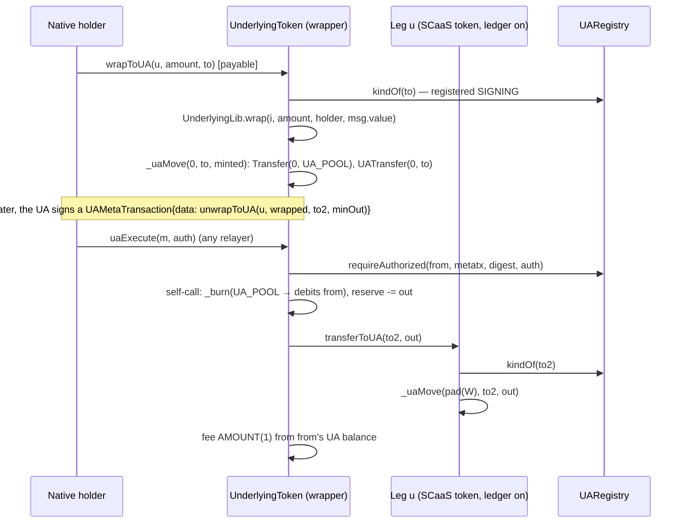

# UA-5a — UA receivers, the one-step wrap and receiver-pays on the UA path: `_uaMint`, `wrapToUA`, `unwrapToUA`, `mintToUA`, `burn` on the UA allowlist, `payWithFeeToUA`, `uaPayReceiverFee` — Implementation Plan

> **For agentic workers:** REQUIRED SUB-SKILL: Use superpowers:subagent-driven-development (recommended) or superpowers:executing-plans to implement this plan task-by-task. Steps use checkbox (`- [ ]`) syntax for tracking.

**Status: FINAL (spiked 2026-10-13).** Task 0 built Tasks 1–6 on branch `ua5a-spike` (worktree `.claude/worktrees/ua5a`,
from `main` `82d7d7c`), in order, one commit each, and ran them green: Task 1 `2c767b4`, Task 2 `bd11f2a`, Task 3
`0315e39`, Task 4 `4db008b`, Task 5 `419b6ab`, Task 6 `8542ef0`. The diffs below are those commits; the two vector files
of Task 6 are generated, never applied. Checked on a clean checkout of `main` `e4e4340` (three unrelated commits after
`82d7d7c`: `.gitignore`, PQZ verifier-floor docs and `pqz-core/floor`): the diffs, taken from this file, apply in sequence
with `git apply --check --whitespace=error`; with the vectors generated, the tree equals `ua5a-spike` byte for byte; every
command and count below was run there. Two ways to land it: merge `ua5a-spike` (then do Task 7), or execute Tasks 1–7 on a
fresh branch. Rulings R5a-1…R5a-15 are kept; the spike's own choices are the controller rulings C5a-1…C5a-15 below.

**Goal:** the UA-5a row of the UA-5 stream (`TODO.md`; owner 2026-10-13): the receiver axis of UA parity
([accounts.md](../../contracts/accounts.md) CTR-UA-27, CTR-UA-28) and receiver-pays on the UA path
([metatx.md](../../contracts/metatx.md) §13, the `uaPayReceiverFee` paragraph): a native caller credits a derived UA in
one call (`wrapToUA` on any leg, `unwrapToUA` from a SCaaS ledger leg, `mintToUA`, `payWithFeeToUA`), a UA burns and
unwraps-to-a-UA under `uaExecute`, a payee (native or UA) pays a relayer out of a UA payment it receives, with
clientkeys typed data and the `metatx3.json` / `pq_signatures.json` rows. Gate: the new suites green, the
`UALedgerInvariant` replay (Σ `_uaBalance` == `balanceOf(UA_POOL)`) and wrapper solvency over the new moves, the full
forge suite (default and `private7622`), the size gate.
Not here: UA-5b (`UATradeOrder`, `uaTrade`, `uaWrap`, `SCaaSDex` tagged legs), UA-5c (the Zether public side, the UA
pipeline in `MetaTxBase`, `MandateWallet` with `bytes32` ids), the node (UA F5: `ua_metatx` jobs, `UATransfer` /
`UA_POOL` indexing; the address-path receiver-fee job is refused today), SCaaS Chain 22776, size work (Glamsterdam).

**Architecture:** Nothing new is written to the ledger by hand: a mint into a UA is `_uaMove(bytes32(0), to, v)` —
`ERC20._update(0, UA_POOL, v)` plus `_uaBalance[to] += v` plus `UATransfer(0, to, v)` — so `_uaMint` is a receiver check
in front of the existing move, and `balanceOf(UA_POOL) == Σ _uaBalance` holds by construction. The receivers are
dedicated functions beside their address twins (`wrap`, `unwrap`, `mint`, `payWithFee`), because each has a `bytes32`
receiver or a native caller who pays. `unwrapToUA` and `burn` are self-calls whose body reads only `_msgSender()`, so
they also join the UA allowlist: under a derived ticket `_msgSender()` is `UA_POOL` and the burn debits the subject
(L4-3, built). `unwrapToUA` pays the underlying leg by calling that leg's own `transferToUA`, so the wrapper's balance of
the leg drops exactly as with `safeTransfer` and the reserve accounting does not change. `uaPayReceiverFee` reuses the
built typed UA pipeline (`_uaExecuteTransfer`, which already returns the digest), the built `ReceiverFee` typehash and
digest, and the registry's existing `receiver-fee` purpose for a derived payee.



**Tech Stack:** Solidity 0.8.37, Foundry (forge 1.3.5 `9979a41`, osaka, OpenZeppelin 5.2 — `ERC165Checker` is in the
tree), the UA registry gen 1 (UA-2a…P6c); Node 22 (`clients/clientkeys`, `@noble/*` as pinned, `@noble/post-quantum`
0.7.1 for the PQ row); no anvil (the deploy scripts do not change).

**Spec:** `docs/contracts/accounts.md` §1.7 — CTR-UA-27 (parity rules: own struct, one lane, receivers, ledger writes,
funds, events, allowlist vs dedicated function, Q1 unchanged set), CTR-UA-28 (the four receiver functions, `_uaMint`,
`UnwrappedToUA`, `UALegNotLedger`), CTR-UA-18 (mint events), CTR-UA-26 (UA allowlist), §1.5 purposes (`metatx`,
`receiver-fee`); `docs/contracts/metatx.md` CTR-MTX-05/06 and the `uaPayReceiverFee` paragraph, CTR-MTX-19 (the two
new address-allowlist rows; `mintToUA`, `payWithFeeToUA` never allowlisted), CTR-MTX-20 (fee classes);
`docs/contracts/token-wrappers.md` CTR-TOK-01, CTR-TOK-05 (solvency), CTR-TOK-26 (native leg); design record
`docs/history/specs/2026-10-13-ua-parity-design.md` §2 (UP-1…UP-6), §4.1–§4.3, §4.5, §4.8, §4.10, §4.14–§4.17, §7.

**Base (measured at `82d7d7c`, Task 0 Step 1):** forge default 94 suites, 1104 passed / 0 failed / 10 skipped;
`FOUNDRY_PROFILE=private7622` the same; `--match-path 'test/ua/**'` 23 suites, 232 passed; clientkeys
`node --test test/` 101 tests, 99 passed / 2 skipped; runtime (init) sizes: `NoUnderlyingToken` 31,770 (33,276),
`UnderlyingToken` 39,189 (40,702), `NoUnderlyingZetherToken` 40,067 (41,727), `UnderlyingZetherToken` 49,778 (51,473),
`UnderlyingLib` 11,697 (11,749).

## Global Constraints

- Paths relative to `/home/ha/work/ainative/scaas`; work in a worktree `.claude/worktrees/ua5a` on its own branch from
  `main` (symlink `smartcontracts/evm/lib` → `/home/ha/work/ainative/scaas/smartcontracts/evm/lib` and
  `clients/clientkeys/node_modules` → the main checkout's, as the earlier worktrees do). Heavy commands (forge, node
  tests, the vector generator) only through `scripts/capped`, one at a time machine-wide (a second capped command
  waits; no `dotnet` here); `/usr/bin/git`, `/usr/bin/grep`; forge in `smartcontracts/evm`, node in `clients/clientkeys`.
- Task order is fixed: 1 plumbing → 2 receivers (with their address-allowlist rows) → 3 UA allowlist → 4 receiver-pays →
  5 invariants → 6 vectors and clientkeys → 7 docs. The branch merges as a whole after Task 7.
- TDD: each code task applies its test diff first and runs it red (a new function: a compile error; a new rule: an
  assertion failure), then applies the implementation diff and runs green. Each diff is applied with
  `/usr/bin/git apply --whitespace=error` from the repo root.
- Vector files are never edited by hand: `clients/clientkeys/scripts/ua-sig-vectors.mjs` writes `metatx3.json` and
  `pq_signatures.json` (Task 6). The existing keys of both files stay byte-identical (the new rows go under new keys);
  `kinds.json`, `structures.json`, `signatures.json`, `groups.json`, `ed25519_fuzz.json`, `pq_kat.json`,
  `pq_external.json` and the address-path KATs do not change.
- No chain-7622 or real/public-chain action, no change to chain docker/chainspec files, no node (`scaas-node`) change.
- No size optimisation (owner: wait for Glamsterdam); the size gate must pass — the new sizes go into
  `smartcontracts/evm/size-baseline.json` (the ratchet) instead. Test chains run 64 KiB code.
- Nothing is superseded (no `legacy/` move); every chain is a test chain: redeploy, no migration.
- The role and admin functions stay as they are (owner 2026-10-13, Q1): no UA form of `mint`'s role, `ITokenAdmin`,
  rate, guardian or `addReserve`; `mintToUA` is a receiver form for the native minter, never allowlisted.
- SPDX header of every new Solidity file: `// SPDX-License-Identifier: LicenseRef-Vegan-Community-1.0`.
- Commit trailer: the model that wrote the commit, e.g. `Co-Authored-By: Claude Opus 5.5 <noreply@anthropic.com>`.
  Never `git add` `claude-code-api.txt`, `out/`, `cache/`, `target/`, `node_modules/`, `smartcontracts/evm/lib/`,
  `smartcontracts/evm/deployments/`, `broadcast/`, `.superpowers/`.
- Stop every background shell you started before reporting.

## Review Focus

- **`UA_POOL`'s slot stays Σ of the UA balances.** Every new credit is `_uaMove` (the mint from 0 included); no new path
  writes `UA_POOL`'s ERC-20 slot otherwise. `uaPayReceiverFee` refuses `feeRecipient == UA_POOL` **before** any move
  (a `_uaMove` to the native id `pad(UA_POOL)` would credit the pool's slot with no ledger entry); `payWithFeeToUA`'s
  fee to `UA_POOL` is refused by `_update` — `test_uaPayReceiverFee_poolFeeRecipientRefused`,
  `test_payWithFeeToUA_poolFeeRecipientRefused`, the `UALedgerInvariant` replay with the new handlers.
- **Under a derived ticket only the allowlisted burns run.** `burn` and `unwrapToUA` debit exactly the subject and fail
  `UAInsufficientBalance` past its balance; `wrapToUA`, `mintToUA`, `payWithFeeToUA`, `addReserve` under `uaExecute`
  are `MetaTxUnknownOp`; `mintToUA` and `payWithFeeToUA` are on no allowlist — `test_uaExecute_burnUnderUA`,
  `test_uaExecute_unwrapToUAUnderUA`, `test_uaAllowlist_refusals`, `test_refusedEverywhere`.
- **Reserve accounting of `unwrapToUA`.** The leg's reserve drops by `out` and the wrapper's balance of the leg by
  exactly `out`; a leg that is not a SCaaS ledger token reverts `UALegNotLedger` before anything is paid; a leg that
  answers ERC-165 but moves less reverts `UnderlyingTransferMismatch`; re-entry from the leg's `transferToUA` into the
  wrapper hits its guard — `test_unwrapToUA_*`, `invariant_ledgerLegSolvent`.
- **The co-signature binds one payment.** `uaPayReceiverFee`'s `ReceiverFee` is over the payer's UA digest; a derived
  payee signs under purpose `receiver-fee` (a `metatx` signature of the same key does not pass, nor the reverse); a
  co-signature over another digest, a payer intent landed through `uaExecuteTransfer` first (bad nonce), an expired
  co-signature and every shape error revert — `test_uaPayReceiverFee_*`.
- **Native-coin leg.** A direct `wrapToUA` of the native leg is payable and credits the UA; relayed through
  `mtxExecute` it reverts `NativeValueMismatch(0, amount)` as the address path's wrap does —
  `test_wrapToUA_nativeLeg_direct`, `test_wrapToUA_nativeLeg_relayedRefused`.

## Rulings (spec vs code) and defaults taken

All kept by the spike; where the spike settled a detail the ruling names, the controller ruling is cited.

- **R5a-1 Scope.** `_uaMint`, `wrapToUA` (direct and relayed through `mtxExecute`), `unwrapToUA` (direct, relayed,
  and under `uaExecute`), `mintToUA`, `burn` on the UA allowlist, `payWithFeeToUA`, `uaPayReceiverFee`, clientkeys
  typed data and calldata builders, the vector rows. Kinds: `wrapToUA` / `unwrapToUA` on `UnderlyingToken` and,
  inherited, `UnderlyingZetherToken`; `mintToUA` and the UA-allowlisted `burn` on `NoUnderlyingToken` and, inherited,
  `NoUnderlyingZetherToken`; `payWithFeeToUA` and `uaPayReceiverFee` on every kind (`MetaTokenBase`).
- **R5a-2 One receiver check, one ledger write.** `ERC20MetaTx` gets `_requireDerivedReceiver(bytes32 to)` —
  `_uaOn()`; a native id ⇒ `UANotRegistered(to)`; `_checkTo(to)` (`UANotRegistered`, `UAKindNotAccepted`) — factored
  out of `transferToUA` (whose behaviour does not change), and `_uaMint(bytes32 to, uint256 v)` =
  `_requireDerivedReceiver(to); _uaMove(bytes32(0), to, v)`. A native `to` is refused on every `…ToUA` function: the
  address twin serves it (CTR-UA-28), as `transferToUA` does today.
- **R5a-3 `wrapToUA(address u, uint256 amount, bytes32 to) payable returns (uint256 minted)`.** Cheap first:
  `_requireDerivedReceiver(to)`, then `UnderlyingLib.wrap(UnderlyingLib.indexOf(u), amount, _msgSender(), msg.value)`
  (every leg check, the native leg's `msg.value` rule and the measured delta unchanged), then
  `_uaMove(bytes32(0), to, minted)`; `Wrapped(account, u, received, minted)`. `nonReentrant`. Address allowlist:
  `ABSOLUTE`, static length 100 (`4 + 3 · 32`); not on the UA allowlist (a UA holds no outside underlying). No
  single-leg form. Relayed, the `ABSOLUTE` fee is charged after the call from the signer's own native balance of this
  token by the built `_chargeFee` — a signer without one signs fee `NONE`. (Built through one shared `_wrap`, C5a-2.)
- **R5a-4 `unwrapToUA(address u, uint256 wrapped, bytes32 to, uint256 minOut) returns (uint256 out, uint256 burned)`.**
  `UnderlyingLib` gets `quoteUnwrapToUA(i, wrapped, minOut)` (the checks of `quoteUnwrap` without the address recipient
  check; both call one private `_quote`) and `payOutToUA(i, bytes32 to, out) returns (address u)`: `u == NATIVE` or
  `!ERC165Checker.supportsInterface(u, type(IUALedger).interfaceId)` ⇒ `UALegNotLedger(u)` (a `MetaTokenBase` answers
  `IUALedger` iff its registry ≠ 0; an HTS or outside ERC-20 leg answers false); `reserve -= out` (C5a-3: after the leg
  check); `before = balanceOf(this)`; `IUALedger(u).transferToUA(to, out)`; the balance must drop by exactly `out`
  (`UnderlyingTransferMismatch`). The token burns `burned` from `_msgSender()` between quote and pay-out (CEI, as
  `_unwrap`) and emits `UnwrappedToUA(account, u, to, burned, out)` (`account` = `UA_POOL` under a derived subject;
  CTR-UA-28, owner 2026-10-13). `to` is checked by the leg's own `transferToUA`. Both allowlists, `AMOUNT(1)`, static
  length 132.
- **R5a-5 `mintToUA(bytes32 to, uint256 amount)`** on `NoUnderlyingToken`: `AdminLib.requireRole(MINTABLE,
  _msgSender())` exactly as `mint`, then `_uaMint(to, amount)`. Never allowlisted (a role function, CTR-MTX-19).
- **R5a-6 `burn` on the UA allowlist.** `NoUnderlyingToken._uaAllowed(sel) = sel == this.burn.selector`; no body
  change. `NoUnderlyingZetherToken` inherits `_uaAllowed` from two paths (`NoUnderlyingToken`, and `ZetherLayer`
  through `ERC20MetaTx`), so it declares `override(NoUnderlyingToken, ERC20MetaTx)` returning
  `NoUnderlyingToken._uaAllowed(sel)` (as `UnderlyingZetherToken` does for its parent) — confirmed by the compiler. The
  fee is the address path's `AMOUNT(0)` from the signer's UA balance (built `_uaExecute`).
- **R5a-7 `payWithFeeToUA(bytes32 to, uint256 amount, FeeMode feeMode, uint256 fee, address feeRecipient,
  bytes32 entryRef) returns (bool)`** on `MetaTokenBase` beside `payWithFee`: `PAYABLE`; `_requireDerivedReceiver(to)`;
  `payer = _msgSender()`; `feeAmount = FeePolicy.compute(...)`, `validateRecipient`; `feeAmount ≠ 0` ⇒
  `_transfer(payer, feeRecipient, feeAmount)` (`UA_POOL` and the token refused by `_update`); `_uaMove(pad(payer), to,
  amount)`; `UAPaymentSettled(pad(payer), to, amount, feeAmount, feeRecipient, entryRef)`. No `nonReentrant`.
- **R5a-8 `uaPayReceiverFee`** on `MetaTokenBase` beside `mtxPayReceiverFee`, `nonReentrant`, `PAYABLE`, in the order
  `ReceiverFeeShape` → `ReceiverFeeExpired` → `ReceiverFeeAmount` → `FeeRecipientIsPayee` → `TransferToSelf` →
  `UAPoolNotPayable` → `d = _uaExecuteTransfer(t, payerAuth)` → `_uaAuthorize(t.to, PURPOSE_RECEIVER_FEE,
  receiverFeeDigest(d, …), payeeAuth)` → `_uaMove(t.to, pad(feeRecipient), fee)` → `UAReceiverFeePaid`.
  `_uaAuthorize` gained the `bytes32 purpose` parameter and is `internal` (Task 1); its native branch ignores the
  purpose. The `msg.sender` lint counts do not change (C5a-4: the shape checks stay duplicated, as the named UA
  functions duplicate theirs).
- **R5a-9 Placement.** `error UALegNotLedger(address token)` in `IUALedger`; `event UnwrappedToUA`, `wrapToUA`,
  `unwrapToUA` in `IUnderlyingToken`; `event UAReceiverFeePaid`, `payWithFeeToUA`, `uaPayReceiverFee` in
  `IMetaTokenV2`; `mintToUA` beside `mint` (no interface).
- **R5a-10 Allowlist pins.** `UnderlyingToken.mtxSelectors()` 6 → 8 (`wrapToUA`, `unwrapToUA` appended);
  `UnderlyingZetherToken.mtxSelectors()` 14 → 16 (appended at 14, 15), its `_mtxRule` falls back to
  `UnderlyingToken._mtxRule`; `NoUnderlyingToken`'s and `NoUnderlyingZetherToken`'s lists do not change. The UA
  allowlists: `UnderlyingToken` = the two `unwrap`s with `minOut` + `unwrapToUA`; `NoUnderlyingToken` = `burn`.
  (C5a-1: the address-allowlist rows land in Task 2 with their functions.)
- **R5a-11 Vectors.** `metatx3.json` gains `burn`, `unwrapToUA`, `receiverFee` (and `noteUA5a`, C5a-11), existing
  keys byte-identical, `version` 1. `receiverFee` rows `{payer, payee, transfer, paymentDigest, receiverFee,
  receiverFeeDigest, payerAuth, payeeAuth}`: native payer × each of the 8 derived payees, and `p256` × `bip340`.
  `pq_signatures.json`'s `metatx3` gains `receiverFee` with an `mldsa65` payer (index 0) and an `mldsa65` payee
  (index 1, `extraKeys[0]`). clientkeys: `receiverFeeTypedData` (both paths), `wrapToUACalldata`,
  `unwrapToUACalldata`, `payWithFeeToUACalldata`.
- **R5a-12 Node.** No `scaas-node` change in UA-5a (UA F5 first); the gateway reads `mtxSelectors()` on chain, so the two
  new address-path selectors relay with no node release.
- **R5a-13 Gas.** Logged, not asserted, except the two-`mldsa65` `uaPayReceiverFee`, asserted under 16,777,216 with its
  intrinsic and calldata gas (measured **11,874,662**, Task 6).
- **R5a-14 Hedera.** `test_wrapToUA_htsLeg`, `test_unwrapToUA_htsLegRefused`, `test_uaPayReceiverFee_hip632Payee`
  (C5a-5: on version-2 implementations with a stub registry).
- **R5a-15 Sizes.** Measured (runtime / init, after Task 4): `NoUnderlyingToken` 32,985 / 34,491 (+1,215),
  `UnderlyingToken` 41,685 / 43,198 (+2,496), `NoUnderlyingZetherToken` 41,248 (+1,181), `UnderlyingZetherToken`
  52,182 / 53,877 (+2,404 / +2,404), `UnderlyingLib` 12,560 (+863, under 24,576). All below the design's estimates
  (§4.17); recorded in `size-baseline.json`.

## Controller rulings (spike, 2026-10-13)

- **C5a-1 Task split.** The address-allowlist rows of `wrapToUA` / `unwrapToUA` (`mtxSelectors` 6 → 8 and 14 → 16,
  `_mtxRule`, the pins in `Allowlist.t.sol` and `ZetherUnderlying.t.sol`) land in Task 2 with the functions, so every
  commit is green; Task 3 is the UA allowlist only.
- **C5a-2 One wrap body.** `_wrap(i, amount, bytes32 to)` serves `wrap` (`to = 0`: `_mint`) and `wrapToUA` (`_uaMove`
  from 0); `wrapToUA` checks the receiver itself, so the registry is asked once. `_uaMint` serves `mintToUA`.
- **C5a-3 `payOutToUA` order.** The leg check comes before `reserve -= out` (same result, reads "nothing moves first").
- **C5a-4 `uaPayReceiverFee` shape checks** are written out beside `mtxPayReceiverFee`'s, not factored: a shared
  helper over the two struct types needs ten scalar parameters (stack depth without via-IR); the address path is
  untouched.
- **C5a-5 Stub registry in two fixtures.** `StubUARegistry` (`test/helpers/Mocks.sol`: `chainUid`, every derived id a
  `p256` UA, no `requireAuthorized`) turns the ledger on where only native signers act: `Allowlist.t.sol`
  (`single`, `multi`, and `ledgered`, a one-leg wrapper of the SCaaS token `pts`, so `unwrapToUA` runs and the
  eight-entry class cross-check reaches its fee cap) and `HederaV2.t.sol` (version-2 implementations).
- **C5a-6 Receiver-fee matrix ids.** Payers native / `p256` / `bip340`, payees native / `ed25519` / `webauthn-p256`
  (registered in the suite): nine distinct pairs, no self-payment.
- **C5a-7 ERC-1271 payee at 400 k.** Instead of deploying a `SmartKeyAccount`, the payee is an EIP-1167 clone of a
  gas-burning `MockWallet` that is the token's `SMART_KEY_ACCOUNT_IMPL`: 400 k passes; the same wallet against a token
  without that implementation (50 k) fails — the exact budget path a `SmartKeyAccount` payee takes.
- **C5a-8 Zether fixtures.** In `test_everyListedSelectorRuns_underlyingZether`, `wrapToUA` credits a registered
  `schnorr-bn254` UA and `unwrapToUA` reaches the call and reverts `UALegNotLedger` (the legs are outside tokens); the
  `NONE_ZETHER` UA-allowlist test (`test_noneZether_burnUnderUA`) lives in `ZetherUnderlying.t.sol`, which has the
  SIGNING-UA helper.
- **C5a-9 Size pins.** `Factory.t.sol` / `HederaV2.t.sol` `assertLe` bounds 32,768 → 36,864 (`NONE`) and 40,960 →
  45,056 (`UNDERLYING`); `size-baseline.json` remains the exact ratchet.
- **C5a-10 JS verification of derived rows.** The new `metatx3.json` rows' derived signatures are verified with noble
  for `p256`, `bip340` and `ed25519` (and the native ECDSA rows), each also refused under the other purpose; the other
  kinds are verified on chain by `UAMetaTx3Vectors.t.sol` with the real verifiers (as the file already does for every
  derived row).
- **C5a-11 `noteUA5a`.** `metatx3.json` keeps its `note` byte-identical and documents the new rows in a new key.
- **C5a-12 clientkeys.** `payWithFeeToUA` joins `NEVER_CALLED` (`checkCall` refuses it as it refuses `payWithFee`).
- **C5a-13 Gas method.** Pairs are measured from one state snapshot each (`vm.snapshotState` / `revertToState`, which
  restores cold access): every call as cold as its own transaction, minus intrinsic gas;
  `test_gas_snapshotRestoresColdAccess` checks the method.
- **C5a-14 Vector parameters.** `burn` rows: `burn(1000000)` on lane 8; `unwrapToUA` rows:
  `unwrapToUA(0x5ca0…00b1, 1000000, <the p256 UA>, 990000)` on lane 9, both with `call`'s envelope (mode `0x13`, fee
  5000 ppm); `receiverFee`: payment of 100,000,000 with mode `0x01` (relayer bound, fee `NONE`) on
  `payLane(keccak256("scaas.metatx3.receiverFee.<payer>.<payee>"))`, `ReceiverFee` fee 300,000 to `0x…0fee`,
  `validUntil` 1,800,000,060.
- **C5a-15 Ledger-off wrapper, ledger-on leg** (final review M2). `unwrapToUA` on a wrapper whose own ledger is off
  (registry 0), called directly by a native, pays a UA of a ledger-on leg: the credit lives in the leg's ledger, which
  checks `to`; the wrapper needs its own ledger only for a UA subject (`uaExecute`). Kept as is, pinned by
  `test_unwrapToUA_ledgerOffWrapper_ledgerOnLeg`; one sentence in CTR-UA-28.

## Spike findings

- Gas (logged; cold, per C5a-13; stand-in verifier in `test/ua`, so the derived rows show the registry's overhead, not a
  real verify):

  | Call | Address twin | `…ToUA` | Δ |
  |---|---|---|---|
  | `wrap(u, v)` ERC-20 leg / `wrapToUA` | 114,975 | 145,161 | +30,186 |
  | `wrap(u, v)` native leg / `wrapToUA` | 93,228 | 123,415 | +30,187 |
  | `unwrap(u, …)` ledger leg / `unwrapToUA` | 42,700 | 76,557 | +33,857 |
  | `payWithFee` / `payWithFeeToUA` | 59,683 | 89,710 | +30,027 |
  | `mint` / `mintToUA` | 26,344 | 56,392 | +30,048 |

  The +30 k is the cold registry call (`kindOf`) and the new `UA_POOL` and UA slots, as §4.15 estimated.
- `uaPayReceiverFee` (cold, stand-in verifier): native × native 103,349 (address path `mtxPayReceiverFee` 103,876);
  derived payer or payee 112,757–115,997. With the real verifiers (`UAMetaTx3Vectors.t.sol`, warm token): native payer
  × `p256` 98,052, × `bip340` 98,843, × `schnorr-bn254` 116,473, × `schnorr-bls12381` 128,532, × `webauthn-p256`
  160,279, × `bls-bn254-minsig` 233,861, × `bls12381-minsig` 246,774, × `ed25519` 256,335; `p256` × `bip340` 85,175.
  `uaExecute(burn)` per signer 68,092 (`p256`) … 224,983 (`ed25519`).
- Two `mldsa65` signatures (`UAMetaTx3Pq.t.sol`, real verifier, cached expanded keys): calldata 7,492 B (110,644 gas),
  execution 11,743,018, transaction 11,874,662 < 16,777,216 — and the call succeeds when given exactly
  16,777,216 − 21,000 − calldata gas, the registry's per-verify hold included. The total is also under Hedera's 15 M
  (not run on a Hedera profile).
- Nothing in R5a-1…15 had to change. No owner question.

## File map

| File | Change | Task |
|---|---|---|
| `smartcontracts/evm/src/metatx/IUALedger.sol` | `error UALegNotLedger(address token)` | 1 |
| `smartcontracts/evm/src/metatx/ERC20MetaTx.sol` | `_requireDerivedReceiver`, `_uaMint`; `transferToUA` uses the former; `_uaAuthorize(from, purpose, digest, auth)` internal; `_uaAllowed` doc | 1, 3 |
| `smartcontracts/evm/src/metatx/UnderlyingLib.sol` | `_quote`, `quoteUnwrapToUA`, `payOutToUA` (`ERC165Checker`) | 2 |
| `smartcontracts/evm/src/metatx/IUnderlyingToken.sol` | `wrapToUA`, `unwrapToUA`, `event UnwrappedToUA` | 2 |
| `smartcontracts/evm/src/metatx/UnderlyingToken.sol` | `wrapToUA`, `unwrapToUA`, `_wrap(i, amount, to)`, two selectors, `mtxSelectors` 6 → 8, `_mtxRule`; `_uaAllowed` + `unwrapToUA` | 2, 3 |
| `smartcontracts/evm/src/metatx/NoUnderlyingToken.sol` | `mintToUA`; `_uaAllowed` = `burn` | 2, 3 |
| `smartcontracts/evm/src/metatx/MetaTokenBase.sol` | `payWithFeeToUA`; `uaPayReceiverFee` | 2, 4 |
| `smartcontracts/evm/src/metatx/IMetaTokenV2.sol` | `payWithFeeToUA`; `uaPayReceiverFee`, `event UAReceiverFeePaid` | 2, 4 |
| `smartcontracts/evm/src/zether/UnderlyingZetherToken.sol` | `mtxSelectors` 14 → 16 | 2 |
| `smartcontracts/evm/src/zether/NoUnderlyingZetherToken.sol` | `_uaAllowed` override (two paths) | 3 |
| `smartcontracts/evm/size-baseline.json` | the ratchet | 2, 3, 4 |
| `smartcontracts/evm/test/helpers/Mocks.sol` | `StubUARegistry` | 2 |
| `smartcontracts/evm/test/ua/UALedgerBase.sol` | `wrpL` (leg `tok`), `wrpN` (native leg), `_wrapper`, `_wrapL` | 2 |
| `smartcontracts/evm/test/ua/UAReceivers.t.sol` (new) | `_uaMint` (harness), `wrapToUA`, `unwrapToUA`, `mintToUA`, `payWithFeeToUA`, gas | 1, 2 |
| `smartcontracts/evm/test/ua/UAAllowlist5a.t.sol` (new) | `burn` / `unwrapToUA` under `uaExecute` and `uaBatch`, refusals | 3 |
| `smartcontracts/evm/test/ua/UAReceiverFee.t.sol` (new) | `uaPayReceiverFee` | 4 |
| `smartcontracts/evm/test/ua/UALedgerInvariant.t.sol` | handlers for the new moves; `wrpL`, `wrpN` invariants, `invariant_ledgerLegSolvent` | 5 |
| `smartcontracts/evm/test/v2/Allowlist.t.sol` | stub registry, `ledgered`; pins 6 → 8; the new selectors run; refusals | 2, 4 |
| `smartcontracts/evm/test/zether/ZetherUnderlying.t.sol` | pin 14 → 16; the loop runs both; `test_noneZether_burnUnderUA` | 2, 3 |
| `smartcontracts/evm/test/hedera/HederaV2.t.sol` | HTS `wrapToUA`, HTS `unwrapToUA` refused; HIP-632 payee; size pin | 2, 4 |
| `smartcontracts/evm/test/v2/Factory.t.sol` | size pin | 4 |
| `smartcontracts/evm/test/ua/UAMetaTx3Vectors.t.sol`, `test/ua/UAMetaTx3Pq.t.sol` | the new rows; the two-`mldsa65` cap | 6 |
| `clients/clientkeys/src/evm.js` | `receiverFeeTypedData`, `wrapToUACalldata`, `unwrapToUACalldata`, `payWithFeeToUACalldata`; `NEVER_CALLED` | 6 |
| `clients/clientkeys/scripts/ua-sig-vectors.mjs` | the `burn`, `unwrapToUA`, `receiverFee` rows; the PQ `receiverFee` row | 6 |
| `clients/clientkeys/test/evm.test.js`, `test/ua-metatx3.test.js`, `test/pq-sig.test.js` | builders and rows | 6 |
| `smartcontracts/vectors/ua/metatx3.json`, `pq_signatures.json` | generated | 6 |
| `docs/contracts/accounts.md`, `metatx.md`, `token-wrappers.md`, `docs/decisions.md`, `TODO.md` | BUILT, measured numbers | 7 |

---

### Task 0: Spike — done (2026-10-13)

- [x] **Step 1:** Worktree `.claude/worktrees/ua5a` (branch `ua5a-spike`) from `main` `82d7d7c`; base counts and sizes
  under **Base**.
- [x] **Step 2:** Tasks 1–6 built in order, one commit each (hashes in the status line), every command of each task run.
- [x] **Step 3:** This file: the diffs, counts, sizes and gas below; the draft notes resolved (R5a-6's override,
  R5a-15's sizes, R5a-11's layout, R5a-13's gas); C5a-1…14 recorded. Checked on a clean `main` (status line).
- [x] **Step 4:** The worktree and `ua5a-spike` are kept until the owner reviews the plan (owner approves merges).

### Task 1: Plumbing — `UALegNotLedger`, `_requireDerivedReceiver`, `_uaMint`, `_uaAuthorize` with a purpose

**Files:** Modify `src/metatx/IUALedger.sol`, `src/metatx/ERC20MetaTx.sol`; create `test/ua/UAReceivers.t.sol` (its
`_uaMint` part, through the harness `UAMintHarness is NoUnderlyingToken`). Paths in `smartcontracts/evm`.

- [ ] **Step 1: Tests first.** `/usr/bin/git apply --whitespace=error` this diff (`test_uaMint_eventsAndTotals`,
  `test_uaMint_refusesNativeUnregisteredZether`, `test_uaMint_ledgerOff`):

```diff
diff --git a/smartcontracts/evm/test/ua/UAReceivers.t.sol b/smartcontracts/evm/test/ua/UAReceivers.t.sol
new file mode 100644
index 0000000..785aca0
--- /dev/null
+++ b/smartcontracts/evm/test/ua/UAReceivers.t.sol
@@ -0,0 +1,64 @@
+// SPDX-License-Identifier: LicenseRef-Vegan-Community-1.0
+pragma solidity ^0.8.24;
+
+import {Clones} from "@openzeppelin/contracts/proxy/Clones.sol";
+import {IERC20} from "@openzeppelin/contracts/token/ERC20/IERC20.sol";
+import {UAKinds} from "../../src/ua/UAKinds.sol";
+import {IUALedger} from "../../src/metatx/IUALedger.sol";
+import {NoUnderlyingToken} from "../../src/metatx/NoUnderlyingToken.sol";
+import {noneInit} from "../v2/helpers/V2Fixture.sol";
+import {UALedgerBase} from "./UALedgerBase.sol";
+
+/// Exposes `_uaMint` (accounts.md CTR-UA-28).
+contract UAMintHarness is NoUnderlyingToken {
+    constructor(bytes32 uid, address reg) NoUnderlyingToken(msg.sender, address(0), uid, reg, false) {}
+
+    function mintUA(bytes32 to, uint256 v) external {
+        _uaMint(to, v);
+    }
+}
+
+/// accounts.md CTR-UA-28: a native caller credits a derived UA in one call; a mint into a UA is a UA-ledger move from 0.
+contract UAReceiversTest is UALedgerBase {
+    UAMintHarness internal hm;
+
+    function setUp() public override {
+        super.setUp();
+        hm = _harness(REG_L);
+    }
+
+    function _harness(address registry_) internal returns (UAMintHarness h) {
+        h = UAMintHarness(Clones.clone(address(new UAMintHarness(chainUidA, registry_))));
+        h.initialize(address(this), 1, noneInit("H", "H", 6, 0, address(0), address(this)));
+    }
+
+    // ----- _uaMint -----
+
+    function test_uaMint_eventsAndTotals() public {
+        vm.expectEmit(address(hm));
+        emit IERC20.Transfer(address(0), POOL, 700);
+        vm.expectEmit(address(hm));
+        emit IUALedger.UATransfer(bytes32(0), uaP, 700);
+        hm.mintUA(uaP, 700);
+        assertEq(hm.totalSupply(), 700);
+        assertEq(hm.balanceOf(POOL), 700);
+        assertEq(hm.balanceOfUA(uaP), 700);
+    }
+
+    function test_uaMint_refusesNativeUnregisteredZether() public {
+        vm.expectRevert(abi.encodeWithSelector(IUALedger.UANotRegistered.selector, _pad(bob)));
+        hm.mintUA(_pad(bob), 1);
+        bytes32 unknown = keccak256("unregistered");
+        vm.expectRevert(abi.encodeWithSelector(IUALedger.UANotRegistered.selector, unknown));
+        hm.mintUA(unknown, 1);
+        vm.expectRevert(abi.encodeWithSelector(IUALedger.UAKindNotAccepted.selector, uaZ, UAKinds.ZETHER_BN254));
+        hm.mintUA(uaZ, 1);
+        assertEq(hm.totalSupply(), 0);
+    }
+
+    function test_uaMint_ledgerOff() public {
+        UAMintHarness off = _harness(address(0));
+        vm.expectRevert(IUALedger.UALedgerOff.selector);
+        off.mintUA(uaP, 1);
+    }
+}
```

- [ ] **Step 2: Red.** `cd smartcontracts/evm && ../../scripts/capped forge test --match-path test/ua/UAReceivers.t.sol`
  — `Error (7576): Undeclared identifier.` at `_uaMint(to, v);`.
- [ ] **Step 3: Implement** (R5a-2, R5a-8's purpose parameter; the two built callers pass `UAKinds.PURPOSE_METATX`):

```diff
diff --git a/smartcontracts/evm/src/metatx/ERC20MetaTx.sol b/smartcontracts/evm/src/metatx/ERC20MetaTx.sol
index 5cbea4f..7d83e86 100644
--- a/smartcontracts/evm/src/metatx/ERC20MetaTx.sol
+++ b/smartcontracts/evm/src/metatx/ERC20MetaTx.sol
@@ -252,9 +252,7 @@ abstract contract ERC20MetaTx is ERC20, MetaTxBase, IERC20Payment, ITradeToken,
 
     /// @notice Native `msg.sender` → a registered SIGNING UA: `Transfer(sender, UA_POOL)` and `UATransfer`.
     function transferToUA(bytes32 to, uint256 amount) external nonReentrant returns (bool) {
-        _uaOn();
-        if (UAKinds.inNativeSpace(to)) revert UANotRegistered(to);
-        _checkTo(to);
+        _requireDerivedReceiver(to);
         _uaMove(MetaTxLib.pad(_msgSender()), to, amount);
         return true;
     }
@@ -315,7 +313,7 @@ abstract contract ERC20MetaTx is ERC20, MetaTxBase, IERC20Payment, ITradeToken,
         _uaOn();
         _checkEnvelope(m.from, m.batch, m.nonce, m.validUntil, m.mode, m.relayer);                    // 1
         bytes32 digest = _hashTypedDataV4(m.hashStruct());                                             // 2
-        _uaAuthorize(m.from, digest, auth);
+        _uaAuthorize(m.from, UAKinds.PURPOSE_METATX, digest, auth);
         bytes4 sel = bytes4(m.data);                                                                   // 3
         if (m.data.length < 4 || !_uaAllowed(sel)) revert MetaTxUnknownOp(sel);
         uint256 basis = _checkCall(m.data, m.mode);
@@ -336,7 +334,7 @@ abstract contract ERC20MetaTx is ERC20, MetaTxBase, IERC20Payment, ITradeToken,
         _uaOn();
         _checkEnvelope(t.from, t.batch, t.nonce, t.validUntil, t.mode, t.relayer);                    // 1
         digest = _hashTypedDataV4(t.hashStruct());                                                     // 2
-        _uaAuthorize(t.from, digest, auth);
+        _uaAuthorize(t.from, UAKinds.PURPOSE_METATX, digest, auth);
         (uint256 fee, address feeTo) = _checkUATransfer(t);                                           // 3
         _useNonce(t.from, t.batch);                                                                    // 4
         if (fee != 0) _uaMove(t.from, MetaTxLib.pad(feeTo), fee);                                     // 5
@@ -363,6 +361,20 @@ abstract contract ERC20MetaTx is ERC20, MetaTxBase, IERC20Payment, ITradeToken,
         if (have < need) revert MetaTxInsufficientForFee(need, have);
     }
 
+    /// @dev The receiver of every `…ToUA` function (CTR-UA-28): the ledger on and a registered SIGNING derived id; a
+    ///      native id belongs to the address twin (`UANotRegistered`).
+    function _requireDerivedReceiver(bytes32 to) internal view {
+        _uaOn();
+        if (UAKinds.inNativeSpace(to)) revert UANotRegistered(to);
+        _checkTo(to);
+    }
+
+    /// @dev A mint into a derived UA (CTR-UA-28): a UA-ledger move from 0, `Transfer(0, UA_POOL)` and `UATransfer(0, to)`.
+    function _uaMint(bytes32 to, uint256 v) internal {
+        _requireDerivedReceiver(to);
+        _uaMove(bytes32(0), to, v);
+    }
+
     /// @dev A receiver: a native id other than 0, the token and `UA_POOL`; or a registered SIGNING UA (never Zether).
     function _checkTo(bytes32 to) private view {
         if (UAKinds.inNativeSpace(to)) {
@@ -377,12 +389,13 @@ abstract contract ERC20MetaTx is ERC20, MetaTxBase, IERC20Payment, ITradeToken,
         if (!UAKinds.isSigning(kind)) revert UAKindNotAccepted(to, kind);
     }
 
-    /// @dev Step 2: a native id is checked here over the v3 digest (CTR-UA-24: no code ⇒ ECDSA; an EIP-7702 designator
-    ///      ⇒ ECDSA, else ERC-1271 through the delegate; other code ⇒ ERC-1271; Hedera's HIP-632 as on the address
-    ///      path); a derived one by the registry under purpose `metatx`.
-    function _uaAuthorize(bytes32 from, bytes32 digest, bytes calldata auth) private view {
+    /// @dev Step 2: a native id is checked here over the digest itself (CTR-UA-24: no code ⇒ ECDSA; an EIP-7702
+    ///      designator ⇒ ECDSA, else ERC-1271 through the delegate; other code ⇒ ERC-1271; Hedera's HIP-632 as on the
+    ///      address path), whatever the purpose; a derived one by the registry under `purpose` (`metatx`, or
+    ///      `receiver-fee` for a payee's `ReceiverFee`).
+    function _uaAuthorize(bytes32 from, bytes32 purpose, bytes32 digest, bytes calldata auth) internal view {
         if (!UAKinds.inNativeSpace(from)) {
-            return IUARegistry(_REGISTRY).requireAuthorized(from, UAKinds.PURPOSE_METATX, digest, auth);
+            return IUARegistry(_REGISTRY).requireAuthorized(from, purpose, digest, auth);
         }
         address a = address(uint160(uint256(from)));
         if (a == MetaTxLib.UA_POOL) revert UAPoolNotPayable();
diff --git a/smartcontracts/evm/src/metatx/IUALedger.sol b/smartcontracts/evm/src/metatx/IUALedger.sol
index 4dc92b8..18d7d24 100644
--- a/smartcontracts/evm/src/metatx/IUALedger.sol
+++ b/smartcontracts/evm/src/metatx/IUALedger.sol
@@ -26,6 +26,8 @@ interface IUALedger {
     error UAInsufficientBalance(bytes32 ua, uint256 balance, uint256 needed);
     error UACancelUsed();
     error MetaTxUnknownOp(bytes4 selector);
+    /// @notice A leg or receive token that is not a SCaaS token with its UA ledger on (accounts.md CTR-UA-27).
+    error UALegNotLedger(address token);
 
     function registry() external view returns (address);
     function balanceOfUA(bytes32 ua) external view returns (uint256);
```

- [ ] **Step 4: Green.** The same command — 3 passed; `../../scripts/capped forge test --match-path 'test/ua/**'` —
  24 suites, 235 passed (base 232 + 3; `test_transferToUA*` in `UALedger.t.sol` unchanged).
- [ ] **Step 5: Commit** `feat(ua5a): _uaMint as a move from 0, one derived-receiver check, _uaAuthorize by purpose`.

### Task 2: The receivers — `wrapToUA`, `unwrapToUA`, `mintToUA`, `payWithFeeToUA`, and their address-allowlist rows

**Files:** Modify `src/metatx/UnderlyingLib.sol`, `IUnderlyingToken.sol`, `UnderlyingToken.sol`, `NoUnderlyingToken.sol`,
`MetaTokenBase.sol`, `IMetaTokenV2.sol`, `src/zether/UnderlyingZetherToken.sol`, `size-baseline.json`,
`test/helpers/Mocks.sol`, `test/ua/UALedgerBase.sol`, `test/ua/UAReceivers.t.sol`, `test/hedera/HederaV2.t.sol`,
`test/v2/Allowlist.t.sol`, `test/zether/ZetherUnderlying.t.sol`.

- [ ] **Step 1: Tests first.** Apply this diff. New tests: `UAReceivers.t.sol` — `test_wrapToUA_erc20Leg`,
  `test_wrapToUA_nativeLeg_direct`, `test_wrapToUA_relayed_absoluteFeeFromNativeBalance`,
  `test_wrapToUA_nativeLeg_relayedRefused`, `test_wrapToUA_refusals`, `test_unwrapToUA_direct`,
  `test_unwrapToUA_notLedgerLeg`, `test_unwrapToUA_nativeOrBadTo`, `test_unwrapToUA_minOutAndReserve`,
  `test_unwrapToUA_lyingLeg` (mock `LyingLedgerLeg`: moves one unit less, or re-enters), `test_unwrapToUA_relayedNative`,
  `test_mintToUA`, `test_payWithFeeToUA`, `test_payWithFeeToUA_poolFeeRecipientRefused`,
  `test_gas_snapshotRestoresColdAccess`, `test_gas_receiversVsAddressTwins`; `HederaV2.t.sol` — `test_wrapToUA_htsLeg`,
  `test_unwrapToUA_htsLegRefused`; `Allowlist.t.sol` — the pins 6 → 8, `wrapToUA` / `unwrapToUA` in the "every listed
  selector runs" tests, the class cross-check over all eight on `ledgered`, `payWithFeeToUA` / `mintToUA` refused;
  `ZetherUnderlying.t.sol` — the pin 14 → 16, both selectors in the relayed loop (C5a-8):

```diff
diff --git a/smartcontracts/evm/test/hedera/HederaV2.t.sol b/smartcontracts/evm/test/hedera/HederaV2.t.sol
index 4220d2a..a887445 100644
--- a/smartcontracts/evm/test/hedera/HederaV2.t.sol
+++ b/smartcontracts/evm/test/hedera/HederaV2.t.sol
@@ -13,7 +13,8 @@ import {UnderlyingToken} from "../../src/metatx/UnderlyingToken.sol";
 import {IUnderlyingToken} from "../../src/metatx/IUnderlyingToken.sol";
 import {NoUnderlyingToken} from "../../src/metatx/NoUnderlyingToken.sol";
 import {HederaLib} from "../../src/hedera/HederaLib.sol";
-import {MockERC20} from "../helpers/Mocks.sol";
+import {IUALedger} from "../../src/metatx/IUALedger.sol";
+import {MockERC20, StubUARegistry} from "../helpers/Mocks.sol";
 import {noneInit, underlyingInit, Rate} from "../v2/helpers/V2Fixture.sol";
 import {MockHederaAccountService, MockHts} from "./HederaMocks.sol";
 
@@ -180,6 +181,52 @@ contract HederaV2Test is Test {
         IERC20MetaTx(t).mtxExecuteTransfer(x, abi.encodePacked(r, vs));
     }
 
+    // ------------------------------------------------------------------ UA-5a on Hedera (CTR-UA-28, R5a-14)
+
+    bytes32 constant UA = keccak256("scaas.hedera.ua"); // a derived id: the stub registry calls it a p256 UA
+
+    /// Version 2 of NONE and UNDERLYING with the UA ledger on (a stub registry: native signers only).
+    function _ledgerOn() internal {
+        StubUARegistry stub = new StubUARegistry(UID);
+        vm.startPrank(registrar);
+        f.registerImplementation(IOpenFactory.TokenKind.NONE, 2,
+            address(new NoUnderlyingToken(address(f), address(0), UID, address(stub), true)));
+        f.registerImplementation(IOpenFactory.TokenKind.UNDERLYING, 2,
+            address(new UnderlyingToken(address(f), address(0), UID, address(stub), true)));
+        vm.stopPrank();
+    }
+
+    function _singleV2(address u) internal returns (address) {
+        address[] memory us = new address[](1);
+        us[0] = u;
+        return f.createToken(IOpenFactory.TokenKind.UNDERLYING, 2, _init(us), keccak256(abi.encode(u, 2)));
+    }
+
+    /// An HTS leg wraps straight into a UA: the wrapper's association is unchanged, the UA needs none.
+    function test_wrapToUA_htsLeg() public {
+        _ledgerOn();
+        address t = _singleV2(address(usdc));
+        assertTrue(MockHts(HTS).associated(t, address(usdc)));
+        usdc.mint(alice, 10e6);
+        vm.startPrank(alice);
+        usdc.approve(t, 10e6);
+        UnderlyingToken(t).wrapToUA(address(usdc), 10e6, UA);
+        vm.stopPrank();
+        assertEq(UnderlyingToken(t).balanceOfUA(UA), 10e6);
+        assertEq(usdc.balanceOf(t), 10e6);
+    }
+
+    /// An HTS leg is not a SCaaS ledger token: `unwrapToUA` refuses it before anything moves.
+    function test_unwrapToUA_htsLegRefused() public {
+        _ledgerOn();
+        address t = _singleV2(address(usdc));
+        _wrapFor(t, usdc, alice, 10e6);
+        vm.expectRevert(abi.encodeWithSelector(IUALedger.UALegNotLedger.selector, address(usdc)));
+        vm.prank(alice);
+        UnderlyingToken(t).unwrapToUA(address(usdc), 1e6, UA, 0);
+        assertEq(IERC20MetaTx(t).balanceOf(alice), 10e6);
+    }
+
     // ------------------------------------------------------------------ fail-closed HTS checks at init
 
     function _refuse(bytes memory err) internal {
diff --git a/smartcontracts/evm/test/helpers/Mocks.sol b/smartcontracts/evm/test/helpers/Mocks.sol
index 8665897..bcb5fb4 100644
--- a/smartcontracts/evm/test/helpers/Mocks.sol
+++ b/smartcontracts/evm/test/helpers/Mocks.sol
@@ -3,6 +3,14 @@ pragma solidity ^0.8.20;
 
 import {ERC20} from "@openzeppelin/contracts/token/ERC20/ERC20.sol";
 
+/// A UA registry stand-in for fixtures without the real one (accounts.md CTR-UA-19): `chainUid` for `initialize`, and
+/// every derived id a registered `p256` UA. It authorizes nothing: only native signers work against it.
+contract StubUARegistry {
+    bytes32 public immutable chainUid;
+    constructor(bytes32 u) { chainUid = u; }
+    function kindOf(bytes32) external pure returns (uint16) { return 0x0101; }
+}
+
 contract MockERC20 is ERC20 {
     uint8 private immutable _d;
     constructor(string memory n, string memory s, uint8 d) ERC20(n, s) { _d = d; }
diff --git a/smartcontracts/evm/test/ua/UALedgerBase.sol b/smartcontracts/evm/test/ua/UALedgerBase.sol
index e42e746..12362e0 100644
--- a/smartcontracts/evm/test/ua/UALedgerBase.sol
+++ b/smartcontracts/evm/test/ua/UALedgerBase.sol
@@ -14,7 +14,9 @@ import {UARegistryBase} from "./UARegistryBase.sol";
 
 /// The UA ledger fixture (accounts.md CTR-UA-18/19/26): a registry at `REG_L` on context A (chain 31337, `chainUidA`)
 /// with the stand-in verifier for the eight classical kinds and `zether-bn254`; a `NONE` clone and a one-leg 1:1
-/// `UNDERLYING` clone bound to it; two registered SIGNING UAs (`p256`, `bip340`) and a registered Zether UA.
+/// `UNDERLYING` clone bound to it; two registered SIGNING UAs (`p256`, `bip340`) and a registered Zether UA. UA-5a
+/// (CTR-UA-28): `wrpL`, a one-leg 1:1 wrapper of the ledger token `tok` (its reserve wrapped by this fixture, a contract
+/// that may approve, CTR-TOK-01), and `wrpN`, a one-leg 1:1 wrapper of the native coin.
 abstract contract UALedgerBase is UARegistryBase {
     using MetaTxLib for MetaTxLib.UAMetaTransfer;
     using MetaTxLib for MetaTxLib.UAMetaTransaction;
@@ -33,6 +35,8 @@ abstract contract UALedgerBase is UARegistryBase {
     UARegistry internal lreg;
     NoUnderlyingToken internal tok;
     UnderlyingToken internal wrp;
+    UnderlyingToken internal wrpL; // leg: `tok` (a SCaaS ledger token)
+    UnderlyingToken internal wrpN; // leg: the native coin
     MockERC20 internal und;
     address internal alice;
     address internal bob;
@@ -61,6 +65,18 @@ abstract contract UALedgerBase is UARegistryBase {
         (us[0], one[0]) = (address(und), 1);
         Rate memory fixedRate;
         wrp.initialize(address(this), 1, underlyingInit(us, one, one, 6, fixedRate, address(0), address(0)));
+        wrpL = _wrapper(address(tok));
+        wrpN = _wrapper(address(0));
+    }
+
+    /// A one-leg 1:1 wrapper of `leg`, ledger on (`REG_L`), `PAYABLE`, fixed rate.
+    function _wrapper(address leg) internal returns (UnderlyingToken w) {
+        w = UnderlyingToken(Clones.clone(address(new UnderlyingToken(address(this), address(0), chainUidA, REG_L, false))));
+        address[] memory us = new address[](1);
+        uint256[] memory one = new uint256[](1);
+        (us[0], one[0]) = (leg, 1);
+        Rate memory fixedRate;
+        w.initialize(address(this), 1, underlyingInit(us, one, one, 6, fixedRate, address(0), address(0)));
     }
 
     // ----- structs -----
@@ -124,4 +140,12 @@ abstract contract UALedgerBase is UARegistryBase {
         wrp.wrap(amount);
         vm.stopPrank();
     }
+
+    /// `wrpL` units for `who`: this fixture (the `tok` minter, a contract) mints `tok`, wraps it and passes the units on.
+    function _wrapL(address who, uint256 amount) internal {
+        tok.mint(address(this), amount);
+        tok.approve(address(wrpL), amount);
+        wrpL.wrap(amount);
+        wrpL.transfer(who, amount);
+    }
 }
diff --git a/smartcontracts/evm/test/ua/UAReceivers.t.sol b/smartcontracts/evm/test/ua/UAReceivers.t.sol
index 785aca0..9bc0ad8 100644
--- a/smartcontracts/evm/test/ua/UAReceivers.t.sol
+++ b/smartcontracts/evm/test/ua/UAReceivers.t.sol
@@ -3,10 +3,22 @@ pragma solidity ^0.8.24;
 
 import {Clones} from "@openzeppelin/contracts/proxy/Clones.sol";
 import {IERC20} from "@openzeppelin/contracts/token/ERC20/IERC20.sol";
+import {IERC165} from "@openzeppelin/contracts/utils/introspection/IERC165.sol";
 import {UAKinds} from "../../src/ua/UAKinds.sol";
 import {IUALedger} from "../../src/metatx/IUALedger.sol";
+import {IMetaTx} from "../../src/metatx/IMetaTx.sol";
+import {IERC20MetaTx} from "../../src/metatx/IERC20MetaTx.sol";
+import {ITokenAdmin} from "../../src/metatx/ITokenAdmin.sol";
+import {IUnderlyingToken} from "../../src/metatx/IUnderlyingToken.sol";
+import {AdminLib} from "../../src/metatx/AdminLib.sol";
 import {NoUnderlyingToken} from "../../src/metatx/NoUnderlyingToken.sol";
-import {noneInit} from "../v2/helpers/V2Fixture.sol";
+import {UnderlyingToken} from "../../src/metatx/UnderlyingToken.sol";
+import {MetaTokenBase} from "../../src/metatx/MetaTokenBase.sol";
+import {IFactoryToken} from "../../src/factory/IFactoryToken.sol";
+import {MetaTxLib} from "../../src/common/MetaTxLib.sol";
+import {FeeMode, FeePolicy} from "../../src/common/FeePolicy.sol";
+import {MockERC20} from "../helpers/Mocks.sol";
+import {noneInit, underlyingInit, Rate} from "../v2/helpers/V2Fixture.sol";
 import {UALedgerBase} from "./UALedgerBase.sol";
 
 /// Exposes `_uaMint` (accounts.md CTR-UA-28).
@@ -18,8 +30,32 @@ contract UAMintHarness is NoUnderlyingToken {
     }
 }
 
+/// A leg that answers `IUALedger` by ERC-165 but lies: mode 0 moves one unit less than asked, mode 1 re-enters `target`.
+contract LyingLedgerLeg is MockERC20 {
+    uint8 public mode;
+    address public target;
+
+    constructor() MockERC20("Lie", "LIE", 6) {}
+
+    function arm(uint8 m, address t) external {
+        (mode, target) = (m, t);
+    }
+
+    function supportsInterface(bytes4 id) external pure returns (bool) {
+        return id == type(IERC165).interfaceId || id == type(IUALedger).interfaceId;
+    }
+
+    function transferToUA(bytes32, uint256 v) external returns (bool) {
+        if (mode == 1) UnderlyingToken(target).unwrapToUA(address(this), 1, bytes32(0), 0);
+        _transfer(msg.sender, address(0xdead), v - 1);
+        return true;
+    }
+}
+
 /// accounts.md CTR-UA-28: a native caller credits a derived UA in one call; a mint into a UA is a UA-ledger move from 0.
 contract UAReceiversTest is UALedgerBase {
+    bytes32 internal constant REF = keccak256("scaas.ua5a.ref");
+
     UAMintHarness internal hm;
 
     function setUp() public override {
@@ -61,4 +97,395 @@ contract UAReceiversTest is UALedgerBase {
         vm.expectRevert(IUALedger.UALedgerOff.selector);
         off.mintUA(uaP, 1);
     }
+
+    // ----- helpers -----
+
+    /// An address-path `MetaTransaction` of alice on `token`, signed.
+    function _mtx(address token, bytes memory data, uint32 mode, uint256 fee, address feeTo)
+        internal view returns (MetaTxLib.MetaTransaction memory m, bytes memory sig)
+    {
+        m = MetaTxLib.MetaTransaction({from: alice, data: data, batch: 3, nonce: MetaTokenBase(token).mtxNonce(alice, 3),
+            validUntil: block.timestamp + 300, mode: mode, relayer: RELAYER, fee: fee, feeRecipient: feeTo});
+        sig = _ecdsa(ALICE_PK, MetaTokenBase(token).mtxDigest(m));
+    }
+
+    function _relay(address token, bytes memory data, uint32 mode, uint256 fee, address feeTo, bytes memory err) internal {
+        (MetaTxLib.MetaTransaction memory m, bytes memory sig) = _mtx(token, data, mode, fee, feeTo);
+        if (err.length != 0) vm.expectRevert(err);
+        vm.prank(RELAYER);
+        MetaTokenBase(token).mtxExecute(m, sig);
+    }
+
+    function _reserve(UnderlyingToken w, address leg) internal view returns (uint256 r) {
+        (,, r,,) = w.legOf(leg);
+    }
+
+    /// A NONE clone on `REG_L` with `features` and no minter.
+    function _none(uint256 features) internal returns (NoUnderlyingToken t) {
+        t = NoUnderlyingToken(Clones.clone(address(new NoUnderlyingToken(address(this), address(0), chainUidA, REG_L, false))));
+        IFactoryToken.TokenConfig memory c = noneInit("N", "N", 6, 1_000, alice, address(0));
+        c.features = features;
+        t.initialize(address(this), 1, c);
+    }
+
+    // ----- wrapToUA -----
+
+    function test_wrapToUA_erc20Leg() public {
+        und.mint(alice, 1_000);
+        vm.prank(alice);
+        und.approve(address(wrp), 1_000);
+        vm.expectEmit(address(wrp));
+        emit IERC20.Transfer(address(0), POOL, 1_000);
+        vm.expectEmit(address(wrp));
+        emit IUALedger.UATransfer(bytes32(0), uaP, 1_000);
+        vm.expectEmit(address(wrp));
+        emit IUnderlyingToken.Wrapped(alice, address(und), 1_000, 1_000);
+        vm.prank(alice);
+        assertEq(wrp.wrapToUA(address(und), 1_000, uaP), 1_000);
+        assertEq(wrp.balanceOfUA(uaP), 1_000);
+        assertEq(wrp.balanceOf(alice), 0);
+        assertEq(wrp.balanceOf(POOL), 1_000);
+        assertEq(wrp.totalSupply(), 1_000);
+        assertEq(_reserve(wrp, address(und)), 1_000);
+        assertEq(und.balanceOf(address(wrp)), 1_000);
+    }
+
+    function test_wrapToUA_nativeLeg_direct() public {
+        vm.deal(alice, 1 ether);
+        vm.prank(alice);
+        wrpN.wrapToUA{value: 5_000}(address(0), 5_000, uaB);
+        assertEq(wrpN.balanceOfUA(uaB), 5_000);
+        assertEq(address(wrpN).balance, 5_000);
+        assertEq(_reserve(wrpN, address(0)), 5_000);
+        vm.expectRevert(abi.encodeWithSelector(IUnderlyingToken.NativeValueMismatch.selector, 4_999, 5_000));
+        vm.prank(alice);
+        wrpN.wrapToUA{value: 4_999}(address(0), 5_000, uaB);
+        // an ERC-20 leg takes no coin
+        vm.expectRevert(abi.encodeWithSelector(IUnderlyingToken.NativeValueMismatch.selector, 1, 0));
+        vm.prank(alice);
+        wrp.wrapToUA{value: 1}(address(und), 5_000, uaB);
+    }
+
+    /// Relayed (`ABSOLUTE`): the fee comes after the call from the signer's own native balance of this token; a signer
+    /// without one signs fee `NONE`; `PERCENT` is refused at step 3.
+    function test_wrapToUA_relayed_absoluteFeeFromNativeBalance() public {
+        _wrapFor(alice, 5);
+        und.mint(alice, 2_000);
+        vm.prank(alice);
+        und.approve(address(wrp), 2_000);
+        bytes memory data = abi.encodeCall(UnderlyingToken.wrapToUA, (address(und), 1_000, uaP));
+        _relay(address(wrp), data, RR | RF | FIX, 5, FEE_TO, "");
+        assertEq(wrp.balanceOfUA(uaP), 1_000);
+        assertEq(wrp.balanceOf(alice), 0);
+        assertEq(wrp.balanceOf(FEE_TO), 5);
+        _relay(address(wrp), data, RR, 0, address(0), "");
+        assertEq(wrp.balanceOfUA(uaP), 2_000);
+        _relay(address(wrp), data, RR | RF | PCT, 1, FEE_TO,
+            abi.encodeWithSelector(IMetaTx.MtxFeeClass.selector, UnderlyingToken.wrapToUA.selector, RR | RF | PCT));
+    }
+
+    function test_wrapToUA_nativeLeg_relayedRefused() public {
+        _relay(address(wrpN), abi.encodeCall(UnderlyingToken.wrapToUA, (address(0), 1_000, uaP)), RR, 0, address(0),
+            abi.encodeWithSelector(IUnderlyingToken.NativeValueMismatch.selector, 0, 1_000));
+    }
+
+    /// The receiver is checked before any pull; the leg's own refusals are `wrap`'s.
+    function test_wrapToUA_refusals() public {
+        MockERC20 und2 = new MockERC20("U2", "U2", 6);
+        address[] memory us = new address[](2);
+        (us[0], us[1]) = (address(und), address(und2));
+        uint256[] memory one = new uint256[](2);
+        (one[0], one[1]) = (1, 1);
+        Rate memory adj = Rate(true, address(this), 2 days, 1_000);
+        UnderlyingToken w =
+            UnderlyingToken(Clones.clone(address(new UnderlyingToken(address(this), address(0), chainUidA, REG_L, false))));
+        w.initialize(address(this), 1, underlyingInit(us, one, one, 6, adj, address(this), address(0)));
+        und.mint(alice, 1_000);
+        und2.mint(alice, 1_000);
+        vm.startPrank(alice);
+        und.approve(address(w), 1_000);
+        und2.approve(address(w), 1_000);
+        bytes32 unknown = keccak256("unregistered");
+        vm.expectRevert(abi.encodeWithSelector(IUALedger.UANotRegistered.selector, _pad(bob)));
+        w.wrapToUA(address(und), 100, _pad(bob));
+        vm.expectRevert(abi.encodeWithSelector(IUALedger.UANotRegistered.selector, unknown));
+        w.wrapToUA(address(und), 100, unknown);
+        vm.expectRevert(abi.encodeWithSelector(IUALedger.UAKindNotAccepted.selector, uaZ, UAKinds.ZETHER_BN254));
+        w.wrapToUA(address(und), 100, uaZ);
+        vm.expectRevert(abi.encodeWithSelector(IUnderlyingToken.UnknownUnderlying.selector, address(tok)));
+        w.wrapToUA(address(tok), 100, uaP);
+        assertEq(und.allowance(alice, address(w)), 1_000, "nothing pulled");
+        w.wrapToUA(address(und), 100, uaP);
+        vm.stopPrank();
+        deal(address(und), address(w), 99);
+        vm.expectRevert(abi.encodeWithSelector(IUnderlyingToken.ReserveShortfall.selector, address(und), 99, 100));
+        vm.prank(alice);
+        w.wrapToUA(address(und), 100, uaP);
+        deal(address(und), address(w), 100);
+        w.disableWrap(address(und2), "depeg");
+        vm.expectRevert(abi.encodeWithSelector(IUnderlyingToken.WrapDisabledFor.selector, address(und2)));
+        vm.prank(alice);
+        w.wrapToUA(address(und2), 100, uaP);
+        w.proposeRate(address(und), 101, 100);
+        vm.expectRevert(abi.encodeWithSelector(IUnderlyingToken.WrapPausedForRateChange.selector, address(und)));
+        vm.prank(alice);
+        w.wrapToUA(address(und), 100, uaP);
+        UnderlyingToken off = _offWrapper();
+        vm.expectRevert(IUALedger.UALedgerOff.selector);
+        vm.prank(alice);
+        off.wrapToUA(address(und), 100, uaP);
+    }
+
+    function _offWrapper() internal returns (UnderlyingToken w) {
+        w = UnderlyingToken(Clones.clone(address(new UnderlyingToken(address(this), address(0), chainUidA, address(0), false))));
+        address[] memory us = new address[](1);
+        uint256[] memory one = new uint256[](1);
+        (us[0], one[0]) = (address(und), 1);
+        Rate memory fixedRate;
+        w.initialize(address(this), 1, underlyingInit(us, one, one, 6, fixedRate, address(0), address(0)));
+    }
+
+    // ----- unwrapToUA -----
+
+    function test_unwrapToUA_direct() public {
+        _wrapL(alice, 10_000);
+        vm.expectEmit(address(wrpL));
+        emit IERC20.Transfer(alice, address(0), 4_000);
+        vm.expectEmit(address(tok));
+        emit IERC20.Transfer(address(wrpL), POOL, 4_000);
+        vm.expectEmit(address(tok));
+        emit IUALedger.UATransfer(_pad(address(wrpL)), uaB, 4_000);
+        vm.expectEmit(address(wrpL));
+        emit IUnderlyingToken.UnwrappedToUA(alice, address(tok), uaB, 4_000, 4_000);
+        vm.prank(alice);
+        (uint256 out, uint256 burned) = wrpL.unwrapToUA(address(tok), 4_000, uaB, 4_000);
+        assertEq(out, 4_000);
+        assertEq(burned, 4_000);
+        assertEq(wrpL.balanceOf(alice), 6_000);
+        assertEq(wrpL.totalSupply(), 6_000);
+        assertEq(tok.balanceOf(address(wrpL)), 6_000);
+        assertEq(_reserve(wrpL, address(tok)), 6_000);
+        assertEq(tok.balanceOfUA(uaB), 4_000);
+        assertEq(tok.balanceOf(POOL), 4_000);
+    }
+
+    /// A leg that is not a SCaaS ledger token: an outside ERC-20, the native coin, a SCaaS token with the ledger off.
+    function test_unwrapToUA_notLedgerLeg() public {
+        _wrapFor(alice, 100);
+        vm.expectRevert(abi.encodeWithSelector(IUALedger.UALegNotLedger.selector, address(und)));
+        vm.prank(alice);
+        wrp.unwrapToUA(address(und), 100, uaP, 0);
+        vm.deal(alice, 100);
+        vm.startPrank(alice);
+        wrpN.wrap{value: 100}(address(0), 100);
+        vm.expectRevert(abi.encodeWithSelector(IUALedger.UALegNotLedger.selector, address(0)));
+        wrpN.unwrapToUA(address(0), 100, uaP, 0);
+        vm.stopPrank();
+        NoUnderlyingToken off =
+            NoUnderlyingToken(Clones.clone(address(new NoUnderlyingToken(address(this), address(0), chainUidA, address(0), false))));
+        off.initialize(address(this), 1, noneInit("Off", "OFF", 6, 0, address(0), address(this)));
+        UnderlyingToken w = _wrapper(address(off));
+        off.mint(address(this), 100);
+        off.approve(address(w), 100);
+        w.wrap(100);
+        w.transfer(alice, 100);
+        vm.expectRevert(abi.encodeWithSelector(IUALedger.UALegNotLedger.selector, address(off)));
+        vm.prank(alice);
+        w.unwrapToUA(address(off), 100, uaP, 0);
+        assertEq(w.balanceOf(alice), 100);
+    }
+
+    /// `to` is checked by the leg's own `transferToUA`.
+    function test_unwrapToUA_nativeOrBadTo() public {
+        _wrapL(alice, 100);
+        vm.startPrank(alice);
+        vm.expectRevert(abi.encodeWithSelector(IUALedger.UANotRegistered.selector, _pad(bob)));
+        wrpL.unwrapToUA(address(tok), 10, _pad(bob), 0);
+        vm.expectRevert(abi.encodeWithSelector(IUALedger.UAKindNotAccepted.selector, uaZ, UAKinds.ZETHER_BN254));
+        wrpL.unwrapToUA(address(tok), 10, uaZ, 0);
+        bytes32 unknown = keccak256("unregistered");
+        vm.expectRevert(abi.encodeWithSelector(IUALedger.UANotRegistered.selector, unknown));
+        wrpL.unwrapToUA(address(tok), 10, unknown, 0);
+        vm.stopPrank();
+    }
+
+    function test_unwrapToUA_minOutAndReserve() public {
+        _wrapL(alice, 100);
+        vm.startPrank(alice);
+        vm.expectRevert(abi.encodeWithSelector(IUnderlyingToken.UnwrapBelowMin.selector, 10, 11));
+        wrpL.unwrapToUA(address(tok), 10, uaP, 11);
+        vm.expectRevert(IUnderlyingToken.UnwrapTooSmall.selector);
+        wrpL.unwrapToUA(address(tok), 0, uaP, 0);
+        vm.expectRevert(abi.encodeWithSelector(IUnderlyingToken.UnknownUnderlying.selector, address(und)));
+        wrpL.unwrapToUA(address(und), 10, uaP, 0);
+        vm.stopPrank();
+        // two legs: units wrapped on `und`, unwrapped from `tok`, whose reserve is 0
+        address[] memory us = new address[](2);
+        (us[0], us[1]) = (address(und), address(tok));
+        uint256[] memory one = new uint256[](2);
+        (one[0], one[1]) = (1, 1);
+        Rate memory fixedRate;
+        UnderlyingToken w =
+            UnderlyingToken(Clones.clone(address(new UnderlyingToken(address(this), address(0), chainUidA, REG_L, false))));
+        w.initialize(address(this), 1, underlyingInit(us, one, one, 6, fixedRate, address(0), address(0)));
+        und.mint(alice, 50);
+        vm.startPrank(alice);
+        und.approve(address(w), 50);
+        w.wrap(address(und), 50);
+        vm.expectRevert(abi.encodeWithSelector(IUnderlyingToken.InsufficientReserve.selector, address(tok), 50, 0));
+        w.unwrapToUA(address(tok), 50, uaP, 0);
+        vm.stopPrank();
+    }
+
+    /// The exact-delta check protects the reserve from a leg that lies about `IUALedger`; a re-entry from the leg into
+    /// the wrapper hits its guard.
+    function test_unwrapToUA_lyingLeg() public {
+        LyingLedgerLeg leg = new LyingLedgerLeg();
+        UnderlyingToken w = _wrapper(address(leg));
+        leg.mint(alice, 100);
+        vm.startPrank(alice);
+        leg.approve(address(w), 100);
+        w.wrap(100);
+        vm.expectRevert(abi.encodeWithSelector(IUnderlyingToken.UnderlyingTransferMismatch.selector, address(leg), 40, 39));
+        w.unwrapToUA(address(leg), 40, uaP, 0);
+        vm.stopPrank();
+        leg.arm(1, address(w));
+        vm.expectRevert(IMetaTx.Reentrancy.selector);
+        vm.prank(alice);
+        w.unwrapToUA(address(leg), 40, uaP, 0);
+        assertEq(_reserve(w, address(leg)), 100);
+    }
+
+    /// Relayed through `mtxExecute`: `AMOUNT(1)`, a fee of 1 % of `wrapped` from the signer's balance after the call.
+    function test_unwrapToUA_relayedNative() public {
+        _wrapL(alice, 10_000);
+        _relay(address(wrpL), abi.encodeCall(UnderlyingToken.unwrapToUA, (address(tok), 4_000, uaP, 4_000)),
+            RR | RF | PCT, 10_000, FEE_TO, "");
+        assertEq(tok.balanceOfUA(uaP), 4_000);
+        assertEq(wrpL.balanceOf(alice), 10_000 - 4_000 - 40);
+        assertEq(wrpL.balanceOf(FEE_TO), 40);
+        _relay(address(wrpL), abi.encodeCall(UnderlyingToken.unwrapToUA, (address(tok), 1_000, uaP, 0)), RR | RF | FIX,
+            11, FEE_TO, abi.encodeWithSelector(FeePolicy.FeeExceedsCap.selector, 11, 10));
+    }
+
+    // ----- mintToUA -----
+
+    function test_mintToUA() public {
+        uint256 supply = tok.totalSupply();
+        vm.expectEmit(address(tok));
+        emit IERC20.Transfer(address(0), POOL, 500);
+        vm.expectEmit(address(tok));
+        emit IUALedger.UATransfer(bytes32(0), uaP, 500);
+        tok.mintToUA(uaP, 500);
+        assertEq(tok.balanceOfUA(uaP), 500);
+        assertEq(tok.totalSupply(), supply + 500);
+        vm.expectRevert(abi.encodeWithSelector(ITokenAdmin.MissingRole.selector, AdminLib.MINTABLE, alice));
+        vm.prank(alice);
+        tok.mintToUA(uaP, 1);
+        vm.expectRevert(abi.encodeWithSelector(IUALedger.UANotRegistered.selector, _pad(bob)));
+        tok.mintToUA(_pad(bob), 1);
+        NoUnderlyingToken noMint = _none(1 << AdminLib.PAYABLE);
+        vm.expectRevert(abi.encodeWithSelector(ITokenAdmin.FeatureNotSet.selector, AdminLib.MINTABLE));
+        noMint.mintToUA(uaP, 1);
+        _relay(address(tok), abi.encodeCall(NoUnderlyingToken.mintToUA, (uaP, 1)), RR, 0, address(0),
+            abi.encodeWithSelector(IMetaTx.MtxSelectorNotAllowed.selector, NoUnderlyingToken.mintToUA.selector));
+    }
+
+    // ----- payWithFeeToUA -----
+
+    function test_payWithFeeToUA() public {
+        vm.expectEmit(address(tok));
+        emit IERC20.Transfer(alice, FEE_TO, 10);
+        vm.expectEmit(address(tok));
+        emit IERC20.Transfer(alice, POOL, 1_000);
+        vm.expectEmit(address(tok));
+        emit IUALedger.UATransfer(_pad(alice), uaP, 1_000);
+        vm.expectEmit(address(tok));
+        emit IUALedger.UAPaymentSettled(_pad(alice), uaP, 1_000, 10, FEE_TO, REF);
+        vm.prank(alice);
+        assertTrue(tok.payWithFeeToUA(uaP, 1_000, FeeMode.FIXED, 10, FEE_TO, REF));
+        assertEq(tok.balanceOfUA(uaP), 1_000);
+        assertEq(tok.balanceOf(FEE_TO), 10);
+        assertEq(tok.balanceOf(alice), 1_000_000 - 1_010);
+        vm.startPrank(alice);
+        vm.expectRevert(abi.encodeWithSelector(IUALedger.UANotRegistered.selector, _pad(bob)));
+        tok.payWithFeeToUA(_pad(bob), 1, FeeMode.NONE, 0, address(0), REF);
+        vm.expectRevert(abi.encodeWithSelector(IUALedger.UAKindNotAccepted.selector, uaZ, UAKinds.ZETHER_BN254));
+        tok.payWithFeeToUA(uaZ, 1, FeeMode.NONE, 0, address(0), REF);
+        vm.expectRevert(abi.encodeWithSelector(FeePolicy.FeeExceedsCap.selector, 10_001, 10_000));
+        tok.payWithFeeToUA(uaP, 1_000, FeeMode.PERCENT, 10_001, FEE_TO, REF);
+        vm.stopPrank();
+        NoUnderlyingToken notPayable = _none(1 << AdminLib.BURNABLE);
+        vm.expectRevert(abi.encodeWithSelector(ITokenAdmin.FeatureNotSet.selector, AdminLib.PAYABLE));
+        vm.prank(alice);
+        notPayable.payWithFeeToUA(uaP, 1, FeeMode.NONE, 0, address(0), REF);
+        _relay(address(tok), abi.encodeCall(MetaTokenBase.payWithFeeToUA, (uaP, 1, FeeMode.NONE, 0, address(0), REF)), RR,
+            0, address(0), abi.encodeWithSelector(IMetaTx.MtxSelectorNotAllowed.selector, MetaTokenBase.payWithFeeToUA.selector));
+    }
+
+    function test_payWithFeeToUA_poolFeeRecipientRefused() public {
+        vm.startPrank(alice);
+        vm.expectRevert(IUALedger.UAPoolNotPayable.selector);
+        tok.payWithFeeToUA(uaP, 1_000, FeeMode.FIXED, 1, POOL, REF);
+        vm.expectRevert(IERC20MetaTx.TransferToSelf.selector);
+        tok.payWithFeeToUA(uaP, 1_000, FeeMode.FIXED, 1, address(tok), REF);
+        vm.stopPrank();
+        assertEq(tok.balanceOf(POOL), 0);
+    }
+
+    // ----- gas, logged (R5a-13) -----
+
+    /// Gas of one call from `who` measured from a state snapshot, which `revertToState` restores with every account and
+    /// slot cold again: each pair below runs from the same state, as two separate transactions would (no intrinsic gas).
+    function _gasOf(address who, address target, uint256 value, bytes memory data) internal returns (uint256 g) {
+        uint256 snap = vm.snapshotState();
+        vm.prank(who);
+        g = gasleft();
+        (bool ok, bytes memory ret) = target.call{value: value}(data);
+        g -= gasleft();
+        if (!ok) assembly ("memory-safe") { revert(add(ret, 32), mload(ret)) }
+        vm.revertToState(snap);
+    }
+
+    /// The method's own check: the same call twice from one snapshot costs the same (cold both times); a third call
+    /// after it, without the revert, is warm and cheaper.
+    function test_gas_snapshotRestoresColdAccess() public {
+        und.mint(alice, 3_000);
+        vm.prank(alice);
+        und.approve(address(wrp), 3_000);
+        bytes memory data = abi.encodeWithSignature("wrap(address,uint256)", address(und), 1_000);
+        uint256 a = _gasOf(alice, address(wrp), 0, data);
+        uint256 b = _gasOf(alice, address(wrp), 0, data);
+        assertApproxEqAbs(a, b, 10);
+        vm.prank(alice);
+        wrp.wrap(address(und), 1_000);
+        assertLt(_gasOf(alice, address(wrp), 0, data), a - 20_000);
+    }
+
+    function _logPair(string memory a, uint256 ga, string memory b, uint256 gb) internal {
+        emit log_named_uint(a, ga);
+        emit log_named_uint(b, gb);
+    }
+
+    /// Each receiver against its address twin from the same state: the receiver slot empty, the payer's balance set.
+    function test_gas_receiversVsAddressTwins() public {
+        und.mint(alice, 1_000);
+        vm.prank(alice);
+        und.approve(address(wrp), 1_000);
+        vm.deal(alice, 1_000);
+        _wrapL(alice, 1_000);
+        _logPair("wrap(u, v) ERC-20 leg", _gasOf(alice, address(wrp), 0, abi.encodeWithSignature(
+            "wrap(address,uint256)", address(und), 1_000)),
+            "wrapToUA ERC-20 leg", _gasOf(alice, address(wrp), 0, abi.encodeCall(UnderlyingToken.wrapToUA, (address(und), 1_000, uaP))));
+        _logPair("wrap(u, v) native leg", _gasOf(alice, address(wrpN), 1_000, abi.encodeWithSignature(
+            "wrap(address,uint256)", address(0), 1_000)),
+            "wrapToUA native leg", _gasOf(alice, address(wrpN), 1_000, abi.encodeCall(UnderlyingToken.wrapToUA, (address(0), 1_000, uaP))));
+        _logPair("unwrap(u, ...) ledger leg", _gasOf(alice, address(wrpL), 0, abi.encodeWithSignature(
+            "unwrap(address,uint256,address,uint256)", address(tok), 1_000, bob, 0)),
+            "unwrapToUA ledger leg", _gasOf(alice, address(wrpL), 0, abi.encodeCall(UnderlyingToken.unwrapToUA, (address(tok), 1_000, uaB, 0))));
+        _logPair("payWithFee", _gasOf(alice, address(tok), 0, abi.encodeCall(MetaTokenBase.payWithFee, (bob, 1_000, FeeMode.FIXED, 10, FEE_TO, REF))),
+            "payWithFeeToUA", _gasOf(alice, address(tok), 0, abi.encodeCall(MetaTokenBase.payWithFeeToUA, (uaB, 1_000, FeeMode.FIXED, 10, FEE_TO, REF))));
+        _logPair("mint", _gasOf(address(this), address(tok), 0, abi.encodeCall(NoUnderlyingToken.mint, (bob, 1_000))),
+            "mintToUA", _gasOf(address(this), address(tok), 0, abi.encodeCall(NoUnderlyingToken.mintToUA, (uaB, 1_000))));
+    }
 }
diff --git a/smartcontracts/evm/test/v2/Allowlist.t.sol b/smartcontracts/evm/test/v2/Allowlist.t.sol
index 64c2159..32879d6 100644
--- a/smartcontracts/evm/test/v2/Allowlist.t.sol
+++ b/smartcontracts/evm/test/v2/Allowlist.t.sol
@@ -3,7 +3,7 @@ pragma solidity ^0.8.24;
 
 import {Test} from "forge-std/Test.sol";
 import {Clones} from "@openzeppelin/contracts/proxy/Clones.sol";
-import {MockERC20} from "../helpers/Mocks.sol";
+import {MockERC20, StubUARegistry} from "../helpers/Mocks.sol";
 import {MetaTokenBase} from "../../src/metatx/MetaTokenBase.sol";
 import {NoUnderlyingToken} from "../../src/metatx/NoUnderlyingToken.sol";
 import {UnderlyingToken} from "../../src/metatx/UnderlyingToken.sol";
@@ -42,6 +42,12 @@ contract AllowlistTest is Test {
     UnderlyingToken internal multi;
     MockERC20 internal u;
     MockERC20 internal u2;
+    /// UA-5a (CTR-UA-28): the wrappers run the UA ledger on a stub registry (every derived id a `p256` UA); `ledgered`
+    /// is a one-leg 1:1 wrapper of `pts`, a SCaaS ledger token, so `unwrapToUA` can pay out.
+    StubUARegistry internal stub;
+    NoUnderlyingToken internal pts;
+    UnderlyingToken internal ledgered;
+    bytes32 internal constant UA = keccak256("scaas.allowlist.ua");
 
     function setUp() public {
         vm.chainId(7622);
@@ -50,8 +56,9 @@ contract AllowlistTest is Test {
         u2 = new MockERC20("U2", "U2", 6);
         none = NoUnderlyingToken(Clones.clone(address(new NoUnderlyingToken(address(this), address(0), UID, address(0), false))));
         none.initialize(address(this), 1, noneInit("P", "P", 6, 0, address(this), address(this)));
+        stub = new StubUARegistry(UID);
         single = UnderlyingToken(
-            Clones.clone(address(new UnderlyingToken(address(this), address(0), UID, address(0), false))));
+            Clones.clone(address(new UnderlyingToken(address(this), address(0), UID, address(stub), false))));
         Rate memory cfg;
         address[] memory one = new address[](1);
         one[0] = address(u);
@@ -59,12 +66,22 @@ contract AllowlistTest is Test {
         r1[0] = 1;
         single.initialize(address(this), 1, underlyingInit(one, r1, r1, 6, cfg, address(0), address(0)));
         multi = UnderlyingToken(
-            Clones.clone(address(new UnderlyingToken(address(this), address(0), UID, address(0), false))));
+            Clones.clone(address(new UnderlyingToken(address(this), address(0), UID, address(stub), false))));
         address[] memory two = new address[](2);
         (two[0], two[1]) = (address(u), address(u2));
         uint256[] memory r = new uint256[](2);
         (r[0], r[1]) = (1, 1);
         multi.initialize(address(this), 1, underlyingInit(two, r, r, 6, cfg, address(0), address(0)));
+        pts = NoUnderlyingToken(Clones.clone(address(new NoUnderlyingToken(address(this), address(0), UID, address(stub), false))));
+        pts.initialize(address(this), 1, noneInit("PTS", "PTS", 6, 0, address(this), address(this)));
+        ledgered = UnderlyingToken(
+            Clones.clone(address(new UnderlyingToken(address(this), address(0), UID, address(stub), false))));
+        one[0] = address(pts);
+        ledgered.initialize(address(this), 1, underlyingInit(one, r1, r1, 6, cfg, address(0), address(0)));
+        pts.mint(address(this), 10e6); // this fixture is a contract, so it may approve (CTR-TOK-01)
+        pts.approve(address(ledgered), 10e6);
+        ledgered.wrap(10e6);
+        ledgered.transfer(alice, 10e6);
         none.mint(alice, 1_000e6);
         u.mint(alice, 1_000e6);
         u2.mint(alice, 1_000e6);
@@ -122,17 +139,20 @@ contract AllowlistTest is Test {
         _pin(address(none), s, c, new uint8[](2));
     }
 
-    /// P1d: one implementation for 1–8 legs, so one list (the single-asset ABI and the per-leg ABI).
+    /// P1d: one implementation for 1–8 legs, so one list (the single-asset ABI and the per-leg ABI); UA-5a appends
+    /// `wrapToUA` `ABSOLUTE` and `unwrapToUA` `AMOUNT(1)`.
     function _pinUnderlying(address t) internal view {
-        bytes4[] memory s = new bytes4[](6);
-        uint8[] memory c = new uint8[](6);
-        uint8[] memory a = new uint8[](6);
+        bytes4[] memory s = new bytes4[](8);
+        uint8[] memory c = new uint8[](8);
+        uint8[] memory a = new uint8[](8);
         (s[0], c[0]) = (IMetaTx.cancelNonce.selector, 1);
         (s[1], c[1]) = (bytes4(keccak256("wrap(uint256)")), 1);
         (s[2], c[2]) = (bytes4(keccak256("unwrap(uint256,address,uint256)")), 2);
         (s[3], c[3]) = (bytes4(keccak256("wrap(address,uint256)")), 1);
         (s[4], c[4], a[4]) = (bytes4(keccak256("unwrap(address,uint256,address,uint256)")), 2, 1);
         (s[5], c[5]) = (bytes4(keccak256("addReserve(address,uint256)")), 1);
+        (s[6], c[6]) = (bytes4(keccak256("wrapToUA(address,uint256,bytes32)")), 1);
+        (s[7], c[7], a[7]) = (bytes4(keccak256("unwrapToUA(address,uint256,bytes32,uint256)")), 2, 1);
         _pin(t, s, c, a);
     }
 
@@ -159,8 +179,14 @@ contract AllowlistTest is Test {
         _run(address(single), abi.encodeWithSignature("wrap(address,uint256)", address(u), 10e6));
         _run(address(single), abi.encodeWithSignature("unwrap(address,uint256,address,uint256)", address(u), 1e6, alice, 0));
         _run(address(single), abi.encodeWithSignature("addReserve(address,uint256)", address(u), 1e6));
+        _run(address(single), abi.encodeCall(UnderlyingToken.wrapToUA, (address(u), 10e6, UA)));
         assertEq(single.balanceOf(alice), 36e6);
-        assertEq(u.balanceOf(address(single)), 38e6);       // 40 wrapped − 4 unwrapped + 2 by addReserve
+        assertEq(single.balanceOfUA(UA), 20e6);
+        assertEq(u.balanceOf(address(single)), 58e6);       // 60 wrapped − 4 unwrapped + 2 by addReserve
+        // `unwrapToUA` needs a ledger leg: the same implementation, one leg `pts`
+        _run(address(ledgered), abi.encodeCall(UnderlyingToken.unwrapToUA, (address(pts), 1e6, UA, 1e6)));
+        assertEq(pts.balanceOfUA(UA), 2e6);
+        assertEq(ledgered.balanceOf(alice), 8e6);
     }
 
     /// The single-asset entries are listed but revert `UnderlyingRequired` with two legs.
@@ -169,9 +195,11 @@ contract AllowlistTest is Test {
         _run(address(multi), abi.encodeWithSignature("wrap(address,uint256)", address(u2), 10e6));
         _run(address(multi), abi.encodeWithSignature("unwrap(address,uint256,address,uint256)", address(u2), 1e6, alice, 0));
         _run(address(multi), abi.encodeWithSignature("addReserve(address,uint256)", address(u), 1e6));
+        _run(address(multi), abi.encodeCall(UnderlyingToken.wrapToUA, (address(u2), 10e6, UA)));
         assertEq(multi.balanceOf(alice), 18e6);
+        assertEq(multi.balanceOfUA(UA), 20e6);
         assertEq(u.balanceOf(address(multi)), 2e6);         // addReserve(u) twice
-        assertEq(u2.balanceOf(address(multi)), 18e6);
+        assertEq(u2.balanceOf(address(multi)), 38e6);
     }
 
     // ------------------------------------------------------------------ published list vs enforced rule
@@ -207,21 +235,22 @@ contract AllowlistTest is Test {
         _crossCheck(address(none), k, b);
     }
 
-    /// P1d: one implementation, so one rule for every leg count; all six entries need a one-leg token (with more
-    /// legs the single-asset rows revert `UnderlyingRequired` before the AMOUNT cap is checked).
+    /// P1d: one implementation, so one rule for every leg count; all eight entries need a one-leg token (with more
+    /// legs the single-asset rows revert `UnderlyingRequired` before the AMOUNT cap is checked) whose leg is a ledger
+    /// token (`unwrapToUA` reaches the cap only after its pay-out).
     function test_underlying_classAndBasisMatchTheRule() public {
-        vm.prank(alice);
-        single.wrap(10e6);
-        bytes[] memory k = new bytes[](6);
-        uint256[] memory b = new uint256[](6);
+        bytes[] memory k = new bytes[](8);
+        uint256[] memory b = new uint256[](8);
         k[0] = abi.encodeCall(IMetaTx.cancelNonce, (99));
         k[1] = abi.encodeWithSignature("wrap(uint256)", 10e6);
         (k[2], b[2]) = (abi.encodeWithSignature("unwrap(uint256,address,uint256)", 3e6, alice, 1e6), 3e6);
-        k[3] = abi.encodeWithSignature("wrap(address,uint256)", address(u), 10e6);
+        k[3] = abi.encodeWithSignature("wrap(address,uint256)", address(pts), 10e6);
         // basis = arg 1 (`wrapped`), not arg 0 (an address) or arg 3 (`minOut`)
-        (k[4], b[4]) = (abi.encodeWithSignature("unwrap(address,uint256,address,uint256)", address(u), 3e6, alice, 1e6), 3e6);
-        k[5] = abi.encodeWithSignature("addReserve(address,uint256)", address(u), 1e6);
-        _crossCheck(address(single), k, b);
+        (k[4], b[4]) = (abi.encodeWithSignature("unwrap(address,uint256,address,uint256)", address(pts), 3e6, alice, 1e6), 3e6);
+        k[5] = abi.encodeWithSignature("addReserve(address,uint256)", address(pts), 1e6);
+        k[6] = abi.encodeCall(UnderlyingToken.wrapToUA, (address(pts), 10e6, UA));
+        (k[7], b[7]) = (abi.encodeCall(UnderlyingToken.unwrapToUA, (address(pts), 3e6, UA, 1e6)), 3e6);
+        _crossCheck(address(ledgered), k, b);
     }
 
     // ------------------------------------------------------------------ never allowlisted
@@ -247,8 +276,10 @@ contract AllowlistTest is Test {
             _refused(t, abi.encodeWithSelector(IERC20MetaTx.mtxExecuteTransfer.selector));
             _refused(t, abi.encodeWithSelector(IERC20MetaTx.mtxBatchTransfer.selector));
             _refused(t, abi.encodeWithSelector(MetaTokenBase.mtxPayReceiverFee.selector));
+            _refused(t, abi.encodeWithSelector(MetaTokenBase.payWithFeeToUA.selector));
         }
         _refused(address(none), abi.encodeCall(NoUnderlyingToken.mint, (alice, 1)));
+        _refused(address(none), abi.encodeCall(NoUnderlyingToken.mintToUA, (UA, 1)));
         _refused(address(none), abi.encodeCall(ITokenAdmin.renounceRole, (1)));
         _refused(address(single), abi.encodeWithSignature("unwrap(uint256,address)", 1, alice));
         _refused(address(single), abi.encodeWithSignature("proposeRate(address,uint96,uint96)", address(u), 1, 1));
diff --git a/smartcontracts/evm/test/zether/ZetherUnderlying.t.sol b/smartcontracts/evm/test/zether/ZetherUnderlying.t.sol
index b99c462..a8e1ece 100644
--- a/smartcontracts/evm/test/zether/ZetherUnderlying.t.sol
+++ b/smartcontracts/evm/test/zether/ZetherUnderlying.t.sol
@@ -19,6 +19,8 @@ import {ZetherTypes} from "../../src/zether/ZetherTypes.sol";
 import {ITransferDisclosure} from "../../src/zether/ITransferDisclosure.sol";
 import {ZetherKeys} from "./helpers/ZetherKeys.sol";
 import {MockERC20} from "../helpers/Mocks.sol";
+import {IUALedger} from "../../src/metatx/IUALedger.sol";
+import {UAKinds} from "../../src/ua/UAKinds.sol";
 
 /// A leg that calls back into the token when the token pays it out or pulls it (an ERC-777-style hook).
 contract HookLeg is MockERC20 {
@@ -70,6 +72,7 @@ contract ZetherUnderlyingTest is ZetherFixture {
     MockERC20 internal eur = new MockERC20("EUR", "EUR", 6);
     uint256 constant PAYER_PK = 0x9A7E5;
     address payer = vm.addr(PAYER_PK);
+    bytes32 internal signer; // a SIGNING UA, receiver of `wrapToUA`
 
     function setUp() public {
         _stack(false);
@@ -484,9 +487,15 @@ contract ZetherUnderlyingTest is ZetherFixture {
 
     function test_allowlistPinned_underlyingZether() public {
         (bytes4[] memory s, uint8[] memory c, uint8[] memory a) = w.mtxSelectors();
-        assertEq(s.length, 14);
+        assertEq(s.length, 16);
         assertEq(s[12], UnderlyingZetherToken.zetherWrapShield.selector);
         assertEq(s[13], UnderlyingZetherToken.zetherUnshieldUnwrap.selector);
+        assertEq(s[14], UnderlyingToken.wrapToUA.selector);
+        assertEq(s[15], UnderlyingToken.unwrapToUA.selector);
+        assertEq(c[14], 1, "wrapToUA ABSOLUTE");
+        assertEq(a[14], 0);
+        assertEq(c[15], 2, "unwrapToUA AMOUNT(1)");
+        assertEq(a[15], 1);
         assertEq(s[6], ZetherLayer.zetherShield.selector);
         assertEq(s[7], ZetherLayer.zetherTransfer.selector);
         assertEq(s[8], ZetherLayer.zetherTransferCompact.selector);
@@ -543,8 +552,17 @@ contract ZetherUnderlyingTest is ZetherFixture {
         }
     }
 
+    /// A registered SIGNING UA (`schnorr-bn254`) for `wrapToUA` (CTR-UA-28).
+    function _signingUA() internal returns (bytes32 ua) {
+        bytes memory y = ZetherKeys.pub(0xA07, false);
+        ua = UAKinds.uaOf(UAKinds.SCHNORR_BN254, y);
+        bytes32 m = reg.uaMessage(UAKinds.SCHNORR_BN254, UAKinds.PURPOSE_POP, reg.popDigest(ua, 0));
+        reg.register(UAKinds.SCHNORR_BN254, y, ZetherKeys.sign("scaas.ua.schnorr.v1", 0xA07, m, false), 0, "");
+    }
+
     /// Every selector kind 3 publishes runs relayed once (review T4 I1). On this two-leg token the two single-asset
-    /// entries reach the call and revert `UnderlyingRequired`: the rule let them through.
+    /// entries reach the call and revert `UnderlyingRequired`, and `unwrapToUA` reverts `UALegNotLedger` (its legs are
+    /// outside tokens): the rule let them through.
     function test_everyListedSelectorRuns_underlyingZether() public {
         _shielded(70, 0);
         _public(tok, payer, 100 * SCALE);
@@ -552,21 +570,27 @@ contract ZetherUnderlyingTest is ZetherFixture {
         vm.prank(payer);
         usd.approve(address(w), type(uint256).max);
         (bytes4[] memory s,,) = w.mtxSelectors();
-        assertEq(s.length, 14);
+        assertEq(s.length, 16);
+        signer = _signingUA();
         uint256 bal = 70;
         for (uint256 i; i < s.length; ++i) {
             bytes memory data = _k3Call(s[i], bal, w.envelopeBinding(_envOf(300 + i)));
             uint256 sc = w.accountState(alice.ua).sendCounter;
             bool single = s[i] == bytes4(keccak256("wrap(uint256)")) || s[i] == bytes4(keccak256("unwrap(uint256,address,uint256)"));
-            _relay(data, 300 + i, single ? abi.encodeWithSelector(IUnderlyingToken.UnderlyingRequired.selector) : bytes(""));
+            bytes memory err = single ? abi.encodeWithSelector(IUnderlyingToken.UnderlyingRequired.selector) : bytes("");
+            if (s[i] == UnderlyingToken.unwrapToUA.selector) {
+                err = abi.encodeWithSelector(IUALedger.UALegNotLedger.selector, address(usd));
+            }
+            _relay(data, 300 + i, err);
             if (w.accountState(alice.ua).sendCounter != sc) bal -= 10;
         }
+        assertEq(w.balanceOfUA(signer), SCALE, "wrapToUA");
         assertEq(bal, 10, "four transfers, an unshield, an unshield-unwrap");
         assertTrue(_holds(tok, alice, 10, true));
         assertTrue(_holds(tok, bob, 3 + 4 * 10 + 1, false), "shield; transfers; wrap-shield");
         assertEq(w.mtxNonce(payer, 55), 1, "cancelNonce");
         assertEq(w.balanceOf(payer), (100 + 10 - 5 - 3) * SCALE, "wrap; unwrap; shield");
-        assertEq(usd.balanceOf(payer), (100 - 10 + 5 - 1 - 1) * SCALE, "wrap; unwrap; wrap-shield; addReserve");
+        assertEq(usd.balanceOf(payer), (100 - 10 + 5 - 1 - 1 - 1) * SCALE, "wrap; unwrap; wrap-shield; addReserve; wrapToUA");
         assertEq(w.balanceOf(address(0xB0C)), 10 * SCALE, "unshield");
         assertEq(usd.balanceOf(address(0xB0C)), 10 * SCALE, "unshield-unwrap");
     }
@@ -594,6 +618,10 @@ contract ZetherUnderlyingTest is ZetherFixture {
         if (sel == bytes4(keccak256("addReserve(address,uint256)"))) {
             return abi.encodeWithSignature("addReserve(address,uint256)", address(usd), SCALE);
         }
+        if (sel == UnderlyingToken.wrapToUA.selector) return abi.encodeCall(UnderlyingToken.wrapToUA, (address(usd), SCALE, signer));
+        if (sel == UnderlyingToken.unwrapToUA.selector) {
+            return abi.encodeCall(UnderlyingToken.unwrapToUA, (address(usd), SCALE, signer, 0));
+        }
         if (sel == UnderlyingZetherToken.zetherWrapShield.selector) {
             return abi.encodeCall(UnderlyingZetherToken.zetherWrapShield, (address(usd), SCALE, bob.ua));
         }
```

- [ ] **Step 2: Red.** `../../scripts/capped forge test --match-path test/ua/UAReceivers.t.sol` — compile error
  (`Error (9582): Member "wrapToUA" not found or not visible after argument-dependent lookup in contract UnderlyingToken.`).
- [ ] **Step 3: Implement** R5a-3, R5a-4, R5a-5, R5a-7, R5a-9, R5a-10's address rows (C5a-1, C5a-2, C5a-3):

```diff
diff --git a/smartcontracts/evm/src/metatx/IMetaTokenV2.sol b/smartcontracts/evm/src/metatx/IMetaTokenV2.sol
index 67a7a61..f7051fa 100644
--- a/smartcontracts/evm/src/metatx/IMetaTokenV2.sol
+++ b/smartcontracts/evm/src/metatx/IMetaTokenV2.sol
@@ -3,6 +3,7 @@ pragma solidity ^0.8.24;
 
 import {IERC20Payment} from "./IERC20Payment.sol";
 import {MetaTxLib} from "../common/MetaTxLib.sol";
+import {FeeMode} from "../common/FeePolicy.sol";
 
 /// @title Named functions of every v2 tier (`MetaTokenBase`, metatx.md Interfaces; CTR-MTX-09, CTR-MTX-05), and those of
 ///        the UA ledger (accounts.md CTR-UA-26: each builds its `UAMetaTransfer` / `UAMetaTransaction`).
@@ -42,6 +43,10 @@ interface IMetaTokenV2 is IERC20Payment {
 
     function payLane(bytes32 payId) external pure returns (uint256);
 
+    /// @notice `payWithFee` to the registered SIGNING UA `to` (accounts.md CTR-UA-28); emits `UAPaymentSettled`.
+    function payWithFeeToUA(bytes32 to, uint256 amount, FeeMode feeMode, uint256 fee, address feeRecipient,
+                            bytes32 entryRef) external returns (bool);
+
     function uaTransfer(bytes32 from, bytes32 to, uint256 amount, uint256 batch, uint256 nonce, uint256 validUntil,
                         uint32 mode, address relayer, bytes calldata auth) external returns (bool);
     function uaTransferWithFee(bytes32 from, bytes32 to, uint256 amount, uint256 batch, uint256 nonce,
diff --git a/smartcontracts/evm/src/metatx/IUnderlyingToken.sol b/smartcontracts/evm/src/metatx/IUnderlyingToken.sol
index 31eb1fc..ef3faa7 100644
--- a/smartcontracts/evm/src/metatx/IUnderlyingToken.sol
+++ b/smartcontracts/evm/src/metatx/IUnderlyingToken.sol
@@ -10,6 +10,10 @@ interface IUnderlyingToken {
     event Wrapped(address indexed account, address indexed underlying, uint256 underlyingIn, uint256 minted);
     event Unwrapped(address indexed account, address indexed underlying, address recipient, uint256 burned,
         uint256 underlyingOut);
+    /// @notice `unwrapToUA` (accounts.md CTR-UA-28): `account` is `UA_POOL` under a derived subject (its burn's
+    ///         `UATransfer(ua, 0)` names the UA).
+    event UnwrappedToUA(address indexed account, address indexed underlying, bytes32 indexed to, uint256 burned,
+        uint256 out);
     event ReserveAdded(address indexed from, address indexed underlying, uint256 amount);
     event RateChangeProposed(address indexed underlying, uint96 oldNum, uint96 oldDen, uint96 newNum, uint96 newDen,
         uint64 eta);
@@ -65,6 +69,11 @@ interface IUnderlyingToken {
     function unwrap(address underlying, uint256 wrapped, address recipient, uint256 minOut)
         external returns (uint256 out, uint256 burned);
     function addReserve(address underlying, uint256 amount) external payable;
+    /// @notice `wrap(underlying, amount)` minted into the registered SIGNING UA `to` (CTR-UA-28).
+    function wrapToUA(address underlying, uint256 amount, bytes32 to) external payable returns (uint256 minted);
+    /// @notice `unwrap(underlying, …)` paid into `to` in the leg's UA ledger; the leg must be a SCaaS ledger token.
+    function unwrapToUA(address underlying, uint256 wrapped, bytes32 to, uint256 minOut)
+        external returns (uint256 out, uint256 burned);
     /// @notice Wrap a SCaaS underlying by the holder's `TradeOrder` (`dex` = this token, `receiveToken` = this
     ///         token, `receiveAmount` = the minimum minted, `minFill = amount`); `fee` pays the submitter in minted units.
     function mtxWrap(address underlying, ITradeToken.TradeOrder calldata o, bytes calldata sig)
diff --git a/smartcontracts/evm/src/metatx/MetaTokenBase.sol b/smartcontracts/evm/src/metatx/MetaTokenBase.sol
index e5e07a8..038ca3a 100644
--- a/smartcontracts/evm/src/metatx/MetaTokenBase.sol
+++ b/smartcontracts/evm/src/metatx/MetaTokenBase.sol
@@ -347,6 +347,22 @@ abstract contract MetaTokenBase is ERC20MetaTx, IMetaTokenV2, IFactoryToken, IER
         return true;
     }
 
+    /// @notice `payWithFee` to a derived payee (CTR-UA-28): the caller pays `amount` into `to`'s UA balance and the fee
+    ///         on top to `feeRecipient` (an address: never the payee; `UA_POOL` and the token are refused by `_update`).
+    function payWithFeeToUA(
+        bytes32 to, uint256 amount, FeeMode feeMode, uint256 fee, address feeRecipient, bytes32 entryRef
+    ) external returns (bool) {
+        AdminLib.requireFeature(AdminLib.PAYABLE);
+        _requireDerivedReceiver(to);
+        bytes32 payer = MetaTxLib.pad(_msgSender());
+        uint256 feeAmount = FeePolicy.compute(feeMode, amount, fee);
+        FeePolicy.validateRecipient(feeMode, feeRecipient);
+        if (feeAmount != 0) _transfer(_msgSender(), feeRecipient, feeAmount);
+        _uaMove(payer, to, amount);
+        emit UAPaymentSettled(payer, to, amount, feeAmount, feeRecipient, entryRef);
+        return true;
+    }
+
     /// @dev Hedera (CTR-TOK-23): a 64-byte signature from an account without code is HIP-632; all else is EVM.
     function _requireValidSignature(address from, bytes32 digest, bytes calldata sig) internal view override {
         if (IS_HEDERA && sig.length == 64 && !_isContract(from)) return HederaLib.requireValid(from, digest, sig);
diff --git a/smartcontracts/evm/src/metatx/NoUnderlyingToken.sol b/smartcontracts/evm/src/metatx/NoUnderlyingToken.sol
index bbae93c..1e4b17e 100644
--- a/smartcontracts/evm/src/metatx/NoUnderlyingToken.sol
+++ b/smartcontracts/evm/src/metatx/NoUnderlyingToken.sol
@@ -32,6 +32,12 @@ contract NoUnderlyingToken is MetaTokenBase {
         _mint(to, amount);
     }
 
+    /// @notice `mint` into the registered SIGNING UA `to` (CTR-UA-28): the same flag and role; never allowlisted.
+    function mintToUA(bytes32 to, uint256 amount) external {
+        AdminLib.requireRole(AdminLib.MINTABLE, _msgSender());
+        _uaMint(to, amount);
+    }
+
     /// @notice Allowlisted `AMOUNT(0)` (CTR-MTX-19): gasless through `mtxExecute`.
     function burn(uint256 amount) external nonReentrant {
         AdminLib.requireFeature(AdminLib.BURNABLE);
diff --git a/smartcontracts/evm/src/metatx/UnderlyingLib.sol b/smartcontracts/evm/src/metatx/UnderlyingLib.sol
index ad25658..92af2e4 100644
--- a/smartcontracts/evm/src/metatx/UnderlyingLib.sol
+++ b/smartcontracts/evm/src/metatx/UnderlyingLib.sol
@@ -6,7 +6,9 @@ import {IERC20Metadata} from "@openzeppelin/contracts/token/ERC20/extensions/IER
 import {SafeERC20} from "@openzeppelin/contracts/token/ERC20/utils/SafeERC20.sol";
 import {Address} from "@openzeppelin/contracts/utils/Address.sol";
 import {Math} from "@openzeppelin/contracts/utils/math/Math.sol";
+import {ERC165Checker} from "@openzeppelin/contracts/utils/introspection/ERC165Checker.sol";
 import {IUnderlyingToken} from "./IUnderlyingToken.sol";
+import {IUALedger} from "./IUALedger.sol";
 import {IFactoryToken} from "../factory/IFactoryToken.sol";
 import {ITradeToken} from "../trade/ITradeToken.sol";
 import {MetaTxLib} from "../common/MetaTxLib.sol";
@@ -214,6 +216,16 @@ library UnderlyingLib {
         if (recipient == address(0) || recipient == address(this) || recipient == MetaTxLib.UA_POOL) {
             revert IUnderlyingToken.UnwrapRecipientInvalid(recipient);
         }
+        return _quote(i, wrapped, minOut);
+    }
+
+    /// @notice `unwrapToUA` (CTR-UA-28): the checks of `quoteUnwrap` but the recipient's (the leg's `transferToUA`
+    ///         checks `to`).
+    function quoteUnwrapToUA(uint256 i, uint256 wrapped, uint256 minOut) public view returns (uint256 out, uint256 burned) {
+        return _quote(i, wrapped, minOut);
+    }
+
+    function _quote(uint256 i, uint256 wrapped, uint256 minOut) private view returns (uint256 out, uint256 burned) {
         Leg storage L = $().legs[i];
         (uint256 num, uint256 den) = (L.num, L.den);
         out = Math.mulDiv(wrapped, den, num);
@@ -239,6 +251,24 @@ library UnderlyingLib {
         if (sent != out) revert IUnderlyingToken.UnderlyingTransferMismatch(u, out, sent);
     }
 
+    /// @notice `payOut` into a derived UA (CTR-UA-28): leg `u` pays `to` in its own UA ledger,
+    ///         `IUALedger(u).transferToUA(to, out)`, which checks `to`. A leg that does not report `IUALedger` by ERC-165
+    ///         (the native coin, an outside ERC-20 or HTS token, a SCaaS token with the ledger off) reverts
+    ///         `UALegNotLedger` before anything moves; the balance must drop by EXACTLY `out`, as in `payOut`.
+    function payOutToUA(uint256 i, bytes32 to, uint256 out) public returns (address u) {
+        Leg storage L = $().legs[i];
+        u = L.token;
+        if (u == NATIVE || !ERC165Checker.supportsInterface(u, type(IUALedger).interfaceId)) {
+            revert IUALedger.UALegNotLedger(u);
+        }
+        L.reserve -= out;
+        uint256 before = IERC20(u).balanceOf(address(this));
+        IUALedger(u).transferToUA(to, out);
+        uint256 after_ = IERC20(u).balanceOf(address(this));
+        uint256 sent = before > after_ ? before - after_ : 0;
+        if (sent != out) revert IUnderlyingToken.UnderlyingTransferMismatch(u, out, sent);
+    }
+
     // ------------------------------------------------------------------ guardian (WRAP_DISABLEABLE)
 
     /// @notice One-way: no re-enable (a compromised guardian reopening a depegged inflow would drain the good legs).
diff --git a/smartcontracts/evm/src/metatx/UnderlyingToken.sol b/smartcontracts/evm/src/metatx/UnderlyingToken.sol
index cee6318..9105639 100644
--- a/smartcontracts/evm/src/metatx/UnderlyingToken.sol
+++ b/smartcontracts/evm/src/metatx/UnderlyingToken.sol
@@ -24,6 +24,8 @@ contract UnderlyingToken is MetaTokenBase, IUnderlyingToken {
     bytes4 internal constant SEL_WRAP_LEG = bytes4(keccak256("wrap(address,uint256)"));
     bytes4 internal constant SEL_UNWRAP_LEG = bytes4(keccak256("unwrap(address,uint256,address,uint256)"));
     bytes4 internal constant SEL_ADD_RESERVE = bytes4(keccak256("addReserve(address,uint256)"));
+    bytes4 internal constant SEL_WRAP_TO_UA = bytes4(keccak256("wrapToUA(address,uint256,bytes32)"));
+    bytes4 internal constant SEL_UNWRAP_TO_UA = bytes4(keccak256("unwrapToUA(address,uint256,bytes32,uint256)"));
 
     constructor(address factory_, address smartKeyAccountImpl_, bytes32 chainUid_, address registry_, bool isHedera_)
         MetaTokenBase(factory_, smartKeyAccountImpl_, chainUid_, registry_, isHedera_)
@@ -43,11 +45,18 @@ contract UnderlyingToken is MetaTokenBase, IUnderlyingToken {
 
     /// @notice Single-asset ABI. Mints the MEASURED amount received at the leg's rate, rounded down.
     function wrap(uint256 amount) external payable nonReentrant returns (uint256) {
-        return _wrap(UnderlyingLib.sole(), amount);
+        return _wrap(UnderlyingLib.sole(), amount, 0);
     }
 
     function wrap(address u, uint256 amount) external payable nonReentrant returns (uint256) {
-        return _wrap(UnderlyingLib.indexOf(u), amount);
+        return _wrap(UnderlyingLib.indexOf(u), amount, 0);
+    }
+
+    /// @notice `wrap(u, amount)` minted into the registered SIGNING UA `to` (CTR-UA-28), the receiver checked first.
+    ///         Address allowlist `ABSOLUTE`: relayed, the native leg reverts (no coin in a self-call).
+    function wrapToUA(address u, uint256 amount, bytes32 to) external payable nonReentrant returns (uint256) {
+        _requireDerivedReceiver(to);
+        return _wrap(UnderlyingLib.indexOf(u), amount, to);
     }
 
     /// @notice Single-asset ABI, `minOut = 0`; not allowlisted.
@@ -65,6 +74,19 @@ contract UnderlyingToken is MetaTokenBase, IUnderlyingToken {
         return _unwrap(UnderlyingLib.indexOf(u), wrapped, recipient, minOut);
     }
 
+    /// @notice `unwrap(u, …)` paid into `to` in leg `u`'s UA ledger (CTR-UA-28): burns from the subject (a native, or a
+    ///         UA through `UA_POOL` under `uaExecute`) before the one outside call, the leg's `transferToUA`.
+    function unwrapToUA(address u, uint256 wrapped, bytes32 to, uint256 minOut)
+        external nonReentrant returns (uint256 out, uint256 burned)
+    {
+        uint256 i = UnderlyingLib.indexOf(u);
+        (out, burned) = UnderlyingLib.quoteUnwrapToUA(i, wrapped, minOut);
+        address from = _msgSender();
+        _burn(from, burned);
+        UnderlyingLib.payOutToUA(i, to, out);
+        emit UnwrappedToUA(from, u, to, burned, out);
+    }
+
     /// @notice Anyone; no mint. Over-collateralises before a rate decrease; otherwise a donation to every holder.
     function addReserve(address u, uint256 amount) external payable nonReentrant {
         address from = _msgSender();
@@ -84,11 +106,13 @@ contract UnderlyingToken is MetaTokenBase, IUnderlyingToken {
         emit Wrapped(o.from, u, received, minted);
     }
 
-    function _wrap(uint256 i, uint256 amount) private returns (uint256 minted) {
+    /// @dev `to == 0`: mint to the caller; else into the derived UA `to` (checked by the caller), a move from 0.
+    function _wrap(uint256 i, uint256 amount, bytes32 to) private returns (uint256 minted) {
         address account = _msgSender();
         (address u, uint256 received, uint256 m) = UnderlyingLib.wrap(i, amount, account, msg.value);
         minted = m;
-        _mint(account, minted);
+        if (to == 0) _mint(account, minted);
+        else _uaMove(0, to, minted);
         emit Wrapped(account, u, received, minted);
     }
 
@@ -131,20 +155,23 @@ contract UnderlyingToken is MetaTokenBase, IUnderlyingToken {
 
     /// @notice `cancelNonce` (base); `wrap(uint256)`, `wrap(address,uint256)`, `addReserve` `ABSOLUTE` (fee from the
     ///         minted units or the caller's balance); `unwrap(uint256,address,uint256)` `AMOUNT(0)`,
-    ///         `unwrap(address,uint256,address,uint256)` `AMOUNT(1)` (gasless unwrap, CTR-MTX-12). The two-argument
-    ///         `unwrap` is not listed (same intent, second digest, no `minOut`).
+    ///         `unwrap(address,uint256,address,uint256)` `AMOUNT(1)` (gasless unwrap, CTR-MTX-12); UA-5a (CTR-UA-28)
+    ///         `wrapToUA` `ABSOLUTE`, `unwrapToUA` `AMOUNT(1)`. The two-argument `unwrap` is not listed (same intent,
+    ///         second digest, no `minOut`).
     function mtxSelectors()
         public pure virtual override(IMetaTx, MetaTxBase) returns (bytes4[] memory s, uint8[] memory c, uint8[] memory a)
     {
-        s = new bytes4[](6);
-        c = new uint8[](6);
-        a = new uint8[](6);
+        s = new bytes4[](8);
+        c = new uint8[](8);
+        a = new uint8[](8);
         (s[0], c[0]) = (this.cancelNonce.selector, FEE_CLASS_ABSOLUTE);
         (s[1], c[1]) = (SEL_WRAP, FEE_CLASS_ABSOLUTE);
         (s[2], c[2]) = (SEL_UNWRAP_MIN, FEE_CLASS_AMOUNT);
         (s[3], c[3]) = (SEL_WRAP_LEG, FEE_CLASS_ABSOLUTE);
         (s[4], c[4], a[4]) = (SEL_UNWRAP_LEG, FEE_CLASS_AMOUNT, 1);
         (s[5], c[5]) = (SEL_ADD_RESERVE, FEE_CLASS_ABSOLUTE);
+        (s[6], c[6]) = (SEL_WRAP_TO_UA, FEE_CLASS_ABSOLUTE);
+        (s[7], c[7], a[7]) = (SEL_UNWRAP_TO_UA, FEE_CLASS_AMOUNT, 1);
     }
 
     /// @notice The UA allowlist (CTR-UA-26): the two `unwrap`s with `minOut` (a derived signer burns its UA balance).
@@ -158,6 +185,8 @@ contract UnderlyingToken is MetaTokenBase, IUnderlyingToken {
         if (sel == SEL_WRAP_LEG) return MtxRule(FEE_CLASS_ABSOLUTE, 0, 68);
         if (sel == SEL_UNWRAP_LEG) return MtxRule(FEE_CLASS_AMOUNT, 1, 132);
         if (sel == SEL_ADD_RESERVE) return MtxRule(FEE_CLASS_ABSOLUTE, 0, 68);
+        if (sel == SEL_WRAP_TO_UA) return MtxRule(FEE_CLASS_ABSOLUTE, 0, 100);
+        if (sel == SEL_UNWRAP_TO_UA) return MtxRule(FEE_CLASS_AMOUNT, 1, 132);
         return super._mtxRule(sel);
     }
 
diff --git a/smartcontracts/evm/src/zether/UnderlyingZetherToken.sol b/smartcontracts/evm/src/zether/UnderlyingZetherToken.sol
index cb205b8..2fa3392 100644
--- a/smartcontracts/evm/src/zether/UnderlyingZetherToken.sol
+++ b/smartcontracts/evm/src/zether/UnderlyingZetherToken.sol
@@ -122,14 +122,15 @@ contract UnderlyingZetherToken is UnderlyingToken, ZetherLayer {
 
     // ------------------------------------------------------------------ allowlist (CTR-MTX-19, CTR-ZTH-34)
 
-    /// @notice `UnderlyingToken`'s six, then the Zether ops and the two underlying paths, each `ABSOLUTE`.
+    /// @notice `UnderlyingToken`'s first six, then the Zether ops and the two underlying paths, each `ABSOLUTE`, then
+    ///         `UnderlyingToken`'s UA-5a two (`wrapToUA` `ABSOLUTE`, `unwrapToUA` `AMOUNT(1)`, CTR-UA-28).
     function mtxSelectors()
         public pure override(UnderlyingToken, IMetaTx, MetaTxBase)
         returns (bytes4[] memory s, uint8[] memory c, uint8[] memory a)
     {
-        s = new bytes4[](14);
-        c = new uint8[](14);
-        a = new uint8[](14);
+        s = new bytes4[](16);
+        c = new uint8[](16);
+        a = new uint8[](16);
         (s[0], c[0]) = (this.cancelNonce.selector, FEE_CLASS_ABSOLUTE);
         (s[1], c[1]) = (SEL_WRAP, FEE_CLASS_ABSOLUTE);
         (s[2], c[2]) = (SEL_UNWRAP_MIN, FEE_CLASS_AMOUNT);
@@ -144,6 +145,8 @@ contract UnderlyingZetherToken is UnderlyingToken, ZetherLayer {
         (s[11], c[11]) = (this.zetherUnshield.selector, FEE_CLASS_ABSOLUTE);
         (s[12], c[12]) = (this.zetherWrapShield.selector, FEE_CLASS_ABSOLUTE);
         (s[13], c[13]) = (this.zetherUnshieldUnwrap.selector, FEE_CLASS_ABSOLUTE);
+        (s[14], c[14]) = (SEL_WRAP_TO_UA, FEE_CLASS_ABSOLUTE);
+        (s[15], c[15], a[15]) = (SEL_UNWRAP_TO_UA, FEE_CLASS_AMOUNT, 1);
     }
 
     function _mtxRule(bytes4 sel) internal view override(UnderlyingToken, MetaTxBase) returns (MtxRule memory) {
```

- [ ] **Step 4: Green.** In `smartcontracts/evm`, each through `../../scripts/capped forge test --match-path`:
  `test/ua/UAReceivers.t.sol` 19 passed; `test/hedera/HederaV2.t.sol` 14 passed; `test/v2/Allowlist.t.sol`
  13 passed; `test/zether/ZetherUnderlying.t.sol` 16 passed; `'test/ua/**'` 24 suites, 251 passed. Logged by
  `-vv --match-test test_gas_receiversVsAddressTwins`: the table under **Spike findings**.
- [ ] **Step 5: Size gate.** `../../scripts/capped forge build src --sizes --json > /tmp/ua5a-sizes.json; python3
  ../../scripts/size_gate.py /tmp/ua5a-sizes.json size-baseline.json` — before the ratchet 5 errors (`NoUnderlyingToken`
  32,150, `UnderlyingToken` 40,815, `NoUnderlyingZetherToken` 40,383, `UnderlyingZetherToken` 51,327 / init 53,022;
  `UnderlyingLib` 12,560 fits); apply the ratchet, then `size gate: 0 error(s), 84 contracts`:

```diff
diff --git a/smartcontracts/evm/size-baseline.json b/smartcontracts/evm/size-baseline.json
index 000f1d6..035100b 100644
--- a/smartcontracts/evm/size-baseline.json
+++ b/smartcontracts/evm/size-baseline.json
@@ -1,8 +1,8 @@
 {
-  "_comment": "CTR-TOK-24 size gate (scripts/size_gate.py). Contracts allowed over their limit, with the measured runtime size they may not exceed; `<name>.init` likewise for init code over EIP-3860. Owner 2026-10-11: size optimised later (Glamsterdam); remove an entry once the contract fits. UA-4: + the UA ledger.",
-  "NoUnderlyingToken": 31770,
-  "UnderlyingToken": 39189,
-  "NoUnderlyingZetherToken": 40067,
-  "UnderlyingZetherToken": 49778,
-  "UnderlyingZetherToken.init": 51473
+  "_comment": "CTR-TOK-24 size gate (scripts/size_gate.py). Contracts allowed over their limit, with the measured runtime size they may not exceed; `<name>.init` likewise for init code over EIP-3860. Owner 2026-10-11: size optimised later (Glamsterdam); remove an entry once the contract fits. UA-4: + the UA ledger. UA-5a: + the receivers (wrapToUA, unwrapToUA, mintToUA, payWithFeeToUA), the UA allowlist, uaPayReceiverFee.",
+  "NoUnderlyingToken": 32150,
+  "UnderlyingToken": 40815,
+  "NoUnderlyingZetherToken": 40383,
+  "UnderlyingZetherToken": 51327,
+  "UnderlyingZetherToken.init": 53022
 }
```

- [ ] **Step 6: Commit** `feat(ua5a): wrapToUA, unwrapToUA, mintToUA, payWithFeeToUA (CTR-UA-28)`.

### Task 3: The UA allowlist — `burn` and `unwrapToUA` under `uaExecute`

**Files:** Modify `src/metatx/NoUnderlyingToken.sol`, `src/metatx/UnderlyingToken.sol`, `src/metatx/ERC20MetaTx.sol`
(doc), `src/zether/NoUnderlyingZetherToken.sol`, `size-baseline.json`, `test/zether/ZetherUnderlying.t.sol`; create
`test/ua/UAAllowlist5a.t.sol`.

- [ ] **Step 1: Tests first.** Apply this diff (`test_uaExecute_burnUnderUA`, `test_uaExecute_burnNative`,
  `test_uaExecute_unwrapToUAUnderUA`, `test_uaExecute_unwrapToUA_nativeToRefused`, `test_uaAllowlist_refusals`,
  `test_uaBatch_burnAndUnwrapToUA`; `test_noneZether_burnUnderUA`):

```diff
diff --git a/smartcontracts/evm/test/ua/UAAllowlist5a.t.sol b/smartcontracts/evm/test/ua/UAAllowlist5a.t.sol
new file mode 100644
index 0000000..0b24f0d
--- /dev/null
+++ b/smartcontracts/evm/test/ua/UAAllowlist5a.t.sol
@@ -0,0 +1,176 @@
+// SPDX-License-Identifier: LicenseRef-Vegan-Community-1.0
+pragma solidity ^0.8.24;
+
+import {Clones} from "@openzeppelin/contracts/proxy/Clones.sol";
+import {IERC20} from "@openzeppelin/contracts/token/ERC20/IERC20.sol";
+import {IUALedger} from "../../src/metatx/IUALedger.sol";
+import {ITokenAdmin} from "../../src/metatx/ITokenAdmin.sol";
+import {IUnderlyingToken} from "../../src/metatx/IUnderlyingToken.sol";
+import {AdminLib} from "../../src/metatx/AdminLib.sol";
+import {NoUnderlyingToken} from "../../src/metatx/NoUnderlyingToken.sol";
+import {UnderlyingToken} from "../../src/metatx/UnderlyingToken.sol";
+import {MetaTokenBase} from "../../src/metatx/MetaTokenBase.sol";
+import {ITradeToken} from "../../src/trade/ITradeToken.sol";
+import {IFactoryToken} from "../../src/factory/IFactoryToken.sol";
+import {MetaTxLib} from "../../src/common/MetaTxLib.sol";
+import {FeeMode} from "../../src/common/FeePolicy.sol";
+import {noneInit} from "../v2/helpers/V2Fixture.sol";
+import {UALedgerBase} from "./UALedgerBase.sol";
+
+/// accounts.md CTR-UA-26 as grown by UA-5a (CTR-UA-27 "allowlist or dedicated function"): `burn` (`NONE*`) and
+/// `unwrapToUA` (the wrappers) run under `uaExecute` / `uaBatch`; under a derived ticket each debits exactly the subject
+/// through `UA_POOL`, and the fee (`AMOUNT(i)`) comes from the signer's UA balance after the call. The dedicated
+/// functions (`wrapToUA`, `mintToUA`, `payWithFeeToUA`), `addReserve`, `approve` and `mtxTrade` stay off it.
+contract UAAllowlist5aTest is UALedgerBase {
+    function _exec(address token, MetaTxLib.UAMetaTransaction memory m, bytes memory err) internal {
+        bytes memory a = _authM(token, m);
+        if (err.length != 0) vm.expectRevert(err);
+        vm.prank(RELAYER);
+        MetaTokenBase(token).uaExecute(m, a);
+    }
+
+    function _withFee(MetaTxLib.UAMetaTransaction memory m, uint256 fee)
+        internal pure returns (MetaTxLib.UAMetaTransaction memory)
+    {
+        (m.mode, m.fee, m.feeRecipient) = (RR | RF | FIX, fee, FEE_TO);
+        return m;
+    }
+
+    // ----- burn -----
+
+    function test_uaExecute_burnUnderUA() public {
+        _fund(uaP, 1_000);
+        uint256 supply = tok.totalSupply();
+        MetaTxLib.UAMetaTransaction memory m = _withFee(_m(address(tok), uaP, abi.encodeCall(NoUnderlyingToken.burn, (400))), 4);
+        vm.expectEmit(address(tok));
+        emit IUALedger.UATransfer(uaP, bytes32(0), 400);
+        vm.expectEmit(address(tok));
+        emit IERC20.Transfer(POOL, address(0), 400);
+        vm.expectEmit(address(tok));
+        emit IERC20.Transfer(POOL, FEE_TO, 4);
+        vm.expectEmit(address(tok));
+        emit IUALedger.UATransfer(uaP, _pad(FEE_TO), 4);
+        _exec(address(tok), m, "");
+        assertEq(tok.balanceOfUA(uaP), 596);
+        assertEq(tok.balanceOf(POOL), 596);
+        assertEq(tok.balanceOf(FEE_TO), 4);
+        assertEq(tok.totalSupply(), supply - 400);
+        // more than the UA holds: the burn through the pool refuses; the fee cap is `AMOUNT(0)`'s 1 %
+        _exec(address(tok), _m(address(tok), uaP, abi.encodeCall(NoUnderlyingToken.burn, (597))),
+            abi.encodeWithSelector(IUALedger.UAInsufficientBalance.selector, uaP, 596, 597));
+        // `BURNABLE` off: the feature error of `burn`
+        NoUnderlyingToken nb =
+            NoUnderlyingToken(Clones.clone(address(new NoUnderlyingToken(address(this), address(0), chainUidA, REG_L, false))));
+        IFactoryToken.TokenConfig memory c = noneInit("NB", "NB", 6, 0, address(0), address(this));
+        c.features = (1 << AdminLib.PAYABLE) | (1 << AdminLib.MINTABLE);
+        nb.initialize(address(this), 1, c);
+        nb.mintToUA(uaP, 10);
+        _exec(address(nb), _m(address(nb), uaP, abi.encodeCall(NoUnderlyingToken.burn, (1))),
+            abi.encodeWithSelector(ITokenAdmin.FeatureNotSet.selector, AdminLib.BURNABLE));
+    }
+
+    /// A native signer burns its own address balance (`mtxExecute` on the ids path).
+    function test_uaExecute_burnNative() public {
+        uint256 supply = tok.totalSupply();
+        _exec(address(tok), _m(address(tok), _pad(alice), abi.encodeCall(NoUnderlyingToken.burn, (100))), "");
+        assertEq(tok.balanceOf(alice), 1_000_000 - 100);
+        assertEq(tok.totalSupply(), supply - 100);
+    }
+
+    // ----- unwrapToUA -----
+
+    /// A UA unwraps `wrpL` into another UA: its burn through the pool, the leg's `transferToUA`, the fee after.
+    function test_uaExecute_unwrapToUAUnderUA() public {
+        _wrapL(alice, 10_000);
+        vm.prank(alice);
+        wrpL.transferToUA(uaP, 10_000);
+        bytes memory data = abi.encodeCall(UnderlyingToken.unwrapToUA, (address(tok), 4_000, uaB, 4_000));
+        MetaTxLib.UAMetaTransaction memory m = _m(address(wrpL), uaP, data);
+        (m.mode, m.fee, m.feeRecipient) = (RR | RF | PCT, 10_000, FEE_TO); // 1 % of `wrapped`
+        vm.expectEmit(address(wrpL));
+        emit IUALedger.UATransfer(uaP, bytes32(0), 4_000);
+        vm.expectEmit(address(wrpL));
+        emit IERC20.Transfer(POOL, address(0), 4_000);
+        vm.expectEmit(address(tok));
+        emit IUALedger.UATransfer(_pad(address(wrpL)), uaB, 4_000);
+        vm.expectEmit(address(wrpL));
+        emit IUnderlyingToken.UnwrappedToUA(POOL, address(tok), uaB, 4_000, 4_000);
+        _exec(address(wrpL), m, "");
+        assertEq(wrpL.balanceOfUA(uaP), 10_000 - 4_000 - 40);
+        assertEq(wrpL.balanceOf(FEE_TO), 40);
+        assertEq(wrpL.totalSupply(), 6_000);
+        assertEq(tok.balanceOfUA(uaB), 4_000);
+        assertEq(tok.balanceOf(address(wrpL)), 6_000);
+        (,, uint256 reserve,,) = wrpL.legOf(address(tok));
+        assertEq(reserve, 6_000);
+    }
+
+    function test_uaExecute_unwrapToUA_nativeToRefused() public {
+        _wrapL(alice, 100);
+        vm.prank(alice);
+        wrpL.transferToUA(uaP, 100);
+        _exec(address(wrpL), _m(address(wrpL), uaP, abi.encodeCall(UnderlyingToken.unwrapToUA, (address(tok), 10, _pad(bob), 0))),
+            abi.encodeWithSelector(IUALedger.UANotRegistered.selector, _pad(bob)));
+        assertEq(wrpL.balanceOfUA(uaP), 100);
+    }
+
+    // ----- refusals -----
+
+    /// The dedicated functions, `addReserve`, `approve` and `mtxTrade` are off the UA allowlist, for a derived and a
+    /// native `from`.
+    function test_uaAllowlist_refusals() public {
+        _fund(uaP, 10);
+        address[6] memory on = [address(wrp), address(tok), address(tok), address(wrp), address(tok), address(tok)];
+        bytes[6] memory calls = [
+            abi.encodeCall(UnderlyingToken.wrapToUA, (address(und), 1, uaB)),
+            abi.encodeCall(NoUnderlyingToken.mintToUA, (uaB, 1)),
+            abi.encodeCall(MetaTokenBase.payWithFeeToUA, (uaB, 1, FeeMode.NONE, 0, address(0), bytes32("ref"))),
+            abi.encodeWithSignature("addReserve(address,uint256)", address(und), 1),
+            abi.encodeCall(IERC20.approve, (address(this), 1)),
+            abi.encodeWithSelector(ITradeToken.mtxTrade.selector)
+        ];
+        bytes32[2] memory froms = [uaP, _pad(alice)];
+        for (uint256 f; f < 2; ++f) {
+            for (uint256 i; i < calls.length; ++i) {
+                _exec(on[i], _m(on[i], froms[f], calls[i]),
+                    abi.encodeWithSelector(IUALedger.MetaTxUnknownOp.selector, bytes4(calls[i])));
+            }
+        }
+    }
+
+    // ----- batches -----
+
+    /// One atomic batch, a fresh ticket per item: one failing item reverts every item.
+    function test_uaBatch_burnAndUnwrapToUA() public {
+        _fund(uaP, 100);
+        _wrapL(alice, 100);
+        vm.prank(alice);
+        wrpL.transferToUA(uaP, 100);
+        MetaTxLib.UAMetaTransaction[] memory ms = new MetaTxLib.UAMetaTransaction[](2);
+        bytes[] memory as_ = new bytes[](2);
+        ms[0] = _m(address(wrpL), uaP, abi.encodeCall(UnderlyingToken.unwrapToUA, (address(tok), 60, uaB, 0)));
+        ms[1] = _m(address(wrpL), uaP, abi.encodeCall(UnderlyingToken.unwrapToUA, (address(tok), 60, uaB, 0)));
+        ms[1].nonce = 1;
+        (as_[0], as_[1]) = (_authM(address(wrpL), ms[0]), _authM(address(wrpL), ms[1]));
+        // the second item asks for more than is left (the reserve, 1:1 with the supply, is checked first)
+        vm.expectRevert(abi.encodeWithSelector(IUnderlyingToken.InsufficientReserve.selector, address(tok), 60, 40));
+        vm.prank(RELAYER);
+        wrpL.uaBatch(ms, as_);
+        assertEq(wrpL.balanceOfUA(uaP), 100);
+        ms[1] = _m(address(wrpL), uaP, abi.encodeCall(UnderlyingToken.unwrapToUA, (address(tok), 40, uaB, 0)));
+        ms[1].nonce = 1;
+        as_[1] = _authM(address(wrpL), ms[1]);
+        vm.prank(RELAYER);
+        wrpL.uaBatch(ms, as_);
+        assertEq(wrpL.balanceOfUA(uaP), 0);
+        assertEq(tok.balanceOfUA(uaB), 100);
+        ms[0] = _m(address(tok), uaP, abi.encodeCall(NoUnderlyingToken.burn, (30)));
+        ms[1] = _m(address(tok), uaP, abi.encodeCall(NoUnderlyingToken.burn, (70)));
+        ms[1].nonce = 1;
+        (as_[0], as_[1]) = (_authM(address(tok), ms[0]), _authM(address(tok), ms[1]));
+        vm.prank(RELAYER);
+        tok.uaBatch(ms, as_);
+        assertEq(tok.balanceOfUA(uaP), 0);
+        assertEq(tok.balanceOf(POOL), 100); // uaB's
+    }
+}
diff --git a/smartcontracts/evm/test/zether/ZetherUnderlying.t.sol b/smartcontracts/evm/test/zether/ZetherUnderlying.t.sol
index a8e1ece..87d2de3 100644
--- a/smartcontracts/evm/test/zether/ZetherUnderlying.t.sol
+++ b/smartcontracts/evm/test/zether/ZetherUnderlying.t.sol
@@ -13,6 +13,7 @@ import {ITokenAdmin} from "../../src/metatx/ITokenAdmin.sol";
 import {ITradeToken} from "../../src/trade/ITradeToken.sol";
 import {MetaTxLib} from "../../src/common/MetaTxLib.sol";
 import {UnderlyingZetherToken} from "../../src/zether/UnderlyingZetherToken.sol";
+import {NoUnderlyingZetherToken} from "../../src/zether/NoUnderlyingZetherToken.sol";
 import {ZetherLayer} from "../../src/zether/ZetherLayer.sol";
 import {IZetherToken} from "../../src/zether/IZetherToken.sol";
 import {ZetherTypes} from "../../src/zether/ZetherTypes.sol";
@@ -560,6 +561,26 @@ contract ZetherUnderlyingTest is ZetherFixture {
         reg.register(UAKinds.SCHNORR_BN254, y, ZetherKeys.sign("scaas.ua.schnorr.v1", 0xA07, m, false), 0, "");
     }
 
+    /// UA-5a (CTR-UA-26): `NONE_ZETHER` inherits `burn` on the UA allowlist from `NoUnderlyingToken`; a derived signer
+    /// burns its public UA balance through `UA_POOL`.
+    function test_noneZether_burnUnderUA() public {
+        signer = _signingUA();
+        ZetherLayer nz = _newToken(false, "nz");
+        NoUnderlyingZetherToken(address(nz)).mint(address(this), 100);
+        nz.transferToUA(signer, 100);
+        MetaTxLib.UAMetaTransaction memory m = MetaTxLib.UAMetaTransaction({
+            from: signer, data: abi.encodeCall(NoUnderlyingToken.burn, (40)), batch: 1, nonce: 0,
+            validUntil: block.timestamp + 300, mode: MetaTxLib.MODE_RESTRICT_RELAYER, relayer: relayer, fee: 0,
+            feeRecipient: address(0)
+        });
+        bytes32 um = reg.uaMessage(UAKinds.SCHNORR_BN254, UAKinds.PURPOSE_METATX, nz.uaDigest(m));
+        bytes memory auth = abi.encode(ZetherKeys.pub(0xA07, false), ZetherKeys.sign("scaas.ua.schnorr.v1", 0xA07, um, false));
+        vm.prank(relayer);
+        nz.uaExecute(m, auth);
+        assertEq(nz.balanceOfUA(signer), 60);
+        assertEq(nz.totalSupply(), 60);
+    }
+
     /// Every selector kind 3 publishes runs relayed once (review T4 I1). On this two-leg token the two single-asset
     /// entries reach the call and revert `UnderlyingRequired`, and `unwrapToUA` reverts `UALegNotLedger` (its legs are
     /// outside tokens): the rule let them through.
```

- [ ] **Step 2: Red.** `../../scripts/capped forge test --match-path 'test/{ua/UAAllowlist5a,zether/ZetherUnderlying}.t.sol'`
  — 6 failures (5 in `UAAllowlist5a`, `test_noneZether_burnUnderUA`): `MetaTxUnknownOp(0x42966c68)` (`burn`),
  `MetaTxUnknownOp(0xe4a9f766)` (`unwrapToUA`), or the expected events missing for the same reason;
  `test_uaAllowlist_refusals` passes already.
- [ ] **Step 3: Implement** R5a-6 and R5a-10's UA allowlists:

```diff
diff --git a/smartcontracts/evm/src/metatx/ERC20MetaTx.sol b/smartcontracts/evm/src/metatx/ERC20MetaTx.sol
index 7d83e86..a8f21da 100644
--- a/smartcontracts/evm/src/metatx/ERC20MetaTx.sol
+++ b/smartcontracts/evm/src/metatx/ERC20MetaTx.sol
@@ -407,8 +407,9 @@ abstract contract ERC20MetaTx is ERC20, MetaTxBase, IERC20Payment, ITradeToken,
         if (!SigCheck.isValid7702(from, digest, sig, _erc1271Gas(from))) revert MetaTxBadSignature();
     }
 
-    /// @notice The UA allowlist (CTR-UA-26): selectors a `UAMetaTransaction` may call; none on the base, the wrapper
-    ///         kinds add their `unwrap`s. `approve`, `trade` and transfers are never on it (`MetaTxUnknownOp`).
+    /// @notice The UA allowlist (CTR-UA-26): selectors a `UAMetaTransaction` may call; none on the base, `NONE` adds
+    ///         `burn`, the wrapper kinds their `unwrap`s and `unwrapToUA`. `approve`, `trade`, transfers and the dedicated
+    ///         `…ToUA` functions are never on it (`MetaTxUnknownOp`).
     function _uaAllowed(bytes4) internal view virtual returns (bool) {
         return false;
     }
diff --git a/smartcontracts/evm/src/metatx/NoUnderlyingToken.sol b/smartcontracts/evm/src/metatx/NoUnderlyingToken.sol
index 1e4b17e..a1247e1 100644
--- a/smartcontracts/evm/src/metatx/NoUnderlyingToken.sol
+++ b/smartcontracts/evm/src/metatx/NoUnderlyingToken.sol
@@ -55,6 +55,11 @@ contract NoUnderlyingToken is MetaTokenBase {
         (s[1], c[1]) = (this.burn.selector, FEE_CLASS_AMOUNT);
     }
 
+    /// @notice The UA allowlist (CTR-UA-26): `burn` (a derived signer burns its UA balance through `UA_POOL`).
+    function _uaAllowed(bytes4 sel) internal view virtual override returns (bool) {
+        return sel == this.burn.selector;
+    }
+
     function _mtxRule(bytes4 sel) internal view virtual override returns (MtxRule memory) {
         if (sel == this.burn.selector) return MtxRule(FEE_CLASS_AMOUNT, 0, 36);
         return super._mtxRule(sel);
diff --git a/smartcontracts/evm/src/metatx/UnderlyingToken.sol b/smartcontracts/evm/src/metatx/UnderlyingToken.sol
index 9105639..3793348 100644
--- a/smartcontracts/evm/src/metatx/UnderlyingToken.sol
+++ b/smartcontracts/evm/src/metatx/UnderlyingToken.sol
@@ -174,9 +174,10 @@ contract UnderlyingToken is MetaTokenBase, IUnderlyingToken {
         (s[7], c[7], a[7]) = (SEL_UNWRAP_TO_UA, FEE_CLASS_AMOUNT, 1);
     }
 
-    /// @notice The UA allowlist (CTR-UA-26): the two `unwrap`s with `minOut` (a derived signer burns its UA balance).
+    /// @notice The UA allowlist (CTR-UA-26): the two `unwrap`s with `minOut` and `unwrapToUA` (a derived signer burns
+    ///         its UA balance).
     function _uaAllowed(bytes4 sel) internal view virtual override returns (bool) {
-        return sel == SEL_UNWRAP_MIN || sel == SEL_UNWRAP_LEG;
+        return sel == SEL_UNWRAP_MIN || sel == SEL_UNWRAP_LEG || sel == SEL_UNWRAP_TO_UA;
     }
 
     function _mtxRule(bytes4 sel) internal view virtual override returns (MtxRule memory) {
diff --git a/smartcontracts/evm/src/zether/NoUnderlyingZetherToken.sol b/smartcontracts/evm/src/zether/NoUnderlyingZetherToken.sol
index 1750015..45332b5 100644
--- a/smartcontracts/evm/src/zether/NoUnderlyingZetherToken.sol
+++ b/smartcontracts/evm/src/zether/NoUnderlyingZetherToken.sol
@@ -69,4 +69,9 @@ contract NoUnderlyingZetherToken is NoUnderlyingToken, ZetherLayer {
         if (_isZetherOp(sel)) return MtxRule(FEE_CLASS_ABSOLUTE, 0, 0);
         return NoUnderlyingToken._mtxRule(sel);
     }
+
+    /// @notice `NoUnderlyingToken`'s UA allowlist (`burn`); the Zether ops join it in UA-5c (CTR-ZTH-51).
+    function _uaAllowed(bytes4 sel) internal view override(NoUnderlyingToken, ERC20MetaTx) returns (bool) {
+        return NoUnderlyingToken._uaAllowed(sel);
+    }
 }
```

- [ ] **Step 4: Green.** `--match-path test/ua/UAAllowlist5a.t.sol` 6 passed; `test/zether/ZetherUnderlying.t.sol`
  17 passed; `test/v2/Allowlist.t.sol` 13 passed; `test/metatx/MsgSenderLint.t.sol` 2 passed (counts unchanged);
  `'test/ua/**'` 25 suites, 257 passed.
- [ ] **Step 5: Size gate** as Task 2 Step 5 — before the ratchet 5 errors (+19 to +34 B each), after it 0:

```diff
diff --git a/smartcontracts/evm/size-baseline.json b/smartcontracts/evm/size-baseline.json
index 035100b..ed0b8c3 100644
--- a/smartcontracts/evm/size-baseline.json
+++ b/smartcontracts/evm/size-baseline.json
@@ -1,8 +1,8 @@
 {
   "_comment": "CTR-TOK-24 size gate (scripts/size_gate.py). Contracts allowed over their limit, with the measured runtime size they may not exceed; `<name>.init` likewise for init code over EIP-3860. Owner 2026-10-11: size optimised later (Glamsterdam); remove an entry once the contract fits. UA-4: + the UA ledger. UA-5a: + the receivers (wrapToUA, unwrapToUA, mintToUA, payWithFeeToUA), the UA allowlist, uaPayReceiverFee.",
-  "NoUnderlyingToken": 32150,
-  "UnderlyingToken": 40815,
-  "NoUnderlyingZetherToken": 40383,
-  "UnderlyingZetherToken": 51327,
-  "UnderlyingZetherToken.init": 53022
+  "NoUnderlyingToken": 32169,
+  "UnderlyingToken": 40842,
+  "NoUnderlyingZetherToken": 40417,
+  "UnderlyingZetherToken": 51354,
+  "UnderlyingZetherToken.init": 53049
 }
```

- [ ] **Step 6: Commit** `feat(ua5a): burn and unwrapToUA on the UA allowlist (CTR-UA-26)`.

### Task 4: Receiver-pays on the UA path — `uaPayReceiverFee`

**Files:** Modify `src/metatx/MetaTokenBase.sol`, `src/metatx/IMetaTokenV2.sol`, `size-baseline.json`,
`test/hedera/HederaV2.t.sol`, `test/v2/Allowlist.t.sol`, `test/v2/Factory.t.sol`; create `test/ua/UAReceiverFee.t.sol`.

- [ ] **Step 1: Tests first.** Apply this diff (`UAReceiverFee.t.sol`: `test_uaPayReceiverFee_eventsAndBalances`,
  `_matrix` (C5a-6), `test_gas_uaPayReceiverFee`, `_shapeErrors` (with `PAYABLE` off), `_feeRecipientChecks`,
  `_poolFeeRecipientRefused`, `_purposeSeparation`, `_coSignatureOverAnotherDigest_refused`,
  `_payerIntentLandedElsewhere_coSignatureDead`, `_erc1271Payee` (C5a-7), `_7702Payee`, `testFuzz_uaPayReceiverFee_rp1`;
  `HederaV2.t.sol`: `test_uaPayReceiverFee_hip632Payee` and the size pin; `Factory.t.sol`: the size pin (C5a-9);
  `Allowlist.t.sol`: `uaPayReceiverFee` refused):

```diff
diff --git a/smartcontracts/evm/test/hedera/HederaV2.t.sol b/smartcontracts/evm/test/hedera/HederaV2.t.sol
index a887445..2fdd219 100644
--- a/smartcontracts/evm/test/hedera/HederaV2.t.sol
+++ b/smartcontracts/evm/test/hedera/HederaV2.t.sol
@@ -53,10 +53,11 @@ contract HederaV2Test is Test {
     }
 
     function test_implementationSizes() public view {
-        // owner: size later (Glamsterdam); budget 20,480 (P2a ruling); +8.7 KB for the UA ledger (UA-4)
-        assertLe(f.implementationOf(IOpenFactory.TokenKind.NONE, 1).code.length, 32_768);
+        // owner: size later (Glamsterdam); budget 20,480 (P2a ruling); +8.7 KB for the UA ledger (UA-4); +1.2 / +2.5 KB
+        // for the UA-5a receivers (size-baseline.json holds the exact ratchet)
+        assertLe(f.implementationOf(IOpenFactory.TokenKind.NONE, 1).code.length, 36_864);
         // Transitional (P1d D2): over EIP-170 until the size work
-        assertLe(f.implementationOf(IOpenFactory.TokenKind.UNDERLYING, 1).code.length, 40_960);
+        assertLe(f.implementationOf(IOpenFactory.TokenKind.UNDERLYING, 1).code.length, 45_056);
     }
 
     function _edSign(bytes32 digest) internal pure returns (bytes memory) {
@@ -227,6 +228,32 @@ contract HederaV2Test is Test {
         assertEq(IERC20MetaTx(t).balanceOf(alice), 10e6);
     }
 
+    /// HIP-632 payee on the UA path: a native Hedera account co-signs the `ReceiverFee` (64-byte ed25519) of an EVM payer's
+    /// `UAMetaTransfer` through `_requireNativeUASignature`.
+    function test_uaPayReceiverFee_hip632Payee() public {
+        _ledgerOn();
+        vm.prank(alice);
+        address t = f.createToken(IOpenFactory.TokenKind.NONE, 2, noneInit("Points", "PTS", 0, 1000, alice, address(0)), "n2");
+        uint256 payerPk = 0xB0B;
+        address payer = vm.addr(payerPk);
+        address feeTo = address(0xFEE);
+        vm.prank(alice);
+        IERC20MetaTx(t).transfer(payer, 500);
+        bytes32 ref = keccak256("request-ua");
+        MetaTxLib.UAMetaTransfer memory x = MetaTxLib.UAMetaTransfer({from: bytes32(uint256(uint160(payer))),
+            to: bytes32(uint256(uint160(alice))), value: 200, entryRef: ref, batch: IMetaTokenV2(t).payLane(ref), nonce: 0,
+            validUntil: block.timestamp + 300, mode: RR, relayer: relayer, fee: 0, feeRecipient: address(0)});
+        bytes32 d = IUALedger(t).uaTransferDigest(x);
+        (uint8 v, bytes32 r, bytes32 s) = vm.sign(payerPk, d);
+        bytes memory payeeSig = _edSign(IMetaTokenV2(t).receiverFeeDigest(d, 30, feeTo, block.timestamp));
+        uint256 aliceBefore = IERC20MetaTx(t).balanceOf(alice);
+        vm.prank(relayer);
+        IMetaTokenV2(t).uaPayReceiverFee(x, abi.encodePacked(r, s, v), 30, feeTo, block.timestamp, payeeSig);
+        assertEq(IERC20MetaTx(t).balanceOf(payer), 300);
+        assertEq(IERC20MetaTx(t).balanceOf(alice), aliceBefore + 200 - 30);
+        assertEq(IERC20MetaTx(t).balanceOf(feeTo), 30);
+    }
+
     // ------------------------------------------------------------------ fail-closed HTS checks at init
 
     function _refuse(bytes memory err) internal {
diff --git a/smartcontracts/evm/test/ua/UAReceiverFee.t.sol b/smartcontracts/evm/test/ua/UAReceiverFee.t.sol
new file mode 100644
index 0000000..1eba3e8
--- /dev/null
+++ b/smartcontracts/evm/test/ua/UAReceiverFee.t.sol
@@ -0,0 +1,331 @@
+// SPDX-License-Identifier: LicenseRef-Vegan-Community-1.0
+pragma solidity ^0.8.24;
+
+import {Clones} from "@openzeppelin/contracts/proxy/Clones.sol";
+import {IERC20} from "@openzeppelin/contracts/token/ERC20/IERC20.sol";
+import {UAKinds} from "../../src/ua/UAKinds.sol";
+import {IUARegistry} from "../../src/ua/IUARegistry.sol";
+import {IUALedger} from "../../src/metatx/IUALedger.sol";
+import {IMetaTx} from "../../src/metatx/IMetaTx.sol";
+import {IERC20MetaTx} from "../../src/metatx/IERC20MetaTx.sol";
+import {IMetaTokenV2} from "../../src/metatx/IMetaTokenV2.sol";
+import {ITokenAdmin} from "../../src/metatx/ITokenAdmin.sol";
+import {AdminLib} from "../../src/metatx/AdminLib.sol";
+import {NoUnderlyingToken} from "../../src/metatx/NoUnderlyingToken.sol";
+import {IFactoryToken} from "../../src/factory/IFactoryToken.sol";
+import {MetaTxLib} from "../../src/common/MetaTxLib.sol";
+import {noneInit} from "../v2/helpers/V2Fixture.sol";
+import {MockWallet} from "./UARegistryBase.sol";
+import {UALedgerBase} from "./UALedgerBase.sol";
+
+/// Receiver-pays on the UA path (metatx.md CTR-MTX-05/06, the `uaPayReceiverFee` paragraph): the payer's
+/// `UAMetaTransfer` runs untouched through the typed UA pipeline, then the payee — a native id signing the token's
+/// `ReceiverFee` itself, or a derived UA through `requireAuthorized` under `receiver-fee` — pays `fee` out of what it
+/// received, in the same transaction. Payers: native (alice), `p256`, `bip340`; payees: native (bob), `ed25519`,
+/// `webauthn-p256` (distinct ids, so no payment is a self-payment).
+contract UAReceiverFeeTest is UALedgerBase {
+    uint256 internal constant N = 100_000;
+    bytes32 internal uaE; // ed25519 (0x0102)
+    bytes32 internal uaW; // webauthn-p256 (0x0100)
+    uint256 internal refs;
+
+    function setUp() public override {
+        super.setUp();
+        uaE = _register(lreg, UAKinds.ED25519, _key(UAKinds.ED25519));
+        uaW = _register(lreg, UAKinds.WEBAUTHN_P256, _key(UAKinds.WEBAUTHN_P256));
+    }
+
+    function _pay(bytes32 from, bytes32 to, uint256 value) internal returns (MetaTxLib.UAMetaTransfer memory t) {
+        bytes32 ref = keccak256(abi.encode("scaas.ua5a.rf", ++refs));
+        t = MetaTxLib.UAMetaTransfer({
+            from: from, to: to, value: value, entryRef: ref, batch: tok.payLane(ref), nonce: 0,
+            validUntil: block.timestamp + 300, mode: RR, relayer: RELAYER, fee: 0, feeRecipient: address(0)
+        });
+    }
+
+    /// The payer's `metatx` auth (`_authFor`) or the payee's co-signature: a native signs `digest` itself, a derived UA
+    /// `ua_msg(kind, purpose, digest)` through the registry.
+    function _sign(bytes32 id, bytes32 purpose, bytes32 digest) internal view returns (bytes memory) {
+        if (id == _pad(alice)) return _ecdsa(ALICE_PK, digest);
+        if (id == _pad(bob)) return _ecdsa(BOB_PK, digest);
+        uint16 kind = lreg.kindOf(id);
+        return _auth(lreg, kind, _key(kind), purpose, digest);
+    }
+
+    function _fundId(bytes32 id, uint256 amount) internal {
+        if (id == _pad(alice)) return; // alice holds the initial supply
+        _fund(id, amount);
+    }
+
+    function _call(NoUnderlyingToken t_, MetaTxLib.UAMetaTransfer memory t, uint256 fee, address feeTo, uint256 rfUntil,
+        bytes memory err) internal returns (uint256 gas)
+    {
+        bytes32 d = t_.uaTransferDigest(t);
+        bytes memory payerAuth = _sign(t.from, UAKinds.PURPOSE_METATX, d);
+        bytes memory payeeAuth = _sign(t.to, UAKinds.PURPOSE_RECEIVER_FEE, t_.receiverFeeDigest(d, fee, feeTo, rfUntil));
+        if (err.length != 0) vm.expectRevert(err);
+        vm.prank(RELAYER);
+        gas = gasleft();
+        t_.uaPayReceiverFee(t, payerAuth, fee, feeTo, rfUntil, payeeAuth);
+        gas -= gasleft();
+    }
+
+    function _run(MetaTxLib.UAMetaTransfer memory t, uint256 fee) internal returns (uint256) {
+        return _call(tok, t, fee, FEE_TO, block.timestamp + 60, "");
+    }
+
+    function _runRevert(MetaTxLib.UAMetaTransfer memory t, uint256 fee, address feeTo, uint256 rfUntil, bytes memory err)
+        internal
+    {
+        _call(tok, t, fee, feeTo, rfUntil, err);
+    }
+
+    // ----- events and balances -----
+
+    function test_uaPayReceiverFee_eventsAndBalances() public {
+        _fund(uaP, N);
+        MetaTxLib.UAMetaTransfer memory t = _pay(uaP, uaE, N);
+        bytes32 d = tok.uaTransferDigest(t);
+        vm.expectEmit(address(tok));
+        emit IUALedger.UATransfer(uaP, uaE, N);
+        vm.expectEmit(address(tok));
+        emit IUALedger.UAPaymentSettled(uaP, uaE, N, 0, RELAYER, t.entryRef);
+        vm.expectEmit(address(tok));
+        emit IUALedger.UAMetaTransactionExecuted(uaP, RELAYER, t.batch, 0, d, RELAYER, 0);
+        vm.expectEmit(address(tok));
+        emit IERC20.Transfer(POOL, FEE_TO, 3_000);
+        vm.expectEmit(address(tok));
+        emit IUALedger.UATransfer(uaE, _pad(FEE_TO), 3_000);
+        vm.expectEmit(address(tok));
+        emit IMetaTokenV2.UAReceiverFeePaid(d, uaE, FEE_TO, 3_000);
+        _run(t, 3_000);
+        assertEq(tok.balanceOfUA(uaP), 0);                   // RP1: payer −N
+        assertEq(tok.balanceOfUA(uaE), N - 3_000);           // payee N − fee
+        assertEq(tok.balanceOf(FEE_TO), 3_000);
+        assertEq(tok.balanceOf(POOL), N - 3_000);
+    }
+
+    /// Every payer × payee: native, and two derived kinds each.
+    function test_uaPayReceiverFee_matrix() public {
+        bytes32[3] memory payers = [_pad(alice), uaP, uaB];
+        bytes32[3] memory payees = [_pad(bob), uaE, uaW];
+        for (uint256 i; i < 3; ++i) {
+            for (uint256 j; j < 3; ++j) {
+                _fundId(payers[i], N);
+                uint256 payerBefore = tok.balanceOfUA(payers[i]);
+                uint256 payeeBefore = tok.balanceOfUA(payees[j]);
+                uint256 feeBefore = tok.balanceOf(FEE_TO);
+                _run(_pay(payers[i], payees[j], N), 1_000 + j);
+                assertEq(tok.balanceOfUA(payers[i]), payerBefore - N);
+                assertEq(tok.balanceOfUA(payees[j]), payeeBefore + N - 1_000 - j);
+                assertEq(tok.balanceOf(FEE_TO), feeBefore + 1_000 + j);
+            }
+        }
+        assertEq(tok.balanceOf(POOL), tok.balanceOfUA(uaP) + tok.balanceOfUA(uaB) + tok.balanceOfUA(uaE) + tok.balanceOfUA(uaW));
+    }
+
+    /// Gas per payer × payee kind (R5a-13, logged): each call from the same state snapshot, so every account and slot
+    /// is cold as in its own transaction (the stand-in verifier: the registry's overhead, not a real verify); and the
+    /// address path's `mtxPayReceiverFee` (native × native) for comparison.
+    function test_gas_uaPayReceiverFee() public {
+        bytes32[3] memory payers = [_pad(alice), uaP, uaB];
+        bytes32[3] memory payees = [_pad(bob), uaE, uaW];
+        string[3] memory pn = ["native", "p256", "bip340"];
+        string[3] memory qn = ["native", "ed25519", "webauthn-p256"];
+        for (uint256 i; i < 3; ++i) _fundId(payers[i], N);
+        for (uint256 i; i < 3; ++i) {
+            for (uint256 j; j < 3; ++j) {
+                uint256 snap = vm.snapshotState();
+                uint256 g = _run(_pay(payers[i], payees[j], N), 1_000);
+                emit log_named_uint(string.concat("uaPayReceiverFee payer ", pn[i], ", payee ", qn[j]), g);
+                vm.revertToState(snap);
+            }
+        }
+        MetaTxLib.MetaTransfer memory x = MetaTxLib.MetaTransfer({
+            from: alice, to: bob, value: N, entryRef: keccak256("addr"), batch: tok.payLane(keccak256("addr")), nonce: 0,
+            validUntil: block.timestamp + 300, mode: RR, relayer: RELAYER, fee: 0, feeRecipient: address(0)
+        });
+        bytes32 d = tok.mtxTransferDigest(x);
+        bytes memory ps = _ecdsa(ALICE_PK, d);
+        bytes memory rs = _ecdsa(BOB_PK, tok.receiverFeeDigest(d, 1_000, FEE_TO, block.timestamp));
+        vm.prank(RELAYER);
+        uint256 g0 = gasleft();
+        tok.mtxPayReceiverFee(x, ps, 1_000, FEE_TO, block.timestamp, rs);
+        emit log_named_uint("mtxPayReceiverFee payer native, payee native", g0 - gasleft());
+    }
+
+    // ----- shape, expiry, amount, feature -----
+
+    function test_uaPayReceiverFee_shapeErrors() public {
+        _fund(uaP, N);
+        bytes memory shape = abi.encodeWithSelector(IMetaTokenV2.ReceiverFeeShape.selector);
+        uint256 until = block.timestamp;
+        MetaTxLib.UAMetaTransfer memory t = _pay(uaP, uaE, 10);
+        t.entryRef = 0;
+        _runRevert(t, 1, FEE_TO, until, shape);
+        t = _pay(uaP, uaE, 10);
+        t.mode = RR | FIX;
+        _runRevert(t, 1, FEE_TO, until, shape);
+        t = _pay(uaP, uaE, 10);
+        t.fee = 1;
+        _runRevert(t, 1, FEE_TO, until, shape);
+        t = _pay(uaP, uaE, 10);
+        t.mode = 0;                                          // payer relayer unbound
+        _runRevert(t, 1, FEE_TO, until, shape);
+        t = _pay(uaP, uaE, 10);
+        t.batch = 1;                                         // not payLane(entryRef)
+        _runRevert(t, 1, FEE_TO, until, shape);
+        t = _pay(uaP, uaE, 10);
+        t.nonce = 1;
+        _runRevert(t, 1, FEE_TO, until, shape);
+        _runRevert(_pay(uaP, uaE, 10), 1, address(0), until, shape);
+        t = _pay(uaP, uaE, 10);
+        _runRevert(t, 1, FEE_TO, until - 1,
+            abi.encodeWithSelector(IMetaTokenV2.ReceiverFeeExpired.selector, until - 1, until));
+        _runRevert(t, 0, FEE_TO, until, abi.encodeWithSelector(IMetaTokenV2.ReceiverFeeAmount.selector, 0, 10));
+        _runRevert(t, 11, FEE_TO, until, abi.encodeWithSelector(IMetaTokenV2.ReceiverFeeAmount.selector, 11, 10));
+        // `PAYABLE` off
+        NoUnderlyingToken np =
+            NoUnderlyingToken(Clones.clone(address(new NoUnderlyingToken(address(this), address(0), chainUidA, REG_L, false))));
+        IFactoryToken.TokenConfig memory c = noneInit("NP", "NP", 6, 0, address(0), address(this));
+        c.features = (1 << AdminLib.MINTABLE) | (1 << AdminLib.BURNABLE);
+        np.initialize(address(this), 1, c);
+        np.mintToUA(uaP, 10);
+        t = _pay(uaP, uaE, 10);
+        t.batch = np.payLane(t.entryRef);
+        _call(np, t, 1, FEE_TO, until, abi.encodeWithSelector(ITokenAdmin.FeatureNotSet.selector, AdminLib.PAYABLE));
+        assertEq(tok.balanceOfUA(uaP), N);
+    }
+
+    /// `pad(feeRecipient) == t.to` and the token itself are refused before anything moves.
+    function test_uaPayReceiverFee_feeRecipientChecks() public {
+        _fund(uaP, N);
+        _runRevert(_pay(uaP, _pad(bob), 10), 1, bob, block.timestamp,
+            abi.encodeWithSelector(IERC20MetaTx.FeeRecipientIsPayee.selector));
+        _runRevert(_pay(uaP, uaE, 10), 1, address(tok), block.timestamp,
+            abi.encodeWithSelector(IERC20MetaTx.TransferToSelf.selector));
+    }
+
+    /// A `UA_POOL` fee recipient is refused before any move: `_uaMove(payee, pad(UA_POOL), fee)` would debit a derived
+    /// payee and leave the pool's slot unchanged (`balanceOf(UA_POOL)` above Σ of the UA balances).
+    function test_uaPayReceiverFee_poolFeeRecipientRefused() public {
+        _fund(uaP, N);
+        _runRevert(_pay(uaP, uaE, 10), 1, POOL, block.timestamp,
+            abi.encodeWithSelector(IUALedger.UAPoolNotPayable.selector));
+        _runRevert(_pay(uaP, _pad(bob), 10), 1, POOL, block.timestamp,
+            abi.encodeWithSelector(IUALedger.UAPoolNotPayable.selector));
+        assertEq(tok.balanceOf(POOL), N);
+    }
+
+    // ----- the co-signature binds one payment -----
+
+    /// A derived payee signs under `receiver-fee` only: its `metatx` signature over the receiver-fee digest fails, and
+    /// so does a `receiver-fee` signature over the payer's digest.
+    function test_uaPayReceiverFee_purposeSeparation() public {
+        _fund(uaP, N);
+        MetaTxLib.UAMetaTransfer memory t = _pay(uaP, uaE, 10);
+        bytes32 d = tok.uaTransferDigest(t);
+        bytes32 rf = tok.receiverFeeDigest(d, 1, FEE_TO, block.timestamp);
+        bytes memory payerAuth = _sign(uaP, UAKinds.PURPOSE_METATX, d);
+        bytes[2] memory wrong = [_sign(uaE, UAKinds.PURPOSE_METATX, rf), _sign(uaE, UAKinds.PURPOSE_RECEIVER_FEE, d)];
+        for (uint256 i; i < 2; ++i) {
+            vm.expectRevert(abi.encodeWithSelector(IUARegistry.UAUnauthorized.selector, uaE));
+            vm.prank(RELAYER);
+            tok.uaPayReceiverFee(t, payerAuth, 1, FEE_TO, block.timestamp, wrong[i]);
+        }
+        // and the payer's `receiver-fee` signature does not authorize its payment
+        bytes memory payerAsRf = _sign(uaP, UAKinds.PURPOSE_RECEIVER_FEE, d);
+        bytes memory payeeAuth = _sign(uaE, UAKinds.PURPOSE_RECEIVER_FEE, rf);
+        vm.expectRevert(abi.encodeWithSelector(IUARegistry.UAUnauthorized.selector, uaP));
+        vm.prank(RELAYER);
+        tok.uaPayReceiverFee(t, payerAsRf, 1, FEE_TO, block.timestamp, payeeAuth);
+    }
+
+    function test_uaPayReceiverFee_coSignatureOverAnotherDigest_refused() public {
+        _fund(uaP, N);
+        bytes32[2] memory payees = [_pad(bob), uaE];
+        for (uint256 i; i < 2; ++i) {
+            MetaTxLib.UAMetaTransfer memory t = _pay(uaP, payees[i], 10);
+            MetaTxLib.UAMetaTransfer memory other = _pay(uaP, payees[i], 11);
+            bytes memory payerAuth = _sign(uaP, UAKinds.PURPOSE_METATX, tok.uaTransferDigest(t));
+            bytes memory payeeAuth = _sign(payees[i], UAKinds.PURPOSE_RECEIVER_FEE,
+                tok.receiverFeeDigest(tok.uaTransferDigest(other), 1, FEE_TO, block.timestamp));
+            vm.expectRevert(i == 0 ? abi.encodeWithSelector(IMetaTx.MetaTxBadSignature.selector)
+                : abi.encodeWithSelector(IUARegistry.UAUnauthorized.selector, uaE));
+            vm.prank(RELAYER);
+            tok.uaPayReceiverFee(t, payerAuth, 1, FEE_TO, block.timestamp, payeeAuth);
+        }
+        assertEq(tok.balanceOfUA(uaP), N);                   // RP4: no fee without the payment, and vice versa
+    }
+
+    function test_uaPayReceiverFee_payerIntentLandedElsewhere_coSignatureDead() public {
+        _fund(uaP, N);
+        MetaTxLib.UAMetaTransfer memory t = _pay(uaP, uaE, 10);
+        bytes32 d = tok.uaTransferDigest(t);
+        bytes memory payerAuth = _sign(uaP, UAKinds.PURPOSE_METATX, d);
+        bytes memory payeeAuth = _sign(uaE, UAKinds.PURPOSE_RECEIVER_FEE, tok.receiverFeeDigest(d, 1, FEE_TO, block.timestamp));
+        vm.prank(RELAYER);
+        tok.uaExecuteTransfer(t, payerAuth);
+        vm.expectRevert(abi.encodeWithSelector(IMetaTx.MetaTxBadNonce.selector, 1, 0));
+        vm.prank(RELAYER);
+        tok.uaPayReceiverFee(t, payerAuth, 1, FEE_TO, block.timestamp, payeeAuth);
+        assertEq(tok.balanceOf(FEE_TO), 0);
+    }
+
+    // ----- native payees: ERC-1271, EIP-7702 -----
+
+    /// A contract payee co-signs by ERC-1271 with the token's budget: a `SmartKeyAccount` clone (here an EIP-1167 clone
+    /// of the token's `SMART_KEY_ACCOUNT_IMPL`) gets 400 k, any other wallet 50 k.
+    function test_uaPayReceiverFee_erc1271Payee() public {
+        MockWallet impl = new MockWallet(bob, 0, 100_000, address(0)); // ECDSA by bob after burning 100 k gas
+        address payee = Clones.clone(address(impl));
+        NoUnderlyingToken t400 =
+            NoUnderlyingToken(Clones.clone(address(new NoUnderlyingToken(address(this), address(impl), chainUidA, REG_L, false))));
+        t400.initialize(address(this), 1, noneInit("S", "S", 6, 0, address(0), address(this)));
+        t400.mintToUA(uaP, 2 * N);
+        NoUnderlyingToken[2] memory ts = [tok, t400];
+        _fund(uaP, N);
+        for (uint256 i; i < 2; ++i) {
+            MetaTxLib.UAMetaTransfer memory t = _pay(uaP, _pad(payee), N);
+            t.batch = ts[i].payLane(t.entryRef);
+            bytes32 d = ts[i].uaTransferDigest(t);
+            bytes memory payerAuth = _sign(uaP, UAKinds.PURPOSE_METATX, d);
+            bytes memory payeeSig = _ecdsa(BOB_PK, ts[i].receiverFeeDigest(d, 2_000, FEE_TO, block.timestamp));
+            if (i == 0) vm.expectRevert(IMetaTx.MetaTxBadSignature.selector); // 50 k: not enough for this wallet
+            vm.prank(RELAYER);
+            ts[i].uaPayReceiverFee(t, payerAuth, 2_000, FEE_TO, block.timestamp, payeeSig);
+        }
+        assertEq(t400.balanceOf(payee), N - 2_000);
+        assertEq(t400.balanceOf(FEE_TO), 2_000);
+    }
+
+    /// An EIP-7702 delegated payee (CTR-UA-24): its own key, or the delegate's ERC-1271.
+    function test_uaPayReceiverFee_7702Payee() public {
+        address carol = vm.addr(0xCA401);
+        MockWallet delegate = new MockWallet(bob, 0, 0, address(0));
+        vm.signAndAttachDelegation(address(delegate), 0xCA401);
+        _fund(uaP, 2 * N);
+        for (uint256 i; i < 2; ++i) {
+            MetaTxLib.UAMetaTransfer memory t = _pay(uaP, _pad(carol), N);
+            bytes32 d = tok.uaTransferDigest(t);
+            bytes32 rf = tok.receiverFeeDigest(d, 500, FEE_TO, block.timestamp);
+            bytes memory payeeSig = i == 0 ? _ecdsa(0xCA401, rf) : _ecdsa(BOB_PK, rf);
+            bytes memory payerAuth = _sign(uaP, UAKinds.PURPOSE_METATX, d);
+            vm.prank(RELAYER);
+            tok.uaPayReceiverFee(t, payerAuth, 500, FEE_TO, block.timestamp, payeeSig);
+        }
+        assertEq(tok.balanceOf(carol), 2 * (N - 500));
+    }
+
+    /// RP1 under fuzz: payee nets `N − fee ≥ 0`, payer `−N`, fee recipient `+fee`.
+    function testFuzz_uaPayReceiverFee_rp1(uint256 n, uint256 fee) public {
+        n = bound(n, 1, 1_000_000);
+        fee = bound(fee, 1, n);
+        _fund(uaB, n);
+        _run(_pay(uaB, uaW, n), fee);
+        assertEq(tok.balanceOfUA(uaB), 0);
+        assertEq(tok.balanceOfUA(uaW), n - fee);
+        assertEq(tok.balanceOf(FEE_TO), fee);
+        assertEq(tok.balanceOf(POOL), n - fee);
+    }
+}
diff --git a/smartcontracts/evm/test/v2/Allowlist.t.sol b/smartcontracts/evm/test/v2/Allowlist.t.sol
index 32879d6..219107b 100644
--- a/smartcontracts/evm/test/v2/Allowlist.t.sol
+++ b/smartcontracts/evm/test/v2/Allowlist.t.sol
@@ -277,6 +277,7 @@ contract AllowlistTest is Test {
             _refused(t, abi.encodeWithSelector(IERC20MetaTx.mtxBatchTransfer.selector));
             _refused(t, abi.encodeWithSelector(MetaTokenBase.mtxPayReceiverFee.selector));
             _refused(t, abi.encodeWithSelector(MetaTokenBase.payWithFeeToUA.selector));
+            _refused(t, abi.encodeWithSelector(MetaTokenBase.uaPayReceiverFee.selector));
         }
         _refused(address(none), abi.encodeCall(NoUnderlyingToken.mint, (alice, 1)));
         _refused(address(none), abi.encodeCall(NoUnderlyingToken.mintToUA, (UA, 1)));
diff --git a/smartcontracts/evm/test/v2/Factory.t.sol b/smartcontracts/evm/test/v2/Factory.t.sol
index 6ca98bf..5c964dc 100644
--- a/smartcontracts/evm/test/v2/Factory.t.sol
+++ b/smartcontracts/evm/test/v2/Factory.t.sol
@@ -300,10 +300,11 @@ contract FactoryTest is Test {
     }
 
     function test_sizes() public view {
-        // owner: size later (Glamsterdam); budget 20,480 (P2a ruling); +8.7 KB for the UA ledger (UA-4)
-        assertLe(address(noneImpl).code.length, 32_768);
+        // owner: size later (Glamsterdam); budget 20,480 (P2a ruling); +8.7 KB for the UA ledger (UA-4); +1.2 / +2.5 KB
+        // for the UA-5a receivers (size-baseline.json holds the exact ratchet)
+        assertLe(address(noneImpl).code.length, 36_864);
         assertLe(address(f).code.length, 24_576);
         // Transitional (P1d D2): over EIP-170 until the size work
-        assertLe(address(underlyingImpl).code.length, 40_960);
+        assertLe(address(underlyingImpl).code.length, 45_056);
     }
 }
```

- [ ] **Step 2: Red.** `../../scripts/capped forge test --match-path test/ua/UAReceiverFee.t.sol` — compile error
  (`Error (9582): Member "uaPayReceiverFee" not found or not visible after argument-dependent lookup in contract
  IMetaTokenV2.`, from `HederaV2.t.sol`).
- [ ] **Step 3: Implement** R5a-8 (C5a-4):

```diff
diff --git a/smartcontracts/evm/src/metatx/IMetaTokenV2.sol b/smartcontracts/evm/src/metatx/IMetaTokenV2.sol
index f7051fa..48a942a 100644
--- a/smartcontracts/evm/src/metatx/IMetaTokenV2.sol
+++ b/smartcontracts/evm/src/metatx/IMetaTokenV2.sol
@@ -10,6 +10,9 @@ import {FeeMode} from "../common/FeePolicy.sol";
 interface IMetaTokenV2 is IERC20Payment {
     event ReceiverFeePaid(bytes32 indexed paymentDigest, address indexed payee, address indexed feeRecipient,
                           uint256 fee);
+    /// @notice `uaPayReceiverFee` (CTR-MTX-05 on ids): the payee is an id.
+    event UAReceiverFeePaid(bytes32 indexed paymentDigest, bytes32 indexed payee, address indexed feeRecipient,
+                            uint256 fee);
 
     error ReceiverFeeShape();
     error ReceiverFeeExpired(uint256 validUntil, uint256 nowTs);
@@ -41,6 +44,12 @@ interface IMetaTokenV2 is IERC20Payment {
     function receiverFeeDigest(bytes32 paymentDigest, uint256 fee, address feeRecipient, uint256 validUntil)
         external view returns (bytes32);
 
+    /// @notice Receiver-pays on the UA path: payer and payee are ids; a derived payee co-signs under `receiver-fee`.
+    function uaPayReceiverFee(
+        MetaTxLib.UAMetaTransfer calldata t, bytes calldata payerAuth,
+        uint256 fee, address feeRecipient, uint256 rfValidUntil, bytes calldata payeeAuth
+    ) external returns (bool);
+
     function payLane(bytes32 payId) external pure returns (uint256);
 
     /// @notice `payWithFee` to the registered SIGNING UA `to` (accounts.md CTR-UA-28); emits `UAPaymentSettled`.
diff --git a/smartcontracts/evm/src/metatx/MetaTokenBase.sol b/smartcontracts/evm/src/metatx/MetaTokenBase.sol
index 038ca3a..b41bbb2 100644
--- a/smartcontracts/evm/src/metatx/MetaTokenBase.sol
+++ b/smartcontracts/evm/src/metatx/MetaTokenBase.sol
@@ -16,6 +16,7 @@ import {IUARegistry} from "../ua/IUARegistry.sol";
 import {IFactoryToken} from "../factory/IFactoryToken.sol";
 import {MetaTxLib} from "../common/MetaTxLib.sol";
 import {FeePolicy, FeeMode} from "../common/FeePolicy.sol";
+import {UAKinds} from "../ua/UAKinds.sol";
 
 /// @title Common root of the v2 tiers on `ERC20MetaTx` (TW2 §3.3, §7; CTR-MTX-07). EIP-1167 clones.
 /// @notice The named functions (CTR-MTX-09) only build the struct of their kind and run its pipeline; receiver-pays
@@ -319,6 +320,32 @@ abstract contract MetaTokenBase is ERC20MetaTx, IMetaTokenV2, IFactoryToken, IER
         return true;
     }
 
+    /// @notice The UA twin of `mtxPayReceiverFee` (CTR-MTX-05/06 on ids): the same shape on `t`, then the payer's
+    ///         `UAMetaTransfer` through the typed UA pipeline; the payee `t.to` co-signs `ReceiverFee` over its digest —
+    ///         a native id itself (ECDSA, ERC-1271, HIP-632), a derived one through the registry under `receiver-fee` —
+    ///         and pays `fee` out of what it received. A `UA_POOL` recipient is refused before any move (a move to the
+    ///         pool's address would credit its slot with no UA balance behind it).
+    function uaPayReceiverFee(
+        MetaTxLib.UAMetaTransfer calldata t, bytes calldata payerAuth,
+        uint256 fee, address feeRecipient, uint256 rfValidUntil, bytes calldata payeeAuth
+    ) external nonReentrant returns (bool) {
+        AdminLib.requireFeature(AdminLib.PAYABLE);
+        if (t.entryRef == 0 || t.mode & MetaTxLib.MODE_FEE_MASK != 0 || t.fee != 0
+            || t.mode & MetaTxLib.MODE_RESTRICT_RELAYER == 0 || t.batch != payLane(t.entryRef) || t.nonce != 0
+            || feeRecipient == address(0)) revert ReceiverFeeShape();
+        if (block.timestamp > rfValidUntil) revert ReceiverFeeExpired(rfValidUntil, block.timestamp);
+        if (fee == 0 || fee > t.value) revert ReceiverFeeAmount(fee, t.value);
+        bytes32 to = MetaTxLib.pad(feeRecipient);
+        if (to == t.to) revert FeeRecipientIsPayee();
+        if (feeRecipient == address(this)) revert TransferToSelf();
+        if (feeRecipient == MetaTxLib.UA_POOL) revert UAPoolNotPayable();
+        bytes32 d = _uaExecuteTransfer(t, payerAuth);
+        _uaAuthorize(t.to, UAKinds.PURPOSE_RECEIVER_FEE, receiverFeeDigest(d, fee, feeRecipient, rfValidUntil), payeeAuth);
+        _uaMove(t.to, to, fee);
+        emit UAReceiverFeePaid(d, t.to, feeRecipient, fee);
+        return true;
+    }
+
     /// @dev Fee `PERCENT`/`FIXED`, recipient bound by the signer and non-zero.
     function _requireFeeShape(uint32 mode, address feeRecipient) private pure {
         uint32 f = mode & MetaTxLib.MODE_FEE_MASK;
```

- [ ] **Step 4: Green.** `--match-path test/ua/UAReceiverFee.t.sol` 12 passed; `test/v2/ReceiverPays.t.sol` 9 passed
  (unchanged); `test/hedera/HederaV2.t.sol` 15 passed; `test/v2/Factory.t.sol` 14 passed; `test/v2/Allowlist.t.sol`
  13 passed; `test/metatx/MsgSenderLint.t.sol` 2 passed; `'test/ua/**'` 26 suites, 269 passed. `-vv --match-test
  test_gas_uaPayReceiverFee` logs the nine pairs (**Spike findings**).
- [ ] **Step 5: Size gate** as Task 2 Step 5 — before the ratchet 5 errors, after it 0 (the final sizes of R5a-15):

```diff
diff --git a/smartcontracts/evm/size-baseline.json b/smartcontracts/evm/size-baseline.json
index ed0b8c3..787e7fb 100644
--- a/smartcontracts/evm/size-baseline.json
+++ b/smartcontracts/evm/size-baseline.json
@@ -1,8 +1,8 @@
 {
   "_comment": "CTR-TOK-24 size gate (scripts/size_gate.py). Contracts allowed over their limit, with the measured runtime size they may not exceed; `<name>.init` likewise for init code over EIP-3860. Owner 2026-10-11: size optimised later (Glamsterdam); remove an entry once the contract fits. UA-4: + the UA ledger. UA-5a: + the receivers (wrapToUA, unwrapToUA, mintToUA, payWithFeeToUA), the UA allowlist, uaPayReceiverFee.",
-  "NoUnderlyingToken": 32169,
-  "UnderlyingToken": 40842,
-  "NoUnderlyingZetherToken": 40417,
-  "UnderlyingZetherToken": 51354,
-  "UnderlyingZetherToken.init": 53049
+  "NoUnderlyingToken": 32985,
+  "UnderlyingToken": 41685,
+  "NoUnderlyingZetherToken": 41248,
+  "UnderlyingZetherToken": 52182,
+  "UnderlyingZetherToken.init": 53877
 }
```

- [ ] **Step 6: Commit** `feat(ua5a): uaPayReceiverFee (CTR-MTX-05 on ids)`.

### Task 5: Invariants — the UA ledger replay and the ledger-leg wrapper

**Files:** Modify `test/ua/UALedgerInvariant.t.sol`.

- [ ] **Step 1: Handlers and invariants.** Apply this diff: handlers `wrapToUA` (on `wrp` or `wrpN`), `mintToUA`,
  `payWithFeeToUA`, `burnUnderUA`, `wrapLedger` (this handler, a contract, wraps `wrpL` and passes the units to a native
  or a UA), `unwrapToUA` (direct by a native, or under `uaExecute` by a UA, optional `AMOUNT(1)` fee),
  `uaPayReceiverFee`; `natives()` adds `wrpL` and the handler; `_settle2` for calls that move two tokens; invariants
  `invariant_T_V3_2_ledgerLeg`, `invariant_T_V3_2_nativeLeg`, `invariant_ledgerLegSolvent`:

```diff
diff --git a/smartcontracts/evm/test/ua/UALedgerInvariant.t.sol b/smartcontracts/evm/test/ua/UALedgerInvariant.t.sol
index 4651ba4..94f045b 100644
--- a/smartcontracts/evm/test/ua/UALedgerInvariant.t.sol
+++ b/smartcontracts/evm/test/ua/UALedgerInvariant.t.sol
@@ -11,13 +11,17 @@ import {MetaTokenBase} from "../../src/metatx/MetaTokenBase.sol";
 import {IUALedger} from "../../src/metatx/IUALedger.sol";
 import {MockERC20} from "../helpers/Mocks.sol";
 import {MetaTxLib} from "../../src/common/MetaTxLib.sol";
+import {FeeMode} from "../../src/common/FeePolicy.sol";
 import {UALedgerBase} from "./UALedgerBase.sol";
 
 /// Random mixes of native moves, mints, burns, `transferToUA`, the UA transfer entries (`uaExecuteTransfer`, the named
 /// `uaTransfer` / `uaTransferWithFee`, `uaBatchTransfer`; any side native or derived, with or without a fee) on the NONE
 /// clone and on the 1:1 UNDERLYING clone `wrp`, plus wrap, wrap→UA and the burn under a derived UA (`unwrap` through
 /// `uaExecute` with a fee after the self-call, or the named `uaUnwrap`), and the `UA_POOL` `transferFrom` refusal.
-/// After every call the handler replays the token's `Transfer` logs per native holder and `UATransfer` logs per
+/// UA-5a (CTR-UA-28, CTR-UA-26, CTR-MTX-05): `wrapToUA` on `wrp` and on the native-leg `wrpN`, `mintToUA`,
+/// `payWithFeeToUA`, `burn` under a derived UA, wraps of the ledger-leg `wrpL` (leg `tok`, wrapped by this handler, a
+/// contract), `unwrapToUA` from `wrpL` (direct by a native, or under `uaExecute` by a UA), `uaPayReceiverFee`.
+/// After every call the handler replays the tokens' `Transfer` logs per native holder and `UATransfer` logs per
 /// derived id, and checks `UATransfer` is emitted exactly for the moves with a derived side.
 contract UALedgerHandler is Test {
     bytes32 internal constant TRANSFER_SIG = keccak256("Transfer(address,address,uint256)");
@@ -27,6 +31,8 @@ contract UALedgerHandler is Test {
 
     MetaTokenBase internal immutable tok;
     MetaTokenBase internal immutable wrp;
+    MetaTokenBase internal immutable wrpL;
+    MetaTokenBase internal immutable wrpN;
     MockERC20 internal immutable und;
     UARegistry internal immutable reg;
     address internal immutable minter;
@@ -36,19 +42,22 @@ contract UALedgerHandler is Test {
     uint16[2] internal kinds;
     mapping(address => mapping(address => int256)) public replay; // token => native holder
     mapping(address => mapping(bytes32 => int256)) public uaReplay; // token => derived id
+    uint256 internal refs;
 
     constructor(
-        NoUnderlyingToken tok_, UnderlyingToken wrp_, MockERC20 und_, UARegistry reg_, address minter_,
-        bytes32[2] memory uas_, bytes[2] memory keys_, uint16[2] memory kinds_
+        NoUnderlyingToken tok_, UnderlyingToken wrp_, UnderlyingToken wrpL_, UnderlyingToken wrpN_, MockERC20 und_,
+        UARegistry reg_, address minter_, bytes32[2] memory uas_, bytes[2] memory keys_, uint16[2] memory kinds_
     ) {
-        (tok, wrp, und, reg, minter) = (tok_, wrp_, und_, reg_, minter_);
+        (tok, wrp, wrpL, wrpN, und, reg, minter) = (tok_, wrp_, wrpL_, wrpN_, und_, reg_, minter_);
         (uas, keys, kinds) = (uas_, keys_, kinds_);
         replay[address(tok_)][vm.addr(pks[0])] = int256(tok_.balanceOf(vm.addr(pks[0])));
         vm.recordLogs();
     }
 
-    function natives() public view returns (address[6] memory a) {
-        a = [vm.addr(pks[0]), vm.addr(pks[1]), vm.addr(pks[2]), RELAYER, FEE_TO, MetaTxLib.UA_POOL];
+    /// Every native holder of every tracked token: `wrpL` holds `tok` (its reserve), this handler wraps `wrpL`.
+    function natives() public view returns (address[8] memory a) {
+        a = [vm.addr(pks[0]), vm.addr(pks[1]), vm.addr(pks[2]), RELAYER, FEE_TO, MetaTxLib.UA_POOL, address(wrpL),
+            address(this)];
     }
 
     // ----- ops: NONE clone -----
@@ -135,6 +144,124 @@ contract UALedgerHandler is Test {
         _settle(wrp, n, n);
     }
 
+    // ----- ops: UA-5a receivers, the UA allowlist, receiver-pays -----
+
+    /// `wrapToUA` by a native: on `wrp` (ERC-20 leg) or on `wrpN` (the native coin, `msg.value`).
+    function wrapToUA(uint256 who, uint256 ua, uint256 amount, bool nativeLeg) external {
+        address a = vm.addr(pks[who % 3]);
+        amount = bound(amount, 1, 1e12);
+        vm.startPrank(a);
+        if (nativeLeg) {
+            vm.deal(a, amount);
+            UnderlyingToken(address(wrpN)).wrapToUA{value: amount}(address(0), amount, uas[ua % 2]);
+        } else {
+            und.mint(a, amount);
+            und.approve(address(wrp), amount);
+            UnderlyingToken(address(wrp)).wrapToUA(address(und), amount, uas[ua % 2]);
+        }
+        vm.stopPrank();
+        _settle(nativeLeg ? wrpN : wrp, 1, 1);
+    }
+
+    function mintToUA(uint256 ua, uint256 amount) external {
+        amount = bound(amount, 0, 1e12);
+        vm.prank(minter);
+        NoUnderlyingToken(address(tok)).mintToUA(uas[ua % 2], amount);
+        _settle(tok, 1, 1);
+    }
+
+    /// A native pays a UA with an optional FIXED fee of 1 % to `FEE_TO` on top.
+    function payWithFeeToUA(uint256 from, uint256 ua, uint256 amount, bool withFee) external {
+        address a = vm.addr(pks[from % 3]);
+        amount = bound(amount, 0, tok.balanceOf(a) * 100 / 101);
+        uint256 fee = withFee ? amount / 100 : 0;
+        vm.prank(a);
+        tok.payWithFeeToUA(uas[ua % 2], amount, fee != 0 ? FeeMode.FIXED : FeeMode.NONE, fee, FEE_TO, keccak256("pay"));
+        _settle(tok, 1, fee != 0 ? 2 : 1);
+    }
+
+    /// `burn` under a derived UA (`uaExecute`), optionally with the `AMOUNT(0)` fee of 1 % after the self-call.
+    function burnUnderUA(uint256 fromIdx, uint256 amount, bool withFee) external {
+        bytes32 f = uas[fromIdx % 2];
+        amount = bound(amount, 0, tok.balanceOfUA(f) * 100 / 101) / 100 * 100;
+        uint256 fee = withFee ? amount / 100 : 0;
+        MetaTxLib.UAMetaTransaction memory m = _uaCall(tok, f, abi.encodeCall(NoUnderlyingToken.burn, (amount)), fee);
+        bytes memory auth = _auth(3 + fromIdx % 2, tok.uaDigest(m));
+        vm.prank(RELAYER);
+        tok.uaExecute(m, auth);
+        uint256 n = fee != 0 ? 2 : 1;
+        _settle(tok, n, n);
+    }
+
+    /// `wrpL` units for a native or a UA: this handler (a contract, so it may approve) gets `tok` from the minter, wraps
+    /// it and passes the units on (`transfer`, or `transferToUA`).
+    function wrapLedger(uint256 to, uint256 amount) external {
+        amount = bound(amount, 1, 1e12);
+        vm.prank(minter);
+        NoUnderlyingToken(address(tok)).mint(address(this), amount);
+        tok.approve(address(wrpL), amount);
+        UnderlyingToken(address(wrpL)).wrap(amount);
+        bool toUA = to % 5 > 2;
+        if (toUA) wrpL.transferToUA(_id(to % 5), amount);
+        else wrpL.transfer(vm.addr(pks[to % 5]), amount);
+        _settle2(tok, 0, 2, wrpL, toUA ? 1 : 0, 2);
+    }
+
+    /// `unwrapToUA` from `wrpL` into a UA of `tok`: direct by a native, or under `uaExecute` by a UA (optionally with
+    /// the `AMOUNT(1)` fee of 1 %).
+    function unwrapToUA(uint256 fromIdx, uint256 toUa, uint256 amount, bool viaUA, bool withFee) external {
+        bytes32 to = uas[toUa % 2];
+        bytes memory data;
+        if (!viaUA) {
+            address a = vm.addr(pks[fromIdx % 3]);
+            amount = bound(amount, 0, wrpL.balanceOf(a));
+            if (amount == 0) return;
+            vm.prank(a);
+            UnderlyingToken(address(wrpL)).unwrapToUA(address(tok), amount, to, 0);
+            _settle2(wrpL, 0, 1, tok, 1, 1);
+            return;
+        }
+        bytes32 f = uas[fromIdx % 2];
+        amount = bound(amount, 0, wrpL.balanceOfUA(f) * 100 / 101) / 100 * 100;
+        if (amount == 0) return;
+        uint256 fee = withFee ? amount / 100 : 0;
+        data = abi.encodeCall(UnderlyingToken.unwrapToUA, (address(tok), amount, to, 0));
+        MetaTxLib.UAMetaTransaction memory m = _uaCall(wrpL, f, data, fee);
+        bytes memory auth = _auth(3 + fromIdx % 2, wrpL.uaDigest(m));
+        vm.prank(RELAYER);
+        wrpL.uaExecute(m, auth);
+        uint256 n = fee != 0 ? 2 : 1;
+        _settle2(wrpL, n, n, tok, 1, 1);
+    }
+
+    /// Receiver-pays on `tok`: payer and payee index 0–2 a native, 3–4 a UA (distinct); the payee pays `fee` (1 … value)
+    /// to `FEE_TO` out of the payment.
+    function uaPayReceiverFee(uint256 payer, uint256 payee, uint256 amount, uint256 fee) external {
+        (payer, payee) = (payer % 5, payee % 5);
+        if (payer == payee) return;
+        bytes32 p = _id(payer);
+        bytes32 q = _id(payee);
+        amount = bound(amount, 0, tok.balanceOfUA(p));
+        if (amount == 0) return;
+        fee = bound(fee, 1, amount);
+        bytes32 ref = keccak256(abi.encode("scaas.ua5a.inv", ++refs));
+        MetaTxLib.UAMetaTransfer memory x = MetaTxLib.UAMetaTransfer({
+            from: p, to: q, value: amount, entryRef: ref, batch: tok.payLane(ref), nonce: 0,
+            validUntil: block.timestamp + 300, mode: MetaTxLib.MODE_RESTRICT_RELAYER, relayer: RELAYER, fee: 0,
+            feeRecipient: address(0)
+        });
+        bytes32 d = tok.uaTransferDigest(x);
+        bytes memory payerAuth = _auth(payer, d);
+        bytes memory payeeAuth = _sign(payee, UAKinds.PURPOSE_RECEIVER_FEE,
+            tok.receiverFeeDigest(d, fee, FEE_TO, block.timestamp));
+        vm.prank(RELAYER);
+        tok.uaPayReceiverFee(x, payerAuth, fee, FEE_TO, block.timestamp, payeeAuth);
+        bool pUA = payer > 2;
+        bool qUA = payee > 2;
+        // the payment (UATransfer iff a derived side, Transfer iff a native side), then the fee from the payee to FEE_TO
+        _settle(tok, (pUA || qUA ? 1 : 0) + (qUA ? 1 : 0), (pUA && qUA ? 0 : 1) + 1);
+    }
+
     // ----- ops: UA transfers on either token -----
 
     /// `from`/`to` index 0–2 a native holder, 3–4 a UA; `withFee` adds a FIXED fee to `FEE_TO` (1 % cap). `seed` picks
@@ -200,18 +327,49 @@ contract UALedgerHandler is Test {
     }
 
     function _auth(uint256 i, bytes32 digest) internal view returns (bytes memory) {
+        return _sign(i, UAKinds.PURPOSE_METATX, digest);
+    }
+
+    /// A native signs `digest` itself; a UA `ua_msg(kind, purpose, digest)` (the stand-in verifier's "signature").
+    function _sign(uint256 i, bytes32 purpose, bytes32 digest) internal view returns (bytes memory) {
         if (i < 3) {
             (uint8 v, bytes32 r, bytes32 s) = vm.sign(pks[i], digest);
             return abi.encodePacked(r, s, v);
         }
         bytes memory k = keys[i - 3];
-        bytes32 message = reg.uaMessage(kinds[i - 3], UAKinds.PURPOSE_METATX, digest);
+        bytes32 message = reg.uaMessage(kinds[i - 3], purpose, digest);
         return abi.encode(k, abi.encodePacked(keccak256(abi.encode(k, message))));
     }
 
+    /// A `UAMetaTransaction` of `f` on `t_`, lane 1, with a bound FIXED fee to `FEE_TO` when `fee ≠ 0`.
+    function _uaCall(MetaTokenBase t_, bytes32 f, bytes memory data, uint256 fee)
+        internal view returns (MetaTxLib.UAMetaTransaction memory m)
+    {
+        m = MetaTxLib.UAMetaTransaction({
+            from: f, data: data, batch: 1, nonce: t_.uaNonce(f, 1), validUntil: block.timestamp + 300,
+            mode: MetaTxLib.MODE_RESTRICT_RELAYER, relayer: RELAYER, fee: 0, feeRecipient: address(0)
+        });
+        if (fee != 0) {
+            m.mode |= MetaTxLib.MODE_RESTRICT_FEE_RECIPIENT | MetaTxLib.MODE_FEE_FIXED;
+            (m.fee, m.feeRecipient) = (fee, FEE_TO);
+        }
+    }
+
     /// Replays this call's `Transfer` and `UATransfer` logs and checks the event counts.
     function _settle(MetaTokenBase t_, uint256 wantUATransfers, uint256 wantTransfers) internal {
+        _replay(vm.getRecordedLogs(), t_, wantUATransfers, wantTransfers);
+        vm.recordLogs();
+    }
+
+    /// The same for a call that moves two tokens.
+    function _settle2(MetaTokenBase a, uint256 uaA, uint256 trA, MetaTokenBase b, uint256 uaB, uint256 trB) internal {
         Vm.Log[] memory logs = vm.getRecordedLogs();
+        _replay(logs, a, uaA, trA);
+        _replay(logs, b, uaB, trB);
+        vm.recordLogs();
+    }
+
+    function _replay(Vm.Log[] memory logs, MetaTokenBase t_, uint256 wantUATransfers, uint256 wantTransfers) internal {
         uint256 transfers;
         uint256 uaTransfers;
         for (uint256 i; i < logs.length; ++i) {
@@ -235,14 +393,14 @@ contract UALedgerHandler is Test {
         }
         assertEq(uaTransfers, wantUATransfers, "UATransfer iff a side is derived");
         assertEq(transfers, wantTransfers, "Transfer iff a native balance changes");
-        vm.recordLogs();
     }
 }
 
-/// T-V3-2, on the NONE clone and on the 1:1 UNDERLYING clone: `totalSupply == Σ balanceOf(native incl. UA_POOL)`,
-/// `balanceOf(UA_POOL) == Σ balanceOfUA`, replaying `Transfer` logs equals `balanceOf` for every native holder
-/// (`UA_POOL` included), replaying `UATransfer` logs equals `balanceOfUA` for every tracked UA; `UATransfer` iff a side
-/// is derived (checked per call by the handler); on `wrp` also `totalSupply == underlying.balanceOf(wrp)`.
+/// T-V3-2, on the NONE clone and on the 1:1 UNDERLYING clones (`wrp`; UA-5a: the ledger-leg `wrpL`, the native-leg
+/// `wrpN`): `totalSupply == Σ balanceOf(native incl. UA_POOL)`, `balanceOf(UA_POOL) == Σ balanceOfUA`, replaying
+/// `Transfer` logs equals `balanceOf` for every native holder (`UA_POOL` included), replaying `UATransfer` logs equals
+/// `balanceOfUA` for every tracked UA; `UATransfer` iff a side is derived (checked per call by the handler); each
+/// wrapper backed 1:1 by its leg; `wrpL` solvent (CTR-TOK-05) over `unwrapToUA`'s pay-outs into `tok`'s UA ledger.
 contract UALedgerInvariantTest is UALedgerBase {
     UALedgerHandler internal h;
 
@@ -251,12 +409,12 @@ contract UALedgerInvariantTest is UALedgerBase {
         bytes32[2] memory u = [uaP, uaB];
         bytes[2] memory k = [_key(UAKinds.P256), _key(UAKinds.BIP340)];
         uint16[2] memory kd = [UAKinds.P256, UAKinds.BIP340];
-        h = new UALedgerHandler(tok, wrp, und, lreg, address(this), u, k, kd); // this fixture is the NONE token's minter
+        h = new UALedgerHandler(tok, wrp, wrpL, wrpN, und, lreg, address(this), u, k, kd); // this fixture is tok's minter
         targetContract(address(h));
     }
 
     function _check(MetaTokenBase t) internal view {
-        address[6] memory a = h.natives();
+        address[8] memory a = h.natives();
         uint256 sum;
         for (uint256 i; i < a.length; ++i) {
             sum += t.balanceOf(a[i]);
@@ -280,4 +438,21 @@ contract UALedgerInvariantTest is UALedgerBase {
         _check(wrp);
         assertEq(wrp.totalSupply(), und.balanceOf(address(wrp)), "1:1 backing");
     }
+
+    function invariant_T_V3_2_ledgerLeg() public view {
+        _check(wrpL);
+        assertEq(wrpL.totalSupply(), tok.balanceOf(address(wrpL)), "1:1 backing");
+    }
+
+    function invariant_T_V3_2_nativeLeg() public view {
+        _check(wrpN);
+        assertEq(wrpN.totalSupply(), address(wrpN).balance, "1:1 backing");
+    }
+
+    /// CTR-TOK-05 on the ledger leg: the leg balance covers the reserve, the reserve covers the supply.
+    function invariant_ledgerLegSolvent() public view {
+        (,, uint256 reserve,,) = wrpL.legOf(address(tok));
+        assertGe(tok.balanceOf(address(wrpL)), reserve, "leg balance >= reserve");
+        assertGe(wrpL.collateralValue(), wrpL.totalSupply(), "collateral >= supply");
+    }
 }
```

- [ ] **Step 2: Run.** `../../scripts/capped forge test --match-path test/ua/UALedgerInvariant.t.sol` — 5 passed, each `(runs: 64, calls: 2048, reverts: 0)`; the `test/ua/**` count is 272.
- [ ] **Step 3: Commit** `test(ua5a): UA ledger replay and ledger-leg solvency over the new moves`.

### Task 6: Vectors and clientkeys — `receiverFeeTypedData`, calldata builders, the new rows

**Files:** Modify `clients/clientkeys/src/evm.js`, `clients/clientkeys/scripts/ua-sig-vectors.mjs`,
`clients/clientkeys/test/evm.test.js`, `test/ua-metatx3.test.js`, `test/pq-sig.test.js`,
`smartcontracts/evm/test/ua/UAMetaTx3Vectors.t.sol`, `test/ua/UAMetaTx3Pq.t.sol`; generated
`smartcontracts/vectors/ua/metatx3.json`, `pq_signatures.json`.

- [ ] **Step 1: Tests first** (JS: the `cast calldata` pins, the `ReceiverFee` typehash and digest, `checkCall` (C5a-12);
  the new rows recomputed and verified (C5a-10); the PQ row verified with noble. Forge: `test_vectors_burn` (executed),
  `test_vectors_unwrapToUA`, `test_vectors_receiverFee` (executed), `test_receiverFee_twoMldsa65_underCap`):

```diff
diff --git a/clients/clientkeys/test/evm.test.js b/clients/clientkeys/test/evm.test.js
index 735f1a9..c0d23a2 100644
--- a/clients/clientkeys/test/evm.test.js
+++ b/clients/clientkeys/test/evm.test.js
@@ -6,7 +6,8 @@ import {
   hashTypedData, hashStruct, secpSubjectKey, accountSalt, predictAccount, accountSignature, merkleBatch, processProof,
   batchLeaf, evmAddress, passkeySubjectKey, addKeyCalldata, ownerCallTypedData, checkOwnerCall, checkPayment,
   keyProofMessage, metaTxTypedData, metaTransferTypedData, checkCall, tradeOrderTypedData, orderCancelTypedData,
-  checkTradeOrder, checkCancel, payLane,
+  checkTradeOrder, checkCancel, payLane, receiverFeeTypedData, wrapToUACalldata, unwrapToUACalldata,
+  payWithFeeToUACalldata,
 } from '../src/evm.js';
 import { abiEncode, hex, fromHex, keccak_256, utf8ToBytes } from '../src/bytes.js';
 
@@ -509,3 +510,47 @@ const KEY_PROOF_ZERO = '0xfa7987471ecf88572865d4f53880fda17e67fadcae78beb98eb395
 test('key proof message = keccak256("scaas-subject-key-proof-v1" ‖ challenge) (pinned with Odoo)', () => {
   assert.equal(hex(keyProofMessage(new Uint8Array(32))), KEY_PROOF_ZERO);
 });
+
+test('UA-5a: ReceiverFee typed data and the receivers\' calldata (`cast calldata`, foundry 1.3.5); checkCall', () => {
+  // ReceiverPays.t.sol test_receiverFeeDigestIsPinned: the typehash and the salted domain of the token
+  const fields = (td) => td.types[td.primaryType].map((f) => `${f.type} ${f.name}`).join(',');
+  const contract = '0x' + 'a1'.repeat(20);
+  const chainUid = '0x24e43dcbfc9624b23bf89409acd104d6e5671e2c41d8c192373d65519321c464';
+  const paymentDigest = hex(keccak_256(utf8ToBytes('payment')));
+  const td = receiverFeeTypedData({ contract, chainId: 7622, chainUid, paymentDigest, fee: 3000000,
+    feeRecipient: '0x0000000000000000000000000000000000000fee', validUntil: 1800000060 });
+  assert.equal(hex(keccak_256(utf8ToBytes(`ReceiverFee(${fields(td)})`))),
+    '0x0128f09c9f096f23f7540465cf85cf756ab725cb552bf61e040433a9b20a9bdf');
+  const ds = hashStruct(td.types, 'EIP712Domain', td.domain);
+  const sh = keccak_256(abiEncode(['bytes32', 'bytes32', 'uint256', 'address', 'uint256'],
+    ['0x0128f09c9f096f23f7540465cf85cf756ab725cb552bf61e040433a9b20a9bdf', paymentDigest, 3000000n,
+      '0x0000000000000000000000000000000000000fee', 1800000060n]));
+  assert.equal(hex(hashTypedData(td)), hex(keccak_256(new Uint8Array([0x19, 0x01, ...ds, ...sh]))));
+  // cast calldata "wrapToUA(address,uint256,bytes32)" 0x5ca0…b1 1000000 0xabab…ab (likewise below)
+  const U = '0x5ca00000000000000000000000000000000000b1';
+  const TO = '0x' + 'ab'.repeat(32);
+  const W = (n) => n.toString(16).padStart(64, '0');
+  assert.equal(hex(wrapToUACalldata(U, 1000000n, TO)), '0x1b0237ad' + W(BigInt(U)) + W(1000000n) + 'ab'.repeat(32));
+  assert.equal(hex(unwrapToUACalldata(U, 1000000n, TO, 990000n)),
+    '0xe4a9f766' + W(BigInt(U)) + W(1000000n) + 'ab'.repeat(32) + W(990000n));
+  assert.equal(hex(payWithFeeToUACalldata(TO, 100000000n, 2, 100000n, '0x0000000000000000000000000000000000000fee',
+    '0x' + 'cd'.repeat(32))), '0x18c3a777' + 'ab'.repeat(32) + W(100000000n) + W(2n) + W(100000n) + W(0xfeen)
+    + 'cd'.repeat(32));
+  // checkCall decodes the two allowlisted receivers; payWithFeeToUA is never signed as a call (as payWithFee)
+  const k = read('metatx_kat.json');
+  const allowlist = [{ selector: '0x1b0237ad', name: 'wrapToUA', feeClass: 1 },
+    { selector: '0xe4a9f766', name: 'unwrapToUA', feeClass: 2, amountArg: 1 },
+    { selector: '0x18c3a777', name: 'payWithFeeToUA', feeClass: 1 }];
+  const run = (data, over = {}) => {
+    const t = metaTxTypedData({ name: k.domain_name, contract: k.verifying_contract, chainId: 7622, chainUid: k.salt,
+      message: { from: k.from, data, batch: k.batch, nonce: k.nonce, validUntil: k.valid_until, mode: 1, relayer: k.relayer,
+        ...over } });
+    return checkCall(t, { account: k.from, chainId: 7622, chainUid: k.salt, allowlist, maxFee: 10000,
+      call: { contract: k.verifying_contract, data }, now: NOW });
+  };
+  assert.equal(run(hex(wrapToUACalldata(U, 1000000n, TO))).name, 'wrapToUA');
+  const unwrap = hex(unwrapToUACalldata(U, 1000000n, TO, 0n));
+  assert.equal(run(unwrap, { mode: 0x11, fee: '10000' }).fee, 10000n);   // PERCENT on wrapped (argument 1): 1 %
+  assert.throws(() => run(hex(wrapToUACalldata(U, 1000000n, TO)), { mode: 0x11, fee: '1' }), /a percentage fee/);
+  assert.throws(() => run(hex(payWithFeeToUACalldata(TO, 1n, 0, 0n, '0x' + '00'.repeat(20), TO))), /never signed as a call/);
+});
diff --git a/clients/clientkeys/test/pq-sig.test.js b/clients/clientkeys/test/pq-sig.test.js
index df8d26c..b039f93 100644
--- a/clients/clientkeys/test/pq-sig.test.js
+++ b/clients/clientkeys/test/pq-sig.test.js
@@ -94,3 +94,24 @@ test('metatx3 rows: typed data → digest, one call and one transfer per PQ kind
     }
   }
 });
+
+test('metatx3 receiverFee (UA-5a): an mldsa65 payer and an mldsa65 payee, both signatures verify with noble', () => {
+  const [r] = V.metatx3.receiverFee;
+  assert.equal(V.metatx3.receiverFee.length, 1);
+  const payer = V.kinds.find((k) => k.name === 'mldsa65');
+  const payee = V.extraKeys.find((x) => x.name === 'mldsa65' && x.index === 1);
+  assert.deepEqual([r.transfer.message.from, r.transfer.message.to], [payer.ua, payee.ua]);
+  assert.equal(hex(hashTypedData(r.transfer)), r.paymentDigest);
+  assert.equal(r.receiverFee.message.paymentDigest, r.paymentDigest);
+  assert.equal(hex(hashTypedData(r.receiverFee)), r.receiverFeeDigest);
+  // abi.encode(bytes(""), sig): heads 0x40, 0x60; keyData length 0; sig length; sig
+  const sigOf = (auth) => { const b = fromHex(auth); return hex(b.subarray(128, 128 + Number(BigInt(hex(b.subarray(96, 128)))))); };
+  for (const [auth, purpose, digest, k] of [[r.payerAuth, 'metatx', r.paymentDigest, payer],
+    [r.payeeAuth, 'receiver-fee', r.receiverFeeDigest, payee]]) {
+    assert.ok(auth.startsWith(`0x${'0'.repeat(62)}40`), 'abi.encode(bytes(""), sig)');
+    const m = hex(ua.uaMessage(0x0131, tag(purpose), fromHex(digest)));
+    assert.ok(ok(0x0131, k.keyData, m, sigOf(auth)), purpose);
+    assert.ok(!ok(0x0131, k.keyData, hex(ua.uaMessage(0x0131, tag(purpose === 'metatx' ? 'receiver-fee' : 'metatx'),
+      fromHex(digest))), sigOf(auth)), `${purpose}: the other purpose fails`);
+  }
+});
diff --git a/clients/clientkeys/test/ua-metatx3.test.js b/clients/clientkeys/test/ua-metatx3.test.js
index 85cdf90..872a225 100644
--- a/clients/clientkeys/test/ua-metatx3.test.js
+++ b/clients/clientkeys/test/ua-metatx3.test.js
@@ -5,9 +5,14 @@
 import { test } from 'node:test';
 import assert from 'node:assert/strict';
 import { readFileSync } from 'node:fs';
-import { secp256k1 } from '@noble/curves/secp256k1.js';
-import { hex, fromHex, keccak_256, utf8ToBytes } from '../src/bytes.js';
-import { hashTypedData, padId, uaMetaTxTypedData, uaMetaTransferTypedData } from '../src/evm.js';
+import { secp256k1, schnorr } from '@noble/curves/secp256k1.js';
+import { p256 } from '@noble/curves/nist.js';
+import { ed25519 } from '@noble/curves/ed25519.js';
+import { sha256 } from '@noble/hashes/sha2.js';
+import * as ua from '../src/ua.js';
+import { hex, fromHex, keccak_256, utf8ToBytes, abiEncode, concatBytes } from '../src/bytes.js';
+import { hashTypedData, hashStruct, padId, uaMetaTxTypedData, uaMetaTransferTypedData, receiverFeeTypedData,
+  unwrapToUACalldata } from '../src/evm.js';
 
 const dir = new URL('../../../smartcontracts/vectors/ua/', import.meta.url);
 const V = JSON.parse(readFileSync(new URL('metatx3.json', dir)));
@@ -44,3 +49,78 @@ test('the native rows are ECDSA over the v3 digest itself (CTR-UA-24), not the U
     assert.equal(hex(keccak_256(pub.subarray(1)).subarray(12)), S.native.address);
   }
 });
+
+// --- UA-5a: burn, unwrapToUA, receiverFee (accounts.md CTR-UA-26/28, metatx.md CTR-MTX-05/06) ---
+const recover = (sig, digest) => {
+  const s = fromHex(sig);
+  const rec = secp256k1.Signature.fromBytes(s.subarray(0, 64), 'compact').addRecoveryBit(s[64] - 27);
+  return hex(keccak_256(rec.recoverPublicKey(fromHex(digest)).toBytes(false).subarray(1)).subarray(12));
+};
+/** abi.encode(bytes keyData, bytes sig) → [keyData, sig]. */
+const split = (auth) => {
+  const b = fromHex(auth);
+  const at = (o) => Number(BigInt(hex(b.subarray(o, o + 32))));
+  const bytesAt = (head) => { const o = at(head); return b.subarray(o + 32, o + 32 + at(o)); };
+  return [bytesAt(0), bytesAt(32)];
+};
+/** The derived kinds noble verifies directly (the others: on chain, UAMetaTx3Vectors.t.sol with the real verifiers). */
+const NOBLE = {
+  0x0101: (kd, m, sig) => p256.verify(sig, sha256(m), concatBytes(Uint8Array.of(4), kd), { prehash: false, lowS: true }),
+  0x0103: (kd, m, sig) => schnorr.verify(sig, m, kd),
+  0x0102: (kd, m, sig) => ed25519.verify(sig, m, kd, { zip215: false }),
+};
+const authOk = (from, purpose, digest, auth) => {
+  if (from === S.native.ua) return recover(auth, digest) === S.native.address;
+  const d = S.derived.find((x) => x.ua === from);
+  const [kd, sig] = split(auth);
+  assert.equal(hex(kd), d.keyData);
+  return NOBLE[d.kind] ? NOBLE[d.kind](kd, ua.uaMessage(d.kind, ua.purposeTag(purpose), fromHex(digest)), sig) : null;
+};
+
+test('burn and unwrapToUA rows: one per signer of call, the same envelope, data the new call', () => {
+  const sel = (sig) => hex(keccak_256(utf8ToBytes(sig)).subarray(0, 4));
+  const unwrapToUA = hex(unwrapToUACalldata('0x5ca00000000000000000000000000000000000b1', 1000000n,
+    S.derived.find((d) => d.name === 'p256').ua, 990000n));
+  for (const [rows, data, batch] of [[V.burn, sel('burn(uint256)') + '00'.repeat(29) + '0f4240', '8'],
+    [V.unwrapToUA, unwrapToUA, '9']]) {
+    assert.deepEqual(rows.map((r) => r.from), V.call.map((r) => r.from));
+    for (const r of rows) {
+      const m = r.typedData.message;
+      assert.equal(m.data, data, r.name);
+      assert.equal(m.batch, batch);
+      assert.equal(hex(hashStruct(r.typedData.types, 'UAMetaTransaction', m)), r.structHash);
+      assert.equal(hex(hashTypedData(r.typedData)), r.digest, r.name);
+      assert.deepEqual(uaMetaTxTypedData({ ...domain, message: m }), r.typedData, r.name);
+      assert.notEqual(authOk(r.from, 'metatx', r.digest, r.auth), false, r.name);
+    }
+  }
+  assert.equal(hex(unwrapToUACalldata('0x5ca00000000000000000000000000000000000b1', 1000000n, '0x' + 'ab'.repeat(32), 990000n)),
+    '0xe4a9f766' + '0'.repeat(24) + '5ca00000000000000000000000000000000000b1' + '0'.repeat(59) + 'f4240' + 'ab'.repeat(32)
+    + '0'.repeat(59) + 'f1b30');
+});
+
+test('receiverFee rows: native payer x every derived payee and p256 x bip340; payer under metatx, payee under receiver-fee', () => {
+  assert.deepEqual(V.receiverFee.map((r) => `${r.payer}>${r.payee}`),
+    [...S.derived.map((d) => `native>${d.name}`), 'p256>bip340']);
+  let nobled = 0;
+  for (const r of V.receiverFee) {
+    const t = r.transfer.message;
+    assert.equal(hex(hashTypedData(r.transfer)), r.paymentDigest);
+    assert.deepEqual(uaMetaTransferTypedData({ ...domain, message: t }), r.transfer);
+    assert.deepEqual([t.mode, t.fee, t.nonce], [1, '0', '0'], 'CTR-MTX-06 shape: fee NONE, relayer bound, nonce 0');
+    const rf = r.receiverFee.message;
+    assert.equal(rf.paymentDigest, r.paymentDigest);
+    assert.deepEqual(receiverFeeTypedData({ ...domain, ...rf }), r.receiverFee);
+    assert.equal(hex(hashTypedData(r.receiverFee)), r.receiverFeeDigest);
+    for (const [id, purpose, digest, auth] of [[t.from, 'metatx', r.paymentDigest, r.payerAuth],
+      [t.to, 'receiver-fee', r.receiverFeeDigest, r.payeeAuth]]) {
+      const v = authOk(id, purpose, digest, auth);
+      assert.notEqual(v, false, `${r.payer}>${r.payee} ${purpose}`);
+      if (v === true) nobled++;
+      if (id !== S.native.ua && v === true) {   // the purpose binds: the same signature under the other purpose fails
+        assert.equal(authOk(id, purpose === 'metatx' ? 'receiver-fee' : 'metatx', digest, auth), false);
+      }
+    }
+  }
+  assert.equal(nobled, 8 + 1 + 4, 'the native payer x8 (ECDSA), the p256 payer, the p256 / bip340 x2 / ed25519 payees');
+});
diff --git a/smartcontracts/evm/test/ua/UAMetaTx3Pq.t.sol b/smartcontracts/evm/test/ua/UAMetaTx3Pq.t.sol
index 031351c..aee5f45 100644
--- a/smartcontracts/evm/test/ua/UAMetaTx3Pq.t.sol
+++ b/smartcontracts/evm/test/ua/UAMetaTx3Pq.t.sol
@@ -15,6 +15,8 @@ import {UARegistryBase} from "./UARegistryBase.sol";
 /// metatx3.json structs and domain, one row per PQ kind — on a `NONE` clone at the vector token address, context A,
 /// the real PQ verifiers (ML-DSA on its cached expanded key). Every digest is recomputed by the token, every auth passes
 /// `requireAuthorized` under `metatx`, every `UAMetaTransfer` row executes. Gas of `uaExecuteTransfer` per kind is logged.
+/// UA-5a (metatx.md, the `uaPayReceiverFee` paragraph): receiver-pays with an `mldsa65` payer and an `mldsa65` payee
+/// (two PQ verifies) fits one 16,777,216-gas transaction (EIP-7825), intrinsic and calldata included.
 contract UAMetaTx3PqTest is UARegistryBase {
     NoUnderlyingToken internal tok;
 
@@ -38,6 +40,10 @@ contract UAMetaTx3PqTest is UARegistryBase {
             for (uint256 p; kind <= 0x0131 && p < (kind == 0x0130 ? 1 : 2); ++p) reg.cacheExpandedKey(kind, pk, p);
             reg.register(kind, pk, vm.parseJsonBytes(pj, string.concat(k, "pop.sig")), 0, "");
         }
+        // the receiverFee payee: mldsa65 index 1 (extraKeys[0]), its expanded key cached as the payer's
+        bytes memory pk1 = vm.parseJsonBytes(pj, ".extraKeys[0].keyData");
+        for (uint256 p; p < 2; ++p) reg.cacheExpandedKey(0x0131, pk1, p);
+        reg.register(0x0131, pk1, vm.parseJsonBytes(pj, ".extraKeys[0].pop.sig"), 0, "");
         address token = vm.parseJsonAddress(pj, ".metatx3.token");
         address impl = address(new NoUnderlyingToken(address(this), address(0), chainUidA, REG_A, false));
         vm.etch(token, abi.encodePacked(hex"363d3d373d3d3d363d73", impl, hex"5af43d82803e903d91602b57fd5bf3"));
@@ -62,18 +68,23 @@ contract UAMetaTx3PqTest is UARegistryBase {
         m.feeRecipient = vm.parseJsonAddress(pj, _f(r, "feeRecipient"));
     }
 
-    function _transfer(string memory pj, string memory r) internal pure returns (MetaTxLib.UAMetaTransfer memory t) {
-        t.from = vm.parseJsonBytes32(pj, _f(r, "from"));
-        t.to = vm.parseJsonBytes32(pj, _f(r, "to"));
-        t.value = vm.parseJsonUint(pj, _f(r, "value"));
-        t.entryRef = vm.parseJsonBytes32(pj, _f(r, "entryRef"));
-        t.batch = vm.parseJsonUint(pj, _f(r, "batch"));
-        t.nonce = vm.parseJsonUint(pj, _f(r, "nonce"));
-        t.validUntil = vm.parseJsonUint(pj, _f(r, "validUntil"));
-        t.mode = uint32(vm.parseJsonUint(pj, _f(r, "mode")));
-        t.relayer = vm.parseJsonAddress(pj, _f(r, "relayer"));
-        t.fee = vm.parseJsonUint(pj, _f(r, "fee"));
-        t.feeRecipient = vm.parseJsonAddress(pj, _f(r, "feeRecipient"));
+    function _transfer(string memory pj, string memory r) internal pure returns (MetaTxLib.UAMetaTransfer memory) {
+        return _transferAt(pj, string.concat(r, "typedData.message."));
+    }
+
+    /// A `UAMetaTransfer` from the message at path prefix `p`.
+    function _transferAt(string memory pj, string memory p) internal pure returns (MetaTxLib.UAMetaTransfer memory t) {
+        t.from = vm.parseJsonBytes32(pj, string.concat(p, "from"));
+        t.to = vm.parseJsonBytes32(pj, string.concat(p, "to"));
+        t.value = vm.parseJsonUint(pj, string.concat(p, "value"));
+        t.entryRef = vm.parseJsonBytes32(pj, string.concat(p, "entryRef"));
+        t.batch = vm.parseJsonUint(pj, string.concat(p, "batch"));
+        t.nonce = vm.parseJsonUint(pj, string.concat(p, "nonce"));
+        t.validUntil = vm.parseJsonUint(pj, string.concat(p, "validUntil"));
+        t.mode = uint32(vm.parseJsonUint(pj, string.concat(p, "mode")));
+        t.relayer = vm.parseJsonAddress(pj, string.concat(p, "relayer"));
+        t.fee = vm.parseJsonUint(pj, string.concat(p, "fee"));
+        t.feeRecipient = vm.parseJsonAddress(pj, string.concat(p, "feeRecipient"));
     }
 
     /// `UAMetaTransaction` rows: digest and auth (the `unwrap` itself is not on the `NONE` kind's allowlist).
@@ -118,4 +129,63 @@ contract UAMetaTx3PqTest is UARegistryBase {
         assertEq(tok.balanceOf(address(0xFEE)), 4 * 100_000);
         assertEq(tok.balanceOf(MetaTxLib.UA_POOL), 0);
     }
+
+    uint256 internal constant TX_GAS_CAP = 16_777_216; // EIP-7825; chain 7622's block gas limit is the same
+
+    /// `uaPayReceiverFee` with two `mldsa65` signatures (payer and payee) runs inside one capped transaction: the call
+    /// is given exactly `TX_GAS_CAP − 21,000 − calldata` (the registry holds each verify's full cap first), and the
+    /// transaction's gas — 21,000 + max(calldata + execution, the EIP-7623 floor) — stays under the cap (logged).
+    function test_receiverFee_twoMldsa65_underCap() public {
+        (MetaTxLib.UAMetaTransfer memory t, uint256 fee, bytes memory cd) = _receiverFeeRow(_pj(), ".metatx3.receiverFee[0].");
+        tok.mint(address(this), t.value);
+        tok.transferToUA(t.from, t.value);
+        (uint256 std, uint256 floor) = _calldataGas(cd);
+        vm.prank(t.relayer);
+        uint256 g = gasleft();
+        (bool ok, bytes memory ret) = address(tok).call{gas: TX_GAS_CAP - 21_000 - std}(cd);
+        g -= gasleft();
+        if (!ok) assembly ("memory-safe") { revert(add(ret, 32), mload(ret)) }
+        uint256 txGas = 21_000 + (std + g > floor ? std + g : floor);
+        emit log_named_uint("calldata bytes", cd.length);
+        emit log_named_uint("calldata gas (EIP-2028)", std);
+        emit log_named_uint("execution gas", g);
+        emit log_named_uint("transaction gas", txGas);
+        assertLt(txGas, TX_GAS_CAP);
+        assertEq(tok.balanceOfUA(t.to), t.value - fee);
+    }
+
+    /// The row's payment (digest checked), its fee, and the `uaPayReceiverFee` calldata (`ReceiverFee` digest checked).
+    function _receiverFeeRow(string memory pj, string memory r)
+        internal view returns (MetaTxLib.UAMetaTransfer memory t, uint256 fee, bytes memory cd)
+    {
+        t = _transferAt(pj, string.concat(r, "transfer.message."));
+        bytes32 d = vm.parseJsonBytes32(pj, string.concat(r, "paymentDigest"));
+        assertEq(tok.uaTransferDigest(t), d);
+        (uint256 f, address feeTo, uint256 until) = _rfFields(pj, r);
+        assertEq(tok.receiverFeeDigest(d, f, feeTo, until), vm.parseJsonBytes32(pj, string.concat(r, "receiverFeeDigest")));
+        return (t, f, _rfCalldata(pj, r, t));
+    }
+
+    function _rfFields(string memory pj, string memory r) internal pure returns (uint256, address, uint256) {
+        return (vm.parseJsonUint(pj, string.concat(r, "receiverFee.message.fee")),
+            vm.parseJsonAddress(pj, string.concat(r, "receiverFee.message.feeRecipient")),
+            vm.parseJsonUint(pj, string.concat(r, "receiverFee.message.validUntil")));
+    }
+
+    function _rfCalldata(string memory pj, string memory r, MetaTxLib.UAMetaTransfer memory t)
+        internal view returns (bytes memory)
+    {
+        bytes memory payerAuth = vm.parseJsonBytes(pj, string.concat(r, "payerAuth"));
+        bytes memory payeeAuth = vm.parseJsonBytes(pj, string.concat(r, "payeeAuth"));
+        (uint256 fee, address feeTo, uint256 until) = _rfFields(pj, r);
+        return abi.encodeCall(tok.uaPayReceiverFee, (t, payerAuth, fee, feeTo, until, payeeAuth));
+    }
+
+    /// EIP-2028 calldata gas (4 per zero byte, 16 otherwise) and the EIP-7623 floor (10 per token, 4 tokens per non-zero byte).
+    function _calldataGas(bytes memory cd) internal pure returns (uint256 std, uint256 floor) {
+        uint256 zeros;
+        for (uint256 i; i < cd.length; ++i) if (cd[i] == 0) ++zeros;
+        std = 4 * zeros + 16 * (cd.length - zeros);
+        floor = 10 * (zeros + 4 * (cd.length - zeros));
+    }
 }
diff --git a/smartcontracts/evm/test/ua/UAMetaTx3Vectors.t.sol b/smartcontracts/evm/test/ua/UAMetaTx3Vectors.t.sol
index f9c4189..425f161 100644
--- a/smartcontracts/evm/test/ua/UAMetaTx3Vectors.t.sol
+++ b/smartcontracts/evm/test/ua/UAMetaTx3Vectors.t.sol
@@ -23,6 +23,8 @@ import {UARegistryBase} from "./UARegistryBase.sol";
 /// address on context A with the real UA-2a/UA-2b verifiers. Every row's struct (built from the file's typed data)
 /// hashes to the file's digest here, every auth passes (native: ECDSA over the digest; derived: `requireAuthorized`
 /// under `metatx`), and every `UAMetaTransfer` row really executes. Gas of `uaExecuteTransfer` per signer is logged.
+/// UA-5a (accounts.md CTR-UA-26/28, metatx.md CTR-MTX-05/06): the `burn` rows execute under `uaExecute`, the
+/// `unwrapToUA` rows are checked as the `call` rows, every `receiverFee` row executes `uaPayReceiverFee` (gas logged).
 contract UAMetaTx3VectorsTest is UARegistryBase {
     string internal sj;
     string internal vj;
@@ -86,18 +88,23 @@ contract UAMetaTx3VectorsTest is UARegistryBase {
         m.feeRecipient = vm.parseJsonAddress(vj, _f(r, "feeRecipient"));
     }
 
-    function _transfer(string memory r) internal view returns (MetaTxLib.UAMetaTransfer memory t) {
-        t.from = vm.parseJsonBytes32(vj, _f(r, "from"));
-        t.to = vm.parseJsonBytes32(vj, _f(r, "to"));
-        t.value = vm.parseJsonUint(vj, _f(r, "value"));
-        t.entryRef = vm.parseJsonBytes32(vj, _f(r, "entryRef"));
-        t.batch = vm.parseJsonUint(vj, _f(r, "batch"));
-        t.nonce = vm.parseJsonUint(vj, _f(r, "nonce"));
-        t.validUntil = vm.parseJsonUint(vj, _f(r, "validUntil"));
-        t.mode = uint32(vm.parseJsonUint(vj, _f(r, "mode")));
-        t.relayer = vm.parseJsonAddress(vj, _f(r, "relayer"));
-        t.fee = vm.parseJsonUint(vj, _f(r, "fee"));
-        t.feeRecipient = vm.parseJsonAddress(vj, _f(r, "feeRecipient"));
+    function _transfer(string memory r) internal view returns (MetaTxLib.UAMetaTransfer memory) {
+        return _transferAt(string.concat(r, "typedData.message."));
+    }
+
+    /// A `UAMetaTransfer` from the message at path prefix `p`.
+    function _transferAt(string memory p) internal view returns (MetaTxLib.UAMetaTransfer memory t) {
+        t.from = vm.parseJsonBytes32(vj, string.concat(p, "from"));
+        t.to = vm.parseJsonBytes32(vj, string.concat(p, "to"));
+        t.value = vm.parseJsonUint(vj, string.concat(p, "value"));
+        t.entryRef = vm.parseJsonBytes32(vj, string.concat(p, "entryRef"));
+        t.batch = vm.parseJsonUint(vj, string.concat(p, "batch"));
+        t.nonce = vm.parseJsonUint(vj, string.concat(p, "nonce"));
+        t.validUntil = vm.parseJsonUint(vj, string.concat(p, "validUntil"));
+        t.mode = uint32(vm.parseJsonUint(vj, string.concat(p, "mode")));
+        t.relayer = vm.parseJsonAddress(vj, string.concat(p, "relayer"));
+        t.fee = vm.parseJsonUint(vj, string.concat(p, "fee"));
+        t.feeRecipient = vm.parseJsonAddress(vj, string.concat(p, "feeRecipient"));
     }
 
     function test_typeHashesAndDomain() public view {
@@ -151,6 +158,78 @@ contract UAMetaTx3VectorsTest is UARegistryBase {
         assertEq(tok.balanceOf(MetaTxLib.UA_POOL), 0);
     }
 
+    /// `burn` rows: each signer burns 1,000,000 under `uaExecute` (fee PERCENT 0.5 % of it, `AMOUNT(0)`), executed.
+    function test_vectors_burn() public {
+        uint256 n;
+        for (uint256 i; vm.keyExistsJson(vj, string.concat(".burn[", vm.toString(i), "]")); ++i) {
+            string memory r = string.concat(".burn[", vm.toString(i), "].");
+            MetaTxLib.UAMetaTransaction memory m = _call(r);
+            assertEq(MetaTxLib.hashStruct(m), vm.parseJsonBytes32(vj, string.concat(r, "structHash")));
+            assertEq(tok.uaDigest(m), vm.parseJsonBytes32(vj, string.concat(r, "digest")));
+            _fund(m.from, 1_005_000);
+            uint256 supply = tok.totalSupply();
+            bytes memory auth = vm.parseJsonBytes(vj, string.concat(r, "auth"));
+            vm.prank(m.relayer);
+            uint256 g = gasleft();
+            tok.uaExecute(m, auth);
+            g -= gasleft();
+            emit log_named_uint(string.concat("uaExecute(burn) ", vm.parseJsonString(vj, string.concat(r, "name"))), g);
+            assertEq(tok.balanceOfUA(m.from), 0);
+            assertEq(tok.totalSupply(), supply - 1_000_000);
+            ++n;
+        }
+        assertEq(n, 9);
+        assertEq(tok.balanceOf(address(0xFEE)), 9 * 5_000);
+        assertEq(tok.balanceOf(MetaTxLib.UA_POOL), 0);
+    }
+
+    /// `unwrapToUA` rows: digest and auth (the call is not on the `NONE` kind's allowlist; it runs in UAAllowlist5a).
+    function test_vectors_unwrapToUA() public view {
+        uint256 n;
+        for (uint256 i; vm.keyExistsJson(vj, string.concat(".unwrapToUA[", vm.toString(i), "]")); ++i) {
+            string memory r = string.concat(".unwrapToUA[", vm.toString(i), "].");
+            MetaTxLib.UAMetaTransaction memory m = _call(r);
+            bytes32 digest = vm.parseJsonBytes32(vj, string.concat(r, "digest"));
+            assertEq(bytes4(m.data), bytes4(keccak256("unwrapToUA(address,uint256,bytes32,uint256)")));
+            assertEq(MetaTxLib.hashStruct(m), vm.parseJsonBytes32(vj, string.concat(r, "structHash")));
+            assertEq(tok.uaDigest(m), digest);
+            _authorized(m.from, digest, vm.parseJsonBytes(vj, string.concat(r, "auth")));
+            ++n;
+        }
+        assertEq(n, 9);
+    }
+
+    /// `receiverFee` rows: the payment digest and the `ReceiverFee` digest recomputed by the token, then
+    /// `uaPayReceiverFee` executed with the row's two auth blobs (a derived payee under `receiver-fee`).
+    function test_vectors_receiverFee() public {
+        uint256 n;
+        for (uint256 i; vm.keyExistsJson(vj, string.concat(".receiverFee[", vm.toString(i), "]")); ++i) {
+            string memory r = string.concat(".receiverFee[", vm.toString(i), "].");
+            MetaTxLib.UAMetaTransfer memory t = _transferAt(string.concat(r, "transfer.message."));
+            bytes32 d = vm.parseJsonBytes32(vj, string.concat(r, "paymentDigest"));
+            assertEq(tok.uaTransferDigest(t), d);
+            uint256 fee = vm.parseJsonUint(vj, string.concat(r, "receiverFee.message.fee"));
+            address feeTo = vm.parseJsonAddress(vj, string.concat(r, "receiverFee.message.feeRecipient"));
+            uint256 until = vm.parseJsonUint(vj, string.concat(r, "receiverFee.message.validUntil"));
+            assertEq(vm.parseJsonBytes32(vj, string.concat(r, "receiverFee.message.paymentDigest")), d);
+            assertEq(tok.receiverFeeDigest(d, fee, feeTo, until), vm.parseJsonBytes32(vj, string.concat(r, "receiverFeeDigest")));
+            _fund(t.from, t.value);
+            uint256 before = tok.balanceOfUA(t.to);
+            bytes memory payerAuth = vm.parseJsonBytes(vj, string.concat(r, "payerAuth"));
+            bytes memory payeeAuth = vm.parseJsonBytes(vj, string.concat(r, "payeeAuth"));
+            vm.prank(t.relayer);
+            uint256 g = gasleft();
+            tok.uaPayReceiverFee(t, payerAuth, fee, feeTo, until, payeeAuth);
+            g -= gasleft();
+            emit log_named_uint(string.concat("uaPayReceiverFee ", vm.parseJsonString(vj, string.concat(r, "payer")), " > ",
+                vm.parseJsonString(vj, string.concat(r, "payee"))), g);
+            assertEq(tok.balanceOfUA(t.to), before + t.value - fee);
+            ++n;
+        }
+        assertEq(n, 9);
+        assertEq(tok.balanceOf(address(0xFEE)), 9 * 300_000);
+    }
+
     function _authorized(bytes32 from, bytes32 digest, bytes memory auth) internal view {
         if (UAKinds.inNativeSpace(from)) {
             assertEq(ECDSA.recover(digest, auth), address(uint160(uint256(from))));
```

- [ ] **Step 2: Red.** `cd clients/clientkeys && ../../scripts/capped node --test test/evm.test.js` — `SyntaxError: The
  requested module '../src/evm.js' does not provide an export named 'payWithFeeToUACalldata'`.
- [ ] **Step 3: Implement** the builders and the generator rows (C5a-11, C5a-14):

```diff
diff --git a/clients/clientkeys/scripts/ua-sig-vectors.mjs b/clients/clientkeys/scripts/ua-sig-vectors.mjs
index d00366e..7b55ced 100644
--- a/clients/clientkeys/scripts/ua-sig-vectors.mjs
+++ b/clients/clientkeys/scripts/ua-sig-vectors.mjs
@@ -8,6 +8,9 @@
 // Also writes metatx3.json (UA-4, accounts.md §1.16): the UA ledger's UAMetaTransaction and UAMetaTransfer on context A
 // (typed data from src/evm.js, digest, the auth blob of the native key and of every derived kind above); Foundry
 // (test/ua/UAMetaTx3Vectors.t.sol) recomputes each digest on a token and verifies each auth with the real verifiers.
+// UA-5a (accounts.md CTR-UA-26/28, metatx.md CTR-MTX-05/06) appends the keys burn and unwrapToUA (UAMetaTransaction rows
+// of the newly UA-allowlisted calls) and receiverFee (uaPayReceiverFee: the payer's UAMetaTransfer, the payee's
+// ReceiverFee co-signature, a derived payee under the purpose receiver-fee); the existing keys stay byte-identical.
 // Also writes ed25519_fuzz.json (UA-2b T-FUZZ, accounts.md §1.16): mutated / crafted ed25519 cases from a fixed seed, each
 // with its strict verdict (ed25519-dalek verify_strict, re-checked by clients/ua-rs tests/ed25519_fuzz.rs).
 // Also writes pq_signatures.json (P6c, accounts.md §1.16): the PQ kinds (src/pq.js, the keys of pq_kat.json) on context A —
@@ -26,7 +29,8 @@ import { ed25519, ED25519_TORSION_SUBGROUP } from '@noble/curves/ed25519.js';
 import { sha256, sha512 } from '@noble/hashes/sha2.js';
 import { hex, fromHex, keccak_256, utf8ToBytes, concatBytes, b64url, abiEncode, word } from '../src/bytes.js';
 import * as ua from '../src/ua.js';
-import { hashStruct, hashTypedData, padId, payLane, uaMetaTxTypedData, uaMetaTransferTypedData } from '../src/evm.js';
+import { hashStruct, hashTypedData, padId, payLane, uaMetaTxTypedData, uaMetaTransferTypedData, receiverFeeTypedData,
+  unwrapToUACalldata } from '../src/evm.js';
 import { shake256 } from '@noble/hashes/sha3.js';
 import { seedFromWords } from '../src/seed.js';
 import { PQ_KINDS, pqKeygen, pqMessage } from '../src/pq.js';
@@ -514,6 +518,36 @@ const m3Rows = (build) => m3Signers.map((s) => {
     structHash: hex(hashStruct(typedData.types, typedData.primaryType, typedData.message)), digest: hex(digest),
     auth: hex(s.keyData ? abiEncode(['bytes', 'bytes'], [s.keyData, sig]) : sig) };
 });
+// UA-5a: `burn` and `unwrapToUA` under a UA (lanes 8 and 9; the fee as `call`'s), and receiver-pays on the UA path
+const m3CallOf = (data, batch) => (from) => uaMetaTxTypedData({ ...M3, message: { from, data: hex(data), batch, nonce: 0,
+  validUntil: 1800000300, mode: 0x13, relayer: M3_RELAYER, fee: 5000, feeRecipient: M3_FEE_TO } });
+const M3_UA_TO = fromHex(row('p256').ua); // the receiver of `unwrapToUA`: a registered SIGNING UA
+const m3Burn = m3CallOf(concatBytes(keccak_256(utf8ToBytes('burn(uint256)')).subarray(0, 4),
+  abiEncode(['uint256'], [1000000n])), 8);
+const m3UnwrapToUA = m3CallOf(unwrapToUACalldata(M3_UNDERLYING, 1000000n, M3_UA_TO, 990000n), 9);
+const M3_RF = { fee: 300000, feeRecipient: M3_FEE_TO, validUntil: 1800000060 };
+/** The payment of receiver-pays: fee NONE, relayer bound (mode 0x01), its own pay lane, nonce 0 (CTR-MTX-06's shape). */
+const m3Payment = (from, to, ref) => uaMetaTransferTypedData({ ...M3, message: { from, to, value: 100000000,
+  entryRef: hex(ref), batch: payLane(ref), nonce: 0, validUntil: 1800000300, mode: 0x01, relayer: M3_RELAYER } });
+/** Native: ECDSA over the digest itself, whatever the purpose; derived: abi.encode(keyData, sig over ua_msg(kind, purpose, digest)). */
+const m3Auth = (s, purpose, d) => hex(s.keyData
+  ? abiEncode(['bytes', 'bytes'], [s.keyData, SCHEMES[s.name].sign(int(fromHex(row(s.name).secret)), ua.uaMessage(s.kind, tag(purpose), d))])
+  : ecdsa(nativeSk, d));
+/** One receiver-pays row: `payerAuth` under `metatx` over the payment digest, `payeeAuth` under `receiver-fee` over the
+ *  `ReceiverFee` digest; `sign(signer, purpose, digest)` makes either auth blob. */
+const rfRow = (payer, payee, sign) => {
+  const ref = keccak_256(utf8ToBytes(`scaas.metatx3.receiverFee.${payer.name}.${payee.name}`));
+  const transfer = m3Payment(payer.id, payee.id, ref);
+  const paymentDigest = hashTypedData(transfer);
+  const receiverFee = receiverFeeTypedData({ ...M3, paymentDigest, ...M3_RF });
+  const receiverFeeDigest = hashTypedData(receiverFee);
+  return { payer: payer.name, payee: payee.name, transfer, paymentDigest: hex(paymentDigest), receiverFee,
+    receiverFeeDigest: hex(receiverFeeDigest), payerAuth: sign(payer, 'metatx', paymentDigest),
+    payeeAuth: sign(payee, 'receiver-fee', receiverFeeDigest) };
+};
+const m3Signer = (name) => m3Signers.find((s) => s.name === name);
+const m3ReceiverFee = [...m3Signers.slice(1).map((p) => rfRow(m3Signers[0], p, m3Auth)),
+  rfRow(m3Signer('p256'), m3Signer('bip340'), m3Auth)];
 const m3Out = {
   note: 'Generated by clients/clientkeys/scripts/ua-sig-vectors.mjs (src/evm.js typed data, src/ua.js, @noble/curves 2.4.0); '
     + 'never edit by hand. accounts.md CTR-UA-19/26: domain ("SCaaS MetaToken", "1", chainId, token, salt = chain_uid) of '
@@ -529,6 +563,14 @@ const m3Out = {
   domainSeparator: hex(hashStruct(m3Call(nativeUa).types, 'EIP712Domain', m3Call(nativeUa).domain)),
   call: m3Rows(m3Call),
   transfer: m3Rows(m3Transfer),
+  noteUA5a: 'UA-5a (accounts.md CTR-UA-26/28, metatx.md CTR-MTX-05/06): burn and unwrapToUA are UAMetaTransaction rows '
+    + 'as call (auth under metatx); receiverFee rows are uaPayReceiverFee(transfer, payerAuth, receiverFee.message.fee, '
+    + 'feeRecipient, validUntil, payeeAuth): native payer x every derived payee, and p256 x bip340. A native payee signs '
+    + 'receiverFeeDigest itself; a derived payee abi.encode(bytes keyData, bytes sig over ua_msg(kind, receiver-fee, '
+    + 'receiverFeeDigest)).',
+  burn: m3Rows(m3Burn),
+  unwrapToUA: m3Rows(m3UnwrapToUA),
+  receiverFee: m3ReceiverFee,
 };
 
 // --- pq_signatures.json (P6c): the PQ kinds on context A; stored kinds, so every auth carries an empty keyData ---
@@ -612,6 +654,11 @@ const pqM3Rows = (build) => pqRows.map((r) => {
   return { name: r.name, kind: r.kind, from: r.ua, typedData,
     structHash: hex(hashStruct(typedData.types, typedData.primaryType, typedData.message)), digest: hex(digest), auth: pqAuth(sig) };
 });
+// UA-5a: receiver-pays with an mldsa65 payer (index 0) and an mldsa65 payee (index 1, extraKeys[0]): two PQ verifies in
+// one uaPayReceiverFee, the per-transaction cap case (metatx.md the uaPayReceiverFee paragraph)
+const pqSigner = (index) => ({ name: `mldsa65#${index}`, kp: pqKey('mldsa65', index) });
+const pqRfAuth = (s, purpose, d) => pqAuth(pqSignMsg('mldsa65', s.kp.secretKey, ua.uaMessage(0x0131, tag(purpose), d)));
+const pqRf = [pqSigner(0), pqSigner(1)].map((s) => ({ ...s, id: s.kp.ua }));
 const pqOut = {
   note: 'Generated by clients/clientkeys/scripts/ua-sig-vectors.mjs (src/pq.js on @noble/post-quantum 0.7.1, the keys of '
     + 'pq_kat.json: account 0, index 0; mldsa65 indexes 1 and 2 for the treasury); never edit by hand. Context A of '
@@ -620,7 +667,8 @@ const pqOut = {
     + 'metatx3 rows: the domain, structs and fields of metatx3.json, one per PQ signer.',
   version: 1, context: 'A', contexts: { A: contexts.A, B: contexts.B, C: contexts.C, D: contexts.D }, digest: hex(DIGEST),
   mnemonic: PQ_MNEMONIC, kinds: pqRows, extraKeys: pqExtra, msig: { treasury: pqTreasury, hybrid: pqHybrid },
-  metatx3: { token: M3.contract, call: pqM3Rows(m3Call), transfer: pqM3Rows(m3Transfer) },
+  metatx3: { token: M3.contract, call: pqM3Rows(m3Call), transfer: pqM3Rows(m3Transfer),
+    receiverFee: [rfRow(pqRf[0], pqRf[1], pqRfAuth)] },
 };
 
 // --- write ---
@@ -650,6 +698,6 @@ const fuzzDiff = fuzzCases.filter((c) => c.noble !== c.valid).length;
 const negs = derivedRows.reduce((n, r) => n + r.negatives.length, 0);
 console.log(`signatures.json: ${derivedRows.length} derived kinds (${negs} negatives), native ${nativeSigs.length}+${nativeNegatives.length}, msig ${sets.length} sets, ${bip340Official.length} BIP-340 official, ${ed25519Rfc8032.length} ed25519Rfc8032; `
   + `ed25519_fuzz.json: ${fuzzCases.length} cases (${fuzzValid} valid, noble zip215:false alone differs on ${fuzzDiff}); `
-  + `metatx3.json: ${m3Out.call.length} + ${m3Out.transfer.length} rows; `
+  + `metatx3.json: ${m3Out.call.length} + ${m3Out.transfer.length} + ${m3Out.burn.length} + ${m3Out.unwrapToUA.length} + ${m3Out.receiverFee.length} rows; `
   + `pq_signatures.json: ${pqRows.length} kinds (${pqRows.reduce((n, r) => n + r.negatives.length, 0)} negatives), msig 2 structures, `
-  + `metatx3 ${pqOut.metatx3.call.length} + ${pqOut.metatx3.transfer.length}; written to ${OUT}`);
+  + `metatx3 ${pqOut.metatx3.call.length} + ${pqOut.metatx3.transfer.length} + ${pqOut.metatx3.receiverFee.length}; written to ${OUT}`);
diff --git a/clients/clientkeys/src/evm.js b/clients/clientkeys/src/evm.js
index ba4cd53..ab3d349 100644
--- a/clients/clientkeys/src/evm.js
+++ b/clients/clientkeys/src/evm.js
@@ -151,7 +151,8 @@ const DEX_ORDER_TYPES = { EIP712Domain: SALTED_DOMAIN_TYPE, DexOrder: fields(['s
 const sel = (sig) => hex(keccak_256(utf8ToBytes(sig)).subarray(0, 4));
 // Never inside a `MetaTransaction` (CLI-SGN-34): moving funds is a `MetaTransfer`, and EOAs never approve (CLI-SGN-36).
 const NEVER_CALLED = new Set(['transfer(address,uint256)', 'transferFrom(address,address,uint256)',
-  'approve(address,uint256)', 'payWithFee(address,uint256,uint8,uint256,address,bytes32)', 'pay(bytes32)'].map(sel));
+  'approve(address,uint256)', 'payWithFee(address,uint256,uint8,uint256,address,bytes32)', 'pay(bytes32)',
+  'payWithFeeToUA(bytes32,uint256,uint8,uint256,address,bytes32)'].map(sel));
 export const ADD_KEY_SELECTOR = keccak_256(utf8ToBytes(`addKey(${KEY_TUPLE})`)).subarray(0, 4);
 const KEY_PROOF_PREFIX = utf8ToBytes('scaas-subject-key-proof-v1');
 
@@ -287,6 +288,32 @@ export function uaMetaTransferTypedData({ name = 'SCaaS MetaToken', contract, ch
   };
 }
 
+// The payee's co-signature of receiver-pays (CTR-MTX-05/06), over the payer's payment digest: `MetaTransfer`'s on the
+// address path (`mtxPayReceiverFee`), `UAMetaTransfer`'s on the UA path (`uaPayReceiverFee`). A native payee signs its
+// digest; a derived one `ua_msg(kind, receiver-fee, digest)` through the registry.
+const RECEIVER_FEE_TYPES = { EIP712Domain: SALTED_DOMAIN_TYPE, ReceiverFee: fields(['paymentDigest:bytes32', 'fee:uint256',
+  'feeRecipient:address', 'validUntil:uint256']) };
+
+/** A token's `ReceiverFee(paymentDigest, fee, feeRecipient, validUntil)` in its salted domain (both paths). */
+export function receiverFeeTypedData({ name = 'SCaaS MetaToken', contract, chainId, chainUid, paymentDigest, fee,
+  feeRecipient, validUntil }) {
+  return { types: RECEIVER_FEE_TYPES, primaryType: 'ReceiverFee', domain: salted({ name, contract, chainId, chainUid }),
+    message: { paymentDigest: hex(bytes32(paymentDigest)), fee: String(fee), feeRecipient, validUntil: String(validUntil) } };
+}
+
+// The UA-5a receivers (accounts.md CTR-UA-28): a native caller credits a derived UA `to` (32 bytes) in one call.
+const abiCall = (sig, types, values) => concatBytes(fromHex(sel(sig)), abiEncode(types, values));
+/** `wrapToUA(underlying, amount, to)`: direct (payable on the native leg), or inside a `MetaTransaction` (`ABSOLUTE`). */
+export const wrapToUACalldata = (underlying, amount, to) =>
+  abiCall('wrapToUA(address,uint256,bytes32)', ['address', 'uint256', 'bytes32'], [underlying, amount, to]);
+/** `unwrapToUA(underlying, wrapped, to, minOut)`: direct, in a `MetaTransaction` or a `UAMetaTransaction` (`AMOUNT(1)`). */
+export const unwrapToUACalldata = (underlying, wrapped, to, minOut) => abiCall('unwrapToUA(address,uint256,bytes32,uint256)',
+  ['address', 'uint256', 'bytes32', 'uint256'], [underlying, wrapped, to, minOut]);
+/** `payWithFeeToUA(to, amount, feeMode, fee, feeRecipient, entryRef)`: direct only (never a call, as `payWithFee`). */
+export const payWithFeeToUACalldata = (to, amount, feeMode, fee, feeRecipient, entryRef) =>
+  abiCall('payWithFeeToUA(bytes32,uint256,uint8,uint256,address,bytes32)',
+    ['bytes32', 'uint256', 'uint8', 'uint256', 'address', 'bytes32'], [to, amount, feeMode, fee, feeRecipient, entryRef]);
+
 /** The lane of a payment request, `keccak256("scaas.pay.lane" ‖ entryRef)` with nonce 0 (CTR-MTX-03; on chain `payLane`). */
 export function payLane(entryRef) {
   return BigInt(hex(keccak_256(concatBytes(utf8ToBytes('scaas.pay.lane'), bytes32(entryRef)))));
```

- [ ] **Step 4: Generate.** `../../scripts/capped node scripts/ua-sig-vectors.mjs` — prints `… metatx3.json: 9 + 9 + 9 + 9
  + 9 rows; pq_signatures.json: … metatx3 4 + 4 + 1; …`; `/usr/bin/git diff --stat smartcontracts/vectors/ua` shows only
  `metatx3.json` (+3,076) and `pq_signatures.json` (+161), insertions only; key level (`python3 -c` over both JSONs
  against `git show HEAD:<file>`): no existing key changed, added `noteUA5a`, `burn`, `unwrapToUA`, `receiverFee` and
  `metatx3.receiverFee`; a second run leaves both files byte-identical.
- [ ] **Step 5: Test (JS).** `../../scripts/capped node --test test/` — 105 tests, 103 passed / 0 failed / 2 skipped (base 101 + 4).
- [ ] **Step 6: Test (forge).** In `smartcontracts/evm`: `../../scripts/capped forge test --match-path 'test/ua/UAMetaTx3*'
  -vv` — 2 suites, 9 passed (`test/ua/**`: 26 suites, 276); logged: the `receiverFee` and `burn` gas per signer and the two-`mldsa65` numbers
  (**Spike findings**).
- [ ] **Step 7: Commit** `feat(ua5a): clientkeys ReceiverFee typed data and UA receiver calldata; metatx3 and PQ rows`.

### Task 7: Docs — UA-5a BUILT, measured numbers; TODO

Not spiked (Task 0 builds Tasks 1–6). The numbers to write are this plan's measured ones.

**Files:** Modify `docs/contracts/accounts.md` (CTR-UA-28 status → **BUILT (UA-5a)** with the sizes of R5a-15 and the
gas of **Spike findings**; CTR-UA-26 the built UA allowlist: `unwrap` ×2, `unwrapToUA`, `burn`; the §1.7 table row
"(SPECIFIED, UA-5a)" → BUILT; CTR-UA-18's mint sentence → BUILT; §1.16 the new `metatx3.json` keys and the PQ
`receiverFee` row), `docs/contracts/metatx.md` (the two CTR-MTX-19 rows and the `uaPayReceiverFee` paragraph → BUILT
with 11,874,662 for two `mldsa65`; the status line of §13), `docs/contracts/token-wrappers.md` (the `wrapToUA` /
`unwrapToUA` pointer), `docs/decisions.md` (a dated line on CTR-UA-28: built as ruled; the controller rulings C5a-1…14
that touch the spec: none change a rule), `TODO.md` (UA-5a done with the merge commit; open: relaying after UA F5).

- [ ] **Step 1:** Edit the docs; every SPECIFIED tag of a UA-5a item becomes **BUILT (UA-5a)**; UA-5b/5c items stay
  SPECIFIED.
- [ ] **Step 2: Check.** `python3 scripts/docs_check.py --write && python3 scripts/test_docs_check.py && python3
  scripts/docs_check.py check && python3 scripts/docs_check.py facts check` — 0 errors (the pre-existing budget
  warnings stay), facts 0 misses.
- [ ] **Step 3: Commit** `docs(ua5a): receivers, UA allowlist and uaPayReceiverFee BUILT; TODO`.

### Final

- [ ] **Whole branch.** In `smartcontracts/evm`: `../../scripts/capped forge test` — 97 suites, 1157 passed / 0 failed / 10 skipped (base 1104 + 48, + 5 from the final fix wave);
  `FOUNDRY_PROFILE=private7622 ../../scripts/capped forge test` — the same; `../../scripts/capped forge test
  --match-path 'test/ua/**'` — 26 suites, 281 passed; cold gas suites `--isolate --match-path test/ua/UAGas.t.sol` 6 passed and
  `--isolate --match-path test/ua/UARegistryGroups.t.sol` 14 passed; the size gate — `size gate: 0 error(s), 84
  contracts`. `clients/clientkeys`: `../../scripts/capped node --test test/` — 105 / 103 / 2 skipped; the generator a second time
  leaves every vector file unchanged. Docs checkers clean (Task 7). `/usr/bin/git status` clean apart from ignored
  files. `/usr/bin/grep -rn "_uaBalance\|\.balance\[" smartcontracts/evm/src` — four hits, all in `ERC20MetaTx`:
  the read in `balanceOfUA`, the writes in `_uaMove` and `_uaDebit`.
- [x] **Final fix wave** (after the read-only final review; one commit on `ua5a-spike` after Task 7, not in the task
  diffs above, so the "byte for byte" check of the Status line covers Tasks 1–6 only): `wrapToUA` / `unwrapToUA` at a
  3/2 rate, direct, relayed (`mtxExecute`) and under `uaExecute` (minted, burned = ⌈out·num/den⌉, out, reserve, events);
  the invariant handler's ledger-leg wrapper at 3/2 with per-call minted / burned / out / reserve checks; `LyingLedgerLeg`
  mode 2 (over-pay, `UnderlyingTransferMismatch(leg, 40, 41)`); `wrapToUA(…, bytes32(0))` refused
  (`UANotRegistered(0)`); C5a-15. Mutations killed (applied, run, reverted): `_burn(from, wrapped)`, `payOutToUA(i, to,
  burned)`, the `UnwrappedToUA` `burned`/`out` swap, `_uaMove(0, to, received)`, `sent < out`. Comments only in `src`
  (`_wrap`'s `to == 0` sentinel, `payOutToUA`'s natspec, the two refusal checks whose removal gives the same error).
- [ ] **Review** against the Review Focus; then merge to `main` (owner). Next: UA-5b (trade and DEX) or UA-5c (Zether
  public side and mandates), in either order; relayed use after UA F5.
