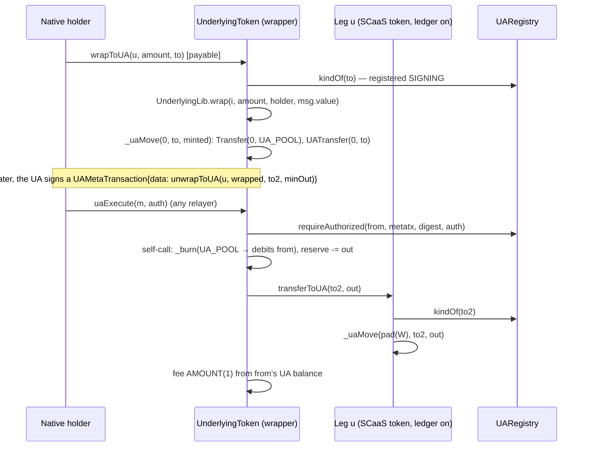

# UA-5a — UA receivers, the one-step wrap and receiver-pays on the UA path: `_uaMint`, `wrapToUA`, `unwrapToUA`, `mintToUA`, `burn` on the UA allowlist, `payWithFeeToUA`, `uaPayReceiverFee` — Implementation Plan (DRAFT)

> **For agentic workers:** REQUIRED SUB-SKILL: Use superpowers:subagent-driven-development (recommended) or superpowers:executing-plans to implement this plan task-by-task. Steps use checkbox (`- [ ]`) syntax for tracking.

> **DRAFT — not spiked.** Unlike the UA-4 and P6c plans, no task below was built in a scratch worktree, so the tasks
> give interfaces, bodies in outline, exact test names and commands, but no verbatim diffs, and every count, size and
> gas figure is an estimate. Before Task 1 a spike (Task 0) builds the tasks in order in a scratch worktree and turns
> this plan into the usual spiked form: diffs checked with `git apply --check`, measured test counts, sizes and gas.
> The rulings below are the decisions the spike must keep; anything it has to change goes back to the controller.

**Goal:** the UA-5a row of the UA-5 stream (`TODO.md`; owner 2026-10-13): the receiver axis of UA parity
([accounts.md](../../contracts/accounts.md) CTR-UA-27, CTR-UA-28) and receiver-pays on the UA path
([metatx.md](../../contracts/metatx.md) §13, the `uaPayReceiverFee` paragraph): a native caller credits a derived UA in
one call (`wrapToUA` on any leg, `unwrapToUA` from a SCaaS ledger leg, `mintToUA`, `payWithFeeToUA`), a UA burns and
unwraps-to-a-UA under `uaExecute`, a payee (native or UA) pays a relayer out of a UA payment it receives, with
clientkeys typed data and the `metatx3.json` / `pq_signatures.json` rows. Gate: the new suites green, the
`UALedgerInvariant` replay (Σ `_uaBalance` == `balanceOf(UA_POOL)`) and wrapper solvency over the new moves, the full
forge suite (default and `private7622`), the size gate.
Not here: UA-5b (`UATradeOrder`, `uaTrade`, `uaWrap`, `SCaaSDex` tagged legs), UA-5c (the Zether public side, the UA
pipeline in `MetaTxBase`, `MandateWallet` with `bytes32` ids), the node (UA F5: `ua_metatx` jobs, `UATransfer` /
`UA_POOL` indexing; the address-path receiver-fee job is refused today), SCaaS Chain 22776, size work (Glamsterdam).

**Architecture:** Nothing new is written to the ledger by hand: a mint into a UA is `_uaMove(bytes32(0), to, v)` —
`ERC20._update(0, UA_POOL, v)` plus `_uaBalance[to] += v` plus `UATransfer(0, to, v)` — so `_uaMint` is a receiver check
in front of the existing move, and `balanceOf(UA_POOL) == Σ _uaBalance` holds by construction. The receivers are
dedicated functions beside their address twins (`wrap`, `unwrap`, `mint`, `payWithFee`), because each has a `bytes32`
receiver or a native caller who pays. `unwrapToUA` and `burn` are self-calls whose body reads only `_msgSender()`, so
they also join the UA allowlist: under a derived ticket `_msgSender()` is `UA_POOL` and the burn debits the subject
(L4-3, built). `unwrapToUA` pays the underlying leg by calling that leg's own `transferToUA`, so the wrapper's balance of
the leg drops exactly as with `safeTransfer` and the reserve accounting does not change. `uaPayReceiverFee` reuses the
built typed UA pipeline (`_uaExecuteTransfer`, which already returns the digest), the built `ReceiverFee` typehash and
digest, and the registry's existing `receiver-fee` purpose for a derived payee.



**Tech Stack:** Solidity 0.8.37, Foundry (forge 1.3.5, osaka, OpenZeppelin 5.2 — `ERC165Checker` is already in the
tree), the UA registry gen 1 (UA-2a…P6c); Node 22 (`clients/clientkeys`, `@noble/*` as pinned, `@noble/post-quantum`
0.7.1 for the PQ rows); anvil only if the deploy scripts change (they should not).

**Spec:** `docs/contracts/accounts.md` §1.7 — CTR-UA-27 (parity rules: own struct, one lane, receivers, ledger writes,
funds, events, allowlist vs dedicated function, Q1 unchanged set), CTR-UA-28 (the four receiver functions, `_uaMint`,
`UnwrappedToUA`, `UALegNotLedger`), CTR-UA-18 (mint events), CTR-UA-26 (UA allowlist), §1.5 purposes (`metatx`,
`receiver-fee`); `docs/contracts/metatx.md` CTR-MTX-05/06 and the `uaPayReceiverFee` paragraph, CTR-MTX-19 (the two
new address-allowlist rows; `mintToUA`, `payWithFeeToUA` never allowlisted), CTR-MTX-20 (fee classes);
`docs/contracts/token-wrappers.md` CTR-TOK-01, CTR-TOK-05 (solvency), CTR-TOK-26 (native leg); design record
`docs/history/specs/2026-10-13-ua-parity-design.md` §2 (UP-1…UP-6), §4.1–§4.3, §4.5, §4.8, §4.10, §4.14–§4.17, §7.

**Base:** `main` at the commit that merges the UA parity docs (branch `ua-parity-spec`), with UA-4 and P6c merged.
Record in Task 0: forge pass / skip counts (default and `private7622`), `test/ua` count, clientkeys `node --test`
counts, the sizes of the four token implementations and `UnderlyingLib`.

## Global Constraints

- Paths relative to `/home/ha/work/ainative/scaas`; work in a worktree `.claude/worktrees/ua5a` on branch
  `ua5a-receivers` from `main` (symlink `smartcontracts/evm/lib` and `clients/clientkeys/node_modules` from the main
  checkout). Heavy commands (forge, node tests, the vector generator) only through `scripts/capped`, one at a time
  machine-wide (a second capped command waits; no `dotnet` here); `/usr/bin/git`, `/usr/bin/grep`; forge in
  `smartcontracts/evm`.
- Task order is fixed: 0 spike → 1 plumbing → 2 receivers → 3 UA allowlist → 4 receiver-pays → 5 invariants → 6 vectors
  and clientkeys → 7 docs. The branch merges as a whole after Task 7.
- TDD: each code task writes its tests first, runs them red (the new functions do not exist: a compile error is the
  red state for a new function, an assertion failure for a new rule), then implements until green.
- Vector files are never edited by hand: `clients/clientkeys/scripts/ua-sig-vectors.mjs` writes `metatx3.json` and
  `pq_signatures.json` (Task 6). The existing keys of both files stay byte-identical (the new rows go under new keys);
  `kinds.json`, `structures.json`, `signatures.json`, `groups.json`, `ed25519_fuzz.json`, `pq_kat.json`,
  `pq_external.json` and the address-path KATs (`metatx_kat.json`, `metatransfer_kat.json`, …) do not change.
- No chain-7622 or real/public-chain action, no change to chain docker/chainspec files, no node (`scaas-node`) change.
- No size optimisation (owner: wait for Glamsterdam); the size gate must pass — record the new sizes in
  `smartcontracts/evm/size-baseline.json` (and `<name>.init` where the init code is over EIP-3860) instead of
  optimising. Test chains run 64 KiB code (`--code-size-limit 65536`, already in the deploy scripts).
- Superseded code goes to `legacy/` (owner: backup, not delete) — nothing is superseded here; every chain is a test
  chain: redeploy, no migration.
- The role and admin functions stay as they are (owner 2026-10-13, Q1): no UA form of `mint`'s role, `ITokenAdmin`,
  rate, guardian or `addReserve`; `mintToUA` is a receiver form for the native minter, never allowlisted.
- SPDX header of every new Solidity file: `// SPDX-License-Identifier: LicenseRef-Vegan-Community-1.0`.
- Commit trailer: the model that wrote the commit, e.g. `Co-Authored-By: Claude Opus 5.5 <noreply@anthropic.com>`.
  Never `git add` `claude-code-api.txt`, `out/`, `cache/`, `target/`, `node_modules/`, `smartcontracts/evm/lib/`,
  `smartcontracts/evm/deployments/`, `broadcast/`, `.superpowers/`.
- Stop every background shell you started before reporting.

## Review Focus

- **`UA_POOL`'s slot stays Σ of the UA balances.** Every new credit is `_uaMove` (the mint from 0 included); no new path
  writes `UA_POOL`'s ERC-20 slot otherwise. `uaPayReceiverFee` refuses `feeRecipient == UA_POOL` **before** any move
  (a `_uaMove` to the native id `pad(UA_POOL)` would credit the pool's slot with no ledger entry); `payWithFeeToUA`'s
  fee to `UA_POOL` is refused by `_update` — `test_uaPayReceiverFee_poolFeeRecipientRefused`,
  `test_payWithFeeToUA_poolFeeRecipientRefused`, the `UALedgerInvariant` replay with the new handlers.
- **Under a derived ticket only the allowlisted burns run.** `burn` and `unwrapToUA` debit exactly the subject and fail
  `UAInsufficientBalance` past its balance; `wrapToUA`, `mintToUA`, `payWithFeeToUA`, `addReserve` under `uaExecute`
  are `MetaTxUnknownOp`; `mintToUA` and `payWithFeeToUA` are on no allowlist — `test_uaExecute_burnUnderUA`,
  `test_uaExecute_unwrapToUAUnderUA`, `test_uaAllowlist_refusals`, `test_none_allowlistPinned`.
- **Reserve accounting of `unwrapToUA`.** The leg's reserve drops by `out` and the wrapper's balance of the leg by
  exactly `out`; a leg that is not a SCaaS ledger token reverts `UALegNotLedger` before anything is paid; a leg that
  answers ERC-165 but moves less reverts `UnderlyingTransferMismatch`; re-entry from the leg's `transferToUA` into the
  wrapper hits its guard — `test_unwrapToUA_*`, `invariant_ledgerLegSolvent`.
- **The co-signature binds one payment.** `uaPayReceiverFee`'s `ReceiverFee` is over the payer's UA digest; a derived
  payee signs under purpose `receiver-fee` (a `metatx` signature of the same key does not pass, nor the reverse); a
  co-signature over another digest, a payer intent landed through `uaExecuteTransfer` / `uaPay` first (bad nonce), an
  expired co-signature and every shape error revert — `test_uaPayReceiverFee_*`.
- **Native-coin leg.** A direct `wrapToUA` of the native leg is payable and credits the UA; relayed through
  `mtxExecute` it reverts `NativeValueMismatch(0, amount)` as the address path's wrap does —
  `test_wrapToUA_nativeLeg_direct`, `test_wrapToUA_nativeLeg_relayedRefused`.

## Rulings (spec vs code) and defaults taken

- **R5a-1 Scope.** `_uaMint`, `wrapToUA` (direct and relayed through `mtxExecute`), `unwrapToUA` (direct, relayed,
  and under `uaExecute`), `mintToUA`, `burn` on the UA allowlist, `payWithFeeToUA`, `uaPayReceiverFee`, clientkeys
  typed data and calldata builders, the vector rows. Kinds: `wrapToUA` / `unwrapToUA` on `UnderlyingToken` and,
  inherited, `UnderlyingZetherToken`; `mintToUA` and the UA-allowlisted `burn` on `NoUnderlyingToken` and, inherited,
  `NoUnderlyingZetherToken`; `payWithFeeToUA` and `uaPayReceiverFee` on every kind (`MetaTokenBase`).
- **R5a-2 One receiver check, one ledger write.** `ERC20MetaTx` gets `_requireDerivedReceiver(bytes32 to)` —
  `_uaOn()`; a native id ⇒ `UANotRegistered(to)`; `_checkTo(to)` (`UANotRegistered`, `UAKindNotAccepted`) — factored
  out of `transferToUA` (whose behaviour does not change), and `_uaMint(bytes32 to, uint256 v)` =
  `_requireDerivedReceiver(to); _uaMove(bytes32(0), to, v)`. A native `to` is refused on every `…ToUA` function: the
  address twin serves it (CTR-UA-28), as `transferToUA` does today.
- **R5a-3 `wrapToUA(address u, uint256 amount, bytes32 to) payable returns (uint256 minted)`.** Cheap first:
  `_requireDerivedReceiver(to)`, then `UnderlyingLib.wrap(UnderlyingLib.indexOf(u), amount, _msgSender(), msg.value)`
  (every leg check, the native leg's `msg.value` rule and the measured delta unchanged), then
  `_uaMove(bytes32(0), to, minted)`; `Wrapped(account, u, received, minted)`. `nonReentrant`. Address allowlist:
  `ABSOLUTE`, static length 100 (`4 + 3 · 32`); not on the UA allowlist (a UA holds no outside underlying). No
  single-leg form. Relayed, the `ABSOLUTE` fee is charged after the call from the signer's own native balance of this
  token by the built `_chargeFee` — a signer without one signs fee `NONE` (the minted units are in the UA, not the
  signer's address; nothing special-cased).
- **R5a-4 `unwrapToUA(address u, uint256 wrapped, bytes32 to, uint256 minOut) returns (uint256 out, uint256 burned)`.**
  `UnderlyingLib` gets `quoteUnwrapToUA(i, wrapped, minOut)` (the checks of `quoteUnwrap` without the address recipient
  check; both call one private `_quote`) and `payOutToUA(i, bytes32 to, out) returns (address u)`: `reserve -= out`;
  `u == NATIVE` or `!ERC165Checker.supportsInterface(u, type(IUALedger).interfaceId)` ⇒ `UALegNotLedger(u)` (a
  `MetaTokenBase` answers `IUALedger` iff its registry ≠ 0; an HTS or outside ERC-20 leg answers false); `before =
  balanceOf(this)`; `IUALedger(u).transferToUA(to, out)`; the balance must drop by exactly `out`
  (`UnderlyingTransferMismatch`). The token burns `burned` from `_msgSender()` between quote and pay-out (CEI, as
  `_unwrap`) and emits `UnwrappedToUA(account, u, to, burned, out)` (`account` = `UA_POOL` under a derived subject;
  CTR-UA-28, controller ruling pending the owner). `to` is checked by the leg's own `transferToUA` (a native `to` ⇒
  `UANotRegistered`, a Zether or unregistered `to` likewise) — the wrapper does not repeat the registry call. Both
  allowlists, `AMOUNT(1)`, static length 132.
- **R5a-5 `mintToUA(bytes32 to, uint256 amount)`** on `NoUnderlyingToken`: `AdminLib.requireRole(MINTABLE,
  _msgSender())` exactly as `mint`, then `_uaMint(to, amount)`. Never allowlisted (a role function, CTR-MTX-19); the
  minter reaches it through its own contract account (`SmartKeyAccount` / Safe), as `mint` (Q1).
- **R5a-6 `burn` on the UA allowlist.** `NoUnderlyingToken._uaAllowed(sel) = sel == this.burn.selector`; no body
  change (`_update`'s `UA_POOL` branch debits the subject, built; `BURNABLE` still required). `NoUnderlyingZetherToken`
  inherits `_uaAllowed` from two paths (`NoUnderlyingToken`, and `ZetherLayer` through `ERC20MetaTx`), so it declares
  `override(NoUnderlyingToken, ERC20MetaTx)` returning `NoUnderlyingToken._uaAllowed(sel)` (as `UnderlyingZetherToken`
  does for its parent). The fee is the address path's `AMOUNT(0)` from the signer's UA balance (built `_uaExecute`).
- **R5a-7 `payWithFeeToUA(bytes32 to, uint256 amount, FeeMode feeMode, uint256 fee, address feeRecipient, bytes32
  entryRef) returns (bool)`** on `MetaTokenBase` beside `payWithFee`, mirroring it: `PAYABLE`; `payer =
  _msgSender()` (never a self-call: not allowlisted); `_requireDerivedReceiver(to)`; `feeAmount =
  FeePolicy.compute(...)`, `validateRecipient`; `feeAmount ≠ 0` ⇒ `_transfer(payer, feeRecipient, feeAmount)` (a
  `UA_POOL` or token recipient is refused by `_update`; `FeeRecipientIsPayee` cannot arise: an address is never a
  derived id); `_uaMove(pad(payer), to, amount)`; `UAPaymentSettled(pad(payer), to, amount, feeAmount, feeRecipient,
  entryRef)`. No `nonReentrant`, as `payWithFee` (no outside call).
- **R5a-8 `uaPayReceiverFee`** on `MetaTokenBase` beside `mtxPayReceiverFee`, `nonReentrant`, `PAYABLE`. Order: the
  shape of `mtxPayReceiverFee` on `t` (`ReceiverFeeShape`), `ReceiverFeeExpired`, `ReceiverFeeAmount`; then
  `pad(feeRecipient) == t.to` ⇒ `FeeRecipientIsPayee`, `feeRecipient == address(this)` ⇒ `TransferToSelf`,
  `feeRecipient == UA_POOL` ⇒ `UAPoolNotPayable`; `d = _uaExecuteTransfer(t, payerAuth)` (built; returns the digest);
  `_uaAuthorize(t.to, UAKinds.PURPOSE_RECEIVER_FEE, receiverFeeDigest(d, fee, feeRecipient, rfValidUntil),
  payeeAuth)`; `_uaMove(t.to, pad(feeRecipient), fee)`; `UAReceiverFeePaid(d, t.to, feeRecipient, fee)`. To allow
  it, `ERC20MetaTx._uaAuthorize` gains a `bytes32 purpose` parameter (the two built callers pass `PURPOSE_METATX`) and
  becomes `internal`; its native branch (`_requireNativeUASignature`, HIP-632 by `MetaTokenBase`'s override) ignores the
  purpose — a native payee signs the token's EIP-712 `ReceiverFee` itself, as on the address path. The `msg.sender`
  lint counts do not change (the only reads stay inside `_uaExecuteTransfer`).
- **R5a-9 Placement of declarations.** `error UALegNotLedger(address token)` in `IUALedger` (UA-5b's DEX reuses it);
  `event UnwrappedToUA(...)`, `wrapToUA`, `unwrapToUA` in `IUnderlyingToken`; `event UAReceiverFeePaid(...)`,
  `payWithFeeToUA`, `uaPayReceiverFee` in `IMetaTokenV2`; `mintToUA` beside `mint` (no interface, as `mint`).
- **R5a-10 Allowlist pins.** `UnderlyingToken.mtxSelectors()` grows 6 → 8 (`wrapToUA`, `unwrapToUA` appended, in that
  order); `UnderlyingZetherToken.mtxSelectors()` 14 → 16 (appended after `zetherUnshieldUnwrap`), its `_mtxRule` falls
  back to `UnderlyingToken._mtxRule`; `NoUnderlyingToken`'s and `NoUnderlyingZetherToken`'s lists do not change. The
  UA allowlists: `UnderlyingToken` = the two `unwrap`s with `minOut` + `unwrapToUA`; `NoUnderlyingToken` = `burn`.
- **R5a-11 Vectors.** `metatx3.json` gains three keys, existing keys byte-identical, `version` stays 1: `burn` and
  `unwrapToUA` (one `UAMetaTransaction` row per signer of `call`, the same domain and fields, `data` the new call) and
  `receiverFee` (rows `{payer, payee, transfer typedData, paymentDigest, receiverFee typedData, receiverFeeDigest,
  payerAuth, payeeAuth}` for native payer × each derived payee and one derived payer × derived payee). A derived
  payee's `payeeAuth` = `abi.encode(keyData, sig over ua_msg(kind, receiver-fee, receiverFeeDigest))`.
  `pq_signatures.json`'s `metatx3` object gains `receiverFee` with an `mldsa65` payer and an `mldsa65` payee (the
  ≈ 11.9 M case). clientkeys gets `receiverFeeTypedData` (also usable by the address path, which has no builder today)
  and the calldata builders `wrapToUACalldata`, `unwrapToUACalldata`, `payWithFeeToUACalldata`.
- **R5a-12 Node.** No `scaas-node` change in UA-5a: relaying `uaExecute` / `uaPayReceiverFee` needs UA F5 (`ua_metatx`
  jobs, `UATransfer` / `UA_POOL` indexing) and the receiver-fee job (refused on both paths today, NODE-MESH-17's
  restricted scope); direct `wrapToUA`, `payWithFeeToUA` are the user's own transactions; `mintToUA` reaches the token
  through the minter's contract account (NODE-JOB-19's row for that contract), like `mint`. The gateway's allowlist
  check reads `mtxSelectors()` on chain, so the two new address-path selectors relay with no node release.
- **R5a-13 Gas.** Logged, not asserted (L4-20), except: `uaPayReceiverFee` with two `mldsa65` signatures fits one
  16,777,216-gas transaction (asserted in `UAMetaTx3Pq.t.sol` against the measured cost plus intrinsic and calldata).
  Logged: `wrapToUA` vs `wrap(u, v)` (ERC-20 leg, native leg), `unwrapToUA` vs `unwrap(u, …)`, `payWithFeeToUA` vs
  `payWithFee`, `uaPayReceiverFee` per payee kind.
- **R5a-14 Hedera.** An HTS leg wraps into a UA (`wrapToUA` under `IS_HEDERA` with the HTS mocks of `HederaV2.t.sol`);
  `unwrapToUA` of an HTS leg reverts `UALegNotLedger`; a Hedera native payee co-signs `ReceiverFee` with a 64-byte
  HIP-632 signature through `_requireNativeUASignature`.
- **R5a-15 Sizes.** Expected growth (design §4.17): `NoUnderlyingToken` + 2–3 K, `UnderlyingToken` + 3–4 K, the Zether
  kinds the base's growth + their own overrides, `UnderlyingLib` + 0.5–1 K (stays under 24,576). Recorded in
  `size-baseline.json`; `UnderlyingZetherToken.init` likewise.

## Owner steps

None in UA-5a (no deployment; every chain is a test chain and redeploys with the next deploy).

## Open questions (not blocking)

- `UnwrappedToUA` as a new event (R5a-4) rather than `Unwrapped` with a placeholder recipient; and the ERC-165 test for
  a ledger leg (a leg that lies about `IUALedger` can only short the unwrapper who chose that leg, and the exact-delta
  check still protects the reserve). Both are controller rulings in CTR-UA-28, pending the owner.
- Whether `payWithFeeToUA` should accept a native `to` and behave as `payWithFee` (one entry point for a mandate's
  payees) instead of refusing it (R5a-2); UA-5c's `MandateWallet` branches on the id either way.

## Out of scope (next)

UA-5b (`UATradeOrder`, `uaTrade`, `uaWrap`, `SCaaSDex` tagged legs, the `trade` purpose), UA-5c (Zether public side,
the UA pipeline in `MetaTxBase`, `MandateWallet` UA ids), UA F5 (the node's UA jobs and indexing, then the receiver-fee
job with a `bytes32` payee), the template library, SCaaS Chain 22776, size work (Glamsterdam).

## File map

| File | Change | Task |
|---|---|---|
| `smartcontracts/evm/src/metatx/IUALedger.sol` | `error UALegNotLedger(address token)` | 1 |
| `smartcontracts/evm/src/metatx/ERC20MetaTx.sol` | `_requireDerivedReceiver`, `_uaMint`; `transferToUA` uses the former; `_uaAuthorize(from, purpose, digest, auth)` internal | 1 |
| `smartcontracts/evm/src/metatx/UnderlyingLib.sol` | `_quote`, `quoteUnwrapToUA`, `payOutToUA` (`ERC165Checker`) | 2 |
| `smartcontracts/evm/src/metatx/IUnderlyingToken.sol` | `wrapToUA`, `unwrapToUA`, `event UnwrappedToUA` | 2 |
| `smartcontracts/evm/src/metatx/UnderlyingToken.sol` | `wrapToUA`, `unwrapToUA`, two selectors, `mtxSelectors` 6 → 8, `_mtxRule`, `_uaAllowed` | 2, 3 |
| `smartcontracts/evm/src/metatx/NoUnderlyingToken.sol` | `mintToUA`; `_uaAllowed` = `burn` | 2, 3 |
| `smartcontracts/evm/src/metatx/MetaTokenBase.sol` | `payWithFeeToUA`, `uaPayReceiverFee` | 2, 4 |
| `smartcontracts/evm/src/metatx/IMetaTokenV2.sol` | `payWithFeeToUA`, `uaPayReceiverFee`, `event UAReceiverFeePaid` | 2, 4 |
| `smartcontracts/evm/src/zether/NoUnderlyingZetherToken.sol` | `_uaAllowed` override (two paths) | 3 |
| `smartcontracts/evm/src/zether/UnderlyingZetherToken.sol` | `mtxSelectors` 14 → 16 | 3 |
| `smartcontracts/evm/size-baseline.json` | new sizes | 2–4 |
| `smartcontracts/evm/test/ua/UALedgerBase.sol` | a ledger-leg wrapper `wrpL` (leg = `tok`), a native-leg wrapper `wrpN`, helpers to sign `UAMetaTransaction`s for the new selectors | 1 |
| `smartcontracts/evm/test/ua/UAReceivers.t.sol` (new) | `_uaMint`, `wrapToUA`, `unwrapToUA`, `mintToUA`, `payWithFeeToUA` | 1, 2 |
| `smartcontracts/evm/test/ua/UAAllowlist5a.t.sol` (new) | `burn` / `unwrapToUA` under `uaExecute`, refusals, fees | 3 |
| `smartcontracts/evm/test/ua/UAReceiverFee.t.sol` (new) | `uaPayReceiverFee` | 4 |
| `smartcontracts/evm/test/ua/UALedgerInvariant.t.sol` | handlers for the new moves; `invariant_ledgerLegSolvent` | 5 |
| `smartcontracts/evm/test/v2/Allowlist.t.sol`, `test/zether/ZetherUnderlying.t.sol` | pins 6 → 8, 14 → 16; every listed selector runs | 3 |
| `smartcontracts/evm/test/hedera/HederaV2.t.sol` | HTS `wrapToUA`, HTS `unwrapToUA` refused, HIP-632 payee | 2, 4 |
| `smartcontracts/evm/test/ua/UAMetaTx3Vectors.t.sol`, `test/ua/UAMetaTx3Pq.t.sol` | the new vector rows; the two-`mldsa65` cap | 6 |
| `clients/clientkeys/src/evm.js` | `receiverFeeTypedData`, `wrapToUACalldata`, `unwrapToUACalldata`, `payWithFeeToUACalldata` | 6 |
| `clients/clientkeys/scripts/ua-sig-vectors.mjs` | the `burn`, `unwrapToUA`, `receiverFee` rows; the PQ `receiverFee` row | 6 |
| `clients/clientkeys/test/evm.test.js`, `test/ua-metatx3.test.js`, `test/pq-sig.test.js` | builders and rows | 6 |
| `smartcontracts/vectors/ua/metatx3.json`, `pq_signatures.json` | generated | 6 |
| `docs/contracts/accounts.md`, `metatx.md`, `token-wrappers.md`, `docs/decisions.md`, `TODO.md` | BUILT, measured numbers | 7 |

---

### Task 0: Spike — build Tasks 1–6 in a scratch worktree and freeze the plan

- [ ] **Step 1:** Worktree `.claude/worktrees/ua5a-spike` from the base; record the base counts and sizes listed under
  **Base**.
- [ ] **Step 2:** Build Tasks 1–6 in order, one commit each, following the rulings; run each task's commands.
- [ ] **Step 3:** Replace each task's outline below with the spike's diff (`git apply --check --whitespace=error` on a
  clean copy, in sequence), the measured counts, sizes and gas; resolve the DRAFT notes (R5a-6's override, R5a-15's
  sizes, the vector layout of R5a-11, the two-`mldsa65` gas of R5a-13). Remove the DRAFT banner. A ruling the spike
  cannot keep goes back to the controller before the plan is committed.
- [ ] **Step 4:** Remove the spike worktree (`/usr/bin/git worktree remove`), keep its branch until the plan is
  reviewed.

### Task 1: Plumbing — `UALegNotLedger`, `_requireDerivedReceiver`, `_uaMint`, `_uaAuthorize` with a purpose

**Files:** Modify `src/metatx/IUALedger.sol`, `src/metatx/ERC20MetaTx.sol`, `test/ua/UALedgerBase.sol`; create
`test/ua/UAReceivers.t.sol` (its `_uaMint` part, through a test harness that exposes `_uaMint`).

Interfaces after the task:

```solidity
// IUALedger
error UALegNotLedger(address token);
// ERC20MetaTx
function _requireDerivedReceiver(bytes32 to) internal view;   // _uaOn; native ⇒ UANotRegistered(to); _checkTo(to)
function _uaMint(bytes32 to, uint256 v) internal;             // _requireDerivedReceiver(to); _uaMove(bytes32(0), to, v)
function _uaAuthorize(bytes32 from, bytes32 purpose, bytes32 digest, bytes calldata auth) internal view;
```

- [ ] **Step 1: Tests first** in `test/ua/UAReceivers.t.sol` (harness `UAMintHarness is NoUnderlyingToken` with
  `function mintUA(bytes32, uint256) external`): `test_uaMint_eventsAndTotals` (`Transfer(0, UA_POOL, v)`,
  `UATransfer(0, ua, v)`, `totalSupply += v`, `balanceOf(UA_POOL) += v`, `balanceOfUA(ua) += v`),
  `test_uaMint_refusesNativeUnregisteredZether` (`UANotRegistered` for a padded address and an unregistered id,
  `UAKindNotAccepted` for `uaZ`), `test_uaMint_ledgerOff` (`UALedgerOff` with registry 0), and in `UALedger.t.sol`
  `test_transferToUA` / `test_transferToUA_refusesNonSigningReceivers` unchanged (regression).
- [ ] **Step 2: Red.** `cd smartcontracts/evm && ../../scripts/capped forge test --match-path test/ua/UAReceivers.t.sol`
  — compile error (no `_uaMint`).
- [ ] **Step 3: Implement** per R5a-2 and R5a-8 (the purpose parameter; `_uaExecute` and `_uaExecuteTransfer` pass
  `UAKinds.PURPOSE_METATX`).
- [ ] **Step 4: Green.** The same command — the three new tests pass; `../../scripts/capped forge test --match-path
  'test/ua/**'` — all pass (the base count + 3).
- [ ] **Step 5: Commit** `feat(ua5a): _uaMint as a move from 0, one derived-receiver check, _uaAuthorize by purpose`.

### Task 2: The receivers — `wrapToUA`, `unwrapToUA`, `mintToUA`, `payWithFeeToUA`

**Files:** Modify `src/metatx/UnderlyingLib.sol`, `IUnderlyingToken.sol`, `UnderlyingToken.sol`,
`NoUnderlyingToken.sol`, `MetaTokenBase.sol`, `IMetaTokenV2.sol`, `size-baseline.json`, `test/ua/UALedgerBase.sol`
(fixtures `wrpL`: one leg = `tok`, 1:1, its reserve funded by the test contract, which may approve as a contract,
CTR-TOK-01; `wrpN`: one native leg), `test/hedera/HederaV2.t.sol`; extend `test/ua/UAReceivers.t.sol`.

- [ ] **Step 1: Tests first** (`UAReceivers.t.sol`):
  - `test_wrapToUA_erc20Leg` — events `Wrapped(holder, u, received, minted)`, `Transfer(0, UA_POOL, minted)`,
    `UATransfer(0, ua, minted)`; reserve += received; the holder's wrapper balance unchanged.
  - `test_wrapToUA_nativeLeg_direct` — payable, `msg.value == amount`; `NativeValueMismatch` otherwise.
  - `test_wrapToUA_relayed_absoluteFeeFromNativeBalance` — `mtxExecute(wrapToUA)` with fee `FIXED` paid from the
    signer's address balance; with fee `NONE` and no balance it succeeds; `PERCENT` ⇒ `MtxFeeClass`.
  - `test_wrapToUA_nativeLeg_relayedRefused` — `NativeValueMismatch(0, amount)`.
  - `test_wrapToUA_refusals` — native / unregistered / Zether `to` before any pull (the holder's allowance untouched);
    disabled leg (`WrapDisabledFor`), pending rate (`WrapPausedForRateChange`), shortfall (`ReserveShortfall`), as `wrap`.
  - `test_unwrapToUA_direct` — native caller, leg `tok`: `UnwrappedToUA(caller, tok, ua, burned, out)`, the wrapper's
    `tok` balance −`out`, reserve −`out`, `tok.balanceOfUA(ua)` +`out`, `tok`'s `Transfer(wrpL, UA_POOL, out)` and
    `UATransfer(pad(wrpL), ua, out)`.
  - `test_unwrapToUA_notLedgerLeg` — outside ERC-20 leg, native leg, a SCaaS leg with registry 0: `UALegNotLedger(u)`.
  - `test_unwrapToUA_nativeOrBadTo` — native `to` ⇒ `UANotRegistered` (from the leg); Zether `to` ⇒ `UAKindNotAccepted`.
  - `test_unwrapToUA_minOutAndReserve` — `UnwrapBelowMin`, `InsufficientReserve`, `UnwrapTooSmall` as `unwrap`.
  - `test_unwrapToUA_lyingLeg` — a mock leg that answers `IUALedger` and moves less ⇒ `UnderlyingTransferMismatch`.
  - `test_unwrapToUA_relayedNative` — `mtxExecute(unwrapToUA)` with an `AMOUNT(1)` fee.
  - `test_mintToUA` — minter mints into `ua` (events as `_uaMint`); non-minter ⇒ the role error of `mint`; `MINTABLE`
    off ⇒ the feature error; native `to` ⇒ `UANotRegistered`; `mtxExecute(mintToUA)` ⇒ `MtxSelectorNotAllowed`.
  - `test_payWithFeeToUA` — `UAPaymentSettled(pad(payer), ua, amount, fee, feeTo, ref)`, fee on top to `feeTo`;
    `PAYABLE` off ⇒ refused; native `to` ⇒ `UANotRegistered`; `PERCENT` over the cap ⇒ `FeeExceedsCap`.
  - `test_payWithFeeToUA_poolFeeRecipientRefused` — `feeRecipient == UA_POOL` ⇒ `UAPoolNotPayable`; the token ⇒
    `TransferToSelf`.
  - `HederaV2.t.sol`: `test_wrapToUA_htsLeg`, `test_unwrapToUA_htsLegRefused`.
- [ ] **Step 2: Red.** `../../scripts/capped forge test --match-path test/ua/UAReceivers.t.sol` — compile error.
- [ ] **Step 3: Implement** R5a-3, R5a-4, R5a-5, R5a-7, R5a-9 (selectors `SEL_WRAP_TO_UA =
  bytes4(keccak256("wrapToUA(address,uint256,bytes32)"))`, `SEL_UNWRAP_TO_UA =
  bytes4(keccak256("unwrapToUA(address,uint256,bytes32,uint256)"))`; `_mtxRule`: `MtxRule(FEE_CLASS_ABSOLUTE, 0, 100)`,
  `MtxRule(FEE_CLASS_AMOUNT, 1, 132)`; `mtxSelectors` 6 → 8). Outline of the token side:

  ```solidity
  function wrapToUA(address u, uint256 amount, bytes32 to) external payable nonReentrant returns (uint256 minted) {
      _requireDerivedReceiver(to);
      address account = _msgSender();
      (address uu, uint256 received, uint256 m) = UnderlyingLib.wrap(UnderlyingLib.indexOf(u), amount, account, msg.value);
      minted = m;
      _uaMove(bytes32(0), to, minted);
      emit Wrapped(account, uu, received, minted);
  }

  function unwrapToUA(address u, uint256 wrapped, bytes32 to, uint256 minOut)
      external nonReentrant returns (uint256 out, uint256 burned)
  {
      uint256 i = UnderlyingLib.indexOf(u);
      (out, burned) = UnderlyingLib.quoteUnwrapToUA(i, wrapped, minOut);
      address from = _msgSender();
      _burn(from, burned);
      UnderlyingLib.payOutToUA(i, to, out);
      emit UnwrappedToUA(from, u, to, burned, out);
  }
  ```

- [ ] **Step 4: Green.** `../../scripts/capped forge test --match-path test/ua/UAReceivers.t.sol` and
  `--match-path test/hedera/HederaV2.t.sol` — all pass; `test/v2/Allowlist.t.sol` is red until Task 3 updates its pins
  (expected; fix the pin counts here if the spike prefers one green commit per task).
- [ ] **Step 5: Size gate.** `../../scripts/capped forge build src --sizes --json > /tmp/ua5a-sizes.json; python3
  ../../scripts/size_gate.py /tmp/ua5a-sizes.json size-baseline.json` — record the new sizes in `size-baseline.json`
  until `size gate: 0 error(s)`.
- [ ] **Step 6: Commit** `feat(ua5a): wrapToUA, unwrapToUA, mintToUA, payWithFeeToUA (CTR-UA-28)`.

### Task 3: The UA allowlist — `burn` and `unwrapToUA` under `uaExecute`; the pins

**Files:** Modify `src/metatx/NoUnderlyingToken.sol`, `src/metatx/UnderlyingToken.sol`,
`src/zether/NoUnderlyingZetherToken.sol`, `src/zether/UnderlyingZetherToken.sol`, `test/v2/Allowlist.t.sol`,
`test/zether/ZetherUnderlying.t.sol`; create `test/ua/UAAllowlist5a.t.sol`.

- [ ] **Step 1: Tests first:**
  - `UAAllowlist5a.t.sol`: `test_uaExecute_burnUnderUA` (derived `from`: `UATransfer(ua, 0, v)`, `Transfer(UA_POOL, 0,
    v)`, `totalSupply −= v`; fee `AMOUNT(0)` from the UA balance; past the balance ⇒ `UAInsufficientBalance`;
    `BURNABLE` off ⇒ the feature error), `test_uaExecute_burnNative` (a native signer burns its address balance),
    `test_uaExecute_unwrapToUAUnderUA` (a UA unwraps `wrpL` into another UA; fee `AMOUNT(1)` from the signer's UA
    balance), `test_uaExecute_unwrapToUA_nativeToRefused`, `test_uaAllowlist_refusals` (`wrapToUA`, `mintToUA`,
    `payWithFeeToUA`, `addReserve`, `approve`, `mtxTrade` under `uaExecute` ⇒ `MetaTxUnknownOp(selector)`),
    `test_uaBatch_burnAndUnwrapToUA` (one atomic batch, fresh ticket per item), `test_noneZether_burnUnderUA` (the
    inherited allowlist on `NONE_ZETHER`).
  - `Allowlist.t.sol`: `test_single_allowlistPinned` / `test_multi_allowlistPinned` expect 8 selectors with
    `wrapToUA` `ABSOLUTE` and `unwrapToUA` `AMOUNT(1)` basis 1; `test_single_everyListedSelectorRuns` /
    `test_multi_everyListedSelectorRuns` and `test_underlying_classAndBasisMatchTheRule` cover the two new selectors
    (they iterate `mtxSelectors()`; the fixtures need a derived `to` and a ledger leg for `unwrapToUA`).
  - `ZetherUnderlying.t.sol`: `test_allowlistPinned_underlyingZether` expects 16 with the two at indexes 14, 15; the
    relayed loop at line ~554 runs them (or skips `unwrapToUA` there with a comment if its leg is an outside token —
    the spike decides).
- [ ] **Step 2: Red.** `../../scripts/capped forge test --match-path test/ua/UAAllowlist5a.t.sol` — `burn` under a
  derived `from` reverts `MetaTxUnknownOp`.
- [ ] **Step 3: Implement** R5a-6 and R5a-10.
- [ ] **Step 4: Green.** `../../scripts/capped forge test --match-path 'test/ua/**'`, `--match-path
  test/v2/Allowlist.t.sol`, `--match-path test/zether/ZetherUnderlying.t.sol`, `--match-path
  test/metatx/MsgSenderLint.t.sol` (counts unchanged) — all pass.
- [ ] **Step 5: Size gate** as Task 2 Step 5. **Commit** `feat(ua5a): burn and unwrapToUA on the UA allowlist; pins`.

### Task 4: Receiver-pays on the UA path — `uaPayReceiverFee`

**Files:** Modify `src/metatx/MetaTokenBase.sol`, `src/metatx/IMetaTokenV2.sol`, `test/hedera/HederaV2.t.sol`;
create `test/ua/UAReceiverFee.t.sol` (mirrors `test/v2/ReceiverPays.t.sol` on ids).

- [ ] **Step 1: Tests first** (`UAReceiverFee.t.sol`; payer × payee ∈ {native, `p256`, `bip340`}):
  - `test_uaPayReceiverFee_eventsAndBalances` — `UAPaymentSettled` (gross), `UAMetaTransactionExecuted`,
    `UAReceiverFeePaid(d, payee, feeTo, fee)`; payer −N, payee +N −fee, `feeTo` +fee; for a derived payee
    `UATransfer(payee, pad(feeTo), fee)` and `Transfer(UA_POOL, feeTo, fee)`.
  - `test_uaPayReceiverFee_matrix` — all nine payer × payee combinations.
  - `test_uaPayReceiverFee_shapeErrors` — every `ReceiverFeeShape` case of the address path (no `entryRef`, fee mode
    ≠ `NONE`, `fee ≠ 0`, relayer unbound, wrong lane, nonce ≠ 0, `feeRecipient == 0`), `ReceiverFeeExpired`,
    `ReceiverFeeAmount` (0, > value), `PAYABLE` off.
  - `test_uaPayReceiverFee_feeRecipientChecks` — `pad(feeRecipient) == t.to` ⇒ `FeeRecipientIsPayee`; the token ⇒
    `TransferToSelf`.
  - `test_uaPayReceiverFee_poolFeeRecipientRefused` — `UA_POOL` ⇒ `UAPoolNotPayable`, before any move.
  - `test_uaPayReceiverFee_purposeSeparation` — a derived payee's `metatx`-purpose signature over the receiver-fee
    digest fails (`UAUnauthorized`); a `receiver-fee` signature over the payer digest fails.
  - `test_uaPayReceiverFee_coSignatureOverAnotherDigest_refused`,
    `test_uaPayReceiverFee_payerIntentLandedElsewhere_coSignatureDead` (the payer's struct through `uaExecuteTransfer`
    first ⇒ `MetaTxBadNonce` on retry), `test_uaPayReceiverFee_erc1271Payee` (a `SmartKeyAccount` payee, 400 k),
    `test_uaPayReceiverFee_7702Payee` (CTR-UA-24), `testFuzz_uaPayReceiverFee_rp1(uint256 n, uint256 fee)` (RP1).
  - `HederaV2.t.sol`: `test_uaPayReceiverFee_hip632Payee`.
- [ ] **Step 2: Red** — compile error (no `uaPayReceiverFee`).
- [ ] **Step 3: Implement** R5a-8.
- [ ] **Step 4: Green.** `../../scripts/capped forge test --match-path test/ua/UAReceiverFee.t.sol`, `--match-path
  test/v2/ReceiverPays.t.sol` (unchanged), `--match-path test/hedera/HederaV2.t.sol`,
  `--match-path test/metatx/MsgSenderLint.t.sol` — all pass.
- [ ] **Step 5: Size gate** as Task 2 Step 5. **Commit** `feat(ua5a): uaPayReceiverFee (CTR-MTX-05 on ids)`.

### Task 5: Invariants — the UA ledger replay and the ledger-leg wrapper

**Files:** Modify `test/ua/UALedgerInvariant.t.sol`.

- [ ] **Step 1:** Handler functions `wrapToUA(who, ua, amount)` (on `wrp` and `wrpN`), `mintToUA(ua, amount)`,
  `payWithFeeToUA(from, ua, amount, withFee)`, `burnUnderUA(ua, amount, withFee)`, `wrapLedger(who, amount)` (the
  test contract funds `wrpL`), `unwrapToUA(fromIdx, toUa, amount, viaUA, withFee)` (direct by a native, or under
  `uaExecute` by a UA), `uaPayReceiverFee(payer, payee, amount, fee)`; each `_settle`s the expected `Transfer` /
  `UATransfer` counts as the existing handlers do.
- [ ] **Step 2:** Invariants: the existing `invariant_T_V3_2_none` / `invariant_T_V3_2_underlying` cover the new moves
  (`balanceOf(UA_POOL) == Σ balanceOfUA`, `totalSupply == Σ native balances + balanceOf(UA_POOL)`); new
  `invariant_T_V3_2_ledgerLeg` (the same on `wrpL`) and `invariant_ledgerLegSolvent` (`tok.balanceOf(wrpL) ≥
  reserve(tok)` and `collateralValue() ≥ wrpL.totalSupply()`).
- [ ] **Step 3: Run.** `../../scripts/capped forge test --match-path test/ua/UALedgerInvariant.t.sol` — every invariant
  holds (64 runs × 32 calls as configured), 0 reverts in the handlers that should not revert.
- [ ] **Step 4: Commit** `test(ua5a): UA ledger replay and ledger-leg solvency over the new moves`.

### Task 6: Vectors and clientkeys — `receiverFeeTypedData`, calldata builders, the new rows

**Files:** Modify `clients/clientkeys/src/evm.js`, `clients/clientkeys/scripts/ua-sig-vectors.mjs`,
`clients/clientkeys/test/evm.test.js`, `test/ua-metatx3.test.js`, `test/pq-sig.test.js`,
`smartcontracts/evm/test/ua/UAMetaTx3Vectors.t.sol`, `test/ua/UAMetaTx3Pq.t.sol`; generated
`smartcontracts/vectors/ua/metatx3.json`, `pq_signatures.json`.

```js
/** The payee's ReceiverFee co-signature (CTR-MTX-05) in the token's salted domain; both paths. */
export function receiverFeeTypedData({ name = 'SCaaS MetaToken', contract, chainId, chainUid, paymentDigest, fee,
  feeRecipient, validUntil }) { /* types {EIP712Domain: salted, ReceiverFee: paymentDigest:bytes32, fee:uint256,
  feeRecipient:address, validUntil:uint256} */ }
export function wrapToUACalldata(underlying, amount, to) { /* selector ‖ abi(address,uint256,bytes32) */ }
export function unwrapToUACalldata(underlying, wrapped, to, minOut) { /* selector ‖ abi(address,uint256,bytes32,uint256) */ }
export function payWithFeeToUACalldata(to, amount, feeMode, fee, feeRecipient, entryRef) { /* … */ }
```

- [ ] **Step 1: Tests first** (JS): `evm.test.js` — `receiverFeeTypedData` hashes to the forge-pinned
  `test_receiverFeeDigestIsPinned` value (`ReceiverPays.t.sol`) for the same inputs; the three calldata builders match
  `cast calldata` outputs pinned in the test; `checkCall` decodes `wrapToUA` / `unwrapToUA` against an allowlist that
  lists them and refuses `payWithFeeToUA` as a call (not listed). `ua-metatx3.test.js` — the new keys' rows recompute
  (struct hash, digest; derived signatures verify with noble over `ua_msg(kind, purpose, digest)`, `receiver-fee` for
  `payeeAuth`). `pq-sig.test.js` — the PQ `receiverFee` row verifies with `@noble/post-quantum`.
- [ ] **Step 2: Generate.** `cd clients/clientkeys && ../../scripts/capped node scripts/ua-sig-vectors.mjs` — rewrites
  `metatx3.json` and `pq_signatures.json`; `git diff --stat smartcontracts/vectors/ua` shows only those two files, and
  a key-level diff (`python3 -c` over both JSONs) shows only the new keys; a second run is byte-identical.
- [ ] **Step 3: Test (JS).** `../../scripts/capped node --test test/` — all pass (the base counts + the new tests).
- [ ] **Step 4: Test (forge).** In `smartcontracts/evm`: `UAMetaTx3Vectors.t.sol` gains `test_vectors_burn`,
  `test_vectors_unwrapToUA`, `test_vectors_receiverFee` (recompute digests on a token at the vector address, run each
  row through the real registry and verifiers); `UAMetaTx3Pq.t.sol` gains `test_receiverFee_twoMldsa65_underCap`
  (execution gas + intrinsic + calldata < 16,777,216; logged). `../../scripts/capped forge test --match-path
  'test/ua/UAMetaTx3*'` — all pass.
- [ ] **Step 5: Commit** `feat(ua5a): clientkeys ReceiverFee typed data and UA receiver calldata; metatx3 and PQ rows`.

### Task 7: Docs — UA-5a BUILT, measured numbers; TODO

**Files:** Modify `docs/contracts/accounts.md` (CTR-UA-28 status → BUILT with the measured gas and sizes; CTR-UA-26 the
UA allowlist's built list; §1.7 table rows; §1.16 the new `metatx3.json` keys), `docs/contracts/metatx.md` (the two
CTR-MTX-19 rows and the `uaPayReceiverFee` paragraph → BUILT; the payers table), `docs/contracts/token-wrappers.md`
(the `wrapToUA` / `unwrapToUA` pointer), `docs/decisions.md` (a dated change line on CTR-UA-28 for any ruling the build
changed; none expected), `TODO.md` (UA-5a done with the merge commit; the open items: node relaying after UA F5).

- [ ] **Step 1:** Edit the docs; every SPECIFIED tag of a UA-5a item becomes **BUILT (UA-5a)**; UA-5b/5c items stay
  SPECIFIED.
- [ ] **Step 2: Check.** `python3 scripts/docs_check.py --write && python3 scripts/test_docs_check.py && python3
  scripts/docs_check.py check && python3 scripts/docs_check.py facts check` — 0 errors (the pre-existing budget
  warnings of `token-wrappers.md` and `dex.md` stay), facts 0 misses.
- [ ] **Step 3: Commit** `docs(ua5a): receivers, UA allowlist and uaPayReceiverFee BUILT; TODO`.

### Final

- [ ] **Whole branch.** In `smartcontracts/evm`: `../../scripts/capped forge test` — 0 failed (base count + the new
  tests); `FOUNDRY_PROFILE=private7622 ../../scripts/capped forge test` — 0 failed; `../../scripts/capped forge test
  --match-path 'test/ua/**'` — 0 failed; the size gate — `0 error(s)`. `clients/clientkeys`: `../../scripts/capped
  node --test test/` — 0 failed; the generator a second time leaves every vector file unchanged. Docs checkers clean.
  `/usr/bin/git status` clean apart from ignored files. `/usr/bin/grep -rn "_uaBalance\|\.balance\[" smartcontracts/evm/src`
  shows ledger writes only in `ERC20MetaTx` (`_uaMove`, `_uaDebit`).
- [ ] **Review** against the Review Focus; then merge to `main` (owner). Next: UA-5b (trade and DEX) or UA-5c (Zether
  public side and mandates), in either order; relayed use after UA F5.
