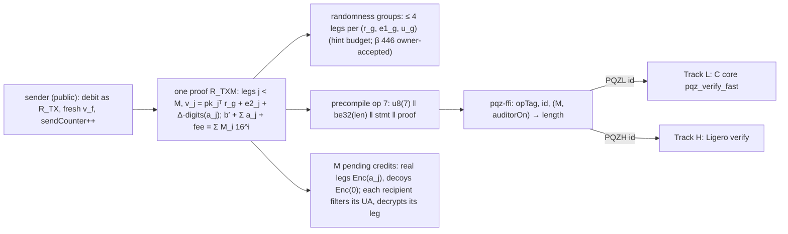

# P6-ANON — the PQZ multi-recipient transfer `R_TXM` (sender public, one proof, M legs, decoy legs for receiver privacy) as the normal PQZ transfer, PQZL and PQZH — Implementation Plan

> **For agentic workers:** REQUIRED SUB-SKILL: Use superpowers:subagent-driven-development (recommended) or superpowers:executing-plans to implement this plan task-by-task. Steps use checkbox (`- [ ]`) syntax for tracking.

**Goal:** the TODO.md row P6-ANON with the owner's decisions of 2026-10-14, in order: build identity hiding (first
"prepared, not enabled", later superseded); the sender may stay visible, only the receiver is hidden ("Chấp nhận lộ người gửi nhưng
không biết người nhận"); only mode 2A′, for both proof systems; "Lập kế hoạch kỹ rồi làm" (plan thoroughly, then
build); the design with the sender visible and **one proof per transfer** is **accepted**, the one PQZ precompile
verifies it for PQZL and PQZH, live on chain 7622 with P6f; and, last, **the multi-recipient transfer is USED by
SCaaS** — it is the normal PQZ transfer path, not an off-by-default option. Mode 2A′ **is** the multi-recipient
transfer the owner decided for classical Zether on 2026-10-08 (Z1–Z13, zether.md CTR-ZTH-37 … 43: one transfer,
`M ≥ 1` recipients, one proof, decoys receive an encryption of 0, sender public; Z7: the multi transfer is the
transfer). This plan builds the PQZ multi-recipient transfer `R_TXM` (M legs, `Σ a_j + fee` debited once, each `a_j` a
proven 64-bit digit vector; a decoy is a leg with `a_j = 0`, chosen by the client), measures it for M = 1, 2, 4, 8, 16
in both systems, builds the sizes that fit today's limits, puts them into the **P6e frozen set** (gate A / gate B,
both `proofSystemId`s) and the P6-PUB package, wires them into the precompile on 7622 (with P6f), and specifies the
contract (P6g), client (P6h) and node (P6i) parts as the normal transfer path. Stealth accounts (2B), the sender ring
(1) and both sides (3) are not built (research note). Two implementation tracks run in parallel: **Track L** (PQZL,
C core) and **Track H** (PQZH, Ligero), on shared statement bytes. Gate: **`R_TXM` in the frozen vectors of P6e
gate A (PQZL) and gate B (PQZH), measured, live in the 7622 precompile**.

**Research:** [pqz-anonymity.md](../../research/pqz-anonymity.md) §5 (Lether read in full), §7 (how balances change
in each mode), §8 (`R_TXM`: relation, hint budget, size / gas table, M transfers vs one M-leg transfer), §11 (what
leaks). Classical design: `docs/history/specs/2026-10-08-zether-multi-recipient-design.md`. Sizing:
`pqz-core/params/anon/` (`txm*_params.sage` sketches, `run_sizing.sh` → `sizing-anon.txt` with the pinned estimator,
`run_codegen.sh`, `anon_sizes.py`, `usvp.py`).

**Architecture:** `R_TXM` is `R_TX` with M receiver legs and one randomness group per 4 legs (with or without the auditor; owner 2026-10-15, β 446). The precompile gets a
new op 7 (new `opTag`, same `proofSystemId`s), decoded by `pqz-stmt` and dispatched by `pqz-ffi` on the id like every
op: PQZL to the C core (generic prover, specialised verifier), PQZH to the Ligero crate. **Both paths stay**, as
classical Z7 + Z8 (owner 2026-10-14): (1) one proof, many recipients — op 7 `R_TXM`, M ≥ 1; (2) the single-recipient
transfer — op 1 `R_TX` / `R_TX0`, unchanged, one proof and one `sendCounter` step per transfer, "as before". `R_TXM`
with M = 1 is the same relation as `R_TX` (§2 F6) and reuses its params header; only `opTag` and two header words
differ.

**Tech stack:** as P6e (C99 / clang 18 `pqz-core/build.sh`, LaZer `3330e48` codegen in the pinned Sage image,
lattice-estimator `53da598`, Rust 1.97.1 stable, libFuzzer clang 18, node v26 for wasm32, Python 3 stdlib), plus
DDGR20's leaky-LWE estimator (commit pinned in Task S1) in the same Sage container.

**Spec:** [pq-zether.md](../../contracts/pq-zether.md) §4.3 (noise, uniqueness), §4.5 CTR-PQZ-04 (shared randomness,
hints), CTR-PQZ-06 (credit cap), §7.4 (transfer, `R_TX`), CTR-PQZ-08 (roll-over), CTR-PQZ-15 / -21 (relaying), CTR-PQZ-19
(encryption randomness), §7.7 (statement), §7.9 CTR-PQZ-14 (disclosure), CTR-PQZ-22 (names; its *Open* line on
multi-recipient transfers is resolved here), CTR-PQZ-23 / -24 (bundle, memo, auditor modes), §9.1 (precompile), §12
(threats); [zether.md](../../contracts/zether.md) CTR-ZTH-37 … 43; the P6e plan
[2026-10-14-p6e-relations.md](2026-10-14-p6e-relations.md) (serialization v1, D4 bump rule, D5 limits, D9 vector
location, D12 fuzzing, D15 canonical encodings, R6 length binding).

**Base and dependencies.** Starts on `main` **after P6e's `pqz-stmt` and `pqz-ffi` have merged** (P6e Progress: A2
`pqz-stmt` merged `9f55013`; A3 `pqz-ffi` in review; A4 vectors / generator in progress; Ligero B1–B3 merged): Tasks
S2, S3, S4 extend those crates and the generator. Task S1 and the spec / codegen half of L1 may start at once.
**Effect on the freezes** (D21): because `R_TXM` is the normal transfer, it must be in the frozen set — P6e gate A
(PQZL vectors and `proofSystemId` v2) waits for Track L's S4 rows, gate B (PQZH, the Ligero id) for Track H's, and
the P6-PUB package's expected results include them; the six P6e forms are not changed (no bump, `proofs_fnv`
checked in L1 / H1), so P6e's open tasks (A3 review, A4 vectors, Task 10 fuzzing, Task 12 docs) continue and simply
gain the op 7 rows before their freeze commit. P6f (precompile, live on 7622), P6g (contracts), P6h (clients) and P6i
(node) take op 7 as part of the normal transfer path (§6–§8).

## 1. Survey (2026-10-14): what exists

| Item | State | Where |
|---|---|---|
| Multi-recipient shared randomness (`u` shared, per-recipient `v`) | **Built** for receiver / sender / auditor (CTR-PQZ-04) | `pqz_rel.c` `build_debit` |
| `R_TX` / `R_TX0`, KeyGen / Enc / Dec from seeds | **Built** (P6e A1, A2) | `pqz-core/src/pqz_rel.c`, `pqz_keys.c` |
| `pqz-stmt`, `pqz-ffi` (decoder, dispatch, prove feature, wasm32) | `pqz-stmt` merged; `pqz-ffi` in review | `pqz-core/stmt/`, `pqz-core/ffi/` |
| Ligero `R_TX` / `R_TX0` / `R_BURN` / `R_DS` / `R_DR` | **Built** (P6e B1–B3) | `pqz-core/pqzh/ligero/` |
| Classical multi-recipient transfer (Z1–Z13) | **Built and measured** (bn254, BLS12-381; M = 1, 2, 4, 8) | zether.md CTR-ZTH-37 … 43, `test/zether/ZetherMulti.t.sol` |
| `R_TXM` | **None**; sizing sketches, pinned-estimator sizing, estimate scripts | `pqz-core/params/anon/` |

## 2. Findings that shape the plan

- **F1 No selector, no quadratic relation.** A decoy is a leg with `a_j = 0`; the relation never knows which leg is
  real. Linear equations, exact ℓ2 norms and binary digits only: LaZer's tbox and Ligero as they are (note §8.1).
- **F2 Hints bound the legs per randomness.** Each recipient key yields 16 hints on the shared `(r, e1)`. The plan's
  "≤ 4 legs with the auditor keep β ≈ 451" was the one-dimension-per-hint approximation; **S1's DDGR20 run** (pinned
  leaky-LWE-Estimator `0a9caf8`, `params/anon/hints-anon.txt`) gives, for the worst case of orthogonal maximal-norm
  mixed hints, β 463.9 / 457.9 / 451.9 / **446.0** / 422.3 at 32 / 48 / 64 / **80** / 144 hints (unit hints on `r`:
  465.8 / 460.8 / 455.8 / 450.9 / 431.0; the approximation 466 / 461 / 456 / 451 / 432). So
  4 legs + the auditor (80 hints) give **β 446.0**, below the self-imposed 450 margin and above Kyber-512's 406; the
  **owner accepted it on 2026-10-15** (pq-zether.md CTR-PQZ-03 exception), so groups stay **4 legs per `(r_g, e1_g)`
  with or without the auditor**; larger M splits into groups of 4 (an interim 3-leg proposal is withdrawn).
- **F3 The noise budget cannot be exhausted; the cap can.** Every leg is a proven encryption and CTR-PQZ-06 counts
  units, so decoy credits never push an account past `K_MAX · B_unit < 2^24` (§5.1); they can fill its cap and bury
  its real credits behind junk (§5.2) — today already possible with zero-amount single transfers, amplified by M − 1.
- **F4 Expected fit** (note §8.3; §8 below): PQZL up to M = 8 (two groups), PQZH up to M = 4; M = 16 fits neither.
  The PQZL sketches were sized with LaZer's codegen and the pinned estimator (`params/anon/sizing-anon.txt`): every
  shape reaches MSIS β 453–464 and MLWE β 470 at LaZer's unchanged root-Hermite target; codegen proof bytes 45,166
  (M = 2), 46,222 (M = 4), 62,002 (M = 8, two groups), 90,938 (M = 16, four groups).
- **F5 One M-leg transfer beats M transfers**: one proof, one debit, one `entryRef`, atomic; M transfers: M proofs in
  sequence, M debits, timing that separates real from decoy; 49–89 % less gas (note §8.3).
- **F6 M = 1 is `R_TX`.** The sketch `txm1` is `R_TX`'s spec and LaZer's codegen gives the identical 44,638 B
  (`params/anon/sizing-anon.txt`); for M = 1, G = 1 the op 7 body is byte-for-byte op 1's body (`pk_f ‖ pk_t ‖ pk_a ‖
  T ‖ u ‖ v_t ‖ v_f ‖ v_a`), only `opTag` and header words 192 (`toUA` vs `recipientsHash`) and 320 (0 vs `M`) differ.
  So op 7 at M = 1 needs no new params header (it uses `pqz_tx_params.h` / `pqz_tx0_params.h` with its own ABDLOP
  tag), and op 1 stays exactly as frozen by P6e (owner: both paths kept, D2).

## 3. `R_TXM` relation (Track L and Track H implement the same rows)

Witness: `s_f, e_f` (sender key), per group `g < G`: `r_g, e1_g`; per leg `j < M`: digits `d_j` (16 × 4 bits),
`e2_j`; `e2_f`; auditor on: per leg `e2_{a,j}`; `d′` (new balance digits), `M_i` (decrypted digits of `T`), carries
`c_i`, `e_T`. `G = ⌈M / 4⌉`, `g(j) = ⌊j / 4⌋` (with or without the auditor); the sender's `v_f` is in group 0.

| # | Relation | Rows |
|---|---|---|
| 1 | `pk_f = A·s_f + e_f` | as `R_TX` |
| 2 | `u_g = Aᵀ·r_g + e1_g`, `g < G` | G |
| 3 | `v_j[i] = (pk_jᵀ r_{g(j)})[i] + e2_j[i] + Δ·d_{j,i}`, `i < 16` | M |
| 4 | `v_f[i] = (pk_fᵀ r_0)[i] + e2_f[i] + Δ·d′_i` | as `R_TX` |
| 5 | `v_{a,j}[i] = (pk_aᵀ r_{g(j)})[i] + e2_{a,j}[i] + Δ·d_{j,i}` (auditor on) | M |
| 6 | `v_T[i] − (u_Tᵀ s_f)[i] = Δ·M_i + e_T[i]` | as `R_TX` |
| 7 | over Z: `M_i + c_{i−1} = d′_i + Σ_j d_{j,i} + f_i + 16·c_i`, `c_{−1} = c_15 = 0`, `f = digits(fee)` | as `R_TX` with the leg sum |
| norms | `‖s_f‖, ‖r_g‖ ≤ 36`; `‖e_f‖, ‖e1_g‖ ≤ 164`; `‖(e2_j)_j‖ ≤ 64·√M` (one block); `‖e2_f‖ ≤ 64`; `‖(e2_{a,j})_j‖ ≤ 64·√M` (one block); `d_{j,i}, d′_i ∈ [0, 16)`; `M_i ∈ [0, 2^14)`; `c_i + 64 ∈ [0, 2^11)`; `e_T[i] + 2^24 ∈ [0, 2^25)` | binary part `917 − 64 + 64·M` bits |

Soundness of row 7 as `R_TX`: every term `< 2^15 ≪ q`, so the identity holds over Z; honest carries lie in
`[−(15·(M + 2) + 1)/16, 1093] ⊂ [−64, 1984)` for M ≤ 64, so the proven carry range is complete; `b′ ≥ 0` (digits)
gives `Σ a_j + fee ≤ balance`, each `a_j < 2^64`. Per-unit noise of a leg credit: `2·36·164 + 64·√M` = 11,898 (M = 2),
11,936 (4), 11,989 (8), 12,064 (16); `K_MAX · 12,064 = 12,353,536 < 2^24`; the mint threshold `Δ − 2^24 ≈ 50.3 M` stays
4.07× above it (§4.3's 4.14× for `R_TX`). `R_TX` is exactly `R_TXM` with M = 1 (the sketch `txm1` equals `R_TX`'s
spec), so one builder serves both and op 1 keeps its own frozen layout.

## 4. Statement layout of op 7 (both tracks; Task S2 freezes it)

Precompile input `u8(7) ‖ be32(len) ‖ stmt ‖ proof`. Header = §7.7's 640 bytes with two words re-purposed and one
fixed to 0:

| Offset | Field (op 7) | Op 1 meaning of the slot |
|---|---|---|
| 0 | `opTag = keccak256("SCAAS-PQZ-OP-TRANSFER-MULTI-V1")` | `opTag` |
| 32 | `proofSystemId` | same |
| 64, 96, 128, 160 | `chainId`, `token`, `registry`, `fromUA` | same |
| **192** | **`recipientsHash = keccak256(UA_0 ‖ … ‖ UA_{M−1})`** (leg order) | `toUA` |
| 224, 256 | `beneficiaryUA`, `fee` | same |
| 288 | `amount` = 0 | same (0 for transfers) |
| **320** | **`M`** (`1 ≤ M`, in the id's built set) | `recipient` (0 for transfers) |
| 352 … 608 | `sendCounter`, `p`, `validUntilBlock`, `auditorOn`, `plainUsed`, `chainUid`, `envelopeBinding`, `salt`, `memoHash` | same |

Body (offsets with `A = auditorOn`):

| Offset | Object | Bytes |
|---|---|---|
| 640 | `pk_f` | 16,384 |
| 17,024 + 16,384·j | `pk_j`, `j < M` | 16,384 each |
| 17,024 + 16,384·M | `pk_a` (if A) | 16,384·A |
| 17,024 + 16,384·(M + A) | `T = u_T ‖ v_T` | 16,512 |
| 33,536 + 16,384·(M + A + g) | `u_g`, `g < G` | 16,384 each |
| 33,536 + 16,384·(M + A + G) + 128·j | `v_j`, `j < M` | 128 each |
| … + 128·M | `v_f` | 128 |
| … + 128·(M + 1 + j) | `v_{a,j}` (if A) | 128 each |

Length = `50,048 + 16,640·M + 16,384·G` (A = 1) / `33,664 + 16,512·M + 16,384·G` (A = 0), `G = ⌈M/4⌉`
(as built in S2; the numbers here before S2 had arithmetic slips for A = 0): M = 1: 83,072 / 66,560, the same lengths as
op 1 (distinguished by op byte and `opTag`); M = 2: 99,712 / 83,072; M = 4: 132,992 / 116,096; M = 8 (G = 2): 215,936
/ 198,528; M = 16 (G = 4, oversize): 381,824 / 363,392. **The length alone does not bind
`(M, A)`**: `(M = 1, A = 1)` and `(M = 2, A = 0)` are both 83,072 B (equal object counts), so the decoder reads
(after the header-present check) `auditorOn` (0 / 1) and the `M` word (in the id's built set) and requires length =
`len(M, A)` (R4 as built); `recipientsHash` hashes the UAs as 32-byte words (12 zero bytes ‖ address) in leg order; coefficients
`< q`, words as P6e D15, `fee` may be 0 (owner 2026-10-14). Objects: `out = u_0 … u_{G−1} ‖ v_0 … v_{M−1} ‖ v_f ‖
[v_{a,0} … v_{a,M−1}]`.

Prover API (not consensus, P6e R3): `R_TX`'s witness layout with `r_g, e1_g` per group after `e1_0`, then the leg
digits and `e2_j`, `e2_{a,j}` in leg order.

**Encryption randomness** (CTR-PQZ-19 extended): group 0 uses `seed_enc` exactly as today; group `g ≥ 1` uses
`seed_enc_g = SHAKE256("SCAAS-PQZ-ENC-GROUP-V1" ‖ seed_enc ‖ be4(g))[0..32)`; inside a group `Enc` draws `r_g, e1_g`
then `e2` in the order: the group's legs, then (group 0) `e2_f`, then the group's auditor copies. The sender re-derives
every leg for `SENDER_S` from its seed and the salt, as today.

## 5. Analyses (completed here; Task S7 writes them into the spec)

### 5.1 Decoy credits and the noise budget

The noise of any `T` an account can debit is bounded by its live units: `accUnits + (pendingCount − rolled) + 1 ≤
K_MAX` (CTR-PQZ-06), each unit ≤ B_unit. A leg credit is one unit with B_unit ≤ 12,064 (§3), whether real or decoy,
whoever sent it: the sender's proof shows the norms of `r_g, e1_g, e2_j`, and the recipient's key norms come from its
`R_REG`. Every path that adds a unit is a proven credit, checked against the cap before it lands (`RefreshRequired`);
roll-over moves units from pending to `acc` without adding any; a debit resets `acc` to one fresh unit; `REFRESH` is a
debit. So **no sequence of decoy credits can exceed `K_MAX · 12,064 = 12.35 M < 2^24`**: decryption stays correct and
the mint margin stays 4.07×. Decoys need no noise rule beyond the existing cap.

### 5.2 Decoy griefing: what an attacker can and cannot do, and the bound

- **Cannot**: exceed the noise budget (§5.1), steal, mint, block the victim's own spending — a debit may choose
  `p = rolled` (no inline credits) and spend `acc` while junk credits stay pending (CTR-PQZ-08's `floor ≤ p`).
- **Can (a), fill the cap.** Each listed recipient gets one unit per transfer (recipients pairwise distinct), so
  filling a victim's free slots `F ≤ 1,022` takes F transfers. Per victim the attacker pays `F · gas(M) / M` if it
  lists M victims at once: PQZL M = 8 ≈ 4.6 M / 8 ≈ 0.58 M per unit (≈ 0.59 G for 1,022), M = 4 ≈ 0.80 M per unit;
  PQZH M = 4 ≈ 2.6 M per unit (≈ 2.7 G). The victim recovers by rolling the junk (≈ 0.55 M per credit, ≈ 0.55 G) and a
  refresh (≈ 2.6 M): attacker / victim ≈ 1.1 : 1 (PQZL M = 8), 1.5 : 1 (PQZL M = 4), 4.9 : 1 (PQZH M = 4) [estimate].
  Today's zero-amount single transfers give ≈ 5 : 1 (T7).
- **Can (b), bury real credits.** Roll-over is in index order, so a real credit behind k junk credits costs its owner
  k roll-overs (≈ 0.55 M each) to reach — also possible today with zero-amount single transfers.
- **Rule options** (owner's list) and the proposal:

| Option | Effect | Verdict |
|---|---|---|
| Roll-over semantics: discard a credit proven to be 0 | the proof reveals that the credit was zero, i.e. that this leg was a decoy — it leaks the anonymity of every other recipient of that transfer | **rejected** |
| Per-account credit cap per window (e.g. ≤ R credits per W blocks) | slows junk and real payments alike; new state per account | not proposed |
| Per-leg fee (a public amount credited to every listed recipient's `plainPending`, same for all legs) | makes griefing cost tokens, compensates decoys; takes no cap slot | **optional** (immutable `multiLegFee`, default 0) |
| Decoy consent (opt-in to multi-recipient credits) | would also block real multi-recipient payments to accounts that did not opt in; since multi is the normal transfer and a decoy is indistinguishable from a real leg, consent cannot target decoys | **rejected** |
| Permissioned submitters, node rate limits (T7's control) | gas is capacity on chain 7622 | unchanged, still the backstop |

The proposal is therefore: **no new on-chain rule**; the cap keeps the noise budget (§5.1), the owner can always
spend `acc` (`p = rolled`), keepers roll (P6i), T7's permissioned submitters and node rate limits stay the backstop,
an optional token-level `multiLegFee` (default 0) can price legs, and the **wallet policy** (§7) keeps honest clients
from concentrating decoy load on a few accounts. The amplification over today's zero-amount single transfers is at
most M − 1 = 7 (PQZL) / 3 (PQZH) victims per transfer.

### 5.3 Per-leg disclosure (CTR-PQZ-14)

Each kind opens exactly one leg, with the existing relations and the §7.9 statement unchanged:

| Kind | Prover | Statement (§7.9) | Opens |
|---|---|---|---|
| `SENDER_S` | sender, re-deriving `r_{g(j)}, e1_{g(j)}, e2_j` from `seed_enc` / `seed_enc_g` | `pk_j` (registry), `u_{g(j)}`, `v_j`, `amount`, `entryRef`, kind 0 | leg j only: `R_DS` is zero knowledge, reveals neither `r` nor any other `v` |
| `RECEIVER_X` | recipient j | `pk_j`, `u_{g(j)}`, `v_j` | leg j |
| `AUDITOR` | auditor | `pk_a`, `u_{g(j)}`, `v_{a,j}` | leg j |

The leg index needs no word in the statement: recipients are pairwise distinct, so `(pk_j, v_j)` identifies the leg,
and a proof for leg j fails on any other leg (different key or `v`). The view becomes `verifyTransferAmount(entryRef,
j, amount, kind, opening)`, `opening = abi.encode(bytes bundle, bytes proof)`; the contract checks the bundle against
the entry (§5.4), takes `toUA_j`, `u_{g(j)}`, `v_j` / `v_{a,j}` from it and `pk` from the registry. Classical Z10
(`SENDER_CP`) is not needed: PQZ's `SENDER_S` is already per leg. What a disclosure reveals: the leg's recipient and
amount — and therefore whether that leg was a decoy (amount 0); by consent of the discloser, as classical.

### 5.4 Storage and memo with M legs (CTR-PQZ-23)

- Bundle `R = salt(16) ‖ u_0 … u_{G−1} ‖ (toUA_j ‖ v_j ‖ v_{a,j})_{j<M}` = `16 + 16,384·G + 288·M` B (auditor on;
  `256·M` → `160·M` without `v_{a,j}`): M = 8, G = 2: 35,088 B.
- BUNDLE stores `R` with SSTORE2 (≈ 3.4 M + 0.06 M per leg [estimate]); COMPACT stores `keccak256(R)` and the memo
  (classical Z4 measured hash-only as the cheapest at large M, so the multi default storage is the token's mode, with
  COMPACT recommended for tokens that allow multi); NoBundle stores nothing.
- Memo: `memo = salt ‖ ((flags ‖ M ‖ (be8(a_j) ‖ toUA_j)_{j<M}) XOR ks)`, `ks` = HKDF-SHA256(`pqzKeySeed`, `"PQZ/memo/v1"`,
  as CTR-PQZ-23) expanded to `1 + 1 + 40·M` bytes; `memoHash` in the header. The sender recovers every leg from
  storage alone (`sendCounter` → `entryRef` → memo → seeds → `u_g`, `v_j`).

### 5.5 The auditor leg (CTR-PQZ-24)

- **FULL**: every transfer carries `v_{a,j}` for every leg (classical `C_aud_j`): the auditor reads each leg's amount,
  so it learns which legs are decoys and who the real recipients are — compliance parity with single transfers.
- **OPTIONAL**: the sender leaves the auditor out of a **whole** transfer (no `v_{a,j}`, `auditorOn = 0`, length
  `33,664 + …`); per-leg mixes are unrepresentable (one length per `(M, A)`), the classical `AuditorLegsMixed` case
  cannot arise. The opt-out is public, as Z12.
- **NONE**: no copies.
- Hints: the M copies are under one key and give the auditor the same 16 linear forms per group with independent
  `e2` noise — counted as 16 perfect hints per group (§F2), already the worst case.
- An alternative (one auditor ciphertext of the total plus the real index) was considered: it saves `128·(M − 1)` B
  but needs a selector in the relation and gives the auditor less than classical; not proposed.

### 5.6 Classical Z-decisions, one by one

| Z | Classical (2026-10-08) | PQZ `R_TXM` | Why |
|---|---|---|---|
| Z1 | one transfer, M ≥ 1 recipients, one proof, decoys `Enc(0)`; `MAX_RECIPIENTS = 16`; recipients distinct, not the sender, registered | **carries over**; op 7 takes M ≥ 1; `M` ∈ the built set per id (D3), not 16 | sizes and hints (§F2, F4) |
| Z2 | no sender ring | **carries over** (owner 2026-10-14 again) | — |
| Z3 | one shared `s` opens every leg when handed over | **differs**: PQZ never hands over `r` (CTR-PQZ-14); instead malicious keys extract hints, so ≤ 4 legs per randomness group (β 446, owner-accepted) | lattice-specific |
| Z4 | three storage modes, hash default | **carries over as CTR-PQZ-23**: BUNDLE / COMPACT by token mode, plus `…NoBundle`; COMPACT recommended with multi (§5.4) | — |
| Z5 | the spike is real code and merged | **N.A.** (process) — this plan builds real code | — |
| Z6 | `s` per transfer from `sendCounter` (HKDF) | **carries over as CTR-PQZ-19** (`seed_enc` per transfer and salt), extended per group (§4) | — |
| Z7 | the multi transfer **is** the default `zetherTransfer` | **carries over** (owner 2026-10-14: used by SCaaS, both paths kept): `pqzTransfer` takes `M ≥ 1` recipients, always op 7 | — |
| Z8 | single format kept as `zetherTransferSingle` | **carries over**: today's single-recipient transfer stays unchanged as `pqzTransferSingle` (op 1 `R_TX` / `R_TX0`, same payload, statement, proof and storage); many single transfers = many proofs and nonces, as before | owner 2026-10-14 |
| Z9 | no attestation | **already PQZ** (CTR-PQZ-14) | — |
| Z10 | `SENDER_CP` per-leg sender opening; challenge binds `j` | **N.A.**: PQZ's `SENDER_S` is a per-leg ZK proof; `j` is bound by `(pk_j, v_j)` (§5.3) | — |
| Z11 | threshold auditor key (off chain DKG) | **not carried** now: an MLWE auditor key can be secret-shared for threshold decryption, but the protocol is separate work | out of scope |
| Z12 | per-transfer auditor opt-out, all legs or none | **carries over as CTR-PQZ-24 OPTIONAL** (§5.5) | — |
| Z13 | stateless `ZetherDisclosure` contract | **open for P6g**: PQZ disclosure is in the token today (CTR-PQZ-14); the per-leg view works either way | contract layout, not this mode |
| (id) | the multi format has its own proof system id | **differs**: same `proofSystemId`s; op 7 and its `opTag` name the relation | P6e D4 |
| (range) | one Bulletproof per `v_j` | **differs**: 16 four-bit digits per leg inside the one proof | PQZ's digit encoding |

## 6. Contract specification for P6g (Task S7 writes it as CTR-PQZ-25 / -26)

- **No switch (CTR-PQZ-25).** Every PQZ token offers both paths; `M ∈` the built set of the token's `proofSystemId`
  (which always contains 1) (`BadRecipientCount`). Optional immutable `multiLegFee` (default 0): a public amount credited
  to every listed recipient's `plainPending` (D17).
- **Entry points (CTR-PQZ-26)**, classical Z7 / Z8 names (CTR-PQZ-22 mirror of CTR-ZTH-45): `pqzTransfer(bytes payload,
  bytes acc, bytes[] inline, bytes32[] recipients, bytes out, bytes proof, bytes authSig)` (the token mode's default
  storage), `pqzTransferCompact`, `pqzTransferNoBundle` — always op 7, M ≥ 1 (classical Z7); `pqzTransferSingle`,
  `pqzTransferSingleCompact`, `pqzTransferSingleNoBundle` are today's single-recipient entries renamed (op 1 `R_TX` /
  `R_TX0`, payload, statement, proof and storage unchanged; classical Z8; CTR-PQZ-22 mirrors CTR-ZTH-45's names). All
  are reachable directly and as allowlisted envelope self-calls (CTR-PQZ-15 / -21); one envelope carries **one** PQZ
  op — PQZ selectors stay refused in `mtxBatch` / `uaBatch` (`MtxNotBatchable`), unchanged.
- **Checks, cheap first**: M built (`BadRecipientCount`); recipients pairwise distinct, none = `fromUA`, all
  registered `pqz-mlwe` UAs (`DuplicateRecipient`, `SelfTransfer`, `NotRegistered`); each recipient below its cap
  (`RefreshRequired(ua)`); then every `pqzTransfer` check on the sender (`validUntilBlock`, `acc`, `inline`, `p`,
  `plainUsed`, beneficiary); `out` length = `16,384·G + 128·(M + 1) + 128·M·A`; every coefficient `< q`.
- **Statement**: op 7 built by the contract per §4 (`pqzTransferSingle*`: op 1 per §7.7, unchanged) (`recipientsHash` from `recipients`, keys by SSTORE2), `authDigest` and
  `authSig` as `pqzTransfer`, then `PQZ(7, stmt ‖ proof)`.
- **Effects**: the sender exactly as `pqzTransfer` (`acc ← (u_0, v_f)`, `floor`, `cleared`, `plainPending`,
  `sendCounter++`); per leg `pending[recipient_j] ← keccak256(u_{g(j)} ‖ v_j)`, `pendingCount++`; fee to the beneficiary
  once; `multiLegFee` (if > 0) to every recipient's `plainPending`; entry per storage mode (§5.4); events
  `PqzTransferMulti(entryRef, fromUA, recipientsHash, M, out)` and `PqzCredit(ua indexed, index, entryRef)` per leg.
- **Disclosure view**: `verifyTransferAmount(entryRef, j, amount, kind, opening)` (§5.3); single entries keep `j = 0`.
- **Size**: `PqzToken --sizes` must stay ≤ 24,576 B; the two families share the sender-side code (checks, debit,
  storage modes) and differ in the statement builder and the credit loop; if it still goes over, the `ua*` / rarely used entries move behind the `fallback` decoder planned
  for MetaToken v3 (pq-zether.md §9.4).
- **Gas** (estimate, note §8.3): PQZL M = 2 / 4 / 8: ≈ 3.0 / 3.2 / 4.6 M; PQZH M = 2 / 4: ≈ 10.5 M; P6g measures with
  forge against the table.

## 7. Node and client specification (P6i, P6h)

- **P6i (node)**: the indexer normalises `PqzTransferMulti` and per-leg `PqzCredit`; the age-gated keeper rolls every
  credit including decoy ones (`KEEPER_AGE`), funded like other roll-overs; `pqz_call` pre-simulates op 7 on the
  follower; limits unchanged (`max_gas_per_tx` 16 M, 1 MiB body: the largest PQZL M = 8 call ≈ 115 KB, PQZH M = 4
  ≈ 270 KB).
- **P6h (clients): decoy selection policy** (a client choice; nothing on chain distinguishes decoys):
  - Path: one recipient and no privacy wanted ⇒ `pqzTransferSingle` (op 1, as before); several recipients or
    `recipientPrivacy = on` ⇒ `pqzTransfer` (op 7). Setting `recipientPrivacy ∈ {off, on}` per payment (integration
    default `off`; the wallet UI offers `on`).
    `on` pads to the largest built M of the token's proof system (PQZL 8, PQZH 4); several real recipients fill legs
    first, decoys the rest.
  - Candidates: registered `pqz-mlwe` UAs of this token with a debit or a received credit in the last
    `W = 7 days` of blocks, excluding the sender, the real recipients and the beneficiary, and excluding accounts whose
    free cap slots are < 64 (they would revert `RefreshRequired` or be near it). If fewer candidates than needed, fall
    back to the next smaller built M; never pad with fresh or inactive accounts.
  - Stable sets: decoys for a payee are drawn with `HKDF-SHA256(wallet seed, "SCAAS-PQZ-DECOY-V1", token ‖ payee UA ‖
    epoch_week)` as the sampling seed, so repeated payments to one payee reuse the same set within a week (against
    intersection), and the real leg's position is uniform per transfer.
  - Load spreading: the sampling weights decay with the candidate's pending count, so decoy roll-over load does not
    concentrate on a few accounts.
  - The receiver filters `PqzCredit` by its UA and decrypts its leg (a zero = decoy credit); the client rolls decoy
    credits with its own ones; `pqz-ffi` `prove` builds op 1 (single) or op 7 (multi); memo per §5.4.

## 8. Precompile on chain 7622 (with P6f) and node limits

Owner 2026-10-14: the design is **accepted**, and the one PQZ precompile verifies `R_TXM` for PQZL and PQZH (dispatch
on `proofSystemId` and the op / form), live on chain 7622 together with P6f, as part of the normal transfer path.

- **Precompile path.** `Nethermind.Pqz` (P6f) passes the input to `pqz-ffi`'s `pqz_precompile` unchanged; op 7 needs
  no Nethermind code beyond the gas table and the self-test coverage: `pqz-ffi` checks op, `opTag`, id, the
  `(id, M, A)` length and every coefficient, then calls the C core (PQZL) or Ligero (PQZH); op 1 is untouched. `OP_SELFTEST` stays as
  P6e D13 (one valid and one invalid `R_REG` per id); one compiled-in `R_TXM` pair per id is added only if P6f's
  calibration shows op 7 code paths not covered by the existing self-test (proposal: not needed — the C core and
  Ligero are already exercised; the op 7 decoder is covered by the vectors).
- **Gas per form** (CTR-PQZ-11): op 1 keeps its P6e / P6f price; `gas(PQZ, 7, input) = G_7(id, M, A) + 3·⌈len/32⌉`
  with `(M, A)` read from the statement's header words 320 and 448 (and `id` from word 1) **without validation** — the
  length alone does not fix `(M, A)` (`(1, on)` and `(2, off)` are both 83,072 B, S2); `G_7` is a small table over the
  built `(id, M, A)`, each entry `1000·⌈6000 · t_p99(id, M, A) / t_ecMul / 1000⌉` from P6f's calibration (p99 over
  1,000 valid and adversarial inputs per shape, on the chain host). Short input, invalid words or an unbuilt
  `(id, M, A)` cost the smallest entry and are rejected before any proof work; gas never depends on validity. Expected [estimate]: PQZL 12–17 ms ⇒ ≈ 1.4–2.0 M;
  PQZH 11–15 ms ⇒ ≈ 1.3–1.8 M; every transfer stays floor-bound (note §8.3).
- **Sizes per M against `MAX_INPUT` 393,216** (auditor on, groups of 4; PQZL from the pinned-estimator codegen
  sizing, PQZH from the model; the limit change that a non-fitting M would need — none is proposed, D20; op 1 keeps
  its P6e sizes):

| system | M (groups) | input B | proof B | gas | today | limit change it would need |
|---|---|---|---|---|---|---|
| PQZL | 2 (1) | 143,022 | 43,305 | 3.01 M | fits | none |
| PQZL | 4 (1) | 177,315 | 44,318 | 3.19 M | fits | none |
| PQZL | 8 (2) | 275,389 | 59,448 | 4.62 M | fits | none |
| PQZL | 16 (4) | 469,021 | 87,192 | 7.81 M | does not fit | `MAX_INPUT` ≥ 491,520 B |
| PQZH | 2 (1) | 330,835 | 231,118 | 10.45 M | fits | none |
| PQZH | 4 (1) | 364,841 | 231,844 | 10.50 M | fits | none |
| PQZH | 8 (2) | 493,523 | 277,582 | 12.87 M | does not fit | `MAX_INPUT` ≥ 524,288 B; PQZH `MAX_PROOF` ≥ 294,912 B |
| PQZH | 16 (4) | 749,435 | 367,606 | 17.57 M | does not fit | `MAX_INPUT` ≥ 753,664 B; PQZH `MAX_PROOF` ≥ 393,216 B; more than the EIP-7825 cap (16,777,216), which stays: not reachable |

- **Node limits on chain 7622** (P6i, NODE-OPS-15): `TxPool.MaxTxSize` ≥ 1 MiB (largest op 7 call: PQZL M = 8
  ≈ 115 KB, PQZH M = 4 ≈ 270 KB of calldata), node `max_gas_per_tx = 16,000,000` (largest ≈ 10.5 M), gateway body
  limit 1 MiB on the `pqz` profile, block target 80 M (≈ 7 PQZH or ≈ 17 PQZL M = 8 multi transfers per block at the
  floor): all unchanged. `pqz_call` pre-simulates op 7 on the follower.

## Global Constraints

- Paths relative to `/home/ha/work/ainative/scaas`; each task one reviewed round on its own branch from `main`
  (`p6-anon-<task>`); merge and push only after owner approval. Heavy commands — `pqz-core/build.sh`,
  `params/codegen/run.sh`, `params/regen.sh`, `run_e_s1.sh`, `params/anon/run_sizing.sh`, the estimators in docker,
  `rel3/relfix.sh`, `sv/*.sh`, every `cargo build|test|run`, node wasm runs, fuzz runs, the artifact image — only
  through `scripts/capped`, one at a time machine-wide, `run_in_background` with notifications; no polling loops.
- P6e's rules hold: CTR-PQZ-09 symbol rules (`check_symbols.sh` after every task); Rust verify paths without `unsafe`
  beyond the FFI and without floats; no allocation sized from untrusted input; D15 canonical encodings for the new
  form; `proofs_fnv` of the existing forms unchanged.
- **Op 1 is untouched**: `R_TX` / `R_TX0` keep their frozen bytes, proofs and measurements; the single path is
  `pqzTransferSingle*`.
- Oversize cells (sizes that do not fit the limits) are built and measured **only** behind a bench feature
  (`oversize`; C `-DPQZ_TXM_OVERSIZE`); they never enter the precompile build, `pqz-stmt`'s accepted set or the vectors.
- Superseded code is kept (backup, not delete); experiment outputs go into the repo as text (`runs/`); no built
  binaries in git or on GitHub; nothing from `scratchpad/` committed.
- Commit trailer: `Co-Authored-By: Claude Opus 5.5 <noreply@anthropic.com>` and the session line. Stop every
  background shell before reporting.

## Rulings (plan-level defaults, no owner input needed)

- **R1 `R_TXM` reuses `R_TX`'s builder** (`build_debit` with `M`, `G`, leg arrays) in C, Ligero (`cs.rs`) and the SV.
- **R2 Groups follow M**: `G = ⌈M / 4⌉`, `g(j) = ⌊j / 4⌋`, `v_f` in group 0 (§3).
- **R3 One exact-ℓ2 block** for the legs' `e2`, one for the auditor copies' (§3).
- **R4 Words and length bind the shape** (P6e R6, corrected in S2): `(id, M, A)` fixes the length; the decoder takes
  `M` (in the id's built set) and `auditorOn` (0 / 1) from the header and requires the length; the length alone is
  ambiguous only at 83,072 B (`(1, on)` = `(2, off)`).
- **R5 Recipient rules are the contract's** (§6); the statement binds the list through `recipientsHash` and the keys.
- **R6 Constant time in the amounts**: one code path for real and decoy legs in both provers (no branch on `a_j = 0`).

## Decisions (controller proposals; recorded in decisions.md in Task S7, "status: controller proposal, owner may override")

| No. | Decision | Recommended choice | Why / cost if wrong |
|---|---|---|---|
| **D1** | Scope | **Mode 2A′ = the PQZ multi-recipient transfer `R_TXM`, the normal PQZ transfer, PQZL and PQZH**; stealth, sender ring, both sides not built | owner 2026-10-14 (accepted; used by SCaaS); classical Z1–Z13 |
| **D2** | Both paths | **op 7 `R_TXM` takes M ≥ 1 (M = 1 reuses `R_TX`'s params headers with its own ABDLOP tag); op 1 `R_TX` / `R_TX0` stays unchanged as the single-recipient path**; no token-level switch | owner 2026-10-14 (classical Z7 + Z8); F6 |
| **D3** | Sizes | **Measure M = 2, 4, 8, 16 in both systems (L3, H2); build, per id, every power of two up to the largest M that fits `MAX_INPUT` 393,216, the id's `MAX_PROOF`, verify p99 ≤ 60 ms native and wasm32, the 16,777,216 cap and the hint budget.** Expected: PQZL {1, 2, 4, 8}, PQZH {1, 2, 4} | owner: "measure N = 2, 4, 8, 16 and pick the max that fits"; one params header per size |
| **D4** | Randomness grouping | **≤ 4 legs per `(r, e1)` with or without the auditor (≤ 80 hints): S1's DDGR20 run gives β 446.0 in the worst case, below the 450 margin, above Kyber-512's 406 — owner-accepted exception 2026-10-15 (pq-zether.md CTR-PQZ-03)** | `params/anon/hints-anon.txt`; the interim 3-leg proposal is withdrawn |
| **D5** | Noise blocks | **one ℓ2 block per kind of leg noise, bound `64·√M`**; pq-zether.md §4.3 line of §3 | M blocks cost M equations for no budget gain |
| **D6** | Op and layout | **op 7 `OP_TRANSFER_MULTI`, layout of §4** | op 1 stays frozen |
| **D7** | `proofSystemId` | **no bump** (P6e D4: added form); existing `proofs_fnv` unchanged | classical gave multi its own id; in PQZ ops name relations |
| **D8** | Limits | **`MAX_INPUT` and `MAX_PROOF` unchanged** | D3 builds only what fits |
| **D9** | Auditor | **one copy per leg; OPTIONAL = whole transfer in or out** (§5.5) | classical `C_aud_j` / Z12 parity |
| **D10** | Disclosure | **per leg with `R_DS` / `R_DR` unchanged, `verifyTransferAmount(entryRef, j, …)`** (§5.3) | no new relation; `j` bound by `(pk_j, v_j)` |
| **D11** | Storage and memo | **§5.4** (bundle with groups and legs; memo with M legs) | sender recovers every leg from storage |
| **D12** | Entry points | **classical Z7 / Z8 names: `pqzTransfer` / `…Compact` / `…NoBundle` (op 7, M ≥ 1); `pqzTransferSingle` / `…SingleCompact` / `…SingleNoBundle` (op 1, unchanged); `MtxNotBatchable` unchanged** (§6) | CTR-PQZ-22 mirrors CTR-ZTH-45; names only (P6g) |
| **D13** | Encryption randomness | **CTR-PQZ-19 extended per group (§4)**: group 0 = today's `seed_enc`, group g ≥ 1 by `SCAAS-PQZ-ENC-GROUP-V1` | the sender re-derives every leg for `SENDER_S` |
| **D14** | Artifact | **`R_TXM` in the default P6-PUB reproduction** (vector replay of every built size, both ids, in `expected-results.json`), plus a stage `multi-bench` that regenerates the measurement table | it is part of the frozen set (D21) |
| **D15** | Vectors | **`smartcontracts/vectors/pqz/`**: `statement_transfer_multi.json`, `R_TXM` rows in `proof_pqzl.json` / `proof_pqzh.json` (every built M, A on / off, real leg at varying positions, one two-real-leg row, a group-boundary row), op 7 rows in `negative.json` | P6e D9 |
| **D16** | Decoys | **a client choice under the policy of §7 (P6h); no on-chain consent or decoy rule** (§5.2) | multi is the normal transfer and decoys are indistinguishable from real legs, so consent would block real payments |
| **D17** | Griefing extras | **optional immutable `multiLegFee` (default 0)**; rejected: zero-credit discard (leaks decoy status), per-window credit caps | §5.2 table |
| **D19** | Precompile and gas | **op 7 verified by the one `PQZ` precompile through `pqz-ffi` for both ids, live on chain 7622 with P6f; op 1 priced as before, `G_7` a table keyed by the `(id, M, auditorOn)` header words (read without validation; invalid or unbuilt ⇒ the smallest entry) from P6f's p99 calibration; no change to `OP_SELFTEST`** (§8) | the length alone does not fix (M, A) (83,072 B is both (1, on) and (2, off)); the words are three fixed offsets, so pricing stays O(1); gas never depends on validity |
| **D21** | Freezes | **`R_TXM` joins the frozen set: P6e gate A (PQZL vectors, id v2) waits for Track L's rows, gate B (PQZH, Ligero id) for Track H's; P6-PUB's expected results include them; no `proofSystemId` bump (D7)** | owner: used by SCaaS, so it ships with the frozen engine. Cost: gate A / B later by Track L / H's duration (≈ 2–3 weeks), unless the owner freezes the six forms first and adds op 7 before the first deployment (P6e D4 allows it) |
| **D20** | Limits for larger M | **no limit change**: build only what fits (D3); the §8 table records what each larger M would need (owner decision if ever wanted) | `MAX_INPUT`, `MAX_PROOF` and the EIP-7825 cap stay as P6e D5 / CTR-PQZ-11 |
| **D18** | Decoy roll-over | **existing `pqzRollOver`, keeper-rolled (P6i)**; no SSTORE2 of the shared `u_g` | note §8.3: worthwhile only at volume |

## Threat-model additions (Task S7 adds them to pq-zether.md §12)

| # | Threat | Control |
|---|---|---|
| T21 | Malicious recipient keys extract hints on a multi transfer's shared `(r, e1)` (16 per leg) and open the sender's `v_f` or every leg | ≤ 4 legs per randomness group, ≤ 80 hints, β 446.0 ≥ Kyber-512's 406 (D4, S1's DDGR20 run; owner-accepted exception to CTR-PQZ-03's 450); fresh randomness per operation |
| T22 | Decoy flood: listing victims as decoys fills their `K_MAX` (M − 1 victims per transfer) | each unit is a proven leg (one per victim per transfer); the cap keeps the noise budget (§5.1); optional `multiLegFee`; T7's permissioned submitters and rate limits; wallet load spreading (§7) |
| T23 | Burying real credits behind junk (ordered roll-over) | the owner can always spend `acc` with `p = rolled`; keepers roll (P6i); bound §5.2 |
| T24 | Decoy selection and intersection (inactive / fixed decoys, repeated payments with varying decoys, the real recipient's next activity, colluding decoys) | wallet policy (§7, P6h); anonymity set ≤ M minus colluders, stated |
| T25 | Op confusion (op 1 vs op 7, sizes, groupings, auditor on / off) | distinct `opTag`, lengths bound to `(id, M, A)` (R4), `M` and `recipientsHash` in the statement; negative vectors (S4) |
| T26 | A disclosure reveals that its leg was a decoy (amount 0), which narrows the other recipients' set | by consent of the discloser, as classical; stated in the spec |

## Measurements to produce (L3, H2; results go to the note §8.3 and `pqz-core/STATUS.md`)

For each system, each M ∈ {1, 2, 4, 8, 16} (8 and 16 with the S1 groups; the shared-randomness 8 and 16 as codegen
sizes only), auditor on and off:

| Quantity | PQZL (Track L) | PQZH (Track H) |
|---|---|---|
| proof bytes (min / max over 10 seeds; estimate next to it) | yes | yes, and the exact `max_proof_len` |
| statement and precompile-input bytes vs 393,216 | yes | yes |
| prove p50 / p99 native; p50 wasm32; prove peak memory native / wasm32 vs 256 MiB | yes | yes |
| verify p50 / p99 honest and adversarial | generic and SV (portable, x86-64-v3, wasm32) | Ligero native and wasm32 |
| soundness | MSIS / MLWE β per params header (`run_e_s1.sh`), every round ≥ 128 bits | bits per term |
| gas by the calldata model (`anon_sizes.py` fed with measured bytes and p99) vs 16,777,216 | yes | yes |
| one M-leg transfer vs M separate transfers | yes | yes |
| verdict per M: built / not, and why | yes | yes |

## Review Focus

- **No mint.** A proof with a leg digit ≥ 16, `Σ a_j + fee` above the balance, a leg under the wrong key, a leg moved
  between groups, or `M` / `recipientsHash` changed must fail (L1 / H1 negatives).
- **Indistinguishability.** R6; decoy and real legs produce identically distributed `v_j`.
- **Single path unchanged.** `pqzTransferSingle*` still goes through op 1 byte-identically; op 7 at M = 1 is a
  separate form (own `opTag`, own ABDLOP tag) whose proofs never verify as op 1 and vice versa.
- **Existing forms untouched.** `proofs_fnv` of the six P6e forms unchanged; op 1–6 lengths and dispatch unchanged.

## Tasks

Two shared starters, then **Track L** (PQZL) and **Track H** (PQZH) in parallel over the same statement bytes (S2),
then the shared freeze / wiring / docs tasks.

### Task S1 (shared): Hint evidence (D4) — light, heavy run in docker

**Files:** `pqz-core/params/anon/hints.sage` (new; DDGR20 leaky-LWE, pinned commit), `pqz-core/params/anon/run_hints.sh`
(new), `pqz-core/params/anon/hints-anon.txt` (output); `usvp.py` kept as the cross-check.

- [ ] DDGR20: `(Aᵀ, u = Aᵀ r + e1)` with 48 / 80 / 144 perfect hints in CTR-PQZ-04's worst directions (unit on `r`,
  unit on `e1`, maximal mixed forms allowed by β_s / β_e).
- [ ] Heavy, capped: the run; commands and output recorded.
- **Acceptance:** β per hint count; 80 hints ≥ 450 ⇒ D4 stands; else groups of 2 (rerun `anon_sizes.py` and the
  sizing; both tracks told before their group code).

### Task S2 (shared): `pqz-stmt` op 7 form and length dispatch (D6, R4) — light code, heavy test

**Files:** `pqz-core/stmt/src/lib.rs` (op 7 per §4: `G = ⌈M/4⌉`, lengths per `(id, M, A)`, `recipientsHash` / `M` /
zero words, built sets per id — initially PQZL {1, 2, 4, 8}, PQZH {1, 2, 4}, final in S3 — and the bench-only `oversize`
feature accepting M = 8, 16 for both ids), tests; `pqz-core/pqzh/xcheck/` (op 7 statement dumps from C and Rust).

- **Acceptance:** round trip for every op 7 form (built and oversize); each rule rejects (M = 0, M = 3, an unbuilt M without
  `oversize`, an op 7 proof under op 1 and vice versa, `auditorOn` mismatch, length ± 1, coefficient = q, non-zero `amount`, `M` word ≠ the length's M); op 1–6
  unchanged (P6e tests green).

### Task L1 (Track L): `R_TXM` in PQZL — LaZer specs, codegen per M, sizing, builder, prover, generic verifier — heavy

**Files:** `pqz-core/params/txm{2,4,8}_params.sage` (from `params/anon/txm2`, `txm4`, `txm8g2`; auditor on) and
`txm{2,4,8}0_params.sage` (auditor off); oversize `params/anon/txm16g4`; generated `params/pqz_txm*_params.h`;
`params/estimator-e-s1-txm.txt`; `src/pqz.h` (op 7, lengths, witness sizes); `src/pqz_rel.c` (`parse_debit` /
`build_debit` / `debit_witness` with `M`, `G`, legs; prover checks: digits, `Σ a_j + fee ≤ b`, canonical keys; R6);
`src/pqz_keys.c` (`seed_enc_g`, D13); `test/pqz_bench.c` (relation codes per M, A on / off, real leg at varying
positions, two real legs, group boundary); `params/README.md` (mapping table, P6e R1).

- [ ] Heavy, capped: codegen of every spec; `run_e_s1.sh … txm`: MSIS and MLWE β ≥ 450, every Fiat–Shamir round
  ≥ 128 bits (knowledge error ≤ 2^-127); `regen.sh`: the six existing headers unchanged.
- [ ] Negatives (bench `fails` kinds): leg digit 16; `Σ a_j + fee = b + 1`; `v_j` re-encrypted to another
  recipient's key; legs of two groups swapped; `M` word ≠ the length's M; `recipientsHash` changed; the six P6e tamper
  kinds.
- [ ] Heavy, capped: `rel3/relfix.sh txm` (native, wasm, ASan + UBSan), KAT 19/19, `check_tbox_fixes.sh`.
- **Acceptance:** honest proofs verify native and wasm (byte-identical) for every built and oversize M; every negative
  rejected; `proofs_fnv` of the six existing forms unchanged; symbol scan clean.

### Task L2 (Track L): Specialised verifier and differential test — heavy

**Files:** `src/pqz_sv.c` (legs, groups), `test/pqz_sv_diff.c`, `test/pqz_sv_fuzz.c` (relation byte).

- [ ] Heavy, capped: `sv/rel3.sh txm`, `sv/check_sv_fixes.sh`, `sv/review/review.sh zdiff 1`.
- **Acceptance:** differential test 0 disagreements over all forms incl. every `R_TXM` size (honest, mutations, the
  L1 negatives); symbol scan clean.

### Task L3 (Track L): PQZL measurements, M = 1, 2, 4, 8, 16 — heavy

**Files:** `pqz-core/rel3/runs/txm-*`, `pqz-core/sv/runs/txm-*` (text), `pqz-core/STATUS.md` (a section).

- [ ] Heavy, capped: every PQZL cell of "Measurements to produce" (10 seeds, 30 verifies; SV honest and adversarial
  p99 on portable, x86-64-v3, wasm32; wasm prove peak).
- **Acceptance:** the PQZL half of the table on file, every number [measured], with the D3 verdict per M.

### Task H1 (Track H): `R_TXM` in Ligero — constraint system per M, same statement bytes, mutations — heavy

**Files:** `pqz-core/pqzh/ligero/src/cs.rs` (legs, groups, per-leg digits and `e2`, auditor copies, row 7 with
`Σ_j d_j`), `ligero.rs` (preset per (op 7, M), exact `max_proof_len`), feature `oversize` (M = 8, 16),
`tests/attacks.rs` (the L1 negatives + 12 mutation kinds × 40), `wasm/`, `src/bin/ligero_bench.rs`.

- **Acceptance:** every built and oversize M proves and verifies native and wasm32; 0 mutated accepted, 0 panics;
  statements byte-identical with C (`xcheck`, S2); P6e forms' proofs unchanged.

### Task H2 (Track H): PQZH measurements, M = 1, 2, 4, 8, 16 (gate-B style) — heavy

**Files:** `pqz-core/pqzh/ligero/runs/l-txm-*` (`runs/measure.sh l-txm`), `docs/research/pqzh-ligero.md` (a results
row), `pqz-core/STATUS.md`.

- [ ] Heavy, capped: every PQZH cell (3 proofs, 100 honest verifies, 12 × 40 mutations per M, native and wasm32;
  bits per term; exact `max_proof_len`).
- **Acceptance:** the PQZH half of the table on file, [measured], with the D3 verdict per M.

### Task S3 (shared): Size choice and `pqz-ffi` op 7 (D3) — light code, heavy test

**Files:** `pqz-core/stmt/src/lib.rs` (final built sets from L3 / H2), `params/anon/anon_sizes.py` (reads the
measured numbers), `pqz-core/ffi/src/{decode.rs,pqzl.rs,pqzh.rs}` (op 7 dispatch), `prove` feature
(`build_statement` / `prove` for op 7, the memo of §5.4), tests.

- **Acceptance:** D3's rule applied and recorded (the reason each larger M fails); every built op 7 form of both ids
  ⇒ `…01`, every S2 negative ⇒ `…00`, oversize forms ⇒ `…00` in the precompile build; the largest op 7 input
  ≤ `MAX_INPUT`; 8-thread determinism; wasm32 prove of the smallest `R_TXM` byte-equal to native.

### Task S4 (shared): Vectors (D15) — heavy

**Files:** generator (`pqz-vectors`) and `pqz_kat.py` extended (op 7 layout, `recipientsHash`, `seed_enc_g`, memo);
`statement_transfer_multi.json`, `R_TXM` rows of `proof_pqzl.json` / `proof_pqzh.json`, op 7 rows of `negative.json`.

- **Acceptance:** second run byte-identical; replay of every proof row through generic and specialised PQZL verifiers
  and Ligero, native and wasm32; `pqz_kat.py --check` clean.

### Task S5 (shared): Fuzz target (P6e D12) — heavy

**Files:** `pqz-core/fuzz/targets/{precompile,mutate,codec}.c` (op 7 seeds and forms), corpora, `fuzz/runs/`.

- **Acceptance:** 2-hour run per target with no finding (or each fixed with its regression input committed); CI smoke
  includes op 7.

### Task S6 (shared): Artifact — `R_TXM` in the default P6-PUB reproduction (D14, D21) — light code, heavy run

**Files:** `pqz-core/artifact/{reproduce.sh,results.py,expected-results.json,README.md}` (op 7 vector replay in the
default stages, both ids; a stage `multi-bench` that regenerates the measurement table).

- **Acceptance:** the default run replays every built `R_TXM` size of both ids and matches `expected-results.json`
  (regenerated once, coordinated with the P6-PUB freeze); `multi-bench` prints the table in the Docker image.

### Task S8 (shared, with P6f): Op 7 in the live precompile — gas per M, calibration, activation — heavy

**Files:** P6f's `Nethermind.Pqz` gas table (op 7 entries per built length), its P/Invoke fuzz harness (op 7 seeds
from S4), the calibration runs (`p99` per `(M, A)` over 1,000 valid and adversarial inputs, chain host), the chainspec
gas table; `pqz-core/ffi` (nothing new if S3 is green).

- [ ] Heavy, capped (on the chain-host image): calibration per built length; the adversarial inputs are proofs that
  pass decoding and fail only at the last check, for every M.
- [ ] Throwaway copy of chain 7622 (P6f): call op 7 directly and through `eth_call` for every built form of both ids,
  plus the S4 negatives; probe `has_pqz_precompile` unchanged.
- **Acceptance:** `G_7` table frozen in the chainspec; every built op 7 form ⇒ `…01` on the node, every negative ⇒
  `…00`, oversize lengths priced and rejected; the P/Invoke fuzz run with op 7 seeds clean; activation together with
  P6f's on 7622.

### Task S9 (shared, with P6i): Node limits and indexing for op 7 — light

**Files:** `docs/node/ops.md` (NODE-OPS-15 numbers checked against §8), the P6i keeper / indexer items of §7 (spec
lines for P6i), the `pqz` chain profile's limits.

- **Acceptance:** limits confirmed (no change needed for the built sizes, or the change recorded); P6i's tasks list
  the multi-recipient indexer and keeper items.

### Task S7 (shared): Specification text and decisions — light

**Files:** `docs/contracts/pq-zether.md` (§7.4 rewritten as the multi-recipient transfer, classical Z7 / Z8 mirror:
**CTR-PQZ-25** both paths: `pqzTransfer*` (op 7, M ≥ 1 recipients, built sizes per id) and `pqzTransferSingle*`
(op 1, unchanged), `multiLegFee`
(D2, D3, D12, D16, D17), **CTR-PQZ-26** `R_TXM` and its contract rules (§3–§6: relation,
layout, checks, effects, events, storage, memo, auditor, disclosure by leg, roll-over); CTR-PQZ-19 group derivation
(D13); CTR-PQZ-22's *Open* line updated; §4.3 line (D5); §8.1 op 7 row; §9.1 op table; §12 T21–T26; §14 vector files),
`docs/contracts/zether.md` (a pointer from CTR-ZTH-37 to the PQZ form), `docs/decisions.md` (Change lines for D1–D21,
"status: controller proposal, owner may override"), `docs/node/ops.md` (the P6i items of §7), `pqz-core/STATUS.md`,
`pqz-core/README.md`, `docs/research/pqz-anonymity.md` §8.3 (measured table), the P6 roadmap (a P6-ANON row with this
plan and the P6g / P6h / P6i hand-offs).

- [ ] `python3 scripts/docs_check.py check` → 0 errors.
- **Acceptance:** gate checklist ticked on one commit.

## Order, effort, gate

Order: **S1, S2** (S1 and the spec / codegen half of L1 may start before P6e's crates merge) → **Track L** (L1 → L2
→ L3) **in parallel with Track H** (H1 → H2), heavy runs interleaved one at a time machine-wide → **S3** → **S4** →
**S5** → **S6** → **S8** (with P6f) → **S9** → **S7**. Gate P6-ANON-L = S1, S2, L1–L3, S3–S9 for PQZL; gate P6-ANON-H = the same for PQZH.

| Task | Effort (agent-days) | Heavy compute (capped) |
|---|---|---|
| S1 hint evidence | 1 | leaky-LWE runs ≈ 1–2 h |
| S2 `pqz-stmt` op 7 | 1 | cargo test |
| L1 `R_TXM` PQZL | 4 | codegen 7 specs ≈ 5 min, sizing ≈ 1 h, relfix ≈ 2 h |
| L2 SV + differential | 2.5 | ≈ 1.5 h |
| L3 PQZL measurements | 1 | ≈ 2 h |
| H1 `R_TXM` Ligero | 3.5 | tests ≈ 30 min |
| H2 PQZH measurements | 1 | ≈ 1.5 h |
| S3 size choice + `pqz-ffi` | 1.5 | cargo native + wasm |
| S4 vectors | 2 | generation + replays ≈ 1 h |
| S5 fuzzing | 1.5 | 3 × 2 h |
| S6 artifact stage | 1 | Docker run ≈ 1 h |
| S8 precompile with P6f | 1.5 | calibration ≈ 1 h on the chain host |
| S9 node limits | 0.5 | — |
| S7 spec and decisions | 2 | — |
| **Total** | **≈ 24** (Track L 7.5, Track H 4.5, shared 12) | **≈ 19 h serial** |

**Gate P6-ANON-L / -H:** S1 confirms the grouping; every built size proves and verifies native and wasm32, every
negative fails, PQZL differential 0 disagreements, every built size within `MAX_INPUT`, `MAX_PROOF`, 60 ms p99
native and wasm32 and the gas cap; the measurement table on file; vectors frozen and checked by `pqz_kat.py`; fuzz
first runs clean; the artifact's default run replays op 7; op 7 live in the 7622 precompile with
its calibrated gas (S8); CTR-PQZ-25 / -26 written. P6e gate A / B then freeze with op 7 inside (D21). Merge and push
after the owner's approval.

## Owner steps

1. Review D1–D21 (controller proposals); in particular D2 (op 1 stays the M = 1 form), D3 (the size rule; larger M
   needs the limit changes of §8), D16 (decoys are a client choice, no on-chain consent), D21 (gate A / B wait for
   `R_TXM`, or freeze the six forms first and add op 7 before the first deployment).
2. The independent audit (release gate) covers `R_TXM`, the grouping evidence of S1 and the decoy threats T21–T23.

## Open questions (not blocking)

- Storing a multi transfer's shared `u_g` once with SSTORE2 so roll-overs cost ≈ 0.05 M instead of ≈ 0.55 M — worth
  measuring in P6g once real decoy volume is known.
- A threshold auditor key for MLWE (classical Z11) — later, separately.
- `K_MAX` revisit (TODO) also covers decoy credits.

## Out of scope (next)

P6g: `PqzToken` per §6 (the normal transfer path), forge vectors and gas against the table. P6h: clients and the decoy
policy per §7. P6i: node per §7. Not built (owner
2026-10-14): stealth accounts (2B), sender ring (1), both sides (3) — research note §2, §5, §7, §9.

## Owner rulings (2026-10-14)

- **D21 accepted:** wait for `R_TXM` (op 7), then freeze once — P6e gate A / gate B and the P6-PUB freeze include op 7.
- **D20 accepted:** no limit raise; `MAX_INPUT` stays 393,216 and `MAX_PROOF` 98,304 / 262,144; built sizes PQZL M ∈ {1, 2, 4, 8}, PQZH M ∈ {1, 2, 4}.
- **D16 / D17 accepted:** no on-chain decoy rule; optional `multiLegFee` (default 0) plus the wallet decoy policy.
- Earlier the same day: SCaaS uses the multi-recipient transfer as a normal transfer path; both paths kept (op 7 multi, op 1 single); the precompile on 7622 verifies op 7 for both proof systems.
- **fee = 0 accepted** (PQZ and classical Zether): op 7's `fee` word may be 0, `multiLegFee` defaults to 0.

## Progress

- **S1 done** (branch `p6-anon-s`, commit `b78e3b2`; finding 8 check `hints_q.sage`): `params/anon/hints.sage` +
  `run_hints.sh` → `hints-anon.txt` (pinned leaky-LWE-Estimator `0a9caf8` + lattice-estimator `53da598`, pinned Sage
  image, capped, 74 min). Worst-case mixed hints: β 463.9 / 457.9 / 451.9 / **446.0** at 32 / 48 / 64 / **80** hints.
  The owner accepted 446 for `R_TXM` on 2026-10-15 (CTR-PQZ-03 exception), so D4 stands: 4 legs per group with or
  without the auditor (F2, D4, T21; research note §8.2 and "What β means").
- **S2 done** (branch `p6-anon-s`): op 7 in `pqz-stmt` (`parse_multi`, `Multi`, `multi_len`, `groups`, `built_legs`,
  feature `oversize`, `Reject::Legs`) and in `pqz_kat.py` (`build_multi`, `parse` op 7, self-test); stmt ↔ pqz_kat
  cross-check over every built `(id, M, A)` (fee 0 on every other) and the op 7 mutations; `pqz-core/stmt/README.md`;
  pq-zether.md §8.1 op 7 row and layout. Corrections found: the length alone does not bind `(M, A)` (`(1, on)` = `(2,
  off)` = 83,072 B) — the `auditorOn` / `M` words pick the shape (R4) and price it (D19, §8 gas); the pre-S2 auditor-off
  lengths for M = 2, 4, 16 were arithmetic slips. `parse` / `decode_input` keep op 7 ⇒ `Reject::Op` until S3 (adding
  `Stmt` / `Form` variants breaks exhaustive matches in pqz-ffi and Ligero, outside S2).
- **Review fixes (2026-10-15)**: decoder order opTag, id, header present, `auditorOn`, `M` (built set per id), length;
  `Multi::encode` checks the `M` / `auditorOn` words; `recipientsHash` over the UAs as 32-byte words in leg order;
  pqz-ffi refuses pqz-stmt's `oversize` (`OVERSIZE` const assert); gas `G_7` by the header words (§8, D19). PQZH
  `(M = 4, on)`: 5 + 132,992 + `MAX_PROOF` 262,144 = 395,141 > `MAX_INPUT` 393,216 — honest proofs (model ≈ 232 KB) fit;
  a PQZH proof over 260,219 B makes that input exceed `MAX_INPUT` (H2 measures Ligero's exact bound for this shape).