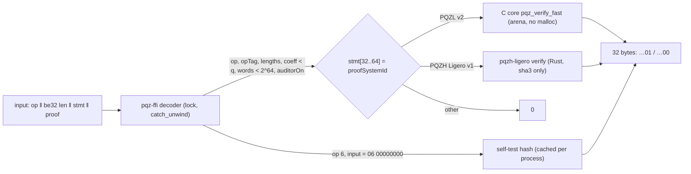

# P6e — E-S2 relations: the five relations frozen for PQZL and PQZH, serialization v1, KATs from C, `pqz-ffi`, continuous fuzzing, `proofSystemId` frozen — Implementation Plan

> **For agentic workers:** REQUIRED SUB-SKILL: Use superpowers:subagent-driven-development (recommended) or superpowers:executing-plans to implement this plan task-by-task. Steps use checkbox (`- [ ]`) syntax for tracking.

**Goal:** the P6e row of the [P6 roadmap](2026-10-12-p6-roadmap.md): `R_TX`, `R_BURN` (also REFRESH), `R_REG`, `R_DS`,
`R_DR` (also AUDITOR) frozen as specified relations with their parameters, one byte-level serialization v1 for
everything the precompile, the contracts and the clients exchange (statements, keys, ciphertexts, disclosure bundle,
both proof formats), the KATs generated from the C core (incl. `worstcase_noise.json`) and from the PQZH crate, the
Rust decoder `pqz-ffi` in front of both verifiers, continuous ASan/UBSan fuzzing started, and both `proofSystemId`s
frozen. Gate: **vectors and `proofSystemId` frozen** — in two stages, P6e-A (PQZL) and P6e-B (PQZH), decision D14.
Not here: the Nethermind precompile and the .NET P/Invoke fuzz harness (P6f), contracts and forge vectors such as
`auth_*.json`, `register_pqz.json`, `metatx_pqz.json` (P6g), `derive.json`, `zether-prover --features pq`, the
wasm-bindgen wallet module (P6h), the PQZH Solidity verifier (measured on branch `pqzh-ligero`, owner correction of
2026-10-14), P6-PUB (the publication package on `pqz-artifact`).

**Architecture:** One precompile input `u8(op) ‖ be32(len) ‖ stmt ‖ proof` for both proof systems. `pqz-ffi` (Rust,
safe code apart from the FFI calls) checks op, `opTag`, `proofSystemId`, the op's fixed lengths and every coefficient
before any proof code runs, then dispatches on the `proofSystemId` word (statement bytes 32..63): PQZL to the C core's
specialised verifier `pqz_verify_fast`, PQZH to the Ligero verifier (Rust). One statement codec (`pqz-stmt`) is shared
by the decoder, the clients' statement builder, the Ligero relations and the vector generator; the C core keeps its own
parser and the cross-checks pin both to the same bytes.

**Tech stack:** C99 (clang 18, `pqz-core/pqzl/build.sh`), LaZer `3330e48` codegen in the pinned Sage image
(`params/codegen/run.sh`, docker, no network), Rust 1.97.1 stable (`pqz-core/pqzh/rust-toolchain.toml`; `sha3`
0.10.8, `cc`, `serde_json`, `hex`), libFuzzer from clang 18 (`libclang_rt.fuzzer-x86_64.a`, installed), node v26 for
the wasm32 runs, Python 3 stdlib (+ `clients/ua-py/scaas_ua`'s Keccak) for the independent KAT script.

**Spec:** [pq-zero-knowledge.md](../../contracts/pq-zero-knowledge.md) §4.1–§4.4 (parameters, algorithms, sizes), §5 (encodings,
transcript), §7.4 / §7.5 / §7.7 / §7.9 (relations, statement layouts, disclosure), §8 CTR-PQZ-09 (engine, versioning,
API, serialization), §9.1 CTR-PQZ-10 (precompile, never-crash, decoder, fuzzing), CTR-PQZ-11 (gas, `MAX_INPUT`),
CTR-PQZ-18 (prover platforms), CTR-PQZ-19 (randomness), CTR-PQZ-23 / -24 (bundle, auditor modes), §14 (vectors and
negative cases); [decisions.md](../../decisions.md) CTR-PQZ-03 / -09 Change lines (v2, z21 no bump, 60 ms); TODO.md P6
rows: the session-4 mandate of 2026-10-14 (decisions are controller proposals recorded in decisions.md; merge and push
when tests, size gate, docs checkers and review pass), P6-PQZH (PQZL / PQZH = one `proofSystemId` with two values,
ZK required, PQZH soundness regime = proven, PQZH proof limit 256 KB proposal, verify limit 60 ms p99 incl. wasm32,
PQZH without precompile where it fits).

**Base:** `main` after `pqzh-ligero` merges (the mandate merges it once its tests pass; P6e-B needs the crate
`pqz-core/pqzh/ligero/`; P6e-A can start from `a1bfbd8`). Coordinate with `pqz-artifact` (Task 1 changes every PQZL
`proofs_fnv`, so the package's expected-results file is regenerated after Task 1 and before the P6-PUB freeze).

## 1. Survey (2026-10-14): what is already done

| Item | State | Commit / file |
|---|---|---|
| Five PQZL relations, generic verifier, native + freestanding wasm32 | **Done.** `R_REG`, `R_TX` (auditor on), `R_BURN` (+REFRESH by `opTag`), `R_DS`, `R_DR` (+AUDITOR by `opTag`) through `pqz_prove` / `pqz_verify`; native and wasm proofs byte-identical | `132d5c2` (P6d), `b87078a` (P6d-2), `3ad4069` (rel3), `7e6e9b0` (relfix) — `pqz-core/pqzl/src/pqz_rel.c` |
| LaZer specifications + codegen | **Done in the LaZer sense**: each relation is a LaZer tbox spec `params/{reg,tx,burn,ds,dr}_params.sage` → generated `params/pqz_*_params.h` by LaZer's own `lnp-tbox-codegen.sage` (pinned image); the statement → tbox equations are hand-built in `pqz_rel.c` (`build_reg`, `build_debit`, `build_ds`, `build_dr`), as upstream LaZer users do; ranks sized by `params/run_e_s1.sh` (β 452–461) | `params/`, `params/README.md`, `estimator-e-s1*.txt` |
| Statement layouts | **Done** for §7.7 (640-byte header, `R_TX` 83,072 B, `R_BURN` 50,048 B) and §7.9 (33,184 B, `kind` word); `R_REG` 16,480 B | `7e6e9b0`; `pqz-core/pqzl/src/pqz.h` |
| Soundness fixes | **Done**: lazer#24/#25 (`proofSystemId` v2), lazer#26 z21 (no bump, owner) | `5361946`, `98695de`, `a8b5b66`; `check_tbox_fixes.sh` |
| Specialised verifier (all five, v2) | **Done**: `pqz_verify_fast`, differential test 4,420 cases / 0 disagreements, p99 ≤ 16.0 ms (wasm `R_TX`) | `dcf0da3`; `sv/` |
| Arithmetic-layer KAT vs upstream | **Done**: 19/19 against the golden dump | `kat/lazer-3330e48.json`, `kat/check.py` |
| Fuzzing (one-off) | **Partly**: `test/pqz_sv_fuzz.c` (libFuzzer, ASan + UBSan, generic vs SV on edit scripts over honest `R_REG` / `R_TX`), 10-min runs; ASan + UBSan bench runs | `sv/fuzz.sh`, `opt/asan.sh` |
| `proofSystemId` PQZL | **Fixed, not formally frozen**: `keccak256("scaas/pqz/lnp22/mlwe-d64k32-q42l4/v2")` = `0x2e07e6ed…13798c2f` | `pqz.h` `PQZ_PROOF_SYSTEM_ID` |
| PQZH | **`R_REG` + `R_TX` only**, on two backends: Plonky3 STARK (`pqz-core/pqzh/`, closed: FRI/WHIR too large) and Ligero over F_q (branch `pqzh-ligero`, proven radix-431 preset n = 32,756, k = 817, t = 121, ℓ = 695: `R_TX` 230,392 B, verify p99 10.5 ms native / 55.9 ms wasm32); statements byte-identical with C (`xcheck`); provisional id is the STARK's `keccak256("scaas/pqz/pqzh/stark-d1-goldilocks5-fri-keccak256-zk/v1")` | `f78056c`, `9fc5714`, `a1bfbd8`; `pqzh-ligero` `2dc7773`, `f2ca1d0` |
| `pqz-ffi`, vectors (`pqz-core/vectors/` / §14 files), `pqz_kat.py`, `worstcase_noise.json`, continuous fuzzing, CI | **None** | — |

## 2. Gaps found (what P6e must do beyond the roadmap words)

- **G1 Auditor-off transfer is not built.** CTR-PQZ-24 (`NONE`, `OPTIONAL` with `auditorOn = 0`: no `v_a`, row 5
  skipped) needs an `R_TX` without `pk_a` / `v_a` (statement 66,560 B); `pqz_rel.c` builds only the auditor-on form and
  never reads the `auditorOn` word. Both proof systems need it (Task 2, Task 8).
- **G2 The PQZL prover is not hedged.** CTR-PQZ-19 says masking randomness is `H(secret ‖ statement ‖ CSPRNG)`;
  `do_prove` derives all masks from `rnd32` alone (`SCAAS-PQZ-PROVER-RND-V1`, `…-SUB-V1`). A repeated `rnd32` (a weak
  browser RNG) for two witnesses repeats the masks `y` and leaks `c·s` differences. Ligero hedges with the statement
  but not the witness. Fix before vectors freeze (Task 1).
- **G3 The transcript text of §5 is not what v2 does.** §5 describes a labelled SHAKE256 transcript; v2 hashes
  `SHAKE128("SCAAS-PQZ-TRANSCRIPT-V1" ‖ u8(op) ‖ be32(len) ‖ stmt)` to a 32-byte seed and then runs LaZer's tbox
  transcript. Strong Fiat–Shamir holds (the statement is absorbed first). Amend the text, not the code (D7).
- **G4 KeyGen / Enc from seeds (§4.2) are not in C.** `pqz_keypair_from_secret` / `pqz_encrypt` take explicit short
  vectors; the spec's `KeyGen(seed32)` (SHAKE256 `SCAAS-PQZ-KEYGEN-V1`, CBD, resampling) and `Enc(…, seed_enc)` are
  not implemented anywhere, and LaZer ships SHAKE128 only. `keygen.json`, `cbd.json`, `enc.json` need them (Task 3).
- **G5 `MAX_INPUT` cannot carry a PQZH transfer.** §9.1 `MAX_INPUT = 262,144` B; a PQZH `R_TX` input is
  5 + 83,072 + ≤ 262,144 B (D5).
- **G6 PQZH has two relations of five** and the Ligero crate pulls the Plonky3 crate (`pqzh = { path = ".." }`) for
  `ring` / `rel` / `client` (Task 6, Task 8).
- **G7 The Ligero proof-length bound is loose.** The verifier's bound for `R_TX` (t distinct columns, full paths) is
  262,350 B, above the proposed 262,144 B limit, while real proofs are ≈ 230–232 KB; compute the exact worst case
  (Task 9).

## Global Constraints

- Paths relative to `/home/ha/work/ainative/scaas`; worktree `.claude/worktrees/p6e-impl` on branch `p6e-relations`.
  Heavy commands — `pqz-core/pqzl/build.sh`, `params/codegen/run.sh` and `run_e_s1.sh` (docker), `rel3/relfix.sh`,
  `sv/*.sh`, every `cargo build|test|run`, node wasm runs, fuzz runs — only through `scripts/capped`, one at a time
  machine-wide. Python scripts, `cast keccak`, grep and the docs checker are light.
- Task order below is fixed inside each part; Part B (Tasks 6, 8, 9) may interleave with Part A only between heavy runs.
- Proof bytes for a fixed `rnd32` are part of the frozen vectors: after Task 11 any change that alters them is a
  `proofSystemId` bump (D4). Pure implementation changes must leave `proofs_fnv` unchanged (as P6d-2 did).
- The C core keeps CTR-PQZ-09's rules: `check_symbols.sh` passes on native and wasm objects after every task; no
  `malloc` / stdio / libm / GMP / MPFR / float on prove and verify paths; error returns, arena only.
- Rust verify paths (`pqz-ffi` decoder, `pqzh-ligero` verify): no `unsafe` except the FFI calls into the C core, no
  `f32` / `f64` (`#![deny(clippy::float_arithmetic)]` on those modules; Ligero's `soundness()` moves behind a
  `bench` feature), no allocation sized from untrusted input (only from the fixed preset and `MAX_PROOF`).
- Superseded code is kept (owner: backup, not delete): the Plonky3 crate `pqz-core/pqzh/` stays as is, unbuilt by
  P6e. Experiment and run outputs go into the repo (`runs/`), text only. No built binaries in git or on GitHub (no
  `.wasm`, `.a`, `.so`, fuzz binaries); fuzz corpora are inputs, not binaries (D12).
- Commit trailer: `Co-Authored-By: Claude Opus 5.5 <noreply@anthropic.com>` and the session line. Never `git add`
  `build/`, `target/`, `node_modules/`, `claude-code-api.txt`. Stop every background shell before reporting.

## Rulings (plan-level defaults, no owner input needed)

- **R1 Relation specification = the LaZer spec files + `pqz_rel.c` + a mapping table**, frozen by the KATs. The
  mapping (per relation: statement fields read, witness slots, equations → spec rows, norm bounds, binary slots, Z
  slack, params header) goes into `pqz-core/pqzl/params/README.md` §"Relations v2 (frozen)", lifted from the `pqz_rel.c`
  header comment; pq-zero-knowledge.md §8 links it. No new spec file.
- **R2 Statement codec in one small crate `pqz-core/stmt` (`pqz-stmt`, no dependencies)**: parse and build every
  statement, `pk`, ciphertext, `T`, `out`, bundle and opening; used by `pqz-ffi`, `pqzh-ligero` and the generator. The
  Ligero crate drops its path dependency on the Plonky3 crate (`ring.rs` and the statement half of `rel.rs` move into
  `pqz-stmt`; `client::setup` moves into `pqzh-ligero`'s test support).
- **R3 Witness bytes (prover API) stay as `pqz.h` defines them** (`int8` / `int16` little-endian, then digit bytes):
  they never cross a trust boundary or reach a chain; documented in §8.1 as "prover API, not consensus".
- **R4 Vectors are written by one generator, `pqz-ffi`'s `src/bin/pqz-vectors.rs`**, which calls the C core through
  the C ABI for PQZL values and the Ligero crate for PQZH ("KATs from C": every PQZL value is computed by the C core;
  the Rust binary only drives it and writes JSON). `--check` regenerates in memory and diffs. Independence comes from
  `pqz_kat.py` (Python, stdlib) for everything but proofs, from the wasm32 builds for proof bytes, and from the generic
  vs specialised verifier pair.
- **R5 The precompile path verifies PQZL with `pqz_verify_fast`**; `pqz_verify` stays the reference in tests and in
  the differential fuzz target. The verify-only build of `pqz-ffi` leaves the generic verifier out of the precompile
  entry point (it is still linked for the differential tests).
- **R6 `auditorOn` is bound by length**: op 1 with a 83,072-byte statement requires the `auditorOn` word = 1, with
  66,560 B it requires 0; any other word value ⇒ reject. Checked in `pqz-ffi` and again in `pqz_rel.c`
  (defence in depth, a few lines).

## Decisions (controller proposals; recorded in decisions.md in Task 12, "status: controller proposal, owner may override")

| No. | Decision | Recommended choice | Why / cost if wrong |
|---|---|---|---|
| **D1** | LaZer specs + codegen vs a statement-code generator | **Freeze the hand-built relations** (R1): keep the LaZer specs and generated headers, prove the headers reproducible once (rerun codegen for all specs, diff = empty), pin the relations with KATs and the generic-vs-SV differential test; build no generator for `pqz_rel.c` or `pqz_sv.c` | The relations exist, are measured and reviewed; a generator for five fixed relations is weeks of work for no new guarantee (`pqz-specialised-verifier.md` §6). Cost if wrong: a later relation change is a hand edit in two places, caught by the differential test |
| **D2** | PQZL `proofSystemId` | **Stays v2, `keccak256("scaas/pqz/lnp22/mlwe-d64k32-q42l4/v2")` = `0x2e07e6ed1fd303a08c89b3eab6e8423fdfb8f31202958dd682a0619313798c2f`, frozen at gate A**, covering the auditor-off variant (an added statement form; existing proofs unchanged) and the hedged prover (prover-only) | Nothing deployed (all chains test-only), the z21 precedent (owner 2026-10-14: no bump for changes that leave honest proofs and the transcript of existing forms unchanged). If overridden: v3 string `…/v3`, one constant and the vectors |
| **D3** | PQZH `proofSystemId` | **`keccak256("scaas/pqz/pqzh/ligero-fq-r431-keccak256-zk-proven/v1")` = `0x0a47a7689250ba178a52ad5972cdd9153358c022cb694c08d2389e82de2fead4`**: Ligero over F_q, radix-431 domains, Keccak-256 Merkle + transcript, ZK (modified construction), proven (unique-decoding) preset; parameters fixed per id and op, never read from the proof. The STARK id `0xaa1f92dd…` is retired unused. Frozen at gate B | Names every property a verifier must match. Cost if wrong: a string change before gate B costs nothing |
| **D4** | Bump rule | **Any change to parameters, presets, relation rows or statement layout of an existing form, transcript, proof encoding, or the accepted set after a deployment ⇒ new id.** Prover-only changes must keep the frozen vectors' proof bytes; additions of a new statement form before the first deployment and accepted-set tightening before any deployment need no bump (recorded case by case). The precompile may implement several ids; retiring one is a chain activation (P6f), never silent | Makes "frozen" testable: `pqz-vectors --check` and the `proofs_fnv` lines fail on any byte change |
| **D5** | Proof limits and `MAX_INPUT` | **Per-id `MAX_PROOF`: PQZL 98,304 B (unchanged), PQZH 262,144 B (the owner-session proposal, 256 KiB). `MAX_INPUT` 262,144 → 393,216 B (384 KiB)**: the largest input is 5 + 83,072 + 262,144 = 345,221 B. The contract bounds the proof by its token's id | The proposal "MAX_INPUT 262,144" forgot the statement. Consequence for P6g (not decided here): a PQZH transfer's proof is ≈ 9.2 M gas of EIP-7623 calldata floor, so 16 inline ciphertexts (≈ 0.54 M each) do not fit the 16,777,216 cap; `INLINE_MAX` per proof system (≈ 8 for PQZH) is a P6g question |
| **D6** | Prover hedging | **Hedge both provers before vectors freeze**: PQZL masks from `SHAKE128("SCAAS-PQZ-PROVER-RND-V2" ‖ rnd32 ‖ SHAKE128(wit) ‖ hash0)` (and `…-SUB-V2`); Ligero `SHAKE256("SCAAS-PQZH-LIGERO-RNG-V2" ‖ rnd32 ‖ u8(op) ‖ be32(len) ‖ stmt ‖ wit)`. Verifiers unchanged | CTR-PQZ-19 requires it; G2. Proof bytes change once, before freezing |
| **D7** | Transcript text | **Amend pq-zero-knowledge.md §5 to the implemented v2 transcript** (G3), no code change | Changing the code is a bump and a LaZer transcript rewrite |
| **D8** | Auditor-off transfer | **Build `R_TX` without the auditor in both systems** (statement 66,560 B, witness 12,384 B, op 1 dispatched by length, R6). Rejected: a dummy auditor key with a `v_a` (16.5 KB of calldata per transfer, a fake key in the registry's group) | CTR-PQZ-24 specifies "no `v_a`, row 5 skipped" |
| **D9** | Vector location | **One canonical directory `smartcontracts/vectors/pqz/`** (as `smartcontracts/vectors/ua/`), read in place by every consumer; §14's copies to `smartcontracts/evm/test/vectors/pqz/` and `clients/zether-prover/vectors/pq/` dropped. `worstcase_noise.json` stores seeds, per-credit hashes and the aggregate `T`, not 1,023 ciphertexts (≈ 34 MB of hex) | One source of truth; copies drift |
| **D10** | `pqz-ffi` scope | **Decode + verify for both systems (C ABI `pqz_precompile` for P6f, Rust API for the node), plus a `prove` feature (statement build, `prove`, `keygen`, `enc`, `dec`) for P6h**; one process-wide `Mutex` around every libpqz call (closes `STATUS.md` Open 6 at this layer for every consumer); `catch_unwind` on every entry → 0; fixed arenas sized from measurement (verify-only, prove); native x86-64 / aarch64 and `wasm32-unknown-unknown` (prove feature, byte-equal proofs with native); no GMP / MPFR anywhere | One audited boundary for precompile, node and clients. Cost if wrong: P6h wraps the C ABI itself |
| **D11** | PQZH backend packaging | **Ligero is the PQZH backend (owner direction, proven regime); `pqzh-ligero` depends only on `sha3` and `pqz-stmt` (R2)**; the Plonky3 STARK crate stays as backup and is never linked into `pqz-ffi`; the conjectured preset is bench-only (behind a feature) | Keeps 18 Plonky3 crates out of the node and the precompile |
| **D12** | Fuzzing set-up | **clang 18 libFuzzer on stable Rust**: C core with ASan + UBSan, `pqz-ffi` / Ligero instrumented with `-C passes=sancov-module` (stable codegen flags), panics turned into aborts in the fuzz build; no nightly / cargo-fuzz unless that fails (then an owner step to install nightly). Corpora: only small structure-aware inputs (edit scripts ≤ 512 B) are committed, minimized, under `pqz-core/fuzz/corpus/<target>/` (≤ 4 MB per target); large seeds are rebuilt from the vectors at run time; crash inputs are committed as regression cases. Continuous = a long run per target on the owner's machine under `scripts/capped` (`pqz-core/fuzz/run.sh`), logs as text in `pqz-core/fuzz/runs/`; plus a CI job `pqz` (build, KATs, vectors `--check`, symbol scan, 60 s per fuzz target, text logs only, no artifacts uploaded) | CTR-PQZ-10 asks for "continuous ASan/UBSan fuzzing in CI". The owner's "no CI workflow for now" (session 4) was about the P6-PUB package; if it covers this job too, the local run alone stays |
| **D13** | Self-test content | **`OP_SELFTEST` returns `keccak256(kat_digest ‖ u8(pqzl_valid) ‖ u8(pqzl_invalid) ‖ u8(pqzh_valid) ‖ u8(pqzh_invalid))`**, `kat_digest` = `keccak256` over the `A` digest, one keygen, one enc / dec, one Ligero FFT round trip; the compiled-in vectors are one valid and one invalid `R_REG` per id. Frozen with the vectors (`selftest.json`), used by P6f | §9.1 defines it for one engine; two ids need both covered |
| **D14** | Gate staging | **P6e-A (PQZL: Tasks 1–5, 7, 10–12 for PQZL) freezes PQZL and unblocks P6f / P6g / P6h on PQZL; P6e-B (PQZH: Tasks 6, 8, 9 and the PQZH parts of 10–12) freezes PQZH after the Ligero Solidity-verifier measurement lands** (its format wishes, e.g. element width, must come before the freeze) and after a Claude-subagent review of the modified ZK argument (`pqzh-ligero.md` §4.1) | PQZL does not wait on PQZH; the PQZH format is frozen once |
| **D15** | Canonical encodings | **Every decoder accepts exactly one encoding**: fixed lengths, coefficients `< q` as `be8`, header scalars that relations read `< 2^64`, `auditorOn` ∈ {0, 1} by length, PQZL proof = LaZer coder grammar with the final 1-bit then zero padding and no trailing byte, PQZH elements `< q` in 6 bytes, opened columns strictly increasing, proof consumed exactly; property: for every accepted input `encode(decode(x)) = x` (fuzzed, Task 10) | No malleable proofs or statements reach state or logs |

## Serialization v1 (the byte layouts frozen by this plan; Task 12 writes them into pq-zero-knowledge.md as §8.1)

**Precompile input (both ids).** `u8(op) ‖ be32(len(stmt)) ‖ stmt ‖ proof`; `len(stmt)` must equal the op's length for
the id; `proof` = the rest, `1 ≤ len(proof) ≤ MAX_PROOF(id)`; whole input ≤ `MAX_INPUT` = 393,216 B (D5).

| op | `opTag` (`keccak256("SCAAS-PQZ-OP-<NAME>-V1")`) | `stmt` | Length |
|---|---|---|---|
| 1 `TRANSFER` | `ef22f3d1…cd5275414` | §7.7 header ‖ `pk_f ‖ pk_t ‖ pk_a ‖ u_T ‖ v_T ‖ u ‖ v_t ‖ v_f ‖ v_a` (auditor on) / without `pk_a`, `v_a` (off) | 83,072 / 66,560 |
| 2 `BURN` / `REFRESH` | `7383374d…b4cc1407` / `f118f2df…cd75eede` | §7.7 header ‖ `pk_f ‖ u_T ‖ v_T ‖ u ‖ v_f` | 50,048 |
| 3 `REGISTER` | `69562a9c…4a03c088` | `opTag ‖ proofSystemId ‖ message(32) ‖ pk` | 16,480 |
| 4 `DISCLOSE_SENDER` | `868cc07c…f5ceef3f` | §7.9 | 33,184 |
| 5 `DISCLOSE_RECEIVER` / `AUDITOR` | `d8356cfb…a4296456` / `d6019aa4…d21daf81` | §7.9 | 33,184 |
| 6 `SELFTEST` | — | empty: input exactly `06 00000000` | 0 |

**Objects.** `pk` 16,384 B = 32 polys × 64 coefficients, `be8`, poly 0 / coefficient 0 first, each `< q`; `v` 128 B =
16 × `be8`; ciphertext `u ‖ v` 16,512 B; `T = u_T ‖ v_T` 16,512 B; `out` = `u ‖ v_t ‖ v_f ‖ v_a` 16,768 B (16,640 B
auditor off); header words 32-byte big-endian, addresses left-padded with 12 zero bytes; `salt` word = 16 zero bytes ‖
salt. Bundle `R = salt(16) ‖ u ‖ v_t ‖ v_a ‖ toUA(32)` 16,688 B (16,560 B without `v_a`); opening
`abi.encode(bytes bundle, bytes proof)`; `ctHash = keccak256(ct)`; `authDigest = keccak256("SCAAS-PQZ-AUTH-V1" ‖
keccak256(stmt))`.

**PQZL proof (id v2).** LaZer's coder stream as `pqz_rel.c` `encproof` / `pqz_decproof` at the frozen commit, field
order `tB` (urandom, `log2q` = 42 bits), `h` (42 bits), `tA1` (`log2q − D` bits), `c` (urandom mod `2ω + 1`,
`log2ω` bits), `hint` (ghint), `z1`, `z21`, `z3`, `z4` (grandom with the relation's `log2stdev1/2/3/4`), then a 1-bit
and zero bits to the byte boundary; widths and counts from `params/pqz_<rel>_params.h`; the length is exactly the
consumed bytes; `≤ 98,304`. Measured 28.1 KB (`R_REG`) – 42.8 KB (`R_TX`).

**PQZH proof (id Ligero v1).** `R(32) ‖ w ‖ q ‖ h ‖ nonce(8, BE) ‖ for each distinct opened column in increasing
index order: salt(32) ‖ (m + 12) × F_q ‖ multiproof digests(32 each, canonical order)`; F_q element = 6 bytes BE
`< q`, F_{q^4} element = 4 F_q elements (24 B), `w`, `q` 2k − 1 coefficients, `h` 2k − 1 − ℓ; parameters (n, k, ℓ, t,
16 grinding bits) per (id, op), never read from the proof; consumed exactly; `≤ 262,144`.

**Transcripts (as implemented, D7).** PQZL: `hash0 = SHAKE128("SCAAS-PQZ-TRANSCRIPT-V1" ‖ u8(op) ‖ be32(len) ‖
stmt)` (32 B), then LaZer's tbox transcript seeded with `hash0`. PQZH: Keccak-256 chain seeded with
`keccak256("SCAAS-PQZH-LIGERO-V1" ‖ u8(op) ‖ be32(len) ‖ stmt)` (`pqzh-ligero.md` §4).

**Prover API (not consensus, R3).** Witness layouts of `pqz.h` (`PQZ_*_WIT_BYTES`, +`PQZ_TX0_WIT_BYTES` 12,384);
`rnd32` 32 B; hedging per D6.

## Review Focus

- **Never crash, never wrong-accept at the boundary.** Every decoder rule of D15 / R6 has a negative vector; the fuzz
  targets reach both verifiers through `pqz_precompile`; a panic or sanitizer report is a failure (Task 10).
- **Op / id confusion.** Each valid proof under every other op byte, with another op's `opTag`, with the other
  system's id, and with an unknown id ⇒ 0 (`negative.json`, Task 11).
- **Auditor-off soundness.** `R_TX0` keeps rows 1–4, 6, 7 and every norm of `R_TX`; an auditor-off statement with
  `auditorOn = 1` (and vice versa) ⇒ 0; the generic and specialised verifiers agree on it (Task 2).
- **Hedging.** Same `rnd32`, different witness ⇒ different masks (PQZL `ex`, Ligero RNG state) (Task 1).
- **Frozen means frozen.** `pqz-vectors --check`, `pqz_kat.py --check`, the `proofs_fnv` lines and the wasm32 replay
  all pass on the gate commit and in CI.

## Tasks

### Task 1 (A): Hedge both provers (D6) — light code, heavy check

**Files:** `pqz-core/pqzl/src/pqz_rel.c` (`do_prove`: tags `…-RND-V2`, `…-SUB-V2`, absorb `SHAKE128(wit)` and `hash0`;
`pqz_prove` passes the witness hash), `pqz-core/pqzh/ligero/src/ligero.rs` (RNG derivation incl. `wit`),
`pqz-core/STATUS.md` (new `proofs_fnv` line).

- [ ] Change the two derivations; nothing else in the prover or verifier.
- [ ] Test (in `test/pqz_bench.c` and `ligero/tests/attacks.rs`): two proofs with equal `rnd32` and statement,
  different witnesses (two valid `R_REG` keys sharing nothing) ⇒ different first proof bytes; equal inputs ⇒
  identical proofs (determinism kept).
- [ ] Heavy, capped: `rel3/relfix.sh hedge` (KAT 19/19, `fails 0`, native = wasm proofs, ASan + UBSan),
  `./check_tbox_fixes.sh`, `sv/check_sv_fixes.sh`, `sv/diff.sh`; `cargo test --release --offline` in
  `pqz-core/pqzh/ligero`.
- **Acceptance:** all green; new `proofs_fnv` recorded for all five relations; proof sizes, times, arena unchanged
  within noise. Tell `pqz-artifact` (expected-results file) — coordination, not a P6e file.

### Task 2 (A): `R_TX` without the auditor, PQZL (D8, R6) — heavy (codegen, sizing, runs)

**Files:** `pqz-core/pqzl/params/tx0_params.sage` (new: `n = [32, 32, 32, 32, 1, 1]`, `B = [36, 164, 36, 164, 64, 64]`,
`m1 = 32·4 + 2 + 15`, same binary part, `nprime = 1` on `e2_t`), `params/pqz_tx0_params.h` (generated),
`params/estimator-e-s1-tx0.txt`, `src/pqz.h` (`PQZ_TX0_STMT_BYTES` 66,560, `PQZ_TX0_WIT_BYTES` 12,384,
`PQZ_HDR_AUDITOR_ON` 448), `src/pqz_rel.c` (rel `TX0`, `parse_debit` / `build_debit` / `debit_witness` with an
auditor flag, row 5 skipped, R6 check), `src/pqz_sv.c` (the same flag in the `R_TX` evaluation), `test/pqz_bench.c`
(mask bit 32 = `R_TX0`), `test/pqz_sv_diff.c`, `test/pqz_sv_fuzz.c` (relation byte), `pqz-core/pqzh/xcheck/`
(TX0 statement / witness dump), `params/README.md`.

- [ ] Heavy, capped: regenerate the header (`params/codegen/run.sh <LaZer 3330e48> params/tx0_params.sage`) and size it
  (`params/run_e_s1.sh … tx0`): MSIS β ≥ 450, knowledge error ≤ 2^-127.
- [ ] D1 evidence in the same capped session: regenerate the five existing headers and `diff` against the checked-in
  ones (must be empty); record the commands and result in `params/README.md`.
- [ ] Builder + SV + R6 check; the bench and the differential test cover `R_TX0`.
- [ ] Heavy, capped: `rel3/relfix.sh tx0`, `sv/rel3.sh tx0`, `./check_tbox_fixes.sh`, `sv/check_sv_fixes.sh`.
- **Acceptance:** honest `R_TX0` proves and verifies native and wasm (byte-identical), all tamper kinds rejected,
  differential test 0 disagreements over six relation forms, `auditorOn` mismatch rejected by both verifiers, proof
  ≤ 98,304 B (expected ≈ 40 KB), SV p99 ≤ 60 ms native and wasm, `proofs_fnv` of the other five unchanged from
  Task 1, symbol scan clean.

### Task 3 (A): `KeyGen` / `Enc` / `Dec` from seeds in C (G4) — light code, heavy build

**Files:** `pqz-core/pqzl/lazer/shake128.c` / `.h` (a SHAKE256 entry on the same Keccak core: rate 136, `PQZ:` comment),
`pqz-core/pqzl/src/pqz_keys.c` (new: `CBD_η`, `pqz_keygen(seed32, pk, s, e)` with the ≤ 64-counter resampling,
`pqz_enc_seed(pks, n, msgs, seed_enc, u, vs, r, e1, e2)`, `pqz_dec(s, ct, M[16], noise[16])`), `src/pqz.h`,
`build.sh` (source list), `test/pqz_bench.c` (a keygen / enc / dec round trip).

- [ ] Implement §4.2 literally (bits LSB-first, `s` then `e` from one stream, error after counter 64).
- [ ] Heavy, capped: `./build.sh all`, the bench round trip, `check_symbols.sh`.
- **Acceptance:** `Dec(Enc(m)) = m` with noise inside the §4.3 bounds for 1,000 seeds; outputs equal to
  `pqz_kat.py` on 20 seeds (Task 4); SHAKE256 equals Python's `hashlib.shake_256` on 10 inputs.

### Task 4 (A): `pqz_kat.py`, the independent Python KAT — light

**Files:** `smartcontracts/vectors/pqz/pqz_kat.py` (new; stdlib + `clients/ua-py/scaas_ua` Keccak; no numpy).

- [ ] Implements: `A` (SHAKE128 `SCAAS-PQZ-A-V2`, digest as `matrix.json`), CBD, `KeyGen`, `Enc`, `Dec`, `Add` /
  `Sub` / `Trivial`, `digits`, the opTags and both ids, every statement layout (build and parse), `ctHash`,
  `authDigest`, the bundle and opening encodings, `entryRef`.
- [ ] `--check`: recompute every non-proof field of every `smartcontracts/vectors/pqz/*.json` and report drift
  (exit 1), like the classical `kat.py`.
- **Acceptance:** `python3 -I smartcontracts/vectors/pqz/pqz_kat.py --check` passes on the Task 11 vectors in under
  a minute.

### Task 5 (A): `pqz-stmt` codec crate (R2) — light code, heavy test

**Files:** `pqz-core/stmt/{Cargo.toml,src/lib.rs}` (new, `#![no_std]` + `alloc`, no dependencies): op and opTag table,
both ids, layout constants, `parse(op, stmt) -> Result<Stmt, Reject>` with the D15 / R6 rules, `build(&StmtFields) ->
Vec<u8>`, `pk` / ciphertext / bundle / opening codecs, `MAX_PROOF(id)`, `MAX_INPUT`.

- [ ] Unit tests: round trip for every form; each D15 rule rejects (coefficient = q, = 2^42, top bytes ≠ 0, fee word
  ≥ 2^64, `auditorOn` = 2, length ± 1, wrong opTag for op, unknown id).
- [ ] Heavy, capped: `cargo test --release --offline`.
- **Acceptance:** tests green; the statements built from `pqz_bench.c`'s `setup()` inputs equal the C bytes
  (`xcheck` extended to all six forms).

### Task 6 (B): Ligero standalone and on `pqz-stmt` (R2, D11) — light code, heavy test

**Files:** `pqz-core/pqzh/ligero/Cargo.toml` (deps `sha3`, `pqz-stmt`; drop `pqzh`), `src/cs.rs` (statement access via
`pqz-stmt`, ring helpers moved), `src/ring.rs` (moved from `pqzh/src/ring.rs`, copy kept there), `tests/support.rs`
(the `setup()` of `pqzh/src/client.rs`), `wasm/`, `runs/measure.sh`; `ligero.rs` (`soundness` / `breakdown` and the
conjectured preset behind feature `bench`).

- [ ] Heavy, capped: `cargo test --release --offline`; `runs/measure.sh l4` (proofs byte-identical to the Task 1
  hedged proofs; same sizes and times within noise); `cargo tree` shows no `p3-*` crate.
- **Acceptance:** green; `pqz-core/pqzh/` (STARK) untouched.

### Task 7 (A): `pqz-ffi` — decoder, dispatch, C ABI, prove feature (D10, R5) — heavy

**Files:** `pqz-core/ffi/{Cargo.toml,build.rs,src/lib.rs,src/decode.rs,src/pqzl.rs,src/pqzh.rs,src/selftest.rs}`
(new). `build.rs` compiles the C core with `cc` from `pqz-core/{src,lazer,params}` with `build.sh`'s flags (`-O2`,
no `-march`, `-DPQZ_SV`, stack protector), for wasm32 without `pqz_wasm_rt.c` (Rust's `compiler_builtins` provides
`mem*` / `__multi3`); `pqzh.rs` calls `pqzh-ligero` (feature `pqzh`, on by default after Task 9).

- [ ] Entry points: `pub fn precompile(input: &[u8]) -> [u8; 32]` and `#[no_mangle] extern "C" fn
  pqz_precompile(ptr, len, out32)`; feature `prove`: `prove(op, stmt, wit, rnd32)`, `keygen`, `enc`, `dec`,
  `build_statement`. One `static LOCK: Mutex<()>`; `catch_unwind` on every entry (poisoned lock ⇒ recover and
  re-init); arenas: verify-only (size from a measured peak of all six forms × 1.5) and prove (≥ 320 MiB), allocated once.
- [ ] Self-test per D13 (compiled-in `R_REG` vectors from Task 11; until then from the bench setup).
- [ ] Tests: every honest form of both ids ⇒ `…01`; every D15 / R6 negative case of `pqz-stmt`'s tests (Task 11 writes the same cases as `negative.json`) ⇒ `…00`; the same input twice ⇒ same
  output; 8 threads hammering `precompile` ⇒ identical results to the serial run.
- [ ] Heavy, capped: `cargo test --release`; `cargo build --release --target wasm32-unknown-unknown --features prove`
  and a node run proving `R_REG` / `R_TX` with Task 1's `rnd32` (bytes equal to native); `readelf -d` / `nm -u` on the
  native `cdylib` (no GMP / MPFR / libstdc++; libm only if Rust std pulls it, then recorded); `glic/absence.sh` extended
  to `libpqz_ffi.so` and the wasm.
- **Acceptance:** all green; measured verify arena recorded; p99 of `precompile` per op recorded (input decode adds
  < 1 ms).

### Task 8 (B): PQZH relations `R_BURN`, `R_DS`, `R_DR`, `R_TX0` in Ligero — heavy

**Files:** `pqz-core/pqzh/ligero/src/cs.rs` (four more constraint systems, mirroring `pqz_rel.c`: `R_BURN` = `R_TX`
rows 1, 2, 4, 6, 7 with public digits; `R_DS` rows `u = A^T r + e1`, `v_t` with public digits; `R_DR` `pk = A s + e`,
`v − u^T s = Δ·d + e'`, `e' + 2^24 < 2^25`; `R_TX0` = `R_TX` without row 5 / `e2_a`), `ligero.rs` (`Params::preset(op)`
proven, radix 431, per op), `tests/attacks.rs` (honest + negative witnesses + 12 mutation kinds per op),
`src/bin/ligero_bench.rs`, `wasm/lib.rs`, `pqzh/xcheck/` (all six forms vs C).

- [ ] Per-op preset by the p1 model (`ligero_params.py`), smallest proven proof with `R_TX`'s rule set (128 bits per
  term, ZK, 16 grinding bits).
- [ ] Heavy, capped: `cargo test --release --offline`; `runs/measure.sh l5` (native + wasm32, 3 proofs, 100 honest
  verifies, 12 × 40 mutations per op); `xcheck` all forms byte-identical with C.
- **Acceptance:** every op ≤ 262,144 B proof (`R_BURN` ≈ `R_TX`), verify p99 ≤ 60 ms on native **and** wasm32,
  0 mutated accepted, 0 panics; `pqzh-ligero.md` gets a §11 with the table (results, not decisions).

### Task 9 (B): PQZH limits and id (D3, D5, G7) — light code, heavy test

**Files:** `ligero.rs` (`PQZH_PROOF_SYSTEM_ID` = D3, `max_proof_len(op)` exact: distinct-column count ≤ t and the
worst pruned multiproof for t leaves in a depth-⌈log2 n⌉ tree, asserted ≤ 262,144; the prover retries with a fresh
derived RNG if a proof would exceed it), `pqz-stmt` (`MAX_PROOF`, `MAX_INPUT`).

- [ ] Unit test: `max_proof_len(op)` ≥ every measured proof and ≤ 262,144 for every op; the verifier rejects
  `MAX + 1` bytes before parsing.
- [ ] Wait for the Ligero Solidity-verifier measurement (branch `pqzh-ligero`, owner correction 2026-10-14); apply any
  encoding change it needs (D14), rerun Task 8's measure, then freeze.
- **Acceptance:** green; the D3 id in the statements of every PQZH vector.

### Task 10 (A+B): Fuzz targets, corpus, runner, CI smoke (D12, D15) — heavy

**Files:** `pqz-core/fuzz/{README.md,run.sh,build.sh}`, `pqz-core/fuzz/targets/{precompile.c,mutate.c,codec.c}`,
`pqz-core/fuzz/corpus/{mutate,codec}/`, `pqz-core/fuzz/runs/`; `test/pqz_sv_fuzz.c` folded into `mutate.c`;
`.github/workflows/ci.yml` (job `pqz`).

- [ ] `precompile.c`: `LLVMFuzzerTestOneInput` → `pqz_precompile` (raw bytes, `-max_len=400000`); seeds = the vectors'
  inputs written at run time. Oracle: no crash / sanitizer report, output is exactly `…00` or `…01`, deterministic.
- [ ] `mutate.c`: input = (form, id, edit script) over an honest input of every form and both ids; oracle as above,
  plus for PQZL `pqz_verify_fast == pqz_verify` (sampled: every 16th input, the generic verifier is slow).
- [ ] `codec.c`: statements, PQZL proofs (`pqz_decproof` → `encproof`) and PQZH proofs: accepted ⇒ re-encoding equals
  the input (D15).
- [ ] `build.sh`: C core with `-fsanitize=address,undefined -fno-sanitize-recover=all` (the two upstream nits of
  `STATUS.md` Open 4 excluded as `sv/fuzz.sh` does), `pqz-ffi` as `staticlib` with
  `RUSTFLAGS="-C passes=sancov-module -C llvm-args=-sanitizer-coverage-level=4 -C
  llvm-args=-sanitizer-coverage-inline-8bit-counters -C llvm-args=-sanitizer-coverage-pc-table -C
  llvm-args=-sanitizer-coverage-trace-compares"` and feature `fuzz` (panic ⇒ abort). If the stable sancov flags do not
  link, stop and report (owner step: nightly + cargo-fuzz).
- [ ] `run.sh <target> <seconds>` (under `scripts/capped`, `-rss_limit_mb=3500`, merges new inputs into the corpus,
  writes `runs/<date>-<target>.txt`).
- [ ] Heavy, capped: first long run 2 h per target (this starts "continuous"); minimize and commit corpora.
- [ ] CI `pqz` job: `build.sh native`, `kat/check.py`, `check_tbox_fixes.sh`, `sv/check_sv_fixes.sh`,
  `pqz-vectors --check`, `pqz_kat.py --check`, `cargo test` (stmt, ligero, ffi), fuzz smoke 60 s per target from the
  committed corpora; no artifact upload.
- **Acceptance:** the 2-hour runs end with no finding (or every finding fixed with its regression input committed);
  CI job green on the branch.

### Task 11 (A+B): Vectors and the generator (D9, D13, R4) — heavy

**Files:** `pqz-core/ffi/src/bin/pqz-vectors.rs`, `pqz-core/pqzl/test/pqz_worstcase.c` (new; C harness),
`smartcontracts/vectors/pqz/{README.md,matrix.json,cbd.json,keygen.json,enc.json,statement_transfer.json,
statement_burn.json,statement_refresh.json,statement_register.json,statement_disclose.json,proof_pqzl.json,
proof_pqzh.json,negative.json,selftest.json,worstcase_noise.json}`.

| File | Content |
|---|---|
| `matrix.json` | `keccak256(A bytes)`, first / last 8 coefficients of `A[0][0]`, `A[31][31]` |
| `cbd.json` | SHAKE inputs → CBD(1), CBD(20) samples |
| `keygen.json` | seed → `pk` hash, counter used (no searched resample seed: probability ≈ 2^-70, row dropped by the controller 2026-10-14; the resample path and the counter-64 error are pinned by the Task 3 test-hook KATs with lowered thresholds, `pqz_keys_kat` / `pqz_kat.py --c-keys`) |
| `enc.json` | `seed_enc`, recipients, messages → `u`, `v_j`; `Add` / `Sub` / `Trivial`; `Dec` → `M`, value (noise omitted) |
| `statement_*.json` | header fields + objects → statement bytes, `keccak256(stmt)`, `authDigest`, `entryRef`, bundle, opening; auditor on / off |
| `proof_pqzl.json`, `proof_pqzh.json` | per form (6) + REFRESH + AUDITOR (8 rows each): statement, witness, `rnd32`, proof, `expect: true` |
| `negative.json` | precompile inputs that must give 0: every D15 / R6 rule, op / opTag / id confusion, truncated / extended / bit-flipped proofs, `MAX_INPUT + 1` (expected revert in P6f) |
| `selftest.json` | the D13 hash and its inputs |
| `worstcase_noise.json` | receiver key seed, generator seed, `K_MAX − 1` = 1,023 credits as `keccak256` list with norms (`‖r‖ = 36`, `‖e1‖ = 164`, `‖e2‖ = 64` aligned to maximize `e_t^T r − s_t^T e1 + e2`), the aggregate `T`, the debit `R_TX` statement, its proof (PQZL and PQZH), the decrypted noise vs the §4.3 bound (12.16 M < 2^24) |

- [ ] `pqz_worstcase.c` builds the aligned credits from the known receiver key (encryption with chosen short vectors
  via `pqz_encrypt`), sums `T` with the reserved plain unit, proves and verifies the debit, prints the JSON pieces.
- [ ] Heavy, capped: generate; `pqz-vectors --check` (byte-identical second run); replay every proof row through the
  generic and specialised PQZL verifiers and Ligero, native and wasm32 (wasm proofs from the same `rnd32` equal);
  `pqz_kat.py --check`.
- **Acceptance:** all files written by the generator only, second run byte-identical, every check green, total size
  recorded in `README.md` (expected ≈ 7–8 MB, dominated by `proof_pqzh.json`).

### Task 12 (A+B): Docs and freeze — light

**Files:** `docs/contracts/pq-zero-knowledge.md` (§5 transcript text (D7); new §8.1 "Serialization v1" from the section above;
CTR-PQZ-09 versioning: both ids, the bump rule (D4), PQZH limit; §9.1 `MAX_INPUT` (D5), the auditor-off length,
dispatch by id, `OP_SELFTEST` (D13); §4.4 sizes (PQZH proof); §14 vector location (D9), fuzzing (D12)),
`docs/decisions.md` (Change lines, each "status: controller proposal, owner may override": CTR-PQZ-09 — D1, D2, D3, D4,
D6, D7, D11, D15; CTR-PQZ-10 — D5, D10, D12, D13; CTR-PQZ-24 — D8; CTR-PQZ-19 — D6 hedging text), `pqz-core/README.md`
and `STATUS.md` (layout rows `stmt/`, `ffi/`, `fuzz/`; new numbers), `pqz-core/pqzl/params/README.md` (R1 table),
`docs/research/pqzh-ligero.md` (§11, Task 8), roadmap P6e row (plan link, status).

- [ ] `python3 scripts/docs_check.py check` → 0 errors; `facts check` clean.
- **Acceptance:** gate checklist below ticked on one commit.

## Order, effort, gate

Order: **A:** 1 → 4 → 3 → 2 → 5 → 7 → 10 (PQZL targets) → 11 (PQZL files) → 12 (PQZL) = **gate A**.
**B** (after `pqzh-ligero` merges and Task 5; light parts may overlap A between heavy runs): 6 → 8 → 9 (waits on the Solidity
measurement) → 10 / 11 / 12 (PQZH parts) = **gate B**. Heavy runs stay serial machine-wide.

| Task | Effort (agent-days) | Heavy compute (capped) |
|---|---|---|
| 1 hedge | 0.5 | relfix + SV checks ≈ 1.5 h |
| 2 `R_TX0` PQZL | 2.5 | codegen 6 × ≈ 1 min, sizing ≈ 30 min, runs ≈ 2 h |
| 3 keygen / enc | 1 | builds |
| 4 `pqz_kat.py` | 1.5 | — |
| 5 `pqz-stmt` | 1 | cargo test |
| 6 Ligero standalone | 1 | measure ≈ 30 min |
| 7 `pqz-ffi` | 3.5 | builds native + wasm, tests |
| 8 PQZH four forms | 4 | measure ≈ 1 h |
| 9 PQZH limits / id | 0.5 (+ wait) | tests |
| 10 fuzzing | 2.5 | 3 × 2 h first runs |
| 11 vectors | 2.5 | generation + replays ≈ 1 h |
| 12 docs | 1 | — |
| **Total** | **≈ 21.5** (A ≈ 14, B ≈ 7.5) | **≈ 14 h serial** |

**Gate A (PQZL):** KAT 19/19; `check_tbox_fixes.sh`, `check_sv_fixes.sh`, differential test 0 disagreements over six
forms; `pqz-vectors --check` and `pqz_kat.py --check` clean; wasm32 replay byte-equal; `pqz-ffi` tests green; fuzz
first runs clean; CI `pqz` job green; D2 recorded; spec §8.1 written. **Gate B (PQZH):** the same for the PQZH rows,
every op ≤ 262,144 B and ≤ 60 ms p99 native and wasm32, the Ligero Solidity measurement folded in, the subagent review
of the ZK argument done, D3 recorded. Then merge and push per the mandate.

**Gates passed 2026-10-17:** gate A and gate B with op 7 in the frozen set — `pqz-core/gate.sh 2026-10-17` (every
step above green; the CI `pqz` job added), the PQZH limits from the S6 multi-bench (≤ 236,196 B, p99 ≤ 10.9 / 20.4 ms
native / wasm32), the Ligero ZK review in `docs/research/pqzh-ligero.md` §12; D2 / D3 recorded as frozen.

## Owner steps

1. Review the decisions D1–D15 (all controller proposals; any override before its gate costs one constant or one
   regeneration).
2. Keep the continuous fuzz runs going on the owner's machine (`pqz-core/fuzz/run.sh`, e.g. nightly, under
   `scripts/capped`); install a nightly toolchain only if Task 10 reports that stable sancov does not link.
3. An external review of the modified Ligero ZK construction (`pqzh-ligero.md` §4.1) before PQZH is used with real
   value (the subagent review in gate B is not a substitute).

## Open questions (not blocking)

- `INLINE_MAX` and the transaction cap for PQZH transfers (≈ 9.2 M gas of proof calldata at the EIP-7623 floor): P6g.
- A hand-written AVX2 SV and a run on the chain host: not needed for the 60 ms limit (P6f calibrates gas on p99).
- `K_MAX` revisit (TODO, owner: later); `worstcase_noise.json` gives the measured margin input.

## Out of scope (next)

P6f (`Nethermind.Pqz`, P/Invoke fuzz harness, gas calibration, image), P6g (contracts, `auth_*` / `register_pqz` /
`metatx_pqz` vectors), P6h (`zether-prover --features pq`, `derive.json`, the wasm-bindgen wallet module on
`pqz-ffi`'s `prove` feature), P6-PUB, the PQZH Solidity verifier, LaBRADOR, `pqz-cli serve`.

## Progress (2026-10-14, session 4)

Execution labels used in the session: the letter is the plan's part (A = PQZL, gate A; B = PQZH / Ligero, gate B),
the number is the round; each round is one agent on its own branch, reviewed before merge.

| Label | Branch | Plan tasks | Content | Status |
|---|---|---|---|---|
| A1 | `p6e-a1` | 1, 4, 3 | hedged PQZL prover (G2, D6, witness tag `SCAAS-PQZ-PROVER-WIT-V2`); `pqz_kat.py`; KeyGen / Enc / Dec from seeds + SHAKE256 in C (G4) | merged `09b9cc3` |
| A2 | `p6e-a2` | 2, 5 | `R_TX0` (G1 / D8, own ABDLOP tag 0x81, R6); `pqz-stmt` (D15 tightened: salt, zero words); review fixes (unsequenced read in both verifiers) | merged `9f55013` |
| A3 | `p6e-a3` | 7 | `pqz-ffi`: decode via `pqz-stmt`, dispatch on `proofSystemId` (PQZL C core / PQZH Ligero), C ABI `pqz_precompile`, never-crash, one lock + fixed-stack worker, status 3 (input fault → …00) vs 4 (node fault → host aborts block), `OP_SELFTEST` for both ids, `prove` feature + wasm32 | merged `072bec1` |
| A4 | `p6e-a4` | 11 | vectors for both ids in `smartcontracts/vectors/pqz/` (D9), generator with `--check`, a `pqz_kat.py` checker per file; fee-0 rows, the attacker-key worst case | merged `0807e41` |
| B1 | `p6e-b1` | 8 (part), D6 | Ligero `R_BURN` / `R_DS` / `R_DR`; hedged Ligero prover; wasm32 21-bit multiply (`R_TX` p99 59.7 → 18.7 ms) | merged `99ad859` |
| B2 | `p6e-b2` | 9 | PQZH D3 id; exact length bound first (Rust + Solidity); opTag / auditorOn checks; retry guard; D5 limits | merged `7347a0b` |
| B3 | `p6e-b3` | 6, 8 | Ligero on `pqz-stmt` (bench-only client / presets, 0 floats); Ligero `R_TX0` | merged `28a17d1` |
| A6 | `p6e-a6` | 12 | docs: pq-zero-knowledge.md §8.1 "Serialization v1" (every byte layout, checked against the code and the vectors), §5 transcripts (D7), §8 ids and bump rule (D4), §4.4 sizes, §14 vectors (D9) and fuzzing (D12), stale text fixed; decisions.md lines D2, D4, D7, D12, D14, D15 (proof half); `params/README.md` relations table (R1); `pqz-core` README / STATUS / `ffi/README.md` links | this branch |

Left: Task 10 (fuzzing, on its own branch), Task 12 (docs, `p6e-a6`), op 7 `R_TXM` (P6-ANON, branch `p6-anon-s`,
into the frozen set and §8.1 before the freezes), then gate A / gate B and the P6-PUB freeze. Owner
2026-10-14: one `PQZ` precompile verifies both proof systems (CTR-PQZ-10).

**One implementation per proof system (owner question 2026-10-14, answer recorded).** PQZL stays in C (the LaZer fork;
porting LNP22's protocol logic to Rust is months of work and the class of subtle bug found in lazer#24 / #25 / #26),
PQZH (Ligero) stays in Rust (`sha3` + `pqz-stmt` only), and `pqz-ffi` (Rust, exporting a C ABI) wraps both: Nethermind
calls it via P/Invoke, the node via Rust, wallets via wasm32. No second production implementation of either: every node
must run the same code (two implementations in consensus risk a chain split on any divergence) and the cryptographic
audit would double. Second implementations exist only as test oracles: PQZL generic vs specialised verifier
(differential), `pqz_kat.py` (keys, encryption, statements), the test-only Solidity Ligero verifier, `pqz-stmt` vs
`pqz_kat.py`, and the Task 10 fuzzers.
