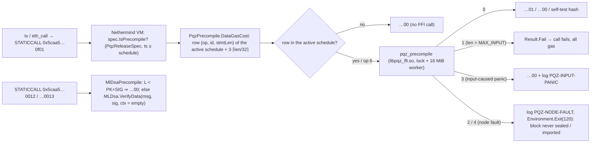

# P6f — E-S3 Nethermind precompiles: `PQZ` (PQZL + PQZH) and ML-DSA-44/65 (EIP-8355 layout), live on chain 7622 — Implementation Plan

> **For agentic workers:** REQUIRED SUB-SKILL: Use superpowers:subagent-driven-development (recommended) or superpowers:executing-plans to implement this plan task-by-task. Steps use checkbox (`- [ ]`) syntax for tracking.

**Goal:** the P6f row of the [P6 roadmap](2026-10-12-p6-roadmap.md), widened by the owner grant of 2026-10-14
(TODO.md "P6f live on chain 7622"): a Nethermind plugin `Nethermind.Pqz` that adds the one `PQZ` precompile (both
proof systems through `pqz-ffi`'s C ABI) and the ML-DSA-44 / ML-DSA-65 precompiles in the EIP-8355 layout, at
addresses outside the EIP-1352 range, priced by a calibrated deterministic table frozen in the chainspec; a local image
`scaas/nethermind-pqz:1.39.0-pqz1` (never pushed); tested on a throwaway copy of chain 7622, then **run for real on
the live chain 7622** with timestamped backups, health checks, the self-test and e2e on the live chain, and a rehearsed
rollback. Gate: **pq-zether.md §10 steps 1–2 and 5 pass on the copy**, then the live roll-out (§10 steps 3–4).
Not here: `PqzToken`, `UAPqzVerifier`, the UA registry redeploy (P6g); the node's `pqz` profile and `pqz_call` (P6i);
a follower node on the live chain (owner step, rehearsed here); chain 22776 (owner step).

**Architecture:** a plugin, no Nethermind patch. Nethermind 1.39.0 already lets a plugin replace the precompile table
(`IPrecompileProvider`) and the spec provider (`ISpecProvider`) — Taiko and Optimism do exactly that — and discovers a
plugin's `IChainSpecEngineParameters` class in the chainspec's `engine` object. The plugin reads a strict
`engine.Pqz` section (gas schedules with activation timestamps), adds the three addresses to the release spec's
precompile set from the first schedule's timestamp, and forwards each call: `PQZ` to `pqz_precompile` (P/Invoke into
`libpqz_ffi.so`), ML-DSA to .NET 10's `System.Security.Cryptography.MLDsa` (OpenSSL in the base image).

**Tech stack:** C# 14 / .NET 10 (the image's runtime `aspnet:10.0.9-resolute`; build SDK
`mcr.microsoft.com/dotnet/sdk:10.0.301-resolute@sha256:196f61c6…26da44`, the one Nethermind 1.39.0's own Dockerfile
pins), the plugin compiled against the **assemblies extracted from the pinned image** (no Nethermind source build),
NUnit for tests, `pqz-ffi` (Rust 1.97.1, merged on `main`), Docker (BuildKit, local only), Foundry `cast` / `forge`,
Python 3 stdlib (`python3 -I`) for the e2e driver.

**Spec:** [pq-zether.md](../../contracts/pq-zether.md) CTR-PQZ-10 (§9 precompile, never-crash, probing), §9.1 (input,
ops, `OP_SELFTEST`), §9.2 (ML-DSA precompile), CTR-PQZ-11 (§9.3 gas model, block target 80 M within EIP-7934, node
limits), §10 (build, consensus rules, operational steps 1–5, contract self-test); [accounts.md](../../contracts/accounts.md)
CTR-UA-23 (ML-DSA by probe, empty context); [pq-eips-vs-scaas.md](../../research/pq-eips-vs-scaas.md) Q6 (private
addresses); `pqz-core/ffi/README.md` + `pqz_ffi.h` (C ABI, statuses 0–4, thread safety, 16 MiB worker stack, 1 MiB
caller stack); [P6e plan](2026-10-14-p6e-relations.md) D5 (`MAX_INPUT` 393,216), D13 (self-test), D4 (bump rule);
[P6-ANON plan](2026-10-14-p6-anon.md) §8 and D19 (op 7 `R_TXM` through the same precompile, gas per form keyed by
length); decisions.md CTR-PQZ-10 Change lines (both ids, status 3 / 4 split). TODO.md P6 rows: the session-4 mandate
(decisions are controller proposals recorded in decisions.md) and the owner grant "P6f live on chain 7622".

**Base:** `main` at `0807e41` (`pqz-ffi` merged with both ids, the status 3 / 4 split, `OP_SELFTEST`; P6e vectors in
`smartcontracts/vectors/pqz/`). P6e Task 10 (fuzzing, `p6e-a5`) and Task 12 (docs) and P6-ANON op 7 (`p6-anon-s`) are
in flight; this plan takes whatever forms `pqz-ffi` on `main` implements when Task 6 runs (decision D12).

## 1. Survey (2026-10-14): Nethermind 1.39.0 and the live chain (read only)

Source: tag `1.39.0` = commit `14aca2c5202c48a6a46c8d928fe7ed8a898d253e`, cloned as data into the session scratchpad.

| Item | Finding | Where (1.39.0) |
|---|---|---|
| Precompile interface | `IPrecompile`: `BaseGasCost(spec)`, `DataGasCost(input, spec)`, `Run(input, spec) → Result<byte[]>`, `SupportsCaching` (default true), `NormalizeInput`; `IPrecompile<T>` adds a static `Instance` | `Nethermind.Evm/Precompiles/IPrecompile.cs` |
| Precompile table | `IPrecompileProvider.GetPrecompiles()` → `FrozenDictionary<AddressAsKey, CodeInfo>`; default `EthereumPrecompileProvider`; **Taiko and Optimism register their own provider** (`AddSingleton<IPrecompileProvider, …>`) that copies the Ethereum one and adds addresses | `Nethermind.Evm/IPrecompileProvider.cs`, `Nethermind.Blockchain/EthereumPrecompileProvider.cs`, `Nethermind.Taiko/Precompiles/TaikoPrecompileProvider.cs`, `TaikoPlugin.cs:142` |
| Activation | an address is a precompile iff `spec.Precompiles` contains it; `ReleaseSpec.BuildPrecompilesCache()` is **virtual** (Taiko overrides it per flag) | `Nethermind.Specs/ReleaseSpec.cs:125–160`, `CodeInfoRepository.cs:47` |
| Spec provider | `ChainSpecBasedSpecProvider` has virtual `CreateEmptyReleaseSpec()` (:32) and `CreateReleaseSpec(...)` (:217); Taiko / Optimism / Xdc register a subclass as `ISpecProvider`; every `IChainSpecEngineParameters` gets `ApplyToReleaseSpec(spec, block, ts)` (:352) and `AddTransitions(blocks, timestamps)` (fork boundaries, fork id) | `Nethermind.Specs/ChainSpecStyle/ChainSpecBasedSpecProvider.cs`, `IChainSpecEngineParameters.cs` |
| Chainspec sections | `ChainSpecParametersProvider` instantiates **every** `IChainSpecEngineParameters` class found by `TypeDiscovery` (plugin DLLs included: `PluginLoader.Load()` runs before the chainspec loads) whose `EngineName` is a key of `engine`; a class with `SealEngineType = null` is not a seal engine | `ChainSpecParametersProvider.cs`, `Nethermind.Runner/Program.cs:125/233` |
| Unknown keys | `params.*` keys outside the schema are ignored silently (README-chainspec.md "genesis nói dối"; the `eip1108` trap) | — |
| Plugin loading | every `*.dll` in `/nethermind/plugins` into the default ALC; plugin modules are added **after** `NethermindModule`, ordered by `Plugins.PluginOrder` (default `[Clique, Aura, Ethash, Optimism, Shutter, AuRaMerge, Merge, MEV, HealthChecks, Hive]`), the rest alphabetically; Autofac: last registration wins | `Nethermind.Api/Extensions/PluginLoader.cs`, `NethermindRunnerModule.cs` |
| Exceptions in `Run` | **caught**: any exception ⇒ a failed precompile call (all gas, `shouldRevert`), logged; only `DllNotFoundException` (or as inner) ⇒ `Environment.Exit(ExitCodes.MissingPrecompile = 110)`. So throwing from `Run` can never abort block processing | `Nethermind.Evm/VirtualMachine.cs` `ExecutePrecompileCall` (≈ l. 1031–1062) |
| Precompile result cache | `PrecompileCachedCodeInfoRepository` caches `Run` results per block by `(address, input)` when `SupportsCaching` (prewarmer runs txs in parallel ahead of the block) | `Nethermind.Blockchain/PrecompileCachedCodeInfoRepository.cs` |
| Limits (defaults) | `TxPool.MaxTxSize` **131,072** (`SizeTxFilter` ⇒ `MaxTxSizeExceeded`); `Blocks.TargetBlockGasLimit` null; `JsonRpc.MaxRequestBodySize` 30,000,000; `JsonRpc.GasCap` 100,000,000; eth/68 `TransactionsMessage.MaxPacketSize` 102,400 (gossip only; large txs go by hash) | `ITxPoolConfig.cs:46`, `IBlocksConfig.cs:19`, `IJsonRpcConfig.cs` |
| Image | `nethermind/nethermind:1.39.0`, RepoDigest `sha256:8af90a30989c16cb15e087bd250c623c98585e490a25950a75642460d497eae6` (local id `c510c7fb5f1b`); framework-dependent publish on `aspnet:10.0.9-resolute` (Ubuntu 26.04), entrypoint `./entrypoint.sh`, workdir `/nethermind`, plugins in `/nethermind/plugins` | `Dockerfile`, `docker image inspect` |
| .NET ML-DSA | the host's .NET 10.0.12 reference pack has `MLDsa`, `MLDsaAlgorithm`, `MLDsaOpenSsl` (OpenSSL ≥ 3.5 needed on Linux; `SYSLIB5006` experimental IDs present in the assembly, which types carry them is checked in Task 3) | `packs/Microsoft.NETCore.App.Ref/10.0.12` |
| EIP-8355 (pinned `3aea9f36`) | `VERIFY_MLDSA44/65/87` at 0x12/0x13/0x14; input `pk ‖ sig ‖ msg`, no context (always empty); `L < PK_LEN + SIG_LEN` ⇒ 32 zero bytes, never revert; output exactly 32 bytes; gas `BASE + 6·⌈max(0, L − PK − SIG)/32⌉`, BASE 6,500 / 9,000 / 13,500 | `eip-8355.md` §Specification |
| Live chain `/home/dockers/mba-chain-nethermind` | container `mba_chain_node_nethermind` **stopped** (Exited (130)); compose: `nethermind/nethermind:1.39.0`, ports 8545 / 8546 / 30303 on 0.0.0.0, no restart policy, network `mba-net`; `config.json`: Clique signer `0xdE36…46BB` unlocked, `Init.DiscoveryEnabled false`, no `Blocks` / `TxPool` sections, `Plugins {}`, KZG path in the image; `genesis.json`: chainId `0x1dc6`, `gasLimit 0x1000000`, period 5, `gasLimitBoundDivisor 0x400`, Fusaka set incl. 7623 / 7825 / 7934, `maxCodeSize 0x10000` from block 6432; `data/` 406 MB (`nethermind_data/`, `nethermind_data.bak-20260831-090830/`); backup naming `genesis.json.bak-<label>-<YYYYMMDD>`, `docker-compose.yml.bak-091537`; datadir owned by the container user (README: copy / delete through a container) | `ls`, `cat`, `docker ps -a` (read only) |

## 2. Gaps found

- **G1 Throwing cannot abort a block.** CTR-PQZ-10 and `pqz-ffi` say status 4 ⇒ "the host aborts block processing";
  in 1.39.0 every exception from `Run` becomes a failed call, i.e. exactly "treat the input as invalid", sealed into a
  block by the single signer. The host must stop the process (D4).
- **G2 Nethermind ignores what it does not know.** A chainspec `engine.Pqz` section on a stock image, or a misspelt
  key, starts a node without the precompiles and without a warning. The plugin must parse strictly and fail closed;
  §10's probes stay mandatory (D2).
- **G3 Default `TxPool.MaxTxSize` is 128 KiB**; a PQZH transfer input is 345,221 B, a PQZH op 7 M = 4 input 364,841 B.
- **G4 The block gas limit is reached by a ramp.** Clique moves the limit by `parent / 1024` per block: 16,777,216 →
  80,000,000 takes ≈ 1,600 blocks ≈ 2.2 h at 5 s. Nothing needs more than 16,777,216 per tx (EIP-7825), so the e2e
  does not wait for it; the 80 M acceptance check does.
- **G5 The gas formula in CTR-PQZ-11 takes op and length only;** both ids and op 7's forms need `(op, id, stmtLen)`
  rows, and a form that a newer `pqz-ffi` accepts must not become valid in old blocks: the active schedule's rows are
  the allowlist (D6).
- **G6 Cold `OP_SELFTEST` ≈ 83 ms** (`STATUS.md`): priced cold per CTR-PQZ-11 that is ≈ 10 M gas at `t_ecMul` ≈ 50 µs,
  which every `PqzToken.initialize` / `UAPqzVerifier` constructor would pay (D6, R3).
- **G7 The ML-DSA spec text is transitional** (§9.2: `MLDSA65` at `…0F10` with a context field); P6a/P6c already
  sign with the empty context and probe the EIP-8355 layout (`UAMldsaVerifier`, `PqUA.probe`).
- **G8 The live chain has no follower.** §10 step 5 (signer without public RPC, follower + rate limits) is rehearsed on
  the copy; on the live chain it is an owner step (topology change, outside the grant's procedure).

## Global Constraints

- Paths relative to `/home/ha/work/ainative/scaas`; worktree `.claude/worktrees/p6f-impl` on branch `p6f-precompiles`.
  New code under `pqz-core/nethermind/` (with its own `.gitignore`: `bin/`, `obj/`, `ref/`, `*.so`); the test-only
  probe contract under `smartcontracts/evm/test/p6f/`.
- Heavy commands only through `scripts/capped`, one at a time machine-wide: every `dotnet build|test|run` (then
  **`dotnet build-server shutdown`**, or VBCSCompiler keeps the heavy lock), `cargo build`, `docker build` (takes the
  lock; BuildKit runs outside the scope, so the Dockerfile caps itself: `cargo build -j 2`, `dotnet publish -m:2`),
  the calibration and harness runs. `docker run` of a measurement container adds `--memory 4g --cpus 4`. Long-running
  chain containers (copy, live) are not "heavy commands" and do not hold the lock.
- **The live directory `/home/dockers/mba-chain-nethermind` is touched only in Task 10**, by the runbook, after the
  gate. Before that: read only (`cat`, `ls`, `docker inspect`), and the copy mounts the live `keystore/` and
  `password.txt` read-only (no copies of key material).
- No built binaries in git or on GitHub: the image is local (`scaas/nethermind-pqz:*`, never `docker push`), no
  `.so` / `.dll` committed, `ref/` (assemblies extracted from the image) git-ignored. Run outputs (calibration, harness,
  probes, runbook logs) are text in `pqz-core/nethermind/runs/` (owner: keep experiment code and results).
- All chains are test-only: no migration; blocks produced after a rollback point are discarded by the rollback.
- Commit trailer: `Co-Authored-By: Claude Opus 5.5 <noreply@anthropic.com>` and the session line. Stop every
  background shell and every container the task started (except the live node after Task 10) before reporting.

## Rulings (plan-level defaults, no owner input needed)

- **R1 Same Nethermind binary as today.** The image is `FROM nethermind/nethermind:1.39.0@sha256:8af90a30…7eae6`
  plus the plugin; no upgrade to 1.39.3 in the same roll-out (one change at a time). The plugin compiles against the
  DLLs of that digest (`ref.sh`: `docker create` + `docker cp /nethermind/.` + `docker rm`, never started).
- **R2 One activation for all three precompiles**: the first schedule's `timestamp` activates `PQZ`, `MLDSA44`,
  `MLDSA65` together; there is no separate ML-DSA key.
- **R3 The plugin computes the self-test at start-up** (`OP_SELFTEST` must equal the constant compiled into the plugin
  from `selftest.json`, else the node refuses to start, exit 120), logs the `libpqz_ffi.so` SHA-256 (must equal the
  value baked into the image label), the schedules and the addresses. So no block ever runs the cold self-test.
- **R4 ML-DSA-87 is not built** (no UA kind uses it); adding it later is one class and one schedule key.
- **R5 Probe contract is test-only** (`smartcontracts/evm/test/p6f/`), never in `src/`; it is deployed on the copy
  and, for the live e2e, on 7622 (a test chain). `UAMldsaVerifier` is deployed only on the copy; on 7622 it is
  deployed with the registry in P6g (owner 2026-10-13: deploy once).

## Decisions (controller proposals; recorded in decisions.md in Task 9, "status: controller proposal, owner may override")

| No. | Decision | Recommended choice | Why / cost if wrong |
|---|---|---|---|
| **D1** | Plugin vs patch | **Plugin `Nethermind.Pqz.dll` in `/nethermind/plugins`**: registers `IPrecompileProvider` (Ethereum table + 3) and `ISpecProvider` (`PqzChainSpecBasedSpecProvider : ChainSpecBasedSpecProvider`, `CreateEmptyReleaseSpec() ⇒ new PqzReleaseSpec()`, `BuildPrecompilesCache()` adds the 3 addresses when active), the Taiko pattern; compiled against the image's own DLLs (R1). Enabled iff the chainspec has `engine.Pqz` | 1.39.0 has every hook (§1); no fork of Nethermind to rebase. Cost if wrong: a patch later reuses the same classes |
| **D2** | Chainspec | **`engine.Pqz` = `{"schedules": [{"timestamp": "0x…", "pqz": [{"op", "id", "stmtLen", "gas"}, …], "selftestGas", "mldsa44Gas", "mldsa65Gas"}, …]}`**, parsed by `PqzChainSpecEngineParameters` (`SealEngineType = null`) with `[JsonUnmappedMemberHandling(Disallow)]`: a missing or unknown key, an unsorted or duplicate timestamp, a timestamp ≤ genesis ⇒ start-up error. `AddTransitions` adds every timestamp (fork id). `ApplyToReleaseSpec` casts the spec to `PqzReleaseSpec` — an exception at start-up when another provider won the registration (fail closed) | CTR-PQZ-11 "frozen in the chainspec"; strictness closes G2; schedules let op 7 and a re-price land as a new timestamp without changing old blocks (G5). The spec's `pqzTransitionTimestamp` becomes "the first schedule's timestamp" |
| **D3** | Addresses | **`PQZ` = `0x5caa500000000000000000000000000000000f01`, `MLDSA44` = `0x5caa500000000000000000000000000000000012`, `MLDSA65` = `0x5caa500000000000000000000000000000000013`** ("5caa5" ≈ SCaaS; low bytes = the old `0x…0F01` and EIP-8355's own 0x12 / 0x13). Above 0xffff (EIP-1352), outside RIP-7587's 0x100–0x1ff, the OP / Taiko / Arbitrum system ranges; same addresses on 22776. Task 7/10 check `eth_getCode` / balance / nonce = empty at each before activation | Owner rule (outside EIP-1352, controller picks). Cost if overridden: three constants and the docs, before Task 10 |
| **D4** | Status mapping | **0 ⇒ the 32 bytes; 1 ⇒ `Result.Fail` (call fails, all its gas: the §9.1 revert); 3 ⇒ `…00` + Warn `PQZ-INPUT-PANIC keccak(input)`; 2, 4, any other ⇒ Critical `PQZ-NODE-FAULT status=… keccak(input)` then `Environment.Exit(120)`** — the block is never sealed or imported, nothing is marked invalid, a restart re-processes. Same exit path Nethermind itself uses for a missing precompile library (110). Also from `eth_call` / the prewarmer (a node fault is not input-reachable by design: 144 MiB arena = 1.59 × the adversarial peak) | G1: throwing is swallowed. Cost if wrong: the alternative (a VM patch that rethrows a typed exception) is a Nethermind patch, D1 lost |
| **D5** | ML-DSA implementation | **.NET 10 `MLDsa` (OpenSSL ≥ 3.5 of the pinned base image)**: `MLDsa.ImportMLDsaPublicKey(MLDsa44/65, pk).VerifyData(msg, sig, context: empty)`; EIP-8355 exactly (R4: 44 and 65); `MLDsa.IsSupported` checked at start-up (false ⇒ refuse to start). **Fallback** if not supported or any vector disagrees: RustCrypto `ml-dsa` (Apache-2.0 OR MIT) in `pqz-ffi` behind a second C ABI `mldsa_verify(level, input, len, out)` | No new dependency or licence (OpenSSL Apache-2.0 and .NET MIT already ship in the image); FIPS 204 verify is deterministic; the image digest pins OpenSSL. Cost of the fallback: ≈ +1 agent-day |
| **D6** | Gas | **PQZ: `gas = row.gas + 3·⌈len/32⌉`, row = the active schedule's `(op = input[0], id = input[37..69], stmtLen = be32(input[1..5]))`; no row (short input, unknown op / id / length) ⇒ the schedule's smallest `gas` and `…00` without calling `pqz-ffi` (the rows are the allowlist, G5); op 6 ⇒ `selftestGas` (fixed). `row.gas = 1000·⌈6000 · t_row / t_ecMul / 1000⌉`. `selftestGas` = the smallest row's gas (R3: always a cache hit in a block), not the cold price (CTR-PQZ-11 amended; the cold p99 is measured and recorded). ML-DSA: `max(EIP-8355 BASE, calibrated) + 6·⌈max(0, L − PK − SIG)/32⌉`** | Deterministic in input bytes only, never in validity; per id and per form as the owner asked (decisions.md CTR-PQZ-10, P6-ANON D19). If the owner keeps cold pricing: `selftestGas` = the cold value (≈ 10 M estimate, G6), one number |
| **D7** | Calibration | **Inside the built image on the chain host** (`docker run --rm --memory 4g --cpus 4 --entrypoint dotnet … Calibrate.dll`): `t_ecMul` = median of Nethermind's own `BN254MulPrecompile.Instance.Run` on the EIP-196 vector (same process, same JIT); per row `t_row = max(p99 of 1,000 calls on the row's valid vectors, p99 of 1,000 distinct adversarial inputs)`, adversarial = the row's honest input with one proof bit flipped (PQZL: fails at the last check), the worst `negative.json` rows of that form, and for PQZH the honest proof under a statement with the last word changed; plus 20 fresh proofs per form (variance across witnesses); cold self-test p99 over 200 fresh processes; ML-DSA p99 over the ACVP valid / invalid cases. Output: `runs/<date>-calib.txt` and the `pqz` rows as JSON | CTR-PQZ-11's method, made concrete; same machine as the copy and the live chain. Through `PqzPrecompile.Run`, so the P/Invoke hop is in the number |
| **D8** | Node limits | **`TxPool.MaxTxSize` 1,048,576; `Blocks.TargetBlockGasLimit` 80,000,000; `JsonRpc` defaults kept** (body 30 MB, `GasCap` 100 M); EIP-7623 / 7825 / 7934 unchanged | CTR-PQZ-11 (1 MiB, 80 M); every PQZ input fits; 80 M ⇒ ≤ 8.0 MB calldata per block < EIP-7934's 8,388,608 B |
| **D9** | Result cache | **Keep `SupportsCaching = true`** for all three (the per-block cache saves the prewarmer's verify being repeated by block processing; key = exact input, deterministic). Task 7 records block processing time with and without prewarming | Default behaviour; a status-4 exit happens before anything is cached |
| **D10** | Copy layout | **`scratchpad/p6f-copy/` (git-ignored)**: `data-signer/`, `data-follower/` (two copies of the live `data/nethermind_data`, made through an `alpine:3` container with the source mounted `:ro`, only while the live container is stopped), `genesis.json` (live copy + `engine.Pqz`), `config.signer.json` / `config.follower.json`, compose project `pqzcopy` on its own network: signer (no published ports, mining), follower (static peer = signer, `127.0.0.1:18545` behind `nginx:1.27-alpine` with `limit_req` 10 r/s + burst 20 and `limit_conn` 8 on `eth_call` / `eth_estimateGas`) | Gate needs §10 step 5 on the copy; never peers with the live node (other network, no published p2p) |
| **D11** | Live scope | **The grant's procedure only**: image swap, `engine.Pqz`, `config.json` limits, start, self-test, e2e, watch; rollback = restore the four backups. Follower + rate-limit proxy on the live chain: owner step (rehearsed configs ready) | Topology is not in the grant (G8) |
| **D12** | Forms in pqz1 | **The forms `pqz-ffi` on `main` implements when Task 6 runs** (today: six relations + REFRESH + AUDITOR for both ids = 12 rows, 6 per id: op 1 auditor on / off, op 2, op 3, op 4, op 5; REFRESH and AUDITOR share their op's length, so their row takes the max of both forms); op 7 `R_TXM` rows join when P6-ANON merges, as a **second schedule** (new timestamp) with a new image `-pqz2`, same runbook; op 7 lengths at `MAX_INPUT` are already admitted by D8 | Owner wants it live now; schedules (D2) make the second activation a config edit plus an image |
| **D13** | Image | **`scaas/nethermind-pqz:1.39.0-pqz1`**: `FROM` the pinned digest; stage 1 `rust:1.97.1-bookworm@sha256:<pinned in Task 5>` builds `libpqz_ffi.so` (`--release`, no `prove`, no `test-hooks`); stage 2 the pinned SDK builds the plugin against `/nethermind` of the base image; final: `/nethermind/plugins/{Nethermind.Pqz.dll, libpqz_ffi.so, NOTICE-pqz.txt}`; labels `scaas.pqz.commit`, `scaas.pqz.ffi.sha256`, `scaas.pqz.selftest`. Built locally, never pushed (owner) | Same base and runtime as today (R1); the label pins what the plugin checks at start-up (R3) |
| **D14** | Monitoring | **Log tags + exit code + one script**: `PQZ-START` (sha256, selftest, schedules, addresses), `PQZ-INPUT-PANIC` (Warn), `PQZ-NODE-FAULT` (Critical, then exit 120); `pqz-core/nethermind/chain/watch.sh <container> <rpc>` prints block height / age, `gasLimit`, the container's state and last exit code, and counts the tags in `docker logs --since`; run by the operator (or cron) — no restart policy change, a node fault stops the chain visibly | Smallest thing that shows a fault; Prometheus not needed for one node |
| **D15** | Live timing | **Live roll-out as soon as the copy gate passes**, not waiting for P6e gate A / B: the vectors' proof bytes are already fixed (P6e Task 11 merged); a later engine change (Task 10 fuzz fix, op 7, freeze) is a new schedule + image by the same runbook (all chains test-only) | Owner grant: run it for real; the runbook is rehearsed |

## Review Focus

- **Never a wrong verdict sealed.** Status 2 / 4 can only exit; status 3 only `…00`; a missing or disabled plugin
  with an `engine.Pqz` section must not start (Task 1 test); a stock image ignores `engine.Pqz` — the probes catch it
  (Task 7 runs the stock image against the patched chainspec once and shows the probe failing).
- **Gas is a function of bytes, never of validity.** Same `(op, id, stmtLen)` with a valid and an invalid proof ⇒ the
  same gas, through `gasleft()` in the probe contract (Task 7); misses priced at the smallest row.
- **History is unchanged before the first timestamp.** Before T the addresses are empty accounts (call succeeds with
  empty output) and `spec.Precompiles` equals the stock set (Task 1 test; Task 7 probe before T).
- **The P/Invoke boundary.** Pinning, `len = 0`, `len = MAX_INPUT` and `+ 1`, concurrent calls from 8 threads with
  GC pressure, the 1 MiB caller-stack rule (Task 4).
- **ML-DSA exactness.** EIP-8355 short-input rule, empty context, every ACVP sigVer case, no exception for any input
  (Task 3); `UAMldsaVerifier`'s probe accepts the new address (Task 7).

## Tasks

### Task 1: Reference assemblies, plugin skeleton, chainspec section, spec and precompile providers (D1, D2, R1–R3) — heavy build

**Files:** `pqz-core/nethermind/{.gitignore,README.md,ref.sh}`, `Nethermind.Pqz/{Nethermind.Pqz.csproj,PqzPlugin.cs,
PqzChainSpecEngineParameters.cs,PqzReleaseSpec.cs,PqzChainSpecBasedSpecProvider.cs,PqzPrecompileProvider.cs,
Addresses.cs}`, `Nethermind.Pqz.Test/{Nethermind.Pqz.Test.csproj,SpecTests.cs,chainspecs/*.json}`.

- [ ] `ref.sh`: extract `/nethermind/*.dll` from the pinned digest into `ref/` (git-ignored), print the digest; the
  csproj references `ref/Nethermind.*.dll` and `Autofac.dll` with `Private=false` (nothing of Nethermind is copied
  into the plugin output).
- [ ] `PqzPlugin : INethermindPlugin` (`Name "Pqz"`, `Enabled` iff `chainSpec.EngineChainSpecParametersProvider`
  holds `PqzChainSpecEngineParameters`); `Module`: `AddSingleton<ISpecProvider, PqzChainSpecBasedSpecProvider>()`,
  `AddSingleton<IPrecompileProvider, PqzPrecompileProvider>()`; `Init`: resolve both and assert they are ours, run R3
  (self-test via Task 2's class, SHA-256 of the library, `MLDsa.IsSupported`), log `PQZ-START`.
- [ ] `PqzChainSpecEngineParameters` per D2 (strict); `PqzReleaseSpec : ReleaseSpec` with `ActiveSchedule` (null
  before the first timestamp) and `BuildPrecompilesCache()` = base + the 3 addresses when active.
- [ ] Tests (chainspecs = the live `genesis.json` + `engine.Pqz` variants): before T `Precompiles` equals the stock
  set, at T and after it contains exactly the 3 more; two schedules switch at the second timestamp; fork-id
  transitions include each timestamp; unknown key / missing key / unsorted / duplicate / T ≤ genesis ⇒ exception;
  a container built with the stock `ChainSpecBasedSpecProvider` and `engine.Pqz` present ⇒ the cast in
  `ApplyToReleaseSpec` throws (fail closed); without `engine.Pqz` the plugin is disabled and the spec is the stock one.
- [ ] Heavy, capped: `dotnet test` (then `dotnet build-server shutdown`).
- **Acceptance:** green; `Nethermind.Pqz.dll` references only `ref/` assemblies and the framework.

### Task 2: `PqzPrecompile` — P/Invoke, statuses, gas rows (D4, D6) — heavy build

**Files:** `Nethermind.Pqz/{PqzPrecompile.cs,Native.cs,SelfTest.cs}`, `Nethermind.Pqz.Test/{PqzPrecompileTests.cs,
VectorFiles.cs}`; `pqz-core/ffi` unchanged.

- [ ] `Native.cs`: `[LibraryImport("pqz_ffi")] static partial int pqz_precompile(byte* input, nuint len, byte* out,
  nuint outLen)`; a `NativeLibrary.SetDllImportResolver` that loads exactly `<plugin dir>/libpqz_ffi.so` (no search
  path); input pinned with `fixed` over the `ReadOnlyMemory<byte>` span (empty span ⇒ null pointer, `len = 0`).
- [ ] `PqzPrecompile : IPrecompile<PqzPrecompile>`: `Address` (D3), `Name "PQZ"`, `BaseGasCost` 0,
  `DataGasCost` = D6 (reads only `input[0]`, `input[1..5]`, `input[37..69]`; never throws on a short input), `Run`:
  op 6 ⇒ FFI (cached inside `pqz-ffi`); row present ⇒ FFI; else `…00`; status per D4. Logging through Nethermind's
  `ILogManager` (set in `Init`).
- [ ] Tests (host, the `pqz-ffi` cdylib built from `main` without `test-hooks`): every row of `proof_pqzl.json`,
  `proof_pqzh.json`, `fee0.json` ⇒ `…01` and one-bit-flipped ⇒ `…00`; every `negative.json` input ⇒ its expected
  output (`MAX_INPUT + 1` ⇒ `Result.Fail`); `selftest.json` hash; gas of each row and of misses per D6, valid and
  invalid inputs of a row ⇒ equal gas; a row absent from the active schedule ⇒ `…00` without an FFI call (counter).
- [ ] Status 2 / 4 path: `tests/fault` child process with a `test-hooks` build of `pqz-ffi` (`TEST_FAIL_WORKER`)
  through `PqzPrecompile.Run` ⇒ the child exits 120 with `PQZ-NODE-FAULT` on stderr; the `test-hooks` library is
  built into `bin/test-hooks/` only and never reaches the image (Task 5 checks the symbol names are absent).
- [ ] Heavy, capped: `cargo build --release` in `pqz-core/ffi` (cdylib for tests), `dotnet test`, then
  `dotnet build-server shutdown`.
- **Acceptance:** green; every vector through the C# class equals the vector's expectation.

### Task 3: ML-DSA-44 / -65 precompiles (D5, R4) — heavy build

**Files:** `Nethermind.Pqz/MlDsaPrecompile.cs` (one class per level, shared code), `Nethermind.Pqz.Test/MlDsaTests.cs`.

- [ ] Per EIP-8355: `L < PK + SIG` ⇒ `…00`; else verify `(pk, sig, msg = input[PK+SIG..])` with the empty context;
  output always 32 bytes; gas per D6. No `catch` in the class: any exception goes to Nethermind (failed call), and the
  harness (Task 4) shows no input reaches one.
- [ ] Check (light, in the test run log): `MLDsa.IsSupported` on the host and inside the base image
  (`docker run --rm --entrypoint dotnet` of a 10-line check against the image's runtime, no node started), the
  image's `openssl version`, and whether `MLDsa` carries `SYSLIB5006` (then `NoWarn` it in the csproj with a comment).
- [ ] Tests: `pq_external.json` `acvp_mldsa` (60 cases; external-interface cases through `VerifyData`, internal
  `mprime` cases through `μ = SHAKE256(SHAKE256(pk, 64) ‖ M')` and the external-μ API if .NET exposes it, else
  skipped and listed), `eip8355` (3), `pq_signatures.json` ML-DSA rows (the UA `pq_msg` path), every length from 0 to
  `PK + SIG + 33`, a 1-bit flip in each of pk / sig / msg ⇒ `…00`.
- [ ] If `IsSupported` is false or any case disagrees: stop, apply the D5 fallback as its own sub-task (crate
  `ml-dsa` pinned, `mldsa_verify` in `pqz-ffi`, the same tests through P/Invoke), G-LIC row added.
- [ ] Heavy, capped: `dotnet test`, `dotnet build-server shutdown`.
- **Acceptance:** every case equals its expectation; gas = EIP-8355 at minimum.

### Task 4: P/Invoke boundary harness (CTR-PQZ-10 "P/Invoke harness under the .NET host") — heavy run

**Files:** `pqz-core/nethermind/Harness/{Harness.csproj,Program.cs}`, `runs/<date>-harness.txt`.

- [ ] Inputs: every vector input, each with random edits (bit flips, byte runs, truncation, extension, length field
  edits, op / id swaps), uniform random bytes of random length 0..`MAX_INPUT + 1`, the ML-DSA vectors with edits;
  through `PqzPrecompile.Run` / `MlDsaPrecompile.Run` (not the C ABI directly).
- [ ] Oracle: no exception, no process fault; PQZ output exactly `…00`, `…01` or the self-test hash; status 1 only
  for `len > MAX_INPUT`; status 3 count = 0 expected (reported); same input ⇒ same output and same gas; the
  number of `…01` equals the number of unedited honest inputs.
- [ ] 8 threads at once with a GC-pressure thread (`GC.Collect` + large allocations, so pinned buffers must not move),
  and a run on a thread with a 1 MiB stack.
- [ ] Heavy, capped: 10 min smoke, then 1 h (`--minutes 60`).
- **Acceptance:** 1 h clean; counts recorded (inputs, per output, per thread).

### Task 5: Image `scaas/nethermind-pqz:1.39.0-pqz1` (D13, R1) — heavy

**Files:** `pqz-core/nethermind/{Dockerfile,build-image.sh,NOTICE-pqz.txt}`, `docs/research/pqz-licence-inventory.md`
(rows: `Nethermind.Pqz` — repo licence; Nethermind LGPL-3.0 runtime, image local only; OpenSSL Apache-2.0 / .NET MIT
for ML-DSA; `pqz-ffi` as inventoried).

- [ ] Dockerfile per D13, every `FROM` pinned by digest, `cargo build --release --locked -j 2` (no `prove`, no
  `test-hooks`), `dotnet publish -c Release -m:2` against `/nethermind` of the base image, labels; `build-image.sh`
  runs `ref.sh`, the build, then prints `docker image inspect` (id, labels) into `runs/<date>-image.txt`.
- [ ] Checks in the script: `libpqz_ffi.so` in the image has the label's SHA-256; `nm -D` shows no `test_` / hook
  names and no GMP / MPFR / HEXL (`glic/absence.sh` on the extracted `.so`); `docker run --rm <image> --version`
  (exits immediately, no chain) prints Nethermind 1.39.0.
- [ ] Heavy, capped: `build-image.sh pqz1`.
- **Acceptance:** image present locally, labels set, checks green; nothing pushed (`docker image ls` shows no remote
  repo for it).

### Task 6: Gas calibration (D6, D7) — heavy run on the chain host

**Files:** `pqz-core/nethermind/Calibrate/{Calibrate.csproj,Program.cs}` (built into the image's `/opt/pqz-calibrate/`
by a second Dockerfile target `calib`, not into the node image), `chain/engine-pqz.json` (written), `runs/<date>-calib.txt`.

- [ ] Rows: every `(op, id, stmtLen)` that `pqz-ffi` on `main` accepts (D12), each with its valid vectors, the D7
  adversarial set and 20 fresh proofs (the `prove` feature, in the calib target only).
- [ ] Measure per D7; write the table (`t_ecMul`, per row p50 / p99 valid, p99 adversarial, `t_row`, `gas`), the cold
  self-test p50 / p99 (200 fresh processes), ML-DSA p99, and `engine-pqz.json` (`pqz` rows, `selftestGas` = smallest
  row, `mldsa44Gas` / `mldsa65Gas` per D6; `timestamp` filled in by the runbook).
- [ ] Sanity: every `t_row` ≤ 60 ms (CTR-PQZ-09 verify limit); every row's gas + its calldata floor ≤ 16,777,216 for
  a direct transaction (the PQZH transfer: ≈ 13.8 M floor + gas); report the largest PQZ call that does not fit as a
  P6g note (contract-built statements are smaller).
- [ ] Heavy, capped: `docker build --target calib`, `docker run --rm --memory 4g --cpus 4 … calibrate` (≈ 1 h incl.
  fresh proofs).
- **Acceptance:** table and JSON written from **one** calibration run (owner 2026-10-15: "P6f đo gas một lần";
  the earlier two-runs-on-different-days rule is withdrawn — re-calibrate before 22776 or if a later measurement
  disagrees by more than 15 %).

### Task 7: Throwaway copy, probes, probe contract, e2e (D10, §10 steps 1–2) — heavy (long runs)

**Files:** `pqz-core/nethermind/chain/{copy.sh,patch-chainspec.py,docker-compose.copy.yml,config.signer.json,
config.follower.json,nginx-rpc.conf,probe.sh,e2e.py,watch.sh}`, `smartcontracts/evm/test/p6f/{PqzPrecompileProbe.sol,
PqzPrecompileProbe.t.sol}`, `runs/<date>-copy-*.txt`.

- [ ] `PqzPrecompileProbe.sol`: `call(address target, bytes calldata input) returns (uint256 word, uint256 gasUsed,
  uint256 rlen)` (`gasleft()` around one `staticcall`, returndata length kept) and `check(…)` (same, as a transaction,
  emits `Probed(target, keccak256(input), word, gasUsed, rlen)`); forge test with `vm.etch` mocks (1 / 0 / empty /
  64-byte answers).
- [ ] `copy.sh`: refuse unless the live container is stopped; `alpine:3` copy of the live `data/nethermind_data` (`:ro`)
  into `data-signer/` and `data-follower/`; `patch-chainspec.py <live genesis> <engine-pqz.json> <timestamp>` writes the
  copy's `genesis.json` (and prints the diff: exactly one added `engine.Pqz` key); configs = live `config.json` + D8
  limits (+ follower: `Mining.Enabled false`, static peer); compose per D10, keystore and password mounted `:ro` from
  the live directory.
- [ ] Stock-image check first: start the signer with `nethermind/nethermind:1.39.0` and the patched chainspec, run
  `probe.sh` after T ⇒ the probe **fails** (empty answers) — the G2 demonstration; stop; wipe the copy; copy again.
- [ ] Step 1: start signer + follower with `-pqz1`, T = start + 10 min; logs show `PQZ-START`. Before T: `eth_getCode`
  / balance / nonce of the 3 addresses empty, `call` returns `rlen = 0`.
- [ ] Step 2 (`probe.sh`, after T, through the follower): genesis hash `0x24e43dcb…c464`; `eth_chainId` `0x1dc6`;
  `OP_SELFTEST` = `ed910a2c…d205`; for every row: valid ⇒ 1, one-bit flip ⇒ 0, `gasUsed` = formula + the warm
  `STATICCALL` cost (100), equal for valid and invalid; misses at the smallest row; ML-DSA EIP-8355 / ACVP /
  `pq_signatures` 1 / 0 at both addresses with EIP-8355 gas at minimum.
- [ ] `e2e.py` (transactions through the follower, mined by the signer): deploy the probe; `check` for every proof row
  of both ids + `fee0.json` rows (events = expectations); the largest inputs (PQZH transfer 345,221 B) sent directly
  to `PQZ` as transactions (> 128 KiB: exercises `TxPool.MaxTxSize`; `gasUsed` = the EIP-7623 floor);
  `UAMldsaVerifier(0x0130, MLDSA44, valid, flipped)` and `(0x0131, MLDSA65, …)` deployed ⇒ `PRECOMPILE()` = the
  address, and `verify` of a `pq_signatures.json` row through it ⇒ true; record gas, block processing times (node
  log), and the same with `Blocks.PreWarmStateOnBlockProcessing false` once (D9).
- [ ] Heavy, capped: `forge test --match-path test/p6f/*`; the copy itself runs as containers (not capped).
- **Acceptance:** every probe and e2e expectation met, logs in `runs/`; stock-image probe failure recorded.

### Task 8: Rehearsal on the copy: §10 step 5, gas ramp, fault drill, rollback (gate) — light work, long wait

**Files:** `pqz-core/nethermind/README.md` (§Runbook, written from what is executed here), `runs/<date>-rehearsal.txt`.

- [ ] Step 5: the signer has no published port; the follower's RPC only through nginx; a burst of 200 `eth_call` to
  `PQZ` (PQZH transfer) from 4 clients ⇒ 429 beyond the limit, signer block interval stays 5 s ± 1 s.
- [ ] Ramp: `watch.sh` until `gasLimit` = 80,000,000 (≈ 2.2 h), then one block filled with PQZ transfers (≤ 8.0 MB
  calldata, accepted).
- [ ] Fault drill: `docker kill -s KILL` the signer during a burst of PQZ transactions; restart; the chain continues,
  the follower agrees on every block hash, no `PQZ-NODE-FAULT` / `PQZ-INPUT-PANIC` in the logs (a SIGKILL is harsher
  than the exit 120 of D4).
- [ ] Rollback rehearsal = the live runbook on the copy: timestamped backups (`genesis.json`, `config.json`,
  compose file, data dir via `alpine:3 cp -a`) taken before step 1 are restored, the stock image starts, head hash =
  the hash recorded before step 1.
- [ ] Gate checklist (below) ticked in the run log; stop and remove the copy's containers (data kept until Task 10 is
  accepted, then removed through a container).
- **Acceptance:** the gate.

### Task 9: Docs and decisions — light

**Files:** `docs/contracts/pq-zether.md` (CTR-PQZ-10: plugin, addresses D3, status mapping D4; §9.1 address; §9.2
→ "`MLDSA44` / `MLDSA65`, EIP-8355 layout and gas, empty context", transitional text removed; CTR-PQZ-11: per-row
formula, schedules as allowlist, `selftestGas` D6, the measured table, limits D8; §10: plugin build, chainspec
`engine.Pqz`, runbook link, step 5 status), `docs/contracts/accounts.md` (CTR-UA-23: 7622's ML-DSA addresses),
`docs/research/pq-eips-vs-scaas.md` (Q6 closed by D3), `docs/networks/evm.md` (§2: precompiles live, addresses,
image), `docs/node/ops.md` (pqz section: `TxPool.MaxTxSize`, 80 M, `watch.sh`, exit 120), `docs/decisions.md`
(Change lines, each "status: controller proposal, owner may override": CTR-PQZ-10 — D1, D3, D4, D5, D13; CTR-PQZ-11 —
D2, D6, D7, D8; CTR-UA-23 — D3, D5), `pqz-core/nethermind/README.md`, roadmap P6f row (status).

- [ ] `python3 scripts/docs_check.py check` → 0 errors.
- **Acceptance:** clean; every decision of this plan is in decisions.md with its status.

### Task 10: Live roll-out on chain 7622 (owner grant 2026-10-14) — operational

**Files:** `runs/<date>-live.txt` (every command and output), the live directory per the runbook.

- [ ] Preconditions: gate passed; image id = the one Task 8 used; the live container stopped (`docker inspect` state);
  no other consumer is mid-job (bamboo-dms / scaas-node told: chain stopped meanwhile — owner informed in the report).
- [ ] Backups, `TS=$(date +%Y%m%d-%H%M%S)`: `genesis.json.bak-pqz-$TS`, `config.json.bak-pqz-$TS`,
  `docker-compose.yml.bak-pqz-$TS`, `data/nethermind_data.bak-pqz-$TS` (alpine `cp -a`); `sha256sum` of the three
  files and `du -s` of both data dirs in the log; the rollback head (number, hash) is the one `copy.sh` recorded from
  the same data (the live node has been stopped since the copy; if it ran meanwhile, redo Task 7's copy step first).
- [ ] Edit: `genesis.json` += `engine.Pqz` (`patch-chainspec.py`, T = planned start + 15 min), `config.json` += D8,
  compose `image: scaas/nethermind-pqz:1.39.0-pqz1`; `diff` of each against its backup in the log.
- [ ] Start (`docker compose up -d blockchain-node`); health: `PQZ-START` line (sha256, selftest, schedule, addresses),
  head = recorded head + new blocks every 5 s, `eth_chainId`, genesis hash; before T the 3 addresses are empty.
- [ ] After T: `probe.sh` and `e2e.py` against `127.0.0.1:8545` (the probe contract deployed on 7622, R5).
- [ ] Watch: `watch.sh` hourly for 24 h (cron line in the log or manual): no exit, no `PQZ-NODE-FAULT`, `gasLimit`
  reaches 80 M.
- [ ] Rollback (only on a failed check): `docker compose down`; restore the four backups (data through `alpine:3`:
  `rm -rf` the live dir, `cp -a` the backup); start the stock image; head hash = the recorded one; report.
- **Acceptance:** probes and e2e green on 7622; 24 h watch clean; backups kept (not deleted; owner decides).

## Order, effort, gate

Order: **1 → 2 → 3 → 4 → 5 → 6 → 7 → 8 (gate) → 9 → 10.** Task 3's code may be written during Task 2's capped runs;
heavy runs stay serial machine-wide. Task 9 may start after Task 6 (numbers) and finishes after Task 10.

| Task | Effort (agent-days) | Heavy compute (capped) / wall time |
|---|---|---|
| 1 plugin skeleton, chainspec, providers | 2 | dotnet builds |
| 2 `PqzPrecompile` | 1.5 | cargo + dotnet |
| 3 ML-DSA | 1 (+1 if fallback) | dotnet |
| 4 harness | 1 | 1 h run |
| 5 image | 1 | docker build ≈ 20 min |
| 6 calibration | 1.5 | ≈ 1 h (one run, owner 2026-10-15) |
| 7 copy, probes, e2e | 2.5 | copies, containers |
| 8 rehearsal (gate) | 1 | ≈ 3 h wall (ramp) |
| 9 docs | 1 | — |
| 10 live | 0.5 | 24 h watch |
| **Total** | **≈ 13** (+1 fallback) | **≈ 3 h capped + ≈ 1 day wall** |

**Gate (on the copy):** §10 step 1 (image, copy started with a future timestamp, before-T probe empty); step 2 (genesis
hash, self-test hash, gas = formula for every row and equal for valid / invalid, every vector 1 / 0, ML-DSA both
levels, `UAMldsaVerifier` probe accepted); step 5 (signer without published RPC, follower behind the rate limit,
burst test); plus the stock-image probe failure, the e2e transactions incl. a > 128 KiB one, the 80 M ramp, the kill
drill and the rollback rehearsal. **Then** Task 10 on the live chain (§10 steps 3–4).

## Owner steps

1. Review D1–D15 (controller proposals; D3 addresses and D6 `selftestGas` are the ones that change contract-facing
   constants — override before Task 10 costs a constant).
2. Live follower node + rate-limited public RPC on chain 7622 (§10 step 5; configs from Task 8 ready) — until then
   the signer's RPC on `0.0.0.0:8545` is the only RPC and free `eth_call`s to `PQZ` compete with block processing for
   the `pqz-ffi` lock.
3. Restart policy for `mba_chain_node_nethermind` (none today; with D4 a node fault stops the chain until restarted).
4. When to delete the `*.bak-pqz-*` backups and the copy's data.
5. Chain 22776 genesis (owner step): put `engine.Pqz` in from genesis (timestamp > genesis), same addresses.
6. G-LIC written clearance and the external audit before any public or commercial use (unchanged).

## Risks

- **Silent non-activation** (G2): stock image or a lost plugin ⇒ addresses are empty accounts. Mitigated by strict
  parsing, the start-up cast, `PQZ-START`, and the probes; contracts fail closed (§10 consensus rules).
- **Exit 120 loop = chain halt** if a node fault repeats (e.g. arena reservation failing under host memory pressure:
  the host also runs Odoo, Postgres, MSSQL). Visible by design; `watch.sh`; RocksDB consistency after an abrupt stop
  is shown by the kill drill.
- **`eth_call` CPU spam on the single node** (owner step 2): each PQZL verify holds the lock ≈ 8–12 ms.
- **OpenSSL without ML-DSA** in the base image ⇒ D5 fallback (+1 day).
- **Direct-tx size edge:** a PQZH op 7 M = 4 input as a direct transaction is ≈ 14.6 M floor + gas, close to
  16,777,216; contract-built statements (P6g) are smaller. Task 6 reports the exact margin.
- **Cold pricing override** (G6): ≈ 10 M `selftestGas` would weigh on P6g's constructors.
- **Plugin order:** another enabled plugin registering `ISpecProvider` later would win — the start-up assertion
  refuses to run.
- **Discarded blocks on rollback** (test chain, accepted).

## Open questions (not blocking)

- A Nethermind upgrade (1.39.3 or later) is a separate roll-out: re-extract `ref/`, rebuild, rerun Tasks 1–7.
- Whether P6g needs the `R_TXM` self-test pair (P6-ANON §8: proposal not needed).
- Prometheus metrics for the plugin, if a dashboard is wanted later.

## Out of scope (next)

P6g (`PqzToken`, `UAPqzVerifier`, registry redeploy with `MLDSA44` / `MLDSA65` as the probe candidates), P6i (`pqz`
profile, `has_pqz_precompile`, `pqz_call`, gateway limits), op 7 rows (second schedule after P6-ANON), chain 22776,
customer chains (co-processor seam, E-S9).
