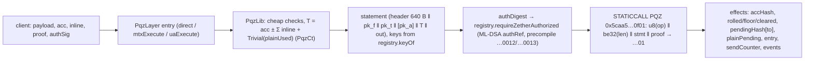

# P6g — E-S4 contracts: `PqzSafety`, `PqzCt`, `UAPqzVerifier`, the `*_PQZ` token kinds, deploy and e2e on the SCaaS testnet — Implementation Plan

> **For agentic workers:** REQUIRED SUB-SKILL: Use superpowers:subagent-driven-development (recommended) or superpowers:executing-plans to implement this plan task-by-task. Steps use checkbox (`- [ ]`) syntax for tracking.

**Goal:** the P6g row of the [P6 roadmap](2026-10-12-p6-roadmap.md): the PQZ contracts on the finished token tree —
`PqzSafety` (allowlist + precompile self-test), `PqzCt` (ciphertext arithmetic), `UAPqzVerifier` (the `pqz-mlwe`
0x0142 kind through the `PQZ` precompile op 3), the PQZ layer (`PqzLayer` + `PqzLib`) on `MetaTokenBase` with the kinds
`NONE_PQZ` / `UNDERLYING_PQZ` (CTR-PQZ-15/21/22/23/24), `OpenFactory.pqzEnabled`; forge tests with the precompile
mocked and real ciphertext arithmetic; then the owner mandate of 2026-10-15 (TODO.md): **deploy on the SCaaS testnet** (UA
registry generation 1 with `UAMldsaVerifier` on the `MLDSA44` / `MLDSA65` precompiles and `UAPqzVerifier`, the factory,
the implementations, tokens) and an **e2e with real proofs** — register, shield, transfer, rollover, burn, refresh,
disclose, both relaying paths — with every gas figure measured and logged in `runs/`.
Not here: op 7 `R_TXM` entry points (after P6-ANON S3–S8, D8), the clients' `pqz-cli` / WASM prover (P6h), the node's
`pqz` profile and keeper (P6i), chain 22776 (owner).

**Architecture:** classical Zether's shape, one-to-one (D1). `PqzLib` is an external library (ERC-7201 `scaas.pqz`)
holding the state and the logic (statements, checks, the precompile call, account updates, entries, disclosure);
`PqzLayer` (abstract, on `MetaTokenBase`) holds the entry points and views; `NoUnderlyingPqzToken` and
`UnderlyingPqzToken` combine it with the public tiers exactly as `NoUnderlyingZetherToken` / `UnderlyingZetherToken`
do. Ciphertexts live in calldata and events, hashes in storage (CTR-PQZ-07); public amounts are `plainPending`
(CTR-PQZ-06). The contract builds every statement from storage, the registry's stored keys and calldata, hashes it into
`authDigest`, checks the PQ `authSig` through `registry.requireZetherAuthorized(…, zkCovered = true)` and then calls
`PQZ(op, stmt ‖ proof)`; a word other than exactly `…01` reverts `ProofRejected`.

**Tech stack:** Solidity 0.8.37 (`osaka`), Foundry (`forge test`, `vm.mockCall`), Python 3 stdlib for the e2e
driver (`python3 -I`; `eth.py` from P6f for legacy EIP-155 signing — calldata of 100–300 KB cannot pass `cast`'s
argv), `pqz_kat.py` (P6e) for KeyGen / Enc / witnesses, a `pqz-ffi` example under `--features prove` for proofs,
Node 26 with `@noble/post-quantum` 0.7.1 (`clients/clientkeys/node_modules`) for ML-DSA signatures.

**Spec:** [pq-zero-knowledge.md](../../contracts/pq-zero-knowledge.md) §5 (encodings), CTR-PQZ-13 / -12 (kind, `authRef`), §7.1–7.11
(state, register, fund, transfer, burn / refresh, rollover, statement layout, events, disclosure, authorization,
meta-transactions), §8.1 (serialization v1: byte layouts, opTags, ids), §9.1–9.4 (precompile, gas, contracts list,
selectors, errors); [accounts.md](../../contracts/accounts.md) §1.8 (register), CTR-UA-17/23 (verifiers, ML-DSA by probe);
decisions.md CTR-PQZ-01…24 with their Change lines; the [P6c plan](2026-10-13-p6c-pq-kinds.md) C6-1 / C6-10 (the
`pqz-mlwe` slot, the `< q` key check left to P6g) and the [P6f plan](2026-10-14-p6f-precompiles.md) (addresses, gas
rows, live chain). HANDOFF.md 2026-10-16 "p6g": the eight design notes, recorded below as D1–D8.

**Base:** `main` at `b6185dd` (P6f live on the SCaaS testnet, Tracks L / H merged). The SCaaS testnet runs `scaas/nethermind-pqz:1.39.0-pqz1`
with the precompiles from block 0, `maxCodeSize` 0x10000 from block 0, gas limit ramping 16.8 M → 80 M; funded test
keys `0x…01`–`0x…04` in genesis. P6-ANON S3 is in flight in `pqz-core/stmt` and `pqz-core/ffi` (another agent): this
plan only adds one example file there and touches nothing else.

## 1. Survey (2026-10-16)

| Item | Finding |
|---|---|
| Registry | `UARegistry` gen 1 has slot `_CFG18` for `pqz-mlwe` (P6c): stored 16,384-byte `pk` (`keyPtr` SSTORE2), `_checkPqzAuthRef` (PQ-only `authRef`, PQ-dominant `msig`), PoP by `IUAPopVerifier.verifyPop(pk, message, pop)` capped at the kind's `verifyCap`; `requireZetherAuthorized(ua, digest, auth, true)` runs `requireAuthorized(authRef, PURPOSE_ZETHER_AUTH, …)`; `keyOf(ua)` returns the stored key. `UAKinds.isZether` covers 0x0142. Nothing to change. |
| ML-DSA | `UAMldsaVerifier(kind, candidate, probeValid, probeInvalid)` (P6a/P6c) uses the precompile when the probe passes; vectors `smartcontracts/vectors/ua/pq_signatures.json` (P6f e2e already probed both levels on the copy). |
| Zether layer | `ZetherLayer` / `ZetherLib` / `NoUnderlyingZetherToken` / `UnderlyingZetherToken`: shield burns public units, unshield mints (or pays a leg), `_ticketBinding()` gives the envelope binding inside `mtxExecute`, `unwrapBinding(u, minOut)` binds a direct unshield-unwrap, `ZetherSafety` gates dev chains 31337 / 1337. |
| Meta-tx base | `MetaTxBase._execute` writes `_envelopeBinding(m)` into the ticket; `ERC20MetaTx._uaExecute` passes binding 0 with the note "safe only while no confidential selector is on the UA allowlist (L4-4); when one joins (P6), write the envelope binding here". `mtxBatch` / `uaBatch` batch any allowlisted selector. |
| Factory | `TokenKind` already lists `NONE_PQZ` (4), `UNDERLYING_PQZ` (5), `*_ZETHER_PQZ` (6, 7); `_checkImplementation` refuses kinds above `UNDERLYING_ZETHER` (`KindReserved`). `ConfidentialConfig {verifier, auditorKey, shieldScale, maxShielded, confidentialFee, disclosureMode, auditorMode}`. |
| Sizes | baseline `NoUnderlyingZetherToken` 43,624, `UnderlyingZetherToken` 55,528 (init 57,223): over EIP-170, under 7622's 65,536. |
| Vectors | `smartcontracts/vectors/pqz/`: statement rows with full statement bytes (`statement_*.json`), `enc.json` Add / Sub with Trivial as `ct_keccak`, proofs per id, `selftest.json` (`0xed910a2c…d205`), `pqz_kat.py` (KeyGen, Enc, `trivial`, `digits`, `build_debit`, witnesses). |
| SCaaS testnet | head ≈ 340, base fee 7 wei, gas limit 23.4 M and rising; PQZ / ML-DSA live (P6f `runs/2026-10-16-live.txt`). Nothing of SCaaS deployed since the reset (no CREATE2 deployer either). |

## 2. Decisions (controller proposals, owner may override; recorded in decisions.md)

- **D1 — Mirror the Zether layer** (design note 1). `PqzLayer` (abstract, on `MetaTokenBase`) + `PqzLib` (external,
  ERC-7201 `scaas.pqz`) + kinds `NONE_PQZ` = 4 (`NoUnderlyingPqzToken`) and `UNDERLYING_PQZ` = 5 (`UnderlyingPqzToken`).
  `pqzShield(ua, amount)` **burns** `amount · shieldScale` public units of the signer, exactly as `zetherShield`
  (pq-zero-knowledge.md §7.3's `transferFrom` of the underlying predates the token tree, where the public ERC-20 balance is
  the layer below; §7.3 is amended). `pqzUnshield` mints public units to `recipient`; on `UNDERLYING_PQZ`,
  `pqzWrapShield` (a leg's underlying straight into `plainPending`) and `pqzUnshieldUnwrap` (straight out to a leg)
  follow `zetherWrapShield` / `zetherUnshieldUnwrap` (CTR-PQZ-22). `NONE_ZETHER_PQZ` / `UNDERLYING_ZETHER_PQZ` stay
  reserved. `OpenFactory.pqzEnabled` + `setPqzEnabled` (registrar; `true` needs `PqzSafety`'s chain and a passing
  self-test), `KindReserved` above 5; a `*_PQZ` creation re-checks the gate, the chain and the verifier (D9).
- **D2 — `PqzSafety`** (note 2): a library, allowlist {31337, 1337, 7622} hard-coded (a new chain = a code change and a
  new deploy, as `ZetherSafety`), `PQZ = 0x5caa500000000000000000000000000000000f01`, `selfTest(pqz)` = STATICCALL
  with input exactly `06 00000000`, success, exactly 32 bytes equal to the frozen
  `0xed910a2cf4c8f7845efe524151f68f91074a40ab8f59df687e233ce91333d205` (P6e D13). Run in `UAPqzVerifier`'s
  constructor, `setPqzEnabled(true)` and `isSupportedOnThisChain()` (every `*_PQZ` creation).
- **D3 — `UAPqzVerifier`** (note 3): `IUAPopVerifier` for 0x0142; `verify = verifyPop` = the precompile op 3 on
  `opTag(REGISTER) ‖ PROOF_SYSTEM_ID ‖ message ‖ pk` (16,480 B) with the proof; `PRECOMPILE` and `PROOF_SYSTEM_ID`
  immutable (PQZL v2 on 7622's registry; a PQZH instance may serve a token, D9). `pk` must be exactly 16,384 bytes with
  every coefficient `< q`, checked in Solidity (closes P6c C6-10; the precompile decoder checks it again). Constructor:
  allowed chain, self-test, and an `R_REG` probe through its own `verify` (valid ⇒ true, one proof bit flipped ⇒
  false), else revert — so a deployed instance has seen the precompile accept and refuse. Registry cap = measured
  verify gas + margin; `verifyBudget` 12 M stays ≥ every cap.
- **D4 — v3 path and batching** (note 4): `ERC20MetaTx._uaExecute` writes `_uaEnvelopeBinding(m)` (new virtual hook,
  default 0) into the ticket, as the address path does with `_envelopeBinding(m)`; the PQZ layer overrides it with
  tag `SCAAS-PQZ-UA-ENVELOPE-V1` and `m.from` as `bytes32`. The four PQZ selectors (`pqzShield`, `pqzTransfer*`,
  `pqzUnshield`, `pqzRollOver`; on `UNDERLYING_PQZ` also `pqzWrapShield`, `pqzUnshieldUnwrap`) join both allowlists,
  fee class `ABSOLUTE`. A new hook `_batchable(sel)` (default true) in `mtxBatch` / `uaBatch`; the PQZ layer returns
  false for its selectors ⇒ `MtxNotBatchable(sel)` (CTR-PQZ-21).
- **D5 — Sizes** (note 5): the SCaaS testnet has `maxCodeSize` 0x10000 from block 0; no size-reduction work (owner: wait for
  Glamsterdam); the measured runtime / init sizes of the new contracts over their limits go into `size-baseline.json`
  (a ratchet), the two token names into `size_gate.py`'s `TOKENS`.
- **D6 — Forge tests** (note 6): the precompile is mocked with `vm.mockCall` (op 6 ⇒ the frozen hash, op 1–5 ⇒ the
  word 1, or 0 / short output where a test needs it); everything else is real: `PqzCt` on the P6e vectors
  (`enc.json`: Enc + Trivial(1000) and back, by `ct_keccak`), the token-built statement body checked byte for byte
  against `statement_transfer.json`'s, the real `UARegistry` with `UAPqzVerifier` and `UAMldsaVerifier` (the ML-DSA
  precompile candidate mocked too).
- **D7 — E2E with real proofs** (note 7): a `pqz-ffi` example `pqz_prove` (feature `prove`; stdin `op`, `stmt`,
  `wit`, `rnd32` as hex lines → stdout the proof as hex), statements read from the token's views
  (`transferStatement`, `burnStatement`, `disclosureStatement`), keys, Enc and witnesses from `pqz_kat.py`; ML-DSA
  keys and signatures from `@noble/post-quantum` 0.7.1 (a Node helper); transactions signed by P6f's `eth.py`.
- **D8 — Op 7 later** (note 8): no `R_TXM` entry point in P6g; it comes after P6-ANON S3–S8 (pqz-ffi / precompile op 7
  and its gas schedule).
- **D9 — Configuration reuses `ConfidentialConfig` unchanged.** `verifier` = a `UAPqzVerifier` (the token reads its
  `PRECOMPILE` and `PROOF_SYSTEM_ID` at `init`, so a token's proof system is fixed by the verifier it names: PQZL or
  PQZH); `auditorKey` = empty or exactly 32 bytes, the auditor's `pqz-mlwe` UA (its `pk` comes from the registry);
  `maxShielded ≤ 2^62` (CTR-PQZ-17), `confidentialFee < 2^64` and `< maxShielded`, `shieldScale ≠ 0`, `maxShielded ·
  shieldScale` without overflow; `disclosureMode` / `auditorMode` as Zether (`BadDisclosureMode`, `BadAuditorMode`,
  the auditor UA registered as `pqz-mlwe`).
- **D10 — A new account's `acc` is `Trivial(0)`** (16,512 zero bytes): stored `accHash = 0` stands for
  `keccak256(zero ct)`, `accUnits = 0` (no ciphertext summed yet). Clients send the 16,512 zero bytes as `acc`.
- **D11 — Disclosure lives on the token.** `verifyTransferAmount(entryRef, amount, kind, opening)` (a view, CTR-PQZ-14)
  with `kind` = `ITransferDisclosure.OpeningKind` `SENDER_S` 0 / `RECEIVER_X` 1 / `AUDITOR` 2 (`SENDER_CP` ⇒ false);
  `opening = abi.encode(bytes bundle, bytes proof)` canonical only (re-encoded and compared), `keccak256(bundle)` =
  `transferCiphertextHash(entryRef)`; the 33,184-byte statement by §7.9, `pk` from the registry (`toUA` of the bundle, or
  the token's `auditorUA`). No separate disclosure contract (`ZetherDisclosure` is curve code; PQZ needs none).
- **D12 — A direct `pqzUnshieldUnwrap` binds its leg and `minOut`**: `envelopeBinding` header word =
  `keccak256(abi.encode(keccak256("SCAAS-PQZ-UNWRAP-V1"), u, minOut))` for a direct call (Zether's `unwrapBinding`),
  the envelope's binding when relayed (the envelope signature covers `data`, so the leg and `minOut`).
- **D13 — Precompile call and statement memory.** The statement is built once in memory; the 5-byte prefix is
  written into its length word's low bytes and the proof copied after it, so the input is never copied a second time
  (the length word is restored after the call). Verdict: call success, `returndatasize == 32`, word = 1; anything else
  ⇒ `ProofRejected`.
- **D14 — Entries** (CTR-PQZ-23): bundle `R = salt ‖ u ‖ v_t ‖ [v_a] ‖ word(toUA)`; BUNDLE ⇒ `SSTORE2(R)` pointer;
  commit-reveal ⇒ `keccak256(R)` plus the 57-byte memo as given (its first 16 bytes must equal the payload's salt,
  `MemoSaltMismatch`; `memoHash` in the header); no-bundle ⇒ nothing (`TransferEntryDisabled` on COMPACT).
  `PqzTransfer` carries the salt (pq-zero-knowledge.md §7.4 says the salt is "in `PqzTransfer`"; §7.8's event gains the field)
  so `R` is rebuildable from logs.
- **D15 — SCaaS testnet deploy without `forge script`.** forge's EVM has neither `PQZ` nor `MLDSA*`, so its simulation of
  `UAPqzVerifier`'s constructor (self-test) and the token ops fails; the e2e driver deploys the forge artifacts with
  raw transactions (libraries linked from `linkReferences`). Registry gen 1 on the SCaaS testnet: `mldsa44`, `mldsa65`
  (`UAMldsaVerifier` on the precompiles, probe from `pq_signatures.json`), `pqz-mlwe` (`UAPqzVerifier`, PQZL), `msig`;
  budget 12 M; the classical kinds are not enabled in this generation (the SCaaS testnet is the resettable testnet; a full-stack
  deploy is `Deploy.s.sol`'s, which needs the CREATE2 deployer this chain does not have since the reset).
- **D16 — Proof system of the e2e tokens:** PQZL (smaller calldata, the registry's PoP system); one PQZH token through
  a second `UAPqzVerifier` (id PQZH) measures the PQZH debit paths when time allows.

## 3. Tasks

### Task 1: This plan

- [ ] `docs/superpowers/plans/2026-10-16-p6g-contracts.md`; decisions.md Change lines for D1–D16; commit.

### Task 2: `PqzSafety`, `PqzCt`

**Files:** create `smartcontracts/evm/src/pqz/PqzSafety.sol`, `smartcontracts/evm/src/pqz/PqzCt.sol`,
`smartcontracts/evm/test/pqz/PqzCt.t.sol`, `smartcontracts/evm/test/pqz/helpers/PqzMock.sol` (the mocked precompile).

- `PqzCt`: `Q = 2^42 − 215`, `DELTA = 2^26 − 1`, `CT = 16,512`; `isCanonical(bytes)` (every 8-byte coefficient `< q`),
  `add(acc, x)` / `sub(acc, x)` in place on 64-bit lanes (sub as `+ (q − x)` per lane, no borrow), `addTrivial(acc,
  amount)` (`v[i] += Δ·digit_i`, 16 base-16 digits), `reduce(acc)` (one `mod q` per lane at the end), `zero()`,
  `hash(ct)` (`accHash` 0 ⇒ the zero ciphertext's hash).
- Tests: Enc(F, 1,000,000; `0x61…`) + Trivial(1000) = `enc.json` ops[0] (`ct_keccak`) = the `T` of
  `statement_transfer.json`; `T − Trivial(1000)` gives `rows[0]`'s `u_keccak` and `v`; `− Trivial` = ops[1]; 17-term
  sums stay exact; a coefficient `= q` is not canonical; `PqzSafety` allowlist and self-test (mock: exact hash ⇒ true;
  other word, 31 / 33 bytes, revert, empty account ⇒ false).
- **Acceptance:** `forge test --match-path 'test/pqz/*'` green.

### Task 3: `UAPqzVerifier` and the `pqz-mlwe` kind in a registry

**Files:** create `smartcontracts/evm/src/pqz/UAPqzVerifier.sol`, `smartcontracts/evm/test/pqz/UAPqzVerifier.t.sol`.

- Constructor `(address pqz, bytes32 psid, bytes probePk, bytes32 probeMessage, bytes probeProof)`; the probe is the
  self-test's `R_REG` (`statement_register.json`, `proof_pqzl.json` REGISTER row).
- Tests: construction refused on another chain id, failed self-test, failed probe (mock 1 for the flipped proof);
  `verify` builds exactly `u8(3) ‖ be32(16,480) ‖ opTag ‖ psid ‖ message ‖ pk ‖ proof` (`vm.expectCall`); non-canonical
  or short `pk` ⇒ false without a call; register a `pqz-mlwe` UA in a real `UARegistry` gen 1 with an `mldsa65`
  `authRef` (`UAMldsaVerifier` on a mocked candidate), `keyOf` = `pk`; `authRef = 0`, classical ⇒ `UAAuthRef`.

### Task 4: Base hooks, kinds, factory gate

**Files:** modify `smartcontracts/evm/src/metatx/MetaTxBase.sol` (`_batchable`, `MtxNotBatchable`),
`smartcontracts/evm/src/metatx/ERC20MetaTx.sol` (`_uaEnvelopeBinding` in `_uaExecute`, `uaBatch`),
`smartcontracts/evm/src/metatx/IMetaTx.sol` (error), `smartcontracts/evm/src/metatx/AdminLib.sol` (kinds 4 / 5, their
flags as the Zether kinds'), `smartcontracts/evm/src/factory/IOpenFactory.sol`, `smartcontracts/evm/src/factory/OpenFactory.sol`
(`pqzEnabled`, `setPqzEnabled`, `_checkPqz`, `KindReserved` above 5), `smartcontracts/evm/test/v2/layout/*` only if a
pinned layout changes (it must not).

- Tests (with Task 5's token): `KindReserved` for 6 / 7; `setPqzEnabled(true)` refused off the allowlist and without
  the self-test; `createToken(NONE_PQZ)` refused with the gate off, a verifier without `isSupportedOnThisChain() = 1`;
  the existing suites unchanged (binding 0 for every non-PQZ token).

### Task 5: `PqzLib`, `PqzLayer`, `NoUnderlyingPqzToken`

**Files:** create `smartcontracts/evm/src/pqz/IPqzToken.sol`, `smartcontracts/evm/src/pqz/PqzLib.sol`,
`smartcontracts/evm/src/pqz/PqzLayer.sol`, `smartcontracts/evm/src/pqz/NoUnderlyingPqzToken.sol`,
`smartcontracts/evm/test/pqz/helpers/PqzFixture.sol`, `smartcontracts/evm/test/pqz/PqzNone.t.sol`.

- Entry points and views of pq-zero-knowledge.md §9.4 (selectors normative): `pqzShield(bytes32,uint256)`,
  `pqzTransfer` / `pqzTransferCompact` / `pqzTransferNoBundle` `(bytes payload, bytes acc, bytes[] inline, bytes proof,
  bytes authSig)`, `pqzUnshield(bytes,bytes,bytes[],uint256,address,bytes,bytes)` (burn, and refresh with `amount = 0`,
  `recipient = 0`), `pqzRollOver(bytes32,bytes,bytes[])`; views `accountState`, `pendingHash`, `transferCiphertextHash`,
  `transferEntry`, `transferStatement(payload, acc, inline, binding)`, `burnStatement(payload, acc, inline, amount,
  recipient, binding)`, `disclosureStatement(entryRef, amount, kind, bundle)`, `verifyTransferAmount`,
  `envelopeBinding`, `uaEnvelopeBinding`, the config getters.
- Every check of §7.4 / §7.5 / §7.6 in the order given there; errors of §9.4.
- Tests: life cycle shield → transfer (auditor on / off, fee to a beneficiary) → rollover → transfer with inline
  credits on both sides of `rolled` (`p ≥ rolled`, `p < rolled`) → burn → refresh; conservation `totalSupply +
  totalShielded·scale` = minted; every revert of §7.4 (expired, unregistered, self, plain overdraw, acc mismatch,
  floor / p range, `InlineTooFar`, `InlineMismatch` for missing / extra / wrong entries, `RefreshRequired` at the cap,
  `ProofRejected`, `AuthRejected` / `UAUnauthorized`, auditor modes, disclosure modes, memo salt); statement header
  word by word and the body against `statement_transfer.json`; the precompile input exact (`vm.expectCall`);
  disclosure statement and verdicts; `pendingHash` slots deleted below `floor` (≤ 32 per debit).

### Task 6: `UnderlyingPqzToken`, relaying, sizes

**Files:** create `smartcontracts/evm/src/pqz/UnderlyingPqzToken.sol`, `smartcontracts/evm/test/pqz/PqzUnderlying.t.sol`,
`smartcontracts/evm/test/pqz/PqzRelay.t.sol`; modify `smartcontracts/evm/size-baseline.json`, `scripts/size_gate.py`.

- `pqzWrapShield(address u, uint256 amountIn, bytes32 ua)`, `pqzUnshieldUnwrap(bytes payload, bytes acc, bytes[] inline,
  address u, address recipient, uint256 amount, uint256 minOut, bytes proof, bytes authSig)` (D12), `executeRate` with the
  shielded part, reserve invariant.
- Relay tests: v1 `mtxExecute` (binding in header word 17 = `envelopeBinding(m)`; a proof bound to one envelope fails
  direct and in another envelope; `PERCENT` ⇒ `MtxFeeClass`; outer fee paid after the op), v3 `uaExecute` with an
  `mldsa65` fee UA (binding with the UA tag, `pqzShield` burning the UA's public balance), `mtxBatch` / `uaBatch` ⇒
  `MtxNotBatchable`.
- **Acceptance:** the whole forge suite green; `forge build --sizes --json` → `size_gate.py` 0 errors with the new
  baseline entries; every PQZ contract ≤ 65,536 B runtime.

### Task 7: E2E tooling — prover example and driver

**Files:** create `pqz-core/ffi/examples/pqz_prove.rs` (+ an `[[example]]` entry is not needed: Cargo discovers it;
`required-features` via a `#![cfg]` guard), `smartcontracts/evm/script/pqz/e2e.py`, `smartcontracts/evm/script/pqz/mldsa.mjs`,
`smartcontracts/evm/script/pqz/README.md`.

- `pqz_prove`: stdin lines `op`, `stmt` hex, `wit` hex, `rnd32` hex → stdout the proof hex (`pqz_ffi::prove`); nothing
  else in `pqz-core/ffi` changes (P6-ANON S3 is in flight there).
- `e2e.py deploy` / `e2e.py run`: deploy (D15), then the scenario (Task 8), every tx's gas and hash logged; `--rpc`,
  `--key`; reads forge artifacts from `smartcontracts/evm/out`.

### Task 8: Deploy and e2e on the SCaaS testnet

- One run: `UAMldsaVerifier` ×2 (`PRECOMPILE()` = `…0012` / `…0013`), `UAPqzVerifier` (PQZL), `UARegistry` gen 1,
  `OpenFactory`, the libraries, both implementations, `setPqzEnabled(true)`, tokens (`NONE_PQZ` BUNDLE / FULL auditor,
  `UNDERLYING_PQZ` COMPACT / OPTIONAL over a `NONE` underlying); ML-DSA `authRef` UAs, three `pqz-mlwe` UAs (alice,
  bob, auditor) with real `R_REG` proofs; shield, transfer (both auditor forms where the mode allows), rollover, a
  transfer with inline credits, burn, refresh, unshield-unwrap, disclosure views (all three kinds), a v1 and a v3
  relayed transfer; ML-DSA `requireAuthorized` gas both levels.
- Log `smartcontracts/evm/runs/2026-10-16-p6g-7622.txt` and `smartcontracts/evm/deployments/7622-pqz.json`.
- **Acceptance:** every step passes; gas of every PQZ / ML-DSA path recorded in pq-zero-knowledge.md §9.3 (measured rows).

### Task 9: Docs

- pq-zero-knowledge.md §7.3 (shield burns public units), §7.8 (`PqzTransfer` with the salt), §9.3 measured P6g rows, §9.4
  "built"; accounts.md `pqz-mlwe` row built and the SCaaS testnet gen 1; roadmap P6g row; decisions.md (D1–D16 as Change
  lines); `smartcontracts/evm/README.md` if it lists contracts; `scripts/docs_check.py check` and the size gate clean.

## 4. Results (2026-10-16, branch `p6g`)

- **T1** plan + D1–D16 in decisions.md (`fdb36ee`). **T2** `PqzSafety`, `PqzCt` (`01230a7`): the vector's `T` =
  `enc.json` ops[0], `T − Trivial(1000)` = rows[0], 16-term sums exact. **T3** `UAPqzVerifier` (`186f4a4`): constructor
  self-test + `R_REG` probe, exact op-3 input, `pk < q`; a `pqz-mlwe` UA in a gen-1 registry (3,693,727 gas with a
  mocked PoP). **T4** base hooks, kinds 4 / 5, factory gate (`5a24fdc`). **T5** `PqzLib`, `PqzLayer`,
  `NoUnderlyingPqzToken` (`befc7d8`): the token-built transfer statement body equals `statement_transfer.json`'s byte
  for byte. **T6** `UnderlyingPqzToken`, relay tests, sizes (`80d6ced`). **T7** tooling (`0bb7690`). **T8** SCaaS testnet (`8b5a322`).
- **Forge:** 31 PQZ tests in `test/pqz/` (PqzCt 5, UAPqzVerifier 4, PqzNone 13, PqzUnderlying 2, PqzRelay 3) and the
  whole suite (1,272 tests: 1,256 passed, 10 skipped) green except the six `test/pqzh/ligero` `test_mutations_*` (`MemoryOOG`), which fail the same on `main`
  `b6185dd` (not touched here). Two existing tests updated for kinds 4 / 5 being built (`AdminLib.t.sol`,
  `v2/Factory.t.sol`).
- **Sizes** (runtime / init, B): `NoUnderlyingPqzToken` 50,483 / 52,073, `UnderlyingPqzToken` 62,572 / 64,169 (2,964 B
  under 7622's 65,536), `PqzLib` 12,725, `UAPqzVerifier` 1,314; the four existing tokens +137 B each (the two hooks);
  `size-baseline.json` ratchet entries, size gate 0 errors.
- **SCaaS testnet** (log `smartcontracts/evm/runs/2026-10-16-p6g-7622.txt`, 89 checks, 0 failures, 479 s; the first run,
  aborted at §6 because SCaaS tokens give EOAs no allowance (CTR-TOK-01), is kept as `…-run1-aborted.txt`; its contracts
  stay on chain unused; superseded 2026-10-17 by the UA-index redeploy, `smartcontracts/evm/runs/2026-10-17-ua-index-7622.txt`): `UARegistry` gen 1 `0xd3806d52cfc265ea6a8ae264dc3feda92cf1be84`, `UAMldsaVerifier` 44
  `0xe120dcaba543fb54a37cc5dddcc11199f0d4073e` / 65 `0xf422e821237328257e9ae78d30a6081753cd67be` (`PRECOMPILE()` =
  `…0012` / `…0013`), `UAPqzVerifier` (PQZL) `0x3423b8c21222aac7bcfaa3b330e651f74e0d6188`, `OpenFactory`
  `0x61ff7446c5610cd99970e37b0f1dffea00789ca4`, `PqzLib` `0x2182c58ec11ca75831ae99ff04da3c3eb27de195`,
  `NoUnderlyingPqzToken` `0x6a23b0bdbb88c34589366388194e403b78176248`, `UnderlyingPqzToken`
  `0x0f39a5bcb7149ec90d9139d4437b7833b85bc802`, tokens pqUSD (`NONE_PQZ`, BUNDLE, FULL)
  `0x802348c24edfbb3fabd9a1e3038eec225c3485ec`, pqW (`UNDERLYING_PQZ` over a MockERC20 tUSD, COMPACT, OPTIONAL)
  `0xfb5b3b351c7aa91612bd6bd5989a4904589b9113`. Gas per path: pq-zero-knowledge.md §9.3 "Measured on the SCaaS testnet (P6g)".
- **Open:** D16's PQZH token (not run; PQZH debit paths unmeasured on chain); the sender memo body is random filler
  in the e2e (the CTR-ZTH-50 HKDF memo is the client's, P6h); op 7 entry points (D8); `pqzUnshield` to a `bytes32`
  recipient (TODO.md, not in §9.4's selectors) not built; the classical kinds are not in 7622's gen 1 (D15);
  storage-layout pins (`test/v2/layout`) not added for the PQZ tokens.
