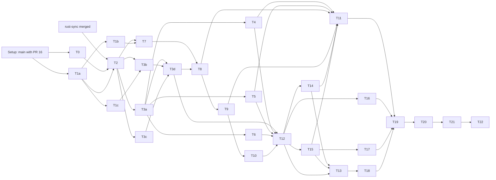
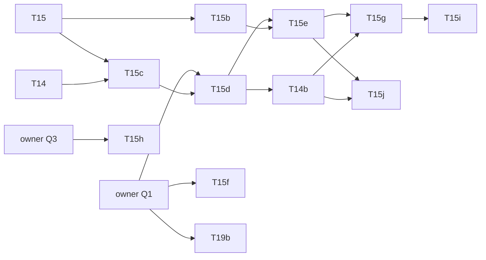

# `ua-rs-sign`: `ua-rs` as the one signer and crypto core of every client — build plan

> **For agentic workers:** REQUIRED SUB-SKILL: Use superpowers:subagent-driven-development (recommended) or
> superpowers:executing-plans to implement this plan task-by-task. Steps use checkbox (`- [ ]`) syntax for tracking.

**Status (2026-11-05):** plan, not executed; nothing is built from it. Work order item 3d (owner 2026-11-05: "write the 3d plan"). **The owner accepted MD-1..MD-14 as proposed (2026-11-05)**; T0 and the clientkeys tasks may start; Rust tasks wait for `rust-sync` on `main`. Revised after the Codex security review (2026-11-05): tasks, tests, mutants and estimates of the twelve findings (C-01 … C-12, spec §17).
Decisions MD-1 to MD-14 are the controller's; the owner may override any of them. Runs in parallel with 3b (regulated kinds) and
3c (PqChat contract), before the EVM freeze. **No contract, node or signed-record byte-format change.** UNAUDITED.

**Spec:** [`2026-11-05-ua-rs-sign.md`](../specs/2026-11-05-ua-rs-sign.md), owner answers 2026-11-05 (all as recommended: §1 rulings
1–9, the four answers after its status, §14 Q1–Q10). Review: [`ua-rs-sign-fable-review.md`](../../research/ua-rs-sign-fable-review.md)
(F-01 … F-52, mapped in spec §16) and [`ua-rs-sign-codex-review.md`](../../research/ua-rs-sign-codex-review.md) (C-01 … C-12, mapped
in spec §17); every "applied" and "task" item has a task below, column "Review items" of the task table.

**Branch / worktree:** `ua-rs-sign`, `.claude/worktrees/ua-rs-sign`, this plan's parent `b7786535`. One commit per task at least,
`ua-rs-sign T<n>: …`; no merge, no push without the owner's word; `main` is PR-only.

**Goal:** `clients/ua-rs` (crate `scaas-ua`) derives every key exactly as `clients/clientkeys`, signs for every kind (with the
policy gate, EVM transactions and WebAuthn builders), holds the UA KEM key, seals and opens, wraps AEAD / HKDF / HMAC, keeps the
clientkeys vault v1, a manifest and backups, and fronts `zether-prover` and `pqz-ffi` as facades; secrets never leave it but
through the named exports. The C ABI moves to v6 (handles, `scaas_ua_features()`); every existing binding but `ua-dart` reaches
the new surface. clientkeys stays the JS reference and writes every vector row first.

**Gate runner:** `smartcontracts/evm/runs/<date>-ua-rs-sign-gates.sh [--only <step>]` on the step contract of
`2026-10-27-metatx-split-gates.sh` (as `2026-11-04-mldsa87-gates.sh`: `P`, `LOGEXT=log`, `STEPS`, `extra_step`, `NEW_TESTS`, then
source the base). Logs `runs/<date>-ua-rs-sign-<step>.log` git-ignored, first line `# <step> at commit <sha>`, last `rc=<n>`; a step
done at the same commit on a clean tree is skipped; `<date>-ua-rs-sign-summary.txt` committed (`step | commit | rc | counts`, no
absolute paths). On resume read the logs and `runs/gate/last` first.

## Preconditions (Setup, before T0)

- [ ] **PR #16 (CLI-SGN-21, clientkeys `dekFrom` bounds) is merged into `main` (2026-11-05).** Merge `main` into `ua-rs-sign`; T1
      builds on it and does not redo it (spec §8.1's "T1 adds it" is done by PR #16). If the merge conflicts, resolve on `main`'s side.
- [ ] **Rust 1.97.1 (`rust-sync`):** T0 and T1 (JS) start now. **No Rust task (T2 on) starts before `rust-sync` is merged into
      `main` and `main` is merged here** (MD-2). If it is late, the controller tells the owner; nothing pins 1.97.1 by hand here.
- [ ] Real directories, not symlinks: `clients/clientkeys/node_modules` (`npm ci --ignore-scripts`), `smartcontracts/evm/lib`
      (`scripts/evm_libs.sh install`, `check`; only for the `forge-ua` guard step).
- [ ] Baseline recorded in `runs/<date>-ua-rs-sign-base-summary.txt`: `clientkeys`, `ua-rs` (+ `pq`, `signers`, `json`), `ua-c`,
      `ua-cxx`, `ua-qt`, `ua-dart-frb`, `ua-py`, `ua-go`, `ua-cs`, `ua-dart`, `cargo-zether-prover`, `docs`. A failure not named in
      `main`'s last summary stops the plan.

## Global constraints

- **Owner rulings override code;** follow a stated rule as stated, no option tables. Spec "proposal" rows stand unless overridden.
- **Every task, the same six steps:** (1) the failing tests listed, positive control first, one change per negative test;
  (2) run them: FAIL (the red line goes in the commit message); (3) implement; (4) the task's gates PASS; (5) mutants, each alone on
  a clean tree, its suite run, restored by `git checkout -- <file>`, logged by `smartcontracts/evm/runs/<date>-ua-rs-sign-t<n>-mutants.py`
  (the form of `2026-11-01-typed-signing-c8-mutants.py`: name, file, old, new, command; a surviving mutant exits 1 and is a
  finding) into `…-t<n>-mutants.txt`; (6) commit, staged by explicit path.
- **Vectors are generated, never hand-edited.** clientkeys writes every row first (T1a–T1c); each generator runs twice and the files
  do not move the second time; every reader reads the same rows. Every struct with `mode` / `relayer` / `feeRecipient` has a row with
  non-zero unbound values whose expected digest is the zeroed one. A byte-format change regenerates all files in one commit.
- **Transcripts never change in `ua-rs`.** No proof, statement or transcript code in the facades; no `pqzl`, `pqzh`, `stmt`, `ffi/src`
  or set-parameter change, so **no full `pqz-core/gate.sh`**. A needed change there stops the task and goes to the controller.
- **Zether ≠ PQZ:** separate tasks (T14, T15), features, handles, tests, commits. **NEAR ≠ Algorand:** not touched.
- **No RNG parameter in a release signature** (F-01); deterministic entry points only under feature `vectors`.
- **Bounded decoders:** every outside input bounded by length and depth before it allocates or recurses (spec §9.3 caps).
- **No contract change** (the `msig` KEM registry change is 3c's). **No EIP-7702, no EIP-191.** No consumer names anywhere.
- **Backup, do not delete:** nothing in `ua-rs` or a binding is removed; a superseded file goes to its `legacy/ua-rs-sign/` (MD-4).
- **Pins move only with old → new in the commit:** `SCAAS_UA_ABI_VERSION`, the header drift test, `rust-version`, every `Cargo.lock`,
  `deny.toml`, the size ratchet (MD-12), generated vectors by their generator. Never edit a pin, bound or test to go green.
- **Machine:** `cargo`, `npm`, `dotnet`, `forge` through `scripts/capped`, foreground, never inside `timeout`, `-j2`, `--locked`;
  `dotnet build-server shutdown` after capped dotnet; ≤ 3 agents, ≤ 2 heavy at once, no two gate runs at once; no `nohup`, `&`,
  `until`, `sleep` loops, `pgrep -f`, `git stash`, `git add -f`. **No timing run without asking the owner** (T17).
- **Git and docs:** English; new source files carry `SPDX-License-Identifier: LicenseRef-Vegan-Community-1.0`; `Signed-off-by` per
  CONTRIBUTING; session `Co-Authored-By` trailer; full output in `.log`, committed summaries only; no machine paths.

## Plan decisions (MD-*; controller calls, the owner may override; recorded in `decisions.md` by T19)

- **MD-1 Task split.** clientkeys first in three parts (T1a derivation and signing rows, T1b KEM / seal / vault rows, T1c external
  answers) so `ua-rs` tasks start on the rows they need; `ua-rs` signing in four kind groups (T3a classic curves, T3b PQ, T3c pairing
  curves and groups, T3d `UASig` / `msig`); KEM (T7) apart from seal / AEAD (T8); the C ABI (T12) once the Rust API is final.
- **MD-2 Toolchain.** `rust-version = "1.97.1"` in `ua-rs`, `ua-c` and every binding's Rust side, set by the merge of `rust-sync`
  (T2 checks, does not write a toolchain file of its own). `zether-prover` follows `rust-sync`'s value.
- **MD-3 Bindings in this round.** All seven move: `ua-c` (ABI v6), `ua-cxx`, `ua-qt`, `ua-dart-frb` (Rust API), `ua-py`, `ua-go`,
  `ua-cs` (load `libscaas_ua_c` for the wallet surface; their ids and digests stay native, the cross-check). `ua-dart` stays
  identity-only (spec §2). The wasm-bindgen browser binding (Q4) is the next round, after T17's numbers.
- **MD-4 Legacy.** Nothing is removed. The ABI v5 header is copied to `clients/ua-c/legacy/ua-rs-sign/scaas_ua.v5.h` before T12
  rewrites its rule text; a binding file replaced in whole goes to its `legacy/ua-rs-sign/`. Checked not git-ignored at T12.
- **MD-5 Features.** `default = ["wallet", "zether", "pqz", "pqz-set-n2304-kmax4096"]` (owner: facades on by default);
  `wallet` = `pq` + `signers` + `json` + the new crates; `zether` and `pqz` imply `wallet`; `pqz-set-*` exactly one; `mlock` (off on
  wasm32); `vectors` (test-only entry points, never in a release build). The verify-only identity layer stays buildable with
  `--no-default-features` (+ `pq` / `json` / `signers` as today), a CI cell of its own.
- **MD-6 Module layout.** New code under `clients/ua-rs/src/wallet/` (`mod.rs`, `derive.rs`, `sign.rs`, `pqsign.rs`, `pairing.rs`,
  `uasig.rs`, `eip712.rs`, `policy.rs`, `tx.rs`, `webauthn.rs`, `kem.rs`, `seal.rs`, `aead.rs`, `vault.rs`, `manifest.rs`,
  `signer.rs`, `bounded.rs`) and `src/facade/{zether,pqz}.rs`; the existing modules (`verify.rs`, `ua8.rs`, `pq.rs`, `musig2.rs`,
  `frost.rs`, `json.rs`) are called, not copied (one `hashToScalar`, one `M'` builder).
- **MD-7 Where vectors live.** New files `smartcontracts/vectors/ua/{keys,sign,kem,seal,vault}.json` (spec §11), generator
  `clients/clientkeys/scripts/ua-wallet-vectors.mjs` (one script, one section per file). Policy rows: section `policy` of
  `sign.json`, produced by running clientkeys' own `check*` functions. ACVP ML-KEM-1024 and RFC 7748 go into `pq_external.json` by
  `pq-external.mjs` (source and sha256 per section); RFC 6979 A.2.5 and the secp256k1 set into `sign.json` section `external`. The
  both-ways fixture `smartcontracts/vectors/ua/rs_signatures.json` is written by a `ua-rs` test under `vectors`
  (`--ignored regenerate`), read by `npm test`.
- **MD-8 Falcon keys (Q1).** T0 decides. Equal → `ua-rs` calls PQClean's seeded keygen through a vendored build
  (`clients/ua-rs/vendor/pqclean-falcon-seeded/`, MIT, `cc`). Not equal → the ruled fallback (both clients on PQClean's keygen,
  vectors regenerated); if that needs PQClean code inside clientkeys (a wasm module), the controller asks the owner first.
- **MD-9 Signing policy port.** `Expect` has one variant per clientkeys check (`Payment`, `ReceiverFee`, `PayMeta`, `Op`, `Call`,
  `OwnerCall`, `Cancel`, `TradeOrder`, `WrapOrder`) with the check's named inputs, plus `Any(AllowAnyTypedData)`; the port reads the
  same rows and refuses with `PolicyRefused`; a check clientkeys adds later is ported with its rows.
- **MD-10 Off-chain purpose `scaas.ua.purpose.seal.v1`.** In clientkeys `ua.js` and `ua-rs` `PURPOSES` with an off-chain mark; never
  in a contract list (no contract change); `sign_ua` accepts it only from the container builder. `decisions.md` entry (owner 2026-11-05).
- **MD-11 `msig` has no KEM key, client side now.** Enforced by `kem_key` (single-key handle only), the record builders and the seal
  callers in this round; a `CLI-SGN` rule and a `decisions.md` entry that points at CTR-UA-32's change in round 3c (whichever lands
  second links the other).
  **Change (owner 2026-11-06, option (c)):** this round enforces it in `kem_key` (T7) and the seal callers (T8) only. The record
  builders (clientkeys `ua.js` `holds` / `registrationArgs` / `kemRecordMessage`, ua-rs `ua8.rs`) refuse an `msig` KEM key in round
  3c, together with the registry's own refusal (CTR-UA-32): the contract e2e (`e2e.py` `msig_ua`), the `portable.json` `msig-pq` /
  `kemRecords` rows and the binding tests move to refusal rows there in one step. Reason: the generators, the e2e and four binding
  suites build those records through the same builders while the registry still accepts them.
- **MD-12 Size ratchet.** `clients/ua-c/size-baseline.json`: stripped release `libscaas_ua_c` per target (x86-64, aarch64-android,
  aarch64-ios, wasm32) × feature cell (`--no-default-features`, `wallet`, default, default with each `pqz-set-*`); the runner step
  `ua-sizes` fails on growth without an old → new line and a reason. Sizes are not timing: no owner ask needed.
- **MD-13 External keys (phase 2) in this round:** the `Signer` trait and `SignRequest` are public (T3a), a `TestExternalKey` under
  `vectors` runs `sign.json` through verify-after-sign, and the C header declares `ScaasUaExternalSigner` and
  `scaas_ua_external_key_new`; in a release build the call returns `KIND_UNAVAILABLE` with the feature bit `external` clear.
- **MD-14 Review.** Claude lenses, then Fable; Codex only on the owner's word (credits). Named as AI review; everything stays UNAUDITED.

## Tasks

| Task | Content | Depends on | Review items | Est. (person-days) |
|---|---|---|---|---|
| T0 | Spikes: Falcon Q1, pins and licences, `cargo deny` baseline, `rand_core` / `getrandom`, cross-builds, CT and zeroize words | Setup | 11, 12, 41, 48 | 2–3 |
| T1a | clientkeys: UA tree, EIP-2333 UA paths (index 0 only), `solana`, signers `0x0101` / `0x0108`, Schnorr nonce, tx and policy rows, unrelated-domain row, BLS role rows, WebAuthn refusals → `keys.json`, `sign.json` | Setup (T0 for Falcon rows) | 03, 09, 15, 17, 22, 23, 26, 27; C-04, C-06, C-07, C-08 | 5–7 |
| T1b | clientkeys: KEM key, encaps / decaps checks, seal / open, container and its acceptance, replay rows, vault rows (12-word) → `kem.json`, `seal.json`, `vault.json` | T1a | 02, 04, 07, 08, 19, 20, 43; C-03, C-10, C-11 | 3.5–5 |
| T1c | External answers: ACVP ML-KEM-1024, RFC 7748, RFC 6979 A.2.5, named secp256k1 set; `sigGen` for signers | T1a | 09, 10 | 1–2 |
| T2 | `ua-rs`: features, crates, derivation, `Wallet`, BIP-39 (entropy lengths), the secret store and arena, zeroize types, ranges, EIP-2333 index 0, bounded JSON reader | T0, T1a, rust-sync | 11, 15, 17, 37, 38, 44; C-02, C-06, C-09, C-10 | 4–5 |
| T3a | Signers: ECDSA / ed25519 / BIP-340, native keys, `sign_ua`, `sign_member`, key proof, raw digest, `Signer` trait, `SigRole` | T2 | 01, 09, 25, 45; C-08 | 3–4 |
| T3b | PQ signers: ML-DSA hedged, SLH-DSA, Falcon; both-ways fixture | T2, T1c, T0 (Q1) | 13, 14, 16, 24 | 2–4 |
| T3c | Pairing kinds: scaas Schnorr nonce, `secret_mul` (ladder, structural test), BLS with roles; MuSig2 / FROST sessions, FROST-BN254 element newtype | T2 | 03; C-01, C-06, C-08 | 4–5 |
| T3d | `UASig` builder, `msig` minimal at both levels | T3a–T3c | — | 1–2 |
| T4 | EIP-712 generic hasher (faithful), canonical step on checked records only, `Expect` policy | T3a, T1a | 22, 23, 26; C-04 | 4–6 |
| T5 | `sign_transaction` types 0–3 (`alloy-rlp`) | T3a, T1a | 27 | 2–3 |
| T6 | WebAuthn challenge and assertion builders (expected challenge, chain rule, verify before return) | T3a | 28; C-07 | 1.5–2 |
| T7 | KEM key (`UaKey::kem_key`, store-scoped self-test), combiner, encaps / decaps checks, holder and `msig` rules, ephemeral key | T2, T1b, T1c | 04, 05, 06; C-05 | 3–4 |
| T8 | AEAD, HKDF, HMAC; seal / open; container, sender signature, `open_container` acceptance, `LinkSession`, `from_link` | T7, T3d | 07, 08, 43; C-03, C-11 | 4–5 |
| T9 | Vault v1 (entropy lengths), manifest, discovery, import, `SeedBackup`, `backup_seal` (generation), `restore_backup` | T2, T8 | 02, 18–21, 42, 43, 49; C-03, C-10, C-11, C-12 | 4.5–6.5 |
| T10 | Custody and memory protection: `lock()` / `unlock` revocation by generation, arena `mlock` / no-dump, no-`Clone` / no-RNG compile-fail tests | T9 | 01, 11, 46; C-02, C-09 | 4–5 |
| T11 | Fuzz targets and corpus for every decoder | T4, T5, T8, T9, T14, T15 | 44 | 2–3 |
| T12 | C ABI v6, handles (child handles after wallet free), statuses, `scaas_ua_features()`, header rules, panic lints, error hygiene | T3d–T10 | 29–34, 47; C-02, C-03, C-05 | 4.5–6.5 |
| T13 | Bindings: `ua-cxx`, `ua-qt`, `ua-dart-frb`, `ua-py`, `ua-go`, `ua-cs` | T12, T14, T15 | 29, 32 | 10.5–15 |
| T14 | Facade `zether` | T3a, T8, T12 | 35, 39 | 3–4 |
| T15 | Facade `pqz` | T3a, T8, T12 | 34, 38, 40 | 4–5 |
| T16 | External-key interface (phase 2's API, tests of the interface, role carried) | T3d, T4–T6, T12 | 45; C-08 | 2–3 |
| T17 | Target matrix and sizes; mobile and wasm32 measurement (**asks the owner before any timing run**) | T12, T15 | 40, 41 | 2–4 |
| T18 | CI jobs, `ci_changes.py`, `cargo deny` / `cargo audit` | T12, T13 | 48 | 2–3 |
| T19 | Docs and `decisions.md` | drafts beside T7–T18 | 50–52 notes; C-01 … C-12 rules | 3–4 |
| T20 | Gate runner, closing gates | T19 | — | 2–3 |
| T21 | Review (Claude → Fable; Codex on the owner's word), fix wave | T20 | — | 4–6 |
| T22 | Report and PR (on the owner's go) | T21 | — | 0.5–1 |
| | **Total** | | | **88–127** (was 80–118 before the Codex response) |

Critical path (T1a → T2 → T3c → T3d → T8 → T9 → T10 → T12 → T14 / T15 → T13 → T20 → T21 → T22) ≈ 51–65 working days (was 44–58;
T3c, now 4–5, replaces T3a on the path); the rest runs beside it (≤ 3 agents).

Parallel lanes (≤ 3 agents, ≤ 2 heavy): {T0 ∥ T1a}; {T1b ∥ T1c ∥ T2}; {T3a ∥ T3b ∥ T3c}; {T4 ∥ T5 ∥ T6 ∥ T7}; {T14 ∥ T15 ∥ T16};
the six bindings of T13 two at a time; T18, T19 drafted beside.

---

### T0 — spikes (report only, no code kept)

**Files:** `clients/ua-rs/runs/<date>-ua-rs-sign-t0.md` (the run record), `clients/ua-rs/deny.toml`
(kept: the permanent gate), `clients/ua-rs/NOTICE` (draft list).
- [ ] **Falcon Q1:** PQClean `falcon-512` / `-1024` keygen seeded with the 48 bytes clientkeys passes noble 0.7.1, both through
      SHAKE256 as `crypto_sign_keypair`, on the `pq_kat.json` seeds: equal or not, per kind. Outcome per MD-8.
- [ ] **Pins and licences:** `ml-kem` =0.3.4, `x25519-dalek` =2.0.1 (`static_secrets`), `aes-gcm` =0.10.3, `aes-gcm-siv` =0.11.1,
      `hkdf` =0.12.4, `scrypt` =0.11.0, `bip39` =2.2.2, `bip32` =0.5.3, `zeroize` =1.8.2, `alloy-rlp` (pinned here), facade deps; one
      `aes` (=0.8.4), one `curve25519-dalek`; the `rand_core` generations and their `OsRng`; a review note per new crate.
- [ ] **`cargo deny` baseline** (advisories, licences, duplicates; the tool's version pinned in the report) and `cargo audit` once.
- [ ] **Cross-builds (compile only, no timing):** wasm32-unknown-unknown (Falcon with clang, else `KIND_UNAVAILABLE`; `getrandom`
      0.2 `js`, 0.3 `wasm_js` + cfg), aarch64-linux-android, aarch64-apple-ios (or record "no SDK on this host", T18 runs it in CI).
- [ ] **Words quoted:** each crate's constant-time and zeroize statement, "no claim by the crate" where none (`ml-dsa`, `ml-kem`,
      `slh-dsa`), `ghash` / `polyval` soft paths, `scrypt`, PQClean.
**Gates:** none (report). **Commit:** `ua-rs-sign T0: spike report, deny.toml baseline`.

### T1a — clientkeys: derivation and signing rows

**Files:** `clients/clientkeys/src/{seed,pq,ua,evm}.js` (UA tree `deriveUAKey` `m/22776'/0'/<account>'/<kindNo>'/<i>'`, SLIP-10
`nist256p1`, EIP-2333 UA paths with salt `SCAAS-UA-BN254-v1`, `solana` `m/44'/501'/i'/0'`, ranges `< 2^31`, signers `0x0101` /
`0x0108`, scaas Schnorr production nonce, EVM tx types 0–3 with a small RLP), new `scripts/ua-wallet-vectors.mjs`,
`test/ua-wallet.test.js`; `smartcontracts/vectors/ua/{keys,sign}.json` (new).
**Interfaces:** rows per spec §11 for `keys.json` and `sign.json` (deterministic and randomized rows, `msig` sets, typed rows with
arrays and a negative `int`, one non-zero-unbound row per `mode` struct incl. a nested `MetaTransfer`, `policy` rows from the
`check*` functions, tx rows, the nonce-map row from the generator, refusals); `extraEntropy: false` explicit, said in `note`.
- [ ] Red: `keys.json rows equal deriveUAKey for every kind × account {0,1} × index {0,1}`; `account 2^31 refused`; `non-ASCII BIP-39
      passphrase row`; `0x0101 and 0x0108 sign ua_msg (no prehash for 0x0108, sha256 for 0x0101)`; `nonce map is the 512-bit map`;
      `unbound relayer / feeRecipient hashed as zero in every mode struct`; `tx type 4 cannot be built`; `EIP-155 published row`;
      `index 1 refused for every EIP-2333 kind` and `musig2-bn254 at m/254/0/<account>/274` (C-06); `12-word mnemonic row` (C-10);
      `unrelated Order(mode, relayer, feeRecipient, amount) through Any equals hashTypedData of the supplied values` (C-04); `BLS
      ordinary and PoP rows, right message under the wrong DST refused` (C-08); WebAuthn refusals: wrong challenge, reordered JSON,
      `crossOrigin: true`, `r = 0`, `s = n` (C-07).
- **Mutants:** T2's derivation list on the JS side (hardened bit, `account` / `index` swap, u32 little-endian, non-hardened ed25519,
  wrong `kindNo`, `TAG(kind)` in `info`, NFKD); `extraEntropy` left to the default; canon skipped on a nested struct; canon applied
  to the unrelated `Order` row; an index child appended to an EIP-2333 path.
**Gates:** `clientkeys`, `vectors-check`. **Commit:** `ua-rs-sign T1a: clientkeys UA tree, UA signers, keys.json and sign.json`.

### T1b — clientkeys: KEM, seal, vault rows

**Files:** `clients/clientkeys/src/kem.js` (new: KEM key §6.1, combiner, checks §6.2, `generateEphemeral`), `src/seal.js` (new: §6.3
seal / open, container, `aad`, sender `UASig` under MD-10's purpose), `src/vault.js` (no format change; rows only),
`scripts/ua-wallet-vectors.mjs`, `test/{kem,seal}.test.js`, `test/vault.test.js`; `smartcontracts/vectors/ua/{kem,seal,vault}.json`.
- [ ] Red: `encaps with fixed m, e`; refusals (modulus, length, scheme 2, all-zero `ss_X`); decaps rows (short `ct`, flipped byte →
      another `ss`, small-order `E`); `seal per purpose`; refusals per field; `link container fails on a swapped short code`; vault rows
      (small `N` and `N = 2^17`, wrong passphrase, altered AAD label, NFC / NFD pair, `N = 2^31`, `N = 3`, `r = 16`, `v: 2`, tombstone);
      `KEM key for an msig or a non-holder refused`; acceptance refusals, each from an otherwise valid container (C-03): `signed by
      a different registered UA`, `purpose not expected`, `recipient not the opener's`, `sender key whose UA is not sender.ua`,
      `backup entropy that does not derive sender.ua`; replay rows (C-11): `link created outside the session window`, `backup
      generation 1 over generation 2`; vault (C-10): `12-word vault round trip` (mnemonic, signing key and KEM key equal before and
      after, through the vault and a sealed backup), `31-byte seed payload refused`.
- **Mutants:** modulus check removed; all-zero `ss_X` accepted; combiner `E` dropped; `kemPkHash` out of `info`; short code out of
  the link `aad`; NFKC dropped; AAD label dropped; expected sender ignored; backup self-consistency skipped; entropy padded to 32.
**Gates:** `clientkeys`, `vectors-check`. **Commit:** `ua-rs-sign T1b: clientkeys KEM, seal, container; kem, seal, vault rows`.
clientkeys gains the same container acceptance (`openContainer(kemKey, container, expect, members, accepted)`) and generation as `ua-rs`,
so the rows are written by the reference.
**Owner answers on T1b (2026-11-05), all as recommended (spec header):** `sender.auth` is a full `UASig` (an `msig` sender in the
minimal form; `members` the opener's lookup of its member keys, replacing `senderKey`), built in clientkeys with its `seal.json`
rows and mutants (commit `ua-rs-sign: container sender is a full UASig; owner answers on T1b (2026-11-05)`); KEM `info` version
`be64` (T7); short code 8 decimal digits, `BackupPayload` field order, malformed payload `Argument`, `allowRollback: true` / marker
`AllowRollback` (T8, T9); the checked path refuses a non-zero unbound `relayer` / `feeRecipient` (T4).
**Owner answers on the container sender (2026-11-05, "theo khuyên cả hai"; spec header):** the container carries no kind, the opener
tries `derive_ua` over the derived kinds (at most one matches; T8 the same); an `msig` sender needs its signers accepted at both levels
(CTR-UA-37): `openContainer(…, members, accepted)`, `openLink`, `restoreBackup` take `accepted(id, index)`, a missing lookup or an
answer other than `true` is `ContainerSender`, a single key needs none. Built in clientkeys with six `seal.json` acceptance rows and
mutants (commit `ua-rs-sign: container msig sender needs accepted members (CTR-UA-37) (owner 2026-11-05)`).

### T1c — external known answers

**Files:** `clients/clientkeys/scripts/pq-external.mjs` (ACVP ML-KEM-1024 `keyGen`, `encapDecap`; RFC 7748 §5.2 / §6.1, source and
sha256 per section), `scripts/ua-wallet-vectors.mjs` (`sign.json` `external`: RFC 6979 A.2.5 P-256, a named published secp256k1
RFC 6979 set with source and sha256), `test/pq.test.js`, `test/ua-wallet.test.js`; `smartcontracts/vectors/ua/pq_external.json`.
Existing, read by the signers from T3 on: RFC 8032 and BIP-340 (`signatures.json`), ACVP ML-DSA / SLH-DSA `sigGen` (`pq_external.json`).
- [ ] Red: clientkeys reproduces each new section; a flipped source byte fails its sha256 check.
- **Mutants:** one ACVP `d` / `z` swapped; X25519 clamping skipped.
**Gates:** `clientkeys`, `vectors-check`, `forge-ua` (forge reads `pq_external.json`). **Commit:** `ua-rs-sign T1c: external answers`.

### T2 — `ua-rs` core: features, derivation, `Wallet`

**Files:** `clients/ua-rs/Cargo.toml` (MD-5 features, T0 pins, `rust-version` from `rust-sync`, `[lints]`: `unwrap_used`,
`expect_used`, `panic`, `indexing_slicing` denied in new modules), `Cargo.lock`, `src/lib.rs` (`pub mod wallet`), `src/wallet/{mod,
derive,bounded,store}.rs`, `tests/wallet_keys.rs`, `NOTICE`.
**Interfaces:** `Wallet::{generate, from_mnemonic}` (entropy kept at its BIP-39 length 16–32 B, seed on unlock, `bip39_passphrase`
apart from `vault_passphrase`), `SeedBackup::take()`, `ua_key` (index 0 only for `0x0104`–`0x0107`, `0x0112`; spec §4),
`native_key(network, index, coin_type)`, BIP-32, SLIP-10 (ed25519, `nist256p1`), EIP-2333 (curve order and salt as parameters), HKDF
PQ seeds; `wallet/store.rs` (new): `SecretStore` (`Arc`, read-write lock over generation and arena), the arena of page-aligned
chunks that never move (spec §8.2), handles holding `(Arc, generation, slot)` and no secret bytes; `bounded::json(bytes, max_len,
max_depth)` (the one reader every later decoder uses).
- [ ] Red: `keys.json` every row; BIP-32 / SLIP-10 / EIP-2333 published vectors; `eip2333_equals_zether_prover_on_the_zether_path`;
      ranges refused (`Argument`); `index_1_refused_for_eip2333_kinds`; `twelve_word_entropy_kept_at_16_bytes`;
      `mnemonic_is_not_cloned_and_dropped_after_from_mnemonic`; `bounded_json_refuses_depth_9`; `handle_holds_no_secret_bytes`
      (a `vectors` hook: the handle's own allocation contains no key byte, its slot lies in the arena).
- **Mutants:** hardened bit dropped; salt / `info` order swapped; `account` / `index` swapped; u32 little-endian; non-hardened ed25519
  step accepted; wrong `kindNo`; `TAG(kind)` for `utf8(tag)` in the HKDF `info`; `account ≥ 2^31` accepted; NFKD dropped; the depth
  bound removed; index 1 accepted for an EIP-2333 kind; imported entropy padded to 32 bytes; a key's bytes copied into its handle.
**Gates:** `ua-rs` cells `--no-default-features`, `wallet`, `pq`, `signers`, `json`; clippy `-D warnings`; `cargo deny check`.
**Pins:** `rust-version` 1.90 → 1.97.1 (with `rust-sync`); `Cargo.lock`. **Commit:** `ua-rs-sign T2: wallet core and derivation`.

### T3a — classic-curve signers and the `Signer` trait

**Files:** `src/wallet/{sign,signer}.rs`, `tests/wallet_sign.rs`.
**Interfaces:** `UaKey::{sign_ua, sign_member}`, `NativeKey::{sign_key_proof, sign_digest(_, AllowRawDigest)}`; kinds `0x0001`,
`0x0003` (ECDSA and HIP-632 ed25519), `0x0010`, natives of `NETWORKS`, `0x0101`, `0x0102`, `0x0103`, `0x0108`; one key, one purpose
(CLI-SGN-29); `pub trait Signer`, `#[non_exhaustive] enum SignRequest` built only inside `ua-rs`, `UaMsg` carrying `SigRole` set by
`sign_ua` from its purpose (portable purposes `pop` v2, `kem`, `pqz-key` → `Pop`) and `Authorization` for `sign_member` (spec §9.4);
`OsRng` inside; every secret operation under the store's read guard with the generation check (spec §8.2).
- [ ] Red: `sign.json` rows of these kinds; RFC 6979 A.2.5 and the secp256k1 set; RFC 8032; BIP-340 fixed-`aux`;
      `kindNo_of_another_kind_refused`; `raw_digest_needs_the_marker`; `purpose_not_in_PURPOSES_refused`;
      `role_follows_the_registry_rule` (each purpose → its role); `no_public_call_takes_a_role` (compile_fail).
- **Mutants:** low-s removed; `v` offset 27 lost; prehash added for `0x0108` / removed for `0x0101`; purpose tag v1 for `pop` v2;
  another kind's `TAG`.
**Gates:** `ua-rs` (`wallet`, `vectors`), clippy. **Commit:** `ua-rs-sign T3a: classic-curve signers, Signer trait`.

### T3b — PQ signers

**Files:** `src/wallet/pqsign.rs`, `vendor/pqclean-falcon-seeded/` (if MD-8 equal), `build.rs` (if vendored), `tests/wallet_pq.rs`;
`smartcontracts/vectors/ua/rs_signatures.json` (MD-7); `clients/clientkeys/test/ua-wallet.test.js` (reads it).
**Interfaces:** ML-DSA `sign_internal(M' = 0x00 ‖ 0x00 ‖ pq_msg, rnd)` with `rnd` from `OsRng`; SLH-DSA `slh_sign_internal(M',
opt_rand)` (`None` only under `vectors`); Falcon padded over `ua_msg`, key bytes `Zeroizing`, crate type rebuilt per call.
- [ ] Red: `pq_kat.json` keys; `rnd = 0` and ACVP `sigGen` rows byte-equal; hedged rows verify; `two_release_signatures_differ`;
      the JS side verifies `rs_signatures.json` (Falcon, hedged ML-DSA, randomized SLH-DSA, OS-`aux` BIP-340).
- **Mutants:** Falcon signs `pq_msg`; ML-DSA context non-empty; ML-DSA `rnd` fixed in a release build; SLH-DSA `M'` without the
  two zero bytes.
**Gates:** `ua-rs` (`wallet`, `pq`, `vectors`), `clientkeys`. **Commit:** `ua-rs-sign T3b: PQ signers, both-ways fixture`.

### T3c — pairing-curve kinds and group sessions

**Files:** `src/wallet/pairing.rs`, `src/musig2.rs` / `src/frost.rs` (session wrappers only, no algorithm change), `tests/wallet_pairing.rs`.
**Interfaces:** `0x0104`, `0x0105` nonce `k = hashToScalar(keccak256("scaas.ua.schnorr.nonce.v1" ‖ be32(sk) ‖ Y ‖ ua_msg ‖ aux))` with
`verify.rs`'s one 512-bit `hashToScalar`, `k = 0` redrawn; `secret_mul(base, secret)` (spec §12: `ρ` 128 bits, `k' = k + ρ·r` as
`Zeroizing<[u64; 6]>` by limb arithmetic, a 384-iteration Montgomery ladder with a masked coordinate swap, generic over G1 and G2,
`ρ` / `k'` / swap state wiped) for every secret multiplication: keys of `0x0104`–`0x0107`, `0x0112`, the nonce point, BLS `sk·H(m)`,
MuSig2-bn254 nonces, FROST-BN254 through a `Bn254Group` element newtype in `frost.rs` (`groups.json` byte-equal); `clippy.toml`
`disallowed-methods` for `mul_bigint` in `src/wallet/`; BLS `0x0106`, `0x0107` with the domain from `SigRole` (DSTs of `verify.rs`);
`musig2-bn254` participant key at `m/254/0/<account>/274`; MuSig2 / FROST session objects whose secret nonce is consumed once.
- [ ] Red: fixed-`aux` rows; the nonce-map row (generator-computed); `groups.json` byte-equal; `second_sign_on_a_session_errors`;
      `blinded_and_plain_products_equal`; the **structural test** per secret path (keygen G1, keygen G2, nonce point, BLS sign,
      MuSig2-bn254, FROST-BN254): a `vectors` hook records the ladder's input integer and iteration count; two calls, same secret:
      same point, different integers, each `≥ r` and `≡ k (mod r)`, 384 iterations each; `bls_pop_and_sig_through_the_trait`,
      `right_message_wrong_dst_refused`.
- **Mutants:** nonce reduced from 256 bits; `Y` left out of the nonce; `secret_mul` replaced by `Projective * Fr` (blinding erased);
  `k'` reduced mod `r`; ladder width from the bit length of `k'`; `ρ = 0`; one path (each of the six) bypassing `secret_mul`; BLS
  role ignored (always SIG); `musig2-bn254` on the secp256k1 path.
**Gates:** `ua-rs` (`wallet`, `signers`, `vectors`), clippy. **Commit:** `ua-rs-sign T3c: scaas Schnorr nonce, secret_mul, BLS, group sessions`.

### T3d — `UASig` and `msig`

**Files:** `src/wallet/uasig.rs`, `tests/wallet_uasig.rs`.
**Interfaces:** `UASig` builder over `&dyn Signer` handles; `msig` member slots named by the caller; refusal of a non-minimal set at
both levels (`UAPoP`, the registry's verdict); member acceptance via `membership_digest`.
- [ ] Red: `portable.json`, `nested.json`, `sign.json` `msig` rows; `non_minimal_set_refused_at_level_2`; `slots_sorted`.
- **Mutants:** minimal check skipped; `memberDigest` over the wrong structure; slots unsorted.
**Gates:** `ua-rs` (`wallet`, `json`). **Commit:** `ua-rs-sign T3d: UASig builder and minimal msig`.

### T4 — EIP-712, canonical step, policy

**Files:** `src/wallet/{eip712,policy}.rs`, `tests/wallet_typed.rs`.
**Interfaces:** `TypedData {types, primaryType, domain, message}` parsed through `bounded::json` (64 KiB, depth 8, ≤ 32 types,
≤ 64 fields, acyclic references ≤ 8 deep, arrays ≤ 1,024); canonical step keyed on the fields `mode` / `relayer` / `feeRecipient`,
recursive (as clientkeys `canonical`), applied by the SCaaS record builders only; the checked path (an `Expect` other than `Any`)
**refuses** a server typed-data whose unbound `relayer` / `feeRecipient` is non-zero (`PolicyRefused`) and never zeroes it, as the
clientkeys `check*` functions (owner 2026-11-05, spec §5.3, §5.4); the hasher and `sign_typed_any` are faithful (spec §5.3,
C-04); value encoding of spec §5.3; `NativeKey::sign_typed(td, Expect)` (MD-9), `PolicyRefused`.
- [ ] Red: `typed/typed_ops.json`, `ua/portable.json`, `sign.json` typed and `policy` rows (accepted and refused);
      `unknown_field_refused`; `cyclic_types_refused`; `negative_int_two_complement`; `nested_metatransfer_zeroed` (builders); `checked_path_refuses_nonzero_unbound_relayer_and_fee_recipient`;
      `unrelated_order_through_any_is_signed_as_supplied`.
- **Mutants:** unbound `relayer` hashed; canon skipped on a nested struct; canon applied on `Any`; the checked path zeroes a non-zero unbound field instead of refusing it; policy check skipped; `EIP712Domain`
  field order changed.
**Gates:** `ua-rs` (`wallet`, `vectors`). **Commit:** `ua-rs-sign T4: EIP-712 hasher, canonical step, Expect policy`.

### T5 — `sign_transaction`

**Files:** `src/wallet/tx.rs`, `tests/wallet_tx.rs`, `Cargo.toml` (`alloy-rlp` per T0).
**Interfaces:** `EvmTx` enum `Legacy` (EIP-155 `chainId` required), `Eip2930`, `Eip1559`, `Eip4844` (signed fields only); no type 4;
output envelope and `(r, s, yParity)`; tx JSON 16 KiB, depth 4.
- [ ] Red: `sign.json` tx rows per type; the EIP-155 published row; `legacy_without_chain_id_refused`.
- **Mutants:** type-4 variant added (a `compile_fail` doc test proves none exists); `chainId` dropped from the legacy sighash.
**Gates:** `ua-rs` (`wallet`). **Commit:** `ua-rs-sign T5: EVM transaction signing, types 0-3`.

### T6 — WebAuthn builders

**Files:** `src/wallet/webauthn.rs`, `tests/wallet_webauthn.rs`.
**Interfaces:** `webauthn_assertion(key_data, expected_challenge, auth_data, client_data_json, r, s)` (spec §5.6, C-07): `0 < r, s < n`
first, low-s, the exact JSON bytes, `verify.rs` `client_data_ok` against `expected_challenge`, then `verify(0x0100, …)` of the whole
encoding before return; `WebAuthnAssertion` on any failure.
- [ ] Red: `webauthn_challenge` = `ua_msg`; `webauthn_assertion` on the webauthn rows of `signatures.json` and `portable.json`;
      wrong `type`, non-UTF-8 refused; high-s normalised; `sign.json` WebAuthn refusals (wrong challenge with a self-consistent JSON,
      reordered JSON, `crossOrigin: true`, `r = 0`, `s = n`); `assertion_for_another_key_refused`.
- **Mutants:** WebAuthn high-s accepted; challenge compared without base64url; challenge read from the JSON instead of
  `expected_challenge`; a generic JSON parser in place of `client_data_ok`; verify-before-return skipped; range check after
  normalisation.
**Gates:** `ua-rs` (`wallet`). **Commit:** `ua-rs-sign T6: WebAuthn challenge and assertion builders`.

### T7 — KEM

**Files:** `src/wallet/kem.rs`, `tests/wallet_kem.rs`, `Cargo.toml` (`ml-kem` `zeroize`; `hazmat` only under `vectors`).
**Interfaces:** `UaKey::kem_key(version)`, no wallet argument: the seed of the handle's own store (spec §6.1, C-05) (KEM holders only,
`KemHolder`; `msig` impossible by type, MD-11; revoked handle `KeyRevoked`; external key `KIND_UNAVAILABLE`), `kemSeed` HKDF (`info`
version `be64`, owner 2026-11-05)
→ `KeyGen_internal(d, z)`, `sk_X`, `dk` and `sk_X` in the arena; FIPS 203 §7.3 self-test once per store per `(ua, version)`, its record in
the store; `kem_encaps(kemPk)` with the type
and modulus checks; `KemKeyPair::{generate_ephemeral, kem_pk, decaps}` with the length and contributory checks; implicit rejection kept.
- [ ] Red: `kem.json` every row; ACVP ML-KEM-1024 `keyGen`, `encapDecap`; RFC 7748; `self_test_runs_once_per_store`;
      `kem_key_of_wallet_a_handle_is_a_derivation_while_wallet_b_unlocked`.
- **Mutants:** modulus check removed; all-zero `ss_X` accepted (encaps, decaps); decaps length check removed; combiner fields reordered
  or `E` dropped; label changed; KEM key derived for an `msig`; KEM `version` ignored; self-test record process-wide instead of per
  store.
**Gates:** `ua-rs` (`wallet`, `vectors`). **Commit:** `ua-rs-sign T7: UA KEM key, combiner, encaps / decaps checks`.

### T8 — AEAD, HKDF, HMAC, seal / open, container

**Files:** `src/wallet/{aead,seal}.rs`, `tests/wallet_seal.rs`.
**Interfaces:** `aead_seal / aead_open(Alg::{Aes256Gcm, Aes256GcmSiv}, …)`, `hkdf_sha256`, `hkdf_expand_sha256` (`len ≤ 255 × 32`),
`hmac_sha256`; `seal(kemPk, purpose, aad, pt)` (`pt ≤ 1 MiB`, purpose `[a-z0-9./-]{1,64}`), `KemKeyPair::open`, `SealVersion`,
`SealOpen`; container JSON (named fields, base64url) for `scaas/backup/v1` and `scaas/link/v1`, sender `UASig` under MD-10's purpose;
`KemKeyPair::open_container(c, &ContainerExpect, &Members, Option<&Accepted>)` (spec §6.3, C-03; owner 2026-11-05: `sender.auth` a full
`UASig`, `Members` the lookup of an `msig` sender's member keys, `Accepted` = `ua8::Accepted`, `memberAccepted` by `(id, index)`): purpose,
recipient, expected sender or approved set, `sender.auth.keyData` derives `sender.ua` (an `msig` or exactly one single-key kind, found by
trying `derive_ua` over the derived kinds: the container names none), the `UASig` (single key: no members, `accepted` not asked; `msig`:
`accepted` present, no own signature, minimal at both levels, at each level the weight of the accepted signing slots reaches the
threshold (CTR-UA-37), every member signature), all before decapsulation, `ContainerSender` (also: no `accepted` for an `msig`, a signer
not accepted) / `SealOpen`; `from_link` and `restore_backup` take `accepted` the same way; short code 8 decimal digits; `LinkSession::new()` (ephemeral
key, short code, 10-minute window), `Wallet::from_link(session, …)` consuming the session (C-11), `ContainerReplay`; the "seal
authenticates no sender" and "no replay protection" sentences in the rustdoc.
- [ ] Red: `seal.json` every row incl. the acceptance (the `msig` sender rows too, the six member-acceptance rows with each row's
      `accepted` map as the lookup) and link-window refusals; `msig_sender_without_accepted_refused`; `single_key_sender_never_asks_accepted`; NIST GCM, RFC 8452, RFC 5869, RFC 4231 published
      vectors; `empty_pt_ok`; `pt_over_1_MiB_refused`; `no_container_open_without_expect` (compile_fail);
      `second_link_install_cannot_be_expressed` (compile_fail: the session is moved); `link_session_key_wiped_after_install`.
- **Mutants:** `kemPkHash` or `purpose` left out of `info`; `aad` ignored; open returns plaintext on a bad tag; container sender
  signature unchecked; an `msig` sender with a non-minimal set accepted (level 1, level 2); a single-key `UASig` with members accepted;
  member acceptance skipped (level 1, level 2); accepted weight counted over the signers instead of the accepted ones; a missing
  `accepted` treated as all accepted; short code left out of the link `aad`; expected sender ignored; recipient or purpose expectation skipped;
  `derive_ua` recomputation skipped; link window not checked.
**Gates:** `ua-rs` (`wallet`, `vectors`). **Commit:** `ua-rs-sign T8: AEAD, HKDF, HMAC, seal / open, containers`.

### T9 — vault, manifest, discovery, import, backup

**Files:** `src/wallet/{vault,manifest}.rs`, `tests/wallet_vault.rs`.
**Interfaces:** vault v1 byte-compatible (`seed` = the entropy at its BIP-39 length, 16/20/24/28/32 B exactly, refused otherwise before
a wallet is built, label `seed` required in `open_vault`; BIP-39 passphrase never stored; NFKC; bounds `N ∈ {2^15, 2^16,
2^17}, r = 8, p = 1` checked before scrypt, `VaultParams`; `v: 2` and tombstone `VaultVersion`); `seal_vault`, `open_vault(Unlock)`
(PRF first), `needs_rewrap`, `rewrap_pin`, `enable_prf`, new-passphrase policy; labels `frost-share:`, `kem:`, `native-import:`,
`manifest`; `Manifest` (with `backup_generation`, `backup_senders`) and `discover_candidates(kind, account, gap = 20)` (index 0 alone for
EIP-2333 kinds); `import_native_key` (family-tagged, UA kinds refused); `backup_seal(recipients)` over `BackupPayload` with `generation`
(raised per seal); `Wallet::restore_backup(…, current, rollback)` (spec §6.3: acceptance, the entropy derives `sender.ua`, older
generation over the same wallet `BackupRollback` unless the marker type `AllowRollback`, JS `allowRollback: true`); `BackupPayload` JSON
`{v, generation, entropy, secrets, manifest: {entries: [{kind, account, index, ua}]}}` in this order, a malformed payload `Argument`
(owner 2026-11-05); `rewrap_pin` rustdoc: KEK only, not DEK rotation (C-12).
- [ ] Red: `vault.json` both ways (JS vault opens in Rust; Rust vault opens in clientkeys, a clientkeys test reads a Rust-written row);
      `bip39_passphrase_absent_from_every_payload`; `imported_key_refused_for_another_family`; `backup_restores_manifest_and_secrets`;
      `twelve_word_wallet_round_trips_vault_and_backup` (mnemonic, signing key, KEM key equal); `seed_payload_of_31_bytes_refused`;
      `older_backup_over_newer_refused`, `with_AllowRollback_accepted`, `equal_generation_is_a_no_op`;
      `backup_signed_by_another_registered_ua_refused`; `backup_whose_entropy_does_not_derive_sender_refused`.
- **Mutants:** AAD label dropped; stored scrypt parameters ignored; bounds check removed; NFKC dropped; 64-byte seed stored for the
  entropy; entropy padded to 32 bytes; `v: 2` reported as a wrong passphrase; PRF envelope opened without its label; generation
  compare skipped; backup self-consistency skipped.
**Gates:** `ua-rs` (`wallet`), `clientkeys`. **Commit:** `ua-rs-sign T9: vault v1, manifest, discovery, import, backup`.

### T10 — memory protection

**Files:** `src/wallet/{mod,store}.rs` (`lock(&self)`, `unlock`, `memory_protection`), `Cargo.toml` (`mlock`), `tests/wallet_memory.rs`,
`tests/wallet_custody.rs`, doc tests.
**Interfaces:** spec §8.2 (C-02, C-09): `lock()` takes the write lock, wipes the arena, raises the generation; every secret operation
checks the generation under the read guard (`KeyRevoked`); `unlock` builds a new arena at the raised generation; `WalletLocked`;
`Drop` of the wallet = `lock()`; arena chunks `mlock` / `VirtualLock` and `MADV_DONTDUMP` at allocation, undone at release; no
`PR_SET_DUMPABLE`.
- [ ] Red: `lock_keeps_manifest_drops_secrets`; `unlock_reopens_the_vault`; spec §12 custody tests: `derive_lock_then_sign_decaps_open_prove_are_KeyRevoked`,
      `unlock_does_not_revive_old_handles`, `ua_key_on_locked_wallet_is_WalletLocked`, `wallet_dropped_with_children_retained` (each
      child `KeyRevoked`, freed after), `concurrent_lock_and_sign` (each result a valid signature or `KeyRevoked`; none started after
      `lock()` returned signs; arena zero at return), `arena_chunks_locked_and_no_dump` (Linux `/proc/self/smaps` `lo` / `dd`; a
      derived key's slot inside a chunk); `compile_fail`: a key type is not `Clone`, not `Debug`, has no secret accessor; a release
      build has no RNG parameter (F-01); `mlock` best-effort returns, never fails the wallet.
- **Mutants:** `Clone` derived on `UaKey` (compile_fail test turns red); `lock` keeps the entropy; generation not raised by `lock()`;
  the generation check skipped in one secret operation; `unlock` restores the old generation; `lock()` wipes without the write lock;
  `mlock` on the `Wallet` allocation only (the range test turns red).
**Gates:** `ua-rs` (`wallet`, `wallet,mlock`, `vectors`). **Commit:** `ua-rs-sign T10: lock / unlock revocation, arena mlock, dump exclusion, compile-fail guards`.

### T11 — fuzz

**Files:** `clients/ua-rs/fuzz/` on `pqz-core/fuzz`'s pattern (`build.sh`, `run.sh`, toolchain 1.97.1), targets `typed_data`, `expect`,
`tx`, `vault`, `manifest`, `sealed`, `container`, `kem_pk`, `mnemonic`, `zether_cmd`, `pqz_cmd`; seed corpus from the vector files.
- [ ] Red: a corpus file deeper than each cap is refused (a test per target, outside the fuzzer); short run per target (60 s) clean.
- **Mutants:** one depth bound removed: the corpus case and the short run must hit it.
**Gates:** `ua-fuzz` step. **Commit:** `ua-rs-sign T11: fuzz targets for every decoder`.

### T12 — C ABI v6

**Files:** `clients/ua-c/src/lib.rs`, `include/scaas_ua.h` (cbindgen), `cbindgen.toml`, `tests/{header.rs,smoke.c,test_vectors.py}`,
`Cargo.toml` (`profile.release` `panic = "unwind"`), `Cargo.lock`, `legacy/ua-rs-sign/scaas_ua.v5.h` (MD-4).
**Interfaces:** spec §9.2 in full: handles `ScaasUaWallet`, `ScaasUaKey`, `ScaasUaKemKey`; every call of the listing and its "plus"
line (`scaas_ua_kem_key` without a wallet, `scaas_ua_wallet_lock`, `open_container` with `expect_json` / `members_json` / `accepted_json`
(`{"<msig id>": [indices]}`, NULL for a single-key sender, an `msig` sender without it `ContainerSender`; no callback across the ABI),
link session and restore calls with the same three); statuses `SealOpen`, `SealVersion`, `KemCheck`, `Aead`, `VaultOpen`, `VaultParams`, `VaultVersion`, `RawDigestRefused`,
`PolicyRefused`, `ExternalSignature`, `WalletLocked`, `KeyRevoked`, `ContainerSender`, `ContainerReplay`, `BackupRollback`,
`WebAuthnAssertion`, `KIND_UNAVAILABLE` appended (no renumbering); `scaas_ua_features()` bits `wallet`, `pq`,
`falcon`, `zether`, `pqz`, `pqz-set-*`, `external` (MD-13); header rules (free of NULL, no refcount, UB on reuse, zeroize on free,
any-thread use, per-thread last error, caller zeroizes its secret buffers, "seal authenticates no sender", "no replay protection",
child handles after wallet lock / free return `KEY_REVOKED`, freeing the wallet before its children is defined); nullability.
- [ ] Red: `test_vectors.py` over the five new files through ctypes; `abi_version_is_6`; `features_bits_match_the_build`;
      `exactly_one_unlock_secret`; `error_strings_never_contain_an_input` (every error path fed secret inputs, no substring echoed);
      `free_null_is_a_noop`; `open_container_msig_without_accepted_json_is_ContainerSender`; the C smoke test signs one row per kind group; `child_handle_after_wallet_free_is_KEY_REVOKED` (smoke test
      under AddressSanitizer: no use after free); `kem_key_takes_no_wallet` (header drift).
- **Mutants:** an error string echoes its input; `ZeroizeOnDrop` removed from a handle's inner type (a static trait-bound test
  turns red); `KIND_UNAVAILABLE` folded into `KIND_UNKNOWN`; the `catch_unwind` wrapper dropped from one export; `wallet_free`
  frees the store under live children (ASan red).
**Pins:** `SCAAS_UA_ABI_VERSION` 5 → 6; header drift. **Gates:** `ua-c`. **Commit:** `ua-rs-sign T12: C ABI v6`.

### T13 — bindings

**Depends on:** T12, T14, T15. Two bindings at a time. Every binding: checks `abi_version` and `features` at load and refuses a
mismatch; zeroizes caller-held secrets; reads the five new files; never hands a key handle or decaps to a script layer.

| Sub | Binding | Files | Surface | Est. |
|---|---|---|---|---|
| T13a | `ua-cxx` | `src/lib.rs`, `include/scaas_ua.hpp`, `tests/` | Rust API via `cxx`: wallet, keys, sign, KEM, seal, vault, facades | 1.5–2 |
| T13b | `ua-qt` | `src/*.rs`, QML tests | C++ side as `ua-cxx`; the QML singleton gets public data, `seal` to a public key, sign requests by handle id: no decaps, no raw export | 2–3 |
| T13c | `ua-dart-frb` | `rust/src/api/*.rs`, `lib/`, `test/` | Rust API; opaque handles; `Uint8List` wiped after use | 2–3 |
| T13d | `ua-py` | `scaas_ua/wallet.py` (ctypes), `tests/test_wallet.py` | C ABI; secrets in `bytearray`, wiped | 1.5–2 |
| T13e | `ua-go` | `wallet.go` (cgo), `wallet_test.go` | C ABI; `[]byte` wiped; `runtime.SetFinalizer` frees handles | 1.5–2 |
| T13f | `ua-cs` | `Scaas.Ua/Wallet.cs` (P/Invoke), tests | C ABI; `CryptographicOperations.ZeroMemory`; `SafeHandle` | 2–3 |

- [ ] Red per binding: `load_refuses_wrong_abi_or_features` (a test hook reports 5), the new rows, `secret_buffer_wiped_after_call`.
- **Mutants (per binding):** the load check skipped; a secret buffer not wiped; a handle freed twice.
**Gates:** `ua-cxx`, `ua-qt`, `ua-dart-frb`, `ua-py`, `ua-go`, `ua-cs` (then `dotnet build-server shutdown`). **Commit:** one per binding.

### T14 — facade `zether`

**Files:** `clients/ua-rs/src/facade/zether.rs`, `Cargo.toml` (`zether-prover` path dep, BLS12-381 only, `bn254` off),
`tests/facade_zether.rs`, the C calls in `clients/ua-c/src/lib.rs`.
**Interfaces:** spec §10.1 table: conf and viewing keys (`ZetherKey::derive`), encrypt / decrypt / check, the balance cache box
(clientkeys' `sealBalanceCache` labels), `prove_transfer`, `prove_transfer_multi`, `prove_burn`, memo, recovery, openings, PoP and
signatures; command JSON (1 MiB, depth 8) parsed into typed values, the prover's command struct built inside with the handle's key
(allow-list of fields per command); the Zether `x` lives in the wallet's arena and is used under the store guard, so `lock()` revokes
the facade handle (spec §8.2).
- [ ] Red: `clients/zether-prover/vectors/` rows through the facade; `zether_handle_KeyRevoked_after_lock`; `a_key_field_in_command_json_is_refused`; cache box equals clientkeys'.
- **Mutants:** a `key` field forwarded to zether-prover; cache AAD label changed.
**Gates:** `ua-rs` (`zether`), `cargo-zether-prover`, `ua-c`. **Commit:** `ua-rs-sign T14: Zether facade`.

### T15 — facade `pqz`

**Files:** `clients/ua-rs/src/facade/pqz.rs`, `Cargo.toml` (`pqz-ffi` with `prove`, `default-features = false`, `pqzl-rust`; features
`pqz-set-*` → `set-<set>`), `tests/facade_pqz.rs`, the C calls in `clients/ua-c/src/lib.rs`.
**Interfaces:** spec §10.2: PQZ key (HKDF with `utf8("scaas.ua.pqz-mlwe.v1")`), `enc`, `enc_multi`, `dec`, `dec_win`, cache box;
`pqz-stmt` statements; `prove` ops 1–5, 7 with `rnd32` from `OsRng`; `R_REG` via `pqz_reg_message`; memo; `export_pqz_leaf_raw(_,
AllowSecretExport)`; `pqz_set()` and `PqzSetMismatch`; `seed32` in the wallet's arena, used under the store guard (spec §8.2).
- [ ] Red: `smartcontracts/vectors/pqz/<set>/` rows at the default set; one other set by a `--no-default-features --features
      pqz,pqz-set-n2048-kmax1024` cell; `two_proofs_differ`; `set_mismatch_refused`; `pqz_handle_KeyRevoked_after_lock`.
- **Mutants:** `rnd32` fixed in release; set mismatch accepted; `TAG(kind)` for `utf8(tag)` in the PQZ HKDF.
**Gates:** `ua-rs` (`pqz`, one other set), `ua-c`. **Commit:** `ua-rs-sign T15: PQZ facade`.

### T16 — external-key interface (phase 2 API, MD-13)

**Files:** `src/wallet/signer.rs`, `tests/wallet_external.rs`, `clients/ua-c/src/lib.rs` (`ScaasUaExternalSigner`,
`scaas_ua_external_key_new`), `tests/smoke.c`.
- [ ] Red: `sign.json` rows through `TestExternalKey` (wraps an internal key) equal the internal ones, BLS ordinary and PoP included
      (the role reaches the device read-only and the post-verification uses it); `a_bad_external_signature_is_ExternalSignature`;
      `high_s_from_device_normalised`; release build: `external_key_new` returns `KIND_UNAVAILABLE`, bit `external` clear.
- **Mutants:** verify-after-sign skipped; `SignRequest` gains a public constructor (compile_fail).
**Gates:** `ua-rs` (`wallet`, `vectors`), `ua-c`. **Commit:** `ua-rs-sign T16: external-key interface`.

### T16a — PQZ seed backup k-of-n for an `msig` holder (owner 2026-11-06)

**Why:** for an `msig` PQZ holder the PQZ key is one view / prove key held by an operator (`pq-zero-knowledge.md`); if the
operator loses it or leaves, the confidential balance is stuck (the registry takes no second PQZ key, `UAPqzKeySet`). Owner
2026-11-06: build a k-of-n backup of the operator's PQZ `seed32` (client side, no contract change); key rotation for an `msig`
holder is **rejected** (it still needs the old key to migrate the balance, so it does not help an uncooperative operator).
**Files:** `src/facade/pqz.rs` (or `src/wallet/pqz_backup.rs`), `tests/pqz_backup.rs`, the C calls, clientkeys + vectors if a
byte format is new. **Interfaces:** Shamir k-of-n over the PQZ `seed32` only (never the operator's wallet entropy); each share
sealed to one member's own single-key UA KEM key through T8's container (an `msig` holds no KEM key, MD-11), the share header
binding `(msig ua, pqzKeyHash, k, n, index)`; `reconstruct(k shares)` checks the result derives the registered `pqzKeyHash`
before installing, and makes the caller the new operator (who then sees the balance); a client **warning**, not a refusal, when an
`msig` PQZ holder has no k-of-n seed backup: the client still builds `register` / `setPqzKey` (owner 2026-11-06; CLI-SGN, for T19). - [ ] Red: k-1 shares refused; k shares rebuild a key matching `pqzKeyHash`; a
share for another `msig` / key refused; shares never carry wallet entropy. **Mutants:** share header unbound; the key-hash check
skipped; threshold off by one. **Gates:** `ua-rs` (`pqz`, `wallet`, `vectors`), `ua-c`. **Commit:** `ua-rs-sign T16a: PQZ seed
backup k-of-n for msig holders`.

### T17 — targets, sizes, measurement (owner-gated)

**Files:** `clients/ua-c/size-baseline.json` (MD-12), `clients/ua-rs/runs/<date>-ua-rs-sign-t17.md`.
- [ ] Sizes (no ask): the MD-12 matrix; `pqzh` per set recorded; ratchet set.
- [ ] **Asks the owner before any timing run** (heavy sessions skew it). Then, owner-assisted on real devices: PQZ `R_TX` prove p50
      and heap peak on Android and iOS against CTR-PQZ-18 (≤ 15 s, ≤ 128 MiB); wasm32 scrypt at `N = 2^17` memory on a phone browser;
      Falcon-1024 and SLH-DSA keygen per handle. No figure is quoted without its device and commit.
**Commit:** `ua-rs-sign T17: size ratchet and measurement record`.

### T18 — CI

**Files:** `.github/workflows/ci.yml` (header lines and jobs), `.github/ci_changes.py` (+ its asserts).
- `ua-rs`: toolchain 1.97.1; cells `--no-default-features`, `wallet`, `pq`, `signers`, `json`, default (`zether` + `pqz`), `vectors`,
  one other PQZ set; clippy per cell; `cargo deny check`; `cargo audit`; wasm32 / android / ios compile cells (no run).
- `ua-c`, `ua-cxx`, `ua-qt`, `ua-dart-frb`: `--locked`, 1.97.1. `ua-py`, `ua-go`, `ua-cs`: build `ua-c` first, set the library path.
- `ci_changes.py`: `ua-rs` and every `ua-*` over it read `clients/zether-prover/` and `pqz-core/{ffi,pqzl,pqzh,stmt,params}/`;
  `ua-py`, `ua-go`, `ua-cs` read `clients/ua-c/` and `clients/ua-rs/`.
- [ ] Red: `ci_changes.py`'s asserts (`needed(['pqz-core/ffi/src/lib.rs'])['ua-rs']`, `needed(['clients/ua-rs/src/lib.rs'])['ua-py']`).
**Gates:** `python3 .github/ci_changes.py` self-asserts; a manual `ci-full-clients` run on the branch only on the owner's word (push).
**Commit:** `ua-rs-sign T18: CI cells for the wallet, facades and bindings`.

### T19 — docs and decisions

**Files:**
- `docs/clients/ua-libraries.md`: the wallet surface, features, ABI v6, bindings table, targets; rule ids `CLI-UAL-nn` (new prefix)
  for the BUILT rules (no RNG parameter, bounds, error hygiene, header rules, facades' key custody, external-key interface PLANNED)
  and the Codex response's rules (spec §17): secret scalar multiplication, secret store and revocation, arena coverage, container
  acceptance and trust anchors, replay and rollback, faithful EIP-712 hasher, KEM key through the handle's store, EIP-2333 index 0,
  WebAuthn expected challenge, signature role, vault entropy lengths, `rewrap_pin` not DEK rotation.
- `docs/clients/signers-clientkeys.md`: §9 UA tree, EIP-2333 UA paths, `solana` BUILT; KEM key, seal, container; the `msig` no-KEM
  client rule (MD-11); CLI-SGN-21 BUILT (PR #16); `extraEntropy` explicit.
- `docs/decisions.md`: the spec's rulings 1–9 and answers, `scaas.ua.purpose.seal.v1` (MD-10), the `msig` client rule pointing at 3c,
  the Schnorr nonce rule (Q7), KEM derivation (Q2), vault v1 in Rust (Q3), seal AEAD (Q5), `ss` to callers (Q6), Falcon outcome (Q1),
  PQZ set per build (Q8), MD-1 … MD-14; each in full with status and commit.
- Spec §15 notes kept as notes (key rotation, recovery beyond the phrase, reproducible builds, no `no_std`). The spec's status line.
- [ ] `python3 scripts/test_docs_check.py && python3 scripts/docs_check.py check && python3 scripts/docs_check.py paths`: rc 0; BUILT
      only with code and tests. **Commit:** `ua-rs-sign T19: docs, rule ids, decisions`.

### T20 — gate runner and closing gates

**Files:** `smartcontracts/evm/runs/<date>-ua-rs-sign-gates.sh`, `<date>-ua-rs-sign-summary.txt`.
- `STEPS="docs clientkeys vectors-check forge-ua ua-rs-nodefault ua-rs-wallet ua-rs ua-rs-pq ua-rs-signers ua-rs-json ua-rs-vectors
  ua-rs-zether ua-rs-pqz ua-rs-pqz-n2048 ua-deny ua-fuzz ua-sizes ua-c ua-cxx ua-qt ua-dart-frb ua-py ua-go ua-cs ua-dart
  cargo-zether-prover named-tests summary"`; `vectors-check` runs `ua-wallet-vectors.mjs`, `pq-external.mjs`, the both-ways fixture
  writer twice, then `git diff --exit-code`; `forge-ua` = `forge test --match-path 'test/ua/*'` (forge reads the shared vector files);
  `NEW_TESTS` written from the diff.
- [ ] Self-check: drop one PASS line from a scratch log copy, `--only named-tests` exits non-zero. Run one step at a time, foreground;
      a failure is fixed in its owning task's files. **Commit:** `ua-rs-sign T20: closing gates at <sha>`.

### T21 — review and fix wave

- [ ] Claude lenses (superpowers:requesting-code-review) over `main..ua-rs-sign`, readers given the code and the spec: crypto (nonces,
      combiner, seal, KDF inputs), secret custody (every exit of a secret, error strings, caller memory), ABI safety (handles, panics,
      bounds), clientkeys parity (every row both ways), Zether and PQZ apart. Same class everywhere: a finding in one signer, decoder,
      binding or language is checked in all.
- [ ] Fable on the same; Codex only on the owner's word. Fix wave: failing test first, `ua-rs-sign fix: …`; a finding that changes a
      spec ruling goes to the controller (owner rows to the owner). Re-run the touched T20 steps; re-review the fixes until "ready".

### T22 — report and PR

- [ ] Report: commits per task, T0's outcome (Q1), the size table, T17's figures with devices, gate summary, review verdicts, what
      stays open. PR `ua-rs-sign` → `main` on the owner's go, carrying spec, plan and build; secret scan of the outgoing diff (JSON and
      `runs/` included), hits read; push a separate step by explicit SHA.

---

## Owner answers (2026-11-05, after T0 `e79af3a1`)

- **Link session window:** 10 minutes, one use (spec §6.3). **Blinder width:** 128 bits (spec §12).
- **`secret_mul` in a small shared crate** (option (c), e.g. `clients/scaas-ct`), built in T3c and used by `ua-rs`; moving
  `zether-prover`'s own secret multiplications onto it is a small separate task after this round (`ua-rs` depends on
  `zether-prover`, so neither can host it for the other).
- **Q1:** PQClean's seeded keygen equals noble 0.7.1 byte for byte (T0: 102 comparisons, 0 differ, negative control red) →
  MD-8's equal branch; Falcon vector rows stay.
- **`cargo deny` advisories (gate red at T0 on five, all already in `ua-rs`):**
  - RUSTSEC-2026-0387 (`crypto-bigint` 0.5.5 under k256 / p256 0.13: timing variability in constant-time operations):
    matters now that `ua-rs` signs with secret keys. **T3a moves secp256k1 / P-256 to the k256 / p256 generation that uses
    `crypto-bigint` ≥ 0.7.6**; if that generation is not releasable, ECDSA / P-256 signing is not released until it is,
    and only the verify-only build carries an `ignore` with this reason. `scaas-node` and `ua-c` lock the same crate: a
    follow-up outside this round (TODO).
  - RUSTSEC-2026-0162 / -0163 / -0165 (`pqcrypto-*` unmaintained, PQClean archived): **T3b vendors PQClean Falcon for
    keygen, sign and verify** and drops the `pqcrypto-*` crates, so the three advisories go away.
  - RUSTSEC-2024-0436 (`paste` unmaintained, build-time macro of arkworks 0.5): `ignore` with the reason "build-time only,
    not in the runtime".

## Needs the owner

| Item | When |
|---|---|
| MD-1 … MD-14 (controller calls; accept or override) | before T1a |
| `rust-sync` merged into `main` | before T2 |
| Q1 fallback if clientkeys needs PQClean code (wasm module) | after T0, only if Falcon keys differ |
| Any timing run; real Android / iOS devices and a phone browser | T17 |
| Codex review (credits) | T21, optional |
| Spec proposals added by the Codex response: link-session window 10 min (§6.3), blinding width 128 bits (§12); zether-prover's own secret multiplications stay unblinded (a change of that crate, not this round) | before T8 / T3c |
| CI run on the branch (needs a push), the PR, merge, push | T18, T22 |

## Risks

| Risk | Effect | Handling |
|---|---|---|
| Falcon seeded keygen differs (Q1) | Falcon key rows regenerate; JS may need PQClean | MD-8; T3b's Falcon part waits, the rest of T3b proceeds |
| `rand_core` 0.6 / 0.9 / 0.10 side by side | three `OsRng`s, three `getrandom` wasm backends | T0 lists them; one helper per generation in `wallet/mod.rs` |
| Falcon C on wasm32 without clang | Falcon kinds absent in the browser build | `KIND_UNAVAILABLE`, feature bit `falcon` |
| `slh-dsa` is a release candidate | a later release changes `sign` | `slh_sign_internal` with the vector `M'` (Q10) |
| Default facades grow mobile builds (`pqzh` in every set but `n2816`) | app size | MD-12 ratchet; `--no-default-features` documented |
| `ml-*` make no constant-time claim; arkworks variable time | side channels | stated residuals; `secret_mul` (unreduced blinded integer, fixed ladder) for every arkworks secret multiplication in `ua-rs` (T3c); zether-prover's own multiplications stay a residual of that crate (spec §12) |
| Secret store lock held during a long operation (PQZ prove) | `lock()` waits up to that operation's time | stated in the rustdoc; `lock()` never returns before the wipe (spec §8.2) |
| 3b / 3c edit `vectors/ua/`, `ua.js`, `decisions.md`, `accounts.md` | merge conflicts | rebase on whichever lands first; vectors regenerated, never hand-merged |
| `msig` KEM rule client-only until 3c | a registry could still store an `msig` KEM key | MD-11; clients refuse to build one |
| Build memory (`pqz` + `zether` + arkworks under `capped` 4 GB) | oomd kill | `-j2`; one heavy `ua-rs` cell at a time |
| `cargo deny` / `cargo audit` / fuzz tooling not installed | gate gaps | T0 pins and installs per the report |

## Out of scope

Phase 2 external keys (Secure Enclave, Android Keystore, Ledger, passkeys: interface only, T16); the wasm-bindgen browser binding
(Q4, next round after T17); signing in `ua-dart`; any contract, node or byte-format change; CTR-UA-32's registry change (3c);
PqChat's key schedule, ratchet, envelope, padding (`pqchat-core`); `scaas-wallet`'s chain scan and alloy conversion; vault v2 and
Argon2id; SLIP-39 or threshold recovery; the per-`Wallet` key cache (F-36); native NEAR and Algorand keys; EIP-191; EIP-7702 /
type 4; the P6h PQZ client prover crate (Q9); any `pqz-core` core change or full `gate.sh`; publishing packages or binaries.

---

## ARCH-POS-13 rework: no decryption oracle (added 2026-11-06)

**Spec:** [`2026-11-06-no-decryption-oracle.md`](../specs/2026-11-06-no-decryption-oracle.md) (findings F1–F10, design §4, owner
questions Q1–Q3). Owner ruling ARCH-POS-13 (`docs/decisions.md` on `ua-mtx-merge` `62adb3d7`): "NO oracle!", no
exception, no opt-in. The global constraints above apply unchanged (no contract change, no transcript change, Zether ≠ PQZ in
separate tasks and commits, backup not delete, bounded decoders). T15b and T15c may start now; T15d onward waits for Q1. UNAUDITED.

| Task | Content | Depends on | Findings | Est. (agent-days) |
|---|---|---|---|---|
| T15b | Op 7 `memoHash` per explicit `mode` (BUNDLE → 0, HASH → `keccak256(salt ‖ sealedMemo)`); op 1 the same after T36a | T15 | F10 | 0.5–1 |
| T15c | Fail closed now: PQZ `dec`, `proveDisclose {stmt}` and the `T` / `p` inputs of the debit commands, Zether `decrypt` / `decryptPending` / `checkBalance` and the `acc` / `balance` / `(C, D)` inputs, both `openMemo`s: `vectors`-only; zether-prover `api` feature `hazmat`; `zether-read-balance --rpc` refuses | T15, T14 | F1, F2, F3, F6, F7, F8 | 2–3 |
| T15d | `ua-rs` chain-state verifier (feature `state`): `TrustedHead` in the store, `advance_head`, EVM header RLP, Clique engine (seal, signer set, epoch, majority-of-distinct-signers finality), EIP-1186 account / storage proofs, `codeHash` of SSTORE2 blobs; fuzz targets | T15c, Q1 | §4.2, §4.3 | 5–7 |
| T15e | PQZ proven-state commands: layout reader, `acc` (reference / materialised via `accHash`), window, `T` and `p` as the contract, `balance`, debit commands with locator + evidence, `auditRead`, `proveDisclose` (op 5 built inside), `openMemo` from state; forge state-snapshot vectors | T15d, T15b | F1, F2, F3, F8 | 6–8 |
| T14b | Zether proven-state commands on EVM (same verifier, the Zether token's layout), `D·x` through `scaas_ct::secret_mul`, `zether-read-balance` through the verifier, `clientkeys/src/zether.js` comments | T15d | F6, F7, F8 | 4–6 |
| T15f | Spike (report only): which non-EVM families can have a finality rule and contract-state proofs in `ua-rs` (NEAR, Cosmos, TON, Aptos, Sui, Algorand, Soroban, Solana, Hedera); per-family task sizes | Q1 | Q2 | 2–3 |
| T15g | C ABI and bindings: the new command fields, `advance_head`, head persistence in vault / backup; `ua-cxx`, `ua-qt`, `ua-dart-frb`, `ua-py`, `ua-go`, `ua-cs` rows and tests | T15e, T14b | F1 (bindings) | 4–6 |
| T15h | pqz-core `hazmat` feature over `dec`, `dec_win`, `decrypt_raw`, the C `pqz_dec` family (owner-gated, Q3: with the next full-gate core change) | Q3 | F4 | 1–1.5 + gate |
| T15i | Oracle harness test, evidence negatives, mutants, gate steps, Claude + Fable review (crypto, custody, same class in every binding), fix wave | T15g | all | 3–4 |
| T15j | Docs on this branch: `ua-rs-sign` spec §10.1 / §10.2, `docs/clients/ua-libraries.md` `CLI-UAL` input rule (BUILT only with code and tests) | T15e, T14b | F9 | 1 |
| T19b | Docs on `ua-mtx-merge` (separate branch, separate commit there): the table of spec §6 | Q1 | F4 (T6 text), F5, F9 | 2–3 |
| | **Total** | | | **30.5–43.5** |

Critical path T15c → T15d → T15e → T15g → T15i ≈ 20–28 agent-days; T14b runs beside T15e, T15f beside T15d, T19b and T15j beside
T15g. T15b is independent and goes first.

### T15b — op 7 `memoHash` per mode (F10)

**Why:** `pqz.rs` `multi` sets `H_MEMO_HASH = keccak256(memo)` always; `PqzCore` (`ua-mtx-merge`, ~408 / ~430) fills `memoHash`
only on HASH (`keccak256(abi.encodePacked(t.salt, t.sealedMemo))`) and leaves 0 on BUNDLE, so a facade BUNDLE proof is refused.
The facade's memo is `salt(16) ‖ sealed` (`pqz_ffi::memo::seal`), so the HASH formula already matches; the bug is BUNDLE.
**Files:** `clients/ua-rs/src/facade/pqz.rs` (allow-list `mode` for `proveTransferMulti`; `Req::Multi` gains a typed `Mode`),
`clients/ua-rs/tests/facade_pqz.rs`, `clients/ua-c/tests/test_vectors.py` if a binding row names the fields.
- [ ] Red: `multi_bundle_memo_hash_is_zero` (the statement's `H_MEMO_HASH` word is 0 and no `memo` in the answer);
      `multi_hash_memo_hash_matches_contract` (equals `keccak256(salt ‖ sealedMemo)` and the statement of the forge op 7 HASH
      vector row at the same inputs); `multi_without_mode_refused` (no default). Positive control: the old code passes the HASH
      test and fails the BUNDLE one.
- **Mutants:** `memoHash` set on BUNDLE; the salt dropped from the hash; a default mode.
- Op 1: the same `mode` field once T36a lands (the contract refuses a 58-byte op 1 memo today, `PqzCore.SEALED` = 41); a note in
  the task's commit, no code before then.
**Gates:** `ua-rs-pqz`, `ua-c`. **Commit:** `ua-rs-sign T15b: op 7 memoHash per explicit mode`.

### T15c — fail closed now (F1, F2, F3, F6, F7, F8)

**Files:** `src/facade/pqz.rs`, `src/facade/zether.rs`, `clients/zether-prover/src/api.rs`, `Cargo.toml` (zether-prover feature
`hazmat`), `clients/zether-prover/src/bin/zether-read-balance.rs`, the C call tests, every binding's tests that call a removed
command.
- Release builds: `COMMANDS` without `dec`; `proveDisclose`, `proveTransfer`, `proveBurn`, `proveRefresh`, `proveTransferMulti`,
  `openMemo` (PQZ) and `decrypt`, `decryptPending`, `checkBalance`, `proveTransfer`, `proveTransferMulti`, `proveBurn`,
  `recoverTransfer`, `openDisclosure`, `openMemo` (Zether) refused (`Argument`, one status, nothing decoded beyond the command
  name) until T15e / T14b give them their evidence form. The same commands stay under feature `vectors` for the vector files.
- zether-prover: the raw commands behind `hazmat` (off by default, off in wasm); `ua-rs` enables it only under `vectors`.
- `zether-read-balance --rpc`: refuses with a message naming ARCH-POS-13; the local-backup path unchanged.
- [ ] Red: `release_has_no_raw_decrypt` (every listed command refused in a release build, PQZ and Zether in separate tests);
      `compile_fail` doc test: the raw path absent without `vectors`; per binding, the old `dec` call returns the one status.
- **Mutants:** `dec` back in `COMMANDS`; `hazmat` on by default; `--rpc` accepted.
**Gates:** `ua-rs-pqz`, `ua-rs-zether`, `cargo-zether-prover`, `ua-c`, the six bindings. **Commits:** one PQZ, one Zether.

### T15d — chain-state verifier (spec §4.2, §4.3)

**Files:** `clients/ua-rs/src/state/{mod,head,clique,mpt}.rs` (feature `state`, pulled in by `pqz` and `zether`),
`src/wallet/store.rs` (the `TrustedHead` slot per `chainUid`, sealed with the vault and backups), `tests/state.rs`,
`fuzz/fuzz_targets/{state_header,state_proof}.rs`.
**Interfaces:** `Wallet::trusted_head(chainUid)`, `Wallet::advance_head(chainUid, headers: &[bytes])` (genesis must hash to
`chainUid`; Clique seal recovery with `k256`; signer set from the verified epoch checkpoint; a head is final once descendants by more
than half of the distinct signers are verified), `verify_account(head, address, accountProof) → (storageRoot, codeHash)`,
`verify_storage(storageRoot, slot, value, proof)`, `verify_code(codeHash, code)`. Refusals: one status `StateProof`, no detail.
Bounds: header and proof-node length, node count and RLP depth before allocation or recursion.
- [ ] Red: genesis not hashing to `chainUid`; a seal by a non-signer; a head one signer short of final; a flipped byte in each proof
      node position; a storage slot of another account; code not matching `codeHash`; an over-deep RLP list (no stack overflow);
      fixtures: Clique headers signed in the test by test keys, `eth_getProof` answers from a local `anvil` run (capped, stopped in
      the same step) with the test head built under `vectors`.
- **Mutants:** finality threshold `>` → `≥`; `codeHash` compare skipped; the MPT key nibble path not checked; depth bound removed.
**Gates:** `ua-rs-state` (new cell), `ua-fuzz`. **Commit:** `ua-rs-sign T15d: chain-state verifier (Clique, EIP-1186)`.

### T15e — PQZ proven-state commands (spec §4.4–§4.6)

**Files:** `src/facade/pqz.rs` (layout reader, assembly, commands), `tests/facade_pqz_state.rs`,
`smartcontracts/evm/test/pqz/PqzStateVectors.t.sol` (forge writer over the built token: slot words, blob codes, the contract's `T`
and entry ciphertexts from its statement views) → `smartcontracts/vectors/pqz/<set>/state.json` (generated twice, no diff).
**Interfaces:** `balance`, `proveTransfer`, `proveBurn`, `proveRefresh`, `proveTransferMulti` (with T15b's `mode`), `auditRead`
(auditor handle), `proveDisclose {entryRef, leg, kind}`, `openMemo {entryRef}`: each `{chainUid, token, ua, block, evidence, …}`
in named fields; `p` chosen inside (CTR-PQZ-06); `unitsOf(T) ≤ K_MAX`; materialised `acc` checked against the proven `accHash`.
`need(cmd, locator, accountState)` lists the slots and blob addresses a caller must fetch.
- [ ] Red: `state.json` rows reproduce the contract's `T` and leg ciphertexts at the default set and `n2048-kmax1024`; a debit proven
      over a proven state verifies with the precompile vectors; every evidence negative of T15d through each command; a request
      carrying `T`, `ct`, `stmt` or `p` refused; key-use counter 0 on every refusal.
- **Mutants:** caller `T` accepted; `p` from the request; `accHash` check skipped; TRIVIAL entry built as `Trivial(0)`; the auditor
      window `w` ignored; `openMemo` header words from the request.
**Gates:** `ua-rs-pqz`, `ua-rs-pqz-n2048`, `forge` (the new test only), `vectors-check`. **Commit:** `ua-rs-sign T15e: PQZ decrypts only proven state`.

### T14b — Zether proven-state commands (spec §4.7)

**Files:** `src/facade/zether.rs`, `clients/zether-prover/src/{api,elgamal}.rs` (decrypt and check through `scaas_ct::secret_mul`),
`clients/zether-prover/src/bin/zether-read-balance.rs`, `tests/facade_zether_state.rs`, a forge writer for the Zether token's state
(`smartcontracts/evm/test/zether/ZetherStateVectors.t.sol` → `smartcontracts/vectors/zether/state.json`), `clients/clientkeys/src/zether.js`
(comments only).
- [ ] Red: rows reproduce the contract's account and pending ciphertexts; `decryptPending` / `checkBalance` / `recoverTransfer` /
      `openDisclosure` / `openMemo` with evidence; a raw `(C, D)` refused; the `secret_mul` structural test (fixed ladder, no
      variable-time path on `D·x`); non-EVM family → `StateProof`.
- **Mutants:** raw `acc` accepted; variable-time multiplication restored; `--rpc` bypassing the verifier.
**Gates:** `ua-rs-zether`, `cargo-zether-prover`, `vectors-check`, `clientkeys`. **Commit:** `ua-rs-sign T14b: Zether decrypts only proven state`.

### T15f — spike: non-EVM families (report only, no code kept)

Per family (NEAR, Cosmos, TON, Aptos, Sui, Algorand, Soroban, Solana, Hedera; NEAR ≠ Algorand, reported apart): is there a finality
rule a client can check from a genesis-bound anchor, and a proof of contract state (the Zether layout there) against it? Sources
cited per row, `[repo]` / `[doc]` / `[inference]` tags; sizes of an adapter task per family. Output:
`docs/research/state-proof-families.md` (research banner). Feeds owner question Q2. **Commit:** `ua-rs-sign T15f: state-proof survey`.

### T15g — C ABI and bindings

**Files:** `clients/ua-c/src/lib.rs`, `include/scaas_ua.h` (`scaas_ua_advance_head`, `scaas_ua_trusted_head`; command JSON fields;
still ABI v6, unreleased), `tests/smoke.c`, `tests/test_vectors.py`; per binding (`ua-cxx`, `ua-qt`, `ua-dart-frb`, `ua-py`,
`ua-go`, `ua-cs`): the two calls, the state rows, the old-command refusal.
- [ ] Red per binding: `state.json` rows through the binding; the raw commands refused with the one status; head survives lock /
      unlock and a vault round trip.
- **Mutants (per binding):** the evidence passed by reference after free; the status of a refusal mapped to two values.
**Gates:** `ua-c`, `ua-cxx`, `ua-qt`, `ua-dart-frb`, `ua-py`, `ua-go`, `ua-cs` (then `dotnet build-server shutdown`). **Commit:** one per binding.

### T15h — pqz-core `hazmat` (owner-gated, Q3)

`cfg(feature = "hazmat")` over `pqzl` `decrypt_raw`, pqz-ffi `pqzl::{rust,c}::{dec, dec_win}`; enabled by pqz-ffi's self-test path,
`vectors`, `pqz-vectors` and `ua-rs`'s private decrypt path; the C core's `pqz_dec` family documented as oracle-only. No transcript,
relation or byte change. **Gate:** AGENTS.md's full-gate rule applies to `pqzl` / `ffi/src`: by Q3's recommendation this lands with the
next core change that runs `PQZ_SET=<set> scripts/capped pqz-core/gate.sh` at all four sets anyway (read `runs/gate/last` first); if the
owner wants it now, that full gate runs for it alone. This task is outside the global constraint "no `pqzl` / `ffi/src` change" and
needs the owner's word. **Commit:** `pqz-core: hazmat feature over the raw decrypt functions`.

### T15i — oracle harness, mutants, review

- [ ] `tests/no_oracle.rs` (spec §5): the 8·K crafted queries of research §12.1 at the default set through every release command and
      the C ABI; positive control through the `vectors` raw path recovers `s`; release: one status, key-use counter 0, identical for
      every `off`. The same harness in one binding (`ua-py`) through the C ABI.
- [ ] Gate runner: add steps `ua-rs-state`, `no-oracle` to `<date>-ua-rs-sign-gates.sh`; the mutant logs of T15b–T15g.
- [ ] Review: Claude lenses (crypto: assembly equals the contract, finality rule; custody: no decrypt path without evidence, no
      detail in refusals; same class in every binding, in Zether and in PQZ apart), then Fable (design, security, crypto: owner
      rule for crypto specs). Codex only on the owner's word. Fix wave, failing test first.
**Commit:** `ua-rs-sign T15i: no-oracle harness, gates and review fixes`.

### T15j — docs on this branch

`docs/superpowers/specs/2026-11-05-ua-rs-sign.md` §10.1 / §10.2 (decrypt rows → proven state; this spec linked);
`docs/clients/ua-libraries.md`: the input rule as a `CLI-UAL` rule (BUILT only when T15e / T14b / T15i are in), the state verifier,
the commands; `decisions.md` entries go with T19. `python3 scripts/docs_check.py check` and `paths`: rc 0.
**Commit:** `ua-rs-sign T15j: docs for the no-oracle input rule`.

### T19b — docs on `ua-mtx-merge` (separate branch; not edited from `ua-rs-sign`)

The table of spec §6, in one commit on `ua-mtx-merge` (`git commit --only` with the listed paths), after Q1:
- [ ] `docs/contracts/pq-zero-knowledge.md`: T6 wording; CTR-PQZ-14 and §4.2's owner-only `Dec` → ARCH-POS-13; §7.8 "restore from
      state alone" → from proven state.
- [ ] `docs/contracts/zether.md`: a new rule (proven state only; `zether-read-balance`; CTR-ZTH-41's threshold key blocked on §12.5).
- [ ] `docs/clients/signers-clientkeys.md`: CLI-SGN-31 group B per spec §4.9; the `y_audit` note; `zether.js` wording.
- [ ] `docs/research/07-custody-providers.md`: dated superseded note at the group B sketch.
- [ ] `docs/node/submit-lanes.md` (NODE-LANE-03), `docs/node/gateway.md`: the node never decrypts; evidence is plain RPC data.
- [ ] `docs/decisions.md`: ARCH-POS-13 source updated (audit done, this spec); entries for the `CLI-UAL` input rule, CLI-SGN-31 and
      the Zether rule, each in full with status.
- [ ] `docs/research/pqz-threshold-decrypt-prove.md` §12.5: link to the spec's §3; the quorum question stays open.
- [ ] `python3 scripts/test_docs_check.py && python3 scripts/docs_check.py check && python3 scripts/docs_check.py paths`: rc 0.

**Needs the owner (this section):** Q1 (proven state for the holder's library) before T15d / T15f / T19b; Q2 (families without
verifiable state fail closed) after T15f; Q3 (`hazmat` gate timing) for T15h.
