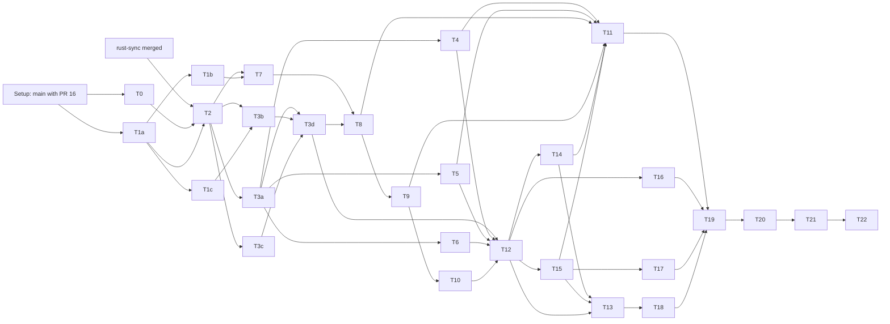
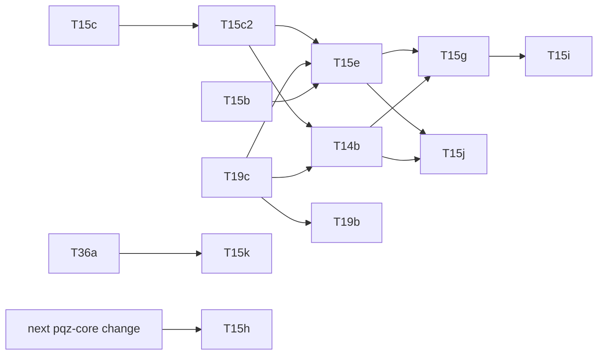

# `ua-rs-sign`: `ua-rs` as the one signer and crypto core of every client — build plan

> **For agentic workers:** REQUIRED SUB-SKILL: Use superpowers:subagent-driven-development (recommended) or
> superpowers:executing-plans to implement this plan task-by-task. Steps use checkbox (`- [ ]`) syntax for tracking.

**Status (2026-11-05):** plan, not executed; nothing is built from it. Work order item 3d (owner 2026-11-05: "write the 3d plan"). **The owner accepted MD-1..MD-14 as proposed (2026-11-05)**; T0 and the clientkeys tasks may start; Rust tasks wait for `rust-sync` on `main`. Revised after the Codex security review (2026-11-05): tasks, tests, mutants and estimates of the twelve findings (C-01 … C-12, spec §17).
Decisions MD-1 to MD-14 are the controller's; the owner may override any of them. Runs in parallel with 3b (regulated kinds) and
3c (PqChat contract), before the EVM freeze. **No contract, node or signed-record byte-format change.** UNAUDITED.

**Spec:** [`2026-11-05-ua-rs-sign.md`](../specs/2026-11-05-ua-rs-sign.md), owner answers 2026-11-05 (all as recommended: §1 rulings
1–9, the four answers after its status, §14 Q1–Q10). Review: [`ua-rs-sign-fable-review.md`](../../research/ua-rs-sign-fable-review.md)
(F-01 … F-52, mapped in spec §16) and [`ua-rs-sign-codex-review.md`](../../research/ua-rs-sign-codex-review.md) (C-01 … C-12, mapped
in spec §17); every "applied" and "task" item has a task below, column "Review items" of the task table.

**Branch / worktree:** `ua-rs-sign`, `.claude/worktrees/ua-rs-sign`, this plan's parent `b7786535`. One commit per task at least,
`ua-rs-sign T<n>: …`; no merge, no push without the owner's word; `main` is PR-only.

**Goal:** `clients/ua-rs` (crate `scaas-ua`) derives every key exactly as `clients/clientkeys`, signs for every kind (with the
policy gate, EVM transactions and WebAuthn builders), holds the UA KEM key, seals and opens, wraps AEAD / HKDF / HMAC, keeps the
clientkeys vault v1, a manifest and backups, and fronts `zether-prover` and `pqz-ffi` as facades; secrets never leave it but
through the named exports. The C ABI moves to v6 (handles, `scaas_ua_features()`); every existing binding but `ua-dart` reaches
the new surface. clientkeys stays the JS reference and writes every vector row first.

**Gate runner:** `smartcontracts/evm/runs/<date>-ua-rs-sign-gates.sh [--only <step>]` on the step contract of
`2026-10-27-metatx-split-gates.sh` (as `2026-11-04-mldsa87-gates.sh`: `P`, `LOGEXT=log`, `STEPS`, `extra_step`, `NEW_TESTS`, then
source the base). Logs `runs/<date>-ua-rs-sign-<step>.log` git-ignored, first line `# <step> at commit <sha>`, last `rc=<n>`; a step
done at the same commit on a clean tree is skipped; `<date>-ua-rs-sign-summary.txt` committed (`step | commit | rc | counts`, no
absolute paths). On resume read the logs and `runs/gate/last` first.

## Preconditions (Setup, before T0)

- [ ] **PR #16 (CLI-SGN-21, clientkeys `dekFrom` bounds) is merged into `main` (2026-11-05).** Merge `main` into `ua-rs-sign`; T1
      builds on it and does not redo it (spec §8.1's "T1 adds it" is done by PR #16). If the merge conflicts, resolve on `main`'s side.
- [ ] **Rust 1.97.1 (`rust-sync`):** T0 and T1 (JS) start now. **No Rust task (T2 on) starts before `rust-sync` is merged into
      `main` and `main` is merged here** (MD-2). If it is late, the controller tells the owner; nothing pins 1.97.1 by hand here.
- [ ] Real directories, not symlinks: `clients/clientkeys/node_modules` (`npm ci --ignore-scripts`), `smartcontracts/evm/lib`
      (`scripts/evm_libs.sh install`, `check`; only for the `forge-ua` guard step).
- [ ] Baseline recorded in `runs/<date>-ua-rs-sign-base-summary.txt`: `clientkeys`, `ua-rs` (+ `pq`, `signers`, `json`), `ua-c`,
      `ua-cxx`, `ua-qt`, `ua-dart-frb`, `ua-py`, `ua-go`, `ua-cs`, `ua-dart`, `cargo-zether-prover`, `docs`. A failure not named in
      `main`'s last summary stops the plan.

## Global constraints

- **Owner rulings override code;** follow a stated rule as stated, no option tables. Spec "proposal" rows stand unless overridden.
- **Every task, the same six steps:** (1) the failing tests listed, positive control first, one change per negative test;
  (2) run them: FAIL (the red line goes in the commit message); (3) implement; (4) the task's gates PASS; (5) mutants, each alone on
  a clean tree, its suite run, restored by `git checkout -- <file>`, logged by `smartcontracts/evm/runs/<date>-ua-rs-sign-t<n>-mutants.py`
  (the form of `2026-11-01-typed-signing-c8-mutants.py`: name, file, old, new, command; a surviving mutant exits 1 and is a
  finding) into `…-t<n>-mutants.txt`; (6) commit, staged by explicit path.
- **Vectors are generated, never hand-edited.** clientkeys writes every row first (T1a–T1c); each generator runs twice and the files
  do not move the second time; every reader reads the same rows. Every struct with `mode` / `relayer` / `feeRecipient` has a row with
  non-zero unbound values whose expected digest is the zeroed one. A byte-format change regenerates all files in one commit.
- **Transcripts never change in `ua-rs`.** No proof, statement or transcript code in the facades; no `pqzl`, `pqzh`, `stmt`, `ffi/src`
  or set-parameter change, so **no full `pqz-core/gate.sh`**. A needed change there stops the task and goes to the controller.
- **Zether ≠ PQZ:** separate tasks (T14, T15), features, handles, tests, commits. **NEAR ≠ Algorand:** not touched.
- **No RNG parameter in a release signature** (F-01); deterministic entry points only under feature `vectors`.
- **Bounded decoders:** every outside input bounded by length and depth before it allocates or recurses (spec §9.3 caps).
- **No contract change** (the `msig` KEM registry change is plan task T66b's on `ua-mtx-merge`, owner 2026-11-07; was 3c's). **No EIP-7702, no EIP-191.** No consumer names anywhere.
- **Backup, do not delete:** nothing in `ua-rs` or a binding is removed; a superseded file goes to its `legacy/ua-rs-sign/` (MD-4).
- **Pins move only with old → new in the commit:** `SCAAS_UA_ABI_VERSION`, the header drift test, `rust-version`, every `Cargo.lock`,
  `deny.toml`, the size ratchet (MD-12), generated vectors by their generator. Never edit a pin, bound or test to go green.
- **Machine:** `cargo`, `npm`, `dotnet`, `forge` through `scripts/capped`, foreground, never inside `timeout`, `-j2`, `--locked`;
  `dotnet build-server shutdown` after capped dotnet; ≤ 3 agents, ≤ 2 heavy at once, no two gate runs at once; no `nohup`, `&`,
  `until`, `sleep` loops, `pgrep -f`, `git stash`, `git add -f`. **No timing run without asking the owner** (T17).
- **Git and docs:** English; new source files carry `SPDX-License-Identifier: LicenseRef-Vegan-Community-1.0`; `Signed-off-by` per
  CONTRIBUTING; session `Co-Authored-By` trailer; full output in `.log`, committed summaries only; no machine paths.

## Plan decisions (MD-*; controller calls, the owner may override; recorded in `decisions.md` by T19)

- **MD-1 Task split.** clientkeys first in three parts (T1a derivation and signing rows, T1b KEM / seal / vault rows, T1c external
  answers) so `ua-rs` tasks start on the rows they need; `ua-rs` signing in four kind groups (T3a classic curves, T3b PQ, T3c pairing
  curves and groups, T3d `UASig` / `msig`); KEM (T7) apart from seal / AEAD (T8); the C ABI (T12) once the Rust API is final.
- **MD-2 Toolchain.** `rust-version = "1.97.1"` in `ua-rs`, `ua-c` and every binding's Rust side, set by the merge of `rust-sync`
  (T2 checks, does not write a toolchain file of its own). `zether-prover` follows `rust-sync`'s value.
- **MD-3 Bindings in this round.** All seven move: `ua-c` (ABI v6), `ua-cxx`, `ua-qt`, `ua-dart-frb` (Rust API), `ua-py`, `ua-go`,
  `ua-cs` (load `libscaas_ua_c` for the wallet surface; their ids and digests stay native, the cross-check). `ua-dart` stays
  identity-only (spec §2). The wasm-bindgen browser binding (Q4) is the next round, after T17's numbers.
- **MD-4 Legacy.** Nothing is removed. The ABI v5 header is copied to `clients/ua-c/legacy/ua-rs-sign/scaas_ua.v5.h` before T12
  rewrites its rule text; a binding file replaced in whole goes to its `legacy/ua-rs-sign/`. Checked not git-ignored at T12.
- **MD-5 Features.** `default = ["wallet", "zether", "pqz", "pqz-set-n2304-kmax4096"]` (owner: facades on by default);
  `wallet` = `pq` + `signers` + `json` + the new crates; `zether` and `pqz` imply `wallet`; `pqz-set-*` exactly one; `mlock` (off on
  wasm32); `vectors` (test-only entry points, never in a release build). The verify-only identity layer stays buildable with
  `--no-default-features` (+ `pq` / `json` / `signers` as today), a CI cell of its own.
- **MD-6 Module layout.** New code under `clients/ua-rs/src/wallet/` (`mod.rs`, `derive.rs`, `sign.rs`, `pqsign.rs`, `pairing.rs`,
  `uasig.rs`, `eip712.rs`, `policy.rs`, `tx.rs`, `webauthn.rs`, `kem.rs`, `seal.rs`, `aead.rs`, `vault.rs`, `manifest.rs`,
  `signer.rs`, `bounded.rs`) and `src/facade/{zether,pqz}.rs`; the existing modules (`verify.rs`, `ua8.rs`, `pq.rs`, `musig2.rs`,
  `frost.rs`, `json.rs`) are called, not copied (one `hashToScalar`, one `M'` builder).
- **MD-7 Where vectors live.** New files `smartcontracts/vectors/ua/{keys,sign,kem,seal,vault}.json` (spec §11), generator
  `clients/clientkeys/scripts/ua-wallet-vectors.mjs` (one script, one section per file). Policy rows: section `policy` of
  `sign.json`, produced by running clientkeys' own `check*` functions. ACVP ML-KEM-1024 and RFC 7748 go into `pq_external.json` by
  `pq-external.mjs` (source and sha256 per section); RFC 6979 A.2.5 and the secp256k1 set into `sign.json` section `external`. The
  both-ways fixture `smartcontracts/vectors/ua/rs_signatures.json` is written by a `ua-rs` test under `vectors`
  (`--ignored regenerate`), read by `npm test`.
- **MD-8 Falcon keys (Q1).** T0 decides. Equal → `ua-rs` calls PQClean's seeded keygen through a vendored build
  (`clients/ua-rs/vendor/pqclean-falcon-seeded/`, MIT, `cc`). Not equal → the ruled fallback (both clients on PQClean's keygen,
  vectors regenerated); if that needs PQClean code inside clientkeys (a wasm module), the controller asks the owner first.
- **MD-9 Signing policy port.** `Expect` has one variant per clientkeys check (`Payment`, `ReceiverFee`, `PayMeta`, `Op`, `Call`,
  `OwnerCall`, `Cancel`, `TradeOrder`, `WrapOrder`) with the check's named inputs, plus `Any(AllowAnyTypedData)`; the port reads the
  same rows and refuses with `PolicyRefused`; a check clientkeys adds later is ported with its rows.
- **MD-10 Off-chain purpose `scaas.ua.purpose.seal.v1`.** In clientkeys `ua.js` and `ua-rs` `PURPOSES` with an off-chain mark; never
  in a contract list (no contract change); `sign_ua` accepts it only from the container builder. `decisions.md` entry (owner 2026-11-05).
- **MD-11 `msig` has no KEM key, client side now.** Enforced by `kem_key` (single-key handle only), the record builders and the seal
  callers in this round; a `CLI-SGN` rule and a `decisions.md` entry that points at CTR-UA-32's change in round 3c (whichever lands
  second links the other).
  **Change (owner 2026-11-06, option (c)):** this round enforces it in `kem_key` (T7) and the seal callers (T8) only. The record
  builders (clientkeys `ua.js` `holds` / `registrationArgs` / `kemRecordMessage`, ua-rs `ua8.rs`) refuse an `msig` KEM key in round
  3c, together with the registry's own refusal (CTR-UA-32): the contract e2e (`e2e.py` `msig_ua`), the `portable.json` `msig-pq` /
  `kemRecords` rows and the binding tests move to refusal rows there in one step. Reason: the generators, the e2e and four binding
  suites build those records through the same builders while the registry still accepts them.
  **Change (owner 2026-11-07):** that step, with CTR-UA-32's registry refusal, moves from round 3c to plan task T66b on `ua-mtx-merge`;
  the owner confirmed the rule the same day. Recorded as CLI-SGN-45 (T19).
- **MD-12 Size ratchet.** `clients/ua-c/size-baseline.json`: stripped release `libscaas_ua_c` per target (x86-64, aarch64-android,
  aarch64-ios, wasm32) × feature cell (`--no-default-features`, `wallet`, default, default with each `pqz-set-*`); the runner step
  `ua-sizes` fails on growth without an old → new line and a reason. Sizes are not timing: no owner ask needed.
- **MD-13 External keys (phase 2) in this round:** the `Signer` trait and `SignRequest` are public (T3a), a `TestExternalKey` under
  `vectors` runs `sign.json` through verify-after-sign, and the C header declares `ScaasUaExternalSigner` and
  `scaas_ua_external_key_new`; in a release build the call returns `KIND_UNAVAILABLE` with the feature bit `external` clear.
- **MD-14 Review.** Claude lenses, then Fable; Codex only on the owner's word (credits). Named as AI review; everything stays UNAUDITED.

## Tasks

| Task | Content | Depends on | Review items | Est. (person-days) |
|---|---|---|---|---|
| T0 | Spikes: Falcon Q1, pins and licences, `cargo deny` baseline, `rand_core` / `getrandom`, cross-builds, CT and zeroize words | Setup | 11, 12, 41, 48 | 2–3 |
| T1a | clientkeys: UA tree, EIP-2333 UA paths (index 0 only), `solana`, signers `0x0101` / `0x0108`, Schnorr nonce, tx and policy rows, unrelated-domain row, BLS role rows, WebAuthn refusals → `keys.json`, `sign.json` | Setup (T0 for Falcon rows) | 03, 09, 15, 17, 22, 23, 26, 27; C-04, C-06, C-07, C-08 | 5–7 |
| T1b | clientkeys: KEM key, encaps / decaps checks, seal / open, container and its acceptance, replay rows, vault rows (12-word) → `kem.json`, `seal.json`, `vault.json` | T1a | 02, 04, 07, 08, 19, 20, 43; C-03, C-10, C-11 | 3.5–5 |
| T1c | External answers: ACVP ML-KEM-1024, RFC 7748, RFC 6979 A.2.5, named secp256k1 set; `sigGen` for signers | T1a | 09, 10 | 1–2 |
| T2 | `ua-rs`: features, crates, derivation, `Wallet`, BIP-39 (entropy lengths), the secret store and arena, zeroize types, ranges, EIP-2333 index 0, bounded JSON reader | T0, T1a, rust-sync | 11, 15, 17, 37, 38, 44; C-02, C-06, C-09, C-10 | 4–5 |
| T3a | Signers: ECDSA / ed25519 / BIP-340, native keys, `sign_ua`, `sign_member`, key proof, raw digest, `Signer` trait, `SigRole` | T2 | 01, 09, 25, 45; C-08 | 3–4 |
| T3b | PQ signers: ML-DSA hedged, SLH-DSA, Falcon; both-ways fixture | T2, T1c, T0 (Q1) | 13, 14, 16, 24 | 2–4 |
| T3c | Pairing kinds: scaas Schnorr nonce, `secret_mul` (ladder, structural test), BLS with roles; MuSig2 / FROST sessions, FROST-BN254 element newtype | T2 | 03; C-01, C-06, C-08 | 4–5 |
| T3d | `UASig` builder, `msig` minimal at both levels | T3a–T3c | — | 1–2 |
| T4 | EIP-712 generic hasher (faithful), canonical step on checked records only, `Expect` policy | T3a, T1a | 22, 23, 26; C-04 | 4–6 |
| T5 | `sign_transaction` types 0–3 (`alloy-rlp`) | T3a, T1a | 27 | 2–3 |
| T6 | WebAuthn challenge and assertion builders (expected challenge, chain rule, verify before return) | T3a | 28; C-07 | 1.5–2 |
| T7 | KEM key (`UaKey::kem_key`, store-scoped self-test), combiner, encaps / decaps checks, holder and `msig` rules, ephemeral key | T2, T1b, T1c | 04, 05, 06; C-05 | 3–4 |
| T8 | AEAD, HKDF, HMAC; seal / open; container, sender signature, `open_container` acceptance, `LinkSession`, `from_link` | T7, T3d | 07, 08, 43; C-03, C-11 | 4–5 |
| T9 | Vault v1 (entropy lengths), manifest, discovery, import, `SeedBackup`, `backup_seal` (generation), `restore_backup` | T2, T8 | 02, 18–21, 42, 43, 49; C-03, C-10, C-11, C-12 | 4.5–6.5 |
| T10 | Custody and memory protection: `lock()` / `unlock` revocation by generation, arena `mlock` / no-dump, no-`Clone` / no-RNG compile-fail tests | T9 | 01, 11, 46; C-02, C-09 | 4–5 |
| T11 | Fuzz targets and corpus for every decoder | T4, T5, T8, T9, T14, T15 | 44 | 2–3 |
| T12 | C ABI v6, handles (child handles after wallet free), statuses, `scaas_ua_features()`, header rules, panic lints, error hygiene | T3d–T10 | 29–34, 47; C-02, C-03, C-05 | 4.5–6.5 |
| T13 | Bindings: `ua-cxx`, `ua-qt`, `ua-dart-frb`, `ua-py`, `ua-go`, `ua-cs` | T12, T14, T15 | 29, 32 | 10.5–15 |
| T14 | Facade `zether` | T3a, T8, T12 | 35, 39 | 3–4 |
| T15 | Facade `pqz` | T3a, T8, T12 | 34, 38, 40 | 4–5 |
| T16 | External-key interface (phase 2's API, tests of the interface, role carried) | T3d, T4–T6, T12 | 45; C-08 | 2–3 |
| T17 | Target matrix and sizes; mobile and wasm32 measurement (**asks the owner before any timing run**) | T12, T15 | 40, 41 | 2–4 |
| T18 | CI jobs, `ci_changes.py`, `cargo deny` / `cargo audit` | T12, T13 | 48 | 2–3 |
| T19 | Docs and `decisions.md` | drafts beside T7–T18 | 50–52 notes; C-01 … C-12 rules | 3–4 |
| T20 | Gate runner, closing gates | T19 | — | 2–3 |
| T21 | Review (Claude → Fable; Codex on the owner's word), fix wave | T20 | — | 4–6 |
| T22 | Report and PR (on the owner's go) | T21 | — | 0.5–1 |
| | **Total** | | | **88–127** (was 80–118 before the Codex response) |

Critical path (T1a → T2 → T3c → T3d → T8 → T9 → T10 → T12 → T14 / T15 → T13 → T20 → T21 → T22) ≈ 51–65 working days (was 44–58;
T3c, now 4–5, replaces T3a on the path); the rest runs beside it (≤ 3 agents).

Parallel lanes (≤ 3 agents, ≤ 2 heavy): {T0 ∥ T1a}; {T1b ∥ T1c ∥ T2}; {T3a ∥ T3b ∥ T3c}; {T4 ∥ T5 ∥ T6 ∥ T7}; {T14 ∥ T15 ∥ T16};
the six bindings of T13 two at a time; T18, T19 drafted beside.

---

### T0 — spikes (report only, no code kept)

**Files:** `clients/ua-rs/runs/<date>-ua-rs-sign-t0.md` (the run record), `clients/ua-rs/deny.toml`
(kept: the permanent gate), `clients/ua-rs/NOTICE` (draft list).
- [ ] **Falcon Q1:** PQClean `falcon-512` / `-1024` keygen seeded with the 48 bytes clientkeys passes noble 0.7.1, both through
      SHAKE256 as `crypto_sign_keypair`, on the `pq_kat.json` seeds: equal or not, per kind. Outcome per MD-8.
- [ ] **Pins and licences:** `ml-kem` =0.3.4, `x25519-dalek` =2.0.1 (`static_secrets`), `aes-gcm` =0.10.3, `aes-gcm-siv` =0.11.1,
      `hkdf` =0.12.4, `scrypt` =0.11.0, `bip39` =2.2.2, `bip32` =0.5.3, `zeroize` =1.8.2, `alloy-rlp` (pinned here), facade deps; one
      `aes` (=0.8.4), one `curve25519-dalek`; the `rand_core` generations and their `OsRng`; a review note per new crate.
- [ ] **`cargo deny` baseline** (advisories, licences, duplicates; the tool's version pinned in the report) and `cargo audit` once.
- [ ] **Cross-builds (compile only, no timing):** wasm32-unknown-unknown (Falcon with clang, else `KIND_UNAVAILABLE`; `getrandom`
      0.2 `js`, 0.3 `wasm_js` + cfg), aarch64-linux-android, aarch64-apple-ios (or record "no SDK on this host", T18 runs it in CI).
- [ ] **Words quoted:** each crate's constant-time and zeroize statement, "no claim by the crate" where none (`ml-dsa`, `ml-kem`,
      `slh-dsa`), `ghash` / `polyval` soft paths, `scrypt`, PQClean.
**Gates:** none (report). **Commit:** `ua-rs-sign T0: spike report, deny.toml baseline`.

### T1a — clientkeys: derivation and signing rows

**Files:** `clients/clientkeys/src/{seed,pq,ua,evm}.js` (UA tree `deriveUAKey` `m/22776'/0'/<account>'/<kindNo>'/<i>'`, SLIP-10
`nist256p1`, EIP-2333 UA paths with salt `SCAAS-UA-BN254-v1`, `solana` `m/44'/501'/i'/0'`, ranges `< 2^31`, signers `0x0101` /
`0x0108`, scaas Schnorr production nonce, EVM tx types 0–3 with a small RLP), new `scripts/ua-wallet-vectors.mjs`,
`test/ua-wallet.test.js`; `smartcontracts/vectors/ua/{keys,sign}.json` (new).
**Interfaces:** rows per spec §11 for `keys.json` and `sign.json` (deterministic and randomized rows, `msig` sets, typed rows with
arrays and a negative `int`, one non-zero-unbound row per `mode` struct incl. a nested `MetaTransfer`, `policy` rows from the
`check*` functions, tx rows, the nonce-map row from the generator, refusals); `extraEntropy: false` explicit, said in `note`.
- [ ] Red: `keys.json rows equal deriveUAKey for every kind × account {0,1} × index {0,1}`; `account 2^31 refused`; `non-ASCII BIP-39
      passphrase row`; `0x0101 and 0x0108 sign ua_msg (no prehash for 0x0108, sha256 for 0x0101)`; `nonce map is the 512-bit map`;
      `unbound relayer / feeRecipient hashed as zero in every mode struct`; `tx type 4 cannot be built`; `EIP-155 published row`;
      `index 1 refused for every EIP-2333 kind` and `musig2-bn254 at m/254/0/<account>/274` (C-06); `12-word mnemonic row` (C-10);
      `unrelated Order(mode, relayer, feeRecipient, amount) through Any equals hashTypedData of the supplied values` (C-04); `BLS
      ordinary and PoP rows, right message under the wrong DST refused` (C-08); WebAuthn refusals: wrong challenge, reordered JSON,
      `crossOrigin: true`, `r = 0`, `s = n` (C-07).
- **Mutants:** T2's derivation list on the JS side (hardened bit, `account` / `index` swap, u32 little-endian, non-hardened ed25519,
  wrong `kindNo`, `TAG(kind)` in `info`, NFKD); `extraEntropy` left to the default; canon skipped on a nested struct; canon applied
  to the unrelated `Order` row; an index child appended to an EIP-2333 path.
**Gates:** `clientkeys`, `vectors-check`. **Commit:** `ua-rs-sign T1a: clientkeys UA tree, UA signers, keys.json and sign.json`.

### T1b — clientkeys: KEM, seal, vault rows

**Files:** `clients/clientkeys/src/kem.js` (new: KEM key §6.1, combiner, checks §6.2, `generateEphemeral`), `src/seal.js` (new: §6.3
seal / open, container, `aad`, sender `UASig` under MD-10's purpose), `src/vault.js` (no format change; rows only),
`scripts/ua-wallet-vectors.mjs`, `test/{kem,seal}.test.js`, `test/vault.test.js`; `smartcontracts/vectors/ua/{kem,seal,vault}.json`.
- [ ] Red: `encaps with fixed m, e`; refusals (modulus, length, scheme 2, all-zero `ss_X`); decaps rows (short `ct`, flipped byte →
      another `ss`, small-order `E`); `seal per purpose`; refusals per field; `link container fails on a swapped short code`; vault rows
      (small `N` and `N = 2^17`, wrong passphrase, altered AAD label, NFC / NFD pair, `N = 2^31`, `N = 3`, `r = 16`, `v: 2`, tombstone);
      `KEM key for an msig or a non-holder refused`; acceptance refusals, each from an otherwise valid container (C-03): `signed by
      a different registered UA`, `purpose not expected`, `recipient not the opener's`, `sender key whose UA is not sender.ua`,
      `backup entropy that does not derive sender.ua`; replay rows (C-11): `link created outside the session window`, `backup
      generation 1 over generation 2`; vault (C-10): `12-word vault round trip` (mnemonic, signing key and KEM key equal before and
      after, through the vault and a sealed backup), `31-byte seed payload refused`.
- **Mutants:** modulus check removed; all-zero `ss_X` accepted; combiner `E` dropped; `kemPkHash` out of `info`; short code out of
  the link `aad`; NFKC dropped; AAD label dropped; expected sender ignored; backup self-consistency skipped; entropy padded to 32.
**Gates:** `clientkeys`, `vectors-check`. **Commit:** `ua-rs-sign T1b: clientkeys KEM, seal, container; kem, seal, vault rows`.
clientkeys gains the same container acceptance (`openContainer(kemKey, container, expect, members, accepted)`) and generation as `ua-rs`,
so the rows are written by the reference.
**Owner answers on T1b (2026-11-05), all as recommended (spec header):** `sender.auth` is a full `UASig` (an `msig` sender in the
minimal form; `members` the opener's lookup of its member keys, replacing `senderKey`), built in clientkeys with its `seal.json`
rows and mutants (commit `ua-rs-sign: container sender is a full UASig; owner answers on T1b (2026-11-05)`); KEM `info` version
`be64` (T7); short code 8 decimal digits, `BackupPayload` field order, malformed payload `Argument`, `allowRollback: true` / marker
`AllowRollback` (T8, T9); the checked path refuses a non-zero unbound `relayer` / `feeRecipient` (T4).
**Owner answers on the container sender (2026-11-05, "theo khuyên cả hai"; spec header):** the container carries no kind, the opener
tries `derive_ua` over the derived kinds (at most one matches; T8 the same); an `msig` sender needs its signers accepted at both levels
(CTR-UA-37): `openContainer(…, members, accepted)`, `openLink`, `restoreBackup` take `accepted(id, index)`, a missing lookup or an
answer other than `true` is `ContainerSender`, a single key needs none. Built in clientkeys with six `seal.json` acceptance rows and
mutants (commit `ua-rs-sign: container msig sender needs accepted members (CTR-UA-37) (owner 2026-11-05)`).

### T1c — external known answers

**Files:** `clients/clientkeys/scripts/pq-external.mjs` (ACVP ML-KEM-1024 `keyGen`, `encapDecap`; RFC 7748 §5.2 / §6.1, source and
sha256 per section), `scripts/ua-wallet-vectors.mjs` (`sign.json` `external`: RFC 6979 A.2.5 P-256, a named published secp256k1
RFC 6979 set with source and sha256), `test/pq.test.js`, `test/ua-wallet.test.js`; `smartcontracts/vectors/ua/pq_external.json`.
Existing, read by the signers from T3 on: RFC 8032 and BIP-340 (`signatures.json`), ACVP ML-DSA / SLH-DSA `sigGen` (`pq_external.json`).
- [ ] Red: clientkeys reproduces each new section; a flipped source byte fails its sha256 check.
- **Mutants:** one ACVP `d` / `z` swapped; X25519 clamping skipped.
**Gates:** `clientkeys`, `vectors-check`, `forge-ua` (forge reads `pq_external.json`). **Commit:** `ua-rs-sign T1c: external answers`.

### T2 — `ua-rs` core: features, derivation, `Wallet`

**Files:** `clients/ua-rs/Cargo.toml` (MD-5 features, T0 pins, `rust-version` from `rust-sync`, `[lints]`: `unwrap_used`,
`expect_used`, `panic`, `indexing_slicing` denied in new modules), `Cargo.lock`, `src/lib.rs` (`pub mod wallet`), `src/wallet/{mod,
derive,bounded,store}.rs`, `tests/wallet_keys.rs`, `NOTICE`.
**Interfaces:** `Wallet::{generate, from_mnemonic}` (entropy kept at its BIP-39 length 16–32 B, seed on unlock, `bip39_passphrase`
apart from `vault_passphrase`), `SeedBackup::take()`, `ua_key` (index 0 only for `0x0104`–`0x0107`, `0x0112`; spec §4),
`native_key(network, index, coin_type)`, BIP-32, SLIP-10 (ed25519, `nist256p1`), EIP-2333 (curve order and salt as parameters), HKDF
PQ seeds; `wallet/store.rs` (new): `SecretStore` (`Arc`, read-write lock over generation and arena), the arena of page-aligned
chunks that never move (spec §8.2), handles holding `(Arc, generation, slot)` and no secret bytes; `bounded::json(bytes, max_len,
max_depth)` (the one reader every later decoder uses).
- [ ] Red: `keys.json` every row; BIP-32 / SLIP-10 / EIP-2333 published vectors; `eip2333_equals_zether_prover_on_the_zether_path`;
      ranges refused (`Argument`); `index_1_refused_for_eip2333_kinds`; `twelve_word_entropy_kept_at_16_bytes`;
      `mnemonic_is_not_cloned_and_dropped_after_from_mnemonic`; `bounded_json_refuses_depth_9`; `handle_holds_no_secret_bytes`
      (a `vectors` hook: the handle's own allocation contains no key byte, its slot lies in the arena).
- **Mutants:** hardened bit dropped; salt / `info` order swapped; `account` / `index` swapped; u32 little-endian; non-hardened ed25519
  step accepted; wrong `kindNo`; `TAG(kind)` for `utf8(tag)` in the HKDF `info`; `account ≥ 2^31` accepted; NFKD dropped; the depth
  bound removed; index 1 accepted for an EIP-2333 kind; imported entropy padded to 32 bytes; a key's bytes copied into its handle.
**Gates:** `ua-rs` cells `--no-default-features`, `wallet`, `pq`, `signers`, `json`; clippy `-D warnings`; `cargo deny check`.
**Pins:** `rust-version` 1.90 → 1.97.1 (with `rust-sync`); `Cargo.lock`. **Commit:** `ua-rs-sign T2: wallet core and derivation`.

### T3a — classic-curve signers and the `Signer` trait

**Files:** `src/wallet/{sign,signer}.rs`, `tests/wallet_sign.rs`.
**Interfaces:** `UaKey::{sign_ua, sign_member}`, `NativeKey::{sign_key_proof, sign_digest(_, AllowRawDigest)}`; kinds `0x0001`,
`0x0003` (ECDSA and HIP-632 ed25519), `0x0010`, natives of `NETWORKS`, `0x0101`, `0x0102`, `0x0103`, `0x0108`; one key, one purpose
(CLI-SGN-29); `pub trait Signer`, `#[non_exhaustive] enum SignRequest` built only inside `ua-rs`, `UaMsg` carrying `SigRole` set by
`sign_ua` from its purpose (portable purposes `pop` v2, `kem`, `pqz-key` → `Pop`) and `Authorization` for `sign_member` (spec §9.4);
`OsRng` inside; every secret operation under the store's read guard with the generation check (spec §8.2).
- [ ] Red: `sign.json` rows of these kinds; RFC 6979 A.2.5 and the secp256k1 set; RFC 8032; BIP-340 fixed-`aux`;
      `kindNo_of_another_kind_refused`; `raw_digest_needs_the_marker`; `purpose_not_in_PURPOSES_refused`;
      `role_follows_the_registry_rule` (each purpose → its role); `no_public_call_takes_a_role` (compile_fail).
- **Mutants:** low-s removed; `v` offset 27 lost; prehash added for `0x0108` / removed for `0x0101`; purpose tag v1 for `pop` v2;
  another kind's `TAG`.
**Gates:** `ua-rs` (`wallet`, `vectors`), clippy. **Commit:** `ua-rs-sign T3a: classic-curve signers, Signer trait`.

### T3b — PQ signers

**Files:** `src/wallet/pqsign.rs`, `vendor/pqclean-falcon-seeded/` (if MD-8 equal), `build.rs` (if vendored), `tests/wallet_pq.rs`;
`smartcontracts/vectors/ua/rs_signatures.json` (MD-7); `clients/clientkeys/test/ua-wallet.test.js` (reads it).
**Interfaces:** ML-DSA `sign_internal(M' = 0x00 ‖ 0x00 ‖ pq_msg, rnd)` with `rnd` from `OsRng`; SLH-DSA `slh_sign_internal(M',
opt_rand)` (`None` only under `vectors`); Falcon padded over `ua_msg`, key bytes `Zeroizing`, crate type rebuilt per call.
- [ ] Red: `pq_kat.json` keys; `rnd = 0` and ACVP `sigGen` rows byte-equal; hedged rows verify; `two_release_signatures_differ`;
      the JS side verifies `rs_signatures.json` (Falcon, hedged ML-DSA, randomized SLH-DSA, OS-`aux` BIP-340).
- **Mutants:** Falcon signs `pq_msg`; ML-DSA context non-empty; ML-DSA `rnd` fixed in a release build; SLH-DSA `M'` without the
  two zero bytes.
**Gates:** `ua-rs` (`wallet`, `pq`, `vectors`), `clientkeys`. **Commit:** `ua-rs-sign T3b: PQ signers, both-ways fixture`.

### T3c — pairing-curve kinds and group sessions

**Files:** `src/wallet/pairing.rs`, `src/musig2.rs` / `src/frost.rs` (session wrappers only, no algorithm change), `tests/wallet_pairing.rs`.
**Interfaces:** `0x0104`, `0x0105` nonce `k = hashToScalar(keccak256("scaas.ua.schnorr.nonce.v1" ‖ be32(sk) ‖ Y ‖ ua_msg ‖ aux))` with
`verify.rs`'s one 512-bit `hashToScalar`, `k = 0` redrawn; `secret_mul(base, secret)` (spec §12: `ρ` 128 bits, `k' = k + ρ·r` as
`Zeroizing<[u64; 6]>` by limb arithmetic, a 384-iteration Montgomery ladder with a masked coordinate swap, generic over G1 and G2,
`ρ` / `k'` / swap state wiped) for every secret multiplication: keys of `0x0104`–`0x0107`, `0x0112`, the nonce point, BLS `sk·H(m)`,
MuSig2-bn254 nonces, FROST-BN254 through a `Bn254Group` element newtype in `frost.rs` (`groups.json` byte-equal); `clippy.toml`
`disallowed-methods` for `mul_bigint` in `src/wallet/`; BLS `0x0106`, `0x0107` with the domain from `SigRole` (DSTs of `verify.rs`);
`musig2-bn254` participant key at `m/254/0/<account>/274`; MuSig2 / FROST session objects whose secret nonce is consumed once.
- [ ] Red: fixed-`aux` rows; the nonce-map row (generator-computed); `groups.json` byte-equal; `second_sign_on_a_session_errors`;
      `blinded_and_plain_products_equal`; the **structural test** per secret path (keygen G1, keygen G2, nonce point, BLS sign,
      MuSig2-bn254, FROST-BN254): a `vectors` hook records the ladder's input integer and iteration count; two calls, same secret:
      same point, different integers, each `≥ r` and `≡ k (mod r)`, 384 iterations each; `bls_pop_and_sig_through_the_trait`,
      `right_message_wrong_dst_refused`.
- **Mutants:** nonce reduced from 256 bits; `Y` left out of the nonce; `secret_mul` replaced by `Projective * Fr` (blinding erased);
  `k'` reduced mod `r`; ladder width from the bit length of `k'`; `ρ = 0`; one path (each of the six) bypassing `secret_mul`; BLS
  role ignored (always SIG); `musig2-bn254` on the secp256k1 path.
**Gates:** `ua-rs` (`wallet`, `signers`, `vectors`), clippy. **Commit:** `ua-rs-sign T3c: scaas Schnorr nonce, secret_mul, BLS, group sessions`.

### T3d — `UASig` and `msig`

**Files:** `src/wallet/uasig.rs`, `tests/wallet_uasig.rs`.
**Interfaces:** `UASig` builder over `&dyn Signer` handles; `msig` member slots named by the caller; refusal of a non-minimal set at
both levels (`UAPoP`, the registry's verdict); member acceptance via `membership_digest`.
- [ ] Red: `portable.json`, `nested.json`, `sign.json` `msig` rows; `non_minimal_set_refused_at_level_2`; `slots_sorted`.
- **Mutants:** minimal check skipped; `memberDigest` over the wrong structure; slots unsorted.
**Gates:** `ua-rs` (`wallet`, `json`). **Commit:** `ua-rs-sign T3d: UASig builder and minimal msig`.

### T4 — EIP-712, canonical step, policy

**Files:** `src/wallet/{eip712,policy}.rs`, `tests/wallet_typed.rs`.
**Interfaces:** `TypedData {types, primaryType, domain, message}` parsed through `bounded::json` (64 KiB, depth 8, ≤ 32 types,
≤ 64 fields, acyclic references ≤ 8 deep, arrays ≤ 1,024); canonical step keyed on the fields `mode` / `relayer` / `feeRecipient`,
recursive (as clientkeys `canonical`), applied by the SCaaS record builders only; the checked path (an `Expect` other than `Any`)
**refuses** a server typed-data whose unbound `relayer` / `feeRecipient` is non-zero (`PolicyRefused`) and never zeroes it, as the
clientkeys `check*` functions (owner 2026-11-05, spec §5.3, §5.4); the hasher and `sign_typed_any` are faithful (spec §5.3,
C-04); value encoding of spec §5.3; `NativeKey::sign_typed(td, Expect)` (MD-9), `PolicyRefused`.
- [ ] Red: `typed/typed_ops.json`, `ua/portable.json`, `sign.json` typed and `policy` rows (accepted and refused);
      `unknown_field_refused`; `cyclic_types_refused`; `negative_int_two_complement`; `nested_metatransfer_zeroed` (builders); `checked_path_refuses_nonzero_unbound_relayer_and_fee_recipient`;
      `unrelated_order_through_any_is_signed_as_supplied`.
- **Mutants:** unbound `relayer` hashed; canon skipped on a nested struct; canon applied on `Any`; the checked path zeroes a non-zero unbound field instead of refusing it; policy check skipped; `EIP712Domain`
  field order changed.
**Gates:** `ua-rs` (`wallet`, `vectors`). **Commit:** `ua-rs-sign T4: EIP-712 hasher, canonical step, Expect policy`.

### T5 — `sign_transaction`

**Files:** `src/wallet/tx.rs`, `tests/wallet_tx.rs`, `Cargo.toml` (`alloy-rlp` per T0).
**Interfaces:** `EvmTx` enum `Legacy` (EIP-155 `chainId` required), `Eip2930`, `Eip1559`, `Eip4844` (signed fields only); no type 4;
output envelope and `(r, s, yParity)`; tx JSON 16 KiB, depth 4.
- [ ] Red: `sign.json` tx rows per type; the EIP-155 published row; `legacy_without_chain_id_refused`.
- **Mutants:** type-4 variant added (a `compile_fail` doc test proves none exists); `chainId` dropped from the legacy sighash.
**Gates:** `ua-rs` (`wallet`). **Commit:** `ua-rs-sign T5: EVM transaction signing, types 0-3`.

### T6 — WebAuthn builders

**Files:** `src/wallet/webauthn.rs`, `tests/wallet_webauthn.rs`.
**Interfaces:** `webauthn_assertion(key_data, expected_challenge, auth_data, client_data_json, r, s)` (spec §5.6, C-07): `0 < r, s < n`
first, low-s, the exact JSON bytes, `verify.rs` `client_data_ok` against `expected_challenge`, then `verify(0x0100, …)` of the whole
encoding before return; `WebAuthnAssertion` on any failure.
- [ ] Red: `webauthn_challenge` = `ua_msg`; `webauthn_assertion` on the webauthn rows of `signatures.json` and `portable.json`;
      wrong `type`, non-UTF-8 refused; high-s normalised; `sign.json` WebAuthn refusals (wrong challenge with a self-consistent JSON,
      reordered JSON, `crossOrigin: true`, `r = 0`, `s = n`); `assertion_for_another_key_refused`.
- **Mutants:** WebAuthn high-s accepted; challenge compared without base64url; challenge read from the JSON instead of
  `expected_challenge`; a generic JSON parser in place of `client_data_ok`; verify-before-return skipped; range check after
  normalisation.
**Gates:** `ua-rs` (`wallet`). **Commit:** `ua-rs-sign T6: WebAuthn challenge and assertion builders`.

### T7 — KEM

**Files:** `src/wallet/kem.rs`, `tests/wallet_kem.rs`, `Cargo.toml` (`ml-kem` `zeroize`; `hazmat` only under `vectors`).
**Interfaces:** `UaKey::kem_key(version)`, no wallet argument: the seed of the handle's own store (spec §6.1, C-05) (KEM holders only,
`KemHolder`; `msig` impossible by type, MD-11; revoked handle `KeyRevoked`; external key `KIND_UNAVAILABLE`), `kemSeed` HKDF (`info`
version `be64`, owner 2026-11-05)
→ `KeyGen_internal(d, z)`, `sk_X`, `dk` and `sk_X` in the arena; FIPS 203 §7.3 self-test once per store per `(ua, version)`, its record in
the store; `kem_encaps(kemPk)` with the type
and modulus checks; `KemKeyPair::{generate_ephemeral, kem_pk, decaps}` with the length and contributory checks; implicit rejection kept.
- [ ] Red: `kem.json` every row; ACVP ML-KEM-1024 `keyGen`, `encapDecap`; RFC 7748; `self_test_runs_once_per_store`;
      `kem_key_of_wallet_a_handle_is_a_derivation_while_wallet_b_unlocked`.
- **Mutants:** modulus check removed; all-zero `ss_X` accepted (encaps, decaps); decaps length check removed; combiner fields reordered
  or `E` dropped; label changed; KEM key derived for an `msig`; KEM `version` ignored; self-test record process-wide instead of per
  store.
**Gates:** `ua-rs` (`wallet`, `vectors`). **Commit:** `ua-rs-sign T7: UA KEM key, combiner, encaps / decaps checks`.

### T8 — AEAD, HKDF, HMAC, seal / open, container

**Files:** `src/wallet/{aead,seal}.rs`, `tests/wallet_seal.rs`.
**Interfaces:** `aead_seal / aead_open(Alg::{Aes256Gcm, Aes256GcmSiv}, …)`, `hkdf_sha256`, `hkdf_expand_sha256` (`len ≤ 255 × 32`),
`hmac_sha256`; `seal(kemPk, purpose, aad, pt)` (`pt ≤ 1 MiB`, purpose `[a-z0-9./-]{1,64}`), `KemKeyPair::open`, `SealVersion`,
`SealOpen`; container JSON (named fields, base64url) for `scaas/backup/v1` and `scaas/link/v1`, sender `UASig` under MD-10's purpose;
`KemKeyPair::open_container(c, &ContainerExpect, &Members, Option<&Accepted>)` (spec §6.3, C-03; owner 2026-11-05: `sender.auth` a full
`UASig`, `Members` the lookup of an `msig` sender's member keys, `Accepted` = `ua8::Accepted`, `memberAccepted` by `(id, index)`): purpose,
recipient, expected sender or approved set, `sender.auth.keyData` derives `sender.ua` (an `msig` or exactly one single-key kind, found by
trying `derive_ua` over the derived kinds: the container names none), the `UASig` (single key: no members, `accepted` not asked; `msig`:
`accepted` present, no own signature, minimal at both levels, at each level the weight of the accepted signing slots reaches the
threshold (CTR-UA-37), every member signature), all before decapsulation, `ContainerSender` (also: no `accepted` for an `msig`, a signer
not accepted) / `SealOpen`; `from_link` and `restore_backup` take `accepted` the same way; short code 8 decimal digits; `LinkSession::new()` (ephemeral
key, short code, 10-minute window), `Wallet::from_link(session, …)` consuming the session (C-11), `ContainerReplay`; the "seal
authenticates no sender" and "no replay protection" sentences in the rustdoc.
- [ ] Red: `seal.json` every row incl. the acceptance (the `msig` sender rows too, the six member-acceptance rows with each row's
      `accepted` map as the lookup) and link-window refusals; `msig_sender_without_accepted_refused`; `single_key_sender_never_asks_accepted`; NIST GCM, RFC 8452, RFC 5869, RFC 4231 published
      vectors; `empty_pt_ok`; `pt_over_1_MiB_refused`; `no_container_open_without_expect` (compile_fail);
      `second_link_install_cannot_be_expressed` (compile_fail: the session is moved); `link_session_key_wiped_after_install`.
- **Mutants:** `kemPkHash` or `purpose` left out of `info`; `aad` ignored; open returns plaintext on a bad tag; container sender
  signature unchecked; an `msig` sender with a non-minimal set accepted (level 1, level 2); a single-key `UASig` with members accepted;
  member acceptance skipped (level 1, level 2); accepted weight counted over the signers instead of the accepted ones; a missing
  `accepted` treated as all accepted; short code left out of the link `aad`; expected sender ignored; recipient or purpose expectation skipped;
  `derive_ua` recomputation skipped; link window not checked.
**Gates:** `ua-rs` (`wallet`, `vectors`). **Commit:** `ua-rs-sign T8: AEAD, HKDF, HMAC, seal / open, containers`.

### T9 — vault, manifest, discovery, import, backup

**Files:** `src/wallet/{vault,manifest}.rs`, `tests/wallet_vault.rs`.
**Interfaces:** vault v1 byte-compatible (`seed` = the entropy at its BIP-39 length, 16/20/24/28/32 B exactly, refused otherwise before
a wallet is built, label `seed` required in `open_vault`; BIP-39 passphrase never stored; NFKC; bounds `N ∈ {2^15, 2^16,
2^17}, r = 8, p = 1` checked before scrypt, `VaultParams`; `v: 2` and tombstone `VaultVersion`); `seal_vault`, `open_vault(Unlock)`
(PRF first), `needs_rewrap`, `rewrap_pin`, `enable_prf`, new-passphrase policy; labels `frost-share:`, `kem:`, `native-import:`,
`manifest`; `Manifest` (with `backup_generation`, `backup_senders`) and `discover_candidates(kind, account, gap = 20)` (index 0 alone for
EIP-2333 kinds); `import_native_key` (family-tagged, UA kinds refused); `backup_seal(recipients)` over `BackupPayload` with `generation`
(raised per seal); `Wallet::restore_backup(…, current, rollback)` (spec §6.3: acceptance, the entropy derives `sender.ua`, older
generation over the same wallet `BackupRollback` unless the marker type `AllowRollback`, JS `allowRollback: true`); `BackupPayload` JSON
`{v, generation, entropy, secrets, manifest: {entries: [{kind, account, index, ua}]}}` in this order, a malformed payload `Argument`
(owner 2026-11-05); `rewrap_pin` rustdoc: KEK only, not DEK rotation (C-12).
- [ ] Red: `vault.json` both ways (JS vault opens in Rust; Rust vault opens in clientkeys, a clientkeys test reads a Rust-written row);
      `bip39_passphrase_absent_from_every_payload`; `imported_key_refused_for_another_family`; `backup_restores_manifest_and_secrets`;
      `twelve_word_wallet_round_trips_vault_and_backup` (mnemonic, signing key, KEM key equal); `seed_payload_of_31_bytes_refused`;
      `older_backup_over_newer_refused`, `with_AllowRollback_accepted`, `equal_generation_is_a_no_op`;
      `backup_signed_by_another_registered_ua_refused`; `backup_whose_entropy_does_not_derive_sender_refused`.
- **Mutants:** AAD label dropped; stored scrypt parameters ignored; bounds check removed; NFKC dropped; 64-byte seed stored for the
  entropy; entropy padded to 32 bytes; `v: 2` reported as a wrong passphrase; PRF envelope opened without its label; generation
  compare skipped; backup self-consistency skipped.
**Gates:** `ua-rs` (`wallet`), `clientkeys`. **Commit:** `ua-rs-sign T9: vault v1, manifest, discovery, import, backup`.

### T10 — memory protection

**Files:** `src/wallet/{mod,store}.rs` (`lock(&self)`, `unlock`, `memory_protection`), `Cargo.toml` (`mlock`), `tests/wallet_memory.rs`,
`tests/wallet_custody.rs`, doc tests.
**Interfaces:** spec §8.2 (C-02, C-09): `lock()` takes the write lock, wipes the arena, raises the generation; every secret operation
checks the generation under the read guard (`KeyRevoked`); `unlock` builds a new arena at the raised generation; `WalletLocked`;
`Drop` of the wallet = `lock()`; arena chunks `mlock` / `VirtualLock` and `MADV_DONTDUMP` at allocation, undone at release; no
`PR_SET_DUMPABLE`.
- [ ] Red: `lock_keeps_manifest_drops_secrets`; `unlock_reopens_the_vault`; spec §12 custody tests: `derive_lock_then_sign_decaps_open_prove_are_KeyRevoked`,
      `unlock_does_not_revive_old_handles`, `ua_key_on_locked_wallet_is_WalletLocked`, `wallet_dropped_with_children_retained` (each
      child `KeyRevoked`, freed after), `concurrent_lock_and_sign` (each result a valid signature or `KeyRevoked`; none started after
      `lock()` returned signs; arena zero at return), `arena_chunks_locked_and_no_dump` (Linux `/proc/self/smaps` `lo` / `dd`; a
      derived key's slot inside a chunk); `compile_fail`: a key type is not `Clone`, not `Debug`, has no secret accessor; a release
      build has no RNG parameter (F-01); `mlock` best-effort returns, never fails the wallet.
- **Mutants:** `Clone` derived on `UaKey` (compile_fail test turns red); `lock` keeps the entropy; generation not raised by `lock()`;
  the generation check skipped in one secret operation; `unlock` restores the old generation; `lock()` wipes without the write lock;
  `mlock` on the `Wallet` allocation only (the range test turns red).
**Gates:** `ua-rs` (`wallet`, `wallet,mlock`, `vectors`). **Commit:** `ua-rs-sign T10: lock / unlock revocation, arena mlock, dump exclusion, compile-fail guards`.

### T11 — fuzz

**Files:** `clients/ua-rs/fuzz/` on `pqz-core/fuzz`'s pattern (`build.sh`, `run.sh`, toolchain 1.97.1), targets `typed_data`, `expect`,
`tx`, `vault`, `manifest`, `sealed`, `container`, `kem_pk`, `mnemonic`, `zether_cmd`, `pqz_cmd`; seed corpus from the vector files.
- [ ] Red: a corpus file deeper than each cap is refused (a test per target, outside the fuzzer); short run per target (60 s) clean.
- **Mutants:** one depth bound removed: the corpus case and the short run must hit it.
**Gates:** `ua-fuzz` step. **Commit:** `ua-rs-sign T11: fuzz targets for every decoder`.

### T12 — C ABI v6

**Files:** `clients/ua-c/src/lib.rs`, `include/scaas_ua.h` (cbindgen), `cbindgen.toml`, `tests/{header.rs,smoke.c,test_vectors.py}`,
`Cargo.toml` (`profile.release` `panic = "unwind"`), `Cargo.lock`, `legacy/ua-rs-sign/scaas_ua.v5.h` (MD-4).
**Interfaces:** spec §9.2 in full: handles `ScaasUaWallet`, `ScaasUaKey`, `ScaasUaKemKey`; every call of the listing and its "plus"
line (`scaas_ua_kem_key` without a wallet, `scaas_ua_wallet_lock`, `open_container` with `expect_json` / `members_json` / `accepted_json`
(`{"<msig id>": [indices]}`, NULL for a single-key sender, an `msig` sender without it `ContainerSender`; no callback across the ABI),
link session and restore calls with the same three); statuses `SealOpen`, `SealVersion`, `KemCheck`, `Aead`, `VaultOpen`, `VaultParams`, `VaultVersion`, `RawDigestRefused`,
`PolicyRefused`, `ExternalSignature`, `WalletLocked`, `KeyRevoked`, `ContainerSender`, `ContainerReplay`, `BackupRollback`,
`WebAuthnAssertion`, `KIND_UNAVAILABLE` appended (no renumbering); `scaas_ua_features()` bits `wallet`, `pq`,
`falcon`, `zether`, `pqz`, `pqz-set-*`, `external` (MD-13); header rules (free of NULL, no refcount, UB on reuse, zeroize on free,
any-thread use, per-thread last error, caller zeroizes its secret buffers, "seal authenticates no sender", "no replay protection",
child handles after wallet lock / free return `KEY_REVOKED`, freeing the wallet before its children is defined); nullability.
- [ ] Red: `test_vectors.py` over the five new files through ctypes; `abi_version_is_6`; `features_bits_match_the_build`;
      `exactly_one_unlock_secret`; `error_strings_never_contain_an_input` (every error path fed secret inputs, no substring echoed);
      `free_null_is_a_noop`; `open_container_msig_without_accepted_json_is_ContainerSender`; the C smoke test signs one row per kind group; `child_handle_after_wallet_free_is_KEY_REVOKED` (smoke test
      under AddressSanitizer: no use after free); `kem_key_takes_no_wallet` (header drift).
- **Mutants:** an error string echoes its input; `ZeroizeOnDrop` removed from a handle's inner type (a static trait-bound test
  turns red); `KIND_UNAVAILABLE` folded into `KIND_UNKNOWN`; the `catch_unwind` wrapper dropped from one export; `wallet_free`
  frees the store under live children (ASan red).
**Pins:** `SCAAS_UA_ABI_VERSION` 5 → 6; header drift. **Gates:** `ua-c`. **Commit:** `ua-rs-sign T12: C ABI v6`.

### T13 — bindings

**Depends on:** T12, T14, T15. Two bindings at a time. Every binding: checks `abi_version` and `features` at load and refuses a
mismatch; zeroizes caller-held secrets; reads the five new files; never hands a key handle or decaps to a script layer.

| Sub | Binding | Files | Surface | Est. |
|---|---|---|---|---|
| T13a | `ua-cxx` | `src/lib.rs`, `include/scaas_ua.hpp`, `tests/` | Rust API via `cxx`: wallet, keys, sign, KEM, seal, vault, facades | 1.5–2 |
| T13b | `ua-qt` | `src/*.rs`, QML tests | C++ side as `ua-cxx`; the QML singleton gets public data, `seal` to a public key, sign requests by handle id: no decaps, no raw export | 2–3 |
| T13c | `ua-dart-frb` | `rust/src/api/*.rs`, `lib/`, `test/` | Rust API; opaque handles; `Uint8List` wiped after use | 2–3 |
| T13d | `ua-py` | `scaas_ua/wallet.py` (ctypes), `tests/test_wallet.py` | C ABI; secrets in `bytearray`, wiped | 1.5–2 |
| T13e | `ua-go` | `wallet.go` (cgo), `wallet_test.go` | C ABI; `[]byte` wiped; `runtime.SetFinalizer` frees handles | 1.5–2 |
| T13f | `ua-cs` | `Scaas.Ua/Wallet.cs` (P/Invoke), tests | C ABI; `CryptographicOperations.ZeroMemory`; `SafeHandle` | 2–3 |

- [ ] Red per binding: `load_refuses_wrong_abi_or_features` (a test hook reports 5), the new rows, `secret_buffer_wiped_after_call`.
- **Mutants (per binding):** the load check skipped; a secret buffer not wiped; a handle freed twice.
**Gates:** `ua-cxx`, `ua-qt`, `ua-dart-frb`, `ua-py`, `ua-go`, `ua-cs` (then `dotnet build-server shutdown`). **Commit:** one per binding.

### T14 — facade `zether`

**Files:** `clients/ua-rs/src/facade/zether.rs`, `Cargo.toml` (`zether-prover` path dep, BLS12-381 only, `bn254` off),
`tests/facade_zether.rs`, the C calls in `clients/ua-c/src/lib.rs`.
**Interfaces:** spec §10.1 table: conf and viewing keys (`ZetherKey::derive`), encrypt / decrypt / check, the balance cache box
(clientkeys' `sealBalanceCache` labels), `prove_transfer`, `prove_transfer_multi`, `prove_burn`, memo, recovery, openings, PoP and
signatures; command JSON (1 MiB, depth 8) parsed into typed values, the prover's command struct built inside with the handle's key
(allow-list of fields per command); the Zether `x` lives in the wallet's arena and is used under the store guard, so `lock()` revokes
the facade handle (spec §8.2).
- [ ] Red: `clients/zether-prover/vectors/` rows through the facade; `zether_handle_KeyRevoked_after_lock`; `a_key_field_in_command_json_is_refused`; cache box equals clientkeys'.
- **Mutants:** a `key` field forwarded to zether-prover; cache AAD label changed.
**Gates:** `ua-rs` (`zether`), `cargo-zether-prover`, `ua-c`. **Commit:** `ua-rs-sign T14: Zether facade`.

### T15 — facade `pqz`

**Files:** `clients/ua-rs/src/facade/pqz.rs`, `Cargo.toml` (`pqz-ffi` with `prove`, `default-features = false`, `pqzl-rust`; features
`pqz-set-*` → `set-<set>`), `tests/facade_pqz.rs`, the C calls in `clients/ua-c/src/lib.rs`.
**Interfaces:** spec §10.2: PQZ key (HKDF with `utf8("scaas.ua.pqz-mlwe.v1")`), `enc`, `enc_multi`, `dec`, `dec_win`, cache box;
`pqz-stmt` statements; `prove` ops 1–5, 7 with `rnd32` from `OsRng`; `R_REG` via `pqz_reg_message`; memo; `export_pqz_leaf_raw(_,
AllowSecretExport)`; `pqz_set()` and `PqzSetMismatch`; `seed32` in the wallet's arena, used under the store guard (spec §8.2).
- [ ] Red: `smartcontracts/vectors/pqz/<set>/` rows at the default set; one other set by a `--no-default-features --features
      pqz,pqz-set-n2048-kmax1024` cell; `two_proofs_differ`; `set_mismatch_refused`; `pqz_handle_KeyRevoked_after_lock`.
- **Mutants:** `rnd32` fixed in release; set mismatch accepted; `TAG(kind)` for `utf8(tag)` in the PQZ HKDF.
**Gates:** `ua-rs` (`pqz`, one other set), `ua-c`. **Commit:** `ua-rs-sign T15: PQZ facade`.

### T16 — external-key interface (phase 2 API, MD-13)

**Files:** `src/wallet/signer.rs`, `tests/wallet_external.rs`, `clients/ua-c/src/lib.rs` (`ScaasUaExternalSigner`,
`scaas_ua_external_key_new`), `tests/smoke.c`.
- [ ] Red: `sign.json` rows through `TestExternalKey` (wraps an internal key) equal the internal ones, BLS ordinary and PoP included
      (the role reaches the device read-only and the post-verification uses it); `a_bad_external_signature_is_ExternalSignature`;
      `high_s_from_device_normalised`; release build: `external_key_new` returns `KIND_UNAVAILABLE`, bit `external` clear.
- **Mutants:** verify-after-sign skipped; `SignRequest` gains a public constructor (compile_fail).
**Gates:** `ua-rs` (`wallet`, `vectors`), `ua-c`. **Commit:** `ua-rs-sign T16: external-key interface`.

### T16a — PQZ seed backup k-of-n for an `msig` holder (owner 2026-11-06)

**Why:** for an `msig` PQZ holder the PQZ key is one view / prove key held by an operator (`pq-zero-knowledge.md`); if the
operator loses it or leaves, the confidential balance is stuck (the registry takes no second PQZ key, `UAPqzKeySet`). Owner
2026-11-06: build a k-of-n backup of the operator's PQZ `seed32` (client side, no contract change); key rotation for an `msig`
holder is **rejected** (it still needs the old key to migrate the balance, so it does not help an uncooperative operator).
**Files:** `src/facade/pqz.rs` (or `src/wallet/pqz_backup.rs`), `tests/pqz_backup.rs`, the C calls, clientkeys + vectors if a
byte format is new. **Interfaces:** Shamir k-of-n over the PQZ `seed32` only (never the operator's wallet entropy); each share
sealed to one member's own single-key UA KEM key through T8's container (an `msig` holds no KEM key, MD-11), the share header
binding `(msig ua, pqzKeyHash, k, n, index)`; `reconstruct(k shares)` checks the result derives the registered `pqzKeyHash`
before installing, and makes the caller the new operator (who then sees the balance); a client **warning**, not a refusal, when an
`msig` PQZ holder has no k-of-n seed backup: the client still builds `register` / `setPqzKey` (owner 2026-11-06; CLI-SGN, for T19). - [ ] Red: k-1 shares refused; k shares rebuild a key matching `pqzKeyHash`; a
share for another `msig` / key refused; shares never carry wallet entropy. **Mutants:** share header unbound; the key-hash check
skipped; threshold off by one. **Gates:** `ua-rs` (`pqz`, `wallet`, `vectors`), `ua-c`. **Commit:** `ua-rs-sign T16a: PQZ seed
backup k-of-n for msig holders`. **Status: BUILT** (`4e734a7a`, gates `ea2f5133`); follow-up decisions in T16b.

### T16b — the rebuilt PQZ key persists; direct members only (owner 2026-11-06)

**Why:** T16a installed the rebuilt `seed32` in the rebuilder's wallet store only, so `lock()` lost it. **Owner decisions
2026-11-06 (all as recommended):**
1. **Persist the rebuilt key** in the rebuilder's encrypted vault and therefore its backup, the same way an imported key persists;
   after unlock the key is available again by its `pqzKeyHash`. The new operator should **rotate to a new key version soon**
   (spec 3g, `2026-11-06-pqz-key-versions.md` on `ua-mtx-merge`, §1 rotation triggers and §7.2): the old operator, and every
   member who held k shares, can read under the rebuilt version. **Status: BUILT** (commit `a76814e7`).
2. **Share recipients are direct members only:** a member that is itself an `msig` gets no share (it holds no KEM key, MD-11)
   and its own members are not reached. This was already T16a's behaviour (`seal_seed_backup`); recorded as owner-decided, no
   code change. **Status: BUILT** (T16a, `4e734a7a`; doc in `src/facade/pqz_backup.rs`, commit `a76814e7`).
3. The PQZ memo mode (`HASH` / `BUNDLE`) is T15b's, not this task's: the memo code is untouched.

**Interfaces (BUILT, `a76814e7`):** the existing label-vault path, vault v1 format unchanged (no new record kind, no version
bump): a new label `pqz-held:<ua>:<version>:<pqzKeyHash>` (`0x` and 64 lower-case hex digits, `version` canonical decimal; any
other form `Argument`), keyed `(ua, version, pqzKeyHash)` as spec 3g C8 / F-14 asks. `Wallet::reconstruct_pqz_seed` lists the
key in the manifest's new `pqzHeld: [{ua, version, pqzKeyHash}]` (public; kept by `lock()`; an absent field reads as none);
`seal_label_vault(label)` seals its `seed32`; `open_label_vault` installs it only if `pqzl::keygen(seed32)` hashes to the
label's `pqzKeyHash` (else `Argument`, nothing held or listed; `KindUnavailable` on a build without `pqz`); the backup and
link payloads carry it in `secrets` under the same label (clientkeys' `encodeBackup` / `decodeBackup` keep labels opaque: no
clientkeys or vector change). New `Wallet::pqz_held_key(pqzKeyHash)` (`Argument` unless listed and held; `WalletLocked` while
locked); C `scaas_ua_wallet_pqz_held_key(w, pqz_key_hash32, out)` (ABI 6 kept, + 1 export, header regenerated). As
for an imported key, after `unlock` the key is listed but not held until its vault is opened, and `backup_seal` refuses
(`Argument`) until then.
- [x] Tests (`tests/pqz_backup.rs`; no separate red run, the mutants stand for it): rebuild → lock → unlock → open the vault → `pqz_held_key` decrypts what the
      operator's key encrypted, the vault JSON exported and read back; the manifest and the vault JSON never show `seed32`;
      the rebuilder's backup restores a wallet that holds it; a forged `pqz-held:` vault (another key under the hash, 31
      bytes, five non-canonical labels) is `Argument` and nothing is held; ua-c `WalletPqzBackup.test_rebuilt_key_after_lock_and_unlock`.
- **Mutants (10 killed of 10):** not persisted; persisted unencrypted (vault data in the clear; `seed32` listed in the public
  manifest); wrong key id (held under another hash; reload checked against the label's `ua`); key-hash check skipped on
  reload; the backup omits the held keys; a non-canonical label accepted; the manifest JSON drops `pqzHeld`; the C getter
  ignores the hash. Harness and results: `smartcontracts/evm/runs/2026-11-06-ua-rs-sign-t16b-{mutants.py,mutants.txt}`.
**Gates:** `ua-rs` (`pqz` both sets, `vectors`, default, `wallet,mlock`), clippy in 6 cells, `ua-c` (clippy 2 cells, tests, C
smoke, ASan smoke, `test_vectors.py`), `cargo tree --locked`, `docs_check`: `smartcontracts/evm/runs/2026-11-06-ua-rs-sign-t16b-summary.txt`.
**Commits:** `a76814e7` `ua-rs-sign T16b: the rebuilt PQZ key persists in the rebuilder's vault and backup`; this section,
the gate summary and the mutant harness in `ua-rs-sign T16b: plan, gate summary, the mutant harness and its 10 kills`.

### T17 — targets, sizes, measurement (owner-gated)

**Files:** `clients/ua-c/size-baseline.json` (MD-12), `clients/ua-c/sizes.py`, `clients/ua-rs/examples/ua_bench.rs`,
`clients/ua-rs/runs/2026-11-07-ua-rs-sign-t17.md`.
- [x] Sizes (no ask): the MD-12 matrix on x86-64, aarch64-android and wasm32, the bindings' artifacts, the wasm32 modules; `pqzh` per set
      recorded; ratchet set. aarch64-ios is not measured (no Xcode on this host). The check has a 1 % tolerance beside MD-12's plain text: the
      reason is in the record.
- [ ] **Reference timing on this machine** (owner 2026-11-07: may be done, alone, when the machine is idle): the bench and its exact command are
      in the record; pending the word that the machine is idle. PQZ `R_TX` prove at `n2304-kmax4096`, scrypt at `N = 2^17`, Falcon-1024 and
      SLH-DSA keygen per handle. A desktop reference, not CTR-PQZ-18's proof.
- [ ] **Device timing:** pending: owner has no devices yet (2026-11-07); not a blocker for T19–T22. PQZ `R_TX` prove and heap peak on Android and
      iOS against CTR-PQZ-18 (≤ 15 s, ≤ 128 MiB); wasm32 scrypt at `N = 2^17` memory on a phone browser; Falcon-1024 and SLH-DSA keygen per
      handle. No harness until there are devices. No figure is quoted without its device and commit.
**Gates:** `sizes.py selftest` (11 cases, 8 mutants killed), `sizes.py check` on the full measurement, `cargo tree --locked`, clippy of `ua_bench`
in 3 cells, `check_test_features.py`, `docs_check`.
**Commits:** `ua-rs-sign T17: ua_bench, the reference bench through ua-rs`; `ua-rs-sign T17: size ratchet and measurement record`.

### T18 — CI

**Files:** `.github/workflows/ci.yml` (header lines and jobs), `.github/ci_changes.py` (+ its asserts).
- `ua-rs`: toolchain 1.97.1; cells `--no-default-features`, `wallet`, `pq`, `signers`, `json`, default (`zether` + `pqz`), `vectors`,
  one other PQZ set; clippy per cell; `cargo deny check`; `cargo audit`; wasm32 / android / ios compile cells (no run).
- `ua-c`, `ua-cxx`, `ua-qt`, `ua-dart-frb`: `--locked`, 1.97.1. `ua-py`, `ua-go`, `ua-cs`: build `ua-c` first, set the library path.
- `ci_changes.py`: `ua-rs` and every `ua-*` over it read `clients/zether-prover/` and `pqz-core/{ffi,pqzl,pqzh,stmt,params}/`;
  `ua-py`, `ua-go`, `ua-cs` read `clients/ua-c/` and `clients/ua-rs/`.
- [x] Red: `ci_changes.py`'s asserts (`needed(['pqz-core/ffi/src/lib.rs'])['ua-rs']`, `needed(['clients/ua-rs/src/lib.rs'])['ua-py']`): both false on the old mapping.
- **As built:** `ua-rs` is a matrix of ten cells (the plan's list, `wallet` as `wallet,mlock`, the other PQZ set in release and `vectors`, a zether-only cell), each with its clippy and tests; the default cell runs `pqz_read` against anvil, the `vectors` cell the `wallet_state.json` generator; `ua-rs-targets` compiles eight ua-rs cells and ua-c's default for wasm32, Android and iOS; `ua-deps` holds `cargo tree --locked` (eight manifests), `cargo deny`, `cargo audit`; `zether-prover` gains clippy and `read_balance` against anvil; `ua-c` the ASan smoke; `ua-py`, `ua-go`, `ua-cs` build `libscaas_ua_c` first. `scripts/check_test_features.py` stays its job. Not in CI: the T20 runner's `vectors-check`, `ua-fuzz`, `ua-sizes` (T17) and the mutants, local gates.
- **Mutant harnesses (coordinator's addition to T18):** `check` failed at `760119d8` on t4, t9, t10, t12, t12fu, t13a, t13c, t14, t15 (20 mutants); refreshed, 17 killed plus a new t14 M25 killed, 3 superseded by `037d5a29` (t13c M2, M4, M10). t14 M3 survived first: the rows of `fields_outside_the_allow_list_are_refused` passed for the wrong reason since T14b, fixed in `96bbe4e6`. The gates' `mutant-logs` checks all 35 harnesses from T4 on; T1a–T3d have no `check` mode (an argument `check` runs their mutants for real).
**Gates:** `python3 .github/ci_changes.py` self-asserts; a manual `ci-full-clients` run on the branch only on the owner's word (push). Results: `smartcontracts/evm/runs/2026-11-07-ua-rs-sign-t18-summary.txt`. **The jobs are unverified on GitHub until that push.**
**Commit:** `ua-rs-sign T18: CI cells for the wallet, facades and bindings`.

### T19 — docs and decisions

**Files:**
- `docs/clients/ua-libraries.md`: the wallet surface, features, ABI v6, bindings table, targets; rule ids `CLI-UAL-nn` (new prefix)
  for the BUILT rules (no RNG parameter, bounds, error hygiene, header rules, facades' key custody, external-key interface PLANNED)
  and the Codex response's rules (spec §17): secret scalar multiplication, secret store and revocation, arena coverage, container
  acceptance and trust anchors, replay and rollback, faithful EIP-712 hasher, KEM key through the handle's store, EIP-2333 index 0,
  WebAuthn expected challenge, signature role, vault entropy lengths, `rewrap_pin` not DEK rotation.
- `docs/clients/signers-clientkeys.md`: §9 UA tree, EIP-2333 UA paths, `solana` BUILT; KEM key, seal, container; the `msig` no-KEM
  client rule (MD-11); CLI-SGN-21 BUILT (PR #16); `extraEntropy` explicit.
- `docs/decisions.md`: the spec's rulings 1–9 and answers, `scaas.ua.purpose.seal.v1` (MD-10), the `msig` client rule pointing at T66b (was 3c),
  the Schnorr nonce rule (Q7), KEM derivation (Q2), vault v1 in Rust (Q3), seal AEAD (Q5), `ss` to callers (Q6), Falcon outcome (Q1),
  PQZ set per build (Q8), MD-1 … MD-14; each in full with status and commit.
- Spec §15 notes kept as notes (key rotation, recovery beyond the phrase, reproducible builds, no `no_std`). The spec's status line.
- [x] `python3 scripts/test_docs_check.py && python3 scripts/docs_check.py check && python3 scripts/docs_check.py paths`: rc 0; BUILT
      only with code and tests. **Commit:** `ua-rs-sign T19: docs, rule ids, decisions`.
- **As built:** `ua-libraries.md` gains the wallet surface (modules, features, ABI 6, bindings, targets) and rules CLI-UAL-01 to CLI-UAL-19
  (the BUILT rules and the Codex response's), CLI-UAL-43 (sizes BUILT at T17, reference timing pending an idle machine, device timing
  pending); T15j's plain anchors became ids: library duties CLI-UAL-20 to CLI-UAL-26, no verifier in `ua-rs` CLI-UAL-27, the reading layer
  CLI-UAL-30 with requirements 1–7 as CLI-UAL-31 to CLI-UAL-37 (written "requirement n": `R1`–`R7` are old-id tokens to `docs_check` C4),
  the source's residual CLI-UAL-38, other families CLI-UAL-39, reference reading layers CLI-UAL-40, decoys CLI-UAL-41, pqz-core `hazmat`
  CLI-UAL-42 (PLANNED); `app.md` CLI-APP-28. `signers-clientkeys.md`: §9 status BUILT, §9.1 with CLI-SGN-43 (KEM key), CLI-SGN-44 (seal,
  container), CLI-SGN-45 (`msig` no KEM key, pointing at T66b), CLI-SGN-46 (Schnorr nonce), CLI-SGN-47 (PQZ seed backup). `decisions.md`:
  ARCH-POS-13 as on `ua-mtx-merge` (Source line: the audit done, the no-oracle spec), a register entry per id above, new section 39 with the
  records CLI-UAL-50 (rulings 1–10), CLI-UAL-51 (owner answers), CLI-UAL-52 (Q1–Q10), CLI-UAL-53 (MD-1 to MD-14), CLI-UAL-54 (owner decisions
  2026-11-06), CLI-UAL-55 (controller decisions of the rework). Spec §15 notes kept as notes in `ua-libraries.md`.

### T20 — gate runner and closing gates

**Files:** `smartcontracts/evm/runs/<date>-ua-rs-sign-gates.sh`, `<date>-ua-rs-sign-summary.txt`.
- `STEPS="docs clientkeys vectors-check forge-ua ua-rs-nodefault ua-rs-wallet ua-rs ua-rs-pq ua-rs-signers ua-rs-json ua-rs-vectors
  ua-rs-zether ua-rs-pqz ua-rs-pqz-n2048 ua-deny ua-fuzz ua-sizes ua-c ua-cxx ua-qt ua-dart-frb ua-py ua-go ua-cs ua-dart
  cargo-zether-prover named-tests summary"`; `vectors-check` runs `ua-wallet-vectors.mjs`, `pq-external.mjs`, the both-ways fixture
  writer twice, then `git diff --exit-code`; `forge-ua` = `forge test --match-path 'test/ua/*'` (forge reads the shared vector files);
  `NEW_TESTS` written from the diff.
- [ ] Self-check: drop one PASS line from a scratch log copy, `--only named-tests` exits non-zero. Run one step at a time, foreground;
      a failure is fixed in its owning task's files. **Commit:** `ua-rs-sign T20: closing gates at <sha>`.

### T20b — sync with `ua-mtx-merge` at milestones (owner 2026-11-08, way 2)

**Why:** the owner merges `ua-mtx-merge` into `main` first; `ua-rs-sign` waits and must not drift from the contract formats
`ua-mtx-merge` keeps changing. A trial merge on 2026-11-08 showed 52 shared files, 7 conflicting (`clients/ua-rs/src/json.rs`,
`clients/clientkeys/test/pqz-versions.test.js`, `clients/zether-prover/src/{api.rs,bin/zether-cli.rs}`, the two `ua-dart-frb`
`frb_generated` files, `docs/decisions.md`).
- [ ] At each milestone, merge `ua-mtx-merge` into `ua-rs-sign` by a merge commit (never a rebase: the branch is pushed).
      Milestones: after T15o; after `ua-mtx-merge`'s factory index + chain-neutral group; after 3f; after 3h; after T66b; after
      3c; finally `main` once `ua-mtx-merge` has merged.
- [ ] Conflicts: `ua-rs-sign`'s structure of `clients/ua-rs` and the bindings wins; the contract formats (typehashes, rows, layouts,
      selectors) are `ua-mtx-merge`'s; generated files (`smartcontracts/vectors/`, `frb_generated.*`, wallet rows) are regenerated
      by their generators, never hand-merged; `docs/decisions.md` keeps both sides' entries and one numbering.
- **Which gates (owner question 2026-11-08):** a milestone sync runs only the T20 steps whose inputs changed, chosen from
      `git diff --name-only <previous sync>..HEAD` by the path rules of `.github/ci_changes.py`, plus `docs`, `vectors-check` and
      `named-tests` always. The full T20 run happens twice: once on the SHA frozen for T21's audit, and once after the final sync
      with `main`, before the PR. The first sync (`aa898cf6`) ran in full because it brought the whole 3g rework.
- [ ] After each merge: the T20 steps whose inputs changed, through the runner; then the client part of that milestone's group on
      this branch (T15m2 after the factory index; CREATE3 addresses and `ChainEnv` after chain-neutral; the verdict after 3f; the
      proof-path client after 3h; the registry's new selectors after T66b). Commit `ua-rs-sign T20b: sync with ua-mtx-merge at
      <sha>`.
- [x] **Milestone 1, after T15o (2026-11-08):** `ua-mtx-merge` `aa898cf6` (3g complete, the factory index T67; nothing of
      T71 / T72) merged by `d7929996`; 7 conflicts resolved by the rules above, the auto-merged 21 / 22 copies of ua-c's 3g
      statuses removed (41 / 42 kept), 3g's client id moved off CLI-SGN-43 (spec 3g C9, plan T57: the next free id after
      CLI-SGN-47), CLI-SGN-47 on 3g's rotation rule; T15o's item 4 ported in `5730f456` (op table and policy on the merged-entry
      rows, `sign.json` regenerated, `pqz-read`'s registry slots from the layout pin), runner and harness `f4b64a53`; decisions
      CLI-UAL-56. Every T20 step through the runner (`GATES_P=2026-11-08-ua-rs-sign-t20b1`): 36 of 37 rows rc 0, `ua-sizes` rc 1
      (5 x86-64 cdylib cells +1.28 % to +1.48 %, past the 1 % tolerance, from the merged code; the baseline left for the
      controller); mutants 15 of 15 killed; named-tests 634 names. Summary `smartcontracts/evm/runs/2026-11-08-ua-rs-sign-t20b1-summary.txt`.
      Left for the next milestone: T15m2 (T67's factory record `Rec` at slot 8, read by `pqz-read` and `zether-read-balance` as
      the old `_info`), `uaEnvelope` on the Zether facade.
- [x] **Milestone 2, after the factory index + chain-neutral group (2026-11-08):** the size baseline of milestone 1 moved first
      (controller: six rows old → new, `fc8ad35b`; `ua-sizes` rc 0, `38f60e87`). `ua-mtx-merge` `4f6d8605` (T70, T71 + T72, T73,
      T74, T76, T68; nothing of 3f) merged by `cec0aab5`, no conflicts. Client part `14766082`: T15m2 (`pqz-read` and
      `zether-read-balance` read the factory index's `_rec[token]` word 2 at the slot and packing of the pin
      `test/zether/ZetherStateVectors.t.sol`, their fixtures write it; `zether-read-balance`'s registry slots from
      `UAStoreLayout.t.sol`), the CREATE3 predictor `factory::create3_address` (`create3_kat.json`), the router's `UACreateToken` /
      `UACreateDex` / `UACreateInstance` in the op table, `uaEnvelope` on the Zether facade; no `ua-*` binding carries the factory
      ABI and no reader reads the index views or needs the clone's `ChainEnv` (CLI-UAL-57). Runner and harness `bbf723c0`, a fix
      `b3033535` (the fuzz regress box input after `uaEnvelope`). The affected T20 steps by `ci_changes.py` (all but `scaas-ct`,
      which ran too for `named-tests`), `GATES_P=2026-11-08-ua-rs-sign-t20b2`: 37 of 37 rows rc 0; mutants 13 of 13 killed, the
      stale R5 strings of the t14b and t15m harnesses refreshed and killed again; named-tests 639 names. Summary
      `smartcontracts/evm/runs/2026-11-08-ua-rs-sign-t20b2-summary.txt`.
- [x] **Milestone 3, after 3f and T66a (2026-11-08):** `ua-mtx-merge` `7558a364` (3f T44–T50 with its fixes, T66a, ARCH-POS-15's
      defaults and discovery `3975f9ae`, CTR-UA-31 / -33, plan T50b / T21) merged by `68d2c1da`, no conflicts (the nine files both
      sides changed merged by git and read; `ua8.rs` carries T66a's `is_kem_holder` refusal on this branch's code). Client part
      `f165e068`: `pqz-verdict` in `PURPOSES` (clientkeys, `ua-rs`, `ua-py`, `ua-go`, `ua-cs`, `ua-dart`; `kinds.json` regenerated,
      the readers 15 → 16 purpose rows, forge `UAKinds.t.sol` too), `wallet::pqz_verdict_typed_data` held to `pqz/verdict.json`
      (the forge signature reproduced by `ua_sig`), the router's `UAPqzSetVerifier` / `UAPqzCancelVerifier` / `UAPqzRevokeVerifier`
      in the op table (86) and in zether-prover's `NOT_ZETHER`; T66a's counts (12 portable KEM records, none nested) and the
      holder rule in the C and C++ headers; not built and why: CLI-UAL-59. Runner and harness `0653d030`; mutants 13 of 13
      killed (`31db2ea6`). The affected T20 steps by `ci_changes.py` (every one, `forge-ua` too; `scaas-ct` for `named-tests`),
      `GATES_P=2026-11-08-ua-rs-sign-t20b4`: 37 of 37 rows rc 0 (`ua-sizes` too, largest growth +0.81 %, no cell
      moved); named-tests 644 names. Summary `smartcontracts/evm/runs/2026-11-08-ua-rs-sign-t20b4-summary.txt`.
- [x] **Milestone 4, after 3h's T58–T65 (2026-11-09):** `ua-mtx-merge` `7d653925` (3h T58–T65 with the T59 node-selector fix, the
      fixes `b98b7ea4` (T45, zether-prover's `NOT_ZETHER`) and `22571e0a` (T66a, `e2e_ua8`), docs `52025efc`, the plan's start rule
      `61f38221`; nothing of T66) merged by `e5c1e3f9`. One conflict, `clients/zether-prover/tests/typed_ops.rs`: both sides added
      3f's three verifier ops to `NOT_ZETHER` and T61 adds `UASetProofStore`, so `ua-mtx-merge`'s list (59 rows). `clientkeys/src/evm.js`
      and the `ua-mtx-merge` plan merged by git and read; `typed-ops-vectors.mjs` and `pq-vectors.mjs` re-run on the merged `evm.js`:
      no byte moved; `docs/decisions.md` untouched by either side since the last sync. Runner `61cbea7c` (prefix
      `2026-11-09-ua-rs-sign-t20b6`; `forge-ua` compiles `test/ua` alone with its own `out/` and `cache/`, after `ua-mtx-merge` T21's
      OOM, so it also runs the suites `test/ua` imports from `test/merge`, `test/metatx`, `test/wallet`) and `77236d91` (`go test
      -count=1` in the runner and in CI's `ua-go` job: Go's test cache does not recheck a file outside the module, and the step had
      gone green on a cached PASS at 24 governance rows). The pinned downloads of `vectors-check` fetched again into the git-ignored
      `scratchpad/`, every sha256 the pinned one. Every T20 step by `ci_changes.py` over `68d2c1da..HEAD` (all; `scaas-ct` for
      `named-tests`): 20 of 37 rows rc 0 (`forge-ua` 706, `clientkeys` 353, `vectors-check`: the T20c rows of `keys.json`,
      `sign.json`, `seal.json`, `rs_vault.json` regenerate byte-identical; `ua-sizes` 0 failures, largest growth +0.91 %, no cell
      moved; `ua-fuzz`, `ua-deny`, `test-features`, `wallet-rows`, the zether-prover steps, `no-oracle*` on the `pqz_chain` model's
      own layout). **17 red, every one explained by 3h's formats and left for T20d (T20d1, T20d2)**, no pin, bound or test edited:
      (a) bit 24 `PQZ_PROOF`, `governance_bits.json` 24 → 25 rows: `governance_bits_rows` of `ua-rs` (`ua-rs-nodefault`,
      `ua-rs-wallet`), `ua-c`, `ua-cxx`, `ua-qt`, `ua-dart-frb`, `ua-py`, `ua-go`, `ua-cs`, `ua-dart`; (b) the 3h layout of `scaas.pqz`
      (`lastDebit` inner 2, `accHash` 3, `pending` 4, `accWords` 5) and the 3h state rows: `facade_pqz_state` `layout_is_the_pin`,
      `forge_rows_on_another_handle_are_refused_before_the_key`, `state_rows_reproduce_the_contract` (`ua-rs`, `ua-rs-vectors`,
      `ua-rs-pqz`, `ua-rs-pqz-n2048`), `pqz-read`'s `reading_layer_against_anvil` (3 account words read, the rows hold 4); (c) the
      3h `memoHash` `keccak256(memo ‖ ownTag)`: `memo_hash_is_the_contracts`; (c′) the six 3h PQZ debit rows of `typed_ops.json`
      (`ownTag` in the args structs): `wallet_typed` `typed_ops_json_rows` ("UAPqzTransferSingle in SCaaS PqzToken: Argument"),
      behind cargo's fail-fast in the runner, found by one diagnostic run of the `vectors` cell with `--no-fail-fast` outside the
      runner (432 passed, 6 failed in 3 targets: the four of (b) and (c), `governance_bits_rows`, `typed_ops_json_rows`; nothing
      else); (d) `mutant-logs`: the t20b5 harness's string
      `NOT_ZETHER: [&str; 58]` (59 after the merge), 49 of 50 harnesses apply, every record 0 survivors; (e) `named-tests`: 270 of 667
      names not passed, all in `ua-rs` / `ua-rs-vectors` (tests after `facade_pqz_state`, which cargo's fail-fast never ran) and
      `pqz-read`'s. Summary `smartcontracts/evm/runs/2026-11-09-ua-rs-sign-t20b6-summary.txt`. Client part: T20d.
- **T21 waits (owner 2026-11-08):** no review yet; it runs when the owner says, after a sync.

### T20c — an imported key registers its own derived kind (owner 2026-11-08)

**Rule:** the CLI-SGN-29 Change of 2026-11-08: `import_native_key`'s secp256k1 secret (`evm`, `cosmos`, `hedera_ecdsa`) may also
register and sign as `secp256k1` (0x0108), its ed25519 seed as `ed25519` (0x0102); id `keccak256(TAG(kind) ‖ key_data)`
(CTR-UA-06), a separate account from the native id; no other kind on that key; no raw-digest call. The key's native use on its
network is unchanged. **Runs now**, beside 3h (no contract change; 0x0108 and 0x0102 are built on EVM, 0x0108 on Soroban).
- [ ] **Step 0, spec first:** spec §8.3 (import) and the UA kinds §: the two kinds, the manifest entry of an imported UA (its
      source `native-import:<network>:<n>`), backup / restore, discovery (none: listed in the manifest), the KEM key (the spec's
      rule for non-derived secrets, or none: say which), the C ABI and bindings where `import_native_key` is exposed. Commit; the
      controller runs a Fable review of the delta before code.
- [ ] Red: an imported secp256k1 secret's UA id equals the id clientkeys and the vectors derive for that public key; its `pop` v2
      (the portable registration record; no KEM or PQZ record, neither kind holds one, spec §8.3) and a meta-transaction
      authorization verify as the contract's `Secp256k1Verifier` checks them (a shared vector row from the generator, not by hand);
      the same for ed25519; `bip340` (or any other kind) on an imported key refused; an imported key's UA signature is refused by
      the native check of the same operation (EIP-712 digest, transaction sighash, key-proof digest) and the reverse (a raw-hash
      check recovers the key by design: the S23-class residual, spec §8.3); `kem_key` on it `KemHolder`; backup and restore keep
      the imported UA, and so does a link; a payload whose `importedUas` entry does not match its secret refused; an empty
      `importedUas` present refused (`ua-rs` and clientkeys); one secret under two `source`s restores both entries; an imported UA
      key as backup or link sender refused, after which `manifest().entries` is unchanged and `unlock` still succeeds; a manifest
      vault listing a wrong `ua` still yields the key's true id; a Rust-written backup payload with `importedUas` read by
      clientkeys and the generator's read by `ua-rs`, the same bytes (clientkeys holds no manifest vault, spec §8.3); `lock()`
      revokes the handle; a digest rebuilt with a non-zero unbound relayer / fee recipient.
- **Mutants:** kind check dropped (bip340 accepted); id over the wrong tag; ed25519 seed used as secp256k1; manifest source lost on
  restore; native and derived domains swapped; the `importedUas` check skipped on restore; an imported UA accepted as backup
  sender; `imported_ua_key` or `payload()` writes the imported UA into `entries`; an empty `importedUas` accepted;
  `imported_ua_key` reads `ua` from `importedUas` instead of recomputing it from the secret (Fable review of the spec delta).
**Docs (owner 2026-11-08):** `accounts.md` beside S23: an imported key's native raw-digest call can sign a `ua_msg` of its derived
UA, and a derived-kind signature is a raw signature of the key over `ua_msg` (the S23 class, both directions; CLI-SGN-22,
CLI-SGN-40, CTR-UA-12 are the guard); `BackupPayload` `importedUas` in the client docs.
**Gates:** the affected T20 steps by `ci_changes.py`, prefix `t20c`. **Commit:** `ua-rs-sign T20c: …`.
**Status (2026-11-09): BUILT.** Spec delta f0b2e8e4, the Fable review's fixes a16a4b3d (owner rulings b3c4ca1d); code 122429cb
(clientkeys first, the generator's rows, ua-rs, the C entry, ua-cxx, ua-dart-frb, ua-py, ua-go, ua-cs, the forge reader, docs) with
three gate fixes (8e9bd010 the new test's `wallet` feature, 75d9668b an unused variable without `vectors`, db5851bc the T1b
harness line). `smartcontracts/evm/runs/2026-11-08-ua-rs-sign-t20c-summary.txt`: 37 rows rc 0 (the steps a one-line clientkeys
change touches, those not yet run and scaas-ct for named-tests, at db5851bc; the rest at 75d9668b), named-tests 667 names 0 problems, ua-sizes 0 failures
(largest growth +0.90 %, inside the tolerance). Mutants `…-t20c-mutants.txt`: 14 of 14 killed at 122429cb. Not run: the other
families' contract jobs and `node` (`ci_changes.py` turns them on for `smartcontracts/vectors/`; none reads `keys.json`,
`sign.json`, `seal.json` or `rs_vault.json`, and the node builds `scaas-ua` with `pq` only, no `wallet`). UNAUDITED.

### T20d — the PQZ proof-path client (after 3h; owner 2026-11-08)

**Source:** the 3h spec on `ua-mtx-merge`, [`2026-11-06-pqz-proof-path.md`](../specs/2026-11-06-pqz-proof-path.md) §9 (the
interface) and §13.3 (items C-PP-1 … C-PP-10, 14–16.5 agent-days), merged here by milestone 4 of T20b (`ua-mtx-merge`
`7d653925`: T58–T65); the client design is the no-oracle spec's §4.14 (T20d0; proof-path spec scope note, O7), path (B) beside
its path (A). What 3h built that the client reads, checked against the merged code at the sync:
- `typed/typed_ops.json`: the six PQZ debit rows `release: "3h"` (`ownTag` in `PqzTransferArgs` after `salt`, `PqzMultiArgs` after
  `salt`, `PqzBurnArgs` after `beneficiaryUA`; typehashes moved) and the router's `UASetProofStore(uint8 next)` (`0xcd4ab715…`).
- `ua/pq_kat.json`: `ownTag` (3 rows: versions 0 and 1, counters 0, 7, 8; label `PQZ/owntag/v1`) and `memoHash` (HASH, BUNDLE,
  burn), from `pq-vectors.mjs` (clientkeys `pqzOwnTag`, `pqzMemoHash` the JS references).
- `test/v2/layout/namespaces.json` `scaas.pqz`: `acct[U][7].lastDebit` inner 2, `accHash` 3, `pending` 4, `accWords` 5 (were 2, 3,
  4), `debitRec[U][7].w0` / `.w1` slot 19 inner 0 / 1, `proofStore` slot 0 byte 23.
- `pqz/state.json`, `pqz/n2304-kmax4096/state.json` (contract commit `6fb7a845`, `release` `3h`, proofs mocked): `records` 13,
  `tails` 13, `proofLogs` 1 (C-PP-1's rows).
- `governance/governance_bits.json`: 25 rows, bit 24 `PQZ_PROOF` (kinds 4, 5, 12, 13, any holder).
- Events `PqzDebitProof(address indexed blob, bytes32 indexed ua, uint64 indexed sendCounter, bytes header, bytes proof)` (LOG
  only), `ProofStoreSet(uint8 previous, uint8 next)`; views `pqzDebitRecord`, `proofStore()` (the release probe, C9),
  `pqzAccount`'s 10th field `lastDebit`; IPqzToken interface id `0x3fef18ca`.
- The binding word of a rebuilt header: a transfer `keccak256(abi.encode(b, uint8(TransferMode)))` (HASH 0 with a sealed memo or
  on a COMPACT token, else BUNDLE 1), `b` = `keccak256("SCAAS-PQZ-DIRECT-MODE-V1")` on a direct call and the envelope's binding on
  a relayed one (`PqzCore._bindMode`); an unwrap `unwrapBinding(underlying, minOut)`; a burn 0 direct. The reference is
  `smartcontracts/evm/script/pqz/e2e.py` `header_of` / `rebuild` (test code, proven by T65 with real proofs, direct calls only).
- Node (`ua-mtx-merge` T63): every PQZ debit job names `ownTag` in `args`; status `PROOF_STORE_OVER_LANE_CAP`. No `ua-*` library
  builds node jobs, so the client's share is the `ownTag` output of every debit command and the docs.
Not built here and why: no `ProofStoreSet` decoder (the record's `w0.proofStore` names the mode of each debit, `proofStore()` the
next one; the node indexes the event); no client reads the interface id (the release probe is `proofStore()`, C9).

No contract, node, transcript or pqz-core change on this branch; contract formats stay `ua-mtx-merge`'s (T20b). Shared rows come
from their generators, never by hand. Each task: red first with a positive control, one change at a time; mutants on a clean tree,
`smartcontracts/evm/runs/<date>-ua-rs-sign-t20d<n>-mutants.{py,txt}` (added to `mutant-logs`), each bracketed by `git diff
--exit-code`; the T20 steps its diff turns on by `ci_changes.py` through the runner, prefix `<date>-ua-rs-sign-t20d<n>`, the new
tests in `NEW_TESTS`. UNAUDITED.

| Order | Task | Content | Depends on | Est. (agent-days) |
|---|---|---|---|---|
| 0 | T20d0 | Spec delta (no-oracle spec, path (B)) and its Fable review | — | 1–1.5 |
| 0 | T20d1 | 3h's formats in every client: the red steps of milestone 4 | — | 1.5–2 |
| 1 | T20d2 | C-PP-4: `ownTag` and `memoHash` in every debit builder, the release probe | T20d0, T20d1 | 1 |
| 1 | T20d3 | C-PP-1: the proof path's words on T15e's parser | T20d0, T20d1 | 0.75 |
| 2 | T20d4 | C-PP-2: `balanceProven` | T20d2, T20d3 | 4–5 |
| 3 | T20d5 | C-PP-3: the proof-path debit commands | T20d4 | 2 |
| 3 | T20d6 | C-PP-5: library duties | T20d4 | 0.5 |
| 3 | T20d7 | C-PP-6: the MPC quorum's rules | T20d4 | 1 |
| 3 | T20d8 | C-PP-7: resource bounds, `pqz-read --command balanceProven` (ruling 2) | T20d4 | 2.75–3.75 |
| 4 | T20d9 | C-PP-8: C ABI and bindings | T20d5, T20d8 | 1.5–2 |
| 5 | T20d10 | C-PP-9: negatives, mutants, the 8·K harness through the proof path | T20d9 | 1.5–2 |
| 4 | T20d11 | C-PP-10: `docs/clients/ua-libraries.md` | T20d5 | 0.5 |
| | | **In all** (C-PP 14–16.5 + T20d0 + T20d1 + ruling 2's reader + 0.5 after the Fable review) | | **18–22** |

Critical path T20d0 → T20d2 ∥ T20d3 → T20d4 → T20d5 → T20d9 → T20d10 ≈ 11–13.5 agent-days, plus the wait for T20d0's review;
**T20d1 does not depend on the delta** and runs beside its review; T20d6–T20d8 beside T20d5, T20d11 beside T20d9.

**Owner rulings (2026-11-09): the five questions of this plan, all as recommended** (recorded in full in [CLI-UAL-60](../../decisions.md#CLI-UAL-60) and the no-oracle spec §7 items 5–9):
- **Q1 (C-PP-6's host).** `ua-rs` has no PQZ MPC partial decryption (the threshold protocol is open, research
  `pqz-threshold-decrypt-prove.md` §12.5), so "verify before a partial" has no command to guard. **Ruled:** a keyless check now
  (`checkProven`, a C function without a handle) and the documented fallback; the MPC partial waits for the threshold protocol.
- **Q2 (a reference reading layer for path (B)).** `ua-rs` is I/O-free; `pqz-read` (T15m, owner-approved for `balance` and
  `auditRead`) is the only code here that reads a chain. **Ruled: yes,** `pqz-read --command balanceProven` (records, the senders'
  windows, `eth_getLogs` by the `blob` topic under LOG, the transaction's calldata under NONE) with an anvil test, in T20d8,
  +1–1.5 agent-days; without it path (B) has no end-to-end test against a chain in this repository.
- **Q3 (rows for a NONE header).** `state.json` ties a LOG debit's header to the contract (`proofLogs`, 1 row); no row ties a NONE
  debit's call fields to the header the contract built, and none covers a relayed debit's envelope binding (T65 ran direct calls
  only). **Ruled: yes,** a test-only `ua-mtx-merge` follow-up of T62 in `PqzStateVectors.t.sol` (the controller schedules it there
  as T62a, after T77: every debit form, direct and relayed, the named call fields, `envelopeBinding`, the header from the
  statement view, both vector sets), taken at the next sync;
  until then T20d3 / T20d4 check the NONE header against the `pqz_chain` model only.
- **Q4 (tokens of a release before 3h; owner).** C-PP-4 says the release probe (C9) chooses C3's `memoHash` or T15b's. A pre-3h
  token also keeps the pre-3h account layout (`accHash` inner 2, `pending` 3, `accWords` 4) and no blob tail, and T62 replaced the
  `state.json` rows with no legacy copy, so a pre-3h words path would have no contract rows to test against. **Ruled: 3h only;**
  the readers refuse a pre-3h token by a named error (the `proofStore()` probe); the old `memoHash` formula moves to `legacy/`.
- **Q5 (the delta's review).** **Ruled:** a full Fable review of T20d0's spec delta (design, security, crypto) before any code;
  Codex only if the owner asks.

**Owner rulings (2026-11-09) on the Fable review of T20d0 (approve with fixes), all as recommended** (CLI-UAL-60's Change line;
the no-oracle spec §7 items 10–12):
- **Q6 (P1-1, the quorum's key).** **Ruled:** a quorum member's `pk` comes from its own DKG record, as a named `pk` field of
  `scaas_ua_pqz_check`; the source names no key the check certifies against: the quorum's key at the version checked is
  `Argument`, an older version's key (a migration credit's `pk_f`) is a sender key (the Fable re-check's P3-A, 2026-11-09).
- **Q7 (P3-3, a failed credit).** **Ruled:** `provenAdd` refuses that one credit and keeps the session (no fail-closed close:
  every check is keyless or under `K_v`, so closing buys no key safety); the session keeps a running sum, units and a bitmap.
- **Q8 (P3-2, a migration credit without its old seed).** **Ruled:** it falls back to verifying its P like any credit.

#### T20d0 — spec delta: path (B) in the no-oracle spec

**Files:** `docs/superpowers/specs/2026-11-06-no-decryption-oracle.md` (a §4.14 "The proof path (B)", SPECIFIED; §4.10 Change: a
3h release uses `keccak256(memo ‖ ownTag)`, release 3h only (ruling 4); §4.12: what path (B) closes and
what stays; §4.13 points to §4.14; §8 effort), `docs/decisions.md` (one CLI-UAL entry, id by `docs_check.py`), this plan.
The delta settles, by the 3h spec and research §15A as stated: each command's named fields and output (`balanceProven`,
`prove*Proven`, the quorum's check); the logged P as the raw log (topics, data) the facade parses and checks against the record's
`(blob, ua, sendCounter)`; a NONE debit's header from the call's named fields, the record and the token's words (the binding
rule above; a relayed debit's envelope binding as a word); which statement words the facade fixes (`opTag` by the form) and
which it compares (the credited `(u, v)` with the pending slot's blob offsets, `pk_t` with the handle's key at `kv`, `sendCounter`
= k, `p`, `plainUsed` = `shieldIn`); the release (ruling 4: the reading layer's `proofStore()` probe); `ownTag` in every
debit command's output (the job's `args.ownTag`); the migration credit by re-encryption (3g KV-11); sums of at most `K_MAX` parts;
the one status `Argument` before the key; the bounds and the batch API of C-PP-7; the quorum's check (ruling 1); what §4.2's
reading-layer requirements say for path (B) (R4 reads storage only today; P is history: `eth_getLogs` by the `blob` topic and
the debit's transaction, §9.5).
- [x] Write the delta; `docs_check.py check` rc 0. Commit `ua-rs-sign T20d0: …` (2026-11-09): the no-oracle spec's new §4.14
      "PQZ: the proof path (B), release 3h" (§4.14.1 what it gives and does not, §4.14.2 commands and the session, §4.14.3 how
      each part is checked, §4.14.4 rebuilding a credit's sender statement, §4.14.5 `ownTag` and `memoHash`, §4.14.6 where the
      words may come from, §4.14.7 sealing and the reinstall table, §4.14.8 the MPC quorum, §4.14.9 bounds, §4.14.10 C ABI and
      bindings, §4.14.11 the reference reader, §4.14.12 vectors); Change notes on §3 row (B), §4.2 R5, §4.10, §4.12, §4.13, §5,
      §6, §8; §7 items 5–9; [CLI-UAL-60](../../decisions.md#CLI-UAL-60).
- [x] Fable full review of the delta (design, security, crypto; ruling 5): **approve with fixes** (P1-1, P2-1 … P2-3, P3-1 …
      P3-6, each checked against the code and applied in `ua-rs-sign T20d0: fixes after the Fable review and the owner's
      rulings`; the owner's rulings Q6–Q8 above). The controller asks Fable for a short re-check of P1-1 and P2-3 before T20d2.
- [x] Fable re-check of `ff956a6a` (2026-11-09): approve; P1-1 and P2-3 closed, no new P1 or P2; its three P3s, each checked
      against the code, applied in `ua-rs-sign T20d0: the Fable re-check's P3-A, P3-B, P3-C`: P3-A the quorum's refusal narrowed
      to its key at the version checked (an older version's key, its own migration credit's `pk_f`, is a sender key), with a
      positive control and the negative in §5 and T20d7; P3-B `legsPerGroup` defined by `PqzCore._groupOf` (`S_AUD` / 4), `j`
      0-based, `v_0 … v_{M−1}` (the code already reads it so: `Entry::ct`, `pqz_chain` `settle7`, `j / legs_per_group`); P3-C
      `need` is the slot range `[p_last, p)`, never the accepted set, with its negative in §5 and T20d4.

#### T20d1 — 3h's formats in every client (milestone 4's red steps)

**Files:** `clients/ua-rs/src/facade/pqz.rs` (`STATE_LAYOUT` the 3h pin, the account 4 slots, `acct()`; 3h's layout only,
ruling 4), `src/bin/pqz-read.rs` (its words at 3h's slots; it probes `proofStore()` and refuses a pre-3h token by name for
`balance`, `auditRead` and `decoys`, spec §4.2 R5's Change),
`tests/pqz_chain/mod.rs` (the model writes 3h's layout: pending kept, the record, `lastDebit`, the tail), `tests/facade_pqz_state.rs`,
`tests/pqz_read.rs`; `src/wallet/eip712.rs`'s op table (the three args structs with `bytes32 ownTag`, the
router row `UASetProofStore`), `tests/wallet_typed.rs`; bit 24 where a table or a row count is written
by hand: the tests of `ua-rs` (its table is `governance_bits.json` compiled in), `ua-c` (and its "bits 0-23" doc, the header
regenerated), `ua-cxx`, and the tables, docs and tests of `ua-qt`, `ua-py`, `ua-go`, `ua-cs`, `ua-dart` (25 rows; 25 and above
`UAArgument`);
`smartcontracts/vectors/pqz/n2304-kmax4096/wallet_state.json` by `gen_wallet_state.sh`; the t20b5 mutant harness's stale string
(`NOT_ZETHER: [&str; 58]`, now 59 after the merge) refreshed and that mutant run again.
- [x] Red: the steps milestone 4 left red (T20b) are the red tests; `layout_is_the_pin` compares every label of the 3h pin; the
      six 3h debit rows signed with a non-zero unbound relayer and fee recipient give the zeroed digest (`MetaTxLib.canon`).
- [x] After T20d1 a path (A) debit still carries the pre-3h `memoHash` and no `ownTag`: a 3h token refuses it until T20d2 (this
      branch only; nothing is pushed between them).
- **Mutants:** `accHash` at inner 2; `pending` at `acct + 3`; `accWords` at `acct + 4`; `ownTag` dropped from `PqzBurnArgs`;
  `UASetProofStore` missing from the router table; bit 24 missing from one binding's table.
**Gates:** the affected T20 steps (every `ua-rs` cell, the bindings, `pqz-read`, `wallet-rows`, `vectors-check`, `named-tests`).
**Commit:** `ua-rs-sign T20d1: 3h's layout, typed rows and bit 24 in every client`.
**Status (2026-11-09): BUILT** `c62c3e48` (no `fuzz/seeds.py` or `wallet_uasig.rs` change was needed: the seeds read the 3h
rows as they are, and no `wallet_uasig` test reads a PQZ row; `src/facade/pqz_path.rs` new for the tail). Mutants
`smartcontracts/evm/runs/2026-11-09-ua-rs-sign-t20d1-mutants.{py,txt}`: 13 of 13 killed (the plan's six, and the account's 4th
slot swapped, `lastDebit`'s width, the tail's `n`, bit 24 in ua-go, pqz-read's 3 slots, its probe skipped, any probe answer
taken), each command green on the clean tree first; the t20b5 record's M12 run again at the refreshed string, killed. Gates
`GATES_P=2026-11-09-ua-rs-sign-t20d1` at `c62c3e48` (every step: `ci_changes.py` turns all on for the vectors file): 32 of 37
rows rc 0, among them every step milestone 4 left red except the four below (ua-rs-nodefault, ua-rs-wallet, ua-c, ua-cxx,
ua-qt, ua-dart-frb, ua-py, ua-go, ua-cs, ua-dart, mutant-logs, pqz-read); `ua-sizes` 0 failures (largest growth +0.87 %).
Still red, all T20d2's: `ua-rs`, `ua-rs-vectors`, `ua-rs-pqz`, `ua-rs-pqz-n2048` on `memo_hash_is_the_contracts` alone (the 3h
`memoHash` with `ownTag`), and `named-tests` (266 of 668 names, every one in `ua-rs` / `ua-rs-vectors` after `facade_pqz_state`,
which cargo's fail-fast never ran). Summary `smartcontracts/evm/runs/2026-11-09-ua-rs-sign-t20d1-summary.txt`. UNAUDITED.

#### T20d2 — C-PP-4: `ownTag` and `memoHash` in every debit builder

**Files:** `src/facade/pqz.rs` (`K = HKDF-SHA256(pqzKeySeed_v, "", "PQZ/owntag/v1", 32)` held by the handle of version v;
`ownTag = HMAC-SHA256(K, chainUid ‖ token ‖ fromUA ‖ be32(sendCounter) ‖ keccak256(P(u) ‖ P(v_f)))`, `u` = `u_0` for op 1 and
op 7, `u′` for burn, refresh, unwrap and a migration; `memoHash` = `keccak256(memo ‖ ownTag)`; T15b / T15k's pre-3h formula to
`clients/ua-rs/legacy/ua-rs-sign/` (ruling 4); `ownTag` in the output), `tests/facade_pqz.rs`, `tests/facade_pqz_state.rs`, the binding tests that
name a debit's output fields.
- [x] Red: `pq_kat.json` `ownTag` (3 rows) and `memoHash` (3 rows) reproduced; the facade's statement of every debit form (op 1
      HASH and BUNDLE, op 7, burn, refresh, unwrap, a migration) carries the 3h `memoHash` of its own `ownTag`, equal to the
      `state.json` 3h rows where they name it; no path of the facade builds the pre-3h words; `ownTag` of version 1 differs from
      version 0 at the same counter.
- **Mutants:** another label; `be64` counter; `P(v_f) ‖ P(u)`; the unpacked instead of the stored form; the current version's seed
  for a stale debit; `ownTag` left out of a HASH `memoHash`; the pre-3h formula on a 3h token.
**Gates:** `ua-rs-pqz`, `ua-rs-pqz-n2048`, `ua-rs`, `ua-rs-vectors`, `no-oracle*`, `ua-c`, `ua-py`, `named-tests`.
**Commit:** `ua-rs-sign T20d2: ownTag and the 3h memoHash in every PQZ debit (C-PP-4)`.
**Status (2026-11-09): BUILT** `84a33fb5`. `own_tag` in `src/facade/pqz.rs` (`K` from the handle's own seed, the debited
version's; the location words from the statement's header; `be32(sendCounter)`, a counter at or above 2^32 `Argument`; the key
derivation fails closed), `pqz_pack::pack` (the stored form, `unpack`'s inverse; `None` for a coefficient wider than `B` bits or a
partial word). Unwrap is `proveBurn`'s op 2 statement (`UAPqzUnshieldUnwrap` takes `PqzBurnArgs`), a migration `proveTransfer` from
a stale version: both covered. The raw debits (feature `vectors`) take `memoHash` as the vector files give it, raw op 7 included
(it built the word itself before; pqz-core's statement rows carry a statement word, not a release's formula), so the op 7 formula
tests run on the words command (`multi_bundle_memo_hash_is_the_tags`, `multi_hash_memo_hash_matches_contract` in
facade_pqz_state.rs; the two raw tests of the pre-3h rule moved with it to `legacy/ua-rs-sign/pre_3h_memo_hash.rs`). The plan's
mutant "the current version's seed for a stale debit" cannot be written: a handle holds one version's seed and a debit's
`keyVersion` must name the handle's key (KV-8); `own_tag_of_every_debit` pins the stale refresh and the migration to the stale
seed and shows version 1's seed gives another tag. Tests: `own_tag_and_memo_hash_kat`, `own_tag_of_every_debit`,
`multi_raw_memo_per_mode`, `memo_hash_is_the_contracts` at 3h's rows, the renamed `..._is_the_tags`; the model's blobs carry the
facade's tag. Mutants `smartcontracts/evm/runs/2026-11-09-ua-rs-sign-t20d2-mutants.{py,txt}`: 13 of 13 killed (the plan's six
writable ones, the pre-3h formula for op 2 too, and the answer without `ownTag`, the counter from `p`, the token as its word, op 1's
tag over `v_t`, the packer's width check), the command green on the clean tree first; the t15b and t15k harnesses' strings brought
to the 3h code and all sixteen run again, killed (their records' T20d2 sections). Gates `GATES_P=2026-11-09-ua-rs-sign-t20d2` at
`84a33fb5`, every step: 36 of 37 rows rc 0, among them the five T20d1 left red (`ua-rs` 374 passed, `ua-rs-vectors` 448,
`ua-rs-pqz` 62, `ua-rs-pqz-n2048` 126; `named-tests` 678 names, 0 problems). **Red: `ua-sizes`**, three wasm32 ua-c cells past
the 1 % ratchet tolerance against `clients/ua-c/size-baseline.json`: `default/cdylib` 5383118 -> 5437670 B (+1.01 %),
`n2048-kmax1024/cdylib` 5342356 -> 5396948 B (+1.02 %), `n2560-kmax16384/cdylib` 5412694 -> 5467102 B (+1.01 %); T20d2 itself adds
about 9.3 KB per cell (T20d1: 5428338, 5387579, 5459099 B, +0.84 to +0.86 %), the rest is the merged 3h code since the last move.
The baseline is not moved here (MD-12: a move needs its old -> new figures and a reason, and the controller's word). Summary
`smartcontracts/evm/runs/2026-11-09-ua-rs-sign-t20d2-summary.txt`. UNAUDITED.

#### T20d3 — C-PP-1: the proof path's words

**Files:** `src/facade/pqz_path.rs` (T20d1's tail reader, now with `ownTag` and `kv`, and the record parser; unit tests over the
rows of this build's set).
- [x] The record: `w0`, `w1` at `debitRec[ua][k]` (slot 19, `keccak256(k ‖ keccak256(ua ‖ root + 19))`, `w1` at + 1), both read
      as storage and parsed as `DebitRecordView`: `w0 ≠ 0`, `RECORD` set and no flag but `WIDE`, `proofStore` 0 or 1, `w1` zero
      when narrow (the plan's first wording, "`WIDE` exactly when `w1` is present", cannot hold: a wide record's `w1` may be zero,
      a gap in the counters alone makes it wide), `w1`'s low 64 bits 0, a narrow record's `prevCounter = k − 1` with a
      predecessor; the account's `lastDebit` (T20d1); pending entries below `cleared` (kept since 3h, read by T20d4).
- [x] The blob tail through one `rOf` twin: `n ≤ 9` from the last byte, `kv` `be64` in statement order, `ownTag`, `R` before
      `P(v_f)`.
- **Moved by the Fable review (P3-1):** no log decoder in the facade; the reading layer decodes `PqzDebitProof` into `header`
  and `proof` (T20d8, against `state.json`'s `proofLogs`); the NONE header's `call` shapes are T20d4's.
- [x] Red: `state.json` `records` and `tails` at the build's set (n2304-kmax4096 in the default cells, n2048-kmax1024 in
      `ua-rs-pqz-n2048`), each equal to the contract's view; each negative `Argument`: `w0 = 0`, `RECORD` clear, an unknown flag,
      `proofStore` 2, a narrow record with a `w1`, `w1`'s low 64 bits set, a predecessor before the first counter, `WIDE`
      cleared with its `w1`; an empty blob, `n = 10`, a tail longer than the data, no room for `P(v_f)`.
- **Mutants:** `n` from the first byte; `kv` little-endian; `ownTag` one byte late; `n` above 9 taken; `WIDE` ignored; a narrow
  `prevCounter` left 0; `RECORD` unchecked; `proofStore` unbounded; `Δp`'s bytes swapped; a narrow `w1` taken.
**Gates:** `ua-rs-pqz`, `ua-rs-pqz-n2048`, `ua-rs`, `named-tests` (no fuzz seed yet: the parsers are crate-internal, no command
reaches them before T20d4, whose fuzz seeds cover them).
**Commit:** `ua-rs-sign T20d3: the proof path's record and tail parsers (C-PP-1)`.
**Status (2026-11-09): BUILT** `b0887815`. Mutants `smartcontracts/evm/runs/2026-11-09-ua-rs-sign-t20d3-mutants.{py,txt}`: 10 of
10 killed (positive control first). Gates `GATES_P=2026-11-09-ua-rs-sign-t20d3` at `ff956a6a` (the code of `b0887815` and the
review's docs): the steps `ci_changes.py` turns on for `471e72c5..HEAD` (every `ua-rs` cell, the bindings over it, `ua-deny`,
`ua-fuzz`, `ua-sizes`, `test-features`, `no-oracle*`, `wallet-rows`, `pqz-read`, `mutant-logs`, `docs`, `vectors-check`), 25 of
30 rows rc 0, the four parser tests passed in `ua-rs-pqz` and `ua-rs-pqz-n2048`; red as after T20d1, T20d2's:
`memo_hash_is_the_contracts` in the four cells that run `facade_pqz_state`, and `named-tests` (672 names, 266 behind cargo's
fail-fast in `ua-rs` / `ua-rs-vectors`; read over this prefix's logs and, for the seven steps the diff leaves off, the t20d1 logs
at `c62c3e48`); one diagnostic run of the `vectors` cell with `--no-fail-fast` outside the runner, at `ff956a6a`: 442 passed,
1 failed (that test alone). Summary `smartcontracts/evm/runs/2026-11-09-ua-rs-sign-t20d3-summary.txt`. UNAUDITED.
**P3-6 for path (A) too (the controller's ruling, 2026-11-09):** `0478f4e4`. `pqz_path::bundle_shape` is the one shape rule
(exactly one `(M, auditorOn)` fit, else `Argument`), and path (A)'s entry parse calls it instead of taking the first fit. Tests:
`bundle_shape_of_the_rows` (every tail of the build's set) and `bundle_shape_refuses_two_fits` (made-up sizes; no real set has
two fits). The t20d3 harness gains M11, "the first fit taken": killed. Gates `GATES_P=2026-11-09-ua-rs-sign-t20d3b` at
`0478f4e4`, over the steps that run the entry parse and pass today: `no-oracle`, `no-oracle-n2048`, `no-oracle-ua-py`,
`pqz-read`, `ua-c`, `mutant-logs`, all rc 0; the `ua-rs` cells wait for T20d2 (`memo_hash_is_the_contracts`), and their entry
tests (`state_rows_reproduce_the_contract`, `disclosures_audit_reads_and_memo_over_rebuilt_words`,
`forge_rows_on_another_handle_are_refused_before_the_key`) pass run by name. Summary
`smartcontracts/evm/runs/2026-11-09-ua-rs-sign-t20d3b-summary.txt`.

#### T20d4 — C-PP-2: `balanceProven`

**Files:** `src/facade/pqz_path.rs`, `src/facade/pqz.rs` (the command, `COMMANDS`), `tests/pqz_chain/mod.rs` (3h's records, tails
and logs; the facade's real proofs, verified with pqz-ffi before a settlement as today), `tests/facade_pqz_proof.rs` (new).
- [ ] `balanceProven`, named like `balance` with the same location fields; output `{value, p, sendCounter, parts}`. Each credit's
      sender debit rebuilt by §9.4 (record, `T_k` by §2.3, the op blob, keys by version from `kv`, the header from the log or from
      the call's fields) and verified by the library's own verifier (pqz-ffi, not exposed); the own `v_f` by `ownTag` (authorship,
      never "latest state"); a migration credit by re-encryption; TRIVIAL entries from amounts; at most `K_MAX` parts; the key used
      only after every part checked.
- [ ] Red, positive control first: op 1 with and without the auditor, op 7 with M legs and the auditor, burn, refresh, unwrap, a
      migration, after rollovers and a rotation, and the forms T65 did not run (a debit with `shieldIn ≠ 0`, a PQZH token, a relayed
      debit by its `envelopeBinding` word; burn, refresh and unwrap NONE headers by their own `call` shape, spec §4.14.4 step 4);
      the value equals path (A)'s `balance` over the same state. Then each negative of
      3h spec §11.4 refused before the key (key-use counter unchanged): wrong historical key version, swapped leg, wrong auditor
      window, wrong `shieldIn`, wrong predecessor or `Δp`, a version boundary crossed, P of another debit, the mode of another
      record; a forged `T`; more than `K_MAX` parts; an own `v_f` with a forged tag; an op 7 blob with two `(M, auditorOn)` fits
      (Fable P3-6); a credit refused alone, the session kept (ruling Q7), and a session whose refused index is never sent again
      never reaches the key (`need` is the slot range, Fable re-check P3-C). The NONE path is BUILT against the `pqz_chain` model and
      contract-checked only after the T62a sync (Fable P3-5).
- **Mutants:** the leg paired with another group's `u` (Fable P2-3); the proof check skipped; `pk_t` not compared with the handle's key; `kv` ignored (current version used); the
  credited `(u, v)` not compared with the pending slot; the tag check skipped; the parts bound off by one; a TRIVIAL amount from the
  wrong bits; a migration credit taken without re-encryption.
**Gates:** `ua-rs-pqz`, `ua-rs-pqz-n2048`, `ua-rs`, `ua-rs-vectors`, `no-oracle*`, `ua-sizes` (the verifier is now reachable:
the ratchet's tolerance may need the controller), `named-tests`. **Commit:** `ua-rs-sign T20d4: balanceProven (C-PP-2)`.

#### T20d5 — C-PP-3: the proof-path debit commands

**Files:** `src/facade/pqz.rs`, `src/facade/pqz_path.rs`, `tests/facade_pqz_proof.rs`.
- [ ] `proveTransferProven`, `proveTransferMultiProven`, `proveBurnProven`, `proveRefreshProven`, one entry per operation: `T` and
      `p` from `balanceProven`'s verified parts, the account words of research §3.3 under R1; output as path (A)'s plus `ownTag`.
- [ ] Red: each proof verifies with pqz-ffi and settles on the `pqz_chain` model; its statement equals path (A)'s over the same
      state; every T20d4 negative refused before the key.
- **Mutants:** `p` from the request; a part not re-verified; the `ownTag` of another version.
**Gates:** as T20d4. **Commit:** `ua-rs-sign T20d5: the proof-path debit commands (C-PP-3)`.

#### T20d6 — C-PP-5: library duties

- [ ] `balanceProven`'s output names the unsealed credits `[p_last, pendingCount)` (`p_last` from the record at `lastDebit − 1`)
      and the seal advice (a refresh seals them); the reinstall table of research §15A in the rustdoc; "a tag proves authorship,
      not inclusion" in the rustdoc, and two tests (Fable P2-2): an older own blob under the current `lastDebit` and record is
      refused (its tag's counter differs); an older own debit with its own older `lastDebit`, record and blob is accepted, the
      proof path's residual control (spec §5).
**Gates:** `ua-rs-pqz`, `named-tests`. **Commit:** `ua-rs-sign T20d6: seal advice and the reinstall table (C-PP-5)`.

#### T20d7 — C-PP-6: the MPC quorum's rules

- [ ] Per ruling 1: `checkProven`, the keyless check a quorum member runs before a partial: the quorum's own last debit's P (found by `lastDebit`; burn,
      refresh and migration included) and every incoming credit's P since, over statements rebuilt by §9.4, at most `K_MAX` parts;
      never path (A); P gone from history → the documented fallback (k members rebuild `seed32` by T16a, one operator seals by
      refresh under path (A) with a trusted source, rotation by 3g).
- [ ] The quorum's `pk` is a named field from the member's own DKG record (ruling Q6); a `keyRecord` of the quorum at the
      version checked is `Argument`, an older version's key (its migration credit's `pk_f`) a sender key (Fable re-check P3-A);
      the bounds of `PqzKey::call` through the same bounded reader (Fable P3-4).
- [ ] Red: the check passes on the model's quorum account and refuses each T20d4 negative; a `keyRecord` whose code differs from
      the member's `pk` is refused with no parts (Fable P1-1); the check across the quorum's own migration credit passes with
      its `pk_f` the older version's key from `keyRecords` (positive control, P3-A); it takes no key handle (so the C ABI gains one handle-free call
      beside `scaas_ua_pqz_call`, T20d9; no new status).
**Gates:** `ua-rs-pqz`, `named-tests`. **Commit:** `ua-rs-sign T20d7: the quorum's check before a partial (C-PP-6)`.

#### T20d8 — C-PP-7: resource bounds

- [ ] Bounded decode (length and depth) of every new field; the parts verified in caller-sized batches with cancellation (a
      dropped handle stops the run); one fetch per shared op 7 blob (a blob listed once, legs refer to it); the version chain by
      `lastDebit` / `prevCounter`, one lookup per step.
- [ ] Red: a large workload (K_MAX − 1 parts at `n2048-kmax1024`); interleaved versions; a request over each bound refused
      before any proof is checked.
- [ ] Per ruling 2: `pqz-read --command balanceProven` as the reference reading layer of path (B), against a local anvil (a fixture that emits
      `PqzDebitProof` and carries the calldata, with the facade's real proofs), R1–R7 as `balance`'s; the reader decodes the
      event into `header` and `proof` (Fable P3-1: no log decoder in the facade), tested against `state.json`'s `proofLogs`.
**Gates:** `ua-rs-pqz`, `ua-rs-pqz-n2048`, `ua-fuzz`, `named-tests`. **Commit:** `ua-rs-sign T20d8: the proof path's bounds (C-PP-7)`.

#### T20d9 — C-PP-8: C ABI and bindings

- [ ] The JSON commands through `scaas_ua_pqz_call` (no new status; the one handle-free call of T20d7; header text), `ua-cxx`, `ua-qt`,
      `ua-dart-frb` (frb codegen if a type moves), `ua-py`, `ua-go`, `ua-cs`: each asserts the new commands are in `COMMANDS` and
      runs one proof-path row end to end.
**Gates:** `ua-c`, `ua-cxx`, `ua-qt`, `ua-dart-frb`, `ua-py`, `ua-go`, `ua-cs`, `ua-sizes`, `test-features`, `named-tests`.
**Commit:** `ua-rs-sign T20d9: the proof path through the C ABI and bindings (C-PP-8)`.

#### T20d10 — C-PP-9: negatives, mutants, the 8·K harness

- [ ] `tests/no_oracle.rs` through the proof path: the 8·K fabricated-words attack that path (A)'s residual control still shows
      is refused by `balanceProven` (no credit without a verified P); the C-PP-9 negatives (forged `T`, wrong historical key
      version, swapped leg, more than `K_MAX` parts, a non-canonical coefficient, a forged `ownTag`, P of another debit) in Rust
      and through one binding (`ua-py`).
- [ ] The round's mutant harness over T20d2–T20d9 rules, the leg / group pairing among them (Fable P2-3); every survivor fixed
      or argued equivalent in the record.
**Gates:** `no-oracle`, `no-oracle-n2048`, `no-oracle-ua-py`, `mutant-logs`, `named-tests`.
**Commit:** `ua-rs-sign T20d10: the oracle harness through the proof path (C-PP-9)`.

#### T20d11 — C-PP-10: docs

- [ ] `docs/clients/ua-libraries.md`: path (B) beside path (A) (commands, the 3h-only rule of ruling 4, `ownTag` in the output and the job's
      `args.ownTag`, `PROOF_STORE_OVER_LANE_CAP` linked to the node docs), the residuals; the decisions entry's status and commits.
**Gates:** `docs`. **Commit:** `ua-rs-sign T20d11: docs, the PQZ proof path in ua-libraries.md (C-PP-10)`.

**Closing:** the affected T20 steps at the last commit (prefix `<date>-ua-rs-sign-t20d`), summary committed; the next milestone
sync (after T66b) follows T20b. T21 waits for the owner.

### T21 — review and fix wave

- [ ] Claude lenses (superpowers:requesting-code-review) over `main..ua-rs-sign`, readers given the code and the spec: crypto (nonces,
      combiner, seal, KDF inputs), secret custody (every exit of a secret, error strings, caller memory), ABI safety (handles, panics,
      bounds), clientkeys parity (every row both ways), Zether and PQZ apart. Same class everywhere: a finding in one signer, decoder,
      binding or language is checked in all.
- **Audit grade (owner 2026-11-08):** no later audit covers `ua-rs` (the contracts audit is contracts only), so T21 runs as an audit:
  a frozen detached snapshot of the pushed SHA, units (crypto, secret custody, ABI, bindings, the no-oracle rule, clientkeys parity),
  Codex one unit at a time with agy on the same unit in parallel, Claude lenses and Fable, one triage. The reviewers are AI and named
  as such; everything cryptographic stays `UNAUDITED`.
- [ ] **Push first (owner 2026-11-08):** right after T15o, push `ua-rs-sign` (secret scan of the outgoing diff, read the hits, then
      push by explicit SHA as a separate step).
- [ ] Fable on the same, **then Codex and agy (owner 2026-11-08: both run on this review)**, each on a clean detached snapshot of
      the pushed SHA, given the code and the specs, not the plan's conclusions. Fix wave: failing test first, `ua-rs-sign fix: …`; a finding that changes a
      spec ruling goes to the controller (owner rows to the owner). Re-run the touched T20 steps; re-review the fixes until "ready".

### T22 — report and PR

- [ ] Report: commits per task, T0's outcome (Q1), the size table, T17's figures with devices, gate summary, review verdicts, what
      stays open. PR `ua-rs-sign` → `main` on the owner's go, carrying spec, plan and build; secret scan of the outgoing diff (JSON and
      `runs/` included), hits read; push a separate step by explicit SHA.

---

## Owner answers (2026-11-05, after T0 `e79af3a1`)

- **Link session window:** 10 minutes, one use (spec §6.3). **Blinder width:** 128 bits (spec §12).
- **`secret_mul` in a small shared crate** (option (c), e.g. `clients/scaas-ct`), built in T3c and used by `ua-rs`; moving
  `zether-prover`'s own secret multiplications onto it is a small separate task after this round (`ua-rs` depends on
  `zether-prover`, so neither can host it for the other).
- **Q1:** PQClean's seeded keygen equals noble 0.7.1 byte for byte (T0: 102 comparisons, 0 differ, negative control red) →
  MD-8's equal branch; Falcon vector rows stay.
- **`cargo deny` advisories (gate red at T0 on five, all already in `ua-rs`):**
  - RUSTSEC-2026-0387 (`crypto-bigint` 0.5.5 under k256 / p256 0.13: timing variability in constant-time operations):
    matters now that `ua-rs` signs with secret keys. **T3a moves secp256k1 / P-256 to the k256 / p256 generation that uses
    `crypto-bigint` ≥ 0.7.6**; if that generation is not releasable, ECDSA / P-256 signing is not released until it is,
    and only the verify-only build carries an `ignore` with this reason. `scaas-node` and `ua-c` lock the same crate: a
    follow-up outside this round (TODO).
  - RUSTSEC-2026-0162 / -0163 / -0165 (`pqcrypto-*` unmaintained, PQClean archived): **T3b vendors PQClean Falcon for
    keygen, sign and verify** and drops the `pqcrypto-*` crates, so the three advisories go away.
  - RUSTSEC-2024-0436 (`paste` unmaintained, build-time macro of arkworks 0.5): `ignore` with the reason "build-time only,
    not in the runtime".

## Needs the owner

| Item | When |
|---|---|
| MD-1 … MD-14 (controller calls; accept or override) | before T1a |
| `rust-sync` merged into `main` | before T2 |
| Q1 fallback if clientkeys needs PQClean code (wasm module) | after T0, only if Falcon keys differ |
| Any timing run; real Android / iOS devices and a phone browser | T17 |
| Codex review (credits) | T21, optional |
| Spec proposals added by the Codex response: link-session window 10 min (§6.3), blinding width 128 bits (§12); zether-prover's own secret multiplications stay unblinded (a change of that crate, not this round) | before T8 / T3c |
| CI run on the branch (needs a push), the PR, merge, push | T18, T22 |

## Risks

| Risk | Effect | Handling |
|---|---|---|
| Falcon seeded keygen differs (Q1) | Falcon key rows regenerate; JS may need PQClean | MD-8; T3b's Falcon part waits, the rest of T3b proceeds |
| `rand_core` 0.6 / 0.9 / 0.10 side by side | three `OsRng`s, three `getrandom` wasm backends | T0 lists them; one helper per generation in `wallet/mod.rs` |
| Falcon C on wasm32 without clang | Falcon kinds absent in the browser build | `KIND_UNAVAILABLE`, feature bit `falcon` |
| `slh-dsa` is a release candidate | a later release changes `sign` | `slh_sign_internal` with the vector `M'` (Q10) |
| Default facades grow mobile builds (`pqzh` in every set but `n2816`) | app size | MD-12 ratchet; `--no-default-features` documented |
| `ml-*` make no constant-time claim; arkworks variable time | side channels | stated residuals; `secret_mul` (unreduced blinded integer, fixed ladder) for every arkworks secret multiplication in `ua-rs` (T3c); zether-prover's own multiplications stay a residual of that crate (spec §12) |
| Secret store lock held during a long operation (PQZ prove) | `lock()` waits up to that operation's time | stated in the rustdoc; `lock()` never returns before the wipe (spec §8.2) |
| 3b / 3c edit `vectors/ua/`, `ua.js`, `decisions.md`, `accounts.md` | merge conflicts | rebase on whichever lands first; vectors regenerated, never hand-merged |
| `msig` KEM rule client-only until T66b (`ua-mtx-merge`; was 3c) | a registry could still store an `msig` KEM key | MD-11; clients refuse to build one |
| Build memory (`pqz` + `zether` + arkworks under `capped` 4 GB) | oomd kill | `-j2`; one heavy `ua-rs` cell at a time |
| `cargo deny` / `cargo audit` / fuzz tooling not installed | gate gaps | T0 pins and installs per the report |

## Out of scope

Phase 2 external keys (Secure Enclave, Android Keystore, Ledger, passkeys: interface only, T16); the wasm-bindgen browser binding
(Q4, next round after T17); signing in `ua-dart`; any contract, node or byte-format change; CTR-UA-32's registry change (T66b on `ua-mtx-merge`, was 3c);
PqChat's key schedule, ratchet, envelope, padding (`pqchat-core`); `scaas-wallet`'s chain scan and alloy conversion; vault v2 and
Argon2id; SLIP-39 or threshold recovery; the per-`Wallet` key cache (F-36); native NEAR and Algorand keys; EIP-191; EIP-7702 /
type 4; the P6h PQZ client prover crate (Q9); any `pqz-core` core change or full `gate.sh`; publishing packages or binaries.

---

## ARCH-POS-13 rework: no decryption oracle (added 2026-11-06; revised after the Fable review, the owner rulings and the Fable and Codex reviews of 2026-11-06 / 07)

**Spec:** [`2026-11-06-no-decryption-oracle.md`](../specs/2026-11-06-no-decryption-oracle.md) (findings F1–F10, design §4, owner
decisions Q1, Q1b, Q3 and Q2 moot, all owner 2026-11-06, spec §7; review response spec §9). Owner ruling ARCH-POS-13
(`docs/decisions.md` on `ua-mtx-merge` `62adb3d7`): "NO oracle!", no exception, no opt-in. **Owner rulings 2026-11-06:** `ua-rs`
contains no light client and no chain-state verifier; the check that words are real chain state of a catalogued token, and that
the selected leg belongs to the handle's key, belongs to the layer that reads the chain (the wallet layer and the app), as
normative requirements R1 to R7 with checkable assertions (spec §4.2); `ua-rs` keeps the library duties (spec §4.3, §4.8). T15d
and T15f are dropped. Fable and Codex (2026-11-06 / 07): all items accepted (spec §9); T15c2 collects the ones that can be built
now. The global constraints above apply unchanged. UNAUDITED.

| Order | Task | Content | Depends on | Findings / review items | Est. (agent-days) |
|---|---|---|---|---|---|
| 1 | T15b | Op 7 `memoHash` per explicit `mode` (owner decision 2026-11-06) | T15 | F10 | 0.5–1 (being finished) |
| 1 | T15c | Fail closed now, lazy: `cfg` filter of `COMMANDS`, zether-prover `hazmat`, `--rpc` refuses, one assertion per binding | T15, T14 | F1, F2, F3, F6, F7, F8 | 0.5–1 (being finished) |
| 2 | T15c2 | T15c follow-up, buildable now: no test feature in a production artifact (`VECTORS` const and features bit, bindings refuse it, `check_test_features.py`, `cargo tree -e features` graph check incl. transitive defaults, positive control); zether-prover public helpers `pub` only under `hazmat`; Zether assertions in `ua-cxx` and `ua-dart-frb`; constant-time compare in `disclose_sender`; `Req` variants and arms of the raw commands only under `vectors` | T15c | Codex C1, C3, C7; Fable P2-5, P3-1, P3-3 | 2–3 |
| 2 | T19c | `ua-mtx-merge`: pin every field of `scaas.pqz` and `scaas.zether` (account structs, storage) in `test/v2/layout/namespaces.json` with `Layout.t.sol` tests; no contract code change | — | Fable P1-2 | 1.5–2 |
| — | T15d | **Dropped** (owner 2026-11-06: no verifier in `ua-rs`) | — | — | 0 |
| 3 | T15e | PQZ on raw words: `psid` first, raw slot words parsed by the T19c pin file, `not()` + Rust stored-form unpacker (vectors at two sets, mutants), TRIVIAL as `vOff == 0`, `[rolled, p)` selection, `T` / `p` as the contract, leg and role binding, `entryRef` recomputed from `fromUA` + `sendCounter`, commands; forge state vectors versioned by contract commit | T15c2, T19c, T15b | F1, F2, F3, F8; Codex C4, C5; Fable P1-1, P2-1, P2-2, P2-3 | 6–7 |
| 3 | T14b | Zether on raw words (spec §4.7 table), every `key.x` multiplication on a supplied point through `scaas_ct::secret_mul`, `zether-read-balance` (`--rpc` as an R1–R7 reading layer, raw `--ct` under `hazmat`), `zether.js` comments | T15c2, T19c | F6, F7, F8; Codex C6; Fable P2-6, P3-4 | 4–5 |
| — | T15f | **Dropped** (owner 2026-11-06: no chain adapters in `ua-rs`; Q2 recorded as moot) | — | — | 0 |
| 4 | T15g | C ABI and bindings: the new command fields (no new status or call); binding tests assert `COMMANDS` membership | T15e, T14b | F1 (bindings); Fable answer 4 | 2–3 |
| — | T15h | pqz-core `hazmat` with the next pqz-core change; full gate waived, a build at four sets plus `kat` (owner decision Q3) | next pqz-core change | F4 | 0.5–1 + four-set build and `kat` |
| 5 | T15i | Oracle harness, residual control, word and role negatives, mutants bracketed by `git diff --exit-code`, mechanical gates (`cargo tree -e features` of every binding's release build without `vectors` / `hazmat`, `check_test_features.py`), Claude + Fable review, fix wave | T15g | all | 2.5–3.5 |
| 5 | T15j | Docs on this branch: `ua-rs-sign` spec §10.1 / §10.2; `docs/clients/ua-libraries.md` rule groups (library duties; R1–R7 with assertions for "the wallet layer that reads the chain") | T15e, T14b | F9; Fable P3-6 | 1.5–2 |
| after T36a | T15k | op 1, burn and refresh `memoHash` per `mode` (today a free word) | T36a, T15e | Fable P3-5 | 0.5–1 |
| 5 | T19b | Docs on `ua-mtx-merge`: the table of spec §6 | T19c | F4 (T6 text), F5, F9 | 3–4 |
| 6 | T15l | Review fix wave (Fable 2026-11-07): op 4 on words, Zether hint from the sealed box, constant-time memo compare, `forOp7`, test-feature check, mutant harnesses, docs | T15i | Fable P2-1, P3-1, P3-2, P3-4 … P3-8, verdict 1 | 2–3 |
| 7 | T15m | PQZ reference reading layer CLI (owner-approved 2026-11-07; BUILT: `pqz-read`, `balance` and `auditRead`) | T15l | Fable verdict 1 | 3–4 |
| 8 | T15n | Decoy selection from the registry's per-kind lists (owner-approved 2026-11-07; BUILT: `pickDecoys`, `pqz-read --command decoys`, `zether-read-balance --decoy-count` / `--decoy-keys`) | T15m | CTR-UA-29 (Change 2026-11-07) | 2–3 |
| | | **Remaining** (T15c2 onward; the reading layer's checks outside this repository not counted) | | | **25.5–34.5** |

Critical path (T15c2 ∥ T19c) → T15e → T15g → T15i ≈ 12.5–16.5 agent-days; T14b runs beside T15e, T15j and T19b beside T15g.
T15c2 and T19c can start now (different branches).

### T15b — op 7 `memoHash` per mode (F10; owner decision 2026-11-06)

**Decided (owner 2026-11-06):** the facade takes the memo mode (`HASH` or `BUNDLE`) as an explicit named request field, for op 7
now and op 1 once T36a lands, and computes `memoHash` exactly as the contract does per mode.
**Why:** `pqz.rs` `multi` sets `H_MEMO_HASH = keccak256(memo)` always; `PqzCore` (`ua-mtx-merge`, ~408 / ~430) fills `memoHash`
only on HASH (`keccak256(abi.encodePacked(t.salt, t.sealedMemo))`) and leaves 0 on BUNDLE, so a facade BUNDLE proof is refused.
The facade's memo is `salt(16) ‖ sealed` (`pqz_ffi::memo::seal`), so the HASH formula already matches; the bug is BUNDLE.
**Files:** `clients/ua-rs/src/facade/pqz.rs` (allow-list `mode` for `proveTransferMulti`; `Req::Multi` gains a typed `Mode`),
`clients/ua-rs/tests/facade_pqz.rs`, `clients/ua-c/tests/test_vectors.py` if a binding row names the fields.
- [ ] Red: `multi_bundle_memo_hash_is_zero` (the statement's `H_MEMO_HASH` word is 0 and no `memo` in the answer);
      `multi_hash_memo_hash_matches_contract` (equals `keccak256(salt ‖ sealedMemo)` and the statement of the forge op 7 HASH
      vector row at the same inputs); `multi_without_mode_refused` (no default). Positive control: the old code passes the HASH
      test and fails the BUNDLE one.
- **Mutants:** `memoHash` set on BUNDLE; the salt dropped from the hash; a default mode.
- Op 1: the same `mode` field once T36a lands (the contract refuses a 58-byte op 1 memo today, `PqzCore.SEALED` = 41).
**Gates:** `ua-rs-pqz`, `ua-c`. **Commit:** `ua-rs-sign T15b: op 7 memoHash per explicit mode`.

### T15c — fail closed now, the lazy version (F1, F2, F3, F6, F7, F8)

**Files:** `src/facade/pqz.rs`, `src/facade/zether.rs` (`COMMANDS` filtered by `cfg(feature = "vectors")`),
`clients/zether-prover/src/api.rs` and `Cargo.toml` (feature `hazmat` over the raw commands; `ua-rs` enables it only under
`vectors`), `clients/zether-prover/src/bin/zether-read-balance.rs` (`--rpc` refuses, naming ARCH-POS-13), one assertion per binding.
- Release builds refuse (`Argument`, one status): PQZ `dec`, `proveDisclose`, `proveTransfer`, `proveBurn`, `proveRefresh`,
  `proveTransferMulti`, `openMemo`; Zether `decrypt`, `decryptPending`, `checkBalance`, `proveTransfer`, `proveTransferMulti`,
  `proveBurn`, `recoverTransfer`, `openDisclosure`, `openMemo`, until T15e / T14b give them their location-and-words form.
- [ ] Red: `release_has_no_raw_decrypt` (PQZ and Zether in separate tests); per binding one assertion that `dec` returns the status.
- **Mutants:** `dec` back in the release list; `hazmat` on by default; `--rpc` accepted.
**Gates:** `ua-rs-pqz`, `ua-rs-zether`, `cargo-zether-prover`, `ua-c`, the six bindings. **Commits:** one PQZ, one Zether.

### T15d — dropped (owner 2026-11-06)

`ua-rs` contains no light client and no chain-state verifier. The chain-state check is the reading layer's (spec §4.2, R1–R7).

### T15c2 — T15c follow-up: production artifacts and the remaining gates (Codex C1, C3, C7; Fable P2-5, P3-1, P3-3)

**Files:** `clients/ua-rs/src/lib.rs` (`pub const VECTORS: bool = cfg!(feature = "vectors")`), `clients/ua-c/src/lib.rs` and
`include/scaas_ua.h` (the `vectors` bit of `scaas_ua_features()`), each binding's load check (`ua-cxx`, `ua-qt`, `ua-dart-frb`,
`ua-py`, `ua-go`, `ua-cs`), `scripts/check_test_features.py` (new), `clients/zether-prover/src/{api,elgamal,schnorr}.rs`,
`clients/ua-rs/src/facade/{pqz,zether}.rs`, `clients/ua-cxx` and `clients/ua-dart-frb` tests.
- **C1:** a library built with `vectors` sets the features bit; every binding refuses to load it; a key handle cannot be created
  in a `vectors` build without the test-only marker type. `check_test_features.py` fails when any `Cargo.toml` enables `vectors` or
  `hazmat` of `scaas-ua`, `zether-prover` or `pqz-ffi` outside `[dev-dependencies]` or a test-only crate.
- **C7:** the check parses `cargo tree -e features` of each production artifact (`ua-c`, `ua-dart-frb`'s crate,
  `zether-read-balance`) as a graph, transitive default features included, and finds neither `vectors` nor `zether-prover/hazmat`.
- **C3:** `api::open_memo_json` and the decrypt and disclosure primitives in `api.rs`, `elgamal.rs`, `schnorr.rs` are `pub` only
  under `hazmat`, `pub(crate)` otherwise; the crate's own code keeps access.
- **P2-5:** the Zether "raw command refused" assertion in `ua-cxx` and `ua-dart-frb` (T15c added PQZ only there); `ua-qt` has no
  Zether call path, noted in its test file.
- **P3-1:** `disclose_sender`'s slice `!=` → `subtle::ConstantTimeEq`.
- **P3-3:** the `Req` variants and match arms of the raw commands compile only under `vectors` (a production build cannot construct
  `Req::Dec`); a `compile_fail` doc test.
- [ ] Red: `check_test_features.py` on a scratch manifest with `vectors` in `[dependencies]` fails (positive control) and on the
      real tree passes; a binding loading a `vectors` build refuses; the `cargo tree` graph check fails when `vectors` is forced;
      `zether_prover::api::open_memo_json` absent without `hazmat` (`compile_fail`); the two Zether binding assertions.
- **Mutants:** the binding load check removed; a helper left `pub`; the `Req::Dec` arm compiled in release; `ConstantTimeEq` back to
  `!=` (a timing test is not required; the mutant is caught by a source assertion in the test). Each mutant bracketed by
  `git diff --exit-code`.
**Gates:** `ua-rs-pqz`, `ua-rs-zether`, `cargo-zether-prover`, `ua-c`, the six bindings, `check-test-features` (new step).
**Commits:** one PQZ / ABI, one Zether, one per binding touched.

### T19c — `ua-mtx-merge`: pin the PQZ and Zether storage layouts (Fable P1-2)

**Branch:** `ua-mtx-merge` (its own worktree; not edited from `ua-rs-sign`). **Files:** `smartcontracts/evm/test/v2/layout/namespaces.json`
(`scaas.pqz`, `scaas.zether`: namespace root, each account-struct and storage field's slot, slot in struct and byte in word, as the
existing entries), `smartcontracts/evm/test/v2/Layout.t.sol` (a write through the source's accessor, then `vm.load`, per field).
No contract code change; the storage layout is pinned, not moved.
- [ ] Red: the new pin test fails against a deliberately wrong slot in a scratch copy of the JSON (positive control).
**Gates:** `forge test --match-path 'test/v2/Layout.t.sol'`, `docs`. **Commit:** `layout: pin scaas.pqz and scaas.zether fields`.
`ua-rs` reads the file as a vector (copied by `vectors-check`, never hand-copied).

### T15e — PQZ on raw words (spec §4.3–§4.6)

**Files:** `src/facade/pqz.rs` (word fields, parser over the T19c pin file, stored-form unpacker, consistency, leg and role binding,
rebuild, commands), `src/facade/pqz_pack.rs` (unpacker), `tests/facade_pqz_state.rs`, `smartcontracts/evm/test/pqz/PqzStateVectors.t.sol`
(forge writer: raw words, the contract's `T` and entry ciphertexts from its statement views, the contract commit in the file) →
`smartcontracts/vectors/pqz/<set>/state.json` (generated twice, no diff).
**Interfaces:** `balance`, `proveTransfer`, `proveBurn`, `proveRefresh`, `proveTransferMulti` (with T15b's `mode`), `auditRead`
(auditor handle), `proveDisclose {entryRef, fromUA, sendCounter, leg, kind}`, `openMemo {entryRef, fromUA, sendCounter}`, each
`{chainUid, token, ua, block, psid, words, …}` in named fields; `psid` compared before parsing; `p` chosen inside; `pkT`, `pkA`, legs
stay caller fields. The rustdoc of each command lists the words to read. Refusals: `Argument`; handle states `KeyRevoked`, `Aead`.
- [ ] Red: `state.json` rows reproduce the contract's `T` and leg ciphertexts at the default set and `n2048-kmax1024`; the unpacker
      at both sets; a debit over rebuilt words verifies with the precompile vectors; every word and role negative of spec §5, each
      with the key unused; a request carrying `T`, `ct`, `stmt`, `p` or a parsed field refused.
- **Mutants:** caller `T` accepted; `p` from the request; `not()` skipped; TRIVIAL as `blob == 0`; unpacker width off by one;
      `accHash` comparison skipped; `entryRef` not recomputed; leg `UA_j` not compared; auditor window `w` ignored.
**Gates:** `ua-rs-pqz`, `ua-rs-pqz-n2048`, `forge` (the new test only), `vectors-check`. **Commit:** `ua-rs-sign T15e: PQZ rebuilds every ciphertext from raw words`.

### T14b — Zether on raw words (spec §4.7)

**Files:** `src/facade/zether.rs`, `clients/zether-prover/src/{api,elgamal,schnorr}.rs` (every multiplication by `key.x` on a supplied
point through `scaas_ct::secret_mul`: decrypt, check, transfer, multi-recipient, burn, disclosure), `clients/zether-prover/src/bin/zether-read-balance.rs`,
`tests/facade_zether_state.rs`, `smartcontracts/evm/test/zether/ZetherStateVectors.t.sol` → `smartcontracts/vectors/zether/state.json`,
`clients/clientkeys/src/zether.js` (comments only).
- [ ] Red: rows reproduce the contract's account and pending ciphertexts from the raw words of spec §4.7 (dynamic `bytes` slots,
      `entryPtrs`, `accSeq`, `pendingSeq`, `lastRolledPendingSeq`, `mode`, legs); leg and role negatives; a raw `(C, D)` refused;
      another family's words refused; the `secret_mul` structural test over every listed path; `zether-read-balance --rpc` checks
      R2, R3, R5, R6 against a local `anvil` (capped, stopped in the same step); `--ct` absent without `hazmat`, the sealed cache box
      accepted.
- **Mutants:** raw `acc` accepted; one `key.x` multiplication left variable-time; the CLI's catalogue check skipped.
**Gates:** `ua-rs-zether`, `cargo-zether-prover`, `vectors-check`, `clientkeys`. **Commit:** `ua-rs-sign T14b: Zether rebuilds every ciphertext from raw words`.

### T15f — dropped (owner 2026-11-06)

No chain adapters in `ua-rs`; Q2 recorded as moot for the library (owner 2026-11-06, spec §7).

### T15g — C ABI and bindings

**Files:** `clients/ua-c/src/lib.rs`, `include/scaas_ua.h` (the command JSON fields only; no new status, no new call; still ABI v6,
unreleased), `tests/smoke.c`, `tests/test_vectors.py`; per binding (`ua-cxx`, `ua-qt`, `ua-dart-frb`, `ua-py`, `ua-go`, `ua-cs`):
the state rows and the old-command refusal; binding tests assert that a command is in `COMMANDS`, never that the list equals one.
- [ ] Red per binding: `state.json` rows through the binding; the raw commands refused.
- **Mutants (per binding):** a refusal mapped to a second status.
**Gates:** `ua-c`, `ua-cxx`, `ua-qt`, `ua-dart-frb`, `ua-py`, `ua-go`, `ua-cs` (then `dotnet build-server shutdown`). **Commit:** one per binding.

### T15h — pqz-core `hazmat` (owner decision Q3, 2026-11-06)

`cfg(feature = "hazmat")` over `pqzl` `decrypt_raw`, pqz-ffi `pqzl::{rust,c}::{dec, dec_win}`; enabled by pqz-ffi's self-test,
`vectors`, `pqz-vectors` and `ua-rs`; the C core's `pqz_dec` family documented as oracle-only. Defence in depth only (spec §4.8).
No transcript, relation or byte change. **Gate (owner decision Q3, 2026-11-06):** lands with the next pqz-core change; the four-set
full gate is waived for this `cfg`-only change and replaced by a build at all four sets plus `kat` (read `runs/gate/last` first).
Allowed outside the global constraint "no `pqzl` / `ffi/src` change" by that decision. **Commit:** `pqz-core: hazmat feature over the raw decrypt functions`.

### T15i — oracle harness, mechanical gates, review

- [ ] `tests/no_oracle.rs` (spec §5): the 8·K crafted queries at the default set; positive control through the `vectors` raw path
      recovers `s`; production: no command or binding call takes a bare ciphertext, statement, `T`, `p` or parsed field (one
      status, key-use counter 0). **Residual control:** the same queries as consistent fabricated raw words are decrypted (asserted,
      so the residual stays visible). The same harness in one binding (`ua-py`) through the C ABI.
- [ ] Mechanical gates in `<date>-ua-rs-sign-gates.sh`: step `no-oracle`; step `test-features` (`check_test_features.py`, and
      `cargo tree -e features` of every binding's release build shows neither `vectors` nor `hazmat` of `scaas-ua` / `zether-prover`);
      every mutant run bracketed by `git diff --exit-code`; the mutant logs of T15c2–T15g.
- [ ] Review: Claude lenses (crypto: the rebuild and unpacker equal the contract; custody: no decrypt path without location and raw
      words, no detail in refusals; production artifacts; same class in every binding, in Zether and in PQZ apart), then Fable
      (design, security, crypto); Codex on the owner's word. Fix wave, failing test first.
**Commit:** `ua-rs-sign T15i: no-oracle harness, mechanical gates and review fixes`.

### T15j — docs on this branch

`docs/superpowers/specs/2026-11-05-ua-rs-sign.md` §10.1 / §10.2 (decrypt rows → location and raw words; chain reading and its checks
with the reading layer; this spec linked); `docs/clients/ua-libraries.md`: a rule group for the library duties (spec §4.3, §4.8; BUILT
only when T15e / T14b / T15i are in) and one for "the wallet layer that reads the chain" (R1–R7 with their assertions, SPECIFIED; no
consumer named in current docs); the `hazmat` name noted as a convention, not a boundary. `decisions.md` entries go with T19.
`python3 scripts/docs_check.py check` and `paths`: rc 0. **Commit:** `ua-rs-sign T15j: docs for the no-oracle split`.

### T15k — op 1, burn and refresh `memoHash` per mode (after T36a; Fable P3-5)

Once T36a lets the contract take op 1's memo, the facade computes `memoHash` for op 1 (and checks burn and refresh, which carry a free
`memoHash` word today) per the explicit `mode`, as T15b does for op 7, with forge-built statements as the oracle of the test.
**Gates:** `ua-rs-pqz`, `ua-c`. **Commit:** `ua-rs-sign T15k: memoHash per mode for op 1, burn and refresh`.

### T15l — review fix wave (Fable 2026-11-07)

The independent Fable review of the rework (design, security, crypto; UNAUDITED) after T15i/T15j. Each item failing test first,
then a mutant per fix (killed, one per run, restored in the same command, `git diff --exit-code`).
- [ ] **P2-1** PQZ `proveDiscloseSender` (op 4) was the last release command taking ciphertext bytes (a caller statement and
      amount: an equality test on the holder's sent amounts, no key recovery). It takes the location-and-words form of
      `proveDisclose`: location, `fromUA` (its `keyRecord` the handle's), `sendCounter`, `entryPtr` and the blob, `leg`,
      `registry`, `legKeyRecord` (the leg owner's registered key, the statement's `pk`); the statement is built inside; the
      amount is the entry's own (the leg's `v` less the sender's re-encryption of zero, then an exact constant-time compare),
      never a caller's. The statement form stays as `rawProveDiscloseSender` under `vectors` (the vector rows). Spec §4.6,
      §4.12; `no_oracle.rs`: a statement or amount beside real words is refused by the allow-list.
- [ ] **P3-1** Zether `checkBalance` and a debit's balance hint take the holder's sealed cache box `{iv, ct}` (opened inside
      under the handle's key, entry `<UA>:<token>`, used only at the words' `accSeq`), never a plain number. Spec §4.7.
- [ ] **P3-2** PQZ `openMemo`: the opened `auditorOn` and UAs compared with the entry's in constant time (`subtle`).
- [ ] **P3-4** `scripts/check_test_features.py`: `scaas-ct` (feature `vectors`) in GUARDED; `scaas-node` and
      `pqz-core/ffi/wasm` in ARTIFACTS; positive controls.
- [ ] **P3-5** The T15e and T15c2 mutant harnesses (and T15b, T15c) brought to HEAD's strings and re-run; the gate runner's
      `mutant-logs` step runs `check` on every harness of the rework.
- [ ] **P3-6** PQZ `balance` takes a named boolean `forOp7` (no default): the `p` and value an op 7 would use
      (`INLINE_MAX_PQZH` on a PQZH token). The wallet rows regenerated.
- [ ] **P3-7** spec §4.7: the per-transfer secrets on arkworks variable-time multiplication (a leak reveals that transfer's
      amounts, never `x`).
- [ ] **P3-8** `docs/clients/ua-libraries.md` library duty 4: the complete list of post-key refusals, all `Argument`.
- [ ] **Verdict 1** spec §4.12 and `ua-libraries.md`: with the owner's ruling `ua-rs` decrypts any internally consistent
      fabricated words, so the full key-recovery oracle exists for any app that breaks R1–R7; PQZ has no reference reading
      layer yet (Zether has `zether-read-balance --rpc`): T15m.
- **Deferred:** Fable P3-3 (the OpenFactory `_info` layout pin that `zether-read-balance` R5 reads at hand-copied offsets)
  waits for `ua-mtx-merge` (a pin in `test/v2/layout/`, as T19c); not done on this branch.
**Gates:** ua-rs every feature cell (test, clippy `-D warnings`), zether-prover default + `hazmat` + wasm smoke, ua-c tests +
smoke + `test_vectors.py`, every binding touched (`dotnet build-server shutdown` after dotnet), `check_test_features.py`,
`cargo tree --locked`, `cargo deny`, `docs_check` check + paths. **Summary:** `smartcontracts/evm/runs/2026-11-07-ua-rs-sign-t15l-summary.txt`.

### T15m — PQZ reference reading layer (owner-approved 2026-11-07; BUILT: `pqz-read`, `balance` and `auditRead`)

**Owner decision (2026-11-07):** yes to a PQZ reference reading-layer CLI, after T15l. A binary beside `zether-read-balance`
that mirrors its `--rpc` mode for PQZ: required `--chain-id`, `--chain-uid` (the genesis hash, NET-ALL-22), `--factory`,
`--token`, and `--depth <n>` or `--finalized`; storage reads only (`eth_getStorageAt`, `eth_getCode`), every read pinned to one
block by hash (EIP-1898); R5 `_info[token]` exists with a PQZ kind; R6 the registry's `pqzKey[UA]` for the key's UA, the auditor
words for an auditor read; it assembles the words of `balance` (with `forOp7`), `auditRead`, `proveDisclose`,
`proveDiscloseSender` and `openMemo` exactly as `STATE_LAYOUT` names them and feeds `ua-rs`'s words commands (it never parses
or decrypts itself); R7 nothing returns to the node after the key is used; the URL and body to `curl` on stdin, never argv. The
`_info` offsets come from the OpenFactory layout pin once `ua-mtx-merge` has it (Fable P3-3); until then they are the hand-copied
offsets of `zether-read-balance`, stated as a residual.
- [x] Red: an `anvil` test (capped, stopped in the same step) with a deployed PQZ token: R2 (a wrong chain id or genesis hash
      refused), R3 (one block hash on every read), R5 (an uncatalogued token or a Zether kind refused), R6 (another key's record
      refused before the key), the words reproducing `ua-rs`'s forge rows; mutants for each check skipped.
- **Size:** 3–4 agent-days (the CLI ≈ 1.5, the `anvil` fixture with a PQZ token and registry ≈ 1–1.5, mutants and docs ≈ 0.5–1).
**Gates:** ua-rs (the binary's crate), the `anvil` test, `check_test_features.py` (the binary is a production artifact),
`docs_check`.

### T15n — decoy selection from the registry's per-kind lists (owner-approved 2026-11-07; BUILT)

**Rule:** CTR-UA-29 with its Change of 2026-11-07 (owner, `ua-mtx-merge` `66ce4beb`): by default decoys are drawn uniformly from
the kind's list up to the wallet's last sync point (never UAs registered later); the token-activity filter (recent activity in
the token, a recency weight; stricter: holder-authorised `sendCounter` moves) is an option, off by default, with the sybil
trade-off stated to the holder. PQZ decoys come from the list `0x0142`, classical Zether decoys from `0x0141`.
- [x] `ua-rs` `facade::decoys` (pure, I/O-free): `{candidates, exclude, count, weights?}` → `{decoys}`, `count` distinct
      candidates, never excluded, by the OS CSPRNG (sequential sampling without replacement, rejection sampling per index),
      weighted when the filter supplies `weights`; `Argument` when too few. Exposed as the command `pickDecoys` of both facades
      (the smallest form under the explicit-parameters rule: one command with named fields; it cannot be a field of
      `proveTransferMulti`, because the pick comes before the chosen decoys' keys are read and the legs take explicit keys);
      the key is not used. C ABI: no new call or status (`scaas_ua_pqz_call`, `scaas_ua_zether_call`).
- [x] `pqz-read --command decoys` (the `0x0142` list's length at `--sync-block`, the rest at the read block, the pick in
      process, each chosen decoy's proven `pqzKey` and code; `--words` prints the pick's request) and `zether-read-balance
      --decoy-count` (the pick's request from `0x0141`) / `--decoy-keys` (each chosen UA's record, list index and `Y`, `UA(Y)`
      checked); `--decoy-filter activity|holder --window <blocks>` by the account counters at `block − window`, `block −
      window/2`, `block` (recency weight 2 / 1). Storage only, every block re-checked after the last read.
- [x] Tests: chi-square at a fixed seed (unit tests), no duplicates, exclusions, too few, weights; the facades and the C ABI;
      each tool against a local `anvil` (sync point, filter on and off, keys, refusals); mutants, each killed.
- **Follow-up:** the PQZ key read moves to the current version with the versioned keys of group 3g (`ua-mtx-merge`): done in
  T15o; the registry slots from the registry layout pin once it is on this branch.
- [x] **T15n2** (follow-up): `pickDecoys` takes an optional `recipient` (excluded implicitly) and then answers `{decoys, legs}`,
      `legs` the full leg order uniformly shuffled by the OS CSPRNG (Fisher–Yates, rejection sampling); unchanged without it;
      `pqz-read --command decoys` and `zether-read-balance --decoy-count` pass `--recipient` through; the recency weight (2 / 1)
      kept as built, a documented choice; zether-prover's `clippy --all-targets -D warnings` findings cleaned in a separate commit.
**Gates:** ua-rs cells, clippy `-D warnings`, zether-prover default + `hazmat`, `ua-c` (the facade JSON), `check_test_features.py`,
`cargo tree --locked`, `cargo deny`, `docs_check`. **Summary:** `smartcontracts/evm/runs/2026-11-07-ua-rs-sign-t15n-summary.txt`,
`smartcontracts/evm/runs/2026-11-07-ua-rs-sign-t15n2-summary.txt`.

### T15o — the client side of 3g: versioned PQZ keys (spec `2026-11-06-pqz-key-versions.md` on `ua-mtx-merge`)

Replaces the "T15 follow-up: `pqz_key(version)`" item (HANDOFF / `TODO.md`) and T15n's follow-up (the key read at the current
version). **Source:** spec 3g (rulings O1–O7, R1–R6, controller calls C1–C9, owner-approved 2026-11-06) and what 3g built on
`ua-mtx-merge` (T51 registry `3f80f072`, T52 token `7e8e2e6f` / `612971bd`, T53 disclosure `455f3e04`, T54 vectors and clients
`e8df0e65`, T55 node `49477fd6`). No contract, node, transcript or pqz-core change on this branch; no full gate. UNAUDITED.
- [x] **Vectors from `ua-mtx-merge` by `git show`** (generated there, not copied by hand): `ua/portable.json` (rows
      `pqzKeyVersions`, `pqzKeyVersionNegatives`; version-0 rows unchanged), `ua/pq_kat.json` (`pqzSeeds`), `pqz/state.json` and
      `pqz/n2304-kmax4096/state.json` (contract commit `455f3e04`: `acct[ua][version]`, `sendCounter[ua]` at slot 12; the layout
      pin in the rows). clientkeys takes T54's builders (`ua.js` `pqzKeyVersionRecordMessage`, `pqzKeyPending`,
      `pqzDecoyCandidates`, `pqzVaultKey`; `ua-verify.js`; `pq.js` `pqzKeySeed`; both generators): `pq-vectors.mjs` and
      `ua-portable-vectors.mjs` re-run here write the same bytes as `ua-mtx-merge`. `wallet_state.json` regenerated by
      `gen_wallet_state.sh`.
- [x] **Identity layer (T54's `ua-rs` copy, brought over):** `ua8::pqz_key_version_record_message` (refuses version 0
      `UAPqzKeySet`, a version other than `latest + 1` or no version 0 `UAPqzKeyVersion`, a stored key `UAKeyInUse`),
      `check_pqz_key_version_record`, `pqz_key_version_digest` / `_record_digest`, `json::set_pqz_key_version_args_json`,
      `UAError::{PqzKeyVersion, KeyInUse}`; the same in ua-py, ua-go, ua-cs, ua-dart (T54's ports). ua-c statuses **41
      `SCAAS_UA_ERR_PQZ_KEY_VERSION`, 42 `SCAAS_UA_ERR_KEY_IN_USE`, appended** (ABI 6 kept): `ua-mtx-merge`'s ABI-5 copy numbers
      them 21 / 22, which ABI 6 uses for `SealOpen` / `SealVersion`; the merge takes 41 / 42.
- [x] **1. `pqz_key(version)`** (C8): `Wallet::pqz_key_version(account, index, version)` and `export_pqz_leaf_raw_version`
      (`pqz_key` / `export_pqz_leaf_raw` are version 0): `info ‖ be64(version)` for v ≥ 1 (`derive::hkdf_pq_version`), each
      version its own store slot (`KeyId::Pqz(account, index, version)`); `pq_kat.json` `pqzSeeds` reproduced in `ua-rs` and
      every binding. C: `scaas_ua_wallet_pqz_key_version`, `scaas_ua_export_pqz_leaf_raw_version` (+2 exports, header
      regenerated, the leaf warning tested on both); ua-py, ua-cs, ua-cxx `version = 0` parameters, ua-go
      `PqzKeyVersion` / `ExportPqzLeafRawVersion`, ua-dart-frb `pqzKeyVersion` / `exportPqzLeafRawVersion` (frb 2.13.0 codegen).
- [x] **2. T16a's share header** already binds `(msig ua, version, pqzKeyHash, k, n, index)` (`4e734a7a`), `reconstruct` checks
      that version's `pqzKeyHash`, the warning is per version, and the recipients are the caller's direct members (so a
      version's shares go to the members who stay): no change, the tests stand.
- [x] **3. State readers on the new layouts:** the words commands take `account` (3 struct slots of `acct[ua][v]`),
      `sendCounterWord` (`sendCounter[ua]`), `keyVersion`, `keyVersions` (the registry's `pqzVersions[ua]`, slot 17) and
      `keyRecord` = `pqzKey[ua][v]`; `STATE_LAYOUT` is the new pin (`acct[U][7].*`, `sendCounter[U]`); `pqz-read` reads them
      (`--key-version`, no default; the stdin key is `pqz_key_version(account, index, --key-version)`); `tests/pqz_chain` keeps
      accounts per `(ua, version)` and credits to `current`; the bindings' forge-row and wallet-row tests read the new shapes
      (rows now `A v0` 50, `A v1` 700 after a migration, `B` 257); the fuzz seeds.
- [x] **5. `setPqzKey` / `storePqzPop` with the version:** `set_pqz_key_version_args_json` (above); `proveKeyRecord` takes an
      explicit `version` (no default): `R_REG` over `UAPqzKey` at 0, `UAPqzKeyVersion{ua, v, pqzKeyHash}` from 1.
- [x] **6. Wallet rules:** vault label `pqz-held:<ua>:<version>:<pqzKeyHash>` (T16b) already keyed `(ua, version, pqzKeyHash)`;
      `pqz-read --command decoys` drops a UA with a pending version (latest of this set's length, not current) and reads each
      decoy's key at its current version; the facade's **stale rule** (KV-8: a version above `current` refused; a stale one only
      migrates, op 1 to its own UA, or refreshes; `SelfTransfer` at the current version) and **pairwise distinct keys** (the
      contract's `KeyReused`: refused before proving, since a reverted transaction's calldata is public too); disclosure: the
      reading layer names the key version (`--key-version`, the `keyRecord` of that version), the statement is unchanged
      (KV-13); **additive sender recovery** (KV-11, `recover_versions.rs` the reference): `proveDiscloseSender` takes
      `legKeyRecords` (1–64 of the leg owner's versions), checks the entry's `u` once (another sender version refused at the
      first try), then each listed key on its own, and names the match `legKey`.
- [x] **4. Typed rows — taken with T20b's first sync** (`5730f456`, see T20b): `ua-mtx-merge`'s `typed/typed_ops.json` is the merged-entry
      world of T2, T6, T11, T12, T34, T41 and T54 (112 → 80 structs: the non-UA forms removed, 48 changed, 18 added,
      `UAPqzRollOver` among them); taking it means porting that rework into `ua-rs`'s EIP-712 op table and policy, zether-prover's
      typed rows and clientkeys `evm.js`, far past 3g's client side. `keyVersion` after `fromUA`, `UAPrepareAcc` with
      `keyVersion`, `UAPqzRollOver` and clientkeys `checkPqzDebit` land with the merge of `ua-mtx-merge` that T20b schedules
      right after T15o (the contract formats are `ua-mtx-merge`'s; `ua-rs`'s op table and policy follow its rows there).
- [x] **CI gaps of T20:** a `scaas-ct` job (clippy with `vectors`, tests release and `vectors`); the `ua-dart-frb` job runs the
      binding's 3 Rust tests (`.github/workflows/ci.yml`, `.github/ci_changes.py` and its self-checks).
- **Gate runner:** `GATES_P` names a re-run's prefix (T15o: `2026-11-08-ua-rs-sign-t15o`, T20's logs and summary untouched);
  the new tests in `NEW_TESTS`; `MUTANT_LOGS_EXTRA` adds a round's harness to `mutant-logs`.
- **Residuals:** the registry's slots 2 and 17, hand-copied in `pqz-read` and the tests, are read from `UAStoreLayout.t.sol`
  since T20b; clientkeys' preference for UAs without a recent `UAPqzKeyCurrent` is not applied by `pqz-read` (no event
  reads); a balance over every version is one `pqz-read` call per version; `ua-qt` exposes no PQZ key (as before); the rule
  texts (CLI-SGN-47's "rotation does not help", 3g's CLI-SGN-43 id) were settled at T20b's first sync (CLI-UAL-56).
**Gates:** every T20 runner step at `8d1449c3` (the later plan-only commits change no code), `GATES_P=2026-11-08-ua-rs-sign-t15o`:
36 rows rc 0 (forge-ua 551, ua-rs 333, ua-rs-vectors 407, ua-rs-pqz-n2048 111, clientkeys 299, ua-c 90 unittest, named-tests 630
names, mutant-logs 44 harnesses); `ua-sizes` 0 failures, 29 cells moved inside the tolerance (at most +0.70 %) and the baseline
moved by hand with them. Mutants `smartcontracts/evm/runs/2026-11-08-ua-rs-sign-t15o-mutants.{py,txt}`: 25 of 25 killed; the 6
refreshed T13d / T15 / T15l / T15n strings killed again. Summary `smartcontracts/evm/runs/2026-11-08-ua-rs-sign-t15o-summary.txt`.
**Commits:** `d6ff9939` (code, vectors, bindings), `b749cbf7` (CI), `8d1449c3` (plan, runner, harness strings), the gates commit
(records, summary, size baseline, this section). **Status: BUILT** (item 4 at T20b's first sync).

### T19b — docs on `ua-mtx-merge` (separate branch; not edited from `ua-rs-sign`)

The table of spec §6, in one commit on `ua-mtx-merge` (`git commit --only` with the listed paths); Q1 and Q1b are decided (owner
2026-11-06) and written as decided:
- [ ] `docs/contracts/pq-zero-knowledge.md`: T6 wording; CTR-PQZ-14 and §4.2's owner-only `Dec` → ARCH-POS-13; §7.8 "restore from
      state alone" → from state read from a trusted source (views only from R1's node); the source-trust residual, linked to NET-EVM-04.
- [ ] `docs/contracts/zether.md`: a new rule (the same split; `zether-read-balance` as a reading layer under R1–R7, raw `--ct` under
      `hazmat`; the residual linked to NET-EVM-04; CTR-ZTH-41's threshold key blocked on §12.5).
- [ ] `docs/clients/signers-clientkeys.md`: CLI-SGN-31 group B per spec §4.9; the `y_audit` note; `zether.js` wording; a link to R1–R7.
- [ ] `docs/integration.md`: an integrator reading PQZ or Zether state for a holder is a reading layer under R1–R7.
- [ ] `docs/research/07-custody-providers.md`: dated superseded note at the group B sketch.
- [ ] `docs/node/submit-lanes.md` (NODE-LANE-03), `docs/node/gateway.md`: the node never decrypts; a reading layer uses a node only as
      R1 allows.
- [ ] `docs/decisions.md`: ARCH-POS-13 source updated (audit done, this spec); entries for the owner rulings and decisions of
      2026-11-06, the library input rule, R1–R7, the production-artifact rule, CLI-SGN-31 and the Zether rule, each in full.
- [ ] `docs/research/pqz-threshold-decrypt-prove.md` §12.5: link to the spec's §3; the quorum question stays open.
- [ ] `python3 scripts/test_docs_check.py && python3 scripts/docs_check.py check && python3 scripts/docs_check.py paths`: rc 0.

**Owner decisions (2026-11-06), recorded:** Q1, R1's trusted source is the holder's own node, a node the holder configured
explicitly, or a verifying light client in the reading layer, never an app default or a discovered endpoint; Q1b, the residual of
the chosen source (a light client trusts the sealing keys, another operator's node trusts that operator) is the holder's chosen
trust, stated in `zether.md` and `pq-zero-knowledge.md` (T19b); Q3, `hazmat` lands with the next pqz-core change, the four-set
full gate waived for this `cfg`-only change and replaced by a build at all four sets plus `kat`; Q2 recorded as moot for `ua-rs`.
Nothing in this section waits for the owner.
