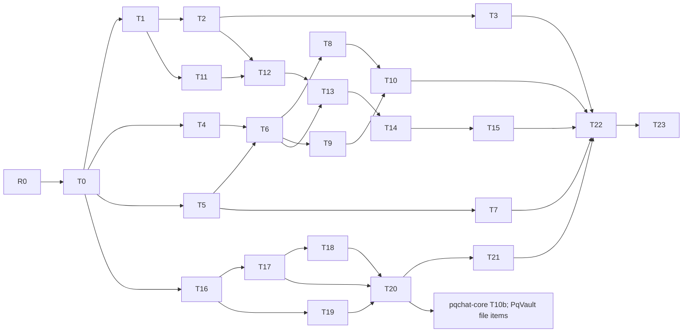

# Avalanche and Polkadot EVMs, an Avalanche message store, and Arweave for encrypted files: build plan

> **For agentic workers:** REQUIRED SUB-SKILL: Use superpowers:subagent-driven-development (recommended) or
> superpowers:executing-plans to implement this plan task by task. Steps use checkbox (`- [ ]`) syntax for tracking.

**Status (2026-11-21):** plan, not executed; nothing is built from it. Spec:
[`2026-11-21-avax-polkadot-arweave.md`](../specs/2026-11-21-avax-polkadot-arweave.md) (SPECIFIED, UNAUDITED; revision 2 after
Fable's review, its §14 maps findings to fixes). Rules:
[NET-ALL-25](../../networks/README.md#NET-ALL-25) (reworded), [NET-EVM-16](../../networks/evm.md#NET-EVM-16) to
[NET-EVM-18](../../networks/evm.md#NET-EVM-18), [CTR-CHAT-22](../../contracts/pqchat.md#CTR-CHAT-22),
[CLI-RPC-13](../../clients/scaas-rpc.md#CLI-RPC-13), [CLI-RPC-14](../../clients/scaas-rpc.md#CLI-RPC-14),
[CLI-UAL-64](../../clients/ua-libraries.md#CLI-UAL-64), [CLI-UAL-65](../../clients/ua-libraries.md#CLI-UAL-65),
[CLI-SDK-21](../../clients/scaas-sdk.md#CLI-SDK-21), [NET-EVM-19](../../networks/evm.md#NET-EVM-19),
[NODE-SPN-05](../../node/sponsorship.md#NODE-SPN-05); owner rulings [ARCH-POS-19](../../decisions.md#ARCH-POS-19), controller calls
[ARCH-POS-20](../../decisions.md#ARCH-POS-20).

**When it runs:** after Fable's review of the spec (task R0, done: revision 2) and on the owner's go, on a branch `avax-dot-arweave` from `main`,
in its own worktree. Parts A, B, C and E need nothing beyond `main`. Part D's `ua-rs` and SDK tasks need the app root key
(CLI-SDK-30, BUILT on `pqchat-core-build`) and the file seal calls `seal_file` / `open_file` (`pqchat-core` O9 (b), being built on
`sdk-complete`): they start once those are merged into this branch (merge commits). Merges to `main` on the owner's word only;
`main` is PR-only.

**Goal:** the Avalanche and Polkadot profiles exist as `draft` with their tests; `PqChatStore` is built, measured and deployable under
NET-EVM-18; clients write and read the `chainstore` entry; `ua-rs` builds and signs ANS-104 items with per-file upload keys;
`scaas-rpc` reads from gateways and posts to bundlers; the SDK uploads and fetches files; `pqchat-core` T10b and PqVault's `file` items
can start.

**Commits:** one or more per task, `avax-dot-arweave T<n>: <what>`, staged by explicit path and committed with
`git commit --only -- <paths>`, with the session's attribution lines; no `Signed-off-by`. **No push, no merge.** No commit holding
only `TODO.md`.

## Run notes

- 2026-11-21, controller call ([ARCH-POS-20](../../decisions.md#ARCH-POS-20) Change): delivered in two parts. **Part 1** (to `main` first): T0–T9, T11, T12, T16, T19. **Part 2**: T17, T20, and the owner's-word tasks T10, T13, T15, T18, T21. Each part ends with its own round-end matrix and a Fable code review before its pull request (T22 and T23 per part). Part 1 is self-contained: no rule text claims BUILT for a Part 2 piece; a Part 1 piece with no caller yet keeps a status that names its later user.
- Part 1 runs on branch `chains-arweave` (commits `chains-arweave T<n>: <what>`), gate runner and logs in `runs/`.

## Global constraints (read before every task)

- AGENTS.md: `cargo`, `forge`, `anvil`, `npm` through `scripts/capped`, **foreground**, never inside `timeout`, never in the
  background; no `sleep` / `until` / `pgrep -f` loops; no background shell or `anvil` left behind (tests start and stop their own).
  The whole node suite needs 6 GB, alone: `CAPPED_MEM=6G`, no other capped job of this agent beside it.
- Inputs as real directories in the worktree: `smartcontracts/evm/lib` (`scripts/evm_libs.sh install`, then `check`),
  `clients/clientkeys/node_modules`.
- Local chains only for every code task: `anvil` (at `--hardfork amsterdam`, and at `--hardfork cancun` for NET-EVM-18's check). Never
  the live testnet stack, its containers or its RPC port. Public chains and Arweave are touched only by the tasks marked
  **[public reads]** (no spend, no write) or **[owner's word]** (a deploy, a permanent upload, or credits spent).
- TDD in every task: the test first, run, **seen failing for the stated reason**, then the code, then green. A negative test has its
  positive control beside it. Each task's mutants (listed) each turn a named test red, one at a time; record
  `runs/2026-11-21-avax-dot-arweave-t<n>-mutants.txt` (last line `N mutants, N killed, 0 survived`).
- Vectors first: clientkeys writes every new row; every other language reads the same rows. Editing one reproducer alone is a
  defect. Unbound fields non-zero in some row.
- Never edit a pin, a bound or a test to go green; a red stops the task and is reported with its output. Gas pins move only with
  old → new figures in the commit.
- Every new input bounded by length and depth; no URL, body or credential in a log line or error (CLI-RPC-11); no consumer name in
  node code or docs; no machine or temp path in a committed file (`mktemp -d` at run time).
- New source files carry `SPDX-License-Identifier: LicenseRef-Vegan-Community-1.0`. English in code, comments, commits and docs.
- No gas or timing calibration without asking the owner (T8's forge gas figures are deterministic test pins, not calibration).
- Gate logs: `runs/2026-11-21-avax-dot-arweave-<step>.log` (git-ignored; first line `# <step> at commit <sha>`, last `rc=<n>`), short
  progress lines on stdout. Only `runs/2026-11-21-avax-dot-arweave-summary.txt` (`step | commit | rc | counts`) is committed. On resume
  read the logs first; a step done at the same commit on a clean tree is skipped.

**Gate steps** (from the worktree root `W`; `cap` = `"$W/scripts/capped"`; `C` = `--locked --offline -j2`):

| Step | Command |
|---|---|
| `forge-chat` | `cd smartcontracts/evm && cap forge test --match-path 'test/pqchat/**'` (default set) |
| `forge-all` | every forge directory at the default set (round end) |
| `forge-sets` | `script/pqz/at-set.sh others sensitive`, then `script/pqz/at-set.sh others modules` (round end; restore `PqzSet.sol`) |
| `size` | `T=$(mktemp -d); forge build src --sizes --json > "$T"/sizes.json; python3 ../../scripts/size_gate.py "$T"/sizes.json size-baseline.json` |
| `deploy-py` | `python3 smartcontracts/evm/script/test_deploybook.py` and the new deploy-check tests |
| `forkcheck` | `cd smartcontracts/evm && T=$(mktemp -d); cap forge build test/forkcheck --extra-output evm.legacyAssembly --out "$T"/out --cache-path "$T"/cache && cap python3 -I script/forkcheck.py exec cancun test/forkcheck/cases.json --out "$T"/out` (T4) |
| `ck-test` | `cd clients/clientkeys && cap npm test` |
| `ua-test` | `cd clients/ua-rs && cap cargo test C --all-features` |
| `rpc-test` | `cd clients/scaas-rpc && cap cargo test C --all-features`, then `cargo clippy C --all-targets --all-features -- -D warnings` |
| `rpc-wasm` | `cd clients/scaas-rpc && cap cargo check C --target wasm32-unknown-unknown --no-default-features --features evm,arweave` |
| `sdk-test` | `cd clients/scaas-sdk && cap cargo test C --all-features`, then clippy |
| `node-test` | `cd scaas-node && CAPPED_MEM=6G cap cargo test C`, then clippy; `node-e2e`: `--test e2e -- --ignored` (round end) |
| `docs` | `python3 scripts/docs_check.py check` and `paths` |

## Tasks and order

| # | Task | Part | Waits for | Marks |
|---|---|---|---|---|
| R0 | Fable review of the spec (design, security, crypto); findings applied to spec and plan | all | — | done (spec revision 2) |
| T0 | Gate runner and baseline | all | R0 | |
| T1 | NET-ALL-25: the `(chainId, chain_uid)` pair check, the `homeChain` kinds refused on a shared genesis, the digest audit, the private-chain field | E | T0 | |
| T2 | Avalanche draft profiles and their `scaas-rpc` tests | A | T1 | |
| T3 | Node lanes and indexer on an Avalanche-like chain | A | T2 | |
| T4 | NET-EVM-18: the five deploy checks for a chain without Amsterdam | A | T0 | |
| T5 | `PqChatStore`: contract, tests, layout, size | B | T0 | |
| T6 | `PqChatStore` deploy path: deterministic deployer, code-hash check, release data, the Cancun check | B | T4, T5 | |
| T7 | The `chainstore` store-list entry: clientkeys rows first, `ua-rs` | B | T5 | |
| T8 | `PqChatStore` gas at Amsterdam and at Cancun, pinned; spec §5.2's estimates replaced | B | T6 | |
| T9 | The node's call-table row for `PqChatStore` and its code-hash check | B | T6 | |
| T10 | Deploy `PqChatStore` on Fuji, then C-Chain; explorer verification | B | T6, T8, T9 | **[owner's word]**, testnet then mainnet |
| T11 | Polkadot Hub and Moonbeam draft profiles, `chain-uids.json` rows from two sources | C | T1 | **[public reads]** |
| T12 | Probes H1–H8 of NET-EVM-19 on every new profile: Avalanche, Hub, Moonbeam (runner, per-probe logs; 24 h and 7-day windows) | A, C | T2, T11 | **[public reads]** |
| T13 | Hub weight-to-gas measurement on Paseo (`GasProbe`, `PqChatStore`) | C | T6, T12 | **[owner's word]**, Paseo deploy, PAS spent |
| T14 | Hub `max_tx_gas` into the profile, `scaas-rpc` and the node; the per-op verdict table to the owner | C | T13 | |
| T15 | Moonbeam: read probes, Frontier configuration, Moonbase deploy of `PqChatStore` | C | T14 | **[owner's word]**, Moonbase deploy |
| T16 | clientkeys: ANS-104 items (both-way `arbundles` cross-check), deep hash, upload keys, frames, buckets, objects, `ar://` rows; the vectors | D | T0 | |
| T17 | `ua-rs`: ANS-104 build, sign, parse; `seal_for_arweave` and `UploadSign`; frames, buckets, the read check and `open_file`'s check; `ar://` | D | T16; CLI-SDK-30 in the branch | |
| T18 | Turbo probe (Q7): type 2 against type 4, the type's byte order, the tag question, the largest single request, the paid path per type | D | T17 | **[owner's word]**: permanent public uploads; credits above 2^16 B |
| T19 | `scaas-rpc` module `arweave`: gateway reader (CLI-RPC-13), bundler uploader (CLI-RPC-14) | D | T16 | |
| T20 | SDK `seal_for_arweave`, `upload_file`, `fetch_file`, `open_file`, settlement and re-posts (CLI-SDK-21) | D | T17, T18, T19; `seal_file` in the branch | |
| T21 | Live round trip: one 2^16-B object through the free tier, read from two gateways | D | T20 | **[owner's word]**: a permanent public upload |
| T24 | Node: the Arweave credit payer service (NODE-SPN-05) | D | T19 (mock first); T18's approval answer for the live call | live approvals **[owner's word]** (credits spent) |
| T22 | Docs and status; the round-end matrix | all | T1–T21, T24 | |
| T23 | Closing review (Fable; Codex only on the owner's request) | all | T22 | |

T2–T4, T5, T11 and T16 may run beside each other once their waits are met; T19 beside T17; T12's windows run beside everything. Every other task in order.
**`pqchat-core` T10b (attachments) waits for part D**: T16, T17, T19, T20 and the T18 answer (its plan names "TODO 8i research + its
`ua-rs` / `scaas-rpc` parts"); PqVault's `file` items ([spec](../specs/2026-11-21-avax-polkadot-arweave.md) §7.10) wait for the same.
The operator payer service is task T24 (owner 2026-11-22: added to this plan): O1 and O2 are settled and its rule is
[NODE-SPN-05](../../node/sponsorship.md#NODE-SPN-05) (off by default, a gateway credential, per-IP budgets, no UA-signed fallback). `x-paid-by` is plumbed and
`PayerUnavailable` stands until the service runs; until then objects above 2^16 B serve tests only. O3 gates T1 and T7; O4 gates
nothing; O5 shapes T20's re-post. The software BLS12-381 path (Q3) belongs to the `bls12381-multi` plan.

**Stop conditions** (the task stops and the owner decides): a NET-EVM-18 opcode or precompile check that fails for a contract (a
build for an older fork changes NET-EVM-06); a NET-EVM-19 probe that fails on any profile (CLI-RPC-03 or CLI-RPC-05 cannot hold
there); a Hub or Moonbeam op that does not fit (numbers, ARCH-POS-18; nothing disabled); Turbo refusing both ed25519 types; an item
that `arbundles` builds differently from ours or refuses (type 3's `v` included); a gap or contradiction in the spec.

## R0 — Fable review of the spec

- [x] Brief Fable on the spec, the component texts named above and ARCH-POS-20 (design, security, crypto: the upload key
  derivation, the `UploadSign` usage, the read check, the metadata of §7.9, the `PqChatStore` trust path). Codex only on the
  owner's request. Done 2026-11-21: P0 0, P1 1, P2 11, P3 9, info 5.
- [x] Apply the findings to spec and plan; record them in the spec's header and in ARCH-POS-20's Change lines. Done: spec
  revision 2, §14.

## T0 — Gate runner and baseline

**Files:** `runs/2026-11-21-avax-dot-arweave-gates.sh`, the summary file.

- [ ] The runner with the steps above (`--only <step>`, `--list`), per-step logs, resume by commit.
- [ ] Baseline every step at the branch point; the counts are the reference for "no behaviour change".

## T1 — NET-ALL-25: the pair check

**Files:** `smartcontracts/evm/script/DeployBook.sol`, `script/deploybook.py`, their tests; the node's chain-profile check
(`scaas-node/src/config*`), its tests.

- [ ] Define the `chain-uids.json` field that marks a chain as private (ours); today rows carry only `network` and `testnet`.
- [ ] Tests first: the two Avalanche rows of `chain-uids.json` (one genesis, chain ids 43114 and 43113) both resolve; a second row
  with an existing `(chainId, chainUid)` pair is refused by name; a private chain's genesis hash repeated under a new chain id is
  still refused; a node configuration with two profiles of one pair is refused at start; the deploy gate refuses `PqChat`,
  `OpenFactory` and `PqVault` on a profile whose `chain_uid` another profile shares, and accepts `PqChatStore` there (spec §8, C18).
- [ ] Audit: list every digest that binds `chain_uid` (EIP-712 domains, typed records, `chainEnv()` reads) and whether it binds the
  chain id; the list goes into the commit and `networks/README.md` links it.
- [ ] Implement where the code does not already hold it; list in the commit what already held.
- Mutants: the pair compared by `chainUid` only; the private-genesis check dropped; the `homeChain` kind refusal dropped.
- Gates: `deploy-py`, `forge-chat` is not needed; `node-test`; `docs`.

## T2 — Avalanche draft profiles

**Files:** `smartcontracts/evm/src/chains/avalanche-{mainnet,testnet}/README.md` (the facts of spec §4.1, as `base-testnet`'s);
`scaas-node/node.example.toml` (commented rows, `finality.mode = "tag"`); the SDK's pinned profile data; `clients/scaas-rpc/tests/`.

- [x] `scaas-rpc` tests against a mock server: an endpoint answering `eth_chainId` 43113 with C-Chain's block 0 hash is dropped from a
  43114 list and the reverse (CLI-RPC-03); a `finalized` read pins the settled block by hash (EIP-1898); a log read above
  `finalized` is labelled not final; real gas is read from receipts, never from a header's `gasUsed`.
- [x] Profiles seeded `draft`; the SDK's profile data gains both with `chain_uid` and chain id.
- Mutants: the identity check on chain id only; the not-final label dropped.
- Gates: `rpc-test`, `rpc-wasm`, `sdk-test`, `docs`.
- **Done (2026-11-22, BUILT on `chains-arweave`):** `src/chains/avalanche-{mainnet,testnet}/{profile.json,README.md}` in the SDK
  plan T40 format (`finality` `tag`, `txType` 2, `l1Fee` none, `eip2537` false, `disabledKinds` none), from T12's probes; both
  keys in `clients/scaas-rpc/tests/evm_profiles.rs` (the 43114 / 43113 pair dropped both ways, `finalized` pinned by hash, and
  `a_log_read_above_finalized_is_not_final_and_gas_is_the_receipts`: the new `EvmPool::logs_range_labelled`, final only at or
  below the answering endpoint's `finalized`; the receipt's gas, never the header's) and in
  `clients/scaas-sdk/tests/evm_profiles.rs`; the node's commented rows. **Misfit, not disabled** (no owner ruling for
  Avalanche): on Fuji's 32 M block, `mldsa44` 43,528,138, `mldsa65` 45,687,694, `mldsa87` 47,857,750 and PQZ ≈ 45,150,000
  (Amsterdam figures × 1.05); C-Chain's 80 M fits every kind.

## T3 — Node lanes on an Avalanche-like chain

**Owner 2026-11-22** ("Đồng ý, thu gọn T3": agreed, slim down T3; owner: yes): audit first, writing nothing; a test only where no
test covers a point the node meets; a real gap built as a profile value, never a chain-id branch, test first, with its mutant;
no local chain and no e2e run for T3 itself; gates `node-test` and `docs`, plus `node-clippy` and `node-e2e` (10 threads) when node
code changes. The original steps (a mock chain delaying receipts, written first) are replaced by the audit below.

**Files:** `scaas-node/src/{submit,config,breaker}.rs`, `scaas-node/node.example.toml`, `docs/node/submit-lanes.md`.

**Audit** (2026-11-22, at the merge of `origin/main` 18bdfa9b5; lines as of the T3 commit):

| Point | In code | Test that covers it | Gap |
|---|---|---|---|
| (a) a delayed receipt stays `Pending`, never `dead` | `submit.rs:1693` (`track`: no receipt ⇒ the nonce stays in flight, bumped after `stuck_after_secs`; `dead` only from a landed gap-fill or an expiry before sending) | `submit::tests::an_earlier_replaced_hash_that_mines_settles_the_nonce`, `own_rows_live_until_a_receipt` | none: BUILT |
| (b) the indexer reads logs at or below the final block only | `indexer.rs:1151` (`safe_head` of `finality.rs:13`: under `tag` the `finalized` block, never above `latest`; no tag ⇒ waits) | `finality::tests::tag_mode_waits_without_a_finalized_block`, `ranges_are_contiguous_and_bounded` | none: BUILT |
| (c) the lane gas limit is the estimate plus its margin | `guard.rs:1091` (`gas_limit`: estimate + 20 %, at least the ERC-1271 floor, at most the cap) | `guard::tests::gas_floor_and_settle_sizing`, `submit::tests::gas_follows_the_two_dimensional_model` | none: BUILT |
| (d) a per-profile in-flight cap (16 where set) | none before T3 (NODE-LANE-24 PLANNED) | none | **gap, built:** `[[chains]] max_inflight` (`config.rs:375`, default 16, at least 1), `Submitter::room` (`submit.rs:1667`) gates `poll_outbox` and the gateway channel; test `submit::tests::a_lane_keeps_at_most_max_inflight_in_flight`, `config::tests::parses_with_defaults` |
| (e) the balance alert is gas limit × worst-case price + value | the floor breaker used the operator's static `min_relayer_balance` only (`breaker.rs`) | `breaker::tests::balance_floor_per_lane` (the floor only) | **gap, built:** `Breaker::below_cost` (`breaker.rs:111`) warns when the balance is below Σ in-flight gas limit × max fee per gas (+ value: lane transactions carry none), `Submitter::inflight_cost` (`submit.rs:1659`) at each sample; an alert, the floor breaker unchanged; test `breaker::tests::balance_below_the_in_flight_cost_is_alerted` |
| (f) the deploy gate reads the live block cap | `submit.rs:685`, `submit.rs:1506` (`guard::total_cap` of `guard.rs:773` over `Chain::block_gas`, `chain.rs:195`, read each time; regular gas also ≤ 2^24 before Amsterdam, the MD-5 rule of every chain); the contract deploy script's check (2) reads the live block (T4) | `submit::tests::gas_follows_the_two_dimensional_model` (`TX_EXCEEDS_CHAIN_LIMIT` at a 30 M block) | none: BUILT |

- Mutants (`runs/2026-11-21-avax-dot-arweave-t3-mutants.txt`): `dead` on a missing receipt; the in-flight cap ignored; a fixed
  gas padding; the cost alert dropped.
- Gates: `node-test`, `node-clippy`, `node-e2e` (10 threads), `docs`.

## T4 — NET-EVM-18: the deploy checks

**Files:** `smartcontracts/evm/script/forkcheck.py` (new), its test, the deploy script's hook.

- [ ] Tests first: the allow-list scan (every byte in code position an opcode of the chain's fork; immediates walked by the
  `amsterdam` table; code and data boundaries from the compiler's output) refuses a fixture with `CLZ` for `cancun` and passes one
  without it; a fixture whose `PUSH` data holds `0x1e` passes; a fixture with an opcode of unknown immediate length is refused;
  runtime and init sizes over the chain's caps refused; a deploy transaction over the live cap refused; a contract declaring a
  precompile the chain lacks refused by check (5) against a mock RPC, and one whose precompile answers the known answer accepted.
- [ ] Check (4)'s mechanism: the `amsterdam` artifact's bytes driven by real transactions on `anvil --hardfork <fork>` (or a forge
  profile at that `evm_version` loading the pinned artifact); the same run executes the `CLZ` control fixture, whose test must be
  red; a run with a green control fails the step. Wired as a gate step.
- [ ] The deploy script runs the five checks before it sends, for a profile whose fork is not Amsterdam; a refusal is named.
- Mutants: the scan as a deny-list without `CLZ`; immediates not skipped (a `PUSH` byte read as an opcode); the control's result
  ignored; check (5) skipped; the size check against 65,536.
- Gates: `deploy-py`, `docs`.

## T5 — `PqChatStore`

**Files:** `smartcontracts/evm/src/pqchat/{IPqChatStore,PqChatStore}.sol`, `test/pqchat/PqChatStore.t.sol`,
`test/v2/layout/` (the layout pin), `size-baseline.json` only if the gate asks (it should not: the contract is far below 24,576 B).

- [ ] Tests first: CTR-CHAT-13's behaviour (append, event, `storedCount`, `storedAt`, `storedRange` clamped to 16, an offset past the end
  empty); `v != 1` refused; `env` 24,416 B accepted and 24,417 B refused (`PqChatShape`); selectors, event topic and error selector
  equal `IPqChat`'s; ERC-165; no constructor argument; no `msg.sender` read; runtime ≤ 24,576 B asserted; storage namespace
  `scaas.pqchatstore` pinned.
- [ ] Implement with SSTORE2 as `PqChat` does, sharing its blob helper where it can be reused without changing `PqChat`'s bytecode.
- Mutants: the bound off by 32; the clamp at 17; a hint's list keyed wrong.
- Gates: `forge-chat`, `size`, `docs`.

## T6 — `PqChatStore` deploy path

**Files:** `smartcontracts/evm/script/DeployPqChatStore.s.sol` (new), release data (the runtime code hash), `deploybook.py` rows.

- [ ] Through the deterministic deployer with salt 0; the release data pins the init-code hash, the runtime code hash and the
  address; a local build whose init-code hash differs refused; the pinned address already holding the pinned code taken as done; the
  deployed code hash compared, refused when it differs; the book entry under the chain's key.
- [ ] NET-EVM-18 on `PqChatStore`: the Cancun allow-list scan passes, its T5 tests execute at Cancun on the `amsterdam` artifact's
  bytes (T4's mechanism) with the `CLZ` control red, no precompile declared; the Cancun gas figures recorded, never compared with
  the Amsterdam pins.
- [ ] The per-chain probes of spec §5.3, as a script step before a profile lists the store: the deployer's code present, an SSTORE2
  write and read, `eth_getCode` equal to the pinned bytes (run locally here; on chains in T10, T13, T15).
- Mutants: the code-hash check skipped; the init-code hash check skipped; salt not 0.
- Gates: `forge-chat`, `deploy-py`, a local `anvil --hardfork cancun --code-size-limit 24576` deploy, `docs`.

## T7 — The `chainstore` entry

**Files:** `clients/clientkeys/src/pqchat.js` and its test, `smartcontracts/vectors/pqchat/` (new rows), `clients/ua-rs` (the
`sealedInfo` parser and its vector reader).

- [ ] clientkeys rows first: a `sealedInfo` with a `chainstore` entry (canonical JSON, `chainId` decimal) and a `chain` entry with
  `chainId` (O3 (a)); refusals: a missing `chainId` in either, two entries with one `(chainId, chainUid, contract)`, a `chainId` above
  `u64`, a session homed on a chain whose `chain_uid` another profile shares; an envelope above the smallest listed store's bound
  refused at send.
- [ ] `ua-rs` reproduces the rows. The `pqchat-core` store adapter for `chainstore` (code-hash pin, then the reads of spec §5.5)
  is a task of its own plan (T7 there); this plan's T22 notes it.
- Mutants: the distinctness key without `chainId`; the shared-genesis home accepted; the bound taken from the largest store.
- Gates: `ck-test`, `ua-test`, `docs`.

## T8 — `PqChatStore` gas

**Files:** `test/pqchat/PqChatStoreGas.t.sol` (`isolate = true`), the spec §5.2 table.

- [ ] Pin regular and state gas at Amsterdam for envelopes of 2,400, 5,100 and 24,416 B (new hint, warm); record the same at Cancun
  through T6's run. Replace the spec's estimates with the figures, old → new.
- Gates: `forge-chat`, `docs`.

## T9 — The node's row for `PqChatStore`

**Files:** the node's call table and policy (`scaas-node/src/`), `docs/node/job-api.md` (the row and its check, BUILT once tested).

- [ ] Tests first: a `storeMessage` call job to a `PqChatStore` whose runtime code hash equals the release data's is accepted under
  the operator's lane policy; another code hash is refused by name; unpaid unsigned writes are not relayed by default (CTR-CHAT-19).
- Mutants: the code-hash check skipped; the default policy relaying unpaid writes.
- Gates: `node-test`, `docs`.

## T10 — Deploy on Fuji, then C-Chain **[owner's word]**

- [ ] On the owner's word for Fuji: deploy through T6 with a funded key the owner names (never committed); verify on the explorer;
  the book `deployments/avalanche-testnet.json`; T6's per-chain probes; a real round trip through `scaas-rpc`: `storeMessage` with
  a 24,416-B `env`, then `storedCount` and `storedAt` at `finalized`, the bytes compared with what was sent (NET-EVM-18's testnet
  round trip before C-Chain).
- [ ] On a second word for C-Chain: the same, `deployments/avalanche-mainnet.json`.
- Evidence: the deploy transaction hashes and addresses in the summary; no key material anywhere.

## T11 — Polkadot Hub and Moonbeam draft profiles **[public reads]**

**Files:** `smartcontracts/evm/chain-uids.json` (rows `polkadot-hub-mainnet`, `polkadot-hub-testnet`, `polkadot-hub-westend`,
`moonbeam-mainnet`, `moonbeam-testnet`), `src/chains/<key>/README.md`, the node's example rows, the SDK's profile data.

- [ ] Each row's block 0 hash read from two independent sources and equal; `network` per NET-EVM-13; seeded `draft`.
- Gates: `deploy-py`, `sdk-test`, `docs`.
- **Done (2026-11-22, BUILT on `chains-arweave`):** the five rows, `src/chains/<key>/{profile.json,README.md}` in the T40 format,
  the node's commented rows, the keys in both profile tests. Controller calls (ARCH-POS-20 Change of 2026-11-22): Hub's eth-rpc
  answers block 0 `null` on mainnet and Paseo, so their `chainUid` is the Substrate genesis hash (`chain_getBlockHash(0)` on two
  Substrate providers, equal), as Westend Hub's eth-rpc answers block 0 with it; `moonbeam-mainnet`'s second source answered
  only over plain HTTP through a third-party metered gateway (its TLS refused this client), named in the row's note. Owner
  questions: below, T12.

## T12 — Probes H1–H8 on every new profile **[public reads]**

**Files:** `smartcontracts/evm/runs/2026-11-21-evm-probes.py` (new, one runner for every profile), its committed summary.

- [ ] For `avalanche-testnet`, `avalanche-mainnet`, the three Hub keys and the two Moonbeam keys, from two independent RPC providers
  each: H1 block 0 hash, re-read daily for 7 days; H2 EIP-1898 on `eth_call`, `eth_getStorageAt`, `eth_getCode`, `eth_getBalance`,
  `eth_getTransactionCount` with a canonical and a made-up hash; H3 `latest` sampled each block for 24 h, compared later with the
  canonical chain; H4 a block asked by its hash; H5 `latest` → `finalized` p99 over 7 days; H6 `eth_getLogs` range limits; H7
  `finalized` never moving back; H8 a read pinned by the newest head's hash, compared with the same read once final.
- [ ] One foreground sample per invocation (`--probe <H> --profile <key>`), appended to its log; the 24-h and 7-day windows are
  the owner's scheduler calling it; no background shell, no sleep loop. Each probe resumable; a failure stops the task (stop
  condition).
- **Done (2026-11-22, one sample each; the 24-h and 7-day windows are the scheduler's, not run):** the SDK plan T40 runner
  (`clients/scaas-rpc/runs/2026-11-22-evm-probes.py`, no second runner), every probe on the seven keys; summary rows in
  `clients/scaas-rpc/runs/2026-11-22-evm-probes-summary.txt` (`--summary` now keeps the rows of keys logged in another checkout).
  Runner fixes, test first: `caps` asks `eth_call` without a sender (Hub refuses a named sender without gas × price, which read
  as a 21,000 cap); a gateway's "not served" is no method (`l1fee`). **Failures (stop conditions, to the owner):** H1 on the three
  Hub keys (one public eth-rpc provider each; mainnet and Paseo serve no block 0); H2 on both Moonbeam keys (a read pinned by a
  made-up block hash is answered from an empty state, not refused); Westend Hub's eth-rpc refused every `eth_call` ("Metadata
  error"), so H2, `fork`, `codesize`, `eip2537` and `caps` failed or are unread there. Avalanche passed H1, H2, H4 and H7.
- **Owner 2026-11-22** ("5 câu hỏi: theo đề xuất": the five questions, as proposed; owner: yes; decisions ARCH-POS-20):
  (1) Hub's `chainUid` is the Substrate genesis; (2) Moonbeam's pinned reads are not trusted: `profile.json` `pinnedReads`
  false, `scaas-rpc` refuses pinned reads on such a pool (`PinnedReadsUntrusted`), plain reads work; **follow-up (T41 family,
  PLANNED):** the SDK reads `pinnedReads` from its profile and builds the pool with it; (3) Westend Hub dropped
  (`smartcontracts/evm/legacy/chains/polkadot-hub-westend/`); (4) Moonbeam mainnet needs an independent second source before
  any deploy; (5) Fuji disables `mldsa44`, `mldsa65`, `mldsa87` and PQZ, C-Chain keeps every kind.

## T13 — Hub weight-to-gas measurement on Paseo **[owner's word]**

- [ ] On the owner's word: T6's per-chain probes on Paseo (the deterministic deployer may be absent on Hub: then the owner decides
  how `PqChatStore` gets its pinned address); deploy a test-only `GasProbe` (≤ 24,576 B) and `PqChatStore`; run spec §6.3's probes, recording
  `eth_estimateGas`, the receipt's `gasUsed`, the effective price, the fee in PAS, `ref_time`, `proof_size` and the deposit reserved.
- [ ] The table in `smartcontracts/evm/runs/`; the largest compute that fits found by binary search.

## T14 — Hub `max_tx_gas`

- [ ] The profile value from T13; `scaas-rpc` and the node take it as the gas cap of CLI-RPC-05 and the lanes; tests against a mock.
- [ ] The per-op verdict (fits / does not fit) for the 60 M lines, the PQZ op, the ML-DSA-65 verify, to the owner with numbers.
- Gates: `rpc-test`, `node-test`, `docs`.

## T15 — Moonbeam **[owner's word]**

- [ ] Moonbeam's T12 probes passed; the Frontier configuration (code cap, EIP-7702, `CLZ`) confirmed by reads; T6's per-chain probes;
  on the owner's word a Moonbase deploy of `PqChatStore` through T6 and its explorer verification; its lines checked against
  Moonbeam's gas.

## T16 — clientkeys: Arweave vectors

**Files:** `clients/clientkeys/src/arweave.js` (new), `test/arweave.test.js`, `smartcontracts/vectors/arweave/*.json` (data items,
deep hashes, ids, upload keys, frames, buckets, objects), `smartcontracts/vectors/pqchat/` (`ar://` `file` rows); the `arbundles`
cross-check in its own generator directory with its own lock file (`clients/clientkeys/xcheck/arbundles/`, a pinned version),
outside clientkeys' dependency tree.

- [ ] The deep hash, layout and id as spec §7.2; types 2, 3 and 4 signed and verified; type 3 with `v ∈ {27, 28}` and low `s`.
- [ ] Cross-check both ways, for each of types 2, 3 and 4 and the same key and data: our item byte-identical to the one `arbundles`
  builds, `arbundles`' own verification accepting ours, and an `arbundles`-built item parsing with its id matching. Rows with one
  tag, 64 tags, a 64-byte name (the two-byte varint edge), a target, an anchor; refusals: a negative block count, trailing tag bytes,
  a header tag count other than the Avro count, an empty name, a presence byte 2, type 3 with `v` 0 or 1 or a high `s`.
- [ ] Upload keys (spec §7.3) from the existing app-root-key rows and fixed file keys, `ctSha256` computed from the object; the
  secp256k1 counter path forced by a fixture; a row showing that another file key gives another upload key for the same `ctSha256`.
- [ ] Frames, buckets and objects (spec §7.4), integer arithmetic: `size = 0`; `size + 8 = 2^k − 1, 2^k, 2^k + 1` for every `k` from 16
  to 31 (above the cap: `FileTooLarge`); the frame's `len`, the zero pad, the object length bucket + 16; read refusals: a length other
  than bucket + 16, a flipped byte (`ctSha256`), and after decryption a `len` other than `size`, a non-zero pad byte, a plaintext
  `sha256` mismatch, each with its positive control.
- [ ] `ar://` rows: accepted; refused at 42 and 44 characters, with `+` or `/`, with `=`, a non-canonical last character, a
  trailing path, an upper-case scheme.
- Mutants: the type string left out of the deep hash; the type as a binary byte instead of decimal text; an empty tag list as
  `0x00`; `"blob"` with a binary length; the id as SHA-256 of the item; `v` written as 0 or 1; the bucket floor at 2^15; the bucket
  from `size + 16` (the old form); the pad check skipped.
- Gates: `ck-test`, `docs`.

## T17 — `ua-rs`: ANS-104, the sealed upload and the upload key

Placement (SDK plan T42, decisions CLI-SDK-33 (35), on branch `sdk-complete`): the generic file seal (the frame inside the
AEAD, the buckets, `open_file`'s `size` and `sha256` checks, the file-key handle) is in the app-core core; ANS-104, the deep
hash, `UploadSign`, the upload key, `seal_for_arweave`, `ar://` and `scaas-rpc`'s `arweave` module are behind `fam-arweave`.
Test: a build without `fam-arweave` seals and opens a file; a build with it uploads.

**Files:** `clients/ua-rs/src/arweave.rs` (new), the app-core handle usages, `tests/arweave.rs`.

- [ ] Reproduce every T16 row byte for byte. The parser's bounds and refusals of spec §7.2; the signature verified before an item is
  returned.
- [ ] `seal_for_arweave` as one call: a fresh file key handle, the frame, the object, `ctSha256` computed there, the upload key from
  the app root key and the file key, the item built, signed and verified. No parameter carries a hash.
- [ ] The usage `UploadSign`: created only inside that call, bound to one type and one `ctSha256`; its one operation signs an item
  `ua-rs` built after recomputing the item's data hash and refusing (`AppKeyUsage`) another; no byte accessor; the label prefix
  `scaas/arweave/` refused to app cores. Test: a handle bound to object A refuses an item over object B (a test-only constructor
  under `cfg(test)` builds that item).
- [ ] `open_file` for the framed form: the tag, `len` equal to `size`, the zero pad, SHA-256 of the file equal to `sha256`, before any
  plaintext leaves `ua-rs`; the same `size` and `sha256` check for UA-7's form; and the `ar://` parser.
- Mutants: the presence byte 2 accepted; `UploadSign` signing without re-checking the item's data hash against its bound `ctSha256`
  (killed by the A/B test); the upload key derived without the file key; the pad check skipped; the plaintext `sha256` check skipped.
- Gates: `ua-test`, `docs`.

## T18 — Turbo probe **[owner's word]**

Keys and data are throwaway and derived from no real root; no key in any committed file.

- [ ] On the owner's word (each upload is public and permanent): one free-tier item of each of types 2 and 4 with no tags, then with
  the fixed `Content-Type` tag only if the first is refused; record which type Turbo accepts, the signature type's byte order, and
  the receipt fields.
- [ ] With credits the owner provides: the largest single-request size, by doubling from 2^17 B, stopping at the first refusal or at
  2^24 B unless the owner allows more.
- [ ] The paid path, with the owner's credits: for each of types 2, 3 and 4, an approval (`shareCredits`) from a throwaway payer to
  the upload key's address, then an upload with `x-paid-by`; record the address form that names the recipient per type and the
  approval item's bytes, and add both to `smartcontracts/vectors/arweave/` (NODE-SPN-05 builds that item).
- [ ] The answers into spec §7.2 and §7.4 (the default type, the profile value for the largest single request); ARCH-POS-20 gains the
  Q7 result as a Change line.

## T19 — `scaas-rpc` module `arweave`

**Files:** `clients/scaas-rpc/src/arweave/` (new), `tests/arweave.rs` with a local mock server.

- [ ] Tests first: identity by `GET /info`; an id checked before any request; `len` above the platform cap refused before any
  request; an announced length other than `len` refused unread (the mock counts bytes sent: none past the header); a body longer or
  shorter than `len` refused; no `Range` header sent; failover past a body that fails the check (`EndpointAnswerRefused`); strict
  majority by SHA-256; the decryption mark (discovered gateways skipped under failover, `n ≥ 3` and a trusted member under
  agreement); `status` bounded; `settled` false with one gateway, false with two of one operator, false at a block shallower than
  `depth`, false when the bytes read back differ, true only with all three conditions; an upload's receipt with another id refused;
  HTTP 402 as `PaymentRequired`; `x-paid-by` sent to that bundler only; no redirect followed; logs without URLs or bodies.
- [ ] The error codes join scaas-rpc.md §8.
- Mutants: failover stopping at a refused body; the id comparison skipped; `x-paid-by` sent to every bundler; the announced length
  not checked; `settled` on one gateway; the depth check dropped.
- Gates: `rpc-test`, `rpc-wasm`, `docs`.

## T20 — SDK `seal_for_arweave`, `upload_file`, `fetch_file`, `open_file`

**Files:** `clients/scaas-sdk/src/` (the app-core surface), `tests/arweave.rs`, the bindings' regeneration.

- [ ] Tests first, against T19's mock and a test clock: `seal_for_arweave` returns the `ar://` url before any upload; `upload_file`
  takes only an item `ua-rs` built (a kept item reloaded by the verifying parser; a tampered kept item refused); the 2^16-B bucket
  posted without `x-paid-by`; a larger bucket `PayerUnavailable` while no payer is configured; the item kept until `settled`;
  re-posts of the same bytes at 24 h, 72 h and 7 days, then `UploadUnsettled`; a re-post refused with 402 asks the payer again for the
  same address (a mock payer); a malformed `url` and a `size` above the cap refused before any request; `FileHashMismatch` with
  nothing sent; `open_file` reached only after the read check, and its plaintext refused on a `size` or `sha256` mismatch; a PqVault
  item not written before one gateway read passed.
- [ ] A counting signer spy: exactly one signature per item, zero on every re-post.
- [ ] The bindings regenerated; their drift check green.
- Mutants: a re-post that signs again (killed by the counting spy); a re-post under a fresh key (killed by the bytes and id
  comparison); the check skipped before `open_file`; the re-post schedule without an end; the item dropped on the first gateway's
  "settled".
- Gates: `sdk-test`, `ua-test`, `docs`.

## T21 — Live round trip **[owner's word]**

- [ ] On the owner's word: one 2^16-B object (random bytes sealed under a throwaway key derived from no real root) through Turbo's
  free tier; `settled` sampled once per invocation until true (strict majority of two gateways of different operators, the depth,
  the bytes read back); fetched from two gateways of the default list, the check passing on both, `open_file` passing. Evidence: the
  id, the block, the depth and timings, no key.

## T24 — Node: the Arweave credit payer service (NODE-SPN-05)

Owner 2026-11-22: the payer service is part of this plan, on branch `chains-arweave` (the plan's node tasks stay there). Until it is
built, an upload above the free tier is `PayerUnavailable` (T20); T20 does not wait for it.

**Optional since 2026-11-22 (owner):** the user may pay for an upload themselves (self-pay: Turbo credits topped up from
the user's own wallet, or a per-upload payment), as self-relay on every chain; T20 builds that path, so Arweave never depends on
the node. The payer service stays an operator convenience. Self-pay links the user's upload keys at Turbo through the paying
wallet: stated in the spec's threat notes, and the client warns.

**Files:** `scaas-node/src/` (a gateway route, its policy and budgets, the payer key's config by env var, file or keystore name),
`scaas-node/node.example.toml` (the route, off, commented), `scaas-node/tests/`, `docs/node/sponsorship.md` (NODE-SPN-05 to BUILT
once tested), `docs/node/gateway.md` (the route).
- [ ] Tests first: the route answers nothing while disabled; enabled, a request without a gateway credential refused by name, one
  over the per-credential or per-IP budget (per hour, per day) refused by name, one carrying a UA, a UA signature, file bytes or a
  message or session id refused (`deny_unknown_fields`); a request with the upload address, the signature type and the bucket
  approves credits to that address for one object with a short expiry, against a mock Turbo payment API (the approval call as
  T18 records it); the payer key never logged, never in an answer; the approval amount bounded by the bucket's price; the same
  address and bucket approved once per expiry window.
- [ ] Live approvals against Turbo only on the owner's word (credits spent), after T18.
- Mutants: the credential check dropped; the per-IP budget dropped; the unknown-field refusal dropped; the amount bound dropped;
  the route on by default.
- Gates: `node-test`, `node-clippy`, `docs`. Commit `avax-dot-arweave T24: the Arweave credit payer service`.

## T22 — Docs and status; the round-end matrix

- [ ] Every rule's status moved to BUILT where code and tests exist; decisions Change lines with commits; the spec's estimates
  replaced by measurements; notes for `pqchat-core` (the `chainstore` adapter, T10b unblocked) and for `pqvault-core` (`file` items).
- [ ] The round-end matrix on the final tree: `forge-all`, `forge-sets`, `size`, `node-test`, `node-e2e`, `rpc-test`, `rpc-wasm`,
  `sdk-test`, `ua-test`, `ck-test`, `deploy-py`, `docs`.

## T23 — Closing review

- [ ] Fable on the code of T5, T6, T9, T16, T17, T19, T20 (design, security, crypto); findings fixed by task; the labels stay
  UNAUDITED until an AI audit round covers the commit.
