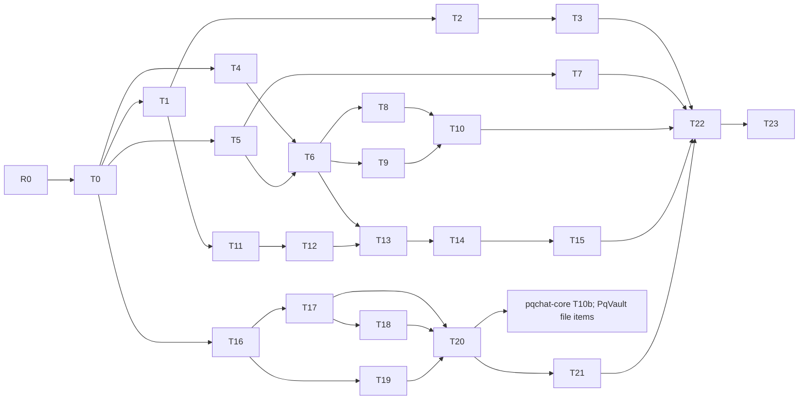

# Avalanche and Polkadot EVMs, an Avalanche message store, and Arweave for encrypted files: build plan

> **For agentic workers:** REQUIRED SUB-SKILL: Use superpowers:subagent-driven-development (recommended) or
> superpowers:executing-plans to implement this plan task by task. Steps use checkbox (`- [ ]`) syntax for tracking.

**Status (2026-11-21):** plan, not executed; nothing is built from it. Spec:
[`2026-11-21-avax-polkadot-arweave.md`](../specs/2026-11-21-avax-polkadot-arweave.md) (SPECIFIED, UNAUDITED). Rules:
[NET-ALL-25](../../networks/README.md#NET-ALL-25) (reworded), [NET-EVM-16](../../networks/evm.md#NET-EVM-16) to
[NET-EVM-18](../../networks/evm.md#NET-EVM-18), [CTR-CHAT-22](../../contracts/pqchat.md#CTR-CHAT-22),
[CLI-RPC-13](../../clients/scaas-rpc.md#CLI-RPC-13), [CLI-RPC-14](../../clients/scaas-rpc.md#CLI-RPC-14),
[CLI-UAL-64](../../clients/ua-libraries.md#CLI-UAL-64), [CLI-UAL-65](../../clients/ua-libraries.md#CLI-UAL-65),
[CLI-SDK-21](../../clients/scaas-sdk.md#CLI-SDK-21); owner rulings [ARCH-POS-19](../../decisions.md#ARCH-POS-19), controller calls
[ARCH-POS-20](../../decisions.md#ARCH-POS-20).

**When it runs:** after Fable's review of the spec (task R0) and on the owner's go, on a branch `avax-dot-arweave` from `main`,
in its own worktree. Parts A, B, C and E need nothing beyond `main`. Part D's `ua-rs` and SDK tasks need the app root key
(CLI-SDK-30, BUILT on `pqchat-core-build`) and the file seal calls `seal_file` / `open_file` (`pqchat-core` O9 (b), being built on
`sdk-complete`): they start once those are merged into this branch (merge commits). Merges to `main` on the owner's word only;
`main` is PR-only.

**Goal:** the Avalanche and Polkadot profiles exist as `draft` with their tests; `PqChatStore` is built, measured and deployable under
NET-EVM-18; clients write and read the `chainstore` entry; `ua-rs` builds and signs ANS-104 items with per-file upload keys;
`scaas-rpc` reads from gateways and posts to bundlers; the SDK uploads and fetches files; `pqchat-core` T10b and PqVault's `file` items
can start.

**Commits:** one or more per task, `avax-dot-arweave T<n>: <what>`, staged by explicit path and committed with
`git commit --only -- <paths>`, with the session's attribution lines; no `Signed-off-by`. **No push, no merge.** No commit holding
only `TODO.md`.

## Global constraints (read before every task)

- AGENTS.md: `cargo`, `forge`, `anvil`, `npm` through `scripts/capped`, **foreground**, never inside `timeout`, never in the
  background; no `sleep` / `until` / `pgrep -f` loops; no background shell or `anvil` left behind (tests start and stop their own).
  The whole node suite needs 6 GB, alone: `CAPPED_MEM=6G`, no other capped job of this agent beside it.
- Inputs as real directories in the worktree: `smartcontracts/evm/lib` (`scripts/evm_libs.sh install`, then `check`),
  `clients/clientkeys/node_modules`.
- Local chains only for every code task: `anvil` (at `--hardfork amsterdam`, and at `--hardfork cancun` for NET-EVM-18's check). Never
  the live testnet stack, its containers or its RPC port. Public chains and Arweave are touched only by the tasks marked
  **[public reads]** (no spend, no write) or **[owner's word]** (a deploy, a permanent upload, or credits spent).
- TDD in every task: the test first, run, **seen failing for the stated reason**, then the code, then green. A negative test has its
  positive control beside it. Each task's mutants (listed) each turn a named test red, one at a time; record
  `runs/2026-11-21-avax-dot-arweave-t<n>-mutants.txt` (last line `N mutants, N killed, 0 survived`).
- Vectors first: clientkeys writes every new row; every other language reads the same rows. Editing one reproducer alone is a
  defect. Unbound fields non-zero in some row.
- Never edit a pin, a bound or a test to go green; a red stops the task and is reported with its output. Gas pins move only with
  old → new figures in the commit.
- Every new input bounded by length and depth; no URL, body or credential in a log line or error (CLI-RPC-11); no consumer name in
  node code or docs; no machine or temp path in a committed file (`mktemp -d` at run time).
- New source files carry `SPDX-License-Identifier: LicenseRef-Vegan-Community-1.0`. English in code, comments, commits and docs.
- No gas or timing calibration without asking the owner (T8's forge gas figures are deterministic test pins, not calibration).
- Gate logs: `runs/2026-11-21-avax-dot-arweave-<step>.log` (git-ignored; first line `# <step> at commit <sha>`, last `rc=<n>`), short
  progress lines on stdout. Only `runs/2026-11-21-avax-dot-arweave-summary.txt` (`step | commit | rc | counts`) is committed. On resume
  read the logs first; a step done at the same commit on a clean tree is skipped.

**Gate steps** (from the worktree root `W`; `cap` = `"$W/scripts/capped"`; `C` = `--locked --offline -j2`):

| Step | Command |
|---|---|
| `forge-chat` | `cd smartcontracts/evm && cap forge test --match-path 'test/pqchat/**'` (default set) |
| `forge-all` | every forge directory at the default set (round end) |
| `forge-sets` | `script/pqz/at-set.sh others sensitive`, then `script/pqz/at-set.sh others modules` (round end; restore `PqzSet.sol`) |
| `size` | `T=$(mktemp -d); forge build src --sizes --json > "$T"/sizes.json; python3 ../../scripts/size_gate.py "$T"/sizes.json size-baseline.json` |
| `deploy-py` | `python3 smartcontracts/evm/script/test_deploybook.py` and the new deploy-check tests |
| `ck-test` | `cd clients/clientkeys && cap npm test` |
| `ua-test` | `cd clients/ua-rs && cap cargo test C --all-features` |
| `rpc-test` | `cd clients/scaas-rpc && cap cargo test C --all-features`, then `cargo clippy C --all-targets --all-features -- -D warnings` |
| `rpc-wasm` | `cd clients/scaas-rpc && cap cargo check C --target wasm32-unknown-unknown --no-default-features --features evm,arweave` |
| `sdk-test` | `cd clients/scaas-sdk && cap cargo test C --all-features`, then clippy |
| `node-test` | `cd scaas-node && CAPPED_MEM=6G cap cargo test C`, then clippy; `node-e2e`: `--test e2e -- --ignored` (round end) |
| `docs` | `python3 scripts/docs_check.py check` and `paths` |

## Tasks and order

| # | Task | Part | Waits for | Marks |
|---|---|---|---|---|
| R0 | Fable review of the spec (design, security, crypto); findings applied to spec and plan | all | — | before any code |
| T0 | Gate runner and baseline | all | R0 | |
| T1 | NET-ALL-25: the `(chainId, chain_uid)` pair check in the deploy gate, the book resolver and the node | E | T0 | |
| T2 | Avalanche draft profiles and their `scaas-rpc` tests | A | T1 | |
| T3 | Node lanes and indexer on an Avalanche-like chain | A | T2 | |
| T4 | NET-EVM-18: the four deploy checks for a chain without Amsterdam | A | T0 | |
| T5 | `PqChatStore`: contract, tests, layout, size | B | T0 | |
| T6 | `PqChatStore` deploy path: deterministic deployer, code-hash check, release data, the Cancun check | B | T4, T5 | |
| T7 | The `chainstore` store-list entry: clientkeys rows first, `ua-rs` | B | T5 | |
| T8 | `PqChatStore` gas at Amsterdam and at Cancun, pinned; spec §5.2's estimates replaced | B | T6 | |
| T9 | The node's call-table row for `PqChatStore` and its code-hash check | B | T6 | |
| T10 | Deploy `PqChatStore` on Fuji, then C-Chain; explorer verification | B | T6, T8, T9 | **[owner's word]**, testnet then mainnet |
| T11 | Polkadot Hub and Moonbeam draft profiles, `chain-uids.json` rows from two sources | C | T1 | **[public reads]** |
| T12 | Hub probes H1–H6 (runner, per-probe logs; 24 h and 7-day windows) | C | T11 | **[public reads]** |
| T13 | Hub weight-to-gas measurement on Paseo (`GasProbe`, `PqChatStore`) | C | T6, T12 | **[owner's word]**, Paseo deploy, PAS spent |
| T14 | Hub `max_tx_gas` into the profile, `scaas-rpc` and the node; the per-op verdict table to the owner | C | T13 | |
| T15 | Moonbeam: read probes, Frontier configuration, Moonbase deploy of `PqChatStore` | C | T14 | **[owner's word]**, Moonbase deploy |
| T16 | clientkeys: ANS-104 items, deep hash, upload keys, buckets, padded objects, `ar://` rows; the vectors | D | T0 | |
| T17 | `ua-rs`: ANS-104 build, sign, parse; `UploadSign`; buckets and the read check; `ar://` | D | T16; CLI-SDK-30 in the branch | |
| T18 | Turbo probe (Q7): type 2 against type 4, the type's byte order, the tag question, the largest single request | D | T17 | **[owner's word]**: permanent public uploads; credits above 2^16 B |
| T19 | `scaas-rpc` module `arweave`: gateway reader (CLI-RPC-13), bundler uploader (CLI-RPC-14) | D | T16 | |
| T20 | SDK `upload_file` / `fetch_file` (CLI-SDK-21) | D | T17, T18, T19; `seal_file` in the branch | |
| T21 | Live round trip: one 2^16-B object through the free tier, read from two gateways | D | T20 | **[owner's word]**: a permanent public upload |
| T22 | Docs and status; the round-end matrix | all | T1–T21 | |
| T23 | Closing review (Fable; Codex only on the owner's request) | all | T22 | |

T2–T4, T5, T11 and T16 may run beside each other once their waits are met; T19 beside T17. Every other task in order.
**`pqchat-core` T10b (attachments) waits for part D**: T16, T17, T19, T20 and the T18 answer (its plan names "TODO 8i research + its
`ua-rs` / `scaas-rpc` parts"); PqVault's `file` items ([spec](../specs/2026-11-21-avax-polkadot-arweave.md) §7.10) wait for the same.
The operator payer service is not built here (spec O1, O2): `x-paid-by` is plumbed and `PayerUnavailable` stands until the owner
answers. The software BLS12-381 path (Q3) belongs to the `bls12381-multi` plan.

**Stop conditions** (the task stops and the owner decides): a NET-EVM-18 opcode check that fails for a contract (a build for an
older fork changes NET-EVM-06); a Hub probe that fails (CLI-RPC-03 or CLI-RPC-05 cannot hold there); a Hub or Moonbeam op that does
not fit (numbers, ARCH-POS-18; nothing disabled); Turbo refusing both ed25519 types; a gap or contradiction in the spec.

## R0 — Fable review of the spec

- [ ] Brief Fable on the spec, the component texts named above and ARCH-POS-20 (design, security, crypto: the upload key
  derivation, the `UploadSign` usage, the read check, the metadata of §7.9, the `PqChatStore` trust path). Codex only on the
  owner's request.
- [ ] Apply the findings to spec and plan; record them in the spec's header and in ARCH-POS-20's Change lines.

## T0 — Gate runner and baseline

**Files:** `runs/2026-11-21-avax-dot-arweave-gates.sh`, the summary file.

- [ ] The runner with the steps above (`--only <step>`, `--list`), per-step logs, resume by commit.
- [ ] Baseline every step at the branch point; the counts are the reference for "no behaviour change".

## T1 — NET-ALL-25: the pair check

**Files:** `smartcontracts/evm/script/DeployBook.sol`, `script/deploybook.py`, their tests; the node's chain-profile check
(`scaas-node/src/config*`), its tests.

- [ ] Tests first: the two Avalanche rows of `chain-uids.json` (one genesis, chain ids 43114 and 43113) both resolve; a second row
  with an existing `(chainId, chainUid)` pair is refused by name; a private chain's genesis hash repeated under a new chain id is
  still refused; a node configuration with two profiles of one pair is refused at start.
- [ ] Implement where the code does not already hold it; list in the commit what already held.
- Mutants: the pair compared by `chainUid` only; the private-genesis check dropped.
- Gates: `deploy-py`, `forge-chat` is not needed; `node-test`; `docs`.

## T2 — Avalanche draft profiles

**Files:** `smartcontracts/evm/src/chains/avalanche-{mainnet,testnet}/README.md` (the facts of spec §4.1, as `base-testnet`'s);
`scaas-node/node.example.toml` (commented rows, `finality.mode = "tag"`); the SDK's pinned profile data; `clients/scaas-rpc/tests/`.

- [ ] `scaas-rpc` tests against a mock server: an endpoint answering `eth_chainId` 43113 with C-Chain's block 0 hash is dropped from a
  43114 list and the reverse (CLI-RPC-03); a `finalized` read pins the settled block by hash (EIP-1898); a log read above
  `finalized` is labelled not final; real gas is read from receipts, never from a header's `gasUsed`.
- [ ] Profiles seeded `draft`; the SDK's profile data gains both with `chain_uid` and chain id.
- Mutants: the identity check on chain id only; the not-final label dropped.
- Gates: `rpc-test`, `rpc-wasm`, `sdk-test`, `docs`.

## T3 — Node lanes on an Avalanche-like chain

**Files:** `scaas-node/src/` lanes and indexer, `scaas-node/tests/`.

- [ ] Tests first, against a mock chain that accepts a transaction and delays its receipt: the job stays `Pending`, never `dead`; the
  indexer reads logs only at or below its final block; the lane's gas limit is the estimate with its margin; a lane keeps at most 16
  in flight on a profile that sets it; the balance alert uses gas limit × worst-case price + value; the deploy gate reads the live
  block cap.
- [ ] Implement as profile values, never as a chain-id branch (one rule on every chain).
- Mutants: `dead` on a missing receipt; the in-flight cap ignored; a fixed gas padding.
- Gates: `node-test`, `docs`.

## T4 — NET-EVM-18: the deploy checks

**Files:** `smartcontracts/evm/script/forkcheck.py` (new), its test, the deploy script's hook.

- [ ] Tests first: a linear disassembly that skips `PUSH` data finds `CLZ` in a fixture and refuses it for `cancun`; a fixture
  without it passes; runtime and init sizes over the chain's caps refused; a deploy transaction over the live cap refused; the
  `anvil --hardfork <fork>` run of a contract's tests with the deployed bytecode wired as a gate step.
- [ ] The deploy script runs the four checks before it sends, for a profile whose fork is not Amsterdam; a refusal is named.
- Mutants: the opcode table without `CLZ`; the size check against 65,536.
- Gates: `deploy-py`, `docs`.

## T5 — `PqChatStore`

**Files:** `smartcontracts/evm/src/pqchat/{IPqChatStore,PqChatStore}.sol`, `test/pqchat/PqChatStore.t.sol`,
`test/v2/layout/` (the layout pin), `size-baseline.json` only if the gate asks (it should not: the contract is far below 24,576 B).

- [ ] Tests first: CTR-CHAT-13's behaviour (append, event, `storedCount`, `storedAt`, `storedRange` clamped to 16, an offset past the end
  empty); `v != 1` refused; `env` 24,416 B accepted and 24,417 B refused (`PqChatShape`); selectors, event topic and error selector
  equal `IPqChat`'s; ERC-165; no constructor argument; no `msg.sender` read; runtime ≤ 24,576 B asserted; storage namespace
  `scaas.pqchatstore` pinned.
- [ ] Implement with SSTORE2 as `PqChat` does, sharing its blob helper where it can be reused without changing `PqChat`'s bytecode.
- Mutants: the bound off by 32; the clamp at 17; a hint's list keyed wrong.
- Gates: `forge-chat`, `size`, `docs`.

## T6 — `PqChatStore` deploy path

**Files:** `smartcontracts/evm/script/DeployPqChatStore.s.sol` (new), release data (the runtime code hash), `deploybook.py` rows.

- [ ] Through the deterministic deployer with salt 0; the deployed code hash compared with the release data's, refused when it
  differs; the book entry under the chain's key.
- [ ] NET-EVM-18 on `PqChatStore`: the Cancun opcode scan passes, and its T5 tests pass on `anvil --hardfork cancun` with the
  `amsterdam` bytecode; the Cancun gas figures recorded, never compared with the Amsterdam pins.
- Mutants: the code-hash check skipped; salt not 0.
- Gates: `forge-chat`, `deploy-py`, a local `anvil --hardfork cancun --code-size-limit 24576` deploy, `docs`.

## T7 — The `chainstore` entry

**Files:** `clients/clientkeys/src/pqchat.js` and its test, `smartcontracts/vectors/pqchat/` (new rows), `clients/ua-rs` (the
`sealedInfo` parser and its vector reader).

- [ ] clientkeys rows first: a `sealedInfo` with a `chainstore` entry (canonical JSON, `chainId` decimal); refusals: a missing
  `chainId`, two entries with one `(chainId, chainUid, contract)`, a `chainId` above `u64`.
- [ ] `ua-rs` reproduces the rows. The `pqchat-core` store adapter for `chainstore` (code-hash pin, then the reads of spec §5.5)
  is a task of its own plan (T7 there); this plan's T22 notes it.
- Mutants: the distinctness key without `chainId`.
- Gates: `ck-test`, `ua-test`, `docs`.

## T8 — `PqChatStore` gas

**Files:** `test/pqchat/PqChatStoreGas.t.sol` (`isolate = true`), the spec §5.2 table.

- [ ] Pin regular and state gas at Amsterdam for envelopes of 2,400, 5,100 and 24,416 B (new hint, warm); record the same at Cancun
  through T6's run. Replace the spec's estimates with the figures, old → new.
- Gates: `forge-chat`, `docs`.

## T9 — The node's row for `PqChatStore`

**Files:** the node's call table and policy (`scaas-node/src/`), `docs/node/job-api.md` (the row and its check, BUILT once tested).

- [ ] Tests first: a `storeMessage` call job to a `PqChatStore` whose runtime code hash equals the release data's is accepted under
  the operator's lane policy; another code hash is refused by name; unpaid unsigned writes are not relayed by default (CTR-CHAT-19).
- Mutants: the code-hash check skipped; the default policy relaying unpaid writes.
- Gates: `node-test`, `docs`.

## T10 — Deploy on Fuji, then C-Chain **[owner's word]**

- [ ] On the owner's word for Fuji: deploy through T6 with a funded key the owner names (never committed); verify on the explorer;
  the book `deployments/avalanche-testnet.json`; a read of `storedCount` through `scaas-rpc` at `finalized`.
- [ ] On a second word for C-Chain: the same, `deployments/avalanche-mainnet.json`.
- Evidence: the deploy transaction hashes and addresses in the summary; no key material anywhere.

## T11 — Polkadot Hub and Moonbeam draft profiles **[public reads]**

**Files:** `smartcontracts/evm/chain-uids.json` (rows `polkadot-hub-mainnet`, `polkadot-hub-testnet`, `polkadot-hub-westend`,
`moonbeam-mainnet`, `moonbeam-testnet`), `src/chains/<key>/README.md`, the node's example rows, the SDK's profile data.

- [ ] Each row's block 0 hash read from two independent sources and equal; `network` per NET-EVM-13; seeded `draft`.
- Gates: `deploy-py`, `sdk-test`, `docs`.

## T12 — Hub probes **[public reads]**

**Files:** `smartcontracts/evm/runs/2026-11-21-hub-probes.py` (new), its committed summary.

- [ ] H1 block 0 hash on two `eth-rpc` instances, re-read daily for 7 days; H2 EIP-1898 on `eth_call`, `eth_getStorageAt`,
  `eth_getCode`, `eth_getBalance`, `eth_getTransactionCount` with a canonical and a made-up hash; H3 `latest` sampled every block for
  24 h, compared later with the canonical chain; H4 a block asked by an Ethereum hash; H5 `latest` → `finalized` p99 over 7 days;
  H6 `eth_getLogs` range limits.
- [ ] Each probe resumable and logged; a failure stops the task (stop condition).

## T13 — Hub weight-to-gas measurement on Paseo **[owner's word]**

- [ ] On the owner's word: deploy a test-only `GasProbe` (≤ 24,576 B) and `PqChatStore` on Paseo; run spec §6.3's probes, recording
  `eth_estimateGas`, the receipt's `gasUsed`, the effective price, the fee in PAS, `ref_time`, `proof_size` and the deposit reserved.
- [ ] The table in `smartcontracts/evm/runs/`; the largest compute that fits found by binary search.

## T14 — Hub `max_tx_gas`

- [ ] The profile value from T13; `scaas-rpc` and the node take it as the gas cap of CLI-RPC-05 and the lanes; tests against a mock.
- [ ] The per-op verdict (fits / does not fit) for the 60 M lines, the PQZ op, the ML-DSA-65 verify, to the owner with numbers.
- Gates: `rpc-test`, `node-test`, `docs`.

## T15 — Moonbeam **[owner's word]**

- [ ] H2, H4, H6 on Moonbeam's RPC; the Frontier configuration (code cap, EIP-7702, `CLZ`) confirmed by reads; on the owner's word a
  Moonbase deploy of `PqChatStore` through T6 and its explorer verification; its lines checked against Moonbeam's gas.

## T16 — clientkeys: Arweave vectors

**Files:** `clients/clientkeys/src/arweave.js` (new), `test/arweave.test.js`, `smartcontracts/vectors/arweave/*.json` (data items,
deep hashes, ids, upload keys, buckets, padded objects), `smartcontracts/vectors/pqchat/` (`ar://` `file` rows).

- [ ] The deep hash, layout and id as spec §7.2; types 2, 3 and 4 signed and verified; cross-checked against a pinned `arbundles`
  dev dependency (a positive control: an `arbundles`-built item parses and its id matches).
- [ ] Upload keys from the existing app-root-key rows (spec §7.3), the secp256k1 counter path forced by a fixture; buckets at their
  edges (`size + 16` = 2^16, 2^16 + 1, 2^31, 2^31 + 1); padded objects and the three read refusals (length, a non-zero tail byte,
  `ctSha256`).
- [ ] `ar://` rows: accepted; refused at 42 and 44 characters, with `+` or `/`, with `=`, a non-canonical last character, a
  trailing path, an upper-case scheme.
- Mutants: the type string left out of the deep hash; an empty tag list as `0x00`; the bucket floor at 2^15.
- Gates: `ck-test`, `docs`.

## T17 — `ua-rs`: ANS-104 and the upload key

**Files:** `clients/ua-rs/src/arweave.rs` (new), the app-core handle usages, `tests/arweave.rs`.

- [ ] Reproduce every T16 row byte for byte. The parser's bounds and refusals of spec §7.2; the signature verified before an item is
  returned.
- [ ] The usage `UploadSign`: derived from the app root key handle; signs only a deep hash `ua-rs` computed over an item it built;
  any other use `AppKeyUsage`; no byte accessor; the label prefix `scaas/arweave/` refused to app cores.
- [ ] `bucket`, `pad`, the read check and the `ar://` parser.
- Mutants: the presence byte 2 accepted; `UploadSign` signing a caller's digest; the zero-tail check skipped.
- Gates: `ua-test`, `docs`.

## T18 — Turbo probe **[owner's word]**

- [ ] On the owner's word (each upload is public and permanent): one free-tier item of each of types 2 and 4 with no tags, then with
  the fixed `Content-Type` tag only if the first is refused; record which type Turbo accepts, the signature type's byte order, and
  the receipt fields.
- [ ] With credits the owner provides: the largest single-request size, by doubling from 2^17 B, stopping at the first refusal or at
  2^24 B unless the owner allows more.
- [ ] The answers into spec §7.2 and §7.4 (the default type, the profile value for the largest single request); ARCH-POS-20 gains the
  Q7 result as a Change line.

## T19 — `scaas-rpc` module `arweave`

**Files:** `clients/scaas-rpc/src/arweave/` (new), `tests/arweave.rs` with a local mock server.

- [ ] Tests first: identity by `GET /info`; an id checked before any request; an announced length above `max_bytes` refused unread
  and a body cut at `max_bytes`; failover past a body that fails the check (`EndpointAnswerRefused`); strict majority by SHA-256;
  the decryption mark (discovered gateways skipped under failover, `n ≥ 3` and a trusted member under agreement); `status` bounded;
  an upload's receipt with another id refused; HTTP 402 as `PaymentRequired`; `x-paid-by` sent to that bundler only; no redirect
  followed; logs without URLs or bodies.
- [ ] The error codes join scaas-rpc.md §8.
- Mutants: failover stopping at a refused body; the id comparison skipped; `x-paid-by` sent to every bundler.
- Gates: `rpc-test`, `rpc-wasm`, `docs`.

## T20 — SDK `upload_file` / `fetch_file`

**Files:** `clients/scaas-sdk/src/` (the app-core surface), `tests/arweave.rs`, the bindings' regeneration.

- [ ] Tests first, against T19's mock: the 2^16-B bucket posted without `x-paid-by`; a larger bucket `PayerUnavailable` while no payer is
  configured; the signed bytes kept and re-posted unchanged after 24 h without settlement (a test clock); a malformed `url` refused
  before any request; `FileHashMismatch` with nothing sent; `open_file` reached only after the check.
- [ ] The bindings regenerated; their drift check green.
- Mutants: re-signing on re-post; the check skipped before `open_file`.
- Gates: `sdk-test`, `ua-test`, `docs`.

## T21 — Live round trip **[owner's word]**

- [ ] On the owner's word: one 2^16-B object (random bytes sealed under a throwaway key) through Turbo's free tier; `status` until
  settled; fetched from two gateways of the default list, the check passing on both. Evidence: the id and timings, no key.

## T22 — Docs and status; the round-end matrix

- [ ] Every rule's status moved to BUILT where code and tests exist; decisions Change lines with commits; the spec's estimates
  replaced by measurements; notes for `pqchat-core` (the `chainstore` adapter, T10b unblocked) and for `pqvault-core` (`file` items).
- [ ] The round-end matrix on the final tree: `forge-all`, `forge-sets`, `size`, `node-test`, `node-e2e`, `rpc-test`, `rpc-wasm`,
  `sdk-test`, `ua-test`, `ck-test`, `deploy-py`, `docs`.

## T23 — Closing review

- [ ] Fable on the code of T5, T6, T9, T16, T17, T19, T20 (design, security, crypto); findings fixed by task; the labels stay
  UNAUDITED until an AI audit round covers the commit.
