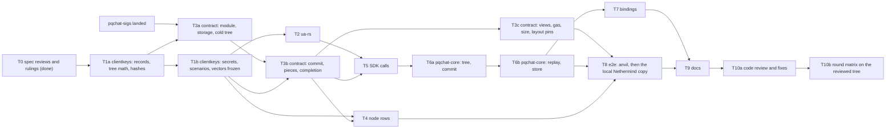

# PqChat TreeKEM mode (`groupMode = 1`), minimal scope: Implementation Plan

> **For agentic workers:** REQUIRED SUB-SKILL: Use superpowers:executing-plans to implement this plan task by task. Steps use
> checkbox (`- [ ]`) syntax for tracking.

**Status (2026-11-23):** PLANNED, nothing built. **UNAUDITED.** Revision 3, after two review rounds by Codex and Fable and a
third, focused round by Fable (`fable-r3-n`), whose fixes moved no record, typehash or derivation; then the owner's R16
(the key no-return set two-level), a contract rule and storage change that moved none either.
Spec [`2026-11-23-pqchat-treekem.md`](../specs/2026-11-23-pqchat-treekem.md) (cited "spec §n", its rulings "R1"–"R16", its
controller calls "C1"–"C36"; a review finding by its id, `codex-n`, `fable-n`, `codex-r2-n`, `fable-r2-n`, `fable-r3-n`); research
[`2026-11-23-treekem-pqchat.md`](../../research/2026-11-23-treekem-pqchat.md).

**Owner rulings (2026-11-23, owner: yes):** minimal mode 1 is built now, before the pre-freeze tag: a commit with UpdatePath, Add
and Remove, Welcome by wraps; external commits, PSKs and ReInit are out; a new DELEGATECALL body module is accepted; the
committer's path secrets are seed-derived; our own TreeKEM in `ua-rs`, no MLS library; PqVault accepts only 0; the leaf is the
registry KEM key; a non-admin commits for its own UA's leaves only; no tree session on a `none` home or a replica; ML-KEM-1024
the one node scheme; `TREE_LEAVES_MAX` = 256 (about 200 keys by one record at 60 M, the rest by Adds); the joiner without
the `init` chain, its cost accepted, with a compromise warning; no automatic receipts in a tree session; impossible commits
refused by the contract at acceptance; a changed session info only after a strict-majority read over at least 3 named
endpoints; no UA and no key returns to a tree session (the way back is a new UA with a fresh key); the key half of that rule is
hygiene against reuse of the same key bytes, and exclusion rests on the UA roster (R15); that key half is two-level, the
pair `(ua, kemHash)` for a key a UA takes out of its own leaves and the session-wide `kemHash` of every key a UA held when
it leaves or is removed, with the admin's client warning before an Add of a key registered to another UA (R16). **No point is open**
(spec §16).

**Goal:** `PqChatTree` and its entries, the reference and vectors, `ua-rs`, the node's rows, the SDK calls, `pqchat-core`'s tree
client, bindings, an e2e and the docs, in one round with one matrix at its end.

## 1. Order and dependencies

- **`pqchat-sigs` lands first.** The contract work (T3) branches from it: it needs the signature-storage setting (C1), several
  `keyId`s per UA and `groupMode` in `PqChatSession`. The round's branch is `pqchat-treekem`, made from the branch `pqchat-sigs`
  merged into; T1a may start before that on clientkeys alone and is rebased once.
- **T0 is done with revision 3:** two review rounds, their fixes, every owner point ruled. The records are settled
  (`PqChatCommit` with `parentTreeHash`, `PqChatTreeLeave`, `PqChatTreeRemove`, `TreeGenesis`); a change to a record after T1b
  moves every vector.
- **T1b before T3b and T4 (fable-14).** T3b's first tests are the `scenario` rows end to end and T4's gate rebuilds the rows'
  calldata; both rows are T1b's. T3a needs only T1a's rows (type strings, the cold tree hash, the admission check).
- **Byte formats change everywhere at once:** the rows of `smartcontracts/vectors/pqchat/tree.json` come only from the clientkeys
  generator; no language edits a reproducer alone.

## 2. Parallel split

One agent's context holds one or two tasks. Four lanes, each a worktree of `pqchat-treekem` with real `lib/`, `node_modules`
and `algorand/out` directories:

| Lane | Agents, in order | Starts when |
|---|---|---|
| A, reference and crypto | A1: T1a → A2: T1b → A3: T2 | T0 done (T1a: the records settled) |
| B, contract | B1: T3a → B2: T3b → B3: T3c | `pqchat-sigs` landed and T1a's rows exist; **T3b when T1b's rows are frozen** |
| C, node | C1: T4 | T1b's rows and T3b's selectors |
| D, clients | D1: T5 → D2: T6a → D3: T6b → D4: T7 | T2 and T3b's ABI |
| Controller | T0, T8 (one agent), T9, T10a, T10b, the merges between lanes | |

Lane B's T3a runs beside lane A's T1b; T3b waits for T1b. Each agent reports its gates, mutants and pins (old → new); the full
matrix runs once, in T10b, on the final tree (round rule of 2026-11-18). Heavy commands go through `scripts/capped`, in the
foreground.

## 3. Tasks

### T0. Second spec review and owner points

- [x] First review (Codex, Fable) of revision 1; revision 2 of the spec; the decisions entries updated; the resolution table.
- [x] Second review of revision 2 (Codex: rework, 3 P0 and 8 P1; Fable: approve with fixes, 1 P1); revision 3; the
      resolution rows of round 2.
- [x] The owner's rulings R8 to R14 recorded in the spec and in decisions; the recovery vectors are pinned to the schedule
      without `init` (codex-r2-16).
- [x] Third review of revision 3 (Fable, focused: approve with fixes; 0 P0, 2 P1, 4 P2, 3 P3), fixed in place: client rules
      (the info after a gap, the checkpoint conflict, the warning's remedies), one node rule (the whole-set guard), one
      ordering rule of the contract (`gone` after the Adds), wording and two gas rows. No record, typehash or derivation
      moved; the owner's R15 recorded.
- [x] The owner's R16 (after round 3, on the controller's finding of a front-running burn): the key no-return set two-level
      in the spec (§1, §2 C28, §6 to §11, §13 to §17), the component docs and decisions; no record, typehash or derivation
      moved.

### T1a. clientkeys: records, tree math, hashes (`clients/clientkeys`)

- [ ] `src/pqchat-tree.js`: Appendix C tree math, resolution, filtered path, `th` with `kemHash` in the leaf (spec §4); the
      typehashes and `hashStruct` of `PqChatCommit` (with `parentTreeHash`), `TreeAdd`, `TreeRemove`, `PathList` (the empty
      list too, codex-r2-14), `PathCt`, `PqChatTreeLeave`, `PqChatTreeRemove`, `TreeGenesis`; `treeId` and `genesisCtx` (spec
      §5, §6);
      applying Removes and Adds; `ctTargets`; the target that covers a leaf; the key admission check (spec §8); **the
      no-return model of R16:** the UA set, the pair set and the session-wide set, the level of each removed key judged on
      the tree after the Adds, and the Add's verdict with its named error.
- [ ] `scripts/pqchat-vectors.mjs`: `tree.json` rows `treeMath` (RFC 9420's tree-math vectors as a control), `resolution`,
      `treeHash` (cold 2, 3, 5 and 8 keys; after a commit, a Remove, an Add, growth; **an Add and a Remove under a copath child
      of the author**, fable-9), `admission` (one key per refused case: a coefficient at 3,329, each of the five canonical small-order
      `pk_X`, **the non-canonical forms: `p`, `p + 1`, an accepted key plus `p` where it fits, and an accepted key with bit
      255 set** (C32, codex-r2-2), a wrong scheme byte, a wrong length; and accepted controls), `typehashes`, `digests`,
      and `noReturn` (R16), each step with the sets after it and the verdict of the next Add: **the burn by own-key churn**
      (B registers A's public key as its own version, adds it by a plain commit, takes it out: only `(B, kemHash)` is set,
      B's re-add is `PqChatTreeOwnKeyReturn`, A's Add is accepted); **the front-running loop** (B repeats it on each of A's
      next keys: every one of A's Adds after B's churn is accepted; B holding keys live blocks at most `KEYS_PER_UA_MAX` of
      them, and an admin's Remove of one such leaf while B keeps another frees it at the pair level); **the burn by leave**
      (B holds A's key, then `treeLeave`, `treeRemove`, or an admin's commit that leaves B no leaf: the `kemHash` of every
      key B's leaves held enters the session-wide set, A's Add of it is `PqChatTreeKeyReturn` under any UA, B's Add is
      `PqChatTreeReturn`, keys B took out earlier stay pairs); the replacement of a UA's only key in one commit (the old key
      a pair, the UA not `gone`); a Remove and an Add of the same bytes in one commit, under the same UA and under another.
- [ ] **An admitted related key (fable-r3-2, R15):** one `admission` row holds an accepted key and the same key with `pk_X`
      shifted by a torsion point (order 4, and order 8): the shifted key is **admitted**, has another `kemHash`, and for one
      fixed ephemeral scalar gives the same X25519 output. The row states what the check does not give; no test may
      assert "one capability per `kemHash`".
- [ ] Gates: `scripts/capped npm test` in `clients/clientkeys`; the generator's `--check` (a regenerated file is byte-identical).
- [ ] Mutants (each must turn a test red, one at a time): resolution lists right before left; a blank leaf counted; the filtered
      path keeps an empty level; `th` of an empty subtree non-zero; the leaf hash without `kemHash`; a sibling hash taken before
      the changes; the admission check without the small-order list; the admission check that clears bit 255 instead of refusing it; one
      field dropped from the `PqChatCommit` type string; `genesisCtx` that hashes `wrapHashes`; **R16:** own-key churn
      written session-wide (the churn row must fail); a going UA's keys written as pairs only (the leave row must fail); the
      level judged between the Removes and the Adds (the replacement row must fail); the pair set ignored at an Add (B's
      re-add must fail); the keys a going UA took out earlier promoted to session-wide (the leave row's earlier-key step must
      fail).

### T1b. clientkeys: secrets, scenarios, the vectors frozen

- [ ] The path secrets, node keys from the 96-byte seed form, `pathContext` and `ps[0]`, the path ciphertext (`kek`, `aad`), the
      schedule without `init` (`ctx` with `parentTreeHash`, `joiner`, `S`, `K`; epoch 0 under `genesisCtx`), the tree wrap
      label, the info marker and the info in force (C33), building and processing a commit, the joiner's path, the roster by
      undo with the rights evidence, replay with its fixed read list (spec §5, §10).
- [ ] **Creation in order (codex-r2-4):** a test builds a session from `genesisCtx` to the signature with no placeholder, and
      a fresh store recovers `K_0` and every wrap from the stored record alone.
- [ ] Rows `secrets`, `pathCt`, `schedule`, and `scenario`: create (3 UAs, one with 2 keys) → commit by B → Add of a UA →
      **a commit by a third member, outside the new member's subtree, right after the Add** (codex-5, fable-5) → a commit by
      the new member → `treeRemove` then a commit → Remove by `(ua, keyId)`; per step every record, piece, tree hash, roster, and
      each member's `K`; one row with non-zero unbound fields where a digest canonicalises any.
- [ ] Rows for the repeats (fable-1, codex-7): the same change, nonce and target indices on a tree with other keys (scenario A)
      and in a twin session at another home (scenario B): `ps[0]` differs in both.
- [ ] Rows for healing (codex-15, fable-6, fable-4): a leaked node set that one commit locks out and one that it does not; a
      member that did not follow an epoch and follows the next commit that reaches its leaf; **a member that missed two
      epochs** and is not restored by the commit that restores the others (fable-r2-7).
- [ ] Rows of round 2: a commit from a device's own `(ua, keyId)` that the seed does not reproduce → the compromise warning,
      not "not followed" (fable-r2-1); a same-id twin of the head with another `treeHash` → refused by the pinned record hash,
      and `ps[0]` differs (fable-r2-4, codex-r2-11); a refresh by a device two epochs behind seals the marker and the info in
      force stays (codex-r2-3, fable-r2-5); a non-admin's changed info is ignored; an epoch-0 head served with a leaf outside
      the signed members and a matching root → refused before encryption (codex-r2-1); a `PqChatTreeLeave` and a
      `PqChatTreeRemove` of a twin session at another home → another digest (codex-r2-5); `sealedInfo` of the 4,096-B bucket
      (4,124 B) at genesis and in a commit, and the next bucket refused (codex-r2-13).
- [ ] Row of round 3 (fable-r3-1): an admin changes the info in epoch `e`; a device does not follow `e`, follows the next
      commit (a non-admin's, from its sibling side), then commits (a new device key) → it seals **the marker**, and the
      retired info appears in no later record; a control in which it followed `e` seals the full info.
- [ ] Negative rows with the expected named result: a wrong target, a wrong `treeHash`, a list that does not hash, a node key
      that does not match its secret, a Welcome that disagrees with the path, a `sealedInfo` that does not open, a valid
      substituted leaf key with the tree unchanged (codex-1), a fetched ciphertext or key altered with the signature unchanged
      (codex-13). **Two different rows for the two failures (codex-r2-15):** "read corrupted" (bytes changed, signed hashes
      kept: refused at the read boundary, before any decapsulation) and "opening failed" (a commit that validly signs the hash
      of a bad ciphertext: the read passes, the opening fails); each row states which step it reaches.
- [ ] Gates: as T1a; the mode-0 rows of `records.json`, `keys.json`, `messages.json` byte-identical (mode 0 does not move).
- [ ] Mutants: `pathContext` without `parentTreeHash`, without `treeId`, without `ctTargets`; `K` from `joiner` directly; the
      ciphertext `aad` without the target; `ctx` without `parentTreeHash`; epoch 0 under `treeId`; a refresh that re-seals
      the last info read; **the gap ignored** (a device that follows again keeps the info it held before the epoch it missed; fable-r3-1); the compromise warning folded into "not followed"; a tree wrap under the flat label; a processed commit that skips the derived-key
      comparison; a joiner that skips its path ciphertext (the third-member row must fail); a ciphertext index chosen from the
      held secrets instead of the list (the read list of the failing member must differ and the test must see it).

### T2. `ua-rs`: the tree behind handles (`clients/ua-rs`)

- [ ] `src/wallet/tree.rs`: a tree-epoch handle (`K`, known node secrets, in the secret store); joining from a wrap and the
      path ciphertext; opening a ciphertext with the leaf key or a held node and deriving upward with the key comparison; the
      committer's recovery. No function returns a secret byte (C1 of the SDK, A-3); errors named (`TreeKeyMismatch`,
      `TreeNotHeld`, `KemCheck`).
- [ ] **The typed commit-signing operation (codex-12, spec §15):** one named operation that authenticates the target keys,
      draws and returns the nonce, builds the path, the list, the pieces and the record inside the boundary, shows the review
      and signs. Tests: a normal signing; a request whose pieces differ from the reviewed ones is refused; no entry signs a
      `PqChatCommit` digest from outside. The same for `PqChatTreeLeave` and `PqChatTreeRemove`: named operations whose
      review shows the `treeId` and "cannot come back" (C30, R14).
- [ ] The epoch-0 tree rebuilt from the signed member list (codex-r2-1); the own-commit check that yields the compromise
      warning (R10), in its two cases with their remedies (fable-r3-5); a device key per UA or random, never one key under two UAs (R14).
- [ ] **The registry KEM record check (codex-1, spec §8 step 4):** key data hashes to the UA; a version above 0 by its kept
      signature over `kemRecordDigest`; version 0 by the registration's committed hash. Encapsulation takes only a key that
      passed. Tests: each form accepted; a substituted valid key refused; a record signed by another UA refused.
- [ ] The public side as plain functions: tree math, resolution, hashes, the record digests, `ctTargets`, the admission check.
- [ ] Gates: `scripts/capped cargo test` with the features the vector tests need, over every `tree.json` row; clippy `-D
      warnings`; the existing KEM and PqChat tests unchanged; `cargo fmt --check`.
- [ ] Mutants: as T1b's, in Rust; plus a handle whose secret is readable through `Debug` (a test greps the output); a held
      node kept after a Remove blanked it; the registry check skipped for an added key; a nonce reused for a rebuilt commit.
- [ ] No new dependency (HKDF, AES-GCM, ML-KEM and X25519 are in the crate).

### T3a. Contract: the module, its storage, the cold tree (`smartcontracts/evm`)

- [ ] `PqGroupBase._land` split into storing wraps and completing an epoch; `_authorOf`'s offset-free form moved from `PqChat`
      to a base the module inherits (fable-U2); mode 0's behaviour and events unchanged (`PqChat` and `PqVault` bytecode may
      move: size and gas pins old → new in the commit).
- [ ] `src/pqchat/PqChatTree.sol` (SPDX header), a DELEGATECALL body module as `PqChatTopics`; namespace `scaas.pqchat.tree`
      (spec §7), with `gone`, and the two key sets of R16, `goneOwnKey[ua][kemHash]` and `goneKey[kemHash]`, apart; `PqChat` gains the immutable `TREE`, `modules()` lists it, the factory release and `script/onchain/PqChat.s.sol`
      pass it. Library-split checks: storage through the hooks only, no `this`, `msg.sender` unused, return data forwarded.
- [ ] `createSession` with `groupMode = 1`: `PqChatTreeSigStore`, `PqChatTreeHome`, the caps (`TREE_INFO_MAX` too), `treeId`;
      only the creator indexed at the record; **leaf `i`, `liveKey`, `keysOf`, the hashes above it and the UA's `sessionsOf`
      entry written when wrap `i` lands (C15, C34)**, with the admission check (canonical `pk_X`, C32) and `PqChatTreeKeyLive`;
      `genesisTreeHash` when epoch 0 completes; `groupMode` 2–255 still `PqChatModeUnsupported`; `rekey` on a tree session
      `PqChatModeEntry`.
- [ ] Tests first (`test/pqchat/PqChatTree.t.sol`), each refusal with its positive control; the cold `treeHash` against the
      vector rows, with the wraps landed in order, in reverse and one per transaction; every `admission` row; two members with
      one key; the author read from a three-part blob; `test/v2/layout/` gains the module's namespace (the pair set and the
      session-wide set at distinct pinned slots, R16) and proves `PqChat`'s and `PqVault`'s layouts unmoved.
- [ ] Gates: every forge directory at the default set; the size gate (`PqChat` under 35,286 B, a new `PqChatTree` row with its
      reason); `forge fmt --check`.
- [ ] Mutants: mode 1 accepted on a `none` home; on a replica; the cap off by one; a leaf hash without its index or without
      `kemHash`; the leaves written in the record's transaction; the pair set stored in the session-wide mapping by `kemHash`
      alone (the layout pin and T3b's churn test must fail, R16); every member indexed in the record's transaction (the gas row
      at 192 first-time UAs must fail, codex-r2-8); the author offset back to the constant 96; the admission check reduced to
      scheme and length.

### T3b. Contract: `commit`, the pieces, completion

- [ ] `PqChatTypes`: the eight typehashes and hashes (`*TypehashIsPinned` against the vectors); `IPqChat`: the structs, entries,
      views, errors and the `PqChatPath` event of spec §6 and §11.
- [ ] `commit`: the acceptance checks of spec §8 (with `treeId`, `parentTreeHash`, `kemHash`, `liveKey`, `gone`, `goneOwnKey`, `goneKey`,
      the shapes of C24, the empty-list hash) and the rights of §9; **the tree check in memory at acceptance (R12): counts,
      path length, removed UAs, the root, the expected-targets hash**; `addPathList` (against that hash), `addPathKeys`,
      `addPath`; `addWraps` and `postMessage` forwarded for a tree session; `treeLeave` and `treeRemove` (`treeId`, `gone`,
      `owed` for both, C21, `PqChatTreeAdmins` with its exemption); `leave` and `remove` refused on a tree session;
      `Epoch.wraps` = pieces + 1 (C20); completion steps 1–5 in order, all or nothing, also from `commit` itself, writing
      `gone` and each removed key at its level, `goneOwnKey` or `goneKey`, judged after the Adds (R16).
- [ ] Tests of round 2: each of a wrong `treeHash`, `ctCount`, path length and a kept removed UA **refused at acceptance with
      no state written** (fable-r2-3), and the same record accepted when right; a `treeRemove` landed between acceptance and
      completion fails step 1; a wrong `parentTreeHash` (codex-r2-11); an Add of a `gone` UA after a leave, after a
      `treeRemove`, after a commit-only removal → `PqChatTreeReturn`; an Add of a key taken out of a UA that went, under
      that UA's other `keyId`, under another UA, and in the commit that removes it → `PqChatTreeKeyReturn`; a new UA with a
      fresh key accepted (R14); a flat session still re-adds; `treeLeave` and `treeRemove` of a twin at another home refused (codex-r2-5);
      32 owed then one leave refused, and the commit of 32 forced changes completes (codex-r2-7); `treeRemove(A2)` then
      `treeLeave(A1)` and the honouring commit completes (fable-r2-6); a zero-target commit with a non-canonical list hash
      refused (codex-r2-14); the signed record sent alone by a third party, then the author's pieces through the piece
      entries (fable-r2-9).
- [ ] **Tests of R16, over T1a's `noReturn` rows, each refusal with its positive control:** (1) **the burn by own-key churn
      is refused to harm A:** B registers A's public KEM key as its own version, adds it by a plain commit, takes it out by
      the next; `goneOwnKeyOf(B, kemHash)` is set and `goneKeyOf(kemHash)` is not; B's re-add under any `keyId` is
      `PqChatTreeOwnKeyReturn(B, kemHash)`; A's Add of that key (by an admin, and by A's own plain commit when A is a
      member) is accepted. (2) **The front-running loop is impossible:** B repeats (1) on A's next three keys, each before
      A's Add; each of A's Adds after B's churn is accepted; with B at `KEYS_PER_UA_MAX` live keys, A's Add of a key B
      holds is `PqChatTreeKeyLive` and A's next key, which B cannot add without taking one out, is accepted; an admin's
      Remove of one held leaf while B keeps another writes only the pair and A then adds that key. (3) **The burn by leave works once and excludes B:** B holds A's key,
      then `treeLeave(B)` and the honouring commit: `goneKeyOf(kemHash)` is set, A's Add of it is `PqChatTreeKeyReturn`
      under A and under a third UA, an Add of B is `PqChatTreeReturn`, B can neither post nor commit, a key B took out
      before its leave stays a pair (A adds it); the same with `treeRemove(B)` and with an admin's commit that leaves B no
      leaf; a fresh UA for the next attempt cannot add itself (`PqChatNotMember`, an admin's Add needed). (4) A Remove and
      an Add of the same bytes in one commit: under the same UA → `PqChatTreeOwnKeyReturn`; under another UA → accepted
      while the removed UA keeps a leaf, `PqChatTreeKeyReturn` when the commit leaves it none. (5) The replacement of X's
      only key in one commit writes the old key as `(X, kemHash)`, not session-wide.
- [ ] Tests of round 3 (fable-r3-4): an admin's commit that removes X's only leaf and adds X's new key completes, X is not
      `gone`, can post, and the next commit owes no Remove for it (`owed` is 0); the same Remove without the Add makes X `gone` (kind
      2) and a later Add of X is `PqChatTreeReturn`.
- [ ] Tests first: the `scenario` rows end to end (single transaction and chunked, pieces sent by a third party, in any order);
      every named error of spec §11 with its positive control; a commit staged before a `treeRemove` that then fails to complete;
      two commits racing for one head; a piece landed twice; a wrong piece by a third party refused and the right one still
      landing; the list, the ciphertexts and the keys read back byte for byte from state.
- [ ] Tests that name a finding: `epochComplete`, `postMessage`, `treeRemove` and a child `commit` on a staged commit without Adds,
      on a losing one and on a zero-piece one, false or refused before completion and true after (codex-10, fable-7); `treeRemove`
      owing 32 leaves accepted and 33 refused, by one record and by several (codex-6, fable-2); an Add of a live `(ua, keyId)`,
      of another `keyId` with the same key bytes, and a leaf freed by a Remove of the same commit taken by another key (codex-2, fable-10); an Add
      whose `kemHash` is another valid key (codex-1); a node key that fails the admission check with every hash matching
      (codex-8); a commit signed for a twin session at another home (codex-7); a commit and a `treeRemove` that would leave a
      keyless admin only (codex-21); an added UA in `sessionsOf` once, also after a second key
      (fable-11, codex-17; the re-add in mode 0 only); `ctCount ≥ leaves`, 33 admins, 4,125 B and 0 B of `sealedInfo` refused at
      acceptance (codex-20).
- [ ] Gates: every forge directory at the default set; `forge test --isolate` for the gas files.
- [ ] Mutants: the walk on the tree before the changes; one target unchecked; `treeHash` unchecked; the hashes compared before
      they are recomputed; completion without the removed-UA check; a non-admin adding another UA's key; the slot taken before
      the last piece; `wraps` without the extra unit; a direct-path node outside the filtered path left with its key; a
      ciphertext or the list kept as its hash only; `liveKey` not freed by a Remove; `owed` not reset at completion; the tree check moved back to
      completion; `gone` cleared at completion; the session-wide set keyed by `(ua, kemHash)` (R16's leave test must fail);
      own-key churn written to the session-wide set (R16's churn test must fail); a going UA's keys written to the pair set
      only (the leave test must fail); the pair set unchecked at an Add (B's re-add must fail); the level judged before the
      Adds (the replacement test must fail); a leave not counted in `owed`; the admin
      exemption widened to any change; `parentTreeHash` unchecked; the flat `leave` accepted on a tree session; `gone` judged
      between the Removes and the Adds (fable-r3-4).

### T3c. Contract: views, gas, size, pins

- [ ] The views of spec §6, with `TREE_RANGE_MAX`; `supportsInterface` and `interfaceId` (old → new).
- [ ] `test/pqchat/PqChatTreeGas.t.sol`: every row of spec §13 measured (2, 8, 64 and 256 keys; warm, after a removal, cold; the
      session record at 64, 128, 192 and 256 member keys; a genesis wrap with its leaf, typical and first of a subtree; the
      record at its bounds; the list at 255 targets; the node keys; completion at its bounds; the acceptance tree check alone, warm and on a cold tree of 256
      (R12's +3 M); `treeLeave` and `treeRemove` with their `gone` slots, a Remove with its key slot at each level and an
      Add's three cold reads (R16); a genesis wrap of a
      first-time UA; **each signed row with ML-DSA-65 and with ML-DSA-87 on their caches (codex-r2-12)**; one transaction
      holding acceptance and completion at the bounds, for both signers: ML-DSA-87 is expected over 2^24 and recorded as
      "record alone"; **the commit of the last live leaf at its bounds** (no piece, so one transaction by construction: 32
      forced Removes, 32 admins, 4,124 B of info), for both signers, which cannot go "record alone": over 2^24 it stops the
      task; **a transaction of 15 genesis wraps, and one whose wraps each open a subtree**, against the block (fable-r3-8)). **The file runs with `--enable-tx-gas-limit`, and each row asserts `regular < 2^24` and `(regular + state)
      × 1.05 ≤ 60 M` in the test itself (fable-15; the session record at 256 member keys is expected above 60 M and is recorded
      with its figure, with the largest key count that fits):** a positive control row that exceeds 2^24 (the FIPS-key verify) must fail
      under the flag, or the flag is not in force. **A row that does not fit stops the task: numbers to the owner, no bound
      edited to pass.** Timing or calibration runs: ask first.
- [ ] **The `treeLeaves` page (fable-r2-U1):** a page of `TREE_LEAF_PAGE_MAX` = 64 leaves whose keys are all versions above 0,
      as an `eth_call` on the local Nethermind copy (2^24 enforced), with its gas; and a page of 256 for the record. If 64 is
      above 4 M, the page is lowered and the figure goes to the spec.
- [ ] A reachability test (fable-3): a tree at the cap with 224 silent added leaves, then `treeRemove`s to `owed` = 32: the next
      commit's pieces are the bounds of §13 and each fits.
- [ ] Pins: `size-baseline.json` (old → new, reasons), the gas pins of `PqChatGas.t.sol` that the base split moved, the layout
      files, `LinkClosure` release pins.
- [ ] Gates: every forge directory at the default set; `script/pqz/at-set.sh others sensitive`, then `others modules` (no outer
      `capped`); `PqzSet.sol` restored.

### T4. Node: typed and guard rows (`scaas-node`)

- [ ] `typed.rs`: `TYPED` rows for `PqChatCommit`, `TreeAdd`, `TreeRemove`, `PathList`, `PathCt`, `PqChatTreeLeave`,
      `PqChatTreeRemove`; entry rows `commit`, `treeLeave`, `treeRemove` (record and `UASig`) and `addPathList`, `addPathKeys`, `addPath` (no signature); every array bounded by length and depth before bytes
      are built, **with the contract's bounds** (`TREE_LEAVES_MAX`, `TREE_CHANGES_MAX`, `TREE_ADMINS_MAX`, `TREE_INFO_MAX`, the
      depth, `ctCount < leaves`; codex-20). `guard.rs`: `commit`, `treeLeave`, `treeRemove` as the signed writes, the three unsigned entries under
      `relay_unsigned_pqchat` as `addWraps`. `selector_audit.json`. Both directions equal to the contract's.
- [ ] **The whole-set guard (fable-r3-6, spec §8, §15):** the node relays a tree commit's record or pieces only when it holds
      every piece the record signs that is not yet in state, each hashing to its signed hash and every node key passing
      the admission check; otherwise a named refusal and zero sends. Test: a commit with one bad `ctHashes` entry, one
      with a node key that fails the admission check and one with a piece missing are refused with nothing sent; the
      right set is relayed. Mutant: the guard checks the hashes but not the admission check.
- [ ] Gas for a piece is estimated on the state at send time, so the piece that turns out last gets the completion's limit
      (fable-r2-9).
- [ ] `docs/node/job-api.md`: the six calls' named fields and the whole-set guard with its refusal; a note for operators (job shapes were added, none changed).
- [ ] Gates: `scripts/capped cargo test`, clippy `-D warnings`; the node rebuilds the vector rows' calldata byte for byte.
- [ ] Mutants: a missing bound on `ctTargets`; a bound one above the contract's; an unsigned entry relayed with the option off;
      one selector missing on either side.

### T5. SDK: thin calls (`clients/scaas-sdk`)

- [ ] Named ABI rows for `commit`, `addPathList`, `addPathKeys`, `addPath`, `treeLeave`, `treeRemove` and the views; the `app_core` calls that pass
      `ua-rs`'s tree handles and the signing operation through; the registry read that returns the KEM key **with** its kept
      signature and the registration (codex-1); chunk planning from the chain's limits as for wraps, **per operation (codex-r2-9):** the
      plan quotes the actual record, completion and chunks, and refuses by name, with figures, only the operation whose
      required piece does not fit; the last piece alone after the others are final; the fallback to the piece entries when
      the record is already stored (fable-r2-9); an ML-DSA-87 record at its bounds sent alone (the gas table stays release
      data). No tree logic, no key byte, no "rejoin" call.
- [ ] Tests: a chain with a 20 M block takes a plain commit and refuses a record at its bounds by name.
- [ ] Gates: the SDK's tests over the `tree.json` digests and calldata; clippy; the binding surface check.
- [ ] Mutants: a chunk plan that exceeds the block-limit rule; a refusal by a protocol-wide constant; a call that names
      `rekey` for a tree session; the decoder that
      drops the signature again.

### T6a. `pqchat-core`: the public tree and building a commit (`clients/pqchat-core`)

- [ ] The mode branch at "obtain `K`"; state, consent and pins keyed by `treeId` (C16); the home's setting from pinned data or a
      majority read (C27); the tree from `treeOf`, `treeLeaves`, `treeNodes`, `treeNodeKey` under the read rules (ARCH-POS-15);
      the steps of spec §8 "before a client encrypts" (the checkpoint by record hash, the recomputed root, the epoch-0 tree from
      the signed members, the head's signature and right, each key against its hash); the info in force, the marker and who
      may change the info (C33); **the majority read at a final block over at least 3 named endpoints before a changed info,
      refused by name with fewer (R13)**; no receipt and no flushed send in a tree session (R11, C35); leaving and removing
      by the tree records; a new UA shown as a new member, never linked to a gone one (R14); the removal of a UA's only key
      worded as an exclusion for good, with the one-commit replacement offered (fable-r3-4); **before an Add, the warning
      when the key's `kemHash` is registered to another UA in the registry, "this key is also held by UA …" (owner, R16;
      a test with such a key and a control without)**; asking `ua-rs` for a commit (plain, Add, Remove, by UA, "refresh") and sending its pieces; the
      rules of spec §11 for a candidate; the size hint (C3); a `none` home refused by name.
- [ ] Gates: `scripts/capped cargo test` over the vector rows; `tests/hostile`: a substituted node key, a substituted live leaf
      key, a substituted key of an added member, a head below the checkpoint, a same-id twin of the head, **a twin pinned first and then the true record (3 nodes: the majority's record replaces the pin and the event is shown; 2 nodes: "conflicting head", nothing built; fable-r3-3)**, every page call of one tree snapshot carrying the same block (the harness asserts it; fable-r3-9), an epoch-0 leaf outside
      the signed members, a changed info with 2 named endpoints and with 3 that disagree, a forged continuation, a flat twin with the
      setting changed on an empty store (the pinned case as control; codex-14), each refused before any encryption.
- [ ] Mutants: encrypting before the signature check; the tree hash not recomputed; a tree read from a replica; the checkpoint
      not consulted; the checkpoint by epoch id only; a pin replaced on one node's word; the setting taken from one discovered node; a changed info sealed with
      one endpoint; a discovered node counted among the 3; a receipt sent in a tree session.

### T6b. `pqchat-core`: replay, the store, not followed

- [ ] Replay from state (spec §10) on a fresh store: the fixed read list, the checks at the read boundary, the starting
      roster anchored to the head's signed root, the roster by undo, the rights check with the signed leave or removal of
      each dropped UA (codex-r2-6), the one period of a `(ua, kemHash)` (`goneOwnKeyOf`, then `goneKeyOf`; R16), the compromise warning (R10); the store's tree rows as a cache; the "not followed" state:
      shown, nothing sent; a seed-restored device opens its own commits; a device key's commits open on that device only.
- [ ] **The trace test (codex-3, fable-8):** the harness records every RPC call (method, arguments, order) and every send of a
      device replaying a session in which it follows every epoch, and of the same device on T1b's "opening failed" row (a
      validly signed bad ciphertext; the test asserts that decapsulation was reached and failed, codex-r2-15); the contract
      reads of the two traces are equal, later polls included, and sends are 0. The "read corrupted" row is a separate
      control. **Store reads by the hint are recorded and reported apart: they differ by design (R11), and the test says so
      instead of hiding them (fable-r2-2).** Control: with the T1b mutant (index from held secrets) the traces differ.
- [ ] Gates: `tests/recovery.rs` over the `scenario` rows for every member, for a late joiner, for a removed key and for an
      unchanged third member as message author (codex-11); a losing signed candidate is not followed; the real-crypto e2e gate.
- [ ] Mutants: any automatic write after a failed open; a held send flushed; a read skipped after a failed open; a dropped UA
      accepted without its signed leave or removal; replay that reads an event; replay
      that needs an epoch before the join; a commit author not checked against the roster.

### T7. Bindings

- [ ] Regenerate `pqchat-core`'s bindings with the new calls and errors; the per-language smoke tests. After `capped dotnet`:
      `dotnet build-server shutdown`.

### T8. e2e

- [ ] Local only. On anvil, deployed through the deploy script (the release with `TREE`): a tree session of 8 keys, a commit by
      a non-admin, an Add, a commit by a third member, a `treeRemove` and the commit after it, a `treeLeave`, a Remove of one device key, the removed UA refused
      on an Add and **a new UA of the same user added with a fresh key** (R14), a refresh by a device that fell behind,
      messages before and after each, a fresh device replaying, a second device racing a commit; through the node's relay with fee 0,
      pieces by a third party.
- [ ] **On the local Nethermind copy (`pqz-core/nethermind/chain/copy.sh`; fable-15), which enforces EIP-7825 and EIP-8037:** the session record at
      192 member keys (and at 256, expected refused at a 60 M block), a commit's record at its bounds, completion at its bounds and a whole warm commit at 64 keys, each
      included or reported with its figures. Docker bypasses `capped`: `--memory` set.
- [ ] Gates: `cargo test --test e2e -- --ignored` in `scaas-node`; the deploy e2e (a deploy-script change); progress lines, the
      full output in a git-ignored log.

### T9. Docs

- [ ] `docs/contracts/pqchat.md` §16 and `docs/clients/pqchat-core.md` to BUILT with the test names and the measured gas rows;
      `docs/node/job-api.md`; `docs/decisions.md` status lines; the summary `step | commit | rc | counts` under `runs/`.
- [ ] Gates: `python3 scripts/docs_check.py check` and `paths`, `python3 scripts/test_docs_check.py`.

### T10a. Code review and fixes

- [ ] Fable code review of the contract and of `ua-rs`'s tree (Codex on the owner's request); fixes, with the suites they touch.

### T10b. The round's matrix, once, on the reviewed tree (codex-22)

- [ ] After T7 and T10a, on the final tree: every forge directory at the default set; the set-sensitive tests and `modules` at
      the other three sets; the size gate; node tests, clippy and e2e; clientkeys, `ua-rs`, the SDK, `pqchat-core`,
      `pqvault-core` (still refusing 1), every `ua-*` that reads `smartcontracts/vectors/pqchat/`; the vector `--check`; docs.
      The summary records the SHA that was reviewed and tested; a change after it reruns the matrix on the new tree.
- [ ] No `pqz-core` path changes: no gate there.
- [ ] The code is UNAUDITED until an AI audit round covers it at its commit. Merge and push on the owner's word.

## 4. Pins this round moves

| Pin | Why |
|---|---|
| `interfaceId` of `IPqChat`, `selector_audit.json`, the node's rows | new entries and views |
| `size-baseline.json`: `PqChat` (dispatch), `PqVault` (if the base split moves it), a new `PqChatTree` row | spec §13 |
| Gas pins of `PqChatGas.t.sol` and `PqVault`'s that the base split moves; the new tree rows | old → new in the commit |
| Layout: a new namespace file; `PqChat` and `PqVault` proven unmoved | spec §7 |
| Typehash pins: eight new; none of mode 0 moves | spec §6 |
| Vectors: a new `tree.json`; the mode-0 files byte-identical | T1 |

## 5. Effort and risks

**Effort (revised twice).** Revision 1 took the note's 10 to 13 agent-days; revision 2 came to about 22. Revision 3 adds: the
tree check in memory at acceptance (R12), the two tree records for leaving and removing with their entries, node rows and
signing operations (C30), the no-return sets (R14), `genesisCtx` and the signed `parentTreeHash`, the info marker and the rule
of who changes the info (C33), the majority read before a changed info (R13), the compromise warning (R10), the rights
evidence in replay, both ML-DSA signers in the gas gate and the `treeLeaves` page run, per-operation chunk planning. It
removes the scan for a key's earlier periods (one period per key; since R16 per `(ua, kemHash)`, with one more view).
R16 adds a set, an error, the `noReturn` rows and their tests and mutants, inside the 25 to 30 range.

| Task | Revision 2 | Revision 3 | What moved |
|---|---:|---:|---|
| T0 (reviews, fixes) | 1 | done | two rounds |
| T1a, T1b | 1.5 + 2 | 1.75 + 2.75 | three records, `genesisCtx`, the marker, the round-2 rows |
| T2 | 2.5 | 3 | the leave and remove signing operations, the epoch-0 tree, the warning |
| T3a, T3b, T3c | 1.5 + 3 + 1.5 | 1.5 + 4.5 + 2 | the acceptance check, two entries, the sets; two signers, the page |
| T4 | 1 | 1.25 | two signed rows |
| T5 | 1 | 1.5 | planning per operation |
| T6a, T6b | 1.5 + 2 | 2.5 + 2.5 | the info rules, the majority read; rights evidence, the warning |
| T7, T8, T9 | 0.5 + 1 + 0.5 | 0.5 + 1.25 + 0.5 | the new-UA step in the e2e |
| T10a, T10b | 1 + 0.5 | 1 + 0.5 | |
| **Total** | **about 22** | **about 27 (25 to 30), T0 not counted** | |

The third round's fixes (the node's whole-set guard, the checkpoint's conflict read, the gap rule, two tests and two gas
rows) add about 1 agent-day, inside the 25 to 30 range.

In four lanes the longest chain is T1a → T1b → T3b → T3c → T8 → T10: about 12 days of work, 9 to 11 calendar days.

- **Time to the tag:** about 2.5 times revision 1's estimate; the contract's acceptance check and completion (C7) and
  `ua-rs`'s signing operations carry the most.
- **2^24 is close in one case:** acceptance plus completion at the bounds in one transaction is about 15.5 M regular with
  ML-DSA-65 by estimate (1.3 M under the cap) and over it with ML-DSA-87. T3c measures both; the planner already splits. A
  record alone over 2^24 would stop the task: numbers to the owner. **The commit of the last live leaf cannot be split**
  (no piece): about 16 M regular with ML-DSA-87 at its bounds by estimate, within about 1 M of the cap (fable-r3-8).
- **The session record** is the one row at the 60 M line (about 200 member keys by estimate); the cap is ruled (R8), so T3c
  records the figure and the largest count that fits.
- **A record change after T1b** restarts T1b's rows and every reader: the records are settled in revision 3.
- **A new protocol before the audit:** every deviation of spec §3 is outside RFC 9420's analyses; R10's cost is accepted, not
  removed.
