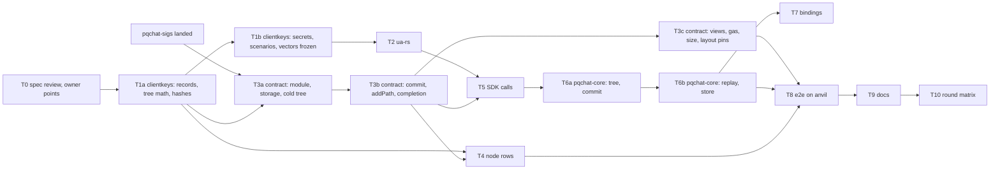

# PqChat TreeKEM mode (`groupMode = 1`), minimal scope: Implementation Plan

> **For agentic workers:** REQUIRED SUB-SKILL: Use superpowers:executing-plans to implement this plan task by task. Steps use
> checkbox (`- [ ]`) syntax for tracking.

**Status (2026-11-23):** PLANNED, nothing built. **UNAUDITED.** Spec
[`2026-11-23-pqchat-treekem.md`](../specs/2026-11-23-pqchat-treekem.md) (cited "spec §n", its controller calls "C1"–"C13", its
open points "O1"–"O5"); research [`2026-11-23-treekem-pqchat.md`](../../research/2026-11-23-treekem-pqchat.md).

**Owner ruling (2026-11-23, owner: yes):** minimal mode 1 is built now, before the pre-freeze tag: a commit with UpdatePath, Add
and Remove, Welcome by wraps; external commits, PSKs and ReInit are out; a new DELEGATECALL body module is accepted; the
committer's path secrets are seed-derived; our own TreeKEM in `ua-rs`, no MLS library; PqVault accepts only 0 (spec §1).

**Goal:** `PqChatTree` and its entries, the reference and vectors, `ua-rs`, the node's rows, the SDK calls, `pqchat-core`'s tree
client, bindings, an anvil e2e and the docs, in one round with one matrix at its end.

## 1. Order and dependencies

- **`pqchat-sigs` lands first.** The contract work (T3) branches from it: it needs the signature-storage setting (C1), several
  `keyId`s per UA and `groupMode` in `PqChatSession`. The round's branch is `pqchat-treekem`, made from the branch `pqchat-sigs`
  merged into; T1a may start before that on clientkeys alone and is rebased once.
- **T0 gates the code:** Fable's review of the spec (design, security, crypto) and its fixes; O1–O5 answered or their defaults
  (the controller calls) confirmed. A change to a record after T1b moves every vector: settle the records in T0.
- **Byte formats change everywhere at once:** the rows of `smartcontracts/vectors/pqchat/tree.json` come only from the clientkeys
  generator; no language edits a reproducer alone.

## 2. Parallel split

One agent's context holds one or two tasks. Four lanes, each a worktree of `pqchat-treekem` with real `lib/`, `node_modules`
and `algorand/out` directories:

| Lane | Agents, in order | Starts when |
|---|---|---|
| A, reference and crypto | A1: T1a → A2: T1b → A3: T2 | T0 done |
| B, contract | B1: T3a → B2: T3b → B3: T3c | `pqchat-sigs` landed and T1a's record rows exist |
| C, node | C1: T4 | T1a's type strings; finishes on T3b's selectors |
| D, clients | D1: T5 → D2: T6a → D3: T6b → D4: T7 | T2 and T3b's ABI |
| Controller | T0, T8 (one agent), T9, T10, the merges between lanes | |

Lanes A and B run side by side; C runs beside B; D starts last. Each agent reports its gates, mutants and pins (old → new); the
full matrix runs once, in T10, on the final tree (round rule of 2026-11-18). Heavy commands go through `scripts/capped`, in the
foreground.

## 3. Tasks

### T0. Spec review and owner points

- [ ] Fable review of the spec; findings mapped to fixes in a spec revision; the decisions entries updated.
- [ ] O1–O5 put to the owner; the spec's constants and C-rows follow the answers.

### T1a. clientkeys: records, tree math, hashes (`clients/clientkeys`)

- [ ] `src/pqchat-tree.js`: Appendix C tree math, resolution, filtered path, `th`, `parentHash` (spec §4); the typehashes and
      `hashStruct` of `PqChatCommit`, `TreeAdd`, `TreeRemove`, `PathCt` (spec §6); applying Removes and Adds; `ctTargets`.
- [ ] `scripts/pqchat-vectors.mjs`: `tree.json` rows `treeMath` (RFC 9420's tree-math vectors as a control), `resolution`,
      `treeHash` (cold 2, 3, 5 and 8 keys; after a commit, a Remove, an Add, growth), `parentHash`, `typehashes`, `digests`.
- [ ] Gates: `scripts/capped npm test` in `clients/clientkeys`; the generator's `--check` (a regenerated file is byte-identical).
- [ ] Mutants (each must turn a test red, one at a time): resolution lists right before left; a blank leaf counted; the filtered
      path keeps an empty level; `th` of an empty subtree non-zero; `parentHash` built bottom-up; one field dropped from the
      `PqChatCommit` type string.

### T1b. clientkeys: secrets, scenarios, the vectors frozen

- [ ] The path secrets, node keys from the 96-byte seed form, `pathContext` and `ps[0]`, the path ciphertext (`kek`, `aad`), the
      schedule (`ctx`, `joiner`, `S`, `K`, `init`), Welcome wraps, building and processing a commit, replay (spec §5, §10).
- [ ] Rows `secrets`, `pathCt`, `schedule`, and `scenario`: create (3 UAs, one with 2 keys) → commit by B → Add of a UA →
      commit by the new member → `remove` then a commit → Remove by `(ua, keyId)`; per step every record, piece, tree hash,
      and each member's `K`; one row with non-zero unbound fields where a digest canonicalises any.
- [ ] Negative rows with the expected named result: a wrong target, a wrong `treeHash`, a wrong `parentHash`, a node key that
      does not match its secret (cut off), a `sealedInfo` that does not open, a rebuilt commit after a `remove` (new secrets).
- [ ] Gates: as T1a; the mode-0 rows of `records.json`, `keys.json`, `messages.json` byte-identical (mode 0 does not move).
- [ ] Mutants: `ps[0]` without `ctTargets` in `pathContext`; `joiner` without `init`; `K` from `joiner` directly; the
      ciphertext `aad` without the target; a processed commit that skips the derived-key comparison (the cut-off row must fail).

### T2. `ua-rs`: the tree behind handles (`clients/ua-rs`)

- [ ] `src/wallet/tree.rs`: a tree-epoch handle (`init`, `K`, known node secrets, in the secret store); joining from a wrap;
      building a path from a `KemKeyPair` and `pathContext`; finishing a commit (`ctx` → epoch handle, Welcome wraps); opening
      a ciphertext with the leaf key or a held node and deriving upward with the key comparison; the committer's recovery.
      No function returns a secret byte (C1 of the SDK, A-3); errors named (`TreeKeyMismatch`, `TreeNotHeld`, `KemCheck`).
- [ ] The public side as plain functions: tree math, resolution, hashes, the record digests, `ctTargets`.
- [ ] Gates: `scripts/capped cargo test` with the features the vector tests need, over every `tree.json` row; clippy `-D
      warnings`; the existing KEM and PqChat tests unchanged; `cargo fmt --check`.
- [ ] Mutants: as T1b's, in Rust; plus a handle whose secret is readable through `Debug` (a test greps the output); a held
      node kept after a Remove blanked it.
- [ ] No new dependency (HKDF, AES-GCM, ML-KEM and X25519 are in the crate).

### T3a. Contract: the module, its storage, the cold tree (`smartcontracts/evm`)

- [ ] `PqGroupBase._land` split into storing wraps and completing an epoch; mode 0's behaviour and events unchanged (`PqChat`
      and `PqVault` bytecode may move: size and gas pins old → new in the commit).
- [ ] `src/pqchat/PqChatTree.sol` (SPDX header), a DELEGATECALL body module as `PqChatTopics`; namespace `scaas.pqchat.tree`
      (spec §7); `PqChat` gains the immutable `TREE`, `modules()` lists it, the factory release and `script/onchain/PqChat.s.sol`
      pass it. Library-split checks: storage through the hooks only, no `this`, `msg.sender` unused, return data forwarded.
- [ ] `createSession` with `groupMode = 1`: `PqChatTreeSigStore`, `PqChatTreeHome`, the cap, the leaves, `keysOf`, the hashes;
      `groupMode` 2–255 still `PqChatModeUnsupported`; `rekey` on a tree session `PqChatModeEntry`.
- [ ] Tests first (`test/pqchat/PqChatTree.t.sol`), each refusal with its positive control; the cold `treeHash` against the
      vector rows; `test/v2/layout/` gains the module's namespace and proves `PqChat`'s and `PqVault`'s layouts unmoved.
- [ ] Gates: every forge directory at the default set; the size gate (`PqChat` under 35,286 B, a new `PqChatTree` row with its
      reason); `forge fmt --check`.
- [ ] Mutants: mode 1 accepted on a `none` home; on a replica; the cap off by one; a leaf hash without its index.

### T3b. Contract: `commit`, `addPath`, completion

- [ ] `PqChatTypes`: the four typehashes and hashes (`*TypehashIsPinned` against the vectors); `IPqChat`: the structs, entries,
      views, errors and the `PqChatPath` event of spec §6 and §11.
- [ ] `commit`: the acceptance checks of spec §8 and the rights of §9; `addPath`; `addWraps`, `leave`, `remove`, `postMessage`
      forwarded for a tree session; completion steps 1–6 in order, all or nothing.
- [ ] Tests first: the `scenario` rows end to end (single transaction and chunked, pieces sent by a third party, in any order);
      every named error of spec §11 with its positive control; a commit staged before a `remove` that then fails to complete;
      two commits racing for one head; a piece landed twice; the ciphertexts and keys read back byte for byte from state.
- [ ] Gates: every forge directory at the default set; `forge test --isolate` for the gas files.
- [ ] Mutants: the walk on the tree before the changes; one target unchecked; `parentHash` or `treeHash` unchecked; completion
      without the removed-UA check; a non-admin adding another UA's key; the slot taken before the last piece; a direct-path
      node outside the filtered path left with its key; a ciphertext kept as its hash only.

### T3c. Contract: views, gas, size, pins

- [ ] The views of spec §6, with `TREE_RANGE_MAX`; `supportsInterface` and `interfaceId` (old → new).
- [ ] `test/pqchat/PqChatTreeGas.t.sol`: every row of spec §13 measured (2, 8, 64, 256 and 1,024 keys; warm, after a removal,
      cold; the record piece and the completion piece alone, with the ML-DSA-65 software check). Each row within 2^24 regular
      and stated with its smallest block. **A row that does not fit stops the task: numbers to the owner (O1), no bound edited
      to pass.** Timing or calibration runs: ask first.
- [ ] Pins: `size-baseline.json` (old → new, reasons), the gas pins of `PqChatGas.t.sol` that the base split moved, the layout
      files, `LinkClosure` release pins.
- [ ] Gates: every forge directory at the default set; `script/pqz/at-set.sh others sensitive`, then `others modules` (no outer
      `capped`); `PqzSet.sol` restored.

### T4. Node: typed and guard rows (`scaas-node`)

- [ ] `typed.rs`: `TYPED` rows for `PqChatCommit`, `TreeAdd`, `TreeRemove`, `PathCt`; entry rows `commit` (record and `UASig`)
      and `addPath` (no signature); every array bounded by length and depth before bytes are built (`TREE_LEAVES_MAX`,
      `TREE_CHANGES_MAX`, the depth). `guard.rs`: `commit` as the signed writes, `addPath` under `relay_unsigned_pqchat` as
      `addWraps`. `selector_audit.json`. Both directions equal to the contract's.
- [ ] `docs/node/job-api.md`: the two calls' named fields; a note for operators (a job shape was added, none changed).
- [ ] Gates: `scripts/capped cargo test`, clippy `-D warnings`; the node rebuilds the vector rows' calldata byte for byte.
- [ ] Mutants: a missing bound on `ctTargets`; `addPath` relayed with the option off; one selector missing on either side.

### T5. SDK: thin calls (`clients/scaas-sdk`)

- [ ] Named ABI rows for `commit`, `addPath` and the views; the `app_core` calls that pass `ua-rs`'s tree handles through;
      chunk planning from the chain's limits as for wraps (the gas table stays release data). No tree logic, no key byte.
- [ ] Gates: the SDK's tests over the `tree.json` digests and calldata; clippy; the binding surface check.
- [ ] Mutants: a chunk plan that exceeds the block-limit rule; a call that names `rekey` for a tree session.

### T6a. `pqchat-core`: the public tree and building a commit (`clients/pqchat-core`)

- [ ] The mode branch at "obtain `K`"; the tree from `treeOf`, `treeLeaves`, `treeNodes`, `treeNodeKey` under the read rules
      (ARCH-POS-15); the validation of spec §8 (recomputed `treeHash`, the head's signature, always on: C11); building a
      commit (plain, Add, Remove, by UA) and its pieces; the size hint (C3); a `none` home refused by name.
- [ ] Gates: `scripts/capped cargo test` over the vector rows; `tests/hostile`: a substituted node key, a stale head, a forged
      continuation, each refused before any encryption.
- [ ] Mutants: encrypting before the signature check; the tree hash not recomputed; a tree read from a replica.

### T6b. `pqchat-core`: replay, the store, cut off

- [ ] Replay from state (spec §10) on a fresh store; the store's tree rows as a cache; the cut-off state: shown, nothing sent
      (ARCH-POS-13); a seed-restored device opens its own commits; a device key's commits open on that device only.
- [ ] Gates: `tests/recovery.rs` over the `scenario` rows for every member and for a late joiner; the real-crypto e2e gate.
- [ ] Mutants: any automatic write after a failed open (a test counts sends: 0); replay that reads an event; replay that
      needs an epoch before the join.

### T7. Bindings

- [ ] Regenerate `pqchat-core`'s bindings with the new calls and errors; the per-language smoke tests. After `capped dotnet`:
      `dotnet build-server shutdown`.

### T8. e2e on anvil

- [ ] Local only. Deploy through the deploy script (the release with `TREE`), then: a tree session of 8 keys, a commit by a
      non-admin, an Add, a `remove` and the commit after it, a Remove of one device key, messages before and after each, a
      fresh device replaying, a second device racing a commit; through the node's relay with fee 0, `addPath` by a third party.
- [ ] Gates: `cargo test --test e2e -- --ignored` in `scaas-node`; the deploy e2e (a deploy-script change); progress lines, the
      full output in a git-ignored log.

### T9. Docs

- [ ] `docs/contracts/pqchat.md` §16 and `docs/clients/pqchat-core.md` to BUILT with the test names and the measured gas rows;
      `docs/node/job-api.md`; `docs/decisions.md` status lines; the summary `step | commit | rc | counts` under `runs/`.
- [ ] Gates: `python3 scripts/docs_check.py check` and `paths`, `python3 scripts/test_docs_check.py`.

### T10. The round's matrix, once, on the final tree

- [ ] Every forge directory at the default set; the set-sensitive tests and `modules` at the other three sets; the size gate;
      node tests, clippy and e2e; clientkeys, `ua-rs`, the SDK, `pqchat-core`, `pqvault-core` (still refusing 1), every `ua-*`
      that reads `smartcontracts/vectors/pqchat/`; the vector `--check`; docs.
- [ ] No `pqz-core` path changes: no gate there.
- [ ] Then: Fable code review of the contract and of `ua-rs`'s tree, fixes, the affected suites again. The code is UNAUDITED
      until an AI audit round covers it at its commit. Merge and push on the owner's word.

## 4. Pins this round moves

| Pin | Why |
|---|---|
| `interfaceId` of `IPqChat`, `selector_audit.json`, the node's rows | new entries and views |
| `size-baseline.json`: `PqChat` (dispatch), `PqVault` (if the base split moves it), a new `PqChatTree` row | spec §13 |
| Gas pins of `PqChatGas.t.sol` and `PqVault`'s that the base split moves; the new tree rows | old → new in the commit |
| Layout: a new namespace file; `PqChat` and `PqVault` proven unmoved | spec §7 |
| Typehash pins: four new; none of mode 0 moves | spec §6 |
| Vectors: a new `tree.json`; the mode-0 files byte-identical | T1 |

## 5. Risks

- **Time to the tag:** the note's estimate for a minimal mode 1 is 10 to 13 agent-days, 4 to 6 calendar days in parallel; the
  contract-side tree hash and walk (C7) sit at the upper end.
- **The cap (O1)** may come back from T3c with numbers.
- **A record change after T1b** restarts T1b's rows and every reader: T0 must close the records.
- **A new protocol before the audit:** every deviation of spec §3 is outside RFC 9420's analyses.
