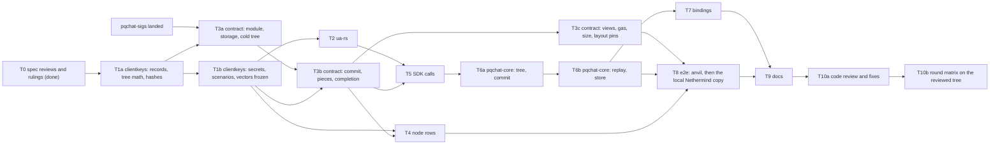

# PqChat TreeKEM mode (`groupMode = 1`), minimal scope: Implementation Plan

> **For agentic workers:** REQUIRED SUB-SKILL: Use superpowers:executing-plans to implement this plan task by task. Steps use
> checkbox (`- [ ]`) syntax for tracking.

**Status (2026-11-23; amended 2026-11-24 after the code review and its spec check, task T11):** PLANNED; BUILT (UNAUDITED): the contract (plan T1a-T3d with the code review's fixes of 2026-11-24 on branch `review-fix-contract`), clientkeys and `ua-rs` (T1a, T1b, the forward walk of C25 / C26), the node's rows and bounds (T4's allow-list part, D-4, D-7); PLANNED: T4's whole-set guard and C37's order at the node, T5-T10. **UNAUDITED.** Revision 3, after two review rounds by Codex and Fable and a
third, focused round by Fable (`fable-r3-n`), whose fixes moved no record, typehash or derivation; then the owner's R16
(the key no-return set two-level), a contract rule and storage change that moved none either; then a third round by
Codex (`codex-r3-n`: 0 P0, 6 P1, 6 P2, 1 P3), fixed in place: no record, typehash, derivation or view moved, one check
added to `commit`'s acceptance (T3b).
Spec [`2026-11-23-pqchat-treekem.md`](../specs/2026-11-23-pqchat-treekem.md) (cited "spec §n", its rulings "R1"–"R16", its
controller calls "C1"–"C38"; a review finding by its id, `codex-n`, `fable-n`, `codex-r2-n`, `fable-r2-n`, `fable-r3-n`, `codex-r3-n`); research
[`2026-11-23-treekem-pqchat.md`](../../research/2026-11-23-treekem-pqchat.md).

**Owner rulings (2026-11-23, owner: yes):** minimal mode 1 is built now, before the pre-freeze tag: a commit with UpdatePath, Add
and Remove, Welcome by wraps; external commits, PSKs and ReInit are out; a new DELEGATECALL body module is accepted; the
committer's path secrets are seed-derived; our own TreeKEM in `ua-rs`, no MLS library; PqVault accepts only 0; the leaf is the
registry KEM key; a non-admin commits for its own UA's leaves only; no tree session on a `none` home or a replica; ML-KEM-1024
the one node scheme; `TREE_LEAVES_MAX` = 256 (about 200 keys by one record at 60 M, the rest by Adds); the joiner without
the `init` chain, its cost accepted, with a compromise warning; no automatic receipts in a tree session; impossible commits
refused by the contract at acceptance; a changed session info only after a strict-majority read over at least 3 named
endpoints; no UA and no key returns to a tree session (the way back is a new UA with a fresh key); the key half of that rule is
hygiene against reuse of the same key bytes, and exclusion rests on the UA roster (R15); that key half is two-level, the
pair `(ua, kemHash)` for a key a UA takes out of its own leaves and the session-wide `kemHash` of every key a UA held when
it leaves or is removed, with the admin's client warning before an Add of a key registered to another UA (R16). **No point is open**
(spec §16).

**Goal:** `PqChatTree` and its entries, the reference and vectors, `ua-rs`, the node's rows, the SDK calls, `pqchat-core`'s tree
client, bindings, an e2e and the docs, in one round with one matrix at its end.

## 1. Order and dependencies

- **`pqchat-sigs` lands first.** The contract work (T3) branches from it: it needs the signature-storage setting (C1), several
  `keyId`s per UA and `groupMode` in `PqChatSession`. The round's branch is `pqchat-treekem`, made from the branch `pqchat-sigs`
  merged into; T1a may start before that on clientkeys alone and is rebased once.
- **T0 is done with revision 3:** two review rounds, their fixes, every owner point ruled. The records are settled
  (`PqChatCommit` with `parentTreeHash`, `PqChatTreeLeave`, `PqChatTreeRemove`, `TreeGenesis`); a change to a record after T1b
  moves every vector.
- **T1b before T3b and T4 (fable-14).** T3b's first tests are the `scenario` rows end to end and T4's gate rebuilds the rows'
  calldata; both rows are T1b's. T3a needs only T1a's rows (type strings, the cold tree hash, the admission check).
- **Byte formats change everywhere at once:** the rows of `smartcontracts/vectors/pqchat/tree.json` come only from the clientkeys
  generator; no language edits a reproducer alone.

## 2. Parallel split

One agent's context holds one or two tasks. Four lanes, each a worktree of `pqchat-treekem` with real `lib/`, `node_modules`
and `algorand/out` directories:

| Lane | Agents, in order | Starts when |
|---|---|---|
| A, reference and crypto | A1: T1a → A2: T1b → A3: T2 | T0 done (T1a: the records settled) |
| B, contract | B1: T3a → B2: T3b → B3: T3c | `pqchat-sigs` landed and T1a's rows exist; **T3b when T1b's rows are frozen** |
| C, node | C1: T4 | T1b's rows and T3b's selectors |
| D, clients | D1: T5 → D2: T6a → D3: T6b → D4: T7 | T2 and T3b's ABI |
| Controller | T0, T8 (one agent), T9, T10a, T10b, the merges between lanes | |

Lane B's T3a runs beside lane A's T1b; T3b waits for T1b. Each agent reports its gates, mutants and pins (old → new); the full
matrix runs once, in T10b, on the final tree (round rule of 2026-11-18). Heavy commands go through `scripts/capped`, in the
foreground.

## 3. Tasks

### T0. Second spec review and owner points

- [x] First review (Codex, Fable) of revision 1; revision 2 of the spec; the decisions entries updated; the resolution table.
- [x] Second review of revision 2 (Codex: rework, 3 P0 and 8 P1; Fable: approve with fixes, 1 P1); revision 3; the
      resolution rows of round 2.
- [x] The owner's rulings R8 to R14 recorded in the spec and in decisions; the recovery vectors are pinned to the schedule
      without `init` (codex-r2-16).
- [x] Third review of revision 3 (Fable, focused: approve with fixes; 0 P0, 2 P1, 4 P2, 3 P3), fixed in place: client rules
      (the info after a gap, the checkpoint conflict, the warning's remedies), one node rule (the whole-set guard), one
      ordering rule of the contract (`gone` after the Adds), wording and two gas rows. No record, typehash or derivation
      moved; the owner's R15 recorded.
- [x] The owner's R16 (after round 3, on the controller's finding of a front-running burn): the key no-return set two-level
      in the spec (§1, §2 C28, §6 to §11, §13 to §17), the component docs and decisions; no record, typehash or derivation
      moved.
- [x] Third review by Codex on that tree (`ddf3a92cb`; rework before the recovery vectors and the gas bounds freeze; 0 P0,
      6 P1, 6 P2, 1 P3; R16 and both readings of C28 judged sound), fixed in place: the two ranges of replay, the
      comparison at the pin, the warning's roster and its empty-path test, the prepared creation, the completion's gas
      recomputed (352 new slots, 49.1 M asked at the bounds), an admin's new info after a gap, R16's guarantee worded,
      the lookup behind the Add warning, `admins` against the UAs a commit evicts, the closed session (C38), the order
      of the pieces (C37), the `treeLeaves` measurement. **No record, typehash, derivation or view moved: T1a's rows and
      T3a's module stand.** New work lands in T1b, T2, T3b, T3c, T4, T5, T6a and T6b below.

### T1a. clientkeys: records, tree math, hashes (`clients/clientkeys`)

- [ ] `src/pqchat-tree.js`: Appendix C tree math, resolution, filtered path, `th` with `kemHash` in the leaf (spec §4); the
      typehashes and `hashStruct` of `PqChatCommit` (with `parentTreeHash`), `TreeAdd`, `TreeRemove`, `PathList` (the empty
      list too, codex-r2-14), `PathCt`, `PqChatTreeLeave`, `PqChatTreeRemove`, `TreeGenesis`; `treeId` and `genesisCtx` (spec
      §5, §6);
      applying Removes and Adds; `ctTargets`; the target that covers a leaf; the key admission check (spec §8); **the
      no-return model of R16:** the UA set, the pair set and the session-wide set, the level of each removed key judged on
      the tree after the Adds, and the Add's verdict with its named error.
- [ ] `scripts/pqchat-vectors.mjs`: `tree.json` rows `treeMath` (RFC 9420's tree-math vectors as a control), `resolution`,
      `treeHash` (cold 2, 3, 5 and 8 keys; after a commit, a Remove, an Add, growth; **an Add and a Remove under a copath child
      of the author**, fable-9), `admission` (one key per refused case: a coefficient at 3,329, each of the five canonical small-order
      `pk_X`, **the non-canonical forms: `p`, `p + 1`, an accepted key plus `p` where it fits, and an accepted key with bit
      255 set** (C32, codex-r2-2), a wrong scheme byte, a wrong length; and accepted controls), `typehashes`, `digests`,
      and `noReturn` (R16), each step with the sets after it and the verdict of the next Add: **the burn by own-key churn**
      (B registers A's public key as its own version, adds it by a plain commit, takes it out: only `(B, kemHash)` is set,
      B's re-add is `PqChatTreeOwnKeyReturn`, A's Add is accepted); **the front-running loop** (B repeats it on each of A's
      next keys: every one of A's Adds after B's churn is accepted; B holding keys live blocks at most `KEYS_PER_UA_MAX` of
      them at a time (occupancy, no priority for A; wording only, the rows stand: codex-r3-8), and an admin's Remove of one such leaf while B keeps another frees it at the pair level); **the burn by leave**
      (B holds A's key, then `treeLeave`, `treeRemove`, or an admin's commit that leaves B no leaf: the `kemHash` of every
      key B's leaves held enters the session-wide set, A's Add of it is `PqChatTreeKeyReturn` under any UA, B's Add is
      `PqChatTreeReturn`, keys B took out earlier stay pairs); the replacement of a UA's only key in one commit (the old key
      a pair, the UA not `gone`); a Remove and an Add of the same bytes in one commit, under the same UA and under another.
- [ ] **An admitted related key (fable-r3-2, R15):** one `admission` row holds an accepted key and the same key with `pk_X`
      shifted by a torsion point (order 4, and order 8): the shifted key is **admitted**, has another `kemHash`, and for one
      fixed ephemeral scalar gives the same X25519 output. The row states what the check does not give; no test may
      assert "one capability per `kemHash`".
- [ ] Gates: `scripts/capped npm test` in `clients/clientkeys`; the generator's `--check` (a regenerated file is byte-identical).
- [ ] Mutants (each must turn a test red, one at a time): resolution lists right before left; a blank leaf counted; the filtered
      path keeps an empty level; `th` of an empty subtree non-zero; the leaf hash without `kemHash`; a sibling hash taken before
      the changes; the admission check without the small-order list; the admission check that clears bit 255 instead of refusing it; one
      field dropped from the `PqChatCommit` type string; `genesisCtx` that hashes `wrapHashes`; **R16:** own-key churn
      written session-wide (the churn row must fail); a going UA's keys written as pairs only (the leave row must fail); the
      level judged between the Removes and the Adds (the replacement row must fail); the pair set ignored at an Add (B's
      re-add must fail); the keys a going UA took out earlier promoted to session-wide (the leave row's earlier-key step must
      fail).

### T1b. clientkeys: secrets, scenarios, the vectors frozen

- [ ] The path secrets, node keys from the 96-byte seed form, `pathContext` and `ps[0]`, the path ciphertext (`kek`, `aad`), the
      schedule without `init` (`ctx` with `parentTreeHash`, `joiner`, `S`, `K`; epoch 0 under `genesisCtx`), the tree wrap
      label, the info marker and the info in force (C33), building and processing a commit, the joiner's path, **the forward
      walk** from the cold tree of the signed members (or a verified pin with its exits) with the exits of each epoch and
      the rights evidence judged as the contract accepts them, replay with its fixed read list (spec §5, §8 step 2, §10;
      C25 as amended 2026-11-24; T11 lists the rows).
- [ ] **Creation in order (codex-r2-4):** a test builds a session from `genesisCtx` to the signature with no placeholder; on
      a **completed** genesis a fresh store recovers `K_0` from its own wrap read back from state, and every stored wrap
      matches `wrapHashes`. No test rebuilds a wrap: the signed ciphertexts are made once (codex-r3-5; the incomplete
      creation is T6a's).
- [ ] Rows `secrets`, `pathCt`, `schedule`, and `scenario`: create (3 UAs, one with 2 keys) → commit by B → Add of a UA →
      **a commit by a third member, outside the new member's subtree, right after the Add** (codex-5, fable-5) → a commit by
      the new member → `treeRemove` then a commit → Remove by `(ua, keyId)`; per step every record, piece, tree hash, roster, and
      each member's `K`; one row with non-zero unbound fields where a digest canonicalises any.
- [ ] Rows for the repeats (fable-1, codex-7): the same change, nonce and target indices on a tree with other keys (scenario A)
      and in a twin session at another home (scenario B): `ps[0]` differs in both.
- [ ] Rows for healing (codex-15, fable-6, fable-4): a leaked node set that one commit locks out and one that it does not; a
      member that did not follow an epoch and follows the next commit that reaches its leaf; **a member that missed two
      epochs** and is not restored by the commit that restores the others (fable-r2-7).
- [ ] Rows of round 2: a commit from a device's own `(ua, keyId)` that the seed does not reproduce → the compromise warning,
      not "not followed" (fable-r2-1); a same-id twin of the head with another `treeHash` → refused by the pinned record hash,
      and `ps[0]` differs (fable-r2-4, codex-r2-11); a refresh by a device two epochs behind seals the marker; that device has **no info in force** from its gap on, and
      the members that followed keep theirs (codex-r2-3, fable-r2-5, codex-r3-7); a non-admin's changed info is ignored; an epoch-0 head served with a leaf outside
      the signed members and a matching root → refused before encryption (codex-r2-1); a `PqChatTreeLeave` and a
      `PqChatTreeRemove` of a twin session at another home → another digest (codex-r2-5); `sealedInfo` of the 4,096-B bucket
      (4,124 B) at genesis and in a commit, and the next bucket refused (codex-r2-13).
- [ ] Row of round 3 (fable-r3-1): an admin changes the info in epoch `e`; a device does not follow `e`, follows the next
      commit (a non-admin's, from its sibling side), then commits (a new device key) → it seals **the marker**, and the
      retired info appears in no later record; a control in which it followed `e` seals the full info.
- [ ] Rows of Codex's round 3, each with its control:
      **the retired key (codex-r3-1):** a key joins at 2, is removed at 5, the head is 9, with Adds and Removes of other
      UAs in 6 to 9; the read list is the session record and the records of 1 to 9 with their exit lists, the ciphertexts
      of 2 to 4 and nothing at 5; the rosters of 2 to 4 by the forward walk equal the scenario's; the same for a **genesis** key taken out (`members[i]`, wrap
      `i`, no record before 0);
      **the twin outside the tree (codex-r3-2):** two signed records with one id, one parent and one `treeHash` and
      another `sealedInfo`: two `hashStruct`s, and the true child fits both;
      **the foreign commit that adds a leaf (codex-r3-3):** an own-UA commit the seed does not reproduce, which also adds
      a second leaf of that UA; after a refresh that leaf is still a target; after the commit that removes it, it is not;
      **the empty path (codex-r3-4):** the last live leaf's commit built from another seed under the UA's signature →
      `sealedInfo` does not open under the derived `K` → the compromise warning; built from the seed → followed; the
      same record with a byte changed → "read corrupted", neither state;
      **the info after a gap (codex-r3-7):** every admin device behind → markers only; an admin establishes a new info
      → the members take it as a changed info; the cached old info is sealed by no automatic step.
- [ ] Negative rows with the expected named result: a wrong target, a wrong `treeHash`, a list that does not hash, a node key
      that does not match its secret, a Welcome that disagrees with the path, a `sealedInfo` that does not open, a valid
      substituted leaf key with the tree unchanged (codex-1), a fetched ciphertext or key altered with the signature unchanged
      (codex-13). **Two different rows for the two failures (codex-r2-15):** "read corrupted" (bytes changed, signed hashes
      kept: refused at the read boundary, before any decapsulation) and "opening failed" (a commit that validly signs the hash
      of a bad ciphertext: the read passes, the opening fails); each row states which step it reaches.
- [ ] Gates: as T1a; the mode-0 rows of `records.json`, `keys.json`, `messages.json` byte-identical (mode 0 does not move).
- [ ] Mutants: `pathContext` without `parentTreeHash`, without `treeId`, without `ctTargets`; `K` from `joiner` directly; the
      ciphertext `aad` without the target; `ctx` without `parentTreeHash`; epoch 0 under `treeId`; a refresh that re-seals
      the last info read; **the gap ignored** (a device that follows again keeps the info it held before the epoch it missed; fable-r3-1); the compromise warning folded into "not followed"; a tree wrap under the flat label; a processed commit that skips the derived-key
      comparison; a joiner that skips its path ciphertext (the third-member row must fail); a ciphertext index chosen from the
      held secrets instead of the list (the read list of the failing member must differ and the test must see it); **the
      walk stopped at the key's `endEpoch`** (the retired-key row must fail); **the own-commit test on node keys only**
      (the empty-path row must fail); a ciphertext opened at `endEpoch`.

### T2. `ua-rs`: the tree behind handles (`clients/ua-rs`)

- [ ] `src/wallet/tree.rs`: a tree-epoch handle (`K`, known node secrets, in the secret store); joining from a wrap and the
      path ciphertext; opening a ciphertext with the leaf key or a held node and deriving upward with the key comparison; the
      committer's recovery. No function returns a secret byte (C1 of the SDK, A-3); errors named (`TreeKeyMismatch`,
      `TreeNotHeld`, `KemCheck`).
- [ ] **The typed commit-signing operation (codex-12, spec §15):** one named operation that authenticates the target keys,
      draws and returns the nonce, builds the path, the list, the pieces and the record inside the boundary, shows the review
      and signs. Tests: a normal signing; a request whose pieces differ from the reviewed ones is refused; no entry signs a
      `PqChatCommit` digest from outside. The same for `PqChatTreeLeave` and `PqChatTreeRemove`: named operations whose
      review shows the `treeId` and "cannot come back" (C30, R14).
- [ ] The epoch-0 tree rebuilt from the signed member list (codex-r2-1); the own-commit check that yields the compromise
      warning (R10), in its two cases with their remedies (fable-r3-5): to reproduce is node keys **and** `sealedInfo`, the empty
      path included (codex-r3-4); a device key per UA or random, never one key under two UAs (R14).
- [ ] **The registry KEM record check (codex-1, spec §8 step 4):** key data hashes to the UA; a version above 0 by its kept
      signature over `kemRecordDigest`; version 0 by the registration's committed hash. Encapsulation takes only a key that
      passed. Tests: each form accepted; a substituted valid key refused; a record signed by another UA refused.
- [ ] The public side as plain functions: tree math, resolution, hashes, the record digests, `ctTargets`, the admission check.
- [ ] Gates: `scripts/capped cargo test` with the features the vector tests need, over every `tree.json` row; clippy `-D
      warnings`; the existing KEM and PqChat tests unchanged; `cargo fmt --check`.
- [ ] Mutants: as T1b's, in Rust; plus a handle whose secret is readable through `Debug` (a test greps the output); a held
      node kept after a Remove blanked it; the registry check skipped for an added key; a nonce reused for a rebuilt commit.
- [ ] No new dependency (HKDF, AES-GCM, ML-KEM and X25519 are in the crate).

### T3a. Contract: the module, its storage, the cold tree (`smartcontracts/evm`)

**Two layers (owner 2026-11-23, CTR-CHAT-26):** the tree math, the tree hash, the admission check, the tree storage and, from
T3b, the R16 sets and the acceptance and completion checks are `src/pqgroup/PqGroupTree.sol`, an abstract base for any
contract that keeps a group tree, app-agnostic (its namespace, typehashes, bounds and errors by hooks the inheritor fixes;
`docs/contracts/pqchat.md` §17); PqChat's entries, domain, typehashes and the glue are `PqChatTree` and `PqChatCore`.

- [x] `PqGroupBase._land` split into storing wraps and completing an epoch; `_authorOf`'s offset-free form moved from `PqChat`
      to a base the module inherits (fable-U2); mode 0's behaviour and events unchanged (`PqChat` and `PqVault` bytecode may
      move: size and gas pins old → new in the commit).
- [x] `src/pqchat/PqChatTree.sol` (SPDX header), a DELEGATECALL body module as `PqChatTopics`; namespace `scaas.pqchat.tree`
      (spec §7), with `gone`, and the two key sets of R16, `goneOwnKey[ua][kemHash]` and `goneKey[kemHash]`, apart; `PqChat` gains the immutable `TREE`, `modules()` lists it, the factory release and `script/onchain/PqChat.s.sol`
      pass it. Library-split checks: storage through the hooks only, no `this`, `msg.sender` unused, return data forwarded.
- [x] `createSession` with `groupMode = 1`: `PqChatTreeSigStore`, `PqChatTreeHome`, the caps (`TREE_INFO_MAX` too), `treeId`;
      only the creator indexed at the record; **leaf `i`, `liveKey`, `keysOf`, the hashes above it and the UA's `sessionsOf`
      entry written when wrap `i` lands (C15, C34)**, with the admission check (canonical `pk_X`, C32) and `PqChatTreeKeyLive`;
      `genesisTreeHash` when epoch 0 completes; `groupMode` 2–255 still `PqChatModeUnsupported`; `rekey` on a tree session
      `PqChatModeEntry`.
- [x] Tests first (`test/pqchat/PqChatTree.t.sol`), each refusal with its positive control; the cold `treeHash` against the
      vector rows, with the wraps landed in order, in reverse and one per transaction; every `admission` row; two members with
      one key; the author read from a three-part blob; `test/v2/layout/` gains the module's namespace (the pair set and the
      session-wide set at distinct pinned slots, R16) and proves `PqChat`'s and `PqVault`'s layouts unmoved.
- [x] Gates: every forge directory at the default set; the size gate (`PqChat` under 35,286 B, a new `PqChatTree` row with its
      reason; built: `PqChatTree` 11,696 B fits EIP-170, so the gate takes no row for it, as for `PqChatTopics`);
      `forge fmt --check`.
- [x] Mutants: mode 1 accepted on a `none` home; on a replica; the cap off by one; a leaf hash without its index or without
      `kemHash`; the leaves written in the record's transaction; the pair set stored in the session-wide mapping by `kemHash`
      alone (the layout pin and T3b's churn test must fail, R16); every member indexed in the record's transaction (the gas row
      at 192 first-time UAs must fail, codex-r2-8); the author offset back to the constant 96; the admission check reduced to
      scheme and length.

### T3b. Contract: `commit`, the pieces, completion

The checks and the tree writes below go into `PqGroupTree` (app-agnostic, by its hooks; a new error code is a `T_*` code that
`PqChatCore._treeFail` maps), the entries, records and typehashes into `PqChatTree` and `PqChatTypes` (T3a's two layers).

- [ ] `PqChatTypes`: the eight typehashes and hashes (`*TypehashIsPinned` against the vectors); `IPqChat`: the structs, entries,
      views, errors and the `PqChatPath` event of spec §6 and §11.
- [ ] `commit`: the acceptance checks of spec §8 (with `treeId`, `parentTreeHash`, `kemHash`, `liveKey`, `gone`, `goneOwnKey`, `goneKey`,
      the shapes of C24, the empty-list hash) and the rights of §9; **the tree check in memory at acceptance (R12): counts,
      path length, removed UAs, the root, the expected-targets hash**; `addPathList` (against that hash), `addPathKeys`,
      `addPath`; `addWraps` and `postMessage` forwarded for a tree session; `treeLeave` and `treeRemove` (`treeId`, `gone`,
      `owed` for both, C21, `PqChatTreeAdmins` with its exemption); `leave` and `remove` refused on a tree session;
      `Epoch.wraps` = pieces + 1 (C20); completion steps 1–5 in order, all or nothing, also from `commit` itself, writing
      `gone` and each removed key at its level, `goneOwnKey` or `goneKey`, judged after the Adds (R16); **`admins` judged
      against the prospective `gone` set at acceptance** (`gone` plus every UA the commit leaves with no leaf:
      `PqChatRemovedKept`; codex-r3-10).
- [ ] Tests of Codex's round 3: an admin's commit that removes another admin's last leaf and keeps it in `admins` is
      refused at acceptance with no state written; the same commit without that UA in `admins` completes and the UA is
      `gone`; the same Remove with an Add of that UA's new key and the UA kept in `admins` completes (codex-r3-10).
      **The closed session (C38, codex-r3-11):** the only member left leaves, and two members leave on one head: the
      record is accepted; a commit by anyone is `PqChatNotMember`, a message refused; `goneOf` is set, `goneKeyOf` and
      `goneOwnKeyOf` are unset for those leaves, `treeLeaves` and `treeOf` are as before with `owed` above 0; control:
      with one member left that is not `gone`, its commit honours the leaves and completes.
- [ ] Tests of round 2: each of a wrong `treeHash`, `ctCount`, path length and a kept removed UA **refused at acceptance with
      no state written** (fable-r2-3), and the same record accepted when right; a `treeRemove` landed between acceptance and
      completion fails step 1; a wrong `parentTreeHash` (codex-r2-11); an Add of a `gone` UA after a leave, after a
      `treeRemove`, after a commit-only removal → `PqChatTreeReturn`; an Add of a key taken out of a UA that went, under
      that UA's other `keyId`, under another UA, and in the commit that removes it → `PqChatTreeKeyReturn`; a new UA with a
      fresh key accepted (R14); a flat session still re-adds; `treeLeave` and `treeRemove` of a twin at another home refused (codex-r2-5);
      32 owed then one leave refused, and the commit of 32 forced changes completes (codex-r2-7); `treeRemove(A2)` then
      `treeLeave(A1)` and the honouring commit completes (fable-r2-6); a zero-target commit with a non-canonical list hash
      refused (codex-r2-14); the signed record sent alone by a third party, then the author's pieces through the piece
      entries (fable-r2-9).
- [ ] **Tests of R16, over T1a's `noReturn` rows, each refusal with its positive control:** (1) **the burn by own-key churn
      is refused to harm A:** B registers A's public KEM key as its own version, adds it by a plain commit, takes it out by
      the next; `goneOwnKeyOf(B, kemHash)` is set and `goneKeyOf(kemHash)` is not; B's re-add under any `keyId` is
      `PqChatTreeOwnKeyReturn(B, kemHash)`; A's Add of that key (by an admin, and by A's own plain commit when A is a
      member) is accepted. (2) **The front-running loop is impossible:** B repeats (1) on A's next three keys, each before
      A's Add; each of A's Adds after B's churn is accepted; with B at `KEYS_PER_UA_MAX` live keys, A's Add of a key B
      holds is `PqChatTreeKeyLive`; **after B releases that key while it stays a member (B takes it out, or an admin
      removes that leaf while B keeps another), only the pair is written and A's Add of it is accepted; an Add that still
      collides with a live leaf is refused, also when B takes one key out and adds A's next key in the same commit.** The
      bound of eight is on the keys B holds at once and gives A no priority (codex-r3-8). (3) **The burn by leave works once and excludes B:** B holds A's key,
      then `treeLeave(B)` and the honouring commit: `goneKeyOf(kemHash)` is set, A's Add of it is `PqChatTreeKeyReturn`
      under A and under a third UA, an Add of B is `PqChatTreeReturn`, B can neither post nor commit, a key B took out
      before its leave stays a pair (A adds it); the same with `treeRemove(B)` and with an admin's commit that leaves B no
      leaf; a fresh UA for the next attempt cannot add itself (`PqChatNotMember`, an admin's Add needed). (4) A Remove and
      an Add of the same bytes in one commit: under the same UA → `PqChatTreeOwnKeyReturn`; under another UA → accepted
      while the removed UA keeps a leaf, `PqChatTreeKeyReturn` when the commit leaves it none. (5) The replacement of X's
      only key in one commit writes the old key as `(X, kemHash)`, not session-wide.
- [ ] Tests of round 3 (fable-r3-4): an admin's commit that removes X's only leaf and adds X's new key completes, X is not
      `gone`, can post, and the next commit owes no Remove for it (`owed` is 0); the same Remove without the Add makes X `gone` (kind
      2) and a later Add of X is `PqChatTreeReturn`.
- [ ] Tests first: the `scenario` rows end to end (single transaction and chunked, pieces sent by a third party, in any order);
      every named error of spec §11 with its positive control; a commit staged before a `treeRemove` that then fails to complete;
      two commits racing for one head; a piece landed twice; a wrong piece by a third party refused and the right one still
      landing; the list, the ciphertexts and the keys read back byte for byte from state.
- [ ] Tests that name a finding: `epochComplete`, `postMessage`, `treeRemove` and a child `commit` on a staged commit without Adds,
      on a losing one and on a zero-piece one, false or refused before completion and true after (codex-10, fable-7); `treeRemove`
      owing 32 leaves accepted and 33 refused, by one record and by several (codex-6, fable-2); an Add of a live `(ua, keyId)`,
      of another `keyId` with the same key bytes, and a leaf freed by a Remove of the same commit taken by another key (codex-2, fable-10); an Add
      whose `kemHash` is another valid key (codex-1); a node key that fails the admission check with every hash matching
      (codex-8); a commit signed for a twin session at another home (codex-7); a commit and a `treeRemove` that would leave a
      keyless admin only (codex-21); an added UA in `sessionsOf` once, also after a second key
      (fable-11, codex-17; the re-add in mode 0 only); `ctCount ≥ leaves`, 33 admins, 4,125 B and 0 B of `sealedInfo` refused at
      acceptance (codex-20).
- [ ] Gates: every forge directory at the default set; `forge test --isolate` for the gas files.
- [ ] Mutants: the walk on the tree before the changes; one target unchecked; `treeHash` unchecked; the hashes compared before
      they are recomputed; completion without the removed-UA check; a non-admin adding another UA's key; the slot taken before
      the last piece; `wraps` without the extra unit; a direct-path node outside the filtered path left with its key; a
      ciphertext or the list kept as its hash only; `liveKey` not freed by a Remove; `owed` not reset at completion; the tree check moved back to
      completion; `gone` cleared at completion; the session-wide set keyed by `(ua, kemHash)` (R16's leave test must fail);
      own-key churn written to the session-wide set (R16's churn test must fail); a going UA's keys written to the pair set
      only (the leave test must fail); the pair set unchecked at an Add (B's re-add must fail); the level judged before the
      Adds (the replacement test must fail); a leave not counted in `owed`; the admin
      exemption widened to any change; `parentTreeHash` unchecked; the flat `leave` accepted on a tree session; `gone` judged
      between the Removes and the Adds (fable-r3-4); `admins` judged against the stored `gone` set only (the evicted-admin
      test must fail; codex-r3-10); the last leave refused, or `goneKey` written by it (the closed-session test must fail).

### T3c. Contract: views, gas, size, pins

- [ ] The views of spec §6, with `TREE_RANGE_MAX`; `supportsInterface` and `interfaceId` (old → new).
- [ ] `test/pqchat/PqChatTreeGas.t.sol`: every row of spec §13 measured (2, 8, 64 and 256 keys; warm, after a removal, cold; the
      session record at 64, 128, 192 and 256 member keys; a genesis wrap with its leaf, typical and first of a subtree; the
      record at its bounds; the list at 255 targets; the node keys; **completion with the last ciphertext sent alone, at two
      fixtures (codex-r3-6): a full tree of 32 keys grown to 64 by 32 Adds of UAs with no session (227 new slots expected),
      and the bound, a tree of 256 with one live leaf, 32 such Adds in 32 different subtrees of 8, the admin list grown
      from 1 to 32 (352 expected); each test counts its new slots and compares them with the spec's table**; the node
      keys as the last piece at the bound, expected not to fit and recorded with its figure (C37); the acceptance tree check alone, warm and on a cold tree of 256
      (R12's +3 M); `treeLeave` and `treeRemove` with their `gone` slots, a Remove with its key slot at each level and an
      Add's three cold reads (R16); a genesis wrap of a
      first-time UA; **each signed row with ML-DSA-65 and with ML-DSA-87 on their caches (codex-r2-12)**; one transaction
      holding acceptance and completion at the bounds, for both signers: both are expected over 2^24 (about 20 M and
      23 M) and recorded as "record alone"; **the commit of the last live leaf at its bounds** (no piece, so one
      transaction by construction: 32 admins, 4,124 B of info, and 32 Removes in two fixtures: forced, their `gone`
      slots paid before, and evictions by the commit alone, 32 `gone` slots more; codex-r3-6), for both signers, which cannot go "record alone": over 2^24 it stops the
      task; **a transaction of 15 genesis wraps, and one whose wraps each open a subtree**, against the block (fable-r3-8)). **The file runs with `--enable-tx-gas-limit`, and each row asserts `regular < 2^24` and `(regular + state)
      × 1.05 ≤ 60 M` in the test itself (fable-15; the session record at 256 member keys is expected above 60 M and is recorded
      with its figure, with the largest key count that fits):** a positive control row that exceeds 2^24 (the FIPS-key verify) must fail
      under the flag, or the flag is not in force. **A row that does not fit stops the task: numbers to the owner, no bound
      edited to pass.** Timing or calibration runs: ask first.
- [ ] **The `treeLeaves` page (fable-r2-U1):** a page of `TREE_LEAF_PAGE_MAX` = 64 leaves whose keys are all versions above 0,
      as an `eth_call` on the local Nethermind copy (2^24 enforced), with its gas; and a full tree of 256 as **four such
      calls at one block**, summed. The production view never returns 256 leaves at once; an uncapped page of 256, if
      wanted for comparison, is a harness contract and is named as that (codex-r3-13). If 64 is
      above 4 M, the page is lowered and the figure goes to the spec.
- [ ] A reachability test (fable-3): a tree at the cap with 224 silent added leaves, then `treeRemove`s to `owed` = 32: the next
      commit's pieces are the bounds of §13 and each fits, sent in the order of C37; the claim is for a tree with a
      member left (a closed session has no next commit, C38).
- [ ] Pins: `size-baseline.json` (old → new, reasons), the gas pins of `PqChatGas.t.sol` that the base split moved, the layout
      files, `LinkClosure` release pins.
- [ ] Gates: every forge directory at the default set; `script/pqz/at-set.sh others sensitive`, then `others modules` (no outer
      `capped`); `PqzSet.sol` restored.

### T4. Node: typed and guard rows (`scaas-node`)

**Progress (2026-11-24, owner ruling: TreeKEM merges into `ua-rs-sign` once, after T3b, T3c and T4's allow-list part).** The
allow-list part is done: the rows, the bounds, `guard.rs`, the both-ways audit, the vector rows' calldata, the docs of the
six calls (`runs/2026-11-23-pqchat-treekem-t4-summary.txt`, mutants in `-t4-mutants.txt`). Left for after the merge: the
whole-set guard, the gas and C37's order in the lanes, the e2e, and the whole-set guard's text and refusal in `job-api.md`.

- [x] `typed.rs`: `TYPED` rows for `PqChatCommit`, `TreeAdd`, `TreeRemove`, `PathList`, `PathCt`, `PqChatTreeLeave`,
      `PqChatTreeRemove`; entry rows `commit`, `treeLeave`, `treeRemove` (record and `UASig`) and `addPathList`, `addPathKeys`, `addPath` (no signature); every array bounded by length and depth before bytes
      are built, **with the contract's bounds** (`TREE_LEAVES_MAX`, `TREE_CHANGES_MAX`, `TREE_ADMINS_MAX`, `TREE_INFO_MAX`, the
      depth, `ctCount < leaves`; codex-20). `guard.rs`: `commit`, `treeLeave`, `treeRemove` as the signed writes, the three unsigned entries under
      `relay_unsigned_pqchat` as `addWraps`. `selector_audit.json`. Both directions equal to the contract's.
- [x] **The whole-set guard (fable-r3-6, spec §8, §15):** the node relays a tree commit's record or pieces only when it holds
      every piece the record signs that is not yet in state, each hashing to its signed hash and every node key passing
      the admission check; otherwise a named refusal and zero sends. Test: a commit with one bad `ctHashes` entry, one
      with a node key that fails the admission check and one with a piece missing are refused with nothing sent; the
      right set is relayed. Mutant: the guard checks the hashes but not the admission check.
- [x] Gas for a piece is estimated on the state at send time, so the piece that turns out last gets the completion's limit
      (fable-r2-9). **The node sends a set in the order of C37:** the record, the list, the node keys, each final before
      the next, then ciphertexts and wraps, one ciphertext alone at the end (codex-r3-12). Test: the last transaction of
      a relayed commit holds one ciphertext; mutant: the node keys sent last.
- [x] `docs/node/job-api.md`: the six calls' named fields and the whole-set guard with its refusal; a note for operators (job shapes were added, none changed).
- [ ] Gates: `scripts/capped cargo test`, clippy `-D warnings`; the node rebuilds the vector rows' calldata byte for byte.
- [ ] Mutants: a missing bound on `ctTargets`; a bound one above the contract's; an unsigned entry relayed with the option off;
      one selector missing on either side.
- [x] **A reverted exit is not `dead` within the lag (D2-5 of the re-review of 2026-11-25; `docs/node/job-api.md`'s operator
      note on exit jobs, SPECIFIED):** an exit job (`treeLeave`, `treeRemove`, mode 0's `leave` / `remove`, `leaveVault`,
      `removeVaultMembers`) whose simulation reverts with a refusal that may clear at a later head (`PqChatTreeBacklog`,
      `PqChatIncomplete`, `PqVaultIncomplete`) stays queued and is retried while the head is within `EXIT_LAG_MAX` = 16 of
      the epoch it names; it is `dead` only on a refusal that cannot clear (`PqChatExitLag` / `PqVaultExitLag`, a bad
      signature, `PqChatNotMember`) or once the lag has passed (AGENTS.md: never `dead` while a transaction may still land).
      Test: a `treeLeave` refused `PqChatTreeBacklog` is requeued, lands after the honouring commit, and one past the lag is
      `dead`; mutant: a backlog refusal reported `dead`. Then the note in `job-api.md` to BUILT.

### T5. SDK: thin calls (`clients/scaas-sdk`)

**Progress (2026-11-26, branch `treekem-t4-t10`; controller calls in decisions.md CTR-CHAT-27's Change of the day).** BUILT,
UNAUDITED: `src/pqchat_tree.rs` (the calls over `PqTreeReads` with `PqTreeStep::Need`, the registry's records with the kept
signature, the creation, the commit prepared and signed once, the exits, the replay and its resumption, `plan_commit`,
`next_send`, `create_cap` over the data rows `gas/pqchat-tree.json`); tests `pqchat_tree::tests` (the 20 M block, the order
broken and its controls, the creation cap). Left: the binding surface check of the SDK is unchanged (the calls are `AppCore`'s,
outside the module objects); the five mutants below; the per-chain rows measured on each chain (the reference rows are a linear
fit of the forge bound rows).

- [ ] **The creation in one transaction (owner 2026-11-25: "khi init session TreeKEM: tối đa 16 thành viên + 16 wraps …
      số thành viên bằng số wraps"):** the SDK's tree-session creation sends the session record **with all its wraps in the
      same transaction**, one wrap per member key (`wraps.length == members.length`, the contract's rule), so the session is
      complete at once and no `addWraps` follows. The number of member keys is capped by the planner, per chain: the largest
      `k` with `record(k) + k × wrap` within the chain's block limit read by RPC (EIP-8037: regular + state) and regular under
      2^24, with a margin, from the per-chain gas rows of the release data (no figure in code), confirmed by
      `eth_estimateGas` before signing. About 16 on a 60 M block (spec §13: 15 typical wraps fit with margin, 16 ask 60.0 M
      with none, fewer where wraps open subtrees: the planner sums the actual wraps). More members come afterwards by commits
      of at most `TREE_CHANGES_MAX` Adds, each with its Welcome wrap ("create small, add over time" is how users act, the
      creator pays the creation; owner 2026-11-25). A list over the cap is refused by name with the figures; a multi-
      transaction creation through `addWraps` is a later, explicit option, not the default. The contract keeps accepting
      larger records (up to about 192 keys) and `addWraps`: this is an SDK rule, not a contract rule.

- [ ] Named ABI rows for `commit`, `addPathList`, `addPathKeys`, `addPath`, `treeLeave`, `treeRemove` and the views; the `app_core` calls that pass
      `ua-rs`'s tree handles and the signing operation through; the registry read that returns the KEM key **with** its kept
      signature and the registration (codex-1); chunk planning from the chain's limits as for wraps, **per operation (codex-r2-9):** the
      plan quotes the actual record, completion and chunks, and refuses by name, with figures, only the operation whose
      required piece does not fit; **the order of C37** (the record, the list and the node keys final first, one
      ciphertext held back and sent alone last), the quote with both figures (the completion with the held ciphertext,
      and the dearest piece that would be last if the order were broken); the fallback to the piece entries when
      the record is already stored (fable-r2-9); an ML-DSA-87 record at its bounds sent alone (the gas table stays release
      data). No tree logic, no key byte, no "rejoin" call.
- [ ] Tests: a chain with a 20 M block takes a plain commit and refuses a record at its bounds by name. **The order
      broken (codex-r3-12):** another sender lands every ciphertext first, so the node keys are last and do not fit with
      the completion → the named result with the figures, nothing more sent, a rebuild with a new nonce; beside it the
      record-already-stored fallback; a control in which the held ciphertext is last and the commit completes.
- [ ] Gates: the SDK's tests over the `tree.json` digests and calldata; clippy; the binding surface check.
- [ ] Mutants: a chunk plan that exceeds the block-limit rule; every ciphertext released before the node keys are final;
      a refusal by a protocol-wide constant; a call that names
      `rekey` for a tree session; the decoder that
      drops the signature again.

### T6a. `pqchat-core`: the public tree and building a commit (`clients/pqchat-core`)

**Progress (2026-11-26, branch `treekem-t4-t10`).** BUILT, UNAUDITED: `src/tree.rs` (the views by `ua-rs`'s names through the
port, all trusted; `create_tree` in one transaction, a `none` home refused; `tree_commit` and `tree_next` in C37's order;
`tree_leave`, `tree_remove`; the Add warning's lookup `tree_add_check` over the candidates, `KEM_SCAN_MAX` 64; `tree_open` for
messages); `tests/chain_tree.rs` (gate `pqc-chain`). Left: the strict-majority read before a changed info (R13), an admin's
info after a gap (codex-r3-7), the prepared creation across a restart (codex-r3-5; the creation is one transaction), the
size hint (C3), `tests/hostile` and the mutants below.

- [ ] **The creation default of T5 (owner 2026-11-25):** a tree session is created with the creator and a few members and
      grown by commits of at most 32 Adds with their Welcome wraps; a test creates a large group that way and replays it.

- [ ] The mode branch at "obtain `K`"; state, consent and pins keyed by `treeId` (C16); the home's setting from pinned data or a
      majority read (C27); the tree from `treeOf`, `treeLeaves`, `treeNodes`, `treeNodeKey` under the read rules (ARCH-POS-15);
      the steps of spec §8 "before a client encrypts" (the checkpoint by record hash, the recomputed root, the epoch-0 tree from
      the signed members, the head's signature and right, each key against its hash); the info in force, the marker and who
      may change the info (C33); **the majority read at a final block over at least 3 named endpoints before a changed info,
      refused by name with fewer (R13)**; no receipt and no flushed send in a tree session (R11, C35); leaving and removing
      by the tree records; a new UA shown as a new member, never linked to a gone one (R14); the removal of a UA's only key
      worded as an exclusion for good, with the one-commit replacement offered (fable-r3-4); **before an Add, the warning
      when the key's `kemHash` is registered to another UA in the registry, "this key is also held by UA …" (owner, R16;
      a test with such a key and a control without)**; **the lookup of spec §15 (codex-r3-9):** candidates from the session's
      UAs and the contacts (versions 0 to the highest up to `KEM_SCAN_MAX` = 64, else 0, the highest and the leaves'
      versions) and from index hints, each positive verified by `kemKeyAt`; tests: a match at an **older, non-latest**
      version of a session member; a hint that verifies; a false hint dropped; a negative that states its coverage; a UA
      outside the candidates → "not found among N", never "held by nobody"; **the prepared creation (codex-r3-5):** the
      signed record and every wrap kept from before the first send until epoch 0 completes; a restart with the store
      finishes the wraps; a fresh store on an incomplete creation shows "creation incomplete, cannot be finished", sends
      nothing and offers a new session; **the comparison at the pin (codex-r3-2)**; **an admin's new info after a gap,
      reviewed, under R13 (codex-r3-7)**; **a closed session shown as closed, and the leave that closes it worded so
      (C38)**; asking `ua-rs` for a commit (plain, Add, Remove, by UA, "refresh") and sending its pieces; the
      rules of spec §11 for a candidate; the size hint (C3); a `none` home refused by name.
- [ ] Gates: `scripts/capped cargo test` over the vector rows; `tests/hostile`: a substituted node key, a substituted live leaf
      key, a substituted key of an added member, a head below the checkpoint, a same-id twin of the head, **a twin of epoch 7 that differs only in `sealedInfo`, pinned, then the true epoch 8 served: the comparison at the pin fires before the state is extended, the majority's record replaces the pin and the info in force is the true record's; with 2 nodes "conflicting head" (codex-r3-2)**, **a twin pinned first and then the true record (3 nodes: the majority's record replaces the pin and the event is shown; 2 nodes: "conflicting head", nothing built; fable-r3-3)**, every page call of one tree snapshot carrying the same block (the harness asserts it; fable-r3-9), an epoch-0 leaf outside
      the signed members, a changed info with 2 named endpoints and with 3 that disagree, a forged continuation, a flat twin with the
      setting changed on an empty store (the pinned case as control; codex-14), each refused before any encryption.
- [ ] Mutants: encrypting before the signature check; the tree hash not recomputed; a tree read from a replica; the checkpoint
      not consulted; the checkpoint by epoch id only; the pin not compared when the head is higher (codex-r3-2); a cached info sealed in full after a gap without the review; a lookup that reads only the latest version; a pin replaced on one node's word; the setting taken from one discovered node; a changed info sealed with
      one endpoint; a discovered node counted among the 3; a receipt sent in a tree session.

### T6b. `pqchat-core`: replay, the store, not followed

**Progress (2026-11-26, branch `treekem-t4-t10`).** BUILT, UNAUDITED: `tree_state` (the replay from state, from the store's
pin or resumed from the device's previous replay; the pin stored by `treeId` after a replay that succeeded; the epochs'
states, `K`, rosters and warnings from `ua-rs`; the closed session). Left: the trace test, `tests/recovery.rs` over the
scenario rows through the crate (the walk itself is held to them in `ua-rs`), every page of a snapshot at one block
(fable-r3-9; the port reads each at the final block) and the mutants below.

- [ ] Replay from state (spec §10) on a fresh store: the fixed read list, the checks at the read boundary, the forward
      walk from the cold tree, or from the pin with its tree and exits (C25, C26 as amended 2026-11-24), the rights check with the signed leave or removal of
      each dropped UA (codex-r2-6), the one period of a `(ua, kemHash)` (`goneOwnKeyOf`, then `goneKeyOf`; R16), **the two
      ranges (codex-r3-1): records from the session record (or the verified pin) to the head, ciphertexts from the join to `endEpoch − 1`,
      nothing opened at `endEpoch`, a genesis join by the signed `members`; a key on a leaf of a closed session read to
      the head (C38)**, the compromise warning (R10) **with what the foreign commit changed, kept until the roster is
      reconciled (codex-r3-3), and raised for an empty path by `sealedInfo` (codex-r3-4)**; the store's tree rows as a cache; the "not followed" state:
      shown, nothing sent; a seed-restored device opens its own commits; a device key's commits open on that device only.
- [ ] **The trace test (codex-3, fable-8):** the harness records every RPC call (method, arguments, order) and every send of a
      device replaying a session in which it follows every epoch, and of the same device on T1b's "opening failed" row (a
      validly signed bad ciphertext; the test asserts that decapsulation was reached and failed, codex-r2-15); the contract
      reads of the two traces are equal, later polls included, and sends are 0. The "read corrupted" row is a separate
      control. **Store reads by the hint are recorded and reported apart: they differ by design (R11), and the test says so
      instead of hiding them (fable-r2-2).** Control: with the T1b mutant (index from held secrets) the traces differ.
- [ ] Gates: `tests/recovery.rs` over the `scenario` rows for every member, for a late joiner, for a removed key **restored at a head several membership changes later, and
      a removed genesis key (T1b's retired-key rows; codex-r3-1)**, and for an
      unchanged third member as message author (codex-11); a losing signed candidate is not followed; the real-crypto e2e gate.
- [ ] Mutants: any automatic write after a failed open; a held send flushed; a read skipped after a failed open; a dropped UA
      accepted without its signed leave or removal; replay that reads an event; replay
      that opens anything before the join, **or starts its walk at the join's parent instead of the session record (the
      joiner row of T11 must fail: there is no verified tree at the join's parent; the mutant of revision 3, "reads a
      record before the join's parent", is withdrawn because that read is now required)**; the walk stopped at
      `endEpoch`; the
      join's author judged without the parent's `admins`; the warning cleared by a refresh while a foreign leaf stays;
      a commit author not checked against the roster.

### T11. The rule changes of the code review of 2026-11-24 and its spec check (branch `review-fix-contract`)

Spec §2 C9, C21, C25, C26, C38, C39, C40, §8, §9, §10, §14, §17; CTR-CHAT-20, CTR-CHAT-10, CTR-PQV-06, CTR-GOV-33. The
contract part runs on `review-fix-contract`; the client parts belong to T1b, T2 and T6b of the clients' round, which
read the rows below. Every test has its positive control; every new check its mutant (`scripts/mutant_guard.py`).

- [x] **C9, tree (contract):** an exit naming the head, the parent and epoch 0 after two commits lands and is kept under
      the head; `goneOf`'s number, `leave*`, `removal*`, `leftIn`, `removedIn` and the events name the head; a staged, a
      losing and a foreign epoch are `PqChatIncomplete` / `PqChatUnknown`; the front-run (a commit of M with 7 own Adds
      completes, then the removal of M lands): all 8 leaves owed, the next commit without them refused; a staged commit
      of M void after it; `PqChatTreeBacklog` counted at the head of application; **the lag:** an exit at exactly
      `EXIT_LAG_MAX` below the head lands, one more is `PqChatExitLag`; the same nonce twice is `PqChatNonceUsed`; a
      removal naming its own signer (a keyless admin) lands; remove-then-leave by one admin on one head both land.
- [x] **C9, mode 0 and PqVault (contract):** `PqChatEpochs.t.sol`'s removal attack turned round (a plain rekey first, the
      removal still lands at the new head and the next rekey must drop M); a leave naming an ancestor lets a plain rekey
      of the head drop the leaver; a leave on a staged child is `PqChatIncomplete`; a removal by an admin that is live at
      the named epoch and not at the head is `PqChatNotAdmin`; the lag at its limit and one over (`PqChatExitLag`,
      `PqVaultExitLag`); a removed vault member's item write at the head is `PqVaultNotMember`; **the replica (sc-E-4):**
      the home's chain M-keeps-F, removal named at E applied at F, G drops M, copied to a replica in both orders (the
      removal before and after F): every epoch is stored; a flag 17 epochs above is not used. BUILT on `review-fix-contract`
      (`7f8439265`) and `review-fix2-contract` (the walk's bound in both copying orders, A-13; E-2 and A-16: a replica
      copies every exit the home took).
- [x] **A-4, all three settings:** an exit that would newly flag nobody at the epoch it applies to is refused whole
      (`PqChatNotMember` / `PqVaultNotMember`): a repeated leave, a removal of a removed UA, a removal after one named UA's
      own leave ran first; the control with a new UA lands.
- [x] **C39:** the two Add orders of A-1's scenario both accepted; the leaf-mark mutant (`st != 1`) red.
- [x] **C40:** an empty `addPath` is `PqChatShape`, a one-ciphertext one lands; at the node, the empty one refused. With
      A-15 of the re-review: an empty `addWraps` / `addVaultWraps` refused too.
- [x] **C25 / C26 (vectors, both readers; T1b, T2, T6b):** BUILT in clientkeys and `ua-rs` on `review-fix-client`
      (2026-11-25; `tree-secrets.json` worlds `exits`, `small-order`, `small`, `pin-exit`, `returned`, `lag`, its `pins` and its
      28 `lies`; T6b's part waits for `pqchat-core`). A keyless admin, an `msig` or WebAuthn UA, holds no leaf and so signs
      a `treeRemove` only, never a commit; a removal and its signer's leave on one head are one state whatever their order
      (two lists). The walk from the cold tree and from a pin give the same tree
      and roster at every epoch of the scenario rows; E-1's reproducers as rows (a head signed by a UA with no leaf; a leaf
      planted in a blank position): each "read corrupted", no pin moves, `prepare` refuses; a non-admin's commit that
      drops a `gone` admin followed, one that drops a live admin a lying read; a commit and a `treeRemove` signed by an
      `msig` and by a WebAuthn admin replay; a removed keyless admin honoured by a non-admin, and a removal and its
      signer's leave on one head in both orders (sc-E-1, sc-F-1, sc-F-2): followed; an exit under `h` naming an ancestor
      two epochs below, and one naming an epoch 17 below or a losing epoch (a lying read); evidence under the wrong epoch,
      by a non-admin of `h`, with another `treeId`: each a lying read; **a restart between an exit and its honouring
      commit, then an epoch signed by the exited UA (sc-F-3): refused from the pin's exits**; a record with `leaves` above
      512 or a list above its cap refused before allocation (sc-F-7); a joiner at 5 with a head of 9 reads the session
      record and records 1 to 9 with their exit lists and opens nothing before 5 (the read list compared, C22); a
      non-zero unbound value wherever a digest is reproduced.
- [ ] **Mutants, one per walk check:** the id at its number, `treeId`, the signature per kind, `parentEpochId`,
      `parentTreeHash`, the author's leaf, `gone`, the right, `treeHash`, `leaves`, the bounds before allocation, the
      pin's exits ignored; in the contracts: "the head" replaced by "the epoch named" in each of the three apply steps,
      the completeness test dropped, the session test dropped, the lag test dropped, the repeat refusal dropped, the
      replica's ancestor walk dropped. The contract part is BUILT: `runs/2026-11-24-review-fix-contract-mutants.py`
      (M1-M107, no gas or size row counted, the killing tests named); the walk checks are the clients' round.
- [x] **G-1, G-3 (contract):** `G1Window.t.sol` red before the reorder and green after; `configureChain` with a router
      naming factory 0 or another factory refused (`RouterFactoryMismatch`), the fixtures' routers naming their factory.

### T7. Bindings

- [ ] Regenerate `pqchat-core`'s bindings with the new calls and errors; the per-language smoke tests. After `capped dotnet`:
      `dotnet build-server shutdown`.

### T8. e2e

- [ ] Local only. On anvil, deployed through the deploy script (the release with `TREE`): a tree session of 8 keys, a commit by
      a non-admin, an Add, a commit by a third member, a `treeRemove` and the commit after it, a `treeLeave`, a Remove of one device key, the removed UA refused
      on an Add and **a new UA of the same user added with a fresh key** (R14), a refresh by a device that fell behind,
      messages before and after each, a fresh device replaying, a second device racing a commit; through the node's relay with fee 0,
      pieces by a third party.
- [ ] **On the local Nethermind copy (`pqz-core/nethermind/chain/copy.sh`; fable-15), which enforces EIP-7825 and EIP-8037:** the session record at
      192 member keys (and at 256, expected refused at a 60 M block), a commit's record at its bounds, completion at its bounds and a whole warm commit at 64 keys, each
      included or reported with its figures. Docker bypasses `capped`: `--memory` set.
- [ ] Gates: `cargo test --test e2e -- --ignored` in `scaas-node`; the deploy e2e (a deploy-script change); progress lines, the
      full output in a git-ignored log.

### T9. Docs

- [ ] `docs/contracts/pqchat.md` §16 and `docs/clients/pqchat-core.md` to BUILT with the test names and the measured gas rows;
      `docs/node/job-api.md`; `docs/decisions.md` status lines; the summary `step | commit | rc | counts` under `runs/`.
- [ ] Gates: `python3 scripts/docs_check.py check` and `paths`, `python3 scripts/test_docs_check.py`.

### T10a. Code review and fixes

- [ ] Fable code review of the contract and of `ua-rs`'s tree (Codex on the owner's request); fixes, with the suites they touch.

### T10b. The round's matrix, once, on the reviewed tree (codex-22)

- [ ] After T7 and T10a, on the final tree: every forge directory at the default set; the set-sensitive tests and `modules` at
      the other three sets; the size gate; node tests, clippy and e2e; clientkeys, `ua-rs`, the SDK, `pqchat-core`,
      `pqvault-core` (still refusing 1), every `ua-*` that reads `smartcontracts/vectors/pqchat/`; the vector `--check`; docs.
      The summary records the SHA that was reviewed and tested; a change after it reruns the matrix on the new tree.
- [ ] No `pqz-core` path changes: no gate there.
- [ ] The code is UNAUDITED until an AI audit round covers it at its commit. Merge and push on the owner's word.

## 4. Pins this round moves

| Pin | Why |
|---|---|
| `interfaceId` of `IPqChat`, `selector_audit.json`, the node's rows | new entries and views |
| `size-baseline.json`: `PqChat` (dispatch), `PqVault` (if the base split moves it), a new `PqChatTree` row | spec §13 |
| Gas pins of `PqChatGas.t.sol` and `PqVault`'s that the base split moves; the new tree rows | old → new in the commit |
| Layout: a new namespace file; `PqChat` and `PqVault` proven unmoved | spec §7 |
| Typehash pins: eight new; none of mode 0 moves | spec §6 |
| Vectors: a new `tree.json`; the mode-0 files byte-identical | T1 |

## 5. Effort and risks

**Effort (revised twice).** Revision 1 took the note's 10 to 13 agent-days; revision 2 came to about 22. Revision 3 adds: the
tree check in memory at acceptance (R12), the two tree records for leaving and removing with their entries, node rows and
signing operations (C30), the no-return sets (R14), `genesisCtx` and the signed `parentTreeHash`, the info marker and the rule
of who changes the info (C33), the majority read before a changed info (R13), the compromise warning (R10), the rights
evidence in replay, both ML-DSA signers in the gas gate and the `treeLeaves` page run, per-operation chunk planning. It
removes the scan for a key's earlier periods (one period per key; since R16 per `(ua, kemHash)`, with one more view).
R16 adds a set, an error, the `noReturn` rows and their tests and mutants, inside the 25 to 30 range.

| Task | Revision 2 | Revision 3 | What moved |
|---|---:|---:|---|
| T0 (reviews, fixes) | 1 | done | two rounds |
| T1a, T1b | 1.5 + 2 | 1.75 + 2.75 | three records, `genesisCtx`, the marker, the round-2 rows |
| T2 | 2.5 | 3 | the leave and remove signing operations, the epoch-0 tree, the warning |
| T3a, T3b, T3c | 1.5 + 3 + 1.5 | 1.5 + 4.5 + 2 | the acceptance check, two entries, the sets; two signers, the page |
| T4 | 1 | 1.25 | two signed rows |
| T5 | 1 | 1.5 | planning per operation |
| T6a, T6b | 1.5 + 2 | 2.5 + 2.5 | the info rules, the majority read; rights evidence, the warning |
| T7, T8, T9 | 0.5 + 1 + 0.5 | 0.5 + 1.25 + 0.5 | the new-UA step in the e2e |
| T10a, T10b | 1 + 0.5 | 1 + 0.5 | |
| **Total** | **about 22** | **about 27 (25 to 30), T0 not counted** | |

The third round's fixes (the node's whole-set guard, the checkpoint's conflict read, the gap rule, two tests and two gas
rows) add about 1 agent-day, inside the 25 to 30 range. Codex's third round adds about 1.5 more (the retired-key replay
and its rows, the prepared creation, the lookup, the piece order in the planner and the node, two gas fixtures, one
contract check): the top of that range, about 29 to 30.

In four lanes the longest chain is T1a → T1b → T3b → T3c → T8 → T10: about 12 days of work, 9 to 11 calendar days.

- **Time to the tag:** about 2.5 times revision 1's estimate; the contract's acceptance check and completion (C7) and
  `ua-rs`'s signing operations carry the most.
- **2^24 and one transaction:** acceptance plus completion at the bounds in one transaction is about 20 M regular with
  ML-DSA-65 by estimate and 23 M with ML-DSA-87, over the cap with either (the completion's slots recounted, codex-r3-6).
  T3c measures both; the planner already splits, and holds one ciphertext back so that no indivisible piece pays the
  completion (C37). A
  record alone over 2^24 would stop the task: numbers to the owner. **The commit of the last live leaf cannot be split**
  (no piece): about 16 M regular with ML-DSA-87 at its bounds by estimate, within about 1 M of the cap (fable-r3-8).
- **The session record** is the one row at the 60 M line (about 200 member keys by estimate); the cap is ruled (R8), so T3c
  records the figure and the largest count that fits.
- **A record change after T1b** restarts T1b's rows and every reader: the records are settled in revision 3.
- **A new protocol before the audit:** every deviation of spec §3 is outside RFC 9420's analyses; R10's cost is accepted, not
  removed.
