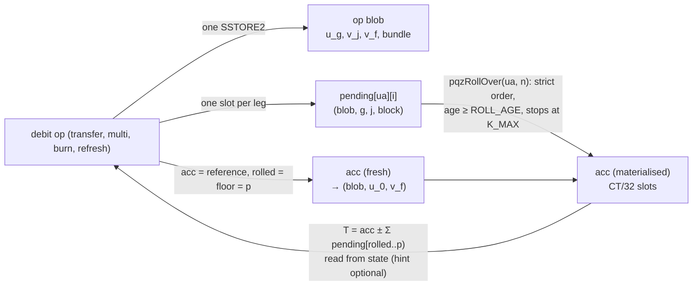

# PQZ state and credit-cap redesign (plan Task 5h): design

**Status:** design for the owner's review (designer for plan Task 5h, 2026-10-20). Nothing is built; the decisions below
are controller proposals until the owner rules. Implementation plan:
[`2026-10-20-pqz-state-redesign.md`](../plans/2026-10-20-pqz-state-redesign.md) (decisions D1–D17).

**Inputs.** Owner rulings of 2026-10-19 in [decisions.md](../../decisions.md): CTR-PQZ-06 (A' plus B), CTR-PQZ-07
(ciphertexts in contract state), CTR-PQZ-08 (raise `ROLL_MAX`); plan
[`2026-10-19-pqzl-fs3.md`](../plans/2026-10-19-pqzl-fs3.md) Task 5h with the carry-overs of the 5g review of W-E; the
controller's request of 2026-10-20 (library split, §8). Normative text today:
[pq-zero-knowledge.md](../../contracts/pq-zero-knowledge.md) §4, §7.

**Evidence (all committed).**
- Gas: the measurement prototype `smartcontracts/evm/test/research/PqzStateGas.t.sol` (forge, Osaka; not production
  code), log `smartcontracts/evm/runs/2026-10-20-5h-state-gas.txt`. Execution gas as it counts against the 2^24
  transaction cap: every account and slot cold as in a new transaction (`vm.cool`), refunds not subtracted.
- Parameters: `pqz-core/pqzl/params/aprime/` — `aprime.sage` (budget, lattice-estimator `53da598`, leaky-LWE-Estimator
  `0a9caf8`; output `aprime.txt`), the A' sizing specs `ap<n>_<rel>_params.sage` run through LaZer's codegen and
  `e_s1_proof.sage` (output `proof-aprime.txt`), `README.md` (how to rerun).
- Live baseline: chain 7622 run of 2026-10-17 (`smartcontracts/evm/runs/2026-10-17-p6g-op7-7622.txt`).

## 1. Summary

**Recommendation** (§5, §6): ciphertexts go into state once per operation and are referenced, never copied:

| Object | Where | Write | Read |
|---|---|---|---|
| The `out` of every debit (transfer, multi, burn, refresh): `u_0 … u_{G−1}`, every `v`, the bundle fields | one SSTORE2 **op blob** per operation (≤ 35.2 KB today, ≤ 47.5 KB under A'; the test chains allow 64 KiB of code) | 200 gas per byte, once | EXTCODECOPY |
| A pending credit | **one slot**: blob address, which `u`, which `v`, the credit's block | 22.1 k | 2.1 k |
| `acc` after a debit | a reference to that debit's blob (`u_0`, `v_f`) | none extra | EXTCODECOPY |
| `acc` after a rollover | materialised in `CT/32` slots (516; 708 under A'), overwritten in place | ≈ 2.6 M (516 × 5,000) | 516 cold SLOADs, or a hash-checked calldata hint |

With it: credits are never refused; rollovers take entries strictly in order from state (no calldata), stop at the
cap, and cost ≈ 36 k per entry (plus ≈ 2.8 M fixed) instead of ≈ 0.52 M of calldata per ciphertext, so **`ROLL_MAX = 256`** (today's
parameters) / **176** (A'), against 16 today; W-E's base mechanism goes away and an enforced `ROLL_AGE` keeps
debits race-free; a transfer costs about what a BUNDLE transfer costs today (its bundle *is* the op blob) and a
COMPACT / NONE transfer ≈ 3.4 M more; state grows by the op blob (≈ 16.8–35.2 KB per operation, as a BUNDLE transfer
already does) plus 16.5 KB once per account (the materialised `acc`).

**A'**: n = 2816 (k = 44), q = 2^54 − 327, `K_MAX = 65,536`; encryption β 520 (496.8 with the 80 worst-case hints of a
4-leg group with the auditor, so the β 446 exception of CTR-PQZ-03 disappears), mint margin 3.08× (today 4.14×), keys
and ciphertexts +37.5 %, R_TX proof ≈ 57.1 KB by LaZer's codegen (today's codegen estimate 44.6 KB). Since B alone
already removes the liveness problem that motivated `K_MAX`, **open question O1** asks whether A' is still worth its
cost.

## 2. Today

State per `(UA, token)` (§7.1): `accHash`, `accUnits` (uint16), `pendingCount`, `rolled`, `floor`, `cleared`,
`sendCounter`, W-E's `baseHash` / `baseRolled` / `baseUnits`, `plainPending`, `pendingHash[i]`; ciphertexts only in
calldata and events, except the optional BUNDLE entry (SSTORE2 of `R = salt ‖ u ‖ v_t ‖ v_a ‖ toUA`). A proven credit
reverts `RefreshRequired` when `accUnits + unrolled + 2 > K_MAX = 1024`. `pqzRollOver(ua, acc, cts)` takes up to 16
ciphertexts in calldata.

| Operation (chain 7622, 2026-10-17, PQZL) | Gas | Calldata |
|---|---|---|
| `pqzTransferSingle` (BUNDLE, auditor, fee) | 10,721,458 | 80,036 B |
| `pqzTransferSingle` with 1 inline credit | 11,041,224 | 96,644 B |
| `pqzTransfer` op 7, M = 4 | 10,106,641 | 83,460 B |
| `pqzUnshield` burn / refresh | 5,549,817 / 5,529,934 | 78,948 B |
| `pqzRollOver` 1 / 2 credits | 709,890 / 1,585,600 | 33,252 / 49,828 B |

Of a transfer, the precompile takes 5.2–5.4 M (op 1, `engine-pqz.json` v3 rows), the BUNDLE SSTORE2 ≈ 3.4 M, calldata
≈ 1.0–1.3 M. A rollover is calldata-bound: ≈ 0.54 M per ciphertext under EIP-7623's floor (16 ciphertexts: 1.76 M execution, 3.55 M standard calldata, 8.86 M under the floor measured).

## 3. Requirements

1. **R-state** (CTR-PQZ-07): every ciphertext an account needs to debit, roll over, decrypt or disclose is readable from
   contract state; history (logs, calldata) is a convenience.
2. **R-B** (CTR-PQZ-06): no credit is refused; the pending queue is unbounded; rollovers are strictly ordered, never lose
   or skip an entry; a rollover stops before `acc` exceeds the cap; the owner's refresh resets it.
3. **R-roll** (CTR-PQZ-08): `ROLL_MAX` = the largest batch under 2^24 gas with ≈ 25 % margin, target ≥ 256, pinned by a
   gas test.
4. **R-A'** (CTR-PQZ-06): q ≈ 2^54, `K_MAX` ≈ 65,536, new `proofSystemId` (PQZL and PQZH), sizes and margin measured.
5. **Carry-overs** (5g review): drop W-E's base instead of keeping two mechanisms; widen `accUnits` beyond uint16; keep
   W-A's direct mode binding and the two race tests as regressions; a wallet view of `rolled`; fold the transfer mode
   into every binding (review L1, T18).
6. **Size** (controller 2026-10-20): every PQZ token implementation under the 64 KiB test-chain limit with margin.

## 4. Layout options

Today's sizes: `u` 16,384 B (512 words), `v` 128 B (4 words), `ct` 16,512 B (516 words). Gas rules (Osaka): a cold
slot read 2,100; a zero → non-zero write 20,000 + 2,100 cold; a non-zero rewrite 2,900 (+ 2,100 cold); a delete refunds
4,800, capped at a fifth of the transaction and **not** counted against the 2^24 cap; CREATE 32,000 + 200 per code
byte; EXTCODECOPY 2,600 cold + 3 per word.

### 4.1 Where the ciphertexts go

| Option | Per transfer (op 1) | Per credit | Rollover read per entry | Verdict |
|---|---|---|---|---|
| **S1** storage slots for every ciphertext | ≥ 2 × 516 slots × 22.1 k ≈ 22.8 M | 516 × 22.1 k ≈ 11.4 M | 516 × 2.1 k ≈ 1.08 M (+ 2.6 M to delete) | over the cap for one transfer: **rejected** |
| **S2** one SSTORE2 per ciphertext (`u ‖ v`) | ≈ 3.3 M per credit + the sender's | ≈ 3.3 M | ≈ 4 k + adds | op 7 M = 8 = 8 × 3.3 M ≈ 27 M: **rejected** (stores `u` M times, against CTR-PQZ-04) |
| **S3** `u` per group in SSTORE2, each `v` in 4 slots | ≈ 3.3 M + 2 × 88 k | 5 slots ≈ 110 k | 8.4 k + EXTCODECOPY | correct, but `v` in slots costs 4× its code bytes |
| **S4 (recommended)** one SSTORE2 **op blob** with every `u_g` and `v`; one slot per credit | 3.49 M (blob 16,816 B + the credit + the sender's `acc` reference) | 26.3 k (46.2 k for an account's first credit) | ≈ 36 k incl. the adds | cheapest everywhere; the blob is also the BUNDLE entry |

The blob of an op 7 transfer with M = 8 and the auditor is 35,216 B (47,504 B under A'): above EIP-170's 24,576 B, inside
the 65,536 B `maxCodeSize` of chain 7622 (since 2026-10-11, [evm.md](../../networks/evm.md); PQZ is gated to the
private chains, CTR-PQZ-01), so one blob per operation always fits there. **New requirement:** the mainnet 22776
genesis must keep `maxCodeSize ≥ 64 KiB` (≥ 48 KiB under A' with n = 2816), or op 7 blobs split per group.

### 4.2 Where `acc` goes

| Option | Debit | Rollover | State | Verdict |
|---|---|---|---|---|
| **A1** always materialised in slots | 516 slot rewrites ≈ 2.6 M (516 × 5,000) | read + rewrite ≈ 2.6 M (516 × 5,000) | 16.5 KB per account | the debit pays the rewrite for nothing |
| **A2** SSTORE2 per write | 3.3 M | 3.3 M + 16.5 KB garbage per rollover | grows per rollover | **rejected** (≥ 1 MB of garbage per account per 64 rollovers) |
| **A3** lazy: `acc` = last debit + Σ rolled entries, never summed | — | free | — | the debit would sum up to `K_MAX` entries: **rejected** |
| **A4 (recommended)** reference after a debit, materialised by rollovers | 1 slot (the reference) | ≈ 2.6 M (516 × 5,000) steady, ≈ 11.4 M (A': ≈ 15.8 M) the first time | 16.5 KB once per account | cheapest; the first materialisation is split out (`pqzPrepareAcc`, §5.3) |

## 5. Recommended design (today's parameters)

### 5.1 State

```text
Account (per (UA, token), ERC-7201 scaas.pqz):
  slot 0  pendingCount u64 | rolled u64 | floor u64 | cleared u64
  slot 1  accBlob address | accG u8 | accGs u8 | accV u8 | accUnits u32 | flags u8 (MATERIALISED, WRITTEN)
  slot 2  plainPending u128 | sendCounter u64
  slot 3  accHash bytes32            (keccak of the materialised acc; the calldata hint's check)
  pending[i]  blob(160) | g u8 | G u8 | j u8 | block u64     (one slot per credit, deleted below rolled − INLINE_MAX)
  accWords[0 .. CT/32)                                         (the materialised acc; never zeroed)
op blob (SSTORE2, per debit; `R` exactly as CTR-PQZ-23 / -26, then v_f):
  transfer  salt(16) ‖ u_0 … u_{G−1} ‖ (v_j ‖ [v_{a,j}] ‖ UA_j)_{j<M} ‖ v_f
  burn      u' ‖ v_f
entryPtr[entryRef] = the op blob (every mode); memos[entryRef] on commit-reveal
```

Invariants: `cleared ≤ floor ≤ rolled ≤ pendingCount`; after a debit `rolled = floor = p` and `accUnits = 1`; every
index `≥ rolled` is pending, every index in `[floor, rolled)` is inside `acc`; `pending[i]` exists for
`i ≥ min(rolled − INLINE_MAX, …)`, never below `cleared`.



### 5.2 Operations

- **Credit** (op 1, op 7 legs): `pending[ua][pendingCount++] = (blob, g, G, j, block.number)`; never refused (R-B).
  The per-credit fee (§5.7) goes to the credited UA's `plainPending`.
- **Rollover** `pqzRollOver(ua, n)`: anyone. `n' = min(n, K_MAX − 1 − accUnits)`; `CapReached(ua)` when `n' = 0`;
  `1 ≤ n ≤ ROLL_MAX`; `AccNotPrepared` until `pqzPrepareAcc` wrote both halves of the account's `acc` words (§5.3); entries
  `[rolled, rolled + n')` in order, each at least `ROLL_AGE` blocks old (`RollTooYoung`); `acc ← acc + Σ` (from the
  reference or the slots), one `mod q` per lane, written to the slots, `accHash` updated, `rolled += n'`,
  `accUnits += n'`; the slots below `rolled − INLINE_MAX` deleted. No calldata besides `(ua, n)`.
- **Debit** (transfer, multi, burn, refresh): `T = acc ± Σ pending[min(p, rolled) .. max(p, rolled)) + Trivial(plainUsed)`
  with `|p − rolled| ≤ INLINE_MAX`, `p ≥ floor`, `unitsOf(T) ≤ K_MAX`, everything read from state; the optional hint
  replaces the 516 SLOADs of a materialised `acc` when `keccak(hint) == accHash`. Effects: op blob, `acc` = reference
  to `(u_0, v_f)`, `accUnits = 1`, `rolled = floor = p`, the dead slots `[cleared, p)` deleted (≤ 2·`INLINE_MAX`).
  A debit with `p < rolled` thereby **un-rolls** `[p, rolled)`: those credits are pending again (their slots still
  exist, §5.1) and are rolled again later — no loss, no skip; the price is re-rolling ≤ `INLINE_MAX` entries.

### 5.3 Rollover gas and `ROLL_MAX`

Measured (prototype, each rollover in a transaction of its own after the queue was filled and `acc` materialised,
every pending entry from a distinct cold blob; `PqzStateSteadyGasTest2048` / `…2816`):

| n | today's parameters (516 words) | A' n = 2816 (708 words) |
|---|---|---|
| 1 | 2,819,010 | 3,857,814 |
| 64 | 5,138,106 | 6,827,070 |
| 128 | 7,462,014 | 9,811,458 |
| **176** | ≈ 9.17 M (interpolated) | **≈ 12.01 M (interpolated; 71.6 % of 2^24)** |
| **256** | **12,109,829 (72.2 % of 2^24)** | 15,780,233 (94.1 %) |
| 320 | 14,433,736 | 18,764,620 (over the cap) |
| 384 | 16,757,644 | 21,749,008 |
| 384 after a debit (`acc` = blob reference) | 16,633,739 | 21,611,660 |

The cost is linear: **≈ 2.78 M fixed** (516 cold `acc` word rewrites at 5,000, `accHash`, counters) **+ ≈ 36.3 k per
entry** (the pending slot 2.1 k, the blob EXTCODECOPY ≈ 4.2 k, the lane-wise add of 516 words ≈ 25 k, the deletion of
the slot `INLINE_MAX` behind ≈ 5 k gross); under A' ≈ 3.81 M + 46.6 k. With the owner's rule (largest batch ≤
`0.75 · 2^24 = 12,582,912`, rounded down to a multiple of 16):

- **today's parameters: `ROLL_MAX = 256`** (12.11 M, margin 27.8 %; 272 would be 12.69 M) — the target is met;
- **A' (n = 2816): `ROLL_MAX = 176`** (≈ 12.01 M; 192 would be ≈ 12.76 M) — **below the 256 target**: the add loop is
  37 % longer and the `acc` rewrite 37 % larger. 256 under A' costs 15.8 M (94 % of the cap). Open question O9.

Today's `ROLL_MAX = 16` costs ≈ 8.9 M: 1.76 M of execution plus 17 ciphertexts of calldata, 3.55 M at the standard price and 8.86 M under the EIP-7623 floor (`test_today_n2048`); the live 7622 run measured 0.71 M for one ciphertext and 1.59 M for two. 64-bit lanes hold `2^64 / q` terms: 2^22 today, **1,024 under A'**, so
`ROLL_MAX + 1 + INLINE_MAX ≤ 1,023` holds either way (one `mod q` per lane at the end, as today).

**The first materialisation** of an account writes its `CT/32` words zero → non-zero: 516 × 22.1 k ≈ 11.4 M (measured:
the first rollover of 32 entries 12,585,689), under A' 708 × 22.1 k ≈ 15.8 M (16 entries 16,551,938, 98.7 % of the cap).
Under A' it cannot share a transaction with any useful batch, so the design splits it out: **`pqzPrepareAcc(ua, half)`**,
permissionless and idempotent, writes a non-zero placeholder into one half of the account's `acc` words (≈ 5.7 M today,
≈ 7.8 M under A'); a rollover reverts `AccNotPrepared` until both halves are done. Keepers (or the owner) run it once per
`(UA, token)` before the first rollover; one rule for both parameter sets, so no `ROLL_MAX_FIRST`.

### 5.4 Gas per operation against today

Contract-side, from the measured parts (prototype) and the live 7622 numbers of §2; the precompile and the authorisation
are unchanged (today's parameters). "Δ" is against today.

| Operation | Today | Proposed (today's parameters) | Δ, where it comes from |
|---|---|---|---|
| Transfer op 1, BUNDLE, auditor, `p = rolled` | 10.72 M (live) | ≈ 10.5 M | blob 16,816 B instead of `R` 16,688 B (+26 k); no `acc` calldata (−208 k); no `out` bytes in the event (−134 k); `T` from the blob reference 115 k instead of calldata `acc` + keccak (+≈ 80 k) |
| … with a materialised `acc` | same | ≈ 10.6 M with the hint, ≈ 11.7 M without | hint: 136 k execution + the same 208 k of calldata as today; from slots: 1.23 M |
| … with 16 inline credits | ≈ 15.8 M (live: +0.32 M per inline credit) | ≈ 11.0 M | 30.5 k per inline credit from its blob instead of 16.5 KB of calldata |
| Transfer op 1, COMPACT / NONE | ≈ 7.3 M | ≈ 10.5 M | +3.36 M: these modes now store the blob too (O5) |
| Transfer op 7, M = 4, BUNDLE | 10.11 M (live) | ≈ 9.9 M | as op 1; blob 17,680 B (3.75 M with the 4 credits) |
| Transfer op 7, M = 8, auditor | ≈ 15.6–16 M (estimate, BUNDLE) | ≈ 15.4 M | blob 35,216 B = 7.45 M with the 8 credits; fits the cap with ≈ 8 % to spare; COMPACT no longer avoids it |
| Burn / refresh | 5.55 / 5.53 M (live) | ≈ 8.7 M | +3.39 M blob `u' ‖ v_f` (O7), −208 k `acc` calldata, −132 k event bytes |
| Credit (per leg) | 31.8 k (keccak 16.5 KB + slot) | 26.3 k (46.2 k first) | one slot, no keccak |
| Rollover of 16 | ≈ 8.9 M (prototype, EIP-7623 floor); the live run added 0.88 M per ciphertext (≈ 14 M for 16) | ≈ 3.36 M | no calldata |
| Rollover of 256 | impossible (> 16 per tx) | 12.11 M | |
| `pqzPrepareAcc` (once per account, two halves) | — | 2 × ≈ 5.7 M | §5.3 |
| Debit effects | ≈ 0.1 M | 82 k | `acc` reference, counters, ≤ 32 slot deletions |

Under A' every blob grows 37 % (op 1 4.73 M, op 7 M = 4 5.00 M, M = 8 9.97 M, burn 4.66 M) and the precompile's
gas is unknown until calibration (timing, owner's go-ahead). **Op 7 with M = 8 then exceeds the 2^24 cap** (≈ 10 M of
blob alone plus a larger proof and precompile): see §6.2 for a remedy (one randomness group, G = 1) and O9.

### 5.5 State growth, garbage and refunds

- **Per operation, permanent:** the op blob, 16,528 B (burn) to 35,216 B (op 7 M = 8 with the auditor), plus an account
  entry in the state trie. A BUNDLE transfer stores 16,688–35,088 B today, so for BUNDLE tokens growth is unchanged
  (+128 B of `v_f`); COMPACT / NONE tokens and burns / refreshes now grow too. Since Cancun there is no way to delete
  code: the blobs are the price of R-state, and they are the permanent disclosure record (§5.8).
- **Per credit, temporary:** one slot (32 B), deleted by the rollover that passes it by `INLINE_MAX` (or by the next
  debit). The refund (4,800 per slot) is capped at a fifth of the transaction's gas and does not raise the 2^24 cap,
  so the gross cost (≈ 5 k per slot) is what `ROLL_MAX` pays for. Leaving the slots instead (today's `CLEAR_MAX`
  deletes ≤ 32 per debit) would grow state by 32 B per credit forever under an unbounded queue.
- **Per account, once:** the materialised `acc`, 16.5 KB (22.6 KB under A'), rewritten in place, never zeroed (a zeroed
  word would cost the zero → non-zero price again).
- **Garbage:** none besides the blobs: `acc` words are reused; the W-E base slots disappear.

### 5.6 Race-freedom without W-E's base

A debit's proof fixes `T` at index `p`; the contract rebuilds the same `T` from state whatever happened in between
(addition mod q is exact and associative; CTR-PQZ-08 unchanged in substance). With `acc` and the pending ciphertexts
in state, no calldata can go stale, so W-E's base (`baseHash`, `baseRolled`, `baseUnits`, the base branch of `_total`)
has nothing left to protect and is removed; its "rolled moves backwards" behaviour survives only as the un-roll of
§5.2, which keeps order and loses nothing. The one race left is a rollover past `p` by more than `INLINE_MAX`
(`InlineTooFar`, re-prove), which needs credits newer than the proof. **`ROLL_AGE = 24` blocks** (2 min at 5 s; today's
honest-keeper `KEEPER_AGE` made a contract rule) closes it: entries `≥ p` are younger than the proof, so within
`ROLL_AGE` blocks of proving no rollover can reach them and `rolled ≤ p` at submission. After `ROLL_AGE` the debit still
settles while `rolled − p ≤ INLINE_MAX`. Cost: the block number rides in the credit's slot (free) and one comparison
per rolled entry. A griefer can no longer force a re-prove of a debit submitted in time (today: by rolling > 16 own
credits past `p`). The two W-E race tests stay as regressions ("a rollover between prove and submit still settles").

### 5.7 B: credits never refused, ordered rollovers, privacy, and the credit fee

**Cap.** `K_MAX` now bounds only `acc`: a rollover never takes `acc` above `K_MAX − 1` units (one reserved for the plain
term), a debit checks `unitsOf(T) ≤ K_MAX` as today, and any debit (a refresh is a burn of 0) resets `accUnits` to 1.
An account whose `acc` is full can always refresh with `p = rolled` (units `K_MAX`); after that rollovers continue.
Credits keep arriving while `acc` is full: they wait in the queue. `accUnits` becomes uint32.

**Head-of-line.** A real credit behind `x` decoys becomes spendable once `rolled ≥ its index − INLINE_MAX`, i.e. after
`⌈x / ROLL_MAX⌉` rollovers: with `ROLL_MAX = 256`, 10,000 queued decoys take 40 rollovers (keepers', the owner's,
or a relayer's).

**Privacy (why strict order).** Every way an entry leaves the queue is a prefix: a rollover takes `[rolled, rolled + n)`,
a debit takes `[rolled, p)` inline. No operation can name, drop or skip a single entry, so the set of credits an owner
absorbs is "all indexes below the cut", independent of their values. A zero-amount decoy leg of someone else's op 7
transfer is absorbed exactly like a real credit, so nobody watching the recipient learns which ring members of past
transfers were decoys (skipping would reveal exactly that, CTR-PQZ-06 controller analysis). Residual: the cut `p` is
public; an owner who always debits right after one particular credit hints that it was real. Clients prove at
`p = pendingCount` (or the largest `p` the inline window allows), never at a value-dependent cut; the wallet rule goes
into the P6h wallet notes.

**Who pays (decoy flooding).** A credit costs its sender the op blob share and one slot (26.3 k (46.2 k for an account's first credit)), and costs the
recipient side one rollover share (≈ 36 k) later, paid by keepers or the owner. On the SCaaS chains gas is free,
so gas does not price a flood; the levers are (a) the **per-credit fee**: today's `multiLegFee` (op 7 only, default 0)
becomes a per-credit fee on both transfer paths, paid to every credited UA's `plainPending` (the victim is paid for the
work), the same for every leg so it reveals nothing; on chains 7622 / 22776 `init` refuses 0 (the floor amount is the
owner's, O4); (b) permissioned submitters and node rate limits (T7), unchanged. Filling a victim's queue no longer
locks it (R-B), so a flood now costs the victim rollover work and delay, not liveness.

### 5.8 Wallets and indexers

Views (D13): `pqzAccount(ua)` → `pendingCount, rolled, floor, cleared, accUnits, flags, plainPending, sendCounter,
accBlob`; `pqzAcc(ua)` → the `acc` bytes (reference or slots); `pqzPending(ua, i)` → `(blob, g, G, j, block)`;
`pqzPendingCt(ua, i)` → `u_g ‖ v_j`; `pqzEntryBlob(entryRef)`. **Restore from state alone:** seed → UA →
`pqzAccount` → `pqzAcc` and `pqzPendingCt` for `[rolled, pendingCount)` → decrypt → balance = Dec(acc) + Σ Dec(pending)
+ `plainPending`; sender disclosure: `sendCounter` → `entryRef` → `pqzEntryBlob` (+ memo) → the leg. All `eth_call`, no
logs. Events carry pointers (D12; ≈ 134 k less per transfer): `PqzTransfer(…, blob)`, `PqzBurned(…, blob)`,
`PqzRolled(ua, rolled, accUnits, accHash)` and a new `PqzDebited(ua, rolled, floor, blob)` (review N4: an indexer sees
`rolled` move on every debit). Indexers follow events for "what changed" and read bytes from state. The debit API
loses its `acc` / `inline` arguments (an optional `accHint` instead), the rollover takes `(ua, n)`: a client break,
done together with the relayed mode binding (review L1, D15) so clients break once.

## 6. A': larger parameters

### 6.1 Candidates and the budget

The noise and digit budget of §4.3 generalised to `K` units (`aprime.sage` part 1): norms bounds at today's distance
above the mean (β_s 12.02 s.d. for CBD(1), β_e 10.15 s.d. for CBD(20); they give today's 36 / 164 at n = 2048),
`B_FRESH = 2·β_e·β_s + 64`, digit sums `M_i ≤ 15·K < 2^m`, `Δ = ⌊q / 2^(m+2)⌋` (so `Δ·2^m ≤ q/4`, today
`q / 2^16`), `e_T ∈ [−E, E)` with `E = 2^⌈log2(K·B)⌉`, uniqueness `2E ≤ Δ`, centring `Δ(2^m − 1) + E < q/2`, mint
margin `(Δ − E) / ((K − 1)·B)` (today 4.14×).

| Candidate | k | q | `K` | β_s / β_e | B_FRESH | m | Δ | E | ok | margin | ct (B) |
|---|---|---|---|---|---|---|---|---|---|---|---|
| today | 32 | 2^42 − 215 | 1,024 | 36 / 164 | 11,872 | 14 | 2^26 − 1 | 2^24 | yes | 4.14× | 16,512 |
| spec option A | 40 | 2^50 − 71 | 4,096 | 40 / 182 | 14,624 | 16 | 2^32 − 1 | 2^26 | yes | 70.6× | 20,608 |
| A' n = 2560 | 40 | 2^54 − 327 | 65,536 | 40 / 182 | 14,624 | 20 | 2^32 − 1 | 2^30 | yes | 3.36× | 20,608 |
| A' n = 2688 | 42 | 2^54 − 327 | 65,536 | 41 / 186 | 15,316 | 20 | 2^32 − 1 | 2^30 | yes | 3.21× | 21,632 |
| **A' n = 2816** | **44** | **2^54 − 327** | **65,536** | **42 / 189** | **15,940** | **20** | **2^32 − 1** | **2^30** | **yes** | **3.08×** | **22,656** |
| A' n = 3072 | 48 | 2^54 − 327 | 65,536 | 44 / 197 | 17,400 | 20 | 2^32 − 1 | 2^31 | **no** | — | 24,704 |
| A' n = 3072, q ≈ 2^55 | 48 | 2^55 − 55 | 65,536 | 44 / 197 | 17,400 | 20 | 2^33 − 1 | 2^31 | yes | 5.65× | 24,704 |

Every q is prime with q ≡ 9 mod 16 (l = 4, the incomplete NTT and LS18's invertibility bound q^{1/4}/2 ≥ 724 keep
working; at 2^54 the bound is 5,793). Option A's "K = 4096" is far inside its budget (it could hold ≈ 4,369 units at
q ≈ 2^50 with the same digit width; the spec's table quoted 4096).

**Derivation for the chosen q.** With `K = 65,536`: `15·K = 983,040 < 2^20`, so `M_i ∈ [0, 2^20)` (today `2^14`);
`K·B_FRESH = 65,536 · 15,940 = 1,044,643,840 < 2^30`, so `e_T ∈ [−2^30, 2^30)` (today `2^24`); `Δ = ⌊q / 2^22⌋ =
2^32 − 1`, `2E = 2^31 ≤ Δ`; `Δ·(2^20 − 1) + 2^30 < 2^52 + 2^30 < q/2 ≈ 2^53`. Hence `q ≥ 2^(m+4)·E = 2^54`: the
owner's "q ≈ 2^54" is exactly the smallest power that holds `K = 2^16`. The reachable worst case `(K − 1)·B` is
1,044,627,900; the mint threshold `Δ − E = 3,221,225,471` is 3.08× above it (n = 2688: 3.21×; n = 2560: 3.36×).
The range proofs grow: `M_i` 14 → 20 bits, carries 11 → 17 bits (`c_i + 64 ∈ [0, 2^17)`, honest carries
`≤ 2^20 / 15`), `e_T` 25 → 31 bits; R_TX 917 → 1,199 bits (15 → 19 binary polys), R_BURN 853 → 1,135 (14 → 18), op 7
`1,199 − 64 + 64·M`, R_DR `e'` 25 → 31 bits. The plain term stays noise-free, so the reachable maximum is
`(K − 1)·B` as today. **n = 3072 does not fit q = 2^54** (`K·B = 2^30.09`); it needs q ≈ 2^55.

### 6.2 Security

Encryption (`aprime.txt`; Kyber-512 for reference: uSVP β 406, core-SVP 118.6 classical / 107.6 quantum):

| Candidate | key / enc uSVP β | best attack, classical / quantum (full `LWE.estimate`) | DDGR20 β, 0 / 32 / 80 worst-case hints | ≥ 450 at 80 hints |
|---|---|---|---|---|
| today | 476 / 476 | 2^136.1 / 2^124.3 (dual_hybrid β 466 / 469) | 475.8 / 463.9 / 446.0 | no (owner exception) |
| spec option A | 508 / 508 | 2^145.7 / 2^132.7 (dual_hybrid 499 / 500) | 507.3 / 497.3 / 482.4 | yes |
| A' n = 2560 | 457 / 457 | — | 456.6 / 447.6 / 434.1 | **no** |
| A' n = 2688 | 488 / 488 | 2^140.2 / 2^128.0 (dual_hybrid 480 / 483) | 488.0 / 478.9 / 465.3 | yes |
| **A' n = 2816** | **520 / 520** | **2^149.3 / 2^135.9 (dual_hybrid 511 / 512)** | **519.7 / 510.5 / 496.8** | **yes** |

(n = 3072 was not run through DDGR20: it fails the budget at q = 2^54; the uSVP shortcut of `anon/usvp.py` gives
≈ 570 at q = 2^55.) The DDGR20 rows reproduce today's recorded `hints-anon.txt` (463.85 / 445.97) exactly, so the
method carries over.

**Hints / R_TXM (CTR-PQZ-03, -04).** The hint count per key does not change (16 coefficients of `v` per recipient
key): 32 for R_TX with the auditor, 80 for a 4-leg R_TXM group with the auditor. At n = 2816 the worst-case mixed forms
(V_max from β_s 42 / β_e 189) give β 510.5 at 32 hints and **496.8 at 80**, above 450: the owner-accepted β 446
exception of 2026-10-15 is no longer needed (groups of 4 legs stay). At n = 2688 the 80-hint case is 465.3 (≥ 450), at
n = 2560 434.1 (below 450, above Kyber-512's 406): n = 2560 would need a new exception, so it is not recommended.

**Proof instances.** LaZer's codegen at q = 2^54 − 327 (table below) keeps MSIS β ≥ 450 by its root-Hermite target,
but its MLWE (hiding) rank reaches uSVP 465 and **dual_hybrid only 447 / 448** (classical / quantum): the A' task must
raise `kmlwe_min` until dual_hybrid ≥ 450 too (today's rank 33 gives dual_hybrid 462). `e_s1_proof.sage` checks uSVP
only; Task 7 adds the dual_hybrid check.

`proof-aprime.txt`: `e_s1_proof.sage` unchanged on the A' specs:

| Spec | kmsis / kmlwe | MSIS β (classical / quantum bits) | MLWE uSVP β, dual_hybrid β | codegen proof | today's codegen (measured v3) |
|---|---|---|---|---|---|
| R_REG n = 2816 / 2688 | 18 / 41 | 478 / 479 | 465, 447 / 448 | 36,668 / 35,964 B | 29,188 (28,091) |
| R_TX n = 2816 / 2688 | 18 / 41 | 456 / 457 (2^133.2 / 2^120.8) | 465, 447 / 448 | 57,132 / 55,724 B | 44,638 (42,762) |
| R_BURN n = 2816 / 2688 | 18 / 41 | 456 / 457 | 465, 447 / 448 | 56,252 / 54,844 B | — (41,895) |
| R_TXM M = 8 + auditor n = 2816 / 2688 | 20 / 41 | 477 / 478 | 460, 447 / 448 | 82,592 / 80,384 B | 64,578 (61,763) |

Proofs grow ≈ 28 % (R_TX) from the larger q and the wider range proofs; the codegen estimates ran ≈ 4 % above the
measured v3 proofs today.

**One randomness group for M = 8 under A'.** At n = 2816 β falls ≈ 0.29 per worst-case hint (519.7 → 496.8 over 80);
144 hints (8 legs + the auditor on one `(r, e1)`) extrapolate to ≈ 478, above 450. Then op 7 with M = 8 needs one `u`
instead of two (blob 24,976 B instead of 47,504 B, ≈ 4.5 M less) and a smaller statement. To be measured with the
leaky-LWE-Estimator in Task 7 before it is relied on (O9).

### 6.3 Sizes

| Object | Today (n = 2048) | A' n = 2688 | A' n = 2816 |
|---|---|---|---|
| `pk`, `u` | 16,384 | 21,504 | 22,528 |
| `ct` | 16,512 | 21,632 | 22,656 |
| Statement R_TX / R_TX0 | 83,072 / 66,560 | 108,672 / 87,040 | 113,792 / 91,136 |
| R_BURN / disclosure | 50,048 / 33,184 | 65,408 / 43,424 | 68,480 / 45,472 |
| op 7 M = 8 with / without auditor | 215,936 / 198,528 | 282,496 / 259,968 | 295,808 / 272,256 |
| op blob op 1 / op 7 M = 8 with auditor | 16,816 / 35,216 | 21,936 / 45,456 | 22,960 / 47,504 |
| Proofs (PQZL, codegen estimate) | R_TX 42,762, M = 8 61,763 (measured) | R_TX ≈ 55.7 KB, M = 8 ≈ 80.4 KB | R_TX ≈ 57.1 KB, M = 8 ≈ 82.6 KB |

`MAX_INPUT = 393,216`: today the largest honest inputs are PQZL op 7 M = 8 (≤ 314,245 at `MAX_PROOF`) and PQZH op 7
M = 4 (≤ 369,193). Under A' (n = 2816) PQZL M = 8 with the auditor is 295,808 + ≈ 80 KB ≈ 376 KB (4 % under the limit) and PQZH M = 4 182,144 + a
larger Ligero proof: **`MAX_INPUT` must rise** (512 KiB proposed; O8). `MAX_PROOF` (PQZL 98,304) holds if the M = 8
proof stays below it (≈ 82.6 KB codegen estimate, ≈ 79 KB expected).

### 6.4 Regeneration scope and order

Everything that names n, q, Δ, the bounds, the bit layouts or the sizes:
- **params** (`pqz-core/pqzl/params/`): every `*_params.sage` (reg, tx, tx0, burn, ds, dr, txm2 / 4 / 8 with and
  without the auditor), headers by `regen.sh`, `to_rust.py` → `pqzl/rust/src/params/`, `estimator-*.txt`,
  `anon/hints-anon.txt` re-run, `e_s0.py`'s exactness and Fiat–Shamir checks at the new q;
- **C and Rust PQZL**: `pqz.h` / `lib.rs` constants (N, k, q, Δ, bounds, `K_MAX`, bit offsets), the NTT for the new q
  (q ≡ 9 mod 16 keeps l = 4 and the incomplete NTT shape), the matrix `A` expansion ("keep the low 54 bits"), keys /
  Enc / Dec KATs, arena sizes (statements +37 %);
- **PQZH (Ligero)**: the field is the new q — 54 × 54-bit products still fit u128; the wasm32 21-bit limb path becomes
  three 18-bit limbs; constraint widths; its id bumps too;
- **`pqz-stmt`**: lengths per form, `MAX_PROOF`, `MAX_INPUT`, the ids; Nethermind plugin limits and arena;
- **Solidity**: `PqzCt` (`Q`, `DELTA`, `PK`, `CT`, `ZERO_HASH`), `PqzSafety` ids, probe proofs, self-test hash;
  `ROLL_MAX` re-pinned (lanes now hold 2^10 terms: `ROLL_MAX + 1 + INLINE_MAX ≤ 1023`);
- **vectors and KATs** (`smartcontracts/vectors/pqz/`, `pqz_kat.py`, fuzz seeds, the package), every digest;
- **ids**: PQZL `keccak256("scaas/pqz/lnp22/mlwe-d64k44-q54l4/v1")` (the d/k/q/l in the label change), PQZH Ligero v2;
- **gas**: precompile calibration (timing, owner's go-ahead), the 60 ms p99 verify limit re-checked (R_TXM M = 8 was
  51.0 ms p99 in wasm32 at today's size; +37 % input is a real risk, O8), node memory.

Order (D17): B and the state layout on today's parameters first — no relation, vector or id changes (statements are
unchanged) — reviewed and merged; then A' as one parameter change; then plan fs3 Task 6 (package) and Task 13 (7622
reset and gas), which wait for 5h.

## 7. Interaction with Task 5g-Z and the classical Zether contracts

- **5g-Z** (CTR-ZTH-20: the Zether verifier immutable in the token implementation, recorded by `OpenFactory`) touches
  the Zether token implementations, `OpenFactory` and deploy scripts. 5h touches the PQZ libraries and the PQZ token
  implementations; the shared files are `OpenFactory` (only if a PQZ registration rule changed — it does not: the PQZ
  verifier pin stays `PqzSafety`'s code pin, W-B) and the deploy scripts (`script/pqz/e2e.py` links four libraries after
  D14). 5g-Z merges first; 5h rebases on it; no semantic overlap.
- **Classical Zether contracts: unchanged.** `ZetherLib` / `ZetherLayer` keep their layout (curve points, small);
  `ConfidentialConfig.multiLegFee` keeps its name and the Zether kinds keep refusing a non-zero value, so D10 does
  not touch them.

## 8. Code size and the library split

`UnderlyingPqzToken` is 60,105 B (limit 65,536, 5,431 B left), `NoUnderlyingPqzToken` 47,349 B; `PqzLib` 20,551 B
(EIP-170's 24,576 B applies to libraries in the size gate). The tokens hold the entry points and the ERC-20 / UA side;
all PQZ logic already runs by DELEGATECALL in `PqzLib` (its public functions), so the 5h logic lands in the library,
not in the tokens.

**Split (D14).** `PqzLib` → four DELEGATECALL libraries in the same ERC-7201 namespace `scaas.pqz`, shared private steps
(`_header`, `_check`, `_total`, `_debit`, the key and buffer helpers) as an internal library compiled into each:

| Library | Public functions | Today's code, measured | Projected after 5h |
|---|---|---|---|
| `PqzStateLib` | `init`, `shield`, `rollOver`, `prepareAcc`, the views of §5.8 | 4,041 B | ≈ 7–8 KB (rollover from state, prepare, five views) |
| `PqzTransferLib` | `transfer` (op 1), `transferMulti` (op 7) | 13,723 B | ≈ 14–15 KB (`_total` from state, blob writer, credit fee; the base branch and calldata `acc` go) |
| `PqzBurnLib` | `unshield` (burn, refresh, unwrap path) | 7,340 B | ≈ 8 KB |
| `PqzViewLib` | `statementOf`, `disclosureStatementOf`, `verifyAmountOf` | 12,220 B | ≈ 12–13 KB (disclosure reads `R` from the blob) |

"Measured" = throwaway copies of today's `PqzLib` with the other public functions made internal (the compiler drops
what is unused), `forge build src --sizes` (log in `runs/2026-10-20-5h-state-gas.txt`); the duplicates of the shared
steps make the four sum to 37.3 KB against 20.6 KB, which is the point: a transfer loads 13.7 KB instead of 20.6 KB, a
rollover 4 KB (owner: lighter per-call code for the node, as the Zether transfer / burn verifier split).

**Tokens.** The tokens link four library addresses instead of one (a few bytes per call site). 5h removes the `acc` and
`inline` arguments of eight entry points (calldata decoding of `bytes` + `bytes[]` per entry point, ≈ 0.1–0.15 KB
each) and adds five views and `pqzPrepareAcc` (≈ 0.1–0.15 KB each, each a DELEGATECALL stub): projected
`UnderlyingPqzToken` ≈ 59.5–60.5 KB, `NoUnderlyingPqzToken` ≈ 46.8–47.8 KB — inside the 4 KiB margin target (≤ 61,440
B) but only by ≈ 1–2 KB. **Reserve if Task 1 measures more:** route the read-only statement / disclosure views of the
token (`transferStatement`, `transferSingleStatement`, `burnStatement`, `disclosureStatement`, `verifyTransferAmount`)
and the new state views through one `fallback` that DELEGATECALLs `PqzViewLib` / `PqzStateLib` by selector (≈ 2–3 KB
saved, no state-changing path through the fallback). Task 1 does the split first, with no behaviour change, so the
later tasks see the real headroom.

## 9. Risks

- **First materialisation** (≈ 11.4 M; A' ≈ 15.8 M, 94 % of the cap) cannot share a transaction with a useful batch
  under A': hence the separate, permissionless `pqzPrepareAcc` (two halves), once per `(UA, token)`.
- **`ROLL_MAX` under A' is 176, not 256**, and **op 7 with M = 8 exceeds the 2^24 cap under A'** with two randomness
  groups (blob ≈ 10 M + precompile + calldata) unless one group (G = 1) is measured safe (O9).
- **Permanent op blobs.** No SELFDESTRUCT since Cancun: every operation leaves 16.8–35.2 KB (A' 22.8–47.5 KB) forever.
  That is the price of R-state; BUNDLE tokens pay it today already. A future pruning (EIP-7736-style state expiry) would
  need the blobs to be resurrectable — out of scope.
- **COMPACT / NONE get dearer** (≈ +3.4 M per transfer); with ciphertexts in state they can no longer avoid storage (O5).
- **Refresh gets dearer** (burn / refresh write a 16.5 KB blob: ≈ +3.3 M; O7 lists the alternative).
- **A'**: verify time (+37 % input, M = 8 near the limit), `MAX_INPUT`, the PQZH field change, proof MLWE dual_hybrid
  below 450 until `kmlwe` rises, mint margin 3.08× instead of 4.14×.
- **Un-roll waste**: a debit with `p < rolled` makes keepers re-roll ≤ `INLINE_MAX` entries.

## 10. Open questions for the owner

| # | Question | Recommendation |
|---|---|---|
| O1 | B alone removes the liveness problem (credits are never refused; only rollovers stop at the cap until a refresh). Is A' still wanted? With `K_MAX = 1024` an account refreshes every ≈ 1,000 credits; with 65,536 every ≈ 65,000. | Keep B first; decide A' after B is live, weighing +37 % sizes, the verify-time risk and the re-calibration against fewer refreshes. If A' is kept: n = 2816. |
| O2 | n = 2816 (β 520 / 496.8 with 80 hints, margin 3.08×) or n = 2688 (488 / 465.3, 3.21×, 4.5 % smaller)? | 2816: drops the β 446 exception with room. |
| O3 | Mint margin 3.08× (today 4.14×) acceptable? q ≈ 2^55 doubles it (6.2×) at a few β units. | Accept 3.08× (the cap is enforced twice; a forge invariant checks it). |
| O4 | The per-credit fee floor on 7622 / 22776: any non-zero amount, or a minimum in token units set per token by the deployer? | `init` refuses 0 on the SCaaS chains; the amount is the deployer's. |
| O5 | Storage modes: with every op stored, BUNDLE costs nothing extra and NONE saves nothing. Keep the three entry points (ABI) with the new meaning, or retire NONE? | Keep them (ABI and W-A bindings stable). |
| O6 | `ROLL_AGE = 24` blocks enforced (rollovers wait 2 min after a credit)? | Yes. |
| O7 | Burn / refresh write a 16.5 KB blob (+3.3 M). Alternative: write the fresh `acc` into the account's slots when they exist (≈ 2.6 M), the blob otherwise. | Blob always (one rule); revisit if refresh gas matters. |
| O8 | Under A': `MAX_INPUT` 384 KiB → 512 KiB, and the verify-time limit for the larger forms. | Raise to 512 KiB; measure p99 with your go-ahead before A' is frozen. |
| O9 | Under A' (n = 2816): `ROLL_MAX` = 176 (target 256 missed: 256 costs 15.8 M, 94 % of the cap), and op 7 M = 8 does not fit one transaction with two randomness groups. Options: accept 176; one group for M = 8 (≈ 478 β extrapolated at 144 hints, to be measured) and drop M = 8 if it still does not fit; or n = 2688 (`ROLL_MAX` ≈ 192, blobs −4.5 %). | Accept 176; measure G = 1 for M = 8 in Task 7; M ≤ 4 on chain under A' if G = 1 fails. |
