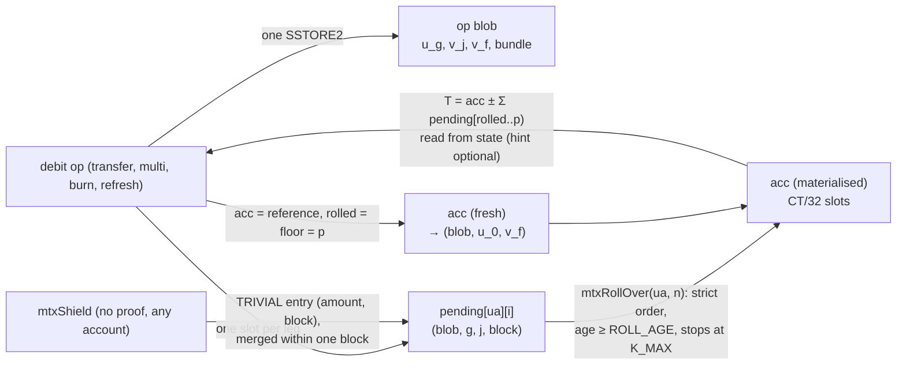

# PQZ state and credit-cap redesign (plan Task 5h): design

**Status:** design (designer for plan Task 5h, 2026-10-20). Owner rulings O1–O9 on the first version recorded
(CTR-PQZ-07 Change 2026-10-20); **updated 2026-10-20 (later the same day)** to the owner's further rulings listed under
"Update 2026-10-20" below. **Part A is built (2026-10-20, branch `pqz-state-b`, Tasks 1–5 incl. 3b, the `mtx*` rename; see "Docs sync" below); part B (16k parameters, one id bump) is not built.** **Superseded 2026-10-21 (§12): set (a) (n = 2304, `K_MAX` 4,096, q = 61,275,424,977,257) replaces the 16k set; §6's 16k figures stay as the record.** Implementation plan:
[`2026-10-20-pqz-state-redesign.md`](../plans/2026-10-20-pqz-state-redesign.md) (decisions D1–D25).

**Docs sync 2026-10-20 (plan Task 5; the text below is the design as written, the passages it lists are superseded, not rewritten).**
Normative text now lives in [pq-zero-knowledge.md](../../contracts/pq-zero-knowledge.md) §7 and CTR-PQZ-06 / -07 / -08 / -15 / -22 /
-23 / -25, [zether.md](../../contracts/zether.md) CTR-ZTH-45 / -51 and [decisions.md](../../decisions.md) (the Changes of 2026-10-20 name
every D row with status and commit). Superseded by owner rulings of the plan review: **`ROLL_AGE = 24` → 5 blocks** (§5.6, D6 / O6);
**D10's per-credit fee and the O4 floor → `txFee` + `decoyFee`** (§5.7, §5.10 last row, Q2: shields free, tx fee only when relayed);
**q = 2^50 − 71 → 2^50 − 42,310,535** (Q1, §6, §6.5); **`ConfidentialConfig.multiLegFee` → `minDecoyFee`**; the **4 KiB size margin
and the view `fallback`** (§8: tokens need only the hard 65,536 B limit; no fallback was needed); the separate **`…ToUA`** entry points
(one `mtxUnshield(…, uint256 amount, bytes32 recipient)` serves native and UA recipients, UA-5c (b) in part A); `authSig` → the `auth`
argument and `beneficiary` in the shared signature (§5.11). As built, against the text: the pending slot stores byte offsets
`(uOff, vOff)` instead of `(g, G, j)` (§5.1; the tuple cannot locate `v_j` with the auditor on); a rollover raises `floor` together with
`cleared`; `mtxPrepareAcc` refuses `half > 1` (`BadPayload`) and non-holders; §5.6's race also includes more than `INLINE_MAX` *old*
entries above a capped `p` (bounded harm); NONE retired also removes `entryHash`; kinds 6 and 7 gone; the combined `PqzLib` is
`PqzStateLib` / `PqzTransferLib` / `PqzBurnLib` / `PqzViewLib` over `PqzCore`; the measured numbers are in pq-zero-knowledge.md §9.3
(`ROLL_MAX = 256` = 12,134,236 gas, prepare-acc 5,757,911 per half, op 1 4.00 M, op 7 M = 8 8.58 M contract side).

**Inputs.** Owner rulings of 2026-10-19 in [decisions.md](../../decisions.md): CTR-PQZ-06 (A' plus B), CTR-PQZ-07
(ciphertexts in contract state), CTR-PQZ-08 (raise `ROLL_MAX`); plan
[`2026-10-19-pqzl-fs3.md`](../plans/2026-10-19-pqzl-fs3.md) Task 5h with the carry-overs of the 5g review of W-E; the
controller's request of 2026-10-20 (library split, §8). Normative text today:
[pq-zero-knowledge.md](../../contracts/pq-zero-knowledge.md) §4, §7.

**Update 2026-10-20 (owner rulings after the first version; each changed passage names its source):**
- **[16k]** CTR-PQZ-06 Change "`K_MAX = 16,384` instead of 65,536": n = 2560 (k = 40), q = 2^50 − 71, Δ = 2^30 − 1;
  supersedes A' (n = 2816, q = 2^54 − 327) and O2 / the A' numbers of O9 (§6).
- **[noPP]** CTR-PQZ-06 Change "`plainPending` is removed": fees go to public UA-ledger balances, `plainUsed` is renamed
  `shieldIn` (§5.1, §5.2, §5.7).
- **[4flows]** CTR-PQZ-06 Change "all four transfer flows … shielding needs no proof on either layer": PQZ public amounts
  enter the ordered queue and are folded by the permissionless rollover (§5.9); research
  [`shield-and-key-reuse.md`](../../research/shield-and-key-reuse.md) §2–§3.
- **[pool]** CTR-PQZ-15 / CTR-ZTH-51 Change "`SHIELD_POOL` sentinel instead of burn", both layers (§5.10).
- **[mtx]** CTR-ZTH-45 Change "one name for both confidential layers: `mtxShield` / `mtxUnshield`" (§5.11).
- **[kinds]** CTR-TOK-21 Change "`NONE_ZETHER_PQZ` / `UNDERLYING_ZETHER_PQZ` dropped" (§7).
- **[bls]** CTR-ZTH-32 Change "classical Zether uses BLS12-381 only", bn254 line to `legacy/` (§7).
- **[ua]** CTR-UA-30 and its Changes (a UA signs; PQZ key = attribute of a PQ signer, supplied in `register`, `R_REG`
  bound to the UA id; `authRef` removed incl. Zether): built in **UA-6**, which comes before 5h (§7).
- **[id]** CTR-PQZ-09 Change (review B-1, owner): one `proofSystemId` bump carries the 16k parameters, the B-1 fix (V3 /
  V4 from the post-`tg` hash), A-2's renumbering and UA-6's `R_REG` message (§6.4).
- **[Z2]** 5g-Z2 merged (`c173de37`): the PQZ tokens are released through `OpenFactory`'s `Env` /
  `deployImplementation` (§7, §8).

**Evidence (all committed).**
- Gas: the measurement prototype `smartcontracts/evm/test/research/PqzStateGas.t.sol` (forge, Osaka; not production
  code), log `smartcontracts/evm/runs/2026-10-20-5h-state-gas.txt`. Execution gas as it counts against the 2^24
  transaction cap: every account and slot cold as in a new transaction (`vm.cool`), refunds not subtracted.
- Parameters: `pqz-core/pqzl/params/aprime/` — `aprime.sage` (budget, lattice-estimator `53da598`, leaky-LWE-Estimator
  `0a9caf8`; output `aprime.txt`), the A' sizing specs `ap<n>_<rel>_params.sage` run through LaZer's codegen and
  `e_s1_proof.sage` (output `proof-aprime.txt`), `README.md` (how to rerun).
- Live baseline: chain 7622 run of 2026-10-17 (`smartcontracts/evm/runs/2026-10-17-p6g-op7-7622.txt`).

## 1. Summary

**Recommendation** (§5, §6): ciphertexts go into state once per operation and are referenced, never copied:

| Object | Where | Write | Read |
|---|---|---|---|
| The `out` of every debit (transfer, multi, burn, refresh): `u_0 … u_{G−1}`, every `v`, the bundle fields | one SSTORE2 **op blob** per operation (≤ 35.2 KB today, ≤ 43.4 KB under 16k; the test chains allow 64 KiB of code) | 200 gas per byte, once | EXTCODECOPY |
| A pending credit | **one slot**: blob address, which `u`, which `v`, the credit's block | 22.1 k | 2.1 k |
| A shield (public amount, any account) [4flows] | **one trivial queue slot** per account and block (no blob): amount, block | 22.1 k, or ≈ 5 k merged into the same block's entry | 2.1 k |
| `acc` after a debit | a reference to that debit's blob (`u_0`, `v_f`) | none extra | EXTCODECOPY |
| `acc` after a rollover | materialised in `CT/32` slots (516; 644 under 16k), overwritten in place | ≈ 2.6 M (516 × 5,000) | 516 cold SLOADs, or a hash-checked calldata hint |

With it: credits are never refused; rollovers take entries strictly in order from state (no calldata), stop at the
cap, and cost ≈ 36 k per entry (plus ≈ 2.8 M fixed) instead of ≈ 0.52 M of calldata per ciphertext, so **`ROLL_MAX = 256`** (today's
parameters) / **≈ 208** (16k, interpolated, to be measured), against 16 today; W-E's base mechanism goes away and an enforced `ROLL_AGE` keeps
debits race-free; a transfer costs about what a BUNDLE transfer costs today (its bundle *is* the op blob) and a
COMPACT transfer ≈ 3.4 M more (NONE retired, O5); state grows by the op blob (≈ 16.8–35.2 KB per operation, as a BUNDLE transfer
already does) plus 16.5 KB once per account (the materialised `acc`).

**Shield without a proof, four flows [4flows], `SHIELD_POOL` [pool], one interface [mtx]** (§5.9–§5.11): a shield
(into one's own or anyone's account) moves public units into `SHIELD_POOL` and appends a *trivial* entry to the
recipient's ordered queue — at most one per account and block, later shields in the same block merge into it; rollovers
and debits add it as `Trivial(digits(amount))` like any entry, so the un-roll of D4 stays exact. Fees and unshields
leave the pool to public UA balances; `totalSupply()` stays the true total. Both layers use `mtxShield` /
`mtxUnshield` and siblings from one `IConfidentialToken` interface.

**Parameters [16k]** (§6, owner 2026-10-20): n = 2560 (k = 40), q = 2^50 − 71, Δ = 2^30 − 1, `K_MAX = 16,384`
(the spec's option-A set): encryption β 508 (482.4 with the 80 worst-case hints of a 4-leg group with the auditor, so
the β 446 exception of CTR-PQZ-03 disappears), mint margin 3.36× (today 4.14×), keys and ciphertexts +25 %. Proof
sizes, `ROLL_MAX` and op 7 M = 8 are re-measured. **New finding (§6.5):** q − 1 = 2^3 · 17 · 8,278,675,785,607 has no
multiplicative subgroup large enough for PQZH's Ligero domains (today 2^3·19·43·431 divides q − 1), so PQZH cannot run
over q = 2^50 − 71; owner question Q1 proposes a prime of the same size whose q − 1 keeps today's radices. The A'
measurements below stay as the record of the superseded candidate.

## 2. Today

State per `(UA, token)` (§7.1): `accHash`, `accUnits` (uint16), `pendingCount`, `rolled`, `floor`, `cleared`,
`sendCounter`, W-E's `baseHash` / `baseRolled` / `baseUnits`, `plainPending`, `pendingHash[i]`; ciphertexts only in
calldata and events, except the optional BUNDLE entry (SSTORE2 of `R = salt ‖ u ‖ v_t ‖ v_a ‖ toUA`). A proven credit
reverts `RefreshRequired` when `accUnits + unrolled + 2 > K_MAX = 1024`. `pqzRollOver(ua, acc, cts)` takes up to 16
ciphertexts in calldata.

| Operation (chain 7622, 2026-10-17, PQZL) | Gas | Calldata |
|---|---|---|
| `pqzTransferSingle` (BUNDLE, auditor, fee) | 10,721,458 | 80,036 B |
| `pqzTransferSingle` with 1 inline credit | 11,041,224 | 96,644 B |
| `pqzTransfer` op 7, M = 4 | 10,106,641 | 83,460 B |
| `pqzUnshield` burn / refresh | 5,549,817 / 5,529,934 | 78,948 B |
| `pqzRollOver` 1 / 2 credits | 709,890 / 1,585,600 | 33,252 / 49,828 B |

Of a transfer, the precompile takes 5.2–5.4 M (op 1, `engine-pqz.json` v3 rows), the BUNDLE SSTORE2 ≈ 3.4 M, calldata
≈ 1.0–1.3 M. A rollover is calldata-bound: ≈ 0.54 M per ciphertext under EIP-7623's floor (16 ciphertexts: 1.76 M execution, 3.55 M standard calldata, 8.86 M under the floor measured).

## 3. Requirements

1. **R-state** (CTR-PQZ-07): every ciphertext an account needs to debit, roll over, decrypt or disclose is readable from
   contract state; history (logs, calldata) is a convenience.
2. **R-B** (CTR-PQZ-06): no credit is refused; the pending queue is unbounded; rollovers are strictly ordered, never lose
   or skip an entry; a rollover stops before `acc` exceeds the cap; the owner's refresh resets it.
3. **R-roll** (CTR-PQZ-08): `ROLL_MAX` = the largest batch under 2^24 gas with ≈ 25 % margin, target ≥ 256, pinned by a
   gas test.
4. **R-16k** (CTR-PQZ-06 Change "`K_MAX = 16,384`", supersedes R-A' q ≈ 2^54 / 65,536): n = 2560, q ≈ 2^50,
   `K_MAX = 16,384`, one new `proofSystemId` for PQZL and PQZH (with B-1, A-2 and UA-6's `R_REG` message, CTR-PQZ-09),
   sizes and margin measured.
5. **Carry-overs** (5g review): drop W-E's base instead of keeping two mechanisms; widen `accUnits` beyond uint16; keep
   W-A's direct mode binding and the two race tests as regressions; a wallet view of `rolled`; fold the transfer mode
   into every binding (review L1, T18). Codex T2 CHAIN-01: refuse an operation whose shared `u` is all zero.
6. **Size** (controller 2026-10-20): every PQZ token implementation under the 64 KiB test-chain limit with margin.
7. **R-flows** [4flows]: all four flows on both layers (public → public, public → anyone's confidential, confidential →
   anyone's public, confidential → confidential); a shield needs no proof; PQZ public amounts reach `acc` by the
   permissionless rollover (one `K_MAX` unit per fold) or inline in a debit; an in-flight debit neither loses a shielded
   amount nor can be griefed by a third-party shield. `plainPending` removed [noPP].
8. **R-pool** [pool]: shielded value sits in `SHIELD_POOL` (no burn / mint on shield, unshield, fees), both layers.
9. **R-names** [mtx], **R-kinds** [kinds], **R-curve** [bls]: one `mtx*` interface for both layers; kinds 6 and 7 gone;
   Zether BLS12-381 only.

## 4. Layout options

Today's sizes: `u` 16,384 B (512 words), `v` 128 B (4 words), `ct` 16,512 B (516 words). Gas rules (Osaka): a cold
slot read 2,100; a zero → non-zero write 20,000 + 2,100 cold; a non-zero rewrite 2,900 (+ 2,100 cold); a delete refunds
4,800, capped at a fifth of the transaction and **not** counted against the 2^24 cap; CREATE 32,000 + 200 per code
byte; EXTCODECOPY 2,600 cold + 3 per word.

### 4.1 Where the ciphertexts go

| Option | Per transfer (op 1) | Per credit | Rollover read per entry | Verdict |
|---|---|---|---|---|
| **S1** storage slots for every ciphertext | ≥ 2 × 516 slots × 22.1 k ≈ 22.8 M | 516 × 22.1 k ≈ 11.4 M | 516 × 2.1 k ≈ 1.08 M (+ 2.6 M to delete) | over the cap for one transfer: **rejected** |
| **S2** one SSTORE2 per ciphertext (`u ‖ v`) | ≈ 3.3 M per credit + the sender's | ≈ 3.3 M | ≈ 4 k + adds | op 7 M = 8 = 8 × 3.3 M ≈ 27 M: **rejected** (stores `u` M times, against CTR-PQZ-04) |
| **S3** `u` per group in SSTORE2, each `v` in 4 slots | ≈ 3.3 M + 2 × 88 k | 5 slots ≈ 110 k | 8.4 k + EXTCODECOPY | correct, but `v` in slots costs 4× its code bytes |
| **S4 (recommended)** one SSTORE2 **op blob** with every `u_g` and `v`; one slot per credit | 3.49 M (blob 16,816 B + the credit + the sender's `acc` reference) | 26.3 k (46.2 k for an account's first credit) | ≈ 36 k incl. the adds | cheapest everywhere; the blob is also the BUNDLE entry |

The blob of an op 7 transfer with M = 8 and the auditor is 35,216 B (43,408 B under 16k [16k]; 47,504 B under the
superseded A'): above EIP-170's 24,576 B, inside
the 65,536 B `maxCodeSize` of chain 7622 (since 2026-10-11, [evm.md](../../networks/evm.md); PQZ is gated to the
private chains, CTR-PQZ-01), so one blob per operation always fits there. **New requirement:** the mainnet 22776
genesis must keep `maxCodeSize ≥ 64 KiB` (≥ 43.4 KB is what 16k needs), or op 7 blobs split per group.

### 4.2 Where `acc` goes

| Option | Debit | Rollover | State | Verdict |
|---|---|---|---|---|
| **A1** always materialised in slots | 516 slot rewrites ≈ 2.6 M (516 × 5,000) | read + rewrite ≈ 2.6 M (516 × 5,000) | 16.5 KB per account | the debit pays the rewrite for nothing |
| **A2** SSTORE2 per write | 3.3 M | 3.3 M + 16.5 KB garbage per rollover | grows per rollover | **rejected** (≥ 1 MB of garbage per account per 64 rollovers) |
| **A3** lazy: `acc` = last debit + Σ rolled entries, never summed | — | free | — | the debit would sum up to `K_MAX` entries: **rejected** |
| **A4 (recommended)** reference after a debit, materialised by rollovers | 1 slot (the reference) | ≈ 2.6 M (516 × 5,000) steady, ≈ 11.4 M (16k: ≈ 14.2 M) the first time | 16.5 KB once per account | cheapest; the first materialisation is split out (`pqzPrepareAcc`, §5.3) |

## 5. Recommended design (today's parameters)

### 5.1 State

```text
Account (per (UA, token), ERC-7201 scaas.pqz):
  slot 0  pendingCount u64 | rolled u64 | floor u64 | cleared u64
  slot 1  accBlob address | accG u8 | accGs u8 | accV u8 | accUnits u32 | flags u8 (MATERIALISED, WRITTEN)
  slot 2  sendCounter u64                                    (plainPending removed [noPP])
  slot 3  accHash bytes32            (keccak of the materialised acc; the calldata hint's check)
  pending[i]  blob(160) | g u8 | G u8 | j u8 | block u64     (one slot per credit, deleted below rolled − INLINE_MAX) [as built: uOff u16 | vOff u16 instead of g, G, j]
              blob = 0: a TRIVIAL entry [4flows], the low 64 bits of the blob field = amount (§5.9)
  accWords[0 .. CT/32)                                         (the materialised acc; never zeroed)
op blob (SSTORE2, per debit; `R` exactly as CTR-PQZ-23 / -26, then v_f):
  transfer  salt(16) ‖ u_0 … u_{G−1} ‖ (v_j ‖ [v_{a,j}] ‖ UA_j)_{j<M} ‖ v_f
  burn      u' ‖ v_f
entryPtr[entryRef] = the op blob (every mode); memos[entryRef] on commit-reveal
```

Invariants: `cleared ≤ floor ≤ rolled ≤ pendingCount`; after a debit `rolled = floor = p` and `accUnits = 1`; every
index `≥ rolled` is pending, every index in `[floor, rolled)` is inside `acc`; `pending[i]` exists for
`i ≥ min(rolled − INLINE_MAX, …)`, never below `cleared`.



### 5.2 Operations

- **Credit** (op 1, op 7 legs): `pending[ua][pendingCount++] = (blob, g, G, j, block.number)`; never refused (R-B).
  The per-credit fee (§5.7) goes to the credited UA's public UA-ledger balance (out of `SHIELD_POOL`) [noPP] [pool]. [superseded: `decoyFee` on op 7 only, see Docs sync.]
- **Shield** `mtxShield(toUA, amount)` (anyone, into any registered account, no proof) [4flows]: public units of the
  signer → `SHIELD_POOL`; a TRIVIAL entry `(amount, block.number)` appended to `pending[toUA]`, or merged into the
  tail entry when that is TRIVIAL and of the same block (§5.9). Never refused (R-B).
- **Rollover** `mtxRollOver(ua, n)` (`pqzRollOver` before [mtx]): anyone. `n' = min(n, K_MAX − 1 − accUnits)`; `CapReached(ua)` when `n' = 0`;
  `1 ≤ n ≤ ROLL_MAX`; `AccNotPrepared` until `mtxPrepareAcc` wrote both halves of the account's `acc` words (§5.3); entries
  `[rolled, rolled + n')` in order, each at least `ROLL_AGE` blocks old (`RollTooYoung`); `acc ← acc + Σ` (from the
  reference or the slots; a TRIVIAL entry adds `Trivial(digits(amount))` to `v` only, no blob read), one `mod q` per lane, written to the slots, `accHash` updated, `rolled += n'`,
  `accUnits += n'`; the slots below `rolled − INLINE_MAX` deleted. No calldata besides `(ua, n)`.
- **Debit** (transfer, multi, burn, refresh): `T = acc ± Σ pending[min(p, rolled) .. max(p, rolled)) + Trivial(digits(shieldIn))`
  (`plainUsed` renamed `shieldIn` [noPP]: the public amount moved from the signer to `SHIELD_POOL` in the same call, 0
  for none; a TRIVIAL entry in the window counts as `Trivial(digits(amount))`, §5.9)
  with `|p − rolled| ≤ INLINE_MAX`, `p ≥ floor`, `unitsOf(T) ≤ K_MAX`, everything read from state; the optional hint
  replaces the 516 SLOADs of a materialised `acc` when `keccak(hint) == accHash`. Effects: op blob, `acc` = reference
  to `(u_0, v_f)`, `accUnits = 1`, `rolled = floor = p`, the dead slots `[cleared, p)` deleted (≤ 2·`INLINE_MAX`).
  A debit with `p < rolled` thereby **un-rolls** `[p, rolled)`: those credits are pending again (their slots still
  exist, §5.1) and are rolled again later — no loss, no skip; the price is re-rolling ≤ `INLINE_MAX` entries.
  An operation whose shared `u` (any `u_g`, or a burn's `u'`) is all zero is refused (Codex T2 CHAIN-01: such a credit
  would leave `acc` unchanged while `rolled` advances); TRIVIAL entries are contract-made and exempt.

### 5.3 Rollover gas and `ROLL_MAX`

Measured (prototype, each rollover in a transaction of its own after the queue was filled and `acc` materialised,
every pending entry from a distinct cold blob; `PqzStateSteadyGasTest2048` / `…2816`):

| n | today's parameters (516 words) | A' n = 2816 (708 words) |
|---|---|---|
| 1 | 2,819,010 | 3,857,814 |
| 64 | 5,138,106 | 6,827,070 |
| 128 | 7,462,014 | 9,811,458 |
| **176** | ≈ 9.17 M (interpolated) | **≈ 12.01 M (interpolated; 71.6 % of 2^24)** |
| **256** | **12,109,829 (72.2 % of 2^24)** | 15,780,233 (94.1 %) |
| 320 | 14,433,736 | 18,764,620 (over the cap) |
| 384 | 16,757,644 | 21,749,008 |
| 384 after a debit (`acc` = blob reference) | 16,633,739 | 21,611,660 |

The cost is linear: **≈ 2.78 M fixed** (516 cold `acc` word rewrites at 5,000, `accHash`, counters) **+ ≈ 36.3 k per
entry** (the pending slot 2.1 k, the blob EXTCODECOPY ≈ 4.2 k, the lane-wise add of 516 words ≈ 25 k, the deletion of
the slot `INLINE_MAX` behind ≈ 5 k gross); under A' ≈ 3.81 M + 46.6 k. With the owner's rule (largest batch ≤
`0.75 · 2^24 = 12,582,912`, rounded down to a multiple of 16):

- **today's parameters: `ROLL_MAX = 256`** (12.11 M, margin 27.8 %; 272 would be 12.69 M) — the target is met;
- **A' (n = 2816): `ROLL_MAX = 176`** (≈ 12.01 M; 192 would be ≈ 12.76 M) — **below the 256 target**: the add loop is
  37 % longer and the `acc` rewrite 37 % larger. 256 under A' costs 15.8 M (94 % of the cap). Open question O9
  (ruled: 176 accepted under A'; superseded by [16k]).
- **16k (n = 2560, 644 words) [16k], not measured:** linear in the word count between the two measured sets,
  ≈ 3.47 M fixed + ≈ 43.2 k per entry, so **`ROLL_MAX` ≈ 208** [estimate; decisions CTR-PQZ-06 gave ≈ 210–220]; 256 would
  cost ≈ 14.5 M (86 % of the cap). Re-measured with `PqzStateSteadyGasTest2560` (prototype parameterised on n) in plan
  Task 7 and pinned in Task 8. A TRIVIAL entry costs a rollover ≈ 9 k [estimate] (slot read, 16 lane adds on `v`,
  deletion), so the worst case for `ROLL_MAX` stays "every entry a credit from a distinct cold blob".

Today's `ROLL_MAX = 16` costs ≈ 8.9 M: 1.76 M of execution plus 17 ciphertexts of calldata, 3.55 M at the standard price and 8.86 M under the EIP-7623 floor (`test_today_n2048`); the live 7622 run measured 0.71 M for one ciphertext and 1.59 M for two. 64-bit lanes hold `2^64 / q` terms: 2^22 today, 1,024 under A', **16,384 under 16k**, so
`ROLL_MAX + 1 + INLINE_MAX` stays far below the bound (one `mod q` per lane at the end, as today).

**The first materialisation** of an account writes its `CT/32` words zero → non-zero: 516 × 22.1 k ≈ 11.4 M (measured:
the first rollover of 32 entries 12,585,689), under A' 708 × 22.1 k ≈ 15.8 M (16 entries 16,551,938, 98.7 % of the cap),
under 16k 644 × 22.1 k ≈ 14.2 M (85 % of the cap) [estimate].
Under A' and 16k it cannot share a transaction with any useful batch, so the design splits it out: **`mtxPrepareAcc(ua, half)`**
(`pqzPrepareAcc` before [mtx]),
permissionless and idempotent, writes a non-zero placeholder into one half of the account's `acc` words (≈ 5.7 M today,
≈ 7.1 M under 16k); a rollover reverts `AccNotPrepared` until both halves are done. Keepers (or the owner) run it once per
`(UA, token)` before the first rollover; one rule for both parameter sets, so no `ROLL_MAX_FIRST`.

### 5.4 Gas per operation against today

Contract-side, from the measured parts (prototype) and the live 7622 numbers of §2; the precompile and the authorisation
are unchanged (today's parameters). "Δ" is against today.

| Operation | Today | Proposed (today's parameters) | Δ, where it comes from |
|---|---|---|---|
| Transfer op 1, BUNDLE, auditor, `p = rolled` | 10.72 M (live) | ≈ 10.5 M | blob 16,816 B instead of `R` 16,688 B (+26 k); no `acc` calldata (−208 k); no `out` bytes in the event (−134 k); `T` from the blob reference 115 k instead of calldata `acc` + keccak (+≈ 80 k) |
| … with a materialised `acc` | same | ≈ 10.6 M with the hint, ≈ 11.7 M without | hint: 136 k execution + the same 208 k of calldata as today; from slots: 1.23 M |
| … with 16 inline credits | ≈ 15.8 M (live: +0.32 M per inline credit) | ≈ 11.0 M | 30.5 k per inline credit from its blob instead of 16.5 KB of calldata |
| Transfer op 1, COMPACT / NONE | ≈ 7.3 M | ≈ 10.5 M | +3.36 M: these modes now store the blob too (O5 ruled: NONE retired, COMPACT stays) |
| Shield (no proof) [4flows] | ≈ 0.1 M (`plainPending`) | ≈ 0.08 M new entry / ≈ 0.06 M merged [estimate] | public move to `SHIELD_POOL` + one trivial slot; replaces the "proven-debit shield" of the first 2026-10-20 ruling (≈ 3.5 M + verify) |
| Transfer op 7, M = 4, BUNDLE | 10.11 M (live) | ≈ 9.9 M | as op 1; blob 17,680 B (3.75 M with the 4 credits) |
| Transfer op 7, M = 8, auditor | ≈ 15.6–16 M (estimate, BUNDLE) | ≈ 15.4 M | blob 35,216 B = 7.45 M with the 8 credits; fits the cap with ≈ 8 % to spare; COMPACT no longer avoids it |
| Burn / refresh | 5.55 / 5.53 M (live) | ≈ 8.7 M | +3.39 M blob `u' ‖ v_f` (O7), −208 k `acc` calldata, −132 k event bytes |
| Credit (per leg) | 31.8 k (keccak 16.5 KB + slot) | 26.3 k (46.2 k first) | one slot, no keccak |
| Rollover of 16 | ≈ 8.9 M (prototype, EIP-7623 floor); the live run added 0.88 M per ciphertext (≈ 14 M for 16) | ≈ 3.36 M | no calldata |
| Rollover of 256 | impossible (> 16 per tx) | 12.11 M | |
| `mtxPrepareAcc` (once per account, two halves) | — | 2 × ≈ 5.7 M | §5.3 |
| Debit effects | ≈ 0.1 M | 82 k | `acc` reference, counters, ≤ 32 slot deletions |

Under 16k [16k] every blob grows ≈ 25 % (op 1 20,912 B ≈ 4.18 M, op 7 M = 4 21,776 B ≈ 4.36 M, M = 8 43,408 B
≈ 8.68 M, burn 20,608 B ≈ 4.12 M; under the superseded A' +37 %) and the precompile's gas is unknown until calibration
(timing, owner's go-ahead). **Op 7 with M = 8 likely exceeds the 2^24 cap** (≈ 15.4 M today + ≈ 1.6 M more blob, a
larger proof and precompile) [estimate]: the O9 remedy carries over — one randomness group (G = 1, blob 22,928 B,
≈ 4.1 M less), else M ≤ 4 on chain (§6.2).

### 5.5 State growth, garbage and refunds

- **Per operation, permanent:** the op blob, 16,528 B (burn) to 35,216 B (op 7 M = 8 with the auditor), plus an account
  entry in the state trie. A BUNDLE transfer stores 16,688–35,088 B today, so for BUNDLE tokens growth is unchanged
  (+128 B of `v_f`); COMPACT / NONE tokens and burns / refreshes now grow too. Since Cancun there is no way to delete
  code: the blobs are the price of R-state, and they are the permanent disclosure record (§5.8).
- **Per credit, temporary:** one slot (32 B), deleted by the rollover that passes it by `INLINE_MAX` (or by the next
  debit). The refund (4,800 per slot) is capped at a fifth of the transaction's gas and does not raise the 2^24 cap,
  so the gross cost (≈ 5 k per slot) is what `ROLL_MAX` pays for. Leaving the slots instead (today's `CLEAR_MAX`
  deletes ≤ 32 per debit) would grow state by 32 B per credit forever under an unbounded queue.
- **Per shield, temporary** [4flows]: at most one TRIVIAL slot per account and block, deleted like a credit's.
- **Per account, once:** the materialised `acc`, 16.5 KB (20.6 KB under 16k), rewritten in place, never zeroed (a zeroed
  word would cost the zero → non-zero price again).
- **Garbage:** none besides the blobs: `acc` words are reused; the W-E base slots disappear.

### 5.6 Race-freedom without W-E's base

A debit's proof fixes `T` at index `p`; the contract rebuilds the same `T` from state whatever happened in between
(addition mod q is exact and associative; CTR-PQZ-08 unchanged in substance). With `acc` and the pending ciphertexts
in state, no calldata can go stale, so W-E's base (`baseHash`, `baseRolled`, `baseUnits`, the base branch of `_total`)
has nothing left to protect and is removed; its "rolled moves backwards" behaviour survives only as the un-roll of
§5.2, which keeps order and loses nothing. The one race left is a rollover past `p` by more than `INLINE_MAX`
(`InlineTooFar`, re-prove), which needs credits newer than the proof. **`ROLL_AGE = 24` blocks** [superseded: 5, owner ruling] (2 min at 5 s; today's
honest-keeper `KEEPER_AGE` made a contract rule) closes it: entries `≥ p` are younger than the proof, so within
`ROLL_AGE` blocks of proving no rollover can reach them and `rolled ≤ p` at submission. After `ROLL_AGE` the debit still
settles while `rolled − p ≤ INLINE_MAX`. Cost: the block number rides in the credit's slot (free) and one comparison
per rolled entry. A griefer can no longer force a re-prove of a debit submitted in time (today: by rolling > 16 own
credits past `p`). The two W-E race tests stay as regressions ("a rollover between prove and submit still settles").

### 5.7 B: credits never refused, ordered rollovers, privacy, and the credit fee

**Cap.** `K_MAX` now bounds only `acc`: a rollover never takes `acc` above `K_MAX − 1` units (one reserved for the `shieldIn`
term), a debit checks `unitsOf(T) ≤ K_MAX` as today, and any debit (a refresh is a burn of 0) resets `accUnits` to 1.
An account whose `acc` is full can always refresh with `p = rolled` (units `K_MAX`); after that rollovers continue.
Credits and shields keep arriving while `acc` is full: they wait in the queue. `accUnits` becomes uint32 (16,384 would
fit uint16 under [16k]; uint32 costs nothing in the packed slot and keeps room).

**Head-of-line.** A real credit behind `x` decoys becomes spendable once `rolled ≥ its index − INLINE_MAX`, i.e. after
`⌈x / ROLL_MAX⌉` rollovers: with `ROLL_MAX = 256`, 10,000 queued decoys take 40 rollovers (keepers', the owner's,
or a relayer's).

**Privacy (why strict order).** Every way an entry leaves the queue is a prefix: a rollover takes `[rolled, rolled + n)`,
a debit takes `[rolled, p)` inline. No operation can name, drop or skip a single entry, so the set of credits an owner
absorbs is "all indexes below the cut", independent of their values. A zero-amount decoy leg of someone else's op 7
transfer is absorbed exactly like a real credit, so nobody watching the recipient learns which ring members of past
transfers were decoys (skipping would reveal exactly that, CTR-PQZ-06 controller analysis). Residual: the cut `p` is
public; an owner who always debits right after one particular credit hints that it was real. Clients prove at
`p = pendingCount` (or the largest `p` the inline window allows), never at a value-dependent cut; the wallet rule goes
into the P6h wallet notes.

**Who pays (decoy flooding).** A credit costs its sender the op blob share and one slot (26.3 k (46.2 k for an account's first credit)), and costs the
recipient side one rollover share (≈ 36 k) later, paid by keepers or the owner. On the SCaaS chains gas is free,
so gas does not price a flood; [superseded by `txFee` + `decoyFee`, Docs sync] the levers are (a) the **per-credit fee**: today's `multiLegFee` (op 7 only, default 0)
becomes a per-credit fee on both transfer paths, paid out of `SHIELD_POOL` to every credited UA's **public UA-ledger
balance** [noPP] [pool] (the victim is paid for the work, spendable at once), the same for every leg so it reveals
nothing; on chains 7622 / 22776 `initialize` refuses an amount below the floor (O4 ruled: at least the state cost of one
pending slot, ≈ 26.3 k gas at the chain's gas price, the figure set per chain profile); (b) permissioned submitters and
node rate limits (T7), unchanged. Filling a victim's queue no longer locks it (R-B), so a flood now costs the victim
rollover work and delay, not liveness.

**Third-party shields** [4flows] (controller proposal, owner question Q2 — [superseded: ruled free, gas only]): a shield into another account adds at most
one TRIVIAL entry per block to the victim's queue (later shields in the block merge), each one `K_MAX` unit and ≈ 9 k of
rollover gas. A dedicated flooder at one shield per block (5 s) adds 17,280 entries a day: about one forced refresh a
day and ≈ 0.16 G gas of keeper work. Proposal: a shield whose `toUA` is not the signer's own UA pays the per-credit fee
of (a) from the signer's public balance straight to `toUA`'s public balance (never through the pool); a shield to
oneself pays nothing. The Zether shield needs no such fee (its pending is one aggregated ciphertext; third-party
shields cost the receiver nothing).

### 5.8 Wallets and indexers

Views (D13): `pqzAccount(ua)` → `pendingCount, rolled, floor, cleared, accUnits, flags, sendCounter,
accBlob` (`plainPending` removed [noPP]); `pqzAcc(ua)` → the `acc` bytes (reference or slots); `pqzPending(ua, i)` →
`(blob, g, G, j, block)` or `(TRIVIAL, amount, block)`; `pqzPendingCt(ua, i)` → `u_g ‖ v_j` (a TRIVIAL entry:
`Trivial(digits(amount))`); `pqzEntryBlob(entryRef)`. **Restore from state alone:** seed → UA →
`pqzAccount` → `pqzAcc` and `pqzPendingCt` for `[rolled, pendingCount)` → decrypt → balance = Dec(acc) + Σ Dec(pending)
(TRIVIAL entries: their public amount); fee income sits in the public balance (`balanceOf` / the UA ledger); sender
disclosure: `sendCounter` → `entryRef` → `pqzEntryBlob` (+ memo) → the leg. All `eth_call`, no
logs. Events carry pointers (D12; ≈ 134 k less per transfer), under the shared names of §5.11 [mtx]:
`ConfidentialTransfer(…, blob)`, `Unshielded(…, blob)`, `RolledOver(ua, rolled, accUnits, accHash)`, `Shielded(toUA,
from, amount, index)` and a new `Debited(ua, rolled, floor, blob)` (review N4: an indexer sees `rolled` move on every
debit). Indexers follow events for "what changed" and read bytes from state. The debit API
loses its `acc` / `inline` arguments (an optional `accHint` instead), the rollover takes `(ua, n)`: a client break,
done together with the relayed mode binding (review L1, D15) and the `mtx*` rename [mtx] so clients break once.

### 5.9 Shield without a proof: the trivial entry and its ordered position [4flows]

Owner ruling (CTR-PQZ-06 Change "all four transfer flows"): a PQZ shield needs no proof; public amounts are folded into
`acc` by the permissionless rollover as `Trivial(sum)` (zero noise, one `K_MAX` unit), and a debit may still take them
inline; the fold must sit at an ordered position so that an in-flight debit neither loses the amount nor can be griefed.

**Why not a per-account integer accumulator outside the queue.** A debit's proof fixes `T` (§5.6). If a rollover
folded a separate accumulator `S` into `acc` between prove and submit, the contract's rebuild `acc + …` would contain
`Trivial(S)` the proof did not, and the un-roll of D4 (which subtracts queue entries `[p, rolled)`) could not take it
out again: either the debit reverts (griefable by any third-party shield followed by a rollover) or `S` is lost when the
debit replaces `acc`. The integer only works if nothing but a debit consumes it — exactly `plainPending`'s flaw.

**Design (controller proposal, D18).** A shield is a queue entry, so the order of D4 / D6 covers it unchanged:

```text
mtxShield(toUA, amount):                    (anyone; toUA registered; 0 < amount, totalShielded + amount ≤ maxShielded)
  move amount · shieldScale public units: signer → SHIELD_POOL            ([pool]; no burn)
  t = pending[toUA][pendingCount − 1]
  if pendingCount > 0 and t is TRIVIAL and t.block == block.number
     and pendingCount − 1 ≥ max(floor, rolled):                       t.amount += amount       (merge, ≈ 5 k)
  else: pending[toUA][pendingCount++] = (TRIVIAL, amount, block.number)                         (append, ≈ 22.1 k)
  (the max(floor, rolled) guard: never merge into an entry a debit of the same block already spent)
  emit Shielded(toUA, signer, amount, index)
rollover / debit: a TRIVIAL entry is the ciphertext (u = 0, v = Δ·digits(amount)) — one unit, zero noise
```

- **No loss.** The entry is rolled like any other (`ROLL_AGE`, strict order, the clamp), and an un-roll (`p < rolled`)
  makes it pending again with its amount intact.
- **No grief.** A debit proven on the state of block `X − 1` or earlier has `p ≤ pendingCount` of that state; a merge
  only touches an entry created in the *current* block, whose index is `≥ p`; an append lands after `p`. So no shield
  can change an entry inside a debit's window `[.., p)`, and `ROLL_AGE` keeps new entries from being rolled past `p`.
  Residual: a debit whose window includes an entry of its own block (possible only if its submitter predicted that
  entry, e.g. a shield and a debit bundled into one block) can be made to revert by a merge before it; wallets use
  the same-call `shieldIn` top-up for "shield and spend now" instead.
- **Exactness.** Each entry contributes its own `Trivial(digits(amount))` wherever it is added (rollover, inline
  window, un-roll subtraction). Folding a run of entries as one normalised `Trivial(digits(Σ))` would cost one unit per
  run instead of one per entry, but `Trivial(digits(a)) + Trivial(digits(b)) ≠ Trivial(digits(a + b))` as ring
  elements (digits are not normalised under addition), so an un-roll could no longer subtract part of a run exactly:
  rejected. The ruling's "one `K_MAX` unit per fold" holds per entry, and an entry already sums every shield into the
  account within one block.
- **Spendable.** After `ROLL_AGE` and a rollover (anyone's), or at once in the owner's own debit with `p` past it (the
  inline window), or in the same call as a debit's `shieldIn` top-up from the signer's public balance (CTR-PQZ-06
  Change "`plainPending` is removed": "any transfer may top up the same way"). `shieldIn` replaces `plainUsed` in the
  payload and the statement header word (offset 480); the relation and `proofSystemId` are unchanged (a name only).
- **Wrap-shield** (`mtxWrapShield`): the underlying is pulled, `minted` public units are minted to `SHIELD_POOL`, and
  the same TRIVIAL entry is written (today it mints nothing).
- **Units.** `unitsOf(T) = accUnits + (p − rolled) + 1` is unchanged (a TRIVIAL entry counts as one, like a credit).
- **The four flows** (research §3): public → public (UA ledger / ERC-20); public → anyone's confidential
  (`mtxShield(toUA, …)`, third party allowed; fee: §5.7, Q2); confidential → anyone's public (`mtxUnshield` with a
  recipient, a proven burn); confidential → confidential (`R_TX`, `R_TXM`).

**Classical Zether** keeps its shield as today (`pending += [amount]G`, no proof, any registered account); only the
public side changes (§5.10). Its race answer for a rollover under an in-flight debit stays `OWNER_ONLY` mode.

### 5.10 `SHIELD_POOL` on both layers [pool]

CTR-PQZ-15 / CTR-ZTH-51 Change: `SHIELD_POOL = address(uint160(uint256(keccak256("scaas.shield.pool.v1"))))`, not
payable, cannot spend (as `UA_POOL`).

| Step | Today (both layers) | After 5h (both layers) |
|---|---|---|
| shield | `_burn(signer, a·s)` | `Transfer(signer → SHIELD_POOL, a·s)` |
| wrap-shield | mints nothing | mint `a·s` to `SHIELD_POOL` |
| unshield | `_mint(recipient, a·s)` | `Transfer(SHIELD_POOL → recipient, a·s)` |
| unshield-unwrap | the leg pays from its reserve | burn `a·s` from `SHIELD_POOL`, then the leg pays |
| beneficiary fee | PQZ `plainPending[ben]`; Zether `pend_ben += [fee]G` | `Transfer(SHIELD_POOL → ben's public balance, fee·s)` |
| per-credit fee (PQZ) | `plainPending[leg]` | `Transfer(SHIELD_POOL → leg's public balance)` per leg [as ruled: `decoyFee` `d` per leg on op 7] |

(`s` = `shieldScale`.) Invariants, tested on both layers: `totalSupply()` unchanged by shield / unshield / fees,
`Σ balanceOf == totalSupply`, `balanceOf(SHIELD_POOL) == totalShielded · shieldScale`, escrow `reserve ≥ totalSupply()`.
The Zether beneficiary fee moving from a confidential credit to the public balance is the ruling's text ("a fee paid
from a hidden balance (beneficiary fee …) moves out of `SHIELD_POOL` to each fee recipient's public balance", for both
kinds); the Zether relation is unchanged (`fee` is already public in the statement), only the effect changes.

### 5.11 One interface for both layers: `mtx*` names [mtx]

CTR-ZTH-45 Change: `mtxShield` / `mtxUnshield` and the siblings on one scheme, one interface shared by the Zether and
PQZ tokens, no layer argument (kinds 6 and 7 dropped, [kinds]). `mtxTransfer` already exists (the public meta-transfer
of `MetaTokenBase`), so the confidential transfers take `mtxConfidentialTransfer…`. Table (controller
proposal, **approved by the owner as Q3, 2026-10-20**; the shared signature of the paragraph below is a controller ruling):

| Old (Zether) | Old (PQZ) | New | Notes |
|---|---|---|---|
| `zetherShield(bytes encodedY, uint256)` | `pqzShield(bytes32 ua, uint256)` | `mtxShield(bytes32 toUA, uint256 amount)` | Zether resolves `Y` from the registry by UA id (CTR-UA-30 (2): the key is the UA) |
| `zetherWrapShield(address, uint256, UA)` | `pqzWrapShield(address, uint256, bytes32)` | `mtxWrapShield(address underlying, uint256 amountIn, bytes32 toUA)` | `UNDERLYING_*` kinds |
| `zetherTransfer` | `pqzTransfer` (op 7) | `mtxConfidentialTransfer` | the token's default storage mode |
| `zetherTransferCompact` | `pqzTransferCompact` | `mtxConfidentialTransferCompact` | |
| `zetherTransferNoBundle` | `pqzTransferNoBundle` | `mtxConfidentialTransferNoBundle` (Zether only) | PQZ NONE retired (O5) |
| `zetherTransferSingle` | `pqzTransferSingle` (op 1) | `mtxConfidentialTransferSingle` | |
| — | `pqzTransferSingleCompact` | `mtxConfidentialTransferSingleCompact` (PQZ only) | |
| — | `pqzTransferSingleNoBundle` | removed | O5 |
| `zetherUnshield` | `pqzUnshield` (burn; `amount = 0` = refresh) | `mtxUnshield` | |
| `zetherUnshieldUnwrap` | `pqzUnshieldUnwrap` | `mtxUnshieldUnwrap` | |
| `zetherRollOver(UA)` | `pqzRollOver(ua, acc, cts)` | `mtxRollOver(bytes32 ua, uint256 n)` | Zether: one aggregated pending, any `n ≥ 1` rolls it |
| `zetherRollOverBatch` | — | `mtxRollOverBatch` (Zether only) | |
| `zetherRollOverSigned` | — | `mtxRollOverSigned` (Zether only) | |
| `zetherSetRollOverMode` | — | `mtxSetRollOverMode` (Zether only) | |
| — | (new) `pqzPrepareAcc` | `mtxPrepareAcc` (PQZ only) | §5.3 |
| event `ZetherShielded` | `PqzPlainCredit` | `Shielded(bytes32 indexed toUA, address indexed from, uint256 amount, uint64 index)` | Zether `index` = `pendingSeq` |
| `ZetherTransfer` / `ZetherTransferMulti` | `PqzTransfer` / `PqzTransferMulti` | `ConfidentialTransfer` / `ConfidentialTransferMulti` | fields unified where both layers have them (Task 3b) |
| `ZetherUnshielded` | `PqzBurned` | `Unshielded` | refresh: `amount = 0` |
| `RolledOver` | `PqzRolled` | `RolledOver(bytes32 indexed ua, uint64 rolled, uint32 accUnits, bytes32 accHash)` | Zether: `rolled` = `accSeq` |
| — | `PqzCredit` | `Credited` | |
| — | (new) `PqzDebited` | `Debited` | D12 |
| `TransferBundles`, `RollOverModeChanged` | — | unchanged | already layer-neutral |

Signatures: the shared functions take the same arguments on both layers so one interface (`IConfidentialToken`) holds
one selector each — the proof-taking ones `(bytes payload, bytes proof, bytes authSig [= auth], bytes32 beneficiary, bytes
accHint[, …])`: PQZ requires `beneficiary` to equal the payload's, Zether requires an empty `accHint`. Layer-only
functions (`mtxPrepareAcc`, the Zether rollover modes) sit in the layer's own interface on the same scheme. Views keep
their names (`pqzAccount`, `accountState`, …): CTR-ZTH-45 is about entry points. The relay allow-lists
(`mtxSelectors`) follow the new selectors; ~~rollovers stay off them (CTR-ZTH-34)~~ (superseded by the owner 2026-10-20: every `mtx*` write is relayable, so the rollovers and `mtxPrepareAcc` are on both allow-lists, Task R).

## 6. Larger parameters: A' measured, 16k chosen

**Superseded (owner 2026-10-21, §12):** the 16k set below is replaced by set (a), n = 2304, `K_MAX` 4,096,
q = 61,275,424,977,257; the text is kept as the record.

**[16k] (owner 2026-10-20, CTR-PQZ-06 Change):** `K_MAX = 16,384` with the spec's option-A set n = 2560 (k = 40),
q = 2^50 − 71, Δ = 2^30 − 1 — supersedes the A' recommendation (n = 2816, q = 2^54 − 327) and rulings O2 and O9's A'
figures. §6.1–§6.3 keep the A' measurements as the record and add the 16k row; §6.4 is the 16k regeneration; §6.5 is
a new constraint from PQZH on q.

### 6.1 Candidates and the budget

The noise and digit budget of §4.3 generalised to `K` units (`aprime.sage` part 1): norms bounds at today's distance
above the mean (β_s 12.02 s.d. for CBD(1), β_e 10.15 s.d. for CBD(20); they give today's 36 / 164 at n = 2048),
`B_FRESH = 2·β_e·β_s + 64`, digit sums `M_i ≤ 15·K < 2^m`, `Δ = ⌊q / 2^(m+2)⌋` (so `Δ·2^m ≤ q/4`, today
`q / 2^16`), `e_T ∈ [−E, E)` with `E = 2^⌈log2(K·B)⌉`, uniqueness `2E ≤ Δ`, centring `Δ(2^m − 1) + E < q/2`, mint
margin `(Δ − E) / ((K − 1)·B)` (today 4.14×).

| Candidate | k | q | `K` | β_s / β_e | B_FRESH | m | Δ | E | ok | margin | ct (B) |
|---|---|---|---|---|---|---|---|---|---|---|---|
| today | 32 | 2^42 − 215 | 1,024 | 36 / 164 | 11,872 | 14 | 2^26 − 1 | 2^24 | yes | 4.14× | 16,512 |
| spec option A | 40 | 2^50 − 71 | 4,096 | 40 / 182 | 14,624 | 16 | 2^32 − 1 | 2^26 | yes | 70.6× | 20,608 |
| **16k (owner 2026-10-20)** | **40** | **2^50 − 71** | **16,384** | **40 / 182** | **14,624** | **18** | **2^30 − 1** | **2^28** | **yes** | **3.36×** | **20,608** |
| A' n = 2560 | 40 | 2^54 − 327 | 65,536 | 40 / 182 | 14,624 | 20 | 2^32 − 1 | 2^30 | yes | 3.36× | 20,608 |
| A' n = 2688 | 42 | 2^54 − 327 | 65,536 | 41 / 186 | 15,316 | 20 | 2^32 − 1 | 2^30 | yes | 3.21× | 21,632 |
| **A' n = 2816** | **44** | **2^54 − 327** | **65,536** | **42 / 189** | **15,940** | **20** | **2^32 − 1** | **2^30** | **yes** | **3.08×** | **22,656** |
| A' n = 3072 | 48 | 2^54 − 327 | 65,536 | 44 / 197 | 17,400 | 20 | 2^32 − 1 | 2^31 | **no** | — | 24,704 |
| A' n = 3072, q ≈ 2^55 | 48 | 2^55 − 55 | 65,536 | 44 / 197 | 17,400 | 20 | 2^33 − 1 | 2^31 | yes | 5.65× | 24,704 |

Every q is prime with q ≡ 9 mod 16 (l = 4, the incomplete NTT and LS18's invertibility bound q^{1/4}/2 ≥ 724 keep
working; at 2^54 the bound is 5,793). Option A's "K = 4096" is far inside its budget (it could hold ≈ 4,369 units at
q ≈ 2^50 with the same digit width; the spec's table quoted 4096).

**Derivation for the chosen q.** With `K = 65,536`: `15·K = 983,040 < 2^20`, so `M_i ∈ [0, 2^20)` (today `2^14`);
`K·B_FRESH = 65,536 · 15,940 = 1,044,643,840 < 2^30`, so `e_T ∈ [−2^30, 2^30)` (today `2^24`); `Δ = ⌊q / 2^22⌋ =
2^32 − 1`, `2E = 2^31 ≤ Δ`; `Δ·(2^20 − 1) + 2^30 < 2^52 + 2^30 < q/2 ≈ 2^53`. Hence `q ≥ 2^(m+4)·E = 2^54`: the
owner's "q ≈ 2^54" is exactly the smallest power that holds `K = 2^16`. The reachable worst case `(K − 1)·B` is
1,044,627,900; the mint threshold `Δ − E = 3,221,225,471` is 3.08× above it (n = 2688: 3.21×; n = 2560: 3.36×).
The range proofs grow: `M_i` 14 → 20 bits, carries 11 → 17 bits (`c_i + 64 ∈ [0, 2^17)`, honest carries
`≤ 2^20 / 15`), `e_T` 25 → 31 bits; R_TX 917 → 1,199 bits (15 → 19 binary polys), R_BURN 853 → 1,135 (14 → 18), op 7
`1,199 − 64 + 64·M`, R_DR `e'` 25 → 31 bits. The plain term stays noise-free, so the reachable maximum is
`(K − 1)·B` as today. **n = 3072 does not fit q = 2^54** (`K·B = 2^30.09`); it needs q ≈ 2^55.

**Derivation for 16k [16k].** `15·K = 245,760 < 2^18` (m = 18); `K·B_FRESH = 16,384 · 14,624 = 239,599,616 < 2^28`
(E = 2^28); `Δ = ⌊q / 2^20⌋ = 2^30 − 1`, `2E = 2^29 ≤ Δ`; `Δ·(2^18 − 1) + 2^28 ≈ 2^48 < q/2`. Mint margin
`(Δ − E) / ((K − 1)·B) = 805,306,367 / 239,584,992 = 3.36×`. Bit widths: `M_i` 14 → 18 bits, carries 11 → 15,
`e_T` 25 → 29; by the A' scaling (+47 bits of R_TX per bit of m) R_TX ≈ 1,105 bits (18 binary polys), R_BURN ≈ 1,041
(17) [estimate; the `*_params.sage` specs of plan Task 7 give the exact rows], R_DR `e'` 25 → 29 bits.

### 6.2 Security

Encryption (`aprime.txt`; Kyber-512 for reference: uSVP β 406, core-SVP 118.6 classical / 107.6 quantum):

| Candidate | key / enc uSVP β | best attack, classical / quantum (full `LWE.estimate`) | DDGR20 β, 0 / 32 / 80 worst-case hints | ≥ 450 at 80 hints |
|---|---|---|---|---|
| today | 476 / 476 | 2^136.1 / 2^124.3 (dual_hybrid β 466 / 469) | 475.8 / 463.9 / 446.0 | no (owner exception) |
| spec option A = **16k** (same n, q) | 508 / 508 | 2^145.7 / 2^132.7 (dual_hybrid 499 / 500) | 507.3 / 497.3 / 482.4 | yes |
| A' n = 2560 | 457 / 457 | — | 456.6 / 447.6 / 434.1 | **no** |
| A' n = 2688 | 488 / 488 | 2^140.2 / 2^128.0 (dual_hybrid 480 / 483) | 488.0 / 478.9 / 465.3 | yes |
| **A' n = 2816** | **520 / 520** | **2^149.3 / 2^135.9 (dual_hybrid 511 / 512)** | **519.7 / 510.5 / 496.8** | **yes** |

(n = 3072 was not run through DDGR20: it fails the budget at q = 2^54; the uSVP shortcut of `anon/usvp.py` gives
≈ 570 at q = 2^55.) The DDGR20 rows reproduce today's recorded `hints-anon.txt` (463.85 / 445.97) exactly, so the
method carries over.

**Hints / R_TXM (CTR-PQZ-03, -04).** The hint count per key does not change (16 coefficients of `v` per recipient
key): 32 for R_TX with the auditor, 80 for a 4-leg R_TXM group with the auditor. At n = 2816 the worst-case mixed forms
(V_max from β_s 42 / β_e 189) give β 510.5 at 32 hints and **496.8 at 80**, above 450: the owner-accepted β 446
exception of 2026-10-15 is no longer needed (groups of 4 legs stay). At n = 2688 the 80-hint case is 465.3 (≥ 450), at
n = 2560 434.1 (below 450, above Kyber-512's 406): n = 2560 would need a new exception, so it is not recommended.

**Proof instances.** LaZer's codegen at q = 2^54 − 327 (table below) keeps MSIS β ≥ 450 by its root-Hermite target,
but its MLWE (hiding) rank reaches uSVP 465 and **dual_hybrid only 447 / 448** (classical / quantum): the A' task must
raise `kmlwe_min` until dual_hybrid ≥ 450 too (today's rank 33 gives dual_hybrid 462). `e_s1_proof.sage` checks uSVP
only; Task 7 adds the dual_hybrid check.

`proof-aprime.txt`: `e_s1_proof.sage` unchanged on the A' specs:

| Spec | kmsis / kmlwe | MSIS β (classical / quantum bits) | MLWE uSVP β, dual_hybrid β | codegen proof | today's codegen (measured v3) |
|---|---|---|---|---|---|
| R_REG n = 2816 / 2688 | 18 / 41 | 478 / 479 | 465, 447 / 448 | 36,668 / 35,964 B | 29,188 (28,091) |
| R_TX n = 2816 / 2688 | 18 / 41 | 456 / 457 (2^133.2 / 2^120.8) | 465, 447 / 448 | 57,132 / 55,724 B | 44,638 (42,762) |
| R_BURN n = 2816 / 2688 | 18 / 41 | 456 / 457 | 465, 447 / 448 | 56,252 / 54,844 B | — (41,895) |
| R_TXM M = 8 + auditor n = 2816 / 2688 | 20 / 41 | 477 / 478 | 460, 447 / 448 | 82,592 / 80,384 B | 64,578 (61,763) |

Proofs grow ≈ 28 % (R_TX) from the larger q and the wider range proofs; the codegen estimates ran ≈ 4 % above the
measured v3 proofs today.

**One randomness group for M = 8 under A'.** At n = 2816 β falls ≈ 0.29 per worst-case hint (519.7 → 496.8 over 80);
144 hints (8 legs + the auditor on one `(r, e1)`) extrapolate to ≈ 478, above 450. Then op 7 with M = 8 needs one `u`
instead of two (blob 24,976 B instead of 47,504 B, ≈ 4.5 M less) and a smaller statement. To be measured with the
leaky-LWE-Estimator in Task 7 before it is relied on (O9).

**Under 16k [16k]:** at n = 2560 β falls ≈ 0.31 per hint (507.3 → 482.4 over 80), so 144 hints extrapolate to ≈ 462,
above 450 with less room; G = 1 for M = 8 gives a 22,928 B blob instead of 43,408 B (≈ 4.1 M less). O9's rule carries
over: measure 144 hints in Task 7, else M ≤ 4 on chain. Also to measure (CTR-PQZ-06 Change): whether **n = 2304**
(k = 36) clears β ≥ 450 at 80 hints (−10 % sizes); if it does, it comes back to the owner as a checkpoint before Task 8
(not assumed here). The proof MLWE rank: at q = 2^42 rank 33 gives dual_hybrid 462, at 2^54 rank 41 only 447; at 2^50
`kmlwe_min` is re-tuned until uSVP and dual_hybrid are both ≥ 450.

### 6.3 Sizes

| Object | Today (n = 2048) | **16k n = 2560** [16k] | A' n = 2688 | A' n = 2816 |
|---|---|---|---|---|
| `pk`, `u` | 16,384 | **20,480** | 21,504 | 22,528 |
| `ct` | 16,512 | **20,608** | 21,632 | 22,656 |
| Statement R_TX / R_TX0 | 83,072 / 66,560 | **≈ 103,552 / 82,944** | 108,672 / 87,040 | 113,792 / 91,136 |
| R_BURN / disclosure | 50,048 / 33,184 | **≈ 62,336 / 41,376** | 65,408 / 43,424 | 68,480 / 45,472 |
| op 7 M = 8 with / without auditor | 215,936 / 198,528 | **≈ 269,184 / 247,680** | 282,496 / 259,968 | 295,808 / 272,256 |
| op blob op 1 / op 7 M = 8 with auditor | 16,816 / 35,216 | **20,912 / 43,408** | 21,936 / 45,456 | 22,960 / 47,504 |
| Proofs (PQZL, codegen estimate) | R_TX 42,762, M = 8 61,763 (measured) | **to measure** (Task 7; between today and A') | R_TX ≈ 55.7 KB, M = 8 ≈ 80.4 KB | R_TX ≈ 57.1 KB, M = 8 ≈ 82.6 KB |

(16k statements interpolated linearly in n between today and A' n = 2688, which is exact for the per-coefficient
parts; the `*_params.sage` / `pqz-stmt` lengths of Task 7 / 8 replace them.)

`MAX_INPUT = 393,216`: today the largest honest inputs are PQZL op 7 M = 8 (≤ 314,245 at `MAX_PROOF`) and PQZH op 7
M = 4 (≤ 369,193). Under 16k PQZL M = 8 with the auditor is ≈ 269,184 + a proof of ≈ 70–80 KB ≈ 345 KB, and PQZH M = 4
grows by its statement (+25 %) and a Ligero proof over the new field: O8's ruling stands — **`MAX_INPUT` 512 KiB**
(the A' figure 376 KB under the old limit is superseded). `MAX_PROOF` (PQZL 98,304) holds if the M = 8 proof stays
below it (measured in Task 7).

### 6.4 Regeneration scope and order: one `proofSystemId` bump [16k] [id]

Everything that names n, q, Δ, the bounds, the bit layouts or the sizes, plus the transcript and `R_REG` changes that
the owner folded into the same bump (CTR-PQZ-09 Change, review B-1; CTR-UA-30 Cost line):
- **params** (`pqz-core/pqzl/params/`): every `*_params.sage` (reg, tx, tx0, burn, ds, dr, txm2 / 4 / 8 with and
  without the auditor) at n = 2560, q (§6.5), m = 18, E = 2^28, headers by `regen.sh`, `to_rust.py` →
  `pqzl/rust/src/params/`, `estimator-*.txt`, `anon/hints-anon.txt` re-run (16–144 hints, and n = 2304 at 80),
  `e_s0.py`'s exactness and Fiat–Shamir checks at the new q;
- **C and Rust PQZL**: `pqz.h` / `lib.rs` constants (N, k, q, Δ, bounds, `K_MAX = 16,384`, bit offsets), the NTT for
  the new q (q ≡ 9 mod 16 keeps l = 4 and the incomplete NTT shape), the matrix `A` expansion (50-bit samples), keys /
  Enc / Dec KATs, heap peaks (statements +25 %);
- **B-1** (review B, P0; confirmed by review A's cheating prover): V3 / V4 drawn from the post-`tg` hash in all four
  implementations (C generic, C SV, Rust generic, Rust `verify_fast`) and both provers, plus the `tg`-mutation binding
  test; the cheating-prover harness (`scratchpad/reviewA/poc/`) becomes the regression fixture;
- **A-2** (review A, P3): the last β4 row and the υ row get distinct Schwartz–Zippel challenges (renumbered);
- **`R_REG` message bound to the UA id** (from **UA-6**, CTR-UA-30 (3)): the statement / transcript change UA-6
  specifies (chain, registry, UA id) — 5h implements it in the relation, `pqz-stmt`, the vectors and the registry's
  probe, UA-6 owns the registry side;
- **PQZH (Ligero)**: the field is the new q (50-bit products fit u128; the wasm32 21-bit limb path becomes three
  17-bit limbs), constraint widths, the FFT domains of §6.5; its id bumps too;
- **`pqz-stmt`**: lengths per form, `MAX_PROOF`, `MAX_INPUT` (512 KiB, O8), the ids; Nethermind plugin limits;
- **Solidity**: `PqzCt` (`Q`, `DELTA`, `PK`, `CT`, `ZERO_HASH`), `PqzSafety` ids, probe proofs, self-test hash;
  `ROLL_MAX` re-pinned (lanes hold 2^14 terms); a new `UAPqzVerifier` instance → a new `Env` version
  (`OpenFactory.publishEnv`) and new PQZ releases (`deployImplementation`) [Z2];
- **vectors and KATs** (`smartcontracts/vectors/pqz/`, `pqz_kat.py`, fuzz seeds, the package), every digest;
- **ids** (controller proposal): PQZL `keccak256("scaas/pqz/lnp22/mlwe-d64k40-q50l4/v4")` — the label's d/k/q/l
  change and the version continues from v3 so "v3 → v4" stays unambiguous in the B-1 records; PQZH
  `keccak256("scaas/pqz/pqzh/ligero-fq-<radices>-keccak256-zk-proven/v2")` with the radices of §6.5; v3 and PQZH v1
  retired at the 7622 reset (plan fs3 Task 13);
- **gas**: precompile calibration (timing, owner's go-ahead), the 60 ms p99 verify limit re-checked (R_TXM M = 8 was
  51.0 ms p99 in wasm32 at today's size; +25 % input), node memory.

Order (D17): B, the state layout, the shield / pool / names work on today's parameters first — no relation, vector
or id changes (statements are unchanged; `shieldIn` is a rename of a header word) — reviewed and merged; then the
16k regeneration with B-1, A-2 and `R_REG` as one id bump; then plan fs3 Task 6 (package) and Task 13 (7622 reset
and gas), which wait for 5h.

### 6.5 New constraint: PQZH needs FFT domains in F_q

PQZH's Ligero works over F_q itself with multiplicative subgroups `H_n`, `n | q − 1` ([pqzh-ligero.md](../../research/pqzh-ligero.md):
today `q − 1 = 2^3 · 19 · 43 · 431 · 1,561,243`, radices 2, 19, 43, 431; the proven `R_TX` / `R_REG` preset n =
32,756 = 4 · 19 · 431). For the ruled **q = 2^50 − 71, q − 1 = 2^3 · 17 · 8,278,675,785,607**: the largest smooth
subgroup has order 136, so no Reed–Solomon domain of the needed size (≈ 2^15) exists and **PQZH cannot be built over
that q**. (The superseded A' prime had the same gap: 2^54 − 327 − 1 = 2^3 · 3 · 1789 · 419,563,967,521.) PQZL does
not care (its NTT needs only q ≡ 9 mod 16), and PQZL and PQZH must share q (same statements, same codec).

Primes of the same size that keep the budget (Δ = ⌊q / 2^20⌋ ≈ 2^30, every check of §6.1 unchanged) and q ≡ 9 mod 16
(searched with stdlib Python, Miller–Rabin with the 12 smallest prime bases, deterministic below 3.3·10^24):

| q | q − 1 divisible by | Δ | Note |
|---|---|---|---|
| **2^50 − 42,310,535** | 2^3 · 19 · 43 · 431 (every radix of today's domains) | 2^30 − 41 | below 2^50: 50-bit sampling and 2^14 terms per lane kept; **recommended** |
| 2^50 + 8,395,753 | 2^3 · 19 · 43 · 431 | 2^30 + 8 | above 2^50 (51-bit samples) |
| 2^50 − 2,086,167 | 2^3 · 19 · 431 (today's proven preset n) | 2^30 − 2 | radix 43 lost (conjectured presets) |
| 2^50 − 423 | 2^3 · 3 · 5^2 · 7 · 19 · 139 | 2^30 − 1 | new radices; the Ligero presets re-searched |

Security moves by nothing measurable (q changes by < 0.004 %); Task 7 re-runs the estimator on the chosen q anyway.
This changes the owner's stated q, so it is **owner question Q1**.

## 7. Dependencies: 5g-Z, UA-6, the Zether side, the kinds and the curve

- **5g-Z1 and 5g-Z2 are merged** (`77f7478`, `c173de37`) [Z2]: the PQZ tokens take their `UAPqzVerifier` from
  `Env.deps[ENV_PQZ_VERIFIER]` and are released by `OpenFactory.deployImplementation` with the linked libraries listed
  in `Env.libs` and checked by `libCodeHashes`. 5h builds on that: D14's four libraries are four `Env.libs` entries
  (deploy scripts publish a new `Env` version for `NONE_PQZ` / `UNDERLYING_PQZ`); the 16k step adds a new
  `UAPqzVerifier` (new id, new probe) and so another `Env` version and release. No factory logic changes for PQZ
  besides [kinds].
- **UA-6 comes before 5h** [ua] (CTR-UA-30; spec and plan written separately): the PQZ key becomes an attribute of a
  PQ-signing UA supplied in `register`, the `pqz-mlwe` kind and `authRef` go (Zether's `authRef` too), and the `R_REG`
  message is bound to the UA id. 5h depends on it for: the account key `(UA, token)` = the signing UA's id; the public
  UA-ledger balance that receives fees and unshields [noPP]; the PQZ auditor (`ConfidentialConfig.auditorKey` = a UA
  whose record carries a PQZ key instead of a `pqz-mlwe` UA); the `R_REG` change, which rides 5h's id bump (§6.4).
- **Classical Zether contracts now change in 5h** (they were "unchanged" in the first version): `SHIELD_POOL` instead of
  burn / mint and the beneficiary fee to the public balance [pool] (§5.10); the `mtx*` names and the shared interface
  [mtx] (§5.11); the Zether shield stays proof-free and third-party (§5.9). `ConfidentialConfig.multiLegFee` is renamed
  `minDecoyFee` and, by the owner's fee ruling of 2026-10-20, applies to both layers: the Zether multi-recipient payload
  carries the sender's `decoyFee` (`fee = txFee + M·d`, paid to every leg; built in the final fix wave). Relations, proofs and the Zether
  layout are unchanged.
- **Kinds 6 and 7 dropped** [kinds] (CTR-TOK-21 Change): `NONE_ZETHER_PQZ` / `UNDERLYING_ZETHER_PQZ` leave
  `IOpenFactory.TokenKind`; ids 6 and 7 are not reused. With the enum ending at `UNDERLYING_PQZ` the ABI decoder already
  rejects 6 and 7, so the four `KindReserved` checks of `OpenFactory` and the error go (tests in `v2/Factory.t.sol`,
  `PqzNone.t.sol` move to "decoding reverts"); token-wrappers.md kind table, pq-zero-knowledge.md, contracts/README.md.
- **Zether BLS12-381 only** [bls] (CTR-ZTH-32 Change): the bn254 Zether line — the bn254 verifier instances, the
  `proofSystemId` `…/bn254/…`, its deploy steps and `Env` publication, the bn254 vectors and test suites — moves to
  `legacy/` (backup, not delete); the prover keeps its curve-generic code but builds and tests BLS12-381 only; the
  signing kinds `schnorr-bn254`, `bls-bn254-minsig`, `frost-bn254`, `musig2-bn254` are not affected. **Decision D22
  (controller proposal): a separate task "Z-BLS" on its own branch, not part of 5h**, run after UA-6 (which removes the
  `zether-bn254` UA kind 0x0140 and its Schnorr verifier from the registry) and merged before 5h's Zether task
  (plan Task 3b), so the rename and `SHIELD_POOL` touch only the BLS line. Reasons: it is a removal across verifiers,
  deploy scripts, vectors and the prover, independent of the PQZ state work; reviewed on its own it stays small; it can
  run alongside 5h Tasks 1–3 (PQZ only).

## 8. Code size and the library split

`UnderlyingPqzToken` is 60,105 B (limit 65,536, 5,431 B left), `NoUnderlyingPqzToken` 47,349 B; `PqzLib` 20,551 B
(at the first version; **after 5g-Z2 `size-baseline.json` has 60,621 B and 48,160 B** [Z2]: 819 B left under the
4 KiB margin target) [superseded: the margin is dropped]
(EIP-170's 24,576 B applies to libraries in the size gate). The tokens hold the entry points and the ERC-20 / UA side;
all PQZ logic already runs by DELEGATECALL in `PqzLib` (its public functions), so the 5h logic lands in the library,
not in the tokens.

**Split (D14).** `PqzLib` → four DELEGATECALL libraries in the same ERC-7201 namespace `scaas.pqz`, shared private steps
(`_header`, `_check`, `_total`, `_debit`, the key and buffer helpers) as an internal library compiled into each:

| Library | Public functions | Today's code, measured | Projected after 5h |
|---|---|---|---|
| `PqzStateLib` | `init`, `shield`, `rollOver`, `prepareAcc`, the views of §5.8 | 4,041 B | ≈ 7–8 KB (rollover from state, prepare, five views, TRIVIAL entries) |
| `PqzTransferLib` | `transfer` (op 1), `transferMulti` (op 7) | 13,723 B | ≈ 14–15 KB (`_total` from state, blob writer, credit fee; the base branch and calldata `acc` go) |
| `PqzBurnLib` | `unshield` (burn, refresh, unwrap path) | 7,340 B | ≈ 8 KB |
| `PqzViewLib` | `statementOf`, `disclosureStatementOf`, `verifyAmountOf` | 12,220 B | ≈ 12–13 KB (disclosure reads `R` from the blob) |

"Measured" = throwaway copies of today's `PqzLib` with the other public functions made internal (the compiler drops
what is unused), `forge build src --sizes` (log in `runs/2026-10-20-5h-state-gas.txt`); the duplicates of the shared
steps make the four sum to 37.3 KB against 20.6 KB, which is the point: a transfer loads 13.7 KB instead of 20.6 KB, a
rollover 4 KB (owner: lighter per-call code for the node, as the Zether transfer / burn verifier split).

**Tokens.** The tokens link four library addresses instead of one (a few bytes per call site; four `Env.libs`
entries [Z2]). 5h removes the `acc` and `inline` arguments of the debit entry points (calldata decoding of `bytes` +
`bytes[]` per entry point, ≈ 0.1–0.15 KB each), retires the two PQZ NONE entry points (O5) and `plainPending` [noPP],
and adds five views and `mtxPrepareAcc` (≈ 0.1–0.15 KB each, each a DELEGATECALL stub), the `SHIELD_POOL` moves
[pool] and the shared-interface argument checks [mtx] (≈ 0.2–0.4 KB): projected `UnderlyingPqzToken` ≈ 60.0–61.0 KB,
`NoUnderlyingPqzToken` ≈ 47.5–48.5 KB [estimate] — **at or above the 4 KiB margin target (≤ 61,440 B) for the
underlying kind.** [superseded: margin dropped, no fallback built] So the former reserve becomes part of plan Task 1 unless the split alone restores the margin: route
the read-only statement / disclosure views of the token (`transferStatement`, `transferSingleStatement`,
`burnStatement`, `disclosureStatement`, `verifyTransferAmount`) and the new state views through one `fallback` that
DELEGATECALLs `PqzViewLib` / `PqzStateLib` by selector (≈ 2–3 KB saved, no state-changing path through the fallback).
Task 1 does the split first, with no behaviour change, so the later tasks see the real headroom. The Zether kinds
(`UnderlyingZetherToken` 58,432 B) change by the rename and the pool moves only (≈ ±0.3 KB).

## 9. Risks

- **First materialisation** (≈ 11.4 M; 16k ≈ 14.2 M, 85 % of the cap; A' ≈ 15.8 M) cannot share a transaction with a
  useful batch under 16k: hence the separate, permissionless `mtxPrepareAcc` (two halves), once per `(UA, token)`.
- **`ROLL_MAX` under 16k ≈ 208, not 256** [estimate], and **op 7 with M = 8 likely exceeds the 2^24 cap under 16k**
  with two randomness groups (blob ≈ 8.7 M + precompile + calldata) unless one group (G = 1) is measured safe (O9).
- **PQZH and q** (§6.5): the ruled q = 2^50 − 71 has no Ligero domain; without a change of q (Q1) PQZH has no 16k id.
- **Permanent op blobs.** No SELFDESTRUCT since Cancun: every operation leaves 16.8–35.2 KB (16k 20.6–43.4 KB) forever.
  That is the price of R-state; BUNDLE tokens pay it today already. A future pruning (EIP-7736-style state expiry) would
  need the blobs to be resurrectable — out of scope.
- **COMPACT gets dearer** (≈ +3.4 M per transfer); with ciphertexts in state it can no longer avoid storage (NONE retired, O5).
- **Refresh gets dearer** (burn / refresh write a 16.5 KB blob: ≈ +3.3 M; O7 ruled: accepted).
- **16k**: verify time (+25 % input, M = 8 near the limit), `MAX_INPUT` (512 KiB, O8), the PQZH field change, the proof
  MLWE rank re-tuned for dual_hybrid ≥ 450, mint margin 3.36× instead of 4.14×; the one id bump also carries B-1, A-2
  and `R_REG`, so its review covers parameters and transcript together.
- **Third-party shield flooding** (§5.7): one TRIVIAL entry per victim per block, one unit each; priced only by Q2's fee.
- **Same-block residual** (§5.9): a debit that inlines an entry of its own block can be reverted by a merge.
- **Token size** (§8): `UnderlyingPqzToken` near the 4 KiB margin target before 5h; the view `fallback` is likely needed.
- **Rename breadth** [mtx]: every client, relayer allow-list (`mtxSelectors`), e2e script, test and doc that names a
  `zether*` / `pqz*` entry point or event changes in one step (test chains only, no migration).
- **Un-roll waste**: a debit with `p < rolled` makes keepers re-roll ≤ `INLINE_MAX` entries.

## 10. Open questions for the owner

All nine were ruled on 2026-10-20 (CTR-PQZ-07 Change "owner rulings on the 5h design": the recommendations accepted);
two were then superseded the same day by [16k].

| # | Question | Recommendation | Ruling (2026-10-20) |
|---|---|---|---|
| O1 | B alone removes the liveness problem (credits are never refused; only rollovers stop at the cap until a refresh). Is A' still wanted? With `K_MAX = 1024` an account refreshes every ≈ 1,000 credits; with 65,536 every ≈ 65,000. | Keep B first; decide A' after B is live, weighing +37 % sizes, the verify-time risk and the re-calibration against fewer refreshes. If A' is kept: n = 2816. | B first with today's parameters, then larger parameters — now the 16k set [16k] |
| O2 | n = 2816 (β 520 / 496.8 with 80 hints, margin 3.08×) or n = 2688 (488 / 465.3, 3.21×, 4.5 % smaller)? | 2816: drops the β 446 exception with room. | n = 2816 — **superseded** by [16k]: n = 2560, q ≈ 2^50 (β 508 / 482.4, margin 3.36×) |
| O3 | Mint margin 3.08× (today 4.14×) acceptable? q ≈ 2^55 doubles it (6.2×) at a few β units. | Accept 3.08× (the cap is enforced twice; a forge invariant checks it). | accepted, re-checked by review B; under 16k the margin is 3.36× |
| O4 | The per-credit fee floor on 7622 / 22776: any non-zero amount, or a minimum in token units set per token by the deployer? | `init` refuses 0 on the SCaaS chains; the amount is the deployer's. | a floor of at least the state cost of one pending slot (≈ 26.3 k gas at the chain's gas price), set per chain profile; paid to public balances [noPP] |
| O5 | Storage modes: with every op stored, BUNDLE costs nothing extra and NONE saves nothing. Keep the three entry points (ABI) with the new meaning, or retire NONE? | Keep them (ABI and W-A bindings stable). | **NONE retired** for PQZ (fewer entry points, simpler W-A binding) |
| O6 | `ROLL_AGE = 24` blocks enforced (rollovers wait 2 min after a credit)? [superseded: 5 blocks] | Yes. | yes (replaces W-E's base); TRIVIAL entries too |
| O7 | Burn / refresh write a 16.5 KB blob (+3.3 M). Alternative: write the fresh `acc` into the account's slots when they exist (≈ 2.6 M), the blob otherwise. | Blob always (one rule); revisit if refresh gas matters. | accepted (≈ 3.3 M dearer) |
| O8 | Under A': `MAX_INPUT` 384 KiB → 512 KiB, and the verify-time limit for the larger forms. | Raise to 512 KiB; measure p99 with your go-ahead before A' is frozen. | 512 KiB; verify time measured on a quiet host when the owner frees it (applies to 16k) |
| O9 | Under A' (n = 2816): `ROLL_MAX` = 176 (target 256 missed: 256 costs 15.8 M, 94 % of the cap), and op 7 M = 8 does not fit one transaction with two randomness groups. Options: accept 176; one group for M = 8 (≈ 478 β extrapolated at 144 hints, to be measured) and drop M = 8 if it still does not fit; or n = 2688 (`ROLL_MAX` ≈ 192, blobs −4.5 %). | Accept 176; measure G = 1 for M = 8 in Task 7; M ≤ 4 on chain under A' if G = 1 fails. | 176 accepted under A' — **figure superseded** by [16k] (≈ 208 to measure); the M = 8 rule (G = 1 at 144 hints, else M ≤ 4) carries over |

## 11. Owner questions (2026-10-20 update)

**Answered 2026-10-20 (plan review):** Q1 q = 2^50 − 42,310,535; Q2 third-party shields free (gas only, tx fee only when relayed); Q3 the `mtx*` table approved with `mtxConfidentialTransfer…`. The rows below are the questions as asked.

Only what blocks a 5h task; research-only items stay in the tasks (n = 2304 at 80 hints, the proof MLWE rank, the
Ligero preset search are measured and reported, not asked).

| # | Question | Recommendation | Blocks |
|---|---|---|---|
| Q1 | The ruled q = 2^50 − 71 has no FFT domain for PQZH's Ligero (q − 1 = 2^3 · 17 · 8.3·10^12, §6.5). Change q to a prime of the same size whose q − 1 keeps today's Ligero radices, or keep 2^50 − 71 for PQZL and leave PQZH without a 16k id? | **q = 2^50 − 42,310,535** (q − 1 divisible by 2^3 · 19 · 43 · 431, Δ = 2^30 − 41, every budget check, `K_MAX` 16,384 and the security estimate unchanged); PQZL and PQZH keep one shared q. | Task 7 |
| Q2 | A PQZ shield into **another** account adds a queue entry and a `K_MAX` unit to the victim (§5.7): charge it the per-credit fee (O4 floor), paid from the shielder straight to the recipient's public balance, with shields to oneself free? | Yes (controller proposal); Zether shields stay free. | Task 2 |
| Q3 | The `mtx*` name table of §5.11 — in particular `mtxConfidentialTransfer…` (since `mtxTransfer` is the public meta-transfer) and one selector per function across both layers (unused arguments refused per layer). | Approve the table as proposed. | Task 3b |

## 12. Amsterdam re-plan (owner 2026-10-21)

**Status:** owner rulings of 2026-10-21, recorded by the controller (CTR-PQZ-06 Change "Amsterdam re-plan" in
[decisions.md](../../decisions.md)). They supersede the 16k parameter set of §6 (n = 2560, `K_MAX` 16,384, q = 2^50 −
42,310,535): §6 is kept as the record, its 16k figures are **superseded** where this section names a new value. Plan 5h
Task 8 is split 8a (transcript B-1 / A-2 / `R_REG`, built `4adea55c` on today's parameters) → 8b (PQZL C and Rust cores
at set (a)) → 8c (PQZH at the new q, backup only) → 8d (`pqz-stmt`, contracts, vectors and the one `proofSystemId` bump).

Each ruling, with its content and status:

1. **Ethereum's Amsterdam rules on the SCaaS chains (option (b)).** The chains run the Amsterdam fork rules as
   Ethereum does: EIP-7976 raises the calldata floor (a transaction carries at most ≈ 261,909 B of calldata:
   `(2^24 − 15,000) / 64`), EIP-8037 prices new state separately (state gas, ≈ 1,530 gas per stored byte for an SSTORE2
   blob), EIP-8038 prices storage writes (a cold `acc` word rewrite ≈ 12,100 gas). Measured under Foundry 1.8.5 in plan
   Task 7b (`9c2f53ef`, merged into pqz-16k `6643389b`; `pqz-core/pqzl/params/p16k/results-16k.md` §8). Status: decided;
   measured.
2. **Budgets are judged against Ethereum-like limits, not the testnet's.** The precompile may be deployed for customers,
   so nothing is justified by a zero gas price or by the testnet's block gas limit: per-transaction and per-block
   budgets use 2^24 regular gas per transaction, the EIP-7976 calldata floor and a 60 M mainnet-like block, not the
   testnet's 200 M target. Status: decided (owner 2026-10-21); applies to every gas pin of 8d and later.
3. **op 7 M = 8 on chain: decided by measurement in 8d; no G = 1 relation.** A first ruling "op 7 M ≤ 4 on chain"
   (owner 2026-10-21) is **withdrawn** the same day: it assumed the precompile input travels as calldata, but the token
   builds it in memory, and op 7 M = 8 (G = 2) relayed calldata is ≈ 124 KB (< 261,909). Whether M = 8 stays on chain is
   decided in 8d by a measurement at set (a) (regular gas ≤ 2^24 under Amsterdam; the total against an Ethereum-like
   60 M block); a spike measures it now. The cores keep M = 8 with today's G = 2 shape (two randomness groups of four
   legs, ≤ 80 hints per group), regenerated at set (a) (8b). The G = 1 specs of §6.2 / Task 7 (`txm8g1`, `txm80g1`) are
   not built. Status: cores decided and built in 8b; on-chain M = 8 open until 8d's measurement.
4. **PQZH is a backup only.** Its debit inputs (406–469 KB at 16k, Task 7b) exceed what one transaction can carry
   (≈ 261,909 B of calldata), so PQZH is not offered on chain; 8c moves it to the new q as a backup.
   `MAX_PROOF_PQZH` stays 262,144. Status: decided; 8c.
5. **Set (a) replaces 16k** (n-study candidate E, `pqz-core/pqzl/params/n-study/results-n-study.md`): n = 2304
   (k = 36), `K_MAX` = 4,096, q = 61,275,424,977,257 (≈ 2^45.80, q ≡ 9 mod 16, q − 1 divisible by 2^3 · 19 · 43 · 431),
   Δ = ⌊q / 2^18⌋ = 233,747,196, β_s / β_e = 38 / 173, digit sums `M_i` 16 bits, carries 13 bits, `e_T` / `e'` + 2^26 in
   27 bits, proof MLWE rank (`kmlwe`) 36. Mint margin 3.08×. Status: decided (owner 2026-10-21); 8b builds the cores
   (`pqz-core/params/sets/n2304-kmax4096/`, item 13), 8c / 8d the rest.

   The n-study table (q = the smallest admissible prime with mint margin ≥ 3.08×; β at 80 worst-case hints):

   | | n | `K_MAX` | q | DDGR20 β @80 / dual_hybrid − offset | sizes vs 16k | R_TX / op 7 M = 4 proof (codegen) | `ROLL_MAX` Amsterdam [estimate] |
   |---|---|---|---|---|---|---|---|
   | 16k (superseded) | 2560 | 16,384 | 2^50.00 | 482.4 / 474.4 | — | 52,624 / 57,202 | 80 (measured, 7b) |
   | B | 2432 | 16,384 | 2^49.85 | 450.5 / 442.5 | −5 % | 51,376 / 55,898 | 80 |
   | C | 2432 | 8,192 | 2^47.85 | 476.4 / 466.4 | −5 % | 50,706 / 55,028 | 80 |
   | D | 2304 | 8,192 | 2^47.80 | 441.9 / 434.9 | −10 % | 49,298 / 53,556 | 96 |
   | **E = set (a)** | **2304** | **4,096** | **2^45.80** | **468.5 / 458.5** | **−10 %** | **48,724 / 52,950** | **96** |
   | F | 2176 | 4,096 | 2^45.75 | 432.6 / 424.6 | −15 % | 47,316 / 51,478 | 112 |
   | G | 2048 | 1,024 | 2^41.69 | 450.5 / 442.5 | −20 % | 44,712 / 47,352 | 128 |

6. **`ROLL_MAX` is re-pinned in 8d** on the as-built code at set (a): ≈ 96 [estimate, n-study §6] instead of 16k's 80
   (Amsterdam) / 192 (old rules). Status: open until 8d measures it.
7. **`MAX_INPUT` stays 512 KiB** (O8): the precompile input is built in memory by the token, so the calldata limit does
   not bound it. Task 7b's 261,120 (255 KiB) proposal is dropped. Status: decided (owner 2026-10-21).
8. **`MAX_PROOF_PQZH` stays 262,144.** Status: decided.
9. **Precompile addresses move to 32-bit form** in 8d: `PQZ` `0x…5caa0f01`, `MLDSA44` `0x…5caa0012`, `MLDSA65`
   `0x…5caa0013` (were `0x5caa50…0f01` / `…0012` / `…0013`, decisions.md CTR-PQZ-10 Change 2026-10-15, P6f D3). Status: decided; 8d.
10. **Op blobs stay in contract state ("Không được mất ciphertext": a ciphertext must never be lost).** Absolute rule:
    calldata and events can be pruned by history expiry (EIP-4444), so every ciphertext a later debit or rollover needs
    stays in state (CTR-PQZ-07 Change 2026-10-19 holds). The state-gas cost is real money on a customer chain and is
    accepted: ≈ 30 M per debit under EIP-8037 at 16k (Task 7b: 32.0 M for op 1's blob), ≈ 27–29 M at set (a) (n-study
    estimate 28.9 M for op 1's blob). Status: decided (owner 2026-10-21).
11. **Foundry 1.8.5 with Amsterdam profiles** (task F185, branch `foundry-185`, `d4c24678`): the default and
    `private7622` profiles use `evm_version = "amsterdam"`, `isolate = true` is pinned. Status: built on its branch, not
    yet merged into pqz-16k.

12. **Spike: tight coefficient packing of the stored blobs and `acc`** (≈ −28 % state gas [estimate]) runs before 8d
    and may change the stored blob format. Status: pending.
13. **Parameter sets are per-directory, selected at compile time; one set per library build.** Each set is one
    directory `pqz-core/params/sets/n<n>-kmax<K_MAX>/` whose only input is `set.toml` (n, `K_MAX`, q, `pqz_delta`,
    `kmlwe_min`, description, approval); `gen_set.py` derives the codegen specs, `pqz_set.h`, `rust/set.rs`,
    `set.json`, `PqzSet.sol` and the crates' feature lists, `make.sh <set> all` runs the rest (estimator, codegen,
    KATs, vectors, gate). C chooses with `PQZ_SET=<set>`, Rust with the cargo feature `set-<set>`; the algorithm code
    uses named constants only; a runtime choice between sets is deferred. Sets: `n2048-kmax1024` (the frozen v3
    set; its vectors stay at `smartcontracts/vectors/pqz/`, which the contracts read until 8d) `n2304-kmax4096`
    (the `pqzl` crate's default; vectors under `smartcontracts/vectors/pqz/n2304-kmax4096/`), `n2560-kmax16384`
    (`K_MAX` 16,384, shippable; vectors under `smartcontracts/vectors/pqz/n2560-kmax16384/`) and `n2816-kmax65536`
    (`K_MAX` 65,536, core only). PQZH is compiled out of pqz-ffi /
    pqz-vectors for every set but v3 until 8c; every set carries the v3 `proofSystemId` until the 8d bump. Status:
    decided (owner 2026-10-21); built in 8b.

Superseded by this section (kept above as the record): the 16k set n = 2560 / `K_MAX` 16,384 / q = 2^50 − 42,310,535
(§6, §6.4's id label `mlwe-d64k40-q50l4`, the k / q of the new label follow set (a) in 8d), O9's G = 1 for M = 8 on
chain, `ROLL_MAX` 208 / 192 (§9, Task 7) and PQZH as an on-chain proof system.
