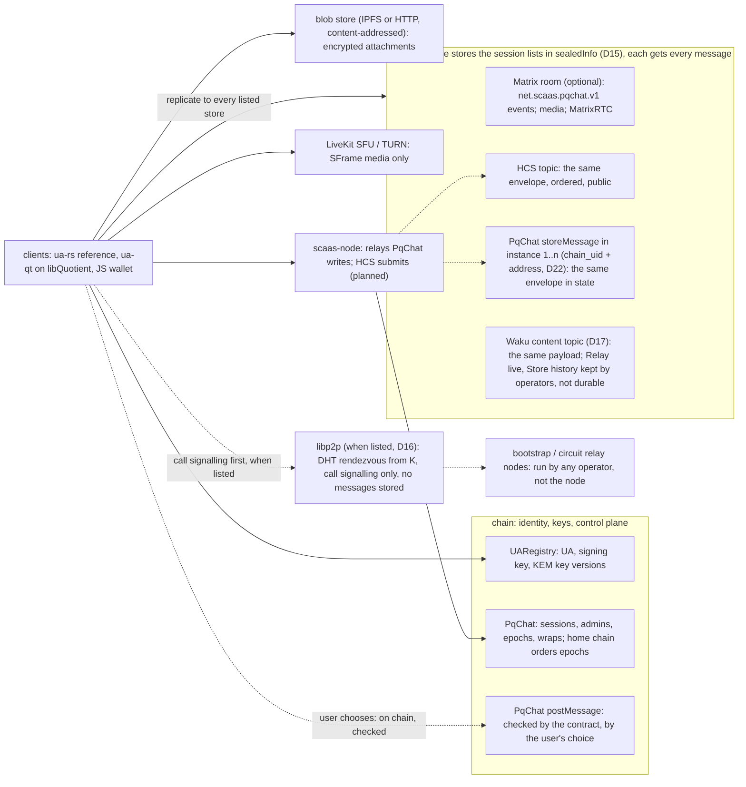

# UA-7: PqChat — post-quantum chat sessions (version 2)

**Status:** version 2, **accepted by the owner 2026-11-04** (revised the same day; the open items O1–O7 and the round name
answered the same day, §14; HCS added as the third transport by the owner 2026-11-05, D14; per-session stores, `storeMessage`
and Matrix optional the same day, D15; libp2p for call signalling the same day, D16; Waku as a message store, the relay
policy for unsigned writes and an optional Matrix id on the contact card the same day, D17; `PqChat` a factory kind with
many instances, owner 2026-11-07, D22, §2.1; public topics in each instance the same day, D18–D21, in the sibling spec
[`2026-11-07-pqchat-public-topics.md`](2026-11-07-pqchat-public-topics.md)). Version 1 (controller, 2026-10-25, with the
owner's answers of that day) is in this file's git history. Status: the EVM contract is **BUILT on branch `ua-mtx-merge`**
(plan 3c; normative text [`contracts/pqchat.md`](../../contracts/pqchat.md)); clients **PLANNED**. Version 2 applies the owner's thirteen
decisions of 2026-11-04 (D1–D13) and of 2026-11-05 (D14–D17) (§15, register entry
[CTR-CHAT-01](../../decisions.md#CTR-CHAT-01)) and the corrections of the architecture study
(`docs/research/pqchat-architecture.md` §9; the two-page summary is `docs/research/pqchat-overview.md`). The build plan
is [`2026-11-04-ua7-pqchat.md`](../plans/2026-11-04-ua7-pqchat.md). Queued after plan 5h and UA-8 (owner 2026-10-25).
UNAUDITED: every cryptographic construction below is a design, not a reviewed protocol.

**Request (owner 2026-10-25).** A smart contract for chat sessions, as an application: a UA creates a session; the
session's AES key goes **on chain**, encrypted with post-quantum cryptography for each member; one KEM key per UA first;
every write is a signed record that anyone may submit, without fees; sessions and messages unique on a chain,
identical on every chain, never locked; the key is then used to chat over **Matrix** (or any other channel).
**Request (owner 2026-11-04).** Make the design clear as a decentralised or semi-decentralised application; say what
is missing, extra and needed for sessions, metadata, chat features, security, and voice and video calls.

**Contents**

1. [What changed from version 1](#1-what-changed-from-version-1)
2. [Architecture](#2-architecture)
3. [Members, KEM keys, devices](#3-members-kem-keys-devices)
4. [Records](#4-records)
5. [Control plane: sessions, epochs, roles](#5-control-plane-sessions-epochs-roles)
6. [Key schedule](#6-key-schedule)
7. [Transports](#7-transports)
8. [Ordering](#8-ordering)
9. [Metadata](#9-metadata)
10. [Voice and video calls](#10-voice-and-video-calls)
11. [Cost](#11-cost)
12. [Libraries and vectors](#12-libraries-and-vectors)
13. [What stays research](#13-what-stays-research)
14. [Open items for the owner](#14-open-items-for-the-owner)
15. [Owner answers and decisions](#15-owner-answers-and-decisions)
16. [Work](#16-work)

## 1. What changed from version 1

| Version 1 | Version 2 | Why |
|---|---|---|
| C1 `createSession(record, sig)` etc., ids `keccak256(TAG ‖ record)`, a raw digest | typed EIP-712 structs with named fields in a portable domain; one named entry per operation (§4) | explicit parameters (CTR-MTX-28, CTR-MTX-29), typed portable records (CTR-UA-07) |
| C3 `wrap = ct ‖ AES-GCM(...)`, one blob | `Wrap {member, keyId, mlkemCt, x25519Eph, sealedKey}` (§4.2) | one crypto object per `bytes` (CTR-MTX-29), the registry's `KemKey` shape |
| C3 / C6b any UA may be a member; a secp256k1 signer column | only KEM holders are members: PQ kinds and a PQ-eligible `msig` (P3) | CTR-UA-32 holders |
| C4 any member rekeys; current epoch = highest number, then smallest id | `epoch = parent + 1`, one child per parent, the first complete child on the session's home chain wins; admins change membership; plain rekeys and leaving open to all (§5) | D3, D4: the v1 rule let a removed member undo its removal |
| C5 "fits one transaction and one block on every chain we target" | wraps in chunks over several transactions; no block-limit assumption (P11) | no assumptions about a chain; EIP-8037 inclusion |
| C6 one `k_send` per sender per epoch, random nonce | a per-sender, per-device hash ratchet; counter-derived nonces (§6.3) | D6, D9 |
| C6b the signature stored in state | its hash in state, its bytes in the event; ciphertext and header in state (§7.2) | D11 |
| C7 Matrix event content in the clear, no signature | the signed record inside an envelope; one event type `net.scaas.pqchat.v1` (§7.1) | D7, D10 |
| C7 the room id "may be stored in the session as a public field" | never in the clear on chain: inside `sealedInfo` (§4.2) | D10 |
| C8 "no forward secrecy beyond C4" | FS and PCS bounded by the KEM key version; rotation is the UA owner's choice, PqChat may suggest it (P5); a per-sender ratchet and epoch rekeys | D6 (changed 2026-11-04) |
| — | `msig` expansion (P13), devices (P6), calls (§10), ordering per transport (§8), metadata hygiene (§9), FIPS 203 §7.2 check (P14) | D5, D8–D10, D12, D13 |
| C10 unlinkable mode | unchanged: research (§13) | D10 |
| C7 Matrix "or any other channel" | a third transport: one Hedera Consensus Service topic per session (§7.3) | D14 |
| C7 Matrix as the channel (D1: primary) | a per-session list of stores inside `sealedInfo` (Matrix room, HCS topic, chains), every message sent to each; Matrix optional; `storeMessage` keeps the opaque envelope in state without checks (P27–P29) | D15 |
| C7 call signalling on Matrix only (D1) | libp2p peer to peer for call signalling, listed in the store list, rendezvous from the epoch key; no stored messages (P30) | D16 |
| — | Waku as a message store kind, content topic from the epoch hint, retention the operators' (P31) | D17 |
| one `PqChat` per chain, deployed once | a factory kind: many instances, each with an owner UA; a session's home and a chain store name an instance (§2.1, P32); public topics in each instance (sibling spec) | D18–D22 |

## 2. Architecture



**P1 — Four layers** (D1). **Identity**: the UA and its signing key in `UARegistry`, the same id on every chain
(CTR-UA-03, CTR-UA-07). **Key directory**: the UA's KEM key versions (CTR-UA-32). **Control plane**: `PqChat` — sessions,
admins, members, epochs, wraps of the epoch key `K` — always on chain (D2). **Data plane**: messages, attachments,
receipts, call signalling — on the **stores the session lists** (D15, P27): any of a Matrix room, an HCS topic (D14), one
or more chains through `storeMessage` (P29) and a Waku content topic (D17, P31); attachments in a blob store or Matrix media (P28); call signalling first over
libp2p when the list names it (D16, P30). A message goes through
`postMessage`, checked by the contract, only when the user chooses (D2).

**P2 — Transports** (D1, D12, D14–D17). A session lists its **stores** in `sealedInfo` (P27): any subset, at least one,
of **Matrix** (§7.1; optional, the default when listed), **HCS**, one Hedera Consensus Service topic per session, a cheap
public ordered log (§7.3), **chains** by `chain_uid`, each through `storeMessage`, the envelope in state with no
contract check (P29), and **Waku**, a content topic per epoch, its history kept by store operators for a limited time
(§7.6, P31). The client sends every message to every listed store. Apart from the list, the user may post a
message through **`postMessage`** (§7.2), where the contract checks the signature and membership. The signed record, its
signature and the client checks are the same on every store; a store is a client choice, not a contract rule, so one rule
still holds on every chain. Peer to peer: 1:1 call media (§10) and, when the list names **libp2p**, call signalling
(§7.5, P30), which is not a message store. `scaas-node`: relays `PqChat`
writes as `call` jobs and, PLANNED, HCS messages as a Hedera job (§7.4); it stores, gossips or pushes no chat traffic and
is no TURN, SFU, libp2p bootstrap, libp2p relay or Waku node.

### 2.1 Instances: `PqChat` is a factory kind (D22)

SPECIFIED (owner 2026-11-07); nothing built.

**P32 — Many instances per chain.** `OpenFactory` creates `PqChat` instances freely, as it creates tokens and DEXes:
anyone calls the generic `createInstance` for class 3 (factory index spec §8, owner-approved 2026-11-07), the factory
clones a catalogued release (EIP-1167, CREATE3 with the salt scoped by the creator) and initialises it with its **owner
UA** (`bytes32`, governance identity) through `initialize(bytes32 ownerUA)`. Releases are versions in the factory's
catalogue (deployed by the registrar from init code, a notice period before use, deprecable, never upgraded). Each
instance has its own sessions, epochs, messages, stored messages and public topics, in its own ERC-7201 storage; nothing
is shared between instances. The factory is a release immutable; the chain values (the registry address, the chain's
`chain_uid`, the code-size limit of P11) are the instance's `ChainEnv`, written by the factory into each clone at creation
(spec `2026-11-07-chain-neutral-releases.md`). The owner UA has **no power** over sessions, topics or entries: it names the
instance in the factory index and in `owner()`, nothing more. The factory index lists instances by class 3
(the mapping to the generic path is in the sibling spec's §11). Change (Fable review 2026-11-10, P2-2, P3-11; text only):
**a replica's record counts only when it equals the home record** (the same record and `sigHash` under the same id):
ids hash the signer and a nonce, nonce bitmaps are per instance, so a signer can land two different records under one id
in two instances; membership is therefore always read from the home instance, and a reader checks the factory listing
(class 3, version ≠ 0) of the home instance as of every other instance it reads.

**Where an instance replaces "the chain".** A record is still portable (domain `DS_C`: no chain id, no address, P7), so
the same record may land in any instance on any chain, as a replica. Wherever this spec says **home chain**, read **home
instance**: the pair `(homeChain, homeContract)` fixed in the session record (§4.2); the slot rule of P9 holds only where
`chainUid() == homeChain` and `address(this) == homeContract`. A **chain store** (P27, P29) names an instance:
`{"kind": "chain", "chainUid": …, "contract": <instance address>}`. `postMessage` needs the epoch in the instance it is
sent to. A client and the node accept as a `PqChat` only an address the chain's factory lists as class 3 with a
registered release (version ≠ 0).

## 3. Members, KEM keys, devices

**P3 — Who can be a member.** A member is a UA that holds a KEM key in this chain's registry (CTR-UA-32 holders):
`mldsa44` (0x0130), `mldsa65` (0x0131), `fndsa512` (0x0132), or a PQ-eligible `msig`, which joins by expansion (P13); on
branch `mldsa87`, being built: `mldsa87` (0x0134) and `fndsa1024` (0x0135). Native ids and classical kinds (secp256k1,
ed25519, passkeys …) hold no KEM key and cannot be members; `slhdsa128s` is not a holder. Signature cost on chain:
FN-DSA-512 2.3 M gas; ML-DSA-44 / -65 only on the registry's cached expanded key (4.1 / 5.8 M) or an EIP-8355 precompile,
never on the FIPS 204 key (18.9 M for ML-DSA-65 is above the EIP-7825 regular cap of 2^24); `mldsa87` only by precompile
(accounts.md §1.6).

**P4 — Using a member's KEM key.** A client reads `kemKeyOf(ua)` / `kemKeyAt(ua, version)` and:

1. wraps only to the **highest version it has seen on any source it reads** (any chain, the node, a contact card); a member
   whose highest version rises is a reason for a plain rekey (P10);
2. skips a UA whose `checkedOf(ua).kem` is `NONE` (the hash-commit form not yet repaired) and says so;
3. on a family where a relayer checked the KEM record (CTR-UA-34), re-verifies the record's signature before using it;
4. shows a fingerprint of each member's `kemPkHash`, and warns when two UAs list the same KEM key (no proof of possession
   of the KEM secret exists, by CTR-UA-32);
5. checks the key before every encapsulation (P14).

**P5 — KEM key rotation: the UA owner's choice** (D6 as changed by the owner 2026-11-04). The KEM key is the UA's general
key in `UARegistry` (CTR-UA-32), used for more than chat, so PqChat sets **no rotation schedule** and requires none. A new
version is registered (`setKemKey`) when, and only when, the UA's owner chooses. A PqChat client always wraps to each
member's **highest stored version** (P4 item 1), rekeys when a member's highest version rises (P10), and **may suggest** a
rotation (for example after a device loss), never require one. Whether an old secret is deleted is also the owner's choice;
a deletion means something only if the secret cannot be regenerated (not derived from a seed the owner keeps).

**What it costs, plainly.** A leaked KEM secret opens every wrap ever made to that version: the epoch keys, and so the
history, of every session that used that version, for as long as the version was used, from the chain, forever. The per-sender
ratchet (§6.3) and epoch rekeys do not protect against that leak, because the wraps stay on chain and re-serve the epoch keys
to whoever holds the secret; they protect against the loss of a device's message and chain keys after deletion. Forward
secrecy and post-compromise security are therefore bounded by how long the owner keeps a version, which PqChat does not
control. History is kept on the device and, opt-in, in an epoch-key backup (§14 O5).
An MLS group or an off-chain ratchet for 1:1 is the later step (D6),
not in this version.

**P6 — Devices** (D9). One KEM key and one signing key per UA, shared by its devices; every device has a **device id**
that enters every sender derivation, counter and nonce scope (§6.3, §4.3). Change (owner 2026-11-10; BUILT on
`ua-mtx-merge`, plan 3c): device id: a 16-byte UUID (`bytes16`), v7 or v4 at the client's choice; nothing checks its
version or variant bits (was a `uint32` assigned by an existing device). The device makes it when it is linked or
restored; a restored device always makes a new one, with no collision check on restore (122 random bits). The contract
never parses it; it is an input of the nonce scope, the ratchet and `messageId`. Its cost, plainly: on `postMessage` the id
is public, so a v7 id makes the device's creation time (in milliseconds) public, while a v4 id hides it; on `storeMessage`
(and every other store) it stays inside the envelope either way. **Linking** is off chain: the new device shows a fresh
ephemeral ML-KEM-1024 + X25519 key and a short code (QR); the existing device checks the code, encapsulates to that key and
sends the UA's secrets and the current epoch keys over a store of the session (P27) or a local channel. Per-device KEM keys (`keyId` per device, CTR-UA-32
"later") come later and change no layout.

## 4. Records

**P7 — Domain, purpose, signature.** Every record is a typed EIP-712 struct in the portable domain
`DS_C = keccak256(abi.encode(keccak256("EIP712Domain(string name,string version)"), keccak256("SCaaS PqChat"), keccak256("1")))`
— no chain id, no contract address, so a record is the same on every chain (owner answer 4) — and `typed(s) =
keccak256(0x1901 ‖ DS_C ‖ hashStruct(s))`. The author signs `uaMessage(kind, PURPOSE_PQCHAT, typed(s))` with
`PURPOSE_PQCHAT = keccak256("scaas.ua.purpose.pqchat.v1")`, as a `UASig` (single key: `signature`; `msig`: `members`,
minimal form, CTR-UA-07). The contract verifies it through the registry's portable check (§14 O1). No record carries a fee
(owner answer 4); a payer pays a relayer through `RelayFeeRouter` (CTR-MTX-27) if it wants to.

### 4.1 Structs

| Struct | Type string |
|---|---|
| `MemberKey` | `MemberKey(bytes32 ua,uint64 keyId,bytes32 via)` |
| `Wrap` | `Wrap(bytes32 member,uint64 keyId,bytes mlkemCt,bytes32 x25519Eph,bytes sealedKey)` |
| `PqChatSession` | `PqChatSession(bytes32 creator,uint64 nonce,bytes32 homeChain,address homeContract,bytes32[] admins,MemberKey[] members,bytes32[] wrapHashes,bytes sealedInfo)MemberKey(bytes32 ua,uint64 keyId,bytes32 via)` |
| `PqChatEpoch` | `PqChatEpoch(bytes32 sessionId,bytes32 author,uint64 nonce,uint64 epoch,bytes32 parentEpochId,bytes32[] admins,MemberKey[] members,bytes32[] wrapHashes,bytes sealedInfo)MemberKey(bytes32 ua,uint64 keyId,bytes32 via)` |
| `PqChatLeave` | `PqChatLeave(bytes32 sessionId,bytes32 epochId,bytes32 member,uint64 nonce)` |
| `PqChatMessage` | `PqChatMessage(bytes32 sessionId,bytes32 epochId,bytes32 sender,bytes16 device,uint64 counter,bytes32[] parents,bytes ciphertext)` |

### 4.2 Fields

- `members` strictly sorted by `ua`; `keyId` = the KEM version wrapped to; `via` = the `msig` seat it came from, or zero
  (display only, P13). `admins` strictly sorted, any registered UA (P10).
- `wrapHashes[i] = hashStruct(Wrap_i)` for `members[i]`, in the same order: the record signs every wrap without carrying
  it, so wraps may arrive in chunks (P11).
- `Wrap.mlkemCt` 1,568 B, `x25519Eph` the X25519 ephemeral public key, `sealedKey` 48 B (`K` under the KEK, with its tag).
- `homeChain` = the `chain_uid` of the chain that orders this session's epochs (the family-neutral id the factory already
  uses), and `homeContract` = the address of the `PqChat` instance on it that orders them (D22, P32); both fixed for the
  session's life.
- `sealedInfo` = AES-256-GCM-SIV under `HKDF(K, "scaas/pqchat/v1/info" ‖ sessionId ‖ epochId)`, a random 96-bit nonce
  prepended, over the padded (§6.5) canonical JSON `{"stores": [<store>, …], "name", "topic", "matrix": {<ua>: <Matrix
  user id>}}`, the store list of P27, each entry one of `{"kind": "matrix", "room": <Matrix room id>}`,
  `{"kind": "hcs", "topic": "shard.realm.num"}` (§7.3), `{"kind": "chain", "chainUid": <chain_uid>, "contract": <PqChat
  instance address>}` (P29, P32),
  `{"kind": "waku", "contentTopic": <content topic>}` (P31) and `{"kind": "libp2p"}` (call signalling only, P30), at
  least one entry that is a message store (Matrix, HCS, chain or Waku; a `libp2p` entry does not count), at most one
  Matrix, one HCS, one Waku and one `libp2p` entry, chain entries distinct by `(chainUid, contract)`; `matrix`
  (the user ids) present only when a Matrix store is listed.
  **The store list, the room id, the HCS topic id and Matrix user ids never appear on chain in the clear** (D10, D14,
  D15).
- `parents` = the ids of the conversation heads the sender has seen, at most 8, sorted (P19).
- `ciphertext` = §6.4.

### 4.3 Ids and nonces

```text
sessionId = keccak256(abi.encode(keccak256("scaas/pqchat/v1/session"), creator, nonce))            epoch 0's id too
epochId   = keccak256(abi.encode(keccak256("scaas/pqchat/v1/epoch"), sessionId, author, nonce))    epochs >= 1
leaveId   = typed(PqChatLeave);  messageId = typed(PqChatMessage)
```

Ids are computable before the wraps exist (the KEK binds them, §6.2). Scoped nonces, checked after the signature and
then marked used (owner answer 7; bitmaps, any order, never locked): a session `(creator, nonce)`; an epoch or a leave
`(sessionId, author, nonce)`; a message `(epochId, sender, device)` over `counter`. A message's scope still has the session
as a dimension (the epoch belongs to one session); the device is new (D9).

### 4.4 Entries, views, events

| Entry | Who | What the contract checks |
|---|---|---|
| `createSession(PqChatSession s, Wrap[] wraps, UASig sig)` | anyone submits; `s.creator` signs | sig; nonce; shapes (P8); every member holds `keyId` here; each given wrap matches its hash; stores |
| `rekey(PqChatEpoch e, Wrap[] wraps, UASig sig)` | anyone submits; `e.author` signs | P9 |
| `addWraps(bytes32 epochId, uint32 first, Wrap[] wraps)` | anyone, no signature | `wraps[j]` hashes to `wrapHashes[first + j]`; not stored yet; the epoch may still complete (P9) |
| `leave(PqChatLeave l, UASig sig)` | anyone submits; `l.member` signs | sig; nonce; `member` in `epochId` |
| `postMessage(PqChatMessage m, UASig sig)` | anyone submits; `m.sender` signs | sig; nonce scope `(epochId, sender, device)`; sender in the complete epoch `epochId`; size bound of §6.5 |
| `storeMessage(uint8 v, bytes8 hint, bytes env)` | anyone, no signature | nothing but the shape: `v == 1`, `env` fits one blob (P29); appends `abi.encode(v, hint, env)` to the list of `hint` |

Views: `sessionOf`, `epochOf`, `epochComplete(epochId)`, `childOf(parentEpochId)` (the winning child on the home chain, zero
elsewhere), `wrapAt(epochId, i)`, `leftIn(epochId, member)`, `nonceUsed(scope, nonce)`, `messageCount(sessionId)`,
`messageAt(sessionId, index)`, `storedCount(hint)`, `storedAt(hint, index)` (P29). Events: `PqChatSessionCreated(sessionId, creator, homeChain)`, `PqChatEpochAdded(sessionId,
epochId, parentEpochId, epoch, author)`, `PqChatWraps(epochId, first, count)`, `PqChatEpochComplete(epochId)`,
`PqChatLeft(sessionId, epochId, member)`, `PqChatMessagePosted(sessionId, messageId, sender, index, sig)` with the
signature's bytes (§7.2), `PqChatStored(hint, index)`. Errors are named per check (`PqChatEpochNumber`, `PqChatEpochTaken`, `PqChatNotAdmin`,
`PqChatNotMember`, `PqChatWrapHash`, `PqChatNonceUsed`, `PqChatKemKey`, `PqChatShape`, …). Every stored record keeps its
full bytes in state (SSTORE2 blobs; never only an event).

**P47 — Recovery from state alone** (owner 2026-11-10; BUILT on `ua-mtx-merge`, plan 3c T96). A client keeps no session list
and reads no event: a new or reinstalled device finds everything in contract state. `sessionCount(ua)` and
`sessionsOf(ua, offset, limit)`: one entry per member at `createSession` and one per member a `rekey` adds to its parent;
append-only (a removed or leaving member keeps its entry and clients check `leftIn` and the latest epoch's members; a
member added again gets another entry). `epochCount(sessionId)` and `epochsOf(sessionId, offset, limit)`: epoch 0 (the
`sessionId`) first once complete, then each epoch as it completes in this instance; in the home instance a child
completes only by taking its parent's slot (P9), so the list is the winning chain 0..n; in a replica it is every complete
epoch in completion order, competing children included (a replica orders nothing, P18: clients follow the home's list).
`latestEpoch(sessionId)` is the list's last entry, with no slot of its own. Every list is paged as `storedRange` (P29): an
offset past the end is empty, the limit clamped (`SESSIONS_RANGE_MAX` = `EPOCHS_RANGE_MAX` = 128 ids); these views
answer the page only (the count is `sessionCount` / `epochCount`), while the topic lists answer `(ids, total)` (topics
P42). Change (Fable review 2026-11-10, P2-1, P3-2; text only): **which instances a new device reads.** `sessionsOf` is
per instance and anyone may create an instance (P32), so a client recovers a UA's sessions by paging the chain factory's
index for class 3 (`contractsPage(3, …)`, version ≠ 0) on each chain it serves and calling `sessionCount(ua)` on each
listed instance; an instance the factory does not list is not read (P43). A `rekey` that never completes or loses the
slot still leaves its added members' entries, and a retry adds them again: entries **may repeat**, so clients
de-duplicate and check `epochCount` and the latest epoch's members. Fable P2-3 (owner ruling kept: the entry is written
at `createSession`): a record listing N UAs with no wrap indexes all N at once for about 0.3 M state gas per UA (128 B of
record and one slot each) and can never be used (`epochCount` 0); clients skip a session whose `epochCount` is 0 before
showing it. **Spam is the
client's decision, off chain** (owner 2026-11-10): no on-chain consent or acceptance step (D5 unchanged). **The main case
is a 2-person chat** (owner 2026-11-10): layout and gas are optimised for a 2-member session and its figures come first in
the gas rows (create, index, rekey, post, store); groups stay correct and tested, and no 1:1 gas is traded for a group
feature.

## 5. Control plane: sessions, epochs, roles

```mermaid
sequenceDiagram
  participant A as creator client
  participant R as relayer (node) or own account
  participant H as PqChat on the home chain
  participant B as member client
  A->>A: K random; per member: check key (FIPS 203 7.2), encapsulate, seal K
  A->>A: sign PqChatSession (wrapHashes, sealedInfo with the store list)
  A->>R: createSession(s, wraps[0..k], sig)
  R->>H: transaction(s); more wraps by addWraps if needed
  H-->>B: PqChatEpochComplete(sessionId)
  B->>H: wrapAt(sessionId, i), sealedInfo
  B->>B: decapsulate, open K, read the store list, join or read each store
```

**P8 — Session.** The creator lists itself as a member and an admin (the creator is always the first admin),
draws `K` for epoch 0 and signs the session record. `admins ⊆` registered UAs; members strictly sorted, at least 2.
Anyone may create a session with any UA (owner answer 2); consent is in clients (P12).

**P9 — Epochs** (D3). `rekey` is accepted when: the signature is the author's; the parent epoch is stored and **complete**;
`e.epoch == parent.epoch + 1` (`PqChatEpochNumber`); the author's rights hold (P10); every member holds `keyId` here. A
child is **complete** when every wrap has landed. **On the home instance** (`chain_uid == homeChain` and
`address(this) == homeContract`, P32), the first child of a
parent to become complete takes the parent's child slot; any other child of that parent is refused or can no longer
complete (`PqChatEpochTaken`). An incomplete child never takes the slot, so nobody can lock a session by starting an
epoch and never finishing it; anyone may finish it with `addWraps` (the signed hashes fix the bytes). **In every other
instance**, on this chain or another, records are replicas: each complete child is stored, `childOf` reads zero, and clients follow the home chain's
`childOf`. A new `K` is always fresh randomness, never derived from the old one, so a removed member cannot read the next
epoch.

```mermaid
sequenceDiagram
  participant AD as admin client
  participant M as removed member
  participant H as PqChat, home chain
  participant Y as PqChat, other chain
  AD->>H: rekey(parent e5, epoch 6, members without M), complete
  M->>H: rekey(parent e5, epoch 6, members with M)
  H-->>M: refused: PqChatEpochTaken (when the admin's child completes first; see the limit below)
  M->>H: rekey(parent e5, epoch 1000)
  H-->>M: refused: PqChatEpochNumber
  AD->>Y: copy of the admin's epoch 6
  Note over H,Y: clients follow childOf(e5) on the home chain
```

Change (Fable review 2026-11-10, P1-2; controller: fix (a) BUILT on `ua-mtx-merge`, fix (b) waits for the owner):
**the limit of the slot rule.** The first complete child wins, so a member about to be removed can answer each new tip
with its own plain rekey that keeps it and take the slot before the admin's removal completes (with chunked wraps it
sees the admin's record before it completes and needs no mempool access); the admin must then rekey from that child, and
the member may repeat. This is liveness, not secrecy (the member never reads an epoch it is not wrapped into; its wraps
for the others may be garbage, which locks them out until one of them rekeys), it costs the member about 2.7 M gas per
member per round, and a 2-person chat is not affected. Built: a member who **left** the parent authors no plain rekey of
it (`PqChatNotMember`), so `leave` stops that member from extending the epoch. Not built (a new rule, the owner's call):
an admin-signed record that marks another member as left (`PqChatRemove`), which would stop a member who does not leave. Change (owner 2026-11-10): build it, **P48** below.

**P10 — Roles** (D4). Each epoch record carries the admin set. **A membership change** (any member added or removed, any
admin added or removed) needs an author who is an admin of the parent epoch (`PqChatNotAdmin`). **A plain rekey** — the
same members and admins, minus those who left the parent epoch (P12), with any `keyId` changes — may be authored by any
member of the parent who has not left it (Fable P1-2 (a), BUILT; the race it leaves is stated under P9). An admin that is an `msig` signs its epoch records by its quorum (`UASig.members`). An admin needs a
KEM key only if it is also a member.

**P11 — Chunks** (no block-limit assumption). The contract assumes no block or code-size limit: wraps are stored in SSTORE2
blobs of at most the chain's code-size limit, declared when the registrar deploys the release (an immutable of the
release, shared by its clones, P32; the EVM has no opcode for it) (one wrap is 1,680 B with its member id;
14 per blob under 24,576 B, 39 under 64 KiB); a client puts as many wraps per transaction as fit its chain's limits
(EIP-8037: regular + state gas ≤ block limit) and sends the rest by `addWraps`. Group size has no protocol bound; cost grows
by ≈ 2.6 M gas per member per epoch (§11).

**P12 — Leaving and consent** (D5). A member leaves by `leave`; the next epoch drops it (a plain rekey may). Consent is
client-side now: a client shows a session from an unknown creator only after its user accepts; a member that never accepts
can leave. Change (Fable review 2026-11-10, P2-4; ARCH-POS-13): **before its user accepts a session, a client makes no
network call and no write derived from the session's wraps or `sealedInfo`** (no store joined or read, no Matrix, HCS or
Waku subscription), **and sends nothing that depends on whether a wrap or a message opened** (no receipt, no leave, no
rekey); the P8 flow above ("join or read each store") runs only after acceptance. Anyone may wrap a chosen ciphertext to a
UA's KEM key and name its own store in `sealedInfo`; an automatic join would tell the creator that the UA's device is
online and opened it. The on-chain link between a creator and the UAs it lists stays public until the unlinkable mode (§13).

**P13 — `msig` members: expansion** (D8). An `msig` is a **seat**, never a KEM recipient: the author's client expands it,
at every epoch, into its accepted members (`memberAccepted`, CTR-UA-37), two levels (CTR-UA-38), keeps the leaves that hold
a KEM key (warning on the others) and lists each leaf with `via = <the seat's msig id>`. The contract does not read `via`;
clients re-check it against the registry. Leaving the `msig` (or losing acceptance) removes the leaf at the next epoch.
Messages and leaves are always signed by a leaf UA, never by the `msig`; an "on behalf of" field may go inside the
plaintext.

## 6. Key schedule

**P48 — Removal by an admin** (owner 2026-11-10, on Fable's review P1-2 fix (b); BUILT on `ua-mtx-merge`, plan 3c). An admin of an
epoch removes members of it with one signed record, so a member about to be removed can no longer keep itself in by
racing plain rekeys (P9's limit). The record, a typed EIP-712 struct in `DS_C` under `PURPOSE_PQCHAT` (P7), every field
an explicit parameter:

| Struct | Type string |
|---|---|
| `PqChatRemove` | `PqChatRemove(bytes32 sessionId,bytes32 epochId,uint64 nextEpoch,bytes32[] members,bytes32 admin,uint64 nonce)` |

- `sessionId`, `epochId`: the session and the epoch the removal applies to (the parent of the next epoch); `nextEpoch`:
  that next epoch's number, `epoch(epochId) + 1` (`PqChatEpochNumber` otherwise), so the record names the step it binds.
- `members`: the removed UAs, 1 to `REMOVE_MAX` = 16, strictly sorted (`PqChatShape` otherwise), each a member of
  `epochId` (`PqChatNotMember`).
- `admin`: an admin of `epochId` (`PqChatNotAdmin`; an `msig` admin signs by its quorum, P10), who signs the record.
- `nonce`: in the epoch scope `(sessionId, admin)` of §4.3, shared with that admin's epochs and leaves (a replay is
  `PqChatNonceUsed`). No deadline, as no `PqChat` record has one (P7): the record is accepted only while `epochId` is
  stored and complete in this instance (`PqChatUnknown`, `PqChatIncomplete`) and, at home, has no complete child yet
  (`PqChatEpochTaken`); once a child holds the slot the removal is moot.

`remove(PqChatRemove r, UASig sig)`: anyone submits it, relayable with a fee of 0 (P17, the rules of the other signed
writes); the contract checks the shape, the admin's rights and signature, then the nonce, marks each listed member
removed from `epochId` (a member already removed stays so) and keeps the record and its `sigHash` in state.

**Precedence.** Once `epochId` has a removal, a child of it completes in this instance only if neither its members nor its
admins hold a removed UA (`PqChatRemovedKept(epochId, ua)`), whoever authors it; a removed member authors no rekey of
`epochId` (`PqChatNotMember`, as a member that left, Fable P1-2 fix (a)); dropping a removed member counts as a plain
rekey (P10), as dropping one that left does, so any remaining member may land the child. A child stored incomplete before
the removal cannot complete while it keeps a removed UA. The check runs when a child completes, in `rekey` or in the last
`addWraps`.

**With `leave`.** `leave` stays the member's own flag (P12): a child may keep a member that left, and a member that left
authors no plain rekey. `remove` is the admin's: the child must drop the member. Both may hold for one UA.

**Recovery from state** (P47). `removedIn(epochId, ua)`, `removalCount(epochId)` and `removalAt(epochId, i)` (the record
and its `sigHash`) read the removals of an epoch; a new device that finds an epoch with no complete child reads them
before it builds the next epoch, and the child's member list shows the removal once it completes. `PqChatRemoved(sessionId,
epochId, admin, members)` notifies.

**A 2-person chat is unchanged**: no removal is needed there, and a rekey or a message reads one more packed field, in a
slot it reads already.

**P14 — KEM key check before encapsulation** (FIPS 203 §7.2). Scheme 1 only (`kemPk[0] == 0x01`, 1,601 B,
CTR-UA-32); anything else is refused. Before every `Encaps` the client runs the **type check** (`ek` is 1,568 B) and the
**modulus check** (`ByteEncode12(ByteDecode12(ek[0:1536])) == ek[0:1536]`), and refuses an all-zero X25519 shared secret.
A receiver runs the FIPS 203 §7.3 decapsulation-key check on its own key once, at generation, and refuses an all-zero
X25519 shared secret at decapsulation too (Fable P2-4).

### 6.1 The hybrid KEM (scheme 1)

```text
(ct_M, ss_M) = ML-KEM-1024.Encaps(ek)                         ek = kemPk[1:1569]
(e, E)       = X25519 key pair, fresh;  ss_X = X25519(e, pk_X) pk_X = kemPk[1569:1601]
ss           = SHA3-256(ss_M || ss_X || E || pk_X || "scaas.kem.1")    X-Wing-style combiner, own label
```

### 6.2 Wrap

```text
kek       = HKDF-SHA-256(ikm = ss, salt = empty,
                         info = "scaas/pqchat/v1/wrap" || sessionId || epochId || member || keyId || 0x01 || kemPkHash)
sealedKey = AES-256-GCM(kek, nonce = 0^96, K, aad = sessionId || epochId || member || keyId)     48 B
Wrap      = {member, keyId, mlkemCt = ct_M, x25519Eph = E, sealedKey}                             1,680 B in calldata with ids
```

`nonce = 0` is safe because each KEK encrypts once. The KEK binds the scheme byte and the key hash, so a wrap cannot be
read as one for another key.

### 6.3 Sender chains (per-sender, per-device ratchet)

```text
ck_0      = HKDF-SHA-256(K, info = "scaas/pqchat/v1/chain" || sessionId || epochId || sender || device)
mk_i      = HMAC-SHA-256(ck_i, 0x01);   n_i = HMAC-SHA-256(ck_i, 0x03)[0:12];   ck_{i+1} = HMAC-SHA-256(ck_i, 0x02)
counter   = i, from 0 in each epoch, per (sender, device)
```

A sender deletes `ck_i` and `mk_i` once used; a receiver deletes `mk_i` after decryption and keeps skipped message keys
for at most 2,000 messages per chain (O6). `K` stays recoverable from the chain while the KEM secret exists; the
bound on forward secrecy is the lifetime of the KEM version, the UA owner's choice (P5). A sender stops using an epoch once the home chain shows a complete
child of it; the home instance enforces it for `postMessage` (Fable P1-1, BUILT: `PqChatEpochTaken`), so a member the
child dropped cannot post under the old epoch later; an in-flight honest message is refused and sent again under the new
epoch. A replica orders nothing and still takes it (clients read membership from the home, P32).

### 6.4 Message encryption

```text
pt         = pad(canonical JSON content, §6.5)        content: {"type": "text" | "edit" | "redact" | "react" | "receipt" |
                                                                "typing" | "file" | "callKey" | ..., fields per type}
aad        = abi.encode(sessionId, epochId, sender, device, counter, keccak256(abi.encode(parents)))   device: bytes16 (P6)
ciphertext = AES-256-GCM-SIV(mk_i, n_i, pt, aad)
```

GCM-SIV stays (v1 C6): a device id reused by mistake does not turn into a nonce reuse. The record `PqChatMessage`
(header + ciphertext) is then signed by the sender (D7, §4); the signature authenticates the author to every member.
There is no deniability: a signature proves authorship of a ciphertext for good.

### 6.5 Padding

Plaintexts are padded (length prefix, then zeros) to 256, 1,024, 4,096 or 16,384 B, then multiples of 16,384 B (D10).
The buckets apply on every transport. A message posted on chain is at most one 1,024-B bucket unless the user confirms
the cost; attachments never go on chain (1 MiB ≈ 1.6 G state gas; P28). An HCS message is bounded by the chunk limit
(P25), a `storeMessage` envelope by one blob (P29), a Waku message by the network's maximum message size (P31).

## 7. Transports

SPECIFIED (D15–D17); nothing built.

**P27 — The session's stores** (D15–D17). A session lists where its messages go in `sealedInfo` (§4.2), so the list is
encrypted and nothing new appears on chain in the clear: any subset, **at least one**, of a Matrix room (§7.1), an HCS
topic (§7.3), one or more chain stores, each a `PqChat` **instance** named by `chain_uid` and address (P32) on **any EVM
chain** whose factory creates `PqChat` (one rule on every chain, owner 2026-11-06; other families in their own rounds),
each written through
`storeMessage` (P29), and a Waku content topic (§7.6, P31). The list may also name **libp2p** (§7.5, P30) for call signalling; it stores no message, receives
no replicated message and does not count toward "at least one". **Matrix is optional**: when listed it is the default (read first; its media and MatrixRTC
available, P28). The client sends every message to **every listed store** (replication), as the same envelope of P15;
readers read any listed store and dedupe by `messageId` (P19). The list may change only at a rekey: the new epoch's
`sealedInfo` carries the new list, and messages of that epoch follow it. A store is a client choice, not a contract rule;
another kind of store or transport can be added later as a new `kind` in the list. **A test-chain store** (for example Sepolia) can be retired and its data lost: fine for tests, not for durable history; the client says so when the user
lists one.

**P28 — Without Matrix** (D15, D16). **Attachments**: the file is encrypted as today (a random AES-256-GCM key) and put in a
content-addressed blob store (IPFS or any HTTP store), or in the Matrix media repository when Matrix is listed; the `file`
content inside the envelope carries `{src, key, sha256, size bucket}`, `src` the content id (or the `mxc://` URI), so the
key and the content hash travel only inside the envelope. Attachments never go on chain (§6.5). **Call signalling**:
over libp2p first when the list names it (P30); otherwise in the Matrix room when Matrix is listed (P21), then over the
HCS topic (D14), as encrypted envelope content types, as on Matrix; media stays WebRTC 1:1 and an SFU for groups (D12). A
session that lists none of libp2p, Matrix and HCS (only chains) has no call signalling; listing libp2p gives it one
(D16). **Push notifications** are out of scope: this spec defines no push service and the node sends
no push (P17).

### 7.1 Matrix (default when listed)

```mermaid
sequenceDiagram
  participant A as sender client
  participant HA as sender's homeserver
  participant HB as member's homeserver
  participant B as member client
  A->>A: content -> pad -> ratchet -> ciphertext; sign PqChatMessage
  A->>A: envelope = AES-256-GCM-SIV(k_env, abi.encode(message, sig))
  A->>HA: event net.scaas.pqchat.v1 {v, hint, env} (inside Megolm when on)
  HA->>HB: federation
  HB->>B: /sync
  B->>B: open envelope, verify the UA signature, decrypt, order by parents
```

**P15 — Event.** Type **`net.scaas.pqchat.v1`**, content `{"v": 1, "hint": base64(HMAC(K, "scaas/pqchat/v1/hint")[0:8]),
"env": base64(nonce ‖ AES-256-GCM-SIV(k_env, nonce, abi.encode(PqChatMessage, UASig)))}` with `k_env =
HKDF(K, "scaas/pqchat/v1/env" ‖ sessionId ‖ epochId)`. The envelope holds **the same bytes** a `postMessage` call takes,
so `postMessage` (§7.2) reposts them unchanged and both copies have one `messageId`; `storeMessage` and HCS keep the
envelope itself (P29, P25). Servers see an opaque blob and an
8-byte epoch hint. Megolm may stay on as an outer layer (it hides even the event type). One room per session; its id
travels in `sealedInfo` only. **Any homeserver works** (owner 2026-11-05): a public one (for example one with open
registration) or a self-hosted one; SCaaS requires no server of its own. A public homeserver costs: a Matrix account per
user on that server, separate from the UA and under the server's terms; its operator sees room membership, timing and
sizes, never content (P20); its rate limits, an event size of about 64 KB and its media limits; retention by the server's
policy. If the server goes away, the session's replicated stores (HCS, chain, Waku; P27) keep the messages. Matrix room membership follows `PqChat` membership (the client invites and kicks the
Matrix ids from `sealedInfo`); a Matrix member without the epoch key sees ciphertext only. Receipts, typing, edits,
redactions, reactions and call keys are content types inside the envelope, never Matrix's plaintext ephemeral events
(D10). Attachments: P28 (the Matrix media repository is one option). Qt client: `clients/ua-qt` on libQuotient (owner
answer 5) registers the event type; push, if a client uses one, is Matrix's own push gateway (event ids only), outside
this spec (P28).

### 7.2 Chain: `postMessage` and `storeMessage`

**P16 — On-chain messages checked by the contract** (D2, D11). `postMessage` is for a message whose membership the
contract itself must enforce; it needs the epoch on that chain (the home chain or a replica). `postMessage` stores the header and the ciphertext in contract state (one SSTORE2
blob per message, an append list per session: never only a hash or an event) and **the signature's hash** in that blob;
the signature's bytes go in `PqChatMessagePosted`. A client posts on chain only when its user chooses (per message or per
session setting), never silently: it costs gas and is public forever. Edits and deletes are new messages; nothing stored
can be removed, and the UI says so.

```mermaid
sequenceDiagram
  participant A as sender client
  participant N as scaas-node (call job)
  participant C as PqChat (any chain)
  participant B as member client
  A->>N: postMessage(PqChatMessage, UASig), named fields
  N->>C: transaction (lane gas; payment via RelayFeeRouter if any)
  C->>C: verify sig (portable), member of complete epoch, mark (epochId, sender, device) counter
  C-->>B: PqChatMessagePosted(sessionId, messageId, sender, index, sig)
  B->>C: messageAt(sessionId, index)
  B->>B: verify sig against the event bytes and the stored hash, decrypt
```

**P29 — `storeMessage`: the chain as a store** (D15). `storeMessage(uint8 v, bytes8 hint, bytes env)` takes the fields of
the HCS payload of P25, `v`, `hint` and `env` exactly as P15 (`hint` the same 8-byte epoch hint, no second hint), and
appends `abi.encode(v, hint, env)`, the same bytes as that HCS payload, as one SSTORE2 blob to the instance's append list
keyed by `hint` (never only an event; each instance its own lists, P32). `env` is one crypto object, so one `bytes` (explicit parameters). It checks **no signature,
no membership, no nonce**: only `v == 1` and that the blob fits the declared code-size limit (P11; `PqChatShape`
otherwise). It emits `PqChatStored(hint, index)`; views `storedCount(hint)` and `storedAt(hint, index)` return the list.
Anyone may call it; spam pays its own gas and clients drop it. Clients check exactly as for HCS (P25): open the envelope,
the portable signature, epoch membership as the home chain orders it, the nonce scope and counter, `messageId` dedupe. No
epoch replica is needed on that chain, so replicating to many chains costs one blob per chain. The signature's full bytes
stay inside the envelope, so in state (no hash split as in P16). The client applies §6.5's 1,024-B rule as for
`postMessage`. Nothing stored can be removed, and the UI says so. Change (Fable review 2026-11-10, P1-1, P3-6; the
limit, not built): `storeMessage` is content-blind, so the home's refusal of a message under a superseded epoch (§6.3)
cannot apply here: a stored envelope under an epoch that has a complete child, from a UA absent in that child, has no
provable time, and clients mark or drop it. An empty `env` is accepted (it is the cheapest filler of a known hint's list,
about 0.48 M state gas); clients page past it.

Change (owner 2026-11-10; BUILT on `ua-mtx-merge`, plan 3c T87): a paged view `storedRange(hint, offset, limit) returns
(bytes[])` beside `storedCount` and `storedAt`: the payloads `[offset, min(offset + limit, count))`, the limit clamped to
`STORED_RANGE_MAX` = 16 (16 blobs of at most 65,535 B: about 1 MiB returned and about 9 M gas of memory in an `eth_call`,
under a 50 M default call gas cap), an offset past the end an empty page, never a revert (the pattern of T83's
`paymentsOf`).

### 7.3 HCS (transport 3)

SPECIFIED (D14); nothing built.

```mermaid
sequenceDiagram
  participant A as sender client
  participant N as scaas-node (Hedera job, planned) or own account
  participant T as HCS topic of the session
  participant M as mirror node
  participant B as member client
  A->>A: content -> pad -> ratchet -> ciphertext; sign PqChatMessage; seal the P15 envelope
  A->>N: topic id, payload (named fields)
  N->>T: TopicMessageSubmitTransaction (chunks of 1,024 B)
  T-->>M: consensus timestamp, sequence number
  B->>M: read the topic
  B->>B: open envelope, verify the UA signature, check epoch membership and nonce, dedupe by messageId
```

**P24 — Topic** (D14). One HCS topic per session, created by the creator's client or through the node's relay (P26).
It is **immutable**: no admin key; **no submit key** (UA keys are PQ and cannot be HCS keys, so anyone may submit and
clients filter); **no custom fee** (HIP-991), so spam costs the spammer HBAR and clients drop it; an empty memo. The topic
id travels only inside `sealedInfo` (§4.2), never in the clear on chain, as the Matrix room id (D10). Per-epoch topics are
not used.

**P25 — Message and client checks.** (Payload inside the envelope: owner confirmed 2026-11-05.) The payload is `abi.encode(uint8 v, bytes8 hint, bytes env)` with `v`, `hint` and
`env` exactly as P15 (`env` = the envelope over `abi.encode(PqChatMessage, UASig)`): the same signed record as on
Matrix and on chain, with the **signature's full bytes** (HCS keeps no state, so there is no hash-in-state split as in
§7.2). Receipts, edits, redactions, reactions and call keys are content types inside the envelope, as on Matrix; the
padding buckets of §6.5 apply. HCS splits a payload into chunks of 1,024 B, at most 20 by default, so about 20 KB per
message: buckets up to 4,096 B fit with every signer kind, the 16,384-B bucket only with the shortest signatures; larger
content goes as an attachment reference (P28) or the client refuses it. The contract is not involved;
the receiving client checks, as for Matrix: the portable signature against the author's UA in the registry (any chain
that holds it); the sender is a member of a complete epoch as the home chain orders it (P9); the nonce scope `(epochId,
sender, device)` and its counter (§4.3); `messageId` dedupe across transports (P19). An envelope that does not open, a
bad signature, a non-member or a replay is dropped silently.

**P26 — Submission and retention.** A client submits with its own Hedera account, or `scaas-node` relays it as a new
Hedera job with named fields (topic id, payload) and creates topics the same way; the lane key holds HBAR only, the node
stores and gossips nothing. PLANNED: the node reaches Hedera today only through the JSON-RPC relay
([NET-HED-04](../../networks/hedera.md#NET-HED-04)); the job's rule and its row go in the node's own spec
(`docs/node/job-api.md`) when it is built. HCS messages live on **mirror nodes, not in consensus state**: public for as
long as mirrors keep them, with no guarantee beyond that. A message that must stay in state goes on chain (§7.2). The
client says so plainly when the user picks HCS: public, kept by mirror nodes only, nothing can be removed.

### 7.4 The node

**P17 — Relay only** (D1). `scaas-node` relays `createSession`, `rekey`, `addWraps`, `leave`, `postMessage` and
`storeMessage` (D15) as `call` jobs: six rows in its call table, kept equal to the contract's entries (NODE-JOB-01), named JSON fields per job
(NODE-JOB-20 style), no fee form (owner answer 4); the call target must be a `PqChat` instance the chain's factory lists
(class `PQCHAT`, version ≠ 0; P32), as a DEX target is checked by `isDex`. The rule and the rows go in the node's own spec (`docs/node/job-api.md`
call table), for every consumer. **Unsigned writes** (owner 2026-11-05): `storeMessage` and `addWraps` carry no signature, so the node
relays them only when paid through `RelayFeeRouter` or under the operator's lane policy, and by default never pays gas for
unsigned spam; this is the rule's intent, and the job rule itself goes in `docs/node/job-api.md` (PLANNED). The node
stores no chat traffic, runs no chat gossip, sends no push and is no TURN or SFU
(D12); it runs no libp2p bootstrap, DHT or relay node either (D16, P30), and no Waku node (D17, P31). The Hedera job for HCS messages is P26 (PLANNED).

### 7.5 libp2p (call signalling only)

SPECIFIED (D16); nothing built.

**P30 — libp2p for call signalling** (D16). When the store list names `{"kind": "libp2p"}` (§4.2), calls use it first for
their signalling (P21): SDP offer and answer, ICE candidates, call-key events (`callKey`, P22), join and leave. Each is
the P15 envelope as an encrypted content type, sent as the same bytes as the HCS payload, `abi.encode(v, hint, env)`
(P25); nothing new travels in the clear, and receivers check it as in P25 and dedupe by `messageId` (P19). libp2p carries
**no stored message**: no message is replicated to it, and nothing is kept for an offline member. A libp2p message store
is left for later and not specified here; Waku became a store kind of its own (D17, P31).

```text
rdvKey    = HKDF(K, "scaas/pqchat/v1/call-rendezvous" || sessionId || epochId)     32 B
rdvCid    = CIDv1(raw, sha2-256(rdvKey))                                            the public DHT's provider key
k_peer    = HKDF(K, "scaas/pqchat/v1/call-peer" || sessionId || epochId)           32 B
hello     = nonce || AES-256-GCM-SIV(k_peer, nonce, pad(canonical JSON {"ua", "device", "peerId"}))   nonce 96 bits, random
topic     = lowercase hex of rdvKey                                                 GossipSub topic of the session's group calls
```

- **Rendezvous** (owner 2026-11-05: the public DHT with ephemeral peer ids, no PqChat DHT of its own). Only members hold
  `K`, so only members can compute `rdvKey` / `rdvCid` and find a session's call; both change with every epoch. A member's
  device online for calls uses an **ephemeral libp2p peer id**: a fresh key pair per epoch, never reused and never linked
  to the UA. It publishes a standard provider record (that peer id and its addresses, in the clear, as Kademlia does)
  under `rdvCid` in the public Kademlia DHT, republishes it while online and lets it expire when it goes offline. After
  connecting, peers exchange `hello` (sealed under `k_peer`) and then PQ-signed envelopes (P15): the UA behind a peer id
  is known only inside that channel. A provider record is not signed by the UA; a forged one leads only to a peer whose
  `hello` does not open or whose envelopes are dropped.
- **Signalling.** 1:1: a direct libp2p stream between the two peers. Groups: the GossipSub topic `topic`, which members
  join while in a call.
- **Connectivity.** Hole punching (DCUtR) first, circuit relay v2 as the fallback; transports a browser can use (WebRTC,
  WebTransport), so the JS wallet joins as any other client.
- **Operators.** Bootstrap and relay nodes are run by anyone. Operators may run bootstrap or relay nodes; they are not
  part of the node: `scaas-node` runs none (D12, P17).
- **Mobile.** Background limits and battery cost apply: a call rings only while the app is active, or through a push the
  user brings; push stays out of scope (P28).
- **Media** is unchanged: WebRTC 1:1, an SFU for groups, SFrame keys as P22 and P23. Cost: no gas, no fee; bandwidth only
  (§11). What it leaks: §9.

### 7.6 Waku (message store)

SPECIFIED (D17); nothing built.

**P31 — Waku as a store** (D17). A session may list `{"kind": "waku", "contentTopic": <content topic>}` (§4.2); it is a
message store and counts toward "at least one" (P27). The content topic is built from the epoch's 8-byte `hint` of P15,
no second hint: `contentTopic = "/scaas-pqchat/1/" ‖ lowercase hex(hint) ‖ "/abi"`, so it changes with each epoch and
each epoch's `sealedInfo` carries its own; a client refuses an entry whose `contentTopic` differs from that value. The
payload is the same bytes as the HCS payload of P25, `abi.encode(v, hint, env)`.

- **Protocols.** Relay for live delivery; Store for history; Light Push to publish and Filter to receive for mobile and
  browser clients; RLN rate limiting where the network uses it.
- **Checks.** Exactly as for HCS (P25): open the envelope, the portable signature, epoch membership as the home chain
  orders it, the nonce scope and counter; dedupe by `messageId` (P19). Anything else is dropped silently.
- **Retention.** History lives on Store nodes for as long as their operators keep it, often days to weeks: **not
  durable**. Durable history goes to a chain store (P29) or HCS mirror nodes (P26); the client says so plainly when the
  user lists Waku.
- **Cost.** No gas, no fee; an RLN membership, if the network requires one, is the user's (§11). The node runs no Waku
  node (P17). What it leaks: §9.

## 8. Ordering

**P18 — Order per transport.**

| Transport | Order it gives | What the client does |
|---|---|---|
| Chain, one chain | `(block, transaction index, log index)`; an append index per session; final after the finality gate | uses it for nothing but the epoch slot on the home chain |
| Chain, across chains | none: records are copied in any order | — |
| Home chain, epochs | one child per parent, first complete wins (P9) | follows `childOf` on the home chain, after finality |
| Matrix | per-room DAG, linearised per server | ignores it for display |
| HCS | consensus timestamp and topic sequence number, one order per topic | display only, under P19; never epochs |
| Chain store (`storeMessage`) | an append index per `hint` on each chain; none across chains | display only, under P19; never epochs |
| Waku (P31) | none guaranteed: Relay delivers in any order, Store returns by timestamp | display only, under P19; never epochs |
| Peer to peer (call media; libp2p signalling, P30) | FIFO per link or stream; none across a GossipSub topic's publishers | — |

**P19 — Conversation order** (every transport the same). Every message names `(epochId, sender, device, counter)` and
`parents` (≤ 8 heads it saw). Display order: topological by `parents`, ties by the sender's timestamp inside the
plaintext, then `messageId`. Counters may have gaps (nonce 5 may land before 4); a message for an unknown epoch is buffered
until its epoch record arrives; a message in a child that lost the home-chain slot is shown as such if its `K` is held.
The same `messageId` on Matrix, HCS, Waku, libp2p, `postMessage` or `storeMessage` on any chain is one message.

## 9. Metadata

**P20 — What is public, and the hygiene rules** (D10).

| Observer | Sees |
|---|---|
| Anyone, forever, from the chain | sessions, creators, admins, member UAs and their KEM versions, epoch authors and times; for on-chain messages the session, sender, device, counter, size and time; the submitter's account |
| Homeservers (any operator's, public or self-hosted, P15) | room membership (Matrix ids), sender Matrix id, time, envelope size (bucketed), the 8-byte hint; never content |
| Waku relay peers and Store nodes (P31) | the content topic, which is the epoch's hint in hex and links all of that epoch's messages; payload size (bucketed); times; the IP of a peer that publishes or subscribes directly (Light Push and Filter move it to the service node) |
| Anyone, forever, from a chain the session lists as a store (P29) | the 8-byte hint, which links the epoch's stored messages on that chain and across every chain they are replicated to; the size (bucketed); the submitter's account; the time. Not the session, sender, device or counter |
| A blob store, anyone with a content id | the encrypted file's size and content id, upload time, the uploader's IP |
| Anyone, from Hedera mirror nodes | for a session with a topic: the topic id, which links all of the session's messages (the cost of one topic per session); the creating and each submitting Hedera account; consensus time; payload size (bucketed); the 8-byte hint |
| RPC providers, relayers | the IP of who reads or submits |
| libp2p DHT nodes, bootstrap and circuit relays, call peers (P30) | the IP addresses and ephemeral peer ids (per epoch, never the UA) of members online for a call: network-level metadata, more than HCS or Matrix show; the `rdvCid` they provide under and the records' times. `rdvCid` is unlinkable to the session without `K`; the UA behind a peer id travels only in the sealed `hello` and the signed envelopes |

Rules: no store list, room id, HCS topic id or Matrix id on chain in the clear (`sealedInfo` only); padding buckets (§6.5); records
HCS messages and stored messages submitted through a relayer rather than the author's own account; receipts and typing inside the envelope; Megolm as an outer layer where
the client supports it; over libp2p, a member that wants to hide its IP connects through a circuit relay (P30); on Waku,
through relays or Light Push and Filter (P31). Hiding the member set and the sender on chain is the unlinkable mode (§13).

## 10. Voice and video calls

```mermaid
sequenceDiagram
  participant A as caller
  participant HS as Matrix room
  participant P as participant
  participant S as LiveKit SFU
  A->>HS: m.rtc.member (MatrixRTC, MSC4143), slot and SFU
  A->>A: callSecret random; per participant: Wrap (KEM) off chain
  A->>HS: net.scaas.pqchat.v1 envelope, content callKey {callId, callEpoch, wraps}
  P->>P: open wrap: callSecret; derive SFrame keys
  A->>S: SFrame media (DTLS-SRTP hop to the SFU)
  S->>P: forwards SFrame packets, cannot decrypt
  Note over A,P: join or leave: callEpoch+1, new callSecret to the remaining participants
```

**P21 — Transport** (D12, D16). Signalling goes over **libp2p first** when the store list names it (P30: a direct stream
for 1:1, the session's GossipSub topic for groups), otherwise in the session's Matrix room, otherwise over its HCS topic
(P28); off Matrix, group membership and transport discovery are envelope content types too. 1:1 media: WebRTC peer to
peer (ICE, STUN, TURN when NAT requires). Groups: MatrixRTC (MSC4143, merged 2026-10-21) for membership (`m.rtc.member`)
and transport discovery when signalling is on Matrix, with a LiveKit SFU (MSC4195). Any operator's TURN, LiveKit server,
libp2p bootstrap or relay; the node is none of them.

**P22 — Media keys** (D13). Media is encrypted end to end with **SFrame** (RFC 9605), cipher suite `AES_256_GCM_SHA512_128`,
through WebRTC Encoded Transform; DTLS-SRTP stays as the hop layer only (it ends at the SFU and is classical unless a hybrid
group is negotiated). MatrixRTC's own `m.rtc.encryption_key` (Olm, classical) is not used.

```text
group:  callSecret        = 32 random bytes per call epoch, sent as a Wrap per participant (§6.2 with the call ids)
        callBase          = HKDF-SHA-256(K || callSecret, "scaas/pqchat/v1/call" || sessionId || epochId || callId || callEpoch)
1:1:    callBase          = HKDF-SHA-256(K, "scaas/pqchat/v1/call" || sessionId || epochId || callId || callEpoch)
both:   base_key(sender)  = HKDF-SHA-256(callBase, "scaas/pqchat/v1/sframe" || sender || device)   one sender per base_key
        KID               = (context << (S + E)) + (participantIndex << E) + (callEpoch mod 2^E),  E = 4 (RFC 9605 P9 layout)
```

A join or a leave starts `callEpoch + 1` with a fresh `callSecret` wrapped to the remaining participants (no chain write);
new keys are installed for decryption first and used for encryption about 5 s later (as MSC4143). A change of the session's
epoch ends every call key of the old epoch. A session member outside the call cannot derive a group call's keys (no
`callSecret`); in a 1:1 call both parties hold `K` already.

**P23 — What a call leaks.** The SFU: participants' IPs, join and leave times, streams, packet sizes and rates, the SFrame
header (participant index, epoch bits, counter); not the media. TURN: IPs and volume. The homeserver: `m.rtc.member`
events (who joined, when, which SFU). libp2p signalling: P20. Hygiene: constant-bitrate Opus for voice; the RTP audio-level header extension off;
no call record on chain. SFrame does not authenticate a sender inside the group (RFC 9605 §6.1.1); a participant could
forge another's media.

## 11. Cost

Estimates (architecture study §8): EIP-8037 1,530 gas per state byte, new slot 97,920, new account 183,600; ETH $2,261.87 and
0.31 gwei (both 2026-11-03); a layer 2 at 0.005 gwei pricing state the same way. To be measured in the plan.

| Item | Gas | Ethereum, 0.31 gwei | at 5 gwei | layer 2 |
|---|---|---|---|---|
| one wrap | ≈ 2.6 M | ≈ $1.8 | ≈ $30 | < $0.03 |
| session or epoch, 2 members (FN-DSA-512 author) | ≈ 8.1 M | $5.7 | $91 | $0.09 |
| session or epoch, 20 members | ≈ 55–58 M | $38–41 | $620–660 | $0.6 |
| message 1 KiB on chain, signature hash in state (FN-DSA-512 / ML-DSA-65 cached / precompile) | 4.6 / 8.1 / 2.5 M | $3.2 / 5.7 / 1.7 | $52 / 92 / 28 | $0.03–0.09 |
| new KEM version (`setKemKey`) | ≈ 6–14 M | $4–10 | $70–155 | < $0.15 |
| `storeMessage`, 1,024-B bucket, signature bytes in state (FN-DSA-512 / ML-DSA-65), per listed chain (D15) | ≈ 4.1 / 8.1 M | $2.9 / 5.7 | $46 / 92 | $0.05 / 0.09 |
| message, call key, attachment over Matrix; attachment in a blob store | 0 gas | hosting | | |
| call signalling over libp2p (P30) | 0 gas, no fee | bandwidth only | | |
| message over Waku (P31) | 0 gas, no fee | bandwidth; an RLN membership, if the network requires one, is the user's | | |

`storeMessage` (P29): about 2.4 KB (FN-DSA-512) or 5.1 KB (ML-DSA-65) of blob at 1,530 gas per state byte, plus the
blob's new account and two slots, no signature check; each listed chain store (an instance, P32) pays it once. A test chain (for example Sepolia) costs
its test token only.

HCS (P25), estimates of 2026-11-05 in USD (Hedera fees are fixed in USD and paid in HBAR), from
[Submit a message](https://docs.hedera.com/native/consensus/submit-message) and
[HIP-1261 Simple Fees](https://hedera.com/blog/hip-1261-a-developer-guide-to-simple-fees/); to be checked when built.

| Item | Cost |
|---|---|
| message submit, topic without custom fees | ≈ $0.0001 base; ≈ $0.0002–0.0008 for 101–1,024 B; per chunk |
| one signed record, 256-B bucket (FN-DSA-512 / ML-DSA-65) | 2 / 5 chunks, ≈ $0.0004–0.0016 / $0.001–0.004 |
| topic creation, once per session | ≈ $0.01 |

## 12. Libraries and vectors

KEM, HKDF, HMAC, AES-GCM(-SIV) and SFrame run in clients (the contract checks signatures, shapes, membership, epoch rules
and nonces only): .NET 10 `System.Security.Cryptography.MLKem`; OpenSSL ≥ 3.5 (Qt client); Rust `ml-kem`, `x25519-dalek`,
`aes-gcm-siv`, `sframe`; JS `@noble/post-quantum`, `@noble/curves`, `@noble/ciphers`; libp2p (P30): `rust-libp2p` in
`ua-rs`, `js-libp2p` in the JS wallet. Every combiner, KDF label, struct
hash and envelope is fixed by vectors under `smartcontracts/vectors/pqchat/` (keys, the §7.2 check's refusals, wraps,
records and typehashes, chains, messages, envelopes, call keys, the P30 rendezvous key, record key, sealed record and
topic name), read by every client.

## 13. What stays research

The unlinkable mode (v1 C10: key-private wraps with view tags, one contract-wide queue with rotating tags, sender inside the
ciphertext; `docs/research/pqchat-unlinkability.md`): later, for on-chain traffic (D10). MLS groups and an off-chain ratchet
for 1:1 (D6): later. Per-device KEM keys (D9): later. A libp2p message store (D16): later, not specified (Waku is a store since D17, P31).

## 14. Open items: the owner's answers

Version 2 left seven items and the round name to the owner, each with a proposal.
**Owner 2026-11-04: all as proposed**, except O6's KEM rotation, withdrawn the same day
(recorded in a Change on [CTR-CHAT-01](../../decisions.md#CTR-CHAT-01)):

1. **O1 — Portable signature check.** `requireAuthorized` verifies the chain-bound `UAAuth` digest; `PqChat` records are
   portable, and the registry verifies portable signatures (`pop`, `kem`, `pqz-key`) only internally. **Answer:** the
   registry gains the view `requirePortable(ua, purposeTag, typedDigest, UASig)` (reverts unless `auth` is the UA's portable
   signature over `uaMessage(kind, purposeTag, typedDigest)`: a single key, or an `msig` in minimal form over two levels,
   native members over the typed digest) **in the same registry generation as `mldsa87` / `fndsa1024`** (branch `mldsa87`,
   not merged on 2026-11-04), so the registry changes once; if that branch has merged before the build reaches this task,
   in the next registry generation. A `PqChat` release is deployed only against a registry that has it (P32).
2. **O2 — The child slot taken by a plain rekey.** Any member may author a plain rekey (D4), so a member can take a parent's
   slot before an admin's membership change. **Answer: accepted.** A plain rekey may take the child slot first; the griefer
   pays its gas (≈ 2.6 M per member each time); the admin rekeys again from the new epoch. No precedence rule for admins.
3. **O3 — Home chain lost.** **Answer:** if the home chain stops, the members start a new session on another chain (a client
   action; history stays readable from the old records); there is no in-protocol move of a session's home chain.
4. **O4 — The last admin leaves.** **Answer:** membership is then frozen (no admin can change it); plain rekeys and messages
   continue.
5. **O5 — History backup.** **Answer:** an opt-in export of epoch keys, encrypted to a backup key the user holds; it re-opens
   forward secrecy for what it holds, and the client says so when the user turns it on.
6. **O6 — Numbers.** **Answer, as proposed**, except the KEM rotation: at most 2,000 skipped message keys per chain
   (§6.3); at most 8 `parents` (P19); padding buckets 256, 1,024, 4,096 and 16,384 B, then multiples of 16,384 B (§6.5);
   SFrame `E = 4` (P22). **Change (owner 2026-11-04): no forced KEM rotation.** O6 as first answered also set a KEM
   rotation every 30 days with a 7-day grace before deleting the old secret. The owner withdrew it: the KEM key is the UA's
   general key, used for other things than chat, and a PqChat schedule would affect those uses. Rotation is the UA owner's
   choice; clients wrap to the highest stored version and may suggest a rotation, never require one (P5). The cost is in
   P5: a leaked KEM secret opens the history of every session that used that version, for as long as it was used.
7. **O7 — First contact.** **Answer:** a signed contact card — UA id, Matrix user id, current KEM version — exchanged out of
   band (QR code, link); no on-chain field. **Change (owner 2026-11-05): the Matrix user id is optional**, present only when
   the user has one (Matrix is optional, D15): the card is the UA id, the current KEM version and, optionally, the Matrix
   user id.
8. **Round name.** **Answer:** every family after EVM takes `PqChat` in its own round, named `pqchat-<family>`.

## 15. Owner answers and decisions

**Answers of 2026-10-25** (version 1 §4), and what version 2 does with them:

1. Scheme ML-KEM-1024 + X25519, the only one — **kept** (scheme byte 1, CTR-UA-32).
2. Anyone may create a session with any UA; clients hide sessions from unknown UAs — **kept**; consent in clients (D5).
3. One KEM key per UA first, several later — **kept**; devices share it with a device id (D9).
4. Every write signed, relayable by anyone, chain-independent, no fee; never locked — **kept**; now as typed records in a
   portable domain (§4); "never locked" holds for epochs too (P9: an incomplete child never takes the slot); epoch order
   now comes from the session's home chain (**changed by D3**).
5. Qt client on libQuotient — **kept** (§7.1).
6. Messages may be stored on chain — **kept**, as the fallback and by the user's choice (**refined by D1, D2**); the
   signature's bytes now in the event, its hash in state (**changed by D11**).
7. Nonce: signature first, then the scoped nonce; message nonce scoped by its session — **kept**; the scope adds the epoch
   and the device (**refined by D9**).

**Decisions of 2026-11-04** (owner, all as the study recommended; [CTR-CHAT-01](../../decisions.md#CTR-CHAT-01)):
D1 Matrix primary, chain fallback (changed by D14 and D15: a per-session store list, Matrix optional; by D16: libp2p for call signalling; by D17: Waku as a store), P2P for 1:1 calls, the node relays only; D2 control plane always on chain, messages on
chain by choice; D3 `epoch = parent + 1`, one child per parent, first landed on the home chain wins; D4 admins change
membership, self-leave and plain rekeys open to all; D5 consent in clients now, the public link stays until C10; D6 a
per-sender ratchet and epoch rekeys now, KEM rotation the UA owner's choice (changed 2026-11-04: first "KEM rotation with
secret deletion"), MLS or an off-chain ratchet later for 1:1; D7 a PQ signature inside every message; D8 an `msig` expands into its accepted members, two levels, messages written by a member UA; D9 a
shared key with a device id plus device linking now, per-device keys later; D10 metadata hygiene now (no Matrix room id on
chain, padding buckets, relayer submission, encrypted receipts), C10 later; D11 an on-chain message's signature as a hash in
state with the bytes in the event, the ciphertext in state; D12 WebRTC 1:1 and MatrixRTC on a LiveKit SFU for groups, the
node no TURN or SFU; D13 group call keys from `K ‖ callSecret` wrapped per participant and rotated on join or leave, 1:1 from
`K`.

**Answers of 2026-11-04 to the open items** (owner, all as proposed; §14): O1 `requirePortable(ua, purposeTag, typedDigest,
UASig)` in the registry generation of branch `mldsa87` (or the next one if that has merged); O2 a plain rekey may take the
child slot first, the griefer pays, the admin rekeys again; O3 a lost home chain means a new session on another chain, no
in-protocol move; O4 the last admin leaving freezes membership, rekeys and messages continue; O5 an opt-in export of epoch
keys encrypted to a user-held backup key; O6 2,000 skipped keys, at most 8 parents, the padding buckets, SFrame `E = 4`,
and **no forced KEM rotation** (changed the same day: the 30-day rotation with a 7-day grace was withdrawn; rotation is the
UA owner's choice, P5); O7 a signed contact card exchanged out of band, no on-chain field (changed 2026-11-05: its Matrix
user id optional); family rounds named
`pqchat-<family>`.

**Decision of 2026-11-05** (owner: "add HCS as transport 3 to the spec"; a Change on
[CTR-CHAT-01](../../decisions.md#CTR-CHAT-01)): **D14** — the Hedera Consensus Service is the third transport, between
Matrix and the chain (P2): one immutable topic per session (no admin key, no submit key, no custom fee, empty memo), its
id only inside `sealedInfo`; the payload is the same signed record in the P15 envelope with the signature's full bytes;
the receiving client checks it as on Matrix and dedupes by `messageId`; the topic's order is for display only, epochs stay
on the home chain; messages live on mirror nodes, not in state; a client submits with its own Hedera account or through
the node's Hedera job (PLANNED) (§7.3, P24–P26). Why: about 10,000× cheaper than an on-chain message, ordered and public
without running a homeserver. Cost: Hedera only, retention as long as mirror nodes keep it, and the topic id links all
of a session's messages.

**Decision of 2026-11-05** (owner: "as recommended, all three"; a Change on
[CTR-CHAT-01](../../decisions.md#CTR-CHAT-01)): **D15** — (1) a session lists its stores inside `sealedInfo`, any subset,
at least one, of a Matrix room, an HCS topic and chains by `chain_uid` with `PqChat`; the client sends every message to
every listed store and readers dedupe by `messageId`; the list changes at a rekey; Matrix is optional, the default when
listed; a testnet store can be retired with its data (P27, §4.2). (2) `storeMessage(uint8 v, bytes8 hint, bytes env)`
beside `postMessage`: the HCS payload's bytes in state, appended per `hint`, no signature, membership or nonce check,
clients check as for HCS; `postMessage` stays for when the contract must enforce membership (P29, P16). (3) Without
Matrix: attachments in a content-addressed blob store (IPFS or HTTP), Matrix media one option; call signalling over HCS;
push out of scope (P28). Why: storage is the heaviest part of the data plane, and the owner wants a free choice and
replication of stores, possibly without Matrix. Cost: each listed chain pays ≈ 4.1–8.1 M gas per 1-KiB message (§11);
a chain store keeps an epoch's 8-byte hint public and linkable across chains (P20); a session without Matrix or HCS has no
call signalling (closed by D16 when it lists libp2p); a testnet store may lose its data.

**Decision of 2026-11-05** (owner: "as recommended"; a Change on [CTR-CHAT-01](../../decisions.md#CTR-CHAT-01)):
**D16** — libp2p carries call signalling (SDP, ICE candidates, call-key events, join and leave) peer to peer, one more
transport beside Matrix (MatrixRTC) and HCS, as the P15 envelope, nothing new in the clear; no stored messages (a libp2p
or Waku message store later, not specified). Rendezvous under a DHT key derived from the epoch key, `rdvKey`; members
publish encrypted provider records under it in a Kademlia DHT (amended the same day: standard provider records under `rdvCid` in the public DHT, ephemeral peer ids per epoch, the UA only inside the sealed `hello`, P30); a direct stream for 1:1, a GossipSub topic named from
`rdvKey` for groups; it rotates with each epoch. Hole punching (DCUtR), circuit relay v2 as the fallback, browser
transports (WebRTC, WebTransport). Bootstrap and relay nodes are run by anyone, never by `scaas-node`. A `{"kind":
"libp2p"}` entry in the store list, signalling only, not counted as a message store; when listed, calls use it first.
Media unchanged (P22, P23). (§7.5 P30, P2, P21, P27, P28, P20.) Why: a decentralised signalling path with no server and no
fee, which also gives a chain-only session call signalling. Tox was considered and not chosen: classical NaCl identity
keys, no browser client, a small ecosystem. Cost: DHT nodes, relays and peers see the IPs and peer ids of members online
for a call (a circuit relay hides the IP); bootstrap and relay nodes must exist; on mobile, background limits and battery
mean a call rings only while the app is active or through a push the user brings.

**Decision of 2026-11-05** (owner; a Change on [CTR-CHAT-01](../../decisions.md#CTR-CHAT-01)): **D17** — Waku is a
message store kind, `{"kind": "waku", "contentTopic": …}` in the store list, the content topic built from the epoch's
`hint` (`/scaas-pqchat/1/<hex(hint)>/abi`), the payload the HCS payload's bytes; Relay for live delivery, Store for
history, Light Push and Filter for mobile, RLN where the network uses it; clients check as for HCS and dedupe by
`messageId` (§7.6, P31). Why: a decentralised store with no server of ours and no fee. Cost: retention is the Store
operators' (often days to weeks), not durable, so durable history goes to a chain store or HCS mirrors; the content topic
links an epoch's messages; relay peers see IPs unless the client uses relays or Light Push; an RLN membership, where
required, is the user's. **Rulings of the same day, with it:** the node relays the unsigned writes `storeMessage` and
`addWraps` only when paid through `RelayFeeRouter` or under the operator's lane policy, never paying gas for unsigned spam by
default (P17; the job rule in the node's spec, PLANNED); the O7 contact card's Matrix user id is optional (§14 O7); any
Matrix homeserver works, public or self-hosted, SCaaS runs none, with the costs of a public one stated in P15.

**Decisions of 2026-11-07** (owner, relayed by the coordinator; a Change on
[CTR-CHAT-01](../../decisions.md#CTR-CHAT-01)): **D22** — `PqChat` is a factory kind: `OpenFactory` creates instances
freely from catalogued releases (EIP-1167 clones, versions in the catalogue, nothing deployed upgraded), each with its own
owner UA, sessions and public topics; the home of a session is an instance `(homeChain, homeContract)`, a chain store
names an instance (§2.1, P32). **D18–D21** — public topics in each instance: no hiding and no moderation on chain;
replies open by default (a per-topic flag); bodies stored in full on chain, with an optional named reference to an entry
on another chain; per-entry up and down counts, one vote per UA. They are stated in the sibling spec
[`2026-11-07-pqchat-public-topics.md`](2026-11-07-pqchat-public-topics.md) §9. Why: anyone runs a chat or a community
service of their own on the same audited code, as with tokens and DEXes; the owner keeps content public and permanent.
Cost: a session record names its instance (the `PqChatSession` typehash gains `homeContract`); one more factory class.

## 16. Work

For the plan (`docs/superpowers/plans/2026-11-04-ua7-pqchat.md`); EVM first, other families in their own rounds.

1. Registry: the portable check view `requirePortable` (O1), on the registry generation of branch `mldsa87` (the next
   generation if that branch has merged first).
2. Vectors (§12) from `clientkeys`, before any contract code.
3. `PqChat.sol` as a factory release (P32: `initialize(owner UA)`, ERC-7201 storage, release immutables; the factory's
   `PQCHAT` class and `createPqChat`, sibling spec §11) (§4–§5, §7.2): structs and typehashes, entries, chunks, home-chain slot, roles, leave, messages with the
   signature hash, `storeMessage` (P29); forge tests (red first): records in any order, a copied record on a second chain, the P9 removal
   attack refused, an incomplete child never blocks, `addWraps` by a stranger, a racing nonce, a forged signature, an
   `msig` admin, a stranger's `storeMessage` stored and listed by `hint`; gas per wrap, epoch, message and stored message
   measured.
4. Node: six call-table rows and the job shapes in `docs/node/job-api.md`, with the relay rule for unsigned writes (P17); then the Hedera job for HCS (topic create,
   message submit; P26), its rule and row in the same spec.
5. `clients/ua-rs` reference: keys, P14 check, wraps, records, chains, envelope, ordering, call keys; then `clients/ua-qt`
   on libQuotient (event type, room, chat screen, SFrame through Qt WebEngine or LiveKit's SDK), then the JS wallet; the HCS
   transport (§7.3), the store list with replication and chain stores (P27, P29) and blob-store attachments (P28) in each
   client that implements PqChat; libp2p call signalling (P30) in `ua-rs` first, then the JS wallet and `ua-qt`, with
   vectors for the rendezvous derivation; then the Waku store adapter (P31) in the same order.
6. Docs: a `docs/contracts/` component section for `PqChat` (SPECIFIED, then BUILT), `docs/clients/`, the node call table.
7. Not in this work: the unlinkable mode, MLS, per-device KEM keys, non-EVM families (each a `pqchat-<family>` round).
