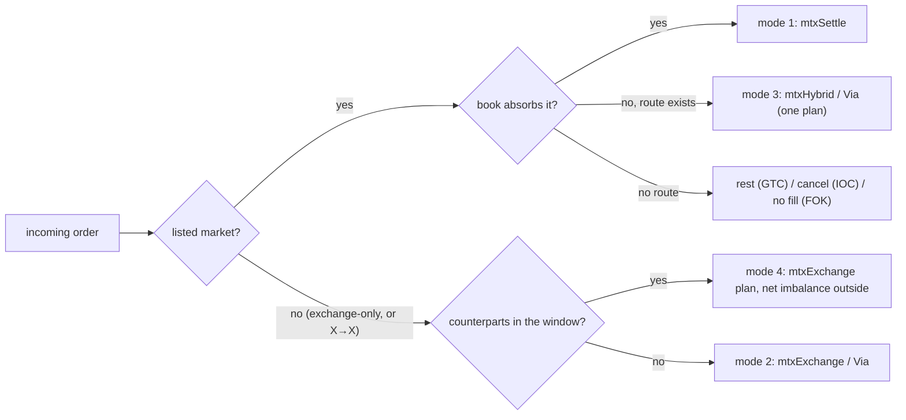

# DEX round (EVM): no minimum-fill floor, four matching modes, `mtxHybrid`, `mtxExchangeBatch` — design

**Status:** accepted by the owner 2026-10-30 (DX7 changed to refund the taker; DX10, DX11 confirmed); every other §0
row a controller proposal, owner may override; the plan follows without owner review
(`docs/superpowers/plans/2026-10-30-dex-round.md`). Nothing is built. Written 2026-10-30 on branch `spec-dex` from
`main` `cc07fced` (after the token-family rename: `NormalToken` / `WrappedToken`, `TokenKind.NORMAL` / `WRAPPED`).
Rules are cited by ID, not restated. Every row of §0 marked **controller proposal** is the controller's and the owner
may override it; the rows marked **owner** rest on a recorded ruling (the owner answers of 2026-10-29 are research note
`docs/research/dex-matching-modes.md` §8, the minimum-fill ruling is CTR-DEX-14, the EIP-7702 rulings are D1–D5 of
2026-10-30 in [accounts.md](../../contracts/accounts.md#CTR-UA-24)).

**Work item.** TODO "Now (order)" step 3 — "EVM contracts: **DEX, one round**" — and the "Recorded, not scheduled"
item "DEX: drop the 50 % minimum-fill floor + four matching modes" (owner 2026-10-29). After this round: step 6's
TradeEngine EVM stream (the planner of §7.2 is built there) in parallel with non-EVM 1 × N.

**Inputs.** Research note `docs/research/dex-matching-modes.md` (§1–§8, the owner answers in §8);
[contracts/dex.md](../../contracts/dex.md) (CTR-DEX-13 … -26); [node/dex-venue.md](../../node/dex-venue.md)
(NODE-DEX-01 … -18); [signers-clientkeys.md](../../clients/signers-clientkeys.md#CLI-SGN-35) CLI-SGN-35;
[decisions.md](../../decisions.md) CTR-DEX entries; the code read on `main`: `smartcontracts/evm/src/dex/`
(`SCaaSDex.sol`, `ISCaaSDex.sol`, `DexPuller.sol`, `TokenCall.sol`), `src/trade/TradeLib.sol`,
`scaas-node/src/dex.rs`, `dex/venue.rs`, `abi.rs`, `guard.rs`, `clients/clientkeys/src/evm.js`. Template: the
metatx-split spec (§0 rulings) and the UA-Soroban spec (§0 decisions table).

## 0. Decisions

Each row: the decision, the options weighed, the choice and why, the cost if it is wrong, who decides.

| # | Decision | Options | Choice and why | Cost if wrong | Who |
|---|---|---|---|---|---|
| DX1 | Minimum fill | keep the 50 % floor / the signer's `minFill` only | **`minFill` only**, exactly as already specified: [CTR-DEX-14](../../contracts/dex.md#CTR-DEX-14), [NODE-DEX-15](../../node/dex-venue.md#NODE-DEX-15), [CLI-SGN-35](../../clients/signers-clientkeys.md#CLI-SGN-35). This round only builds it (§2); nothing is re-decided | recorded in decisions.md CTR-DEX-14 | owner 2026-10-29 |
| DX2 | Hybrid (mode 3) on chain | (a) `mtxExchange` plans only (research §4); (b) a new entry only; (c) both | **(c) both**: `mtxExchange` plans (tests only, no ABI change) **and** `mtxHybrid` / `mtxHybridVia`, where the contract computes each maker's price as `mtxSettle` does and the surplus goes to the taker only. The planner uses `mtxHybrid` for mode 3 on a listed market, `mtxExchange` plans for mode 4 and every other shape | — | owner 2026-10-29 (research §8.1) |
| DX3 | CoW / ring clearing price | per-leg floors chosen freely / one uniform price | **AMM marginal price when a pool exists, else the midpoint of the two limits**, applied by the planner through the floors (§3.4); the contract is unchanged (CTR-DEX-21) | — | owner 2026-10-29 (research §8.2) |
| DX4 | `mtxExchangeBatch` | later / now | **now**, in this round with `mtxHybrid` and the mode 3 / 4 tests: one self-call per plan, a failing plan emits `ExchangeFailed(ref, reason)`, the gas-starvation errors re-raised as in `mtxSettle` (§5) | — | owner 2026-10-29 (research §7.2, §8.3) |
| DX5 | `HybridPlan` shape | the research sketch `{ref, taker, makers[], outsideSell, outsideFloor}` / plus `extraTokens` | **the sketch plus `address[] extraTokens`** (intermediate hop tokens that pass through the DEX, snapshotted, as `ExchangePlan`); `makers` may be empty (a listed-market taker routed only outside), `outsideSell` may be 0 (book only; the planner then uses `mtxSettle`, which is cheaper). No new error for either | an `extraTokens` nobody uses costs one empty array word | controller proposal |
| DX6 | Events of a hybrid | a new `HybridSettled` event / reuse | **reuse**: each maker `LegSettled` / `UALegSettled` (owner sketch); the taker `ExchangeLegSettled` / `UAExchangeLegSettled` with `receivedFloor = Σ maker sold + outsideFloor`, `surplus` = the outside output above `outsideFloor`, `limitReceive` as today. The watcher and indexer already know both shapes (NODE-DEX-04; `ExchangeLegSettled` with P7) | an indexer that wants `outsideFloor` alone derives it (`receivedFloor − Σ maker sold`) | controller proposal |
| DX7 | A route that leaves part of `outsideSell` in the DEX | give it to the makers pro rata (CTR-DEX-21) / refund the taker / revert | **refund the taker, only if what it really sold still satisfies its signed order** (owner answer and clarification 2026-10-30): `leftover` of A goes back to the taker's `from`, fee-free; the taker's sold part `sold = taker.fill − leftover` must be > 0 (`ZeroFill`), ≥ its `minFill` (`BelowMinFill`; CTR-DEX-14) and at a price no worse than its limit (`PriceLimit`), else the whole hybrid reverts — there is no partial refund path. Makers never receive the leftover, each maker's own `minFill` / limit holds as in `mtxSettle`. `leftover > outsideSell` (A from nowhere) or A below its expected balance stays `ConservationBroken(A)`. Observable in the taker's `ExchangeLegSettled`: `sold` is the sold part, `refund` includes the leftover (§4.2) **Capacity restored** (owner 2026-10-30, follow-up): the refunded `leftover` is fillable again under the same signed order. After paying the refund the DEX calls the sell token's new `restorePulled(TradeOrder o, uint256 amount)` (`UATradeOrder` overload for a UA taker): the token checks `msg.sender == o.dex` and `amount ≤` the amount this DEX pulled for `h` **in this transaction** (a transient per-`h` counter `TradeLib` keeps on every pull, EIP-1153), then lowers `pulled[h]` by `amount` and the transient counter alike; error `RestoreExceedsPull(h)`; event `PullRestored(h, amount)`. A remainder that was below `minFill` before the fill stays closable by the remainder clause (CTR-DEX-14). Controller design, owner may override. | the refunded part stays counted in the token's `pulled[h]` (a GTC taker's capacity shrinks by it; §14) | owner 2026-10-30 |
| DX8 | Self-trade and `LISTED_POOLS` in a hybrid | the exchange path's rules / `mtxSettle`'s | **`mtxSettle`'s self-trade rule** (no maker's `from` equals the taker's; makers may share a signer), because it is a book settlement plus a route. `LISTED_POOLS` is read from the **taker** only (or the admin's `listedOnly`): the route cannot change what a maker gets | a maker that wants listed pools only cannot force it in a hybrid (it gets its exact price anyway) | controller proposal |
| DX9 | Fees of a hybrid | as `mtxSettle` / as the exchange path | **makers as `mtxSettle`** (`ceil(recv · fee / 10⁶)` on their exact receive); **taker once on its floor** (`Σ maker sold + outsideFloor`), surplus fee-free (CTR-DEX-21); relayer share to `msg.sender` (CTR-DEX-17) | — | controller proposal (follows CTR-DEX-17 / -21) |
| DX10 | `mtxExchangeBatch` form | path (a) only / (a) and (b) items; parallel arrays / an item struct | **path (a) only, parallel arrays** `mtxExchangeBatch(ExchangePlan[] ps, Interaction[][] xs) returns (bool[] ok)` (owner sketch), `LengthMismatch` on unequal lengths, `NothingSettled` when no plan succeeds; no `mtxHybridBatch` and no executor items (add when the planner shows the need) | one transaction per executor plan or hybrid until then | controller proposal |
| DX11 | A failing interaction | bubble its revert data (built) / wrap it | **wrap**: every path (a) entry (`mtxExchange`, `mtxHybrid`, the batch) reverts `InteractionFailed(uint256 index, address target, bytes reason)` with at most 256 bytes of the target's revert data, and copies no return data on success. Needed so that a hostile target cannot forge `SigCheckGasStarved` / `UAVerifyGas` and take a whole batch down, and so a returnbomb cannot drain a plan's frame. It changes CTR-DEX-20 step (4)'s wording "a failure reverts with its data" | debugging reads one more ABI layer | controller proposal |
| DX12 | Typed data | a new signed struct for hybrid / batch plans / none | **none**: plans are submitter-built over the existing signed `TradeOrder` / `UATradeOrder` / `DexOrder` (owner 2026-10-29: "no extra signature", research §6.1); `trade_kat.json` and `uatrade_kat.json` do not move | — | owner (research §6.1) |
| DX13 | Planner order per tick | research §6 (mode 4 first) / NODE-DEX-17 (book first) | **book first for listed-market orders** (NODE-DEX-17, owner 2026-10-08): mode 1 when the book absorbs the order, else mode 3 in **one** plan; **CoW / ring among exchange-only orders** (mode 4), then mode 2 for what is left; a listed-market order's outside remainder is netted with exchange-only counterparts only inside one `mtxExchange` plan. One atomic plan per matching event of an order; never `mtxSettle` then an AMM transaction for the same incoming order (§7.2) | a CoW counterpart that could have improved a listed-market taker is used one tick later | owner (NODE-DEX-17, research §8.1) + controller (the merge rule) |
| DX14 | What this round builds in the node | the whole TradeEngine / the minimum the contracts need | **the minimum**: `min_fill` = `minFill`, the `depth` / `ticker` `min_fill` bucket (NODE-DEX-15), the ABI and call-table rows of the three new entries pinned against the KAT, NODE-DEX-17 rewritten in docs (§7.2). The planner, quoter, routes, jobs and `GET /v1/dex/exchanges/{ref}` are built in TODO step 6 (TradeEngine EVM), as ordered | none: the contracts are usable by tests and the reference executor without the planner | TODO order (owner 2026-10-29) + controller |
| DX15 | Reference executor | none / one per Uniswap version / one contract | **one contract, `UniswapExecutor`**: v3 pool callback and v4 `unlock` hops, exact-input, the whole balance of a hop's input token spent, holds nothing after a call, callable only by its DEX, no admin, no upgrade (§9). v2 and v3 routers stay on path (a). Not deployed on 7622 (no Uniswap there) | more hop kinds (flash swaps, solver inventory) are later executors | controller proposal |
| DX16 | Uniswap fork test | CI against a public RPC / opt-in by an environment URL / local Uniswap compiled from source | **opt-in**: Ethereum mainnet forked at a block pinned in the test, the RPC URL only from `SCAAS_FORK_RPC_URL` (never in the repo or a run log), skipped when unset; CI never runs it; foundry's fork cache makes re-runs offline (§10). Real Uniswap bytecode is the point of the test, and CI cannot depend on a paid RPC | CI never touches real Uniswap: the mocks of `DexExchange.t.sol` and the executor's unit tests stay the CI coverage | controller proposal (owner constraint: no paid RPC in CI, no secrets) |
| DX17 | Code size | size work / none | **none**: no micro-optimisation, no `via_ir` switch (it would move every CREATE2-derived KAT); `SCaaSDex` gets a `size-baseline.json` entry at its measured size (ratchet); ceiling 65,536 B (§13) | — | owner 2026-10-11 / 2026-10-21 |
| DX18 | EIP-7702 | new guards on the new entries / none | **none new**: the entries follow D1–D5 as `mtxSettle` / `mtxExchange` do (§6.1) | — | owner rulings D1–D5 2026-10-30 |
| DX19 | Non-EVM families | change in this round / unchanged | **unchanged**: none had the floor; none has an exchange path; 1 × N follows in step 6 (§15) | — | owner 2026-10-29 (research §6.3, §8.4) |
| DX20 | Vectors | regenerate what moves / hand-patch | **`dex_order_kat.json` regenerated** (`WRITE_KAT=true`; CREATE2-derived fields move) **plus three encoding-only keys**; `trade_kat.json`, `uatrade_kat.json`, `metatx-parity.json` unchanged (§11) | — | controller proposal (precedent: owner 2026-10-30, token rename option (a)) |
| DX21 | Gates of the round | full `gate.sh` / the affected steps | **affected steps only**: forge (whole suite) at the committed set `n2304-kmax4096`, the size gate, `cargo test` of `scaas-node`, clientkeys, `docs_check`; no pqz-core gate (no core or set parameter changes) | — | owner 2026-10-25 ("full gate only for core") |
| DX22 | Deployment | migrate / redeploy | **redeploy, no migration** (all chains test-only): a new `TradeLib` means new token releases (the release pins the library's code hash), a new `SCaaSDex` a new DEX release; tokens made before keep the 50 % floor until redeployed. The SCaaS testnet takes them in its next roll-out (TODO step 5) | — | owner (all chains test-only; 7622 may be reset) |

## 1. Scope and non-goals

**In scope (EVM).**
1. The minimum-fill floor removed in code (§2): `TradeLib`, `SCaaSDex` Path B, node `min_fill` and the depth bucket,
   clientkeys.
2. `mtxHybrid` / `mtxHybridVia` (§4), `mtxExchangeBatch` and the wrapped interaction failure (§5) in `SCaaSDex` /
   `ISCaaSDex`.
3. Tests that prove modes 3 and 4 on the existing entry points and on the new ones (§12).
4. `UniswapExecutor` (§9) and the Uniswap fork test (§10).
5. Node: the ABI, call-table and KAT pins of the new entries; the NODE-DEX-17 rewrite in docs (§7).
6. `dex_order_kat.json` regenerated with three new keys (§11); docs and decisions updated by the build (§16).

**Non-goals.** The TradeEngine planner, quoter, router search, jobs, `GET /v1/dex/exchanges/{ref}` (TODO step 6);
non-EVM 1 × N and any non-EVM exchange path (§15); a `mtxCow` entry (research §7.4: CoW / ring go through
`mtxExchange` plans); native-coin interactions (`value`; pools with ETH go through WETH, research §3); Permit2 routers
on path (a) (refused on purpose, CTR-DEX-23); `mtxHybridBatch` and executor items in the batch (DX10); a
per-settlement or per-plan gas field (CTR-DEX-16's ruling stands).

## 2. The minimum fill (part a): build CTR-DEX-14

The rule is [CTR-DEX-14](../../contracts/dex.md#CTR-DEX-14) (contract), [NODE-DEX-15](../../node/dex-venue.md#NODE-DEX-15)
(venue: junk fills are policy, the `min_fill` bucket) and [CLI-SGN-35](../../clients/signers-clientkeys.md#CLI-SGN-35)
(clients: default `minFill`, a bid's minimum in base). This round moves each from SPECIFIED to BUILT:

| Where | Today | After |
|---|---|---|
| `TradeLib.record` (Path A, token and DEX outside legs) | `move < max(minFill, ceil(amount / 2)) \|\| receiveFill < ceil(receiveAmount / 2)` ⇒ `BelowMinFill`, unless the fill closes the order | `move != amount − p && move < minFill` ⇒ `BelowMinFill`; no received-side line; `MIN_FILL_PPM` deleted |
| `SCaaSDex._calc` Path B (`SCaaSDex.sol:392-394`, `mtxSettle` and the exchange path) | the same two halves on the matched part | `sold != amount && sold < minFill` ⇒ `BelowMinFill` (`p == 0` on Path B, so `amount` is the remainder) |
| `test_minFillPpm_halvingEncodesIt` and the half cases in `Trade.t.sol`, `Dex.t.sol`, `DexOutside.t.sol`, `UATrade.t.sol` | pin the floor | replaced by: a fill below half settles; `minFill = 0` takes any fill > 0 (`ZeroFill` still refuses 0); the remainder closes below `minFill`; FOK `minFill = amount`; Path B below `minFill` refused; `minFill > amount` refused |
| node `min_fill` (`dex.rs:295`) and its tests (`dex.rs:1061-1062`) | `max(minFill, ceil(amount / 2))` | `minFill`; the matcher's remainder clause (close only with no fill unmined) unchanged |
| node `depth` / `ticker` | every resting order in best bid / ask | an order whose minimum in base units exceeds the market's `min_base_amount` is in a separate `min_fill` bucket (NODE-DEX-15) |
| clientkeys `checkTradeOrder` (`evm.js:724`) | returns `max(minFill, ceil(amount / 2))` | returns `minFill`; two helpers per CLI-SGN-35: a bid's `minFill` from a base minimum (`ceil(minBase · amount / receiveAmount)`, refused above `amount`) and the shown base minimum (`ceil(minFill · receiveAmount / amount)`) |

Nothing else moves: overfill, price limit, fee round-up (CTR-DEX-11), dust (NODE-DEX-05), FOK (CTR-DEX-05), IOC
(CTR-DEX-04). No other client library has DEX order code (only clientkeys reads `minFill`). Parity rows keep their
outcomes: `metatx-parity.json`'s `err_belowMinFill` signs `minFill = amount`, `ok_partialFill` fills 3,000 of 5,000
with `minFill = 2,500` and then closes the remainder.

## 3. The four matching modes

A **mode** is the planner's choice of liquidity source; the **entry** is how it is executed (research §1). Every
mode settles atomically per call (one settlement, one plan); whole-order atomicity is by order type (research §6.4:
FOK, IOC and Path B are whole; GTC Path A fills over several calls).



### 3.1 Mode 1 — book (`mtxSettle`, unchanged)

Who submits: the venue's lane (orders bind `relayer` to it; anyone for `relayer = 0`). On chain: CTR-DEX-16 (market
listed, maker prices `⌈fill · receiveAmount / amount⌉`, every order's `minFill` per §2, conservation). Atomic per
settlement; one call carries several (`MatchFailed` isolates). Fees: CTR-DEX-17 (taker once on the aggregate). Surplus:
all price improvement to the taker. Failure: a stale maker fails its settlement only; gas is the relayer's; the node
attributes by evidence (NODE-DEX-02). Change in this round: only the floor (§2).

### 3.2 Mode 2 — outside liquidity (`mtxExchange` / `mtxExchangeVia`, unchanged but for DX11)

Who submits: the venue's TradeEngine (step 6), or anyone for `relayer = 0` orders. On chain: CTR-DEX-20 … -23.
Atomic per plan. Fees on the floor; surplus pro rata per receive token (CTR-DEX-21). Failure: a reverting or
gas-burning target, an executor paying short (`InsufficientOutput`) or a stale order revert the plan; with DX11 a
target's revert reads `InteractionFailed(i, target, reason)`.

### 3.3 Mode 3 — hybrid: makers first, the rest outside, one plan

Two executions, both one transaction (DX2):

| | `mtxHybrid` / `mtxHybridVia` (new, §4) | `mtxExchange` plan (existing) |
|---|---|---|
| Used for | mode 3 on a listed market (the default) | a hybrid mixed with CoW counterparts, or any shape `mtxHybrid` cannot express |
| Market | must be listed (`MarketNotListed`) | both tokens known |
| Maker price | computed on chain, `⌈fill · receiveAmount / amount⌉`, as `mtxSettle` | the submitter's floor, only checked ≥ the signed limit |
| Maker surplus | none (DX7: a leftover of the taker's sell token is refunded to the taker, never to a maker) | pro rata of `excess` in its receive token |
| Taker | sells `Σ maker receive + outsideSell` (`FillMismatch`), floor `Σ maker sold + outsideFloor`, every unit above `outsideFloor` | floor chosen by the submitter, pro-rata surplus |
| Events | makers `LegSettled`, taker `ExchangeLegSettled` | every leg `ExchangeLegSettled` |
| Self-trade | as `mtxSettle` (DX8) | distinct `from`s across all legs |

IOC and FOK takers work in both, because the taker is pulled once. A maker that cancels or empties its balance between
the node's simulation and inclusion reverts the **whole** plan (no per-maker isolation inside a plan); the relayer
pays that gas, the revert carries the maker's `orderHash` (token and DEX errors), and the node drops it and re-plans
(NODE-DEX-02 extends to plans). Fees: DX9.

### 3.4 Mode 4 — CoW / ring (`mtxExchange` plans, with or without interactions)

Who submits: the venue's TradeEngine (step 6); several independent plans of one tick go in one `mtxExchangeBatch`
(§5). On chain: unchanged CTR-DEX-20 / -21 — each order is one leg; floors summed per receive token; conservation per
token; the excess of a token goes to the legs receiving it, pro rata of their floors, the last one taking the
rounding remainder. The four layers of research §5.2 make partial coincidences settle:

1. **Net, then route the imbalance in the same plan.** Overlapping flows pay each other inside the plan; only the net
   imbalance goes through interactions or an executor. Each order is still one leg with one `sellFill`, so both sides
   fill even when only part of the flow was internal.
2. **Floors, not exact amounts.** Rounding left in a receive token is excess and goes to the signers; it never
   reverts.
3. **Only intermediate tokens must be exact.** A token no leg receives must end at its snapshot
   (`ConservationBroken`): exact-input hops, or an executor last (§9 spends whole balances, so it absorbs the rounding).
4. **More matches.** A window of one `trade_engine.tick`, rings across pairs, partial fills down to each signer's
   `minFill` (§2 makes this possible).

**Clearing price (DX3).** For each pair in the plan the planner fixes one price `P`: the AMM marginal price when a pool
for the pair exists, else the midpoint of the two crossing limits. Each leg's floor is `floor(sellFill · P)` in its
receive token (for the internal part) plus `quote(net part) · (1 − buffer)` for the part routed outside, never below
the signed limit (a leg that cannot meet its limit at `P` is left out of the plan). Surplus above the floors is
distributed by CTR-DEX-21. With no pool, a plan with no interactions is a pure CoW: in a ring A→B→C→A each token is
sold by one leg and received by one, so the plan balances whenever every floor is at most the corresponding sold
amount, and the receiver of each token takes its whole excess.

Failure: a leg's order stale ⇒ the plan reverts (relayer gas, attributed by `orderHash`); in a batch only that plan.

## 4. `mtxHybrid` / `mtxHybridVia`

### 4.1 ABI

```solidity
/// One listed-market taker against 0..n makers at the makers' own prices, the rest of the taker's sell routed outside.
struct HybridPlan {
    bytes32 ref;            // the submitter's, echoed in events only
    Leg taker;              // sells A (= taker.sellToken), receives B (= its order's receiveToken); fill = Σ maker receive + outsideSell
    Leg[] makers;           // each sells B, receives A; fill = the maker's sellFill
    uint256 outsideSell;    // A sent to the route
    uint256 outsideFloor;   // B the route must return at least
    address[] extraTokens;  // intermediate hop tokens that pass through the DEX (snapshotted; must end at the snapshot)
}
function mtxHybrid(HybridPlan calldata p, Interaction[] calldata interactions) external nonReentrant;           // (a)
function mtxHybridVia(HybridPlan calldata p, address executor, bytes calldata data) external nonReentrant;     // (b)
```

`Leg`, `Interaction`, `IExchangeExecutor` are the existing types (CTR-DEX-16, -20, -26): shape 0 and shape 1 legs,
SCaaS Path A / Path B and outside-token (`DexOrder`) legs all work as in `mtxSettle`. No new signed struct (DX12).

### 4.2 Steps

1. **Check.** Decode the taker; `A = taker.sellToken`, `B = taker.receiveToken`; `A ≠ B` and the pair listed
   (`TokenMismatch`, `MarketNotListed`). Each maker: sells B, receives A (`TokenMismatch`); its `from ≠` the taker's
   (`SelfTrade`; makers may share a signer); no order hash twice (`DuplicateOrder`); `recv_i = ⌈fill_i · receiveAmount_i
   / amount_i⌉`; `_calc` (relayer binding `WrongRelayer`, `dex` `DexMismatch`, the order hash in its domain, Path B
   checks on the matched part, `dexFee_i = ⌈recv_i · fee_i / 10⁶⌉`). Taker: `taker.fill == Σ recv_i + outsideSell`
   (`FillMismatch(expected, got)`); `_calc` with `sold = taker.fill`, `recv = Σ fill_i + outsideFloor` (the floor; the
   fee on it). `onlyListed = listedOnly || taker.flags & LISTED_POOLS`.
2. **Snapshot** the DEX's balance of A, B and each `extraTokens`.
3. **Pull** the taker and every maker exactly as `mtxSettle` (`mtxTrade` / `uaTrade` / the puller); the token checks
   Path A bounds — for the taker this is its price limit over `Σ fill_i + outsideFloor`, its `minFill`, its fee bound.
   Each pulled token's balance must have risen by exactly what was pulled (`ConservationBroken`).
4. **Route.** (a) each interaction under CTR-DEX-23 (`ForbiddenTarget`, `ForbiddenSelector`, `TargetNotListed`), a
   failure reverts `InteractionFailed` (DX11), `approve` allowances reset to 0 after the last one; (b) `transfer`
   `outsideSell` of A to `executor` (listed if `onlyListed`, `TargetNotListed`) and call
   `exchangeCallback(ref, [A], [outsideSell], [B], [outsideFloor], data)`.
5. **Outside output and the taker's leftover (DX7), in this order:**
   1. `out = bal(B) − snap(B) − Σ fill_i − Σ refund_i(B)`; `out < outsideFloor` ⇒ `InsufficientOutput(B)` (the
      floor holds with or without a leftover).
   2. `base = snap(A) + Σ recv_i + refundB(taker)` (`refundB` = the taker's Path B remainder, 0 on Path A);
      `bal(A) < base` ⇒ `ConservationBroken(A)`; `leftover = bal(A) − base`; `leftover > outsideSell` ⇒
      `ConservationBroken(A)` (the route cannot hand back more than it was given).
   3. With `leftover > 0`, the taker's sold part `sold = taker.fill − leftover` must satisfy its signed order, else
      the whole hybrid reverts: `sold > 0` (`ZeroFill(h)`); `sold ≥ minFill` (`BelowMinFill(h)`; the remainder clause
      cannot apply, because `sold < taker.fill ≤ amount − pulled`, so FOK can never be refunded); `sold · receiveAmount
      ≤ recv · amount` (`PriceLimit(h)`; `recv` = the floor of step 1 — implied by the token's check at the pull, since
      `sold < taker.fill`, asserted anyway in one internal function `_takerSoldCheck(taker, leftover)`). The errors carry the taker's order hash, as the token's do.
   4. Each maker's `minFill` and limit were checked at its pull (step 3) on its exact fill; the leftover never
      reaches a maker.
6. **Pay.** Makers as `mtxSettle` (`_pay`: `recv_i − dexFee_i` to the destination, fee split, Path B refund, event
   `LegSettled` / `UALegSettled`). The taker: `recv − dexFee + (out − outsideFloor)` to its destination, its fee split
   (the fee is on `recv` only: the refund carries no fee), `refund = refundB + leftover` in A to its `from` (as a Path
   B refund), event `ExchangeLegSettled` / `UAExchangeLegSettled(ref, h, from, to, sold, receivedFloor = recv,
   surplus = out − outsideFloor, dexFee, refund, limitReceive = ⌈sold · receiveAmount / amount⌉)` with `sold =
   taker.fill − leftover`. A client sees the refund as `refund − (amount − taker.fill)` on Path B, `refund` on Path A;
   the token's `TradeFilled` still shows the pulled `taker.fill`, and `pulled[h]` keeps counting it (the token cannot
   be told to give capacity back).
7. **Conservation** over every snapshotted token (`ConservationBroken`).

Implementation note: steps 2–7 are the exchange path's `_exchangeIn` / `_exchangeOut` with the makers' floors computed
on chain and the excess of A, instead of being distributed, refunded to the taker under step 5's checks (B has one
receiver, the taker, so CTR-DEX-21 gives it the whole excess unchanged); only the check step, step 5.2–5.3 and the
makers' event differ. The internal helpers take `submitter` as a parameter
(they read `msg.sender` today), which §5 needs too. If the stack limit bites (`mtxExchangeVia` is at it, via_ir off),
the locals move into a memory struct; `via_ir` stays off (DX17).

### 4.3 Errors and events

New: none for `mtxHybrid` beyond DX11's `InteractionFailed`; the refund checks reuse `ZeroFill`, `BelowMinFill`,
`PriceLimit` (declared on `ISCaaSDex`, raised with the taker's order hash) and `ConservationBroken(A)`. Reused: `MarketNotListed`, `TokenMismatch`, `SelfTrade`,
`DuplicateOrder`, `FillMismatch`, `WrongRelayer`, `DexMismatch`, `LegShapeUnknown`, `UALegNotLedger`,
`UAReceiveNotLedger`, `BadFlags`, `Overfill`, `BelowMinFill`, `PriceLimit` (Path B), every `TradeLib` / token error
(they carry the order hash), `ForbiddenTarget`, `ForbiddenSelector`, `TargetNotListed`, `InsufficientOutput`,
`ConservationBroken`, `SafeERC20FailedOperation` (W-O). Events: `LegSettled`, `UALegSettled`, `ExchangeLegSettled`,
`UAExchangeLegSettled` (DX6).

A hybrid is one plan: no `try`, any failure reverts the transaction, starvation errors included (nothing to isolate).

## 5. `mtxExchangeBatch` and the wrapped interaction failure

```solidity
function mtxExchangeBatch(ExchangePlan[] calldata ps, Interaction[][] calldata xs)
    external nonReentrant returns (bool[] memory ok);
function exchangeOne(ExchangePlan calldata p, Interaction[] calldata xs, address submitter) external; // self only (NotSelf)
event ExchangeFailed(bytes32 indexed ref, bytes reason);       // at most 256 bytes of the plan's revert data
error InteractionFailed(uint256 index, address target, bytes reason); // at most 256 bytes of the target's revert data
```

**Semantics: per item, not all-or-nothing.** An all-or-nothing batch is one plan with more legs, which `mtxExchange`
already is; the batch exists to isolate failures (owner, research §7.2).

1. `ps.length == xs.length` (`LengthMismatch`).
2. For each `i`: a low-level self-call `exchangeOne(ps[i], xs[i], msg.sender)` with all remaining gas, the revert data
   copied at most 256 bytes (as `mtxSettle`, `MAX_REASON`). Success ⇒ `ok[i] = true`. `SigCheckGasStarved` or
   `UAVerifyGas` ⇒ the whole call reverts with it (the submitter's gas failed, not the order: CTR-DEX-08, -26).
   Anything else ⇒ `ExchangeFailed(ps[i].ref, reason)`, and the next plan runs.
3. No plan succeeded ⇒ `NothingSettled` (the relayer's simulation catches it).

`exchangeOne` is `mtxExchange`'s body with `submitter` passed explicitly (relayer binding, fee share). It is not
`nonReentrant` itself (the batch holds the guard, as `settleOne`); a target cannot call it (`ForbiddenTarget`: the
DEX), an executor is not in a batch. A later plan sees the state earlier plans left (`pulled`, balances); the token's
own fill accounting applies, as across settlements of one `mtxSettle`.

**Why DX11 is needed here.** Only the DEX, a SCaaS token and the registry may raise the two starvation errors: token
calls already drop revert data (W-O, `TokenCall`), but `_interact` bubbles the target's data today, so a hostile
target could revert with `SigCheckGasStarved` and the batch would revert whole. Wrapping makes the outer selector
`InteractionFailed` for any target failure; copying at most 256 bytes and nothing on success also closes the
returnbomb on the plan's frame. One rule on every path (a) entry, so `mtxExchange`'s revert shape changes too.

**Gas bounds.** No count limit in the contract; the transaction is bounded by EIP-7825 (2^24 = 16,777,216 gas;
Hedera 15 M). Each plan gets 63/64 of what is left; a gas-burning target exhausts its plan and leaves 1/64 for the
rest, so later plans fail `ExchangeFailed(ref, "")` (the node's `out_of_gas`) — at the relayer's cost only. The node
packs plans from the simulation's per-plan gas plus each leg kind's verify cap (CTR-DEX-26's table), keeps the sum
under the cap with its ordinary margin, puts plans with untried targets last, and uses listed targets where the
chain's operator requires it (`setListedOnly`). A per-plan gas field is not added (DX10, CTR-DEX-16's ruling).

## 6. Owner rules the new entries follow

### 6.1 EIP-7702 (rulings D1–D5, CTR-UA-24)

- **D1 (a designator signs with its own key only).** No new signature path: every leg is verified where it is today —
  a SCaaS leg by its token's pipeline, an outside leg by `SigCheck.isValid` (designator ⇒ ECDSA by its own key, never
  ERC-1271 through the delegate). The node's `valid_sig` already follows it.
- **D2 (a designator direct caller refused where the caller is authority).** No new authority role: the only
  authority on the DEX is the admin (`_onlyAdmin`, `CallerDelegated`); the new entries add no admin function.
- **D3 (open roles unchanged).** The submitter of `mtxHybrid`, `mtxHybridVia`, `mtxExchangeBatch` is an open role and
  the order `relayer` binding compares `o.relayer == msg.sender` (the batch: `submitter`) **without** a designator
  check, exactly as `mtxSettle` / `mtxExchange`.
- **D4 (solver-chosen targets unguarded).** Interaction targets and the executor of the new entries are not checked
  for code or delegation; conservation and the floors bound them (CTR-DEX-23).
- **D5 (deploy-time dependencies must be contracts).** No new DEX dependency. `UniswapExecutor`'s constructor
  refuses a `dex`, a v3 factory or a v4 pool manager that is not a contract (`SigCheck.isContract`; 0 = that hop kind
  off) (§9).

### 6.2 Relayable, fee may be 0; no zero-gas assumption

The three entries are relayer entries over user-signed orders: a user never sends a transaction, the order is its
signature, and the relayer is paid only by its share of each signed `fee` (CTR-DEX-17), which may be 0 (`fee = 0` or
`relayerSharePpm = 0`); there is no outer relay fee, as for `mtxSettle`. `exchangeOne` is a self-call, not an entry.
Nothing assumes gas price 0 or a chain's own block limit: the bound is EIP-7825 per transaction; the node's
junk-fill rule ("no settlement worth less than its gas", NODE-DEX-15) applies to plans and hybrids on every chain
(customer chains included); the fork test runs at mainnet base fee.

## 7. Node

### 7.1 This round (code)

| File | Change |
|---|---|
| `dex.rs` | `min_fill` = `minFill` and its tests (§2); `depth` / `ticker` `min_fill` bucket (NODE-DEX-15) |
| `abi.rs` | `HybridPlan`, `mtxHybrid`, `mtxHybridVia`, `mtxExchangeBatch`, `exchangeOne`, `ExchangeFailed`, `InteractionFailed` |
| `guard.rs` | `CALL_TABLE` 16 → 19 rows: `SCaaSDex.mtxHybrid`, `SCaaSDex.mtxHybridVia`, `SCaaSDex.mtxExchangeBatch`, each `Rule::Dex` (only a listed DEX, NODE-DEX-16); the selectors and an encode / decode round-trip pinned against the three new KAT keys, as the exchange rows are (review C6-2) |
| `dex/venue.rs` | none beyond `min_fill`'s callers: the venue keeps sending `mtxSettle`; a maker of its book filled by someone else's `mtxHybrid` (an unbound market) arrives as `LegSettled`, which the watcher already reads |

### 7.2 NODE-DEX-17 rewritten (text for the build; the planner is built in TODO step 6)

> **NODE-DEX-17 — The TradeEngine plans each order in one atomic call: book, hybrid, CoW / ring, outside.** Off unless
> the chain enables it (`trade_engine.enabled`). Intake: an order on a listed market enters the book; one whose pair is
> no listed market, or whose `receiveToken` is its sell token (a cycle), is exchange-only — never in the book, both
> tokens known, else `TOKEN_NOT_SERVED`. Each tick (`trade_engine.tick`; also the CoW window):
> 1. **Listed-market orders, book first.** An incoming order that the book absorbs within every order's `minFill` is
>    settled by `mtxSettle` (mode 1). If the book is short and a route reaches the order's limit, the makers and the
>    route go in **one** `mtxHybrid` / `mtxHybridVia` call (mode 3): makers at their own price, `outsideFloor` =
>    quote × (1 − `buffer`). Never `mtxSettle` and then an AMM call in a later transaction for the same incoming
>    order: IOC closes at its single pull and FOK cannot span two calls. A resting GTC order is also filled through a
>    route when one reaches its limit (`amm_fill`), as its own matching event.
> 2. **Exchange-only orders: CoW / ring, then outside.** Pairs of opposite orders and rings across pairs among the
>    window's exchange-only orders are netted in one `mtxExchange` plan, each order one leg, floors at one clearing
>    price per pair (AMM marginal price when a pool exists, else the midpoint of the two limits), the net imbalance
>    routed outside in the same plan (mode 4). What is left takes a route (mode 2): at most `max_hops` (3) hops,
>    splits, cycles for X→X; path (a) when routers suffice, (b) through the listed executor for callbacks.
> 3. A listed-market order's outside remainder may be netted with exchange-only counterparts only inside one
>    `mtxExchange` plan (makers then at node-set floors ≥ their limits, CTR-DEX-21).
> 4. Floors never below the signed limit; the buffer costs the signer nothing (the surplus comes back). Independent
>    plans of a tick go in one `mtxExchangeBatch` (a failing plan only `ExchangeFailed`); hybrids and executor plans
>    one per transaction. Simulate, submit as a `call` job, watch the final events (`LegSettled`,
>    `ExchangeLegSettled`, `ExchangeFailed`), attribute failures by the `orderHash` in the revert (NODE-DEX-02).
>
> Fees by role: an exchange-only order and a hybrid taker pay `taker_fee_ppm`, a maker (book or hybrid) and a resting
> order filled through a route `maker_fee_ppm` (below ⇒ `FEE_TOO_LOW` / not selected). MEV: a private relay where one
> exists; floors bound any loss to surplus; netted flows never reach a pool. Config: `enabled`, `amm`
> (`{kind: univ2|univ3|univ4, factory, quoter, router}`), `max_hops`, `executor`, `tick`, `buffer`. EVM only.

NODE-DEX-18 (no surplus kept) is unchanged and covers hybrids: every route output goes to the DEX.

## 8. clientkeys

`checkTradeOrder` returns the signed `minFill` as the effective minimum (the "shown as half" Transitional of
CLI-SGN-35 goes); two exported helpers for a bid's minimum in base (§2); tests `evm.test.js:427-430` rewritten (a
`minFill` below half is shown as itself; `minFill = 0`). clientkeys builds no settlement or plan calldata, so the new
entries need nothing there; its DEX KAT test reads `dex_order_kat.json` and follows the regeneration (§11).

## 9. Reference executor: `UniswapExecutor`

`smartcontracts/evm/src/dex/UniswapExecutor.sol`, with minimal in-repo interfaces for the Uniswap v3 pool / factory
and the v4 `PoolManager` (no Uniswap source vendored).

```solidity
contract UniswapExecutor is IExchangeExecutor {
    address public immutable DEX;
    address public immutable V3_FACTORY;            // 0 = v3 hops off
    bytes32 public immutable V3_POOL_INIT_CODE_HASH; // the factory's pool init-code hash (per chain / fork / mock)
    address public immutable V4_POOL_MANAGER;       // 0 = v4 hops off
    constructor(address dex, address v3Factory, bytes32 v3PoolInitCodeHash, address v4PoolManager); // D5: contracts
    struct Hop { uint8 kind; bytes args; } // 1 = v3: (address tokenIn, address tokenOut, uint24 fee); 2 = v4: (PoolKey, bool zeroForOne)
    function exchangeCallback(bytes32 ref, address[] calldata tokensOut, uint256[] calldata amountsOut,
        address[] calldata tokensIn, uint256[] calldata amountsIn, bytes calldata data) external; // data = abi.encode(Hop[]); only DEX
    function uniswapV3SwapCallback(int256 amount0Delta, int256 amount1Delta, bytes calldata data) external; // only the CREATE2 pool
    function unlockCallback(bytes calldata data) external returns (bytes memory);                          // only V4_POOL_MANAGER
}
```

Rules: `exchangeCallback` only from `DEX` (`NotDex`). Hops run in order, exact-input; a hop's input is the
executor's **whole** balance of its input token, so a chain of hops needs no predicted intermediate amounts (this is
how the executor absorbs intermediate rounding, research §5.2 layer 3). v3: `pool.swap(this, zeroForOne,
int256(amountIn), limit, data)`; the callback checks `msg.sender` is `CREATE2(V3_FACTORY, keccak(token0, token1,
fee), V3_POOL_INIT_CODE_HASH)` (`NotPool`) and pays the positive delta. v4: all v4 hops in one `unlock`; per hop
`swap`, then `sync` / `transfer` / `settle` the input and `take` the output; a native currency (address 0) is refused
(`NativeCurrency`: the DEX holds no native coin). At the end it transfers its whole balance of each `tokensIn` to the
DEX (everything above the floors is the signers' surplus) and requires a zero balance of every `tokensOut` and hop
token (`Leftover(token)`), so it holds nothing between calls. No admin, no owner, no upgrade, no sweep. A stray balance
sent to it becomes surplus at its next use. Listing: the DEX admin lists it with `setExchangeTarget` where listed-only
mode or `LISTED_POOLS` asks; the node names it in `trade_engine.executor`. Deployed per chain only where Uniswap exists
(a `uniswap_executor` key in `deployments/<chainid>.json` when deployed); not on 7622. CI covers it with mock v3 pools
made by a mock factory through CREATE2 (its own init-code hash) and a mock `PoolManager`; real bytecode in §10.

## 10. Uniswap fork test

`smartcontracts/evm/test/fork/UniswapFork.t.sol`:

- **RPC policy.** The URL comes only from `SCAAS_FORK_RPC_URL` (`vm.envOr`); unset ⇒ every test `vm.skip(true)`. Never
  committed, never echoed into a run log (the log records the block and the outcome only). Any endpoint that serves
  state at the pinned block works (an archive node or a free archive endpoint); no API key in the repo. CI does not
  run it. Foundry caches the forked state per block, so a re-run needs the network only for state not yet read.
- **Pinned block.** `FORK_BLOCK`, an Ethereum mainnet block after Uniswap v4's mainnet launch, chosen at
  implementation and fixed as a constant (quotes and pool states are then deterministic); chain id 1. The Uniswap
  addresses (v2 `Router02`, v3 `SwapRouter02` and factory with its pool init-code hash, v4 `PoolManager`, WETH, USDC)
  are constants checked against Uniswap's published deployments when the block is chosen.
- **Setup in the fork.** A fresh SCaaS stack (`OpenFactory`, `Catalogue`, a `NormalToken`, an `SCaaSDex` clone,
  `UniswapExecutor`); balances by `deal`; markets WETH / USDC (outside legs through the puller) and `NormalToken` /
  WETH, with a real v2 pair created on the fork for the SCaaS token.
- **Cases.** (1) mode 2, path (a): an outside-token order WETH → USDC through v3 `SwapRouter02.exactInputSingle`
  (recipient the DEX) and through v2 `Router02`; the surplus above the floor paid to the signer. (2) mode 2, path (b):
  `mtxExchangeVia` through `UniswapExecutor`, a two-hop v3 route and one v4 hop of a two-ERC-20 pool. (3) mode 3:
  `mtxHybrid` with two makers and the remainder through v3; makers at their exact price, the taker gets all output
  above `outsideFloor`; the same through `mtxHybridVia`. (4) a SCaaS-token leg sold into its real v2 pair (the DEX
  approves the router: the DEX is a contract, CTR-TOK-01). (5) mode 4: a partial CoW of two outside orders, the net
  imbalance through v3. (6) Universal Router via Permit2 refused on path (a) (`ForbiddenSelector`). (7) every plan
  ends with the DEX and the executor holding 0 of every token and no allowance.

## 11. Vectors and deployments

| File | Moves? |
|---|---|
| `test/vectors/dex_order_kat.json` | **regenerated** (`WRITE_KAT=true forge test --match-contract DexKatTest`): `SCaaSDex`'s new bytecode moves the DEX implementation's CREATE2 address and so the clone `dex`; `TradeLib`'s new code hash moves the token release (its env pins the library hash) and so `token`. Every field derived from them moves: `token`, `dex`, `dex_domain_separator`, `dex_order_struct_hash`, `dex_order_hash`, `taker_order_hash`, `cancel_digest`, `invalidate_digest`, and the calldata embedding them. Keys, selectors of the old entries, amounts and signer keys unchanged. **New keys** (encoding only, as `exchange_calldata`): `hybrid_calldata`, `hybrid_via_calldata`, `exchange_batch_calldata`. Read by `scaas-node` (`guard.rs`, `dex.rs`) and clientkeys |
| `test/vectors/trade_kat.json` | no: the type hashes are unchanged and the token is a `CREATE` clone |
| `smartcontracts/vectors/ua/uatrade_kat.json` | no: fixed addresses (`vm.etch`), unchanged type hashes; its rows sign `minFill = 0` and settle as before |
| `test/vectors/metatx-parity.json` | no: outcomes unchanged (§2); its `gas` column is compared only under `PARITY_GAS=1` and is already stale on main in eight PQZ rows (token-rename report), so it is not rewritten |
| `deployments/<chainid>.json` | new `dex_implementation`, `TradeLib` and token implementations at the next deploy; `uniswap_executor` where deployed (DX22) |

## 12. Test plan

**Forge, CI** (new file `test/v2/DexModes.t.sol` for modes 3 / 4 and the new entries; `DexExchange.t.sol`'s revert
expectations follow DX11):

- **§2.** As in the §2 table, on `Trade.t.sol`, `Dex.t.sol`, `DexOutside.t.sol`, `UATrade.t.sol`, plus `mtxSettle`
  with a maker filled at 10 % of its order and a Path A order filled in five settlements.
- **Mode 3 via `mtxExchange` plan.** Taker + two makers + a mock v2 / v3 route; makers at node-set floors equal to
  their prices; taker IOC and FOK; a UA maker (shape 1) and an outside-token maker; a stale maker reverts the whole
  plan with its `orderHash`; `excess_A ≠ 0` paid to the makers pro rata.
- **`mtxHybrid` / `Via`.** Makers at `⌈fill · receiveAmount / amount⌉`, `LegSettled` per maker; the taker's
  `ExchangeLegSettled` with floor and surplus; all output above `outsideFloor` to the taker, makers' surplus 0; the
  DX7 refund: a route leaving A with the sold part ≥ `minFill` at the limit settles and refunds the leftover to the
  taker's `from` (event `sold` / `refund`, no fee on it, makers' balances exactly their price), the sold part below
  `minFill` ⇒ `BelowMinFill`, a FOK taker with any leftover ⇒ `BelowMinFill`, a sold part of 0 ⇒ `ZeroFill`, the sold
  part at a worse price ⇒ `PriceLimit` (unreachable through the entry — the floor already met the limit on the
  larger full fill — so this case drives the step-5.3 check, one internal function `_takerSoldCheck`, through a test
  harness that exposes it), a leftover
  above `outsideSell` ⇒ `ConservationBroken(A)`, the refund on the executor path (b); output below `outsideFloor` ⇒ `InsufficientOutput(B)`; `FillMismatch`;
  `MarketNotListed` (a known but unlisted pair); `SelfTrade` taker = maker, two makers of one signer settle;
  `DuplicateOrder`; taker IOC (closed at the pull) and FOK; taker Path B (refund) and a Path B maker; maker relayer
  binding; maker fees on their receive, the taker's once on its floor, the surplus fee-free; `LISTED_POOLS` on the
  taker × `setListedOnly`, a maker's flag ignored; zero makers; `outsideSell = 0`; the executor variant paying short
  and paying more; re-entry refused; a gas-burning target.
- **Mode 4.** A partial CoW: two opposite orders of unequal size, the net through a mock AMM, both filled, the clearing
  price of DX3; a 3-token ring with no interaction, the rounding remainder to the last receiver; an intermediate
  leftover ⇒ `ConservationBroken`; a leg filled at its `minFill` (below half) in a CoW.
- **Batch.** Three plans, the second failing ⇒ `ExchangeFailed(ref2, …)`, the first and third settle, `ok =
  [true, false, true]`; all failing ⇒ `NothingSettled`; a real `SigCheckGasStarved` (a starved 1271 outside leg) and a
  real `UAVerifyGas` revert the whole call; a target reverting with the `SigCheckGasStarved` selector fails only its
  plan (`InteractionFailed` inside `ExchangeFailed`); a returnbomb target; `LengthMismatch`; `exchangeOne` from
  outside ⇒ `NotSelf`; the relayer binding and fee share follow the batch's caller; a later plan sees an earlier
  plan's `pulled`.
- **`UniswapExecutor` with mocks.** Only the DEX may call; a callback from a non-pool ⇒ `NotPool`; v4 native currency
  refused; whole-balance hops; `Leftover`; the constructor's D5 checks.
- **Invariant.** A DEX invariant suite (open in dex.md §14) with handlers for `mtxSettle`, `mtxExchange`, `mtxHybrid`
  and `mtxExchangeBatch` over SCaaS, outside and UA legs: between calls the DEX holds 0 of every token and no
  allowance, `pulled[h] ≤ amount`, every order's receive ≥ its signed limit.
- **KAT.** `DexKatTest` writes the three new keys; `abi.decode` / re-encode round-trip in forge.

**Fork (opt-in).** §10.

**Node.** `cargo test` of `scaas-node`: `min_fill`, the depth bucket, the call-table rows and KAT round-trips.
**clientkeys.** `npm test`: §8. **Docs.** `docs_check`.

Gates (DX21): forge at `n2304-kmax4096`, the size gate, `cargo test -p scaas-node`, clientkeys, `docs_check`,
each logged per step under `runs/` with resume (per-step logs, skip done); forge and cargo through `scripts/capped`.

## 13. Gas and size (estimates; measured by the build)

| Call | Estimate | Basis |
|---|---|---|
| `mtxSettle`, 1 × 1 shape 0 | 354,530 (measured) | CTR-DEX-26 |
| `mtxHybrid`, 1 taker × 1 maker + one v2 / v3 hop | ≈ 0.50–0.60 M | settle + four balance reads + one `approve` and its reset + the hop (≈ 0.10–0.15 M) |
| each further classical maker | ≈ +0.10–0.18 M | CTR-DEX-26: > 90 classical legs per 2^24 |
| `mtxExchangeBatch` overhead per plan | ≈ +15–30 k | the self-call, the plan's re-encoding, the reason copy |
| a PQ leg | its kind's verify cap on top (`mldsa65` 5.95 M) | CTR-DEX-26 table: a hybrid with a PQ taker and two `mldsa65` makers does not fit one transaction; the node splits |

**Size.** `SCaaSDex` today ≈ 23,056 B runtime, 24,716 B init (the forge artifact of `main` on 2026-10-30; it has no
`size-baseline.json` entry today). Expected growth: `mtxHybrid` / `Via` ≈ +2.0–2.5 KB (the check step and the makers'
event; steps 2–7 reuse the exchange helpers), `mtxExchangeBatch` / `exchangeOne` ≈ +1.0–1.5 KB (shares the
self-call / reason-copy code with `mtxSettle` through one helper), DX11 ≈ +0.1 KB, the floor removal ≈ −0.1 KB:
**≈ 26.5–28 KB**, far under 65,536 B. The build adds `"SCaaSDex": <measured>` to `size-baseline.json` with a comment
line (ratchet). `TradeLib` shrinks slightly; the token kinds do not move (`TradeLib` is external). `UniswapExecutor`
≈ 4–6 KB.

## 14. Threats

| Threat | Bound |
|---|---|
| The submitter picks floors in `mtxExchange` plans (maker floors, surplus split) | each signer still gets ≥ its limit (token / DEX checks); `relayer` defaults to the venue (CTR-DEX-17, CLI-SGN-35); `mtxHybrid` removes the maker-floor choice for mode 3 |
| An open submitter (`relayer = 0`) routes outside output away from the DEX | invisible to the contract (CTR-DEX-21); the taker still gets ≥ its limit; NODE-DEX-18 and the default binding |
| Sandwich / MEV on the routed part | floors bound the loss to surplus; private relay (NODE-DEX-17); netted CoW flows never reach a pool |
| A hostile target or executor | `ForbiddenTarget` / `ForbiddenSelector`, `nonReentrant`, conservation, allowance reset; DX11 stops forged starvation and returnbombs; a gas-burner fails its own plan; in a batch later plans may run out of gas — the relayer's cost, simulated first |
| A maker griefs a hybrid (cancels, spends) after simulation | the whole plan reverts at the relayer's gas; the revert names the order; the node drops it (NODE-DEX-02) |
| Dust fills now that the floor is gone | CTR-DEX-14's accepted cost: the submitter pays gas, the maker gets its price, the fee rounds up; node policy (NODE-DEX-15) |
| A fake wall with a large signed `minFill` | the node's `min_fill` bucket keeps it out of best bid / ask (NODE-DEX-15) |
| A batch item replays an order an earlier item filled | the token's fill accounting (`pulled`) refuses it (`OrderClosed` / `Overfill`); that plan only |
| A leftover of the taker's sell token in a hybrid (DX7) | refunded to the taker only if its sold part is > 0, ≥ its `minFill` and within its limit, else the hybrid reverts; never paid to a maker; no fee on it. A planner cannot sell a taker below its own bounds this way. The refunded part is restored to the order's capacity (`restorePulled`, DX7), so a submitter cannot close a GTC taker's order by refunding most of it; `restorePulled` is bounded by what that DEX pulled for `h` in the same transaction. |
| A receive-only outside token with a transfer fee | unchanged residual (CTR-DEX-21, review C6-4): list exact-transfer tokens only |
| A stray balance in the DEX | the sweep rule (CTR-DEX-20) is unchanged; the new entries snapshot their tokens the same way |
| The executor's pool callback called by a non-pool | CREATE2 pool check (`NotPool`); v4 only from the pool manager; the executor holds nothing between calls |
| EIP-7702 delegated signer or submitter | §6.1 (D1–D5) |
| Tokens made before the new release keep the 50 % floor | test-only chains, redeployed (DX22); a client meeting an old token sees fills refused below half, never a loss |

## 15. Non-EVM families

Unchanged in this round. Per family:

| Family | (a) floor | (b) modes 2–4 / (c) batch | Follows later |
|---|---|---|---|
| Sui, Aptos | never had it | no exchange path | 1 × N (step 6); exchange path unscheduled (research §7.9) |
| Solana | never had it | none | 1 × N; exchange path unscheduled |
| Soroban | never had it | none | 1 × N; exchange path unscheduled (the UA-Soroban round does not touch the DEX) |
| Cosmos | FOK only | none | 1 × N needs partial fills first; exchange path unscheduled |
| TON (GRAM) | FOK only, escrow | none | 1 × N; exchange path unscheduled (async) |
| NEAR | FOK only, escrow DEX | none | 1 × N; exchange path unscheduled (async receipts, research §6.4) |
| Algorand | FOK only, atomic group | none | 1 × N; exchange path unscheduled |
| Hedera (EVM) | **changes** with EVM (same contracts) | **changes** with EVM; batches bounded by its 15 M cap; no `DexOrder` from an ED25519 account (HIP-632, unchanged) | — |

## 16. Docs the build changes

- `contracts/dex.md`: CTR-DEX-14 Transitional removed, status BUILT; CTR-DEX-18 row "effective minimum" → "minimum
  fill"; CTR-DEX-20 step (4) per DX11 and the batch; new rules for `mtxHybrid` / `Via` and for `mtxExchangeBatch`
  (next free ids after CTR-DEX-26) and for the reference executor; §14 Conformance (modes 3 / 4, batch, executor,
  fork test, invariant suite); CTR-DEX-26's stale size line.
- `node/dex-venue.md`: NODE-DEX-15 Transitional removed and its stale "partial fills below half an order are
  impossible"; NODE-DEX-17 per §7.2; NODE-DEX-04 lists `ExchangeFailed`.
- `clients/signers-clientkeys.md`: CLI-SGN-35 Transitional removed, BUILT.
- `decisions.md`: CTR-DEX-14 Change line (built, commit); entries for the new rules and the §0 controller proposals
  with status; NODE-DEX-17 Change line.
- TODO: the step-3 line, the "Recorded, not scheduled" item.

## 17. Open questions for the owner

None open. Owner answers 2026-10-30: DX7 changed (refund the taker's leftover when its sold part still satisfies
its `minFill` and limit, else revert), DX10 (path (a) only) and DX11 (`InteractionFailed`) confirmed, the spec
accepted. Owner 2026-10-30: the refunded part is restored to the order's capacity (`restorePulled`, DX7, §14).

## 18. Conflicts noted in the inputs

1. Research §0 / §1 ("modes 3 and 4 need no new entry") is superseded by the owner's §8.1 (a new `mtxHybrid`
   entry as well); this spec follows §8.1.
2. Research §6 puts mode 4 first in each tick; NODE-DEX-17 (owner 2026-10-08) puts the book first. DX13 keeps the
   book first for listed-market orders and runs mode 4 among exchange-only orders, so both hold.
3. Research §7.2b's `HybridPlan` sketch has no `extraTokens` and names no taker event; DX5 / DX6 add them.
4. CTR-DEX-20 step (4) says a failing interaction "reverts with its data"; DX11 changes that (controller proposal).
5. `node/dex-venue.md` NODE-DEX-15's "Cost: … partial fills below half an order are impossible" contradicts the
   SPECIFIED CTR-DEX-14; CTR-DEX-26's "`SCaaSDex` is 23,493 B" is stale (≈ 23,056 B now). Both fixed by the build.
6. The TODO's "Recorded, not scheduled" order reads "minFill code → EVM contract spec + code"; step 3 makes it one
   round. This spec keeps one round, with the minFill change as its first task.
