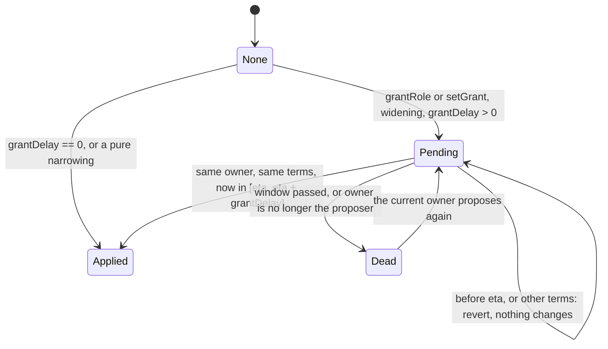
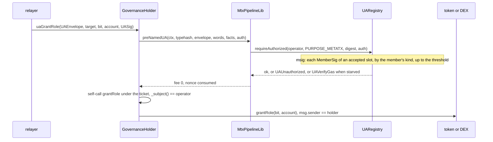

# Governance: `GovernanceBase`, the grant record, the holder, the enum, hybrid underlying, the receiver check — design

**Status:** SPECIFIED, nothing BUILT. Written 2026-11-02 on branch `governance` at `08e92597`, from the rulings CTR-GOV-01 to -18. A measured prototype of D1 and D2 sits on the same
branch (`66c3e74b`, `0e1cf3ac`); it is not a build of this spec. Rows of §0 cite the ruling or finding they rest on; the rows marked **controller call** are the controller's and the owner may
override them. CTR-GOV-02 stays `open`: §9 is a gate before the build. Everything cryptographic here stays `UNAUDITED`.

**Inputs.** [decisions.md](../../decisions.md) CTR-GOV-01 to -18; [permission-model.md](../../research/governance/permission-model.md) (v2, cited "v2"); [permission-model-gaps.md](../../research/governance/permission-model-gaps.md)
(cited "gaps"); [permission-model-v2-attack.md](../../research/governance/permission-model-v2-attack.md) (B-01 to B-34, R-01 to R-19); [permission-model-attack.md](../../research/governance/permission-model-attack.md) (A1-A21, as v2 §3
handled them); [prototype/RESULTS.md](../../research/governance/prototype/RESULTS.md) (cited "RESULTS"); [model-comparison.md](../../research/governance/model-comparison.md); [bit-table.md](../../research/governance/bit-table.md), whose proposed rows §1.2 fixes. Code read at `08e92597`: `src/governance/`, `src/metatx/`
(`WrappedLib`, `MetaTokenBase`, `NormalToken`, `WrappedToken`, `MetaTxBase`, `UAMetaTxBase`, `ERC20MetaTx`), `src/factory/`, `src/dex/`, `src/zether/ZetherLayer.sol`, `ZetherLib.sol`, `src/pqz/PqzLayer.sol`, `test/governance/`, and the admin surface of each non-EVM
family. Form: the DEX round spec and the `typed-signing` plan.

**Words.** *Holder*: an address with a non-zero `roles[bit][address]`. *Root*: a holder with no grantor. *Leaf*: a holder set by a delegable root. *Whole shape*: a holder with no `Grant`. *Limited*: a holder bound by a `Grant`. *Live pending*: §1.6.
*Hybrid*: a wrapped token with `MINTABLE`. Tags on figures: **[M]** measured in RESULTS or the attack round, **[est.]** not measured, **[I]** inferred.

## 0. Decisions — SPECIFIED

| # | Decision | Source | Section |
|---|---|---|---|
| G1 | One layer `GovernanceBase` on every token kind and `SCaaSDex`, own namespace `scaas.governance`, `AdminLib` → `GovernanceLib`, `IGovernance` replaces `ITokenAdmin` with every name kept; not in `MetaTxBase` or `UAMetaTxBase` | CTR-GOV-01 | §1 |
| G2 | Bits 0-63 global, 64-127 per application, 128+ refused, word stays `uint256` | CTR-GOV-10 | §1.2 |
| G3 | The whole `Grant` record is specified; size is a gate before the build; CTR-GOV-02 stays `open` | CTR-GOV-02, owner 2026-11-02 | §1.5, §9 |
| G4 | "+0" means no new read on `transfer` and `mtxTransfer`, on every kind, pinned | CTR-GOV-03, -11, B-33 | §10.2 |
| G5 | A regulated instance is known by its implementation; one per kind, never per feature | CTR-GOV-03 | §4 |
| G6 | Two-call `grantRole`, window, confirmer = proposer, `grantDelay` immutable, `pendingGrant`, `lastProposedAt`, `holderCount`; `acceptOwnership` not delayed | CTR-GOV-04 | §1.6 |
| G7 | `grantDelay = 0` means one call; the DEX's initial grants use the INIT path; bound 30 days | B-27 | §1.6 |
| G8 | `setGrant` that creates a holder or widens anything takes the two calls and binds a `termsHash`; a pure narrowing runs at once | B-01 | §1.6 |
| G9 | `hasRole` means listed, not able to act; `RoleGranted` fires for every new holder | B-07, B-31 | §1.5, §2 |
| G10 | Two levels, narrowing, parent debit, epoch kill; a leaf dies when its parent's scope or delegation changes or the parent goes whole | CTR-GOV-02, B-11, B-18 | §1.5 |
| G11 | A word the contract does not bind is refused at `setGrant`: masks `_scalarBits()`, `_scopeBits()` | B-09, B-10 | §1.5 |
| G12 | `grantor` is honoured only while it is live | B-04 | §1.5 |
| G13 | The renounce rule holds at `init` too, and counts roots | CTR-GOV-02, B-06, B-07 | §1.7 |
| G14 | `use` leaves `GovernanceLib`, `requireRole` goes | B-26, B-31 | §1.3 |
| G15 | `UA_POOL` and `SHIELD_POOL` are refused as owner | B-19 | §1.4 |
| G16 | DEX: `admin` → `owner`, `LISTING`, `FEE_ROUTING`, guard on the four powers, `supportsInterface`; a handover needs `revokeRole` | CTR-GOV-01, B-13, B-31 | §2.3 |
| G17 | `GovernanceHolder`: typed entries only, salt, generic path refused | gaps §1, B-14, B-20, CTR-GOV-15 | §3 |
| G18 | Two-call rotation, no delay, `proposeOperator(0)` cancels, the disclosure says it once | CTR-GOV-15, B-21, B-22 | §3.4 |
| G19 | Relay rule: an owner or holder operation has no `mtx*` or `ua*` on the governed contract | gaps §2, B-29, B-30 | §3.6 |
| G20 | Real enum members 0-13, off until published; placeholders 6 and 7 refused | CTR-GOV-16, B-03 | §4 |
| G21 | Regulated confidential kinds: the five rules, mapped per path, Zether and PQZ apart | CTR-GOV-17, -13 | §4.3 |
| G22 | Receiver check: two feature bits on one `ComplianceRegistry`, `ALLOWLIST` bit 8 and `DENYLIST` bit 9, both off by default; each disables and locks on its own; the issuer chooses at creation | CTR-GOV-18 | §4.4 |
| G23 | Hybrid underlying | CTR-GOV-12 | §5 |
| G24 | A wrapped kind refuses a leg with bit 6 `FORCE` or bit 21 `MODERATE`; the check reads `isRegisteredToken`; bits 5, 7, 8, 9 are disclosed | CTR-GOV-05, B-15, B-34 | §6.1 |
| G25 | `RESCUABLE`, immutable `rescueTo`, per-asset check, `nonReentrant`; no DEX entry, `DexPuller` only; no tender rescue | CTR-GOV-06, -14, A15, A16, R-16 | §6.2 |
| G26 | Admin rotation and renounce on every family, four semantics | CTR-GOV-07, B-23, B-24, B-25, B-32 | §6.3 |
| G27 | Bits 13, 14 unused for ever; a party fixed at creation holds no bit; bits 15, 16 are reserved names only | CTR-GOV-14 | §1.2 |
| G28 | `MODERATE`: bit 21, body later, public balances only | CTR-GOV-08, -13, -18 | §1.2 |
| G29 | Delayed relaxing and `RECORD`: bit taken, body later, and it covers every relaxing path | CTR-GOV-09, B-28 | §1.2 |

**Controller calls.**

| # | Call | Why | If wrong |
|---|---|---|---|
| C1 | `executeRate` on a hybrid keeps every check but `c ≥ supply` (§5.3) | That check is false by design on a token with unbacked units, and CTR-GOV-12 says a hybrid claims no full backing. A counter of minted units would keep a narrower check at the price of a slot and a write on every mint, which no rule asks for | A rate admin steps a hybrid's rate with the reserve short of supply, still bounded by delay, step and window. Fix: an `issued` counter and `c + issued ≥ supply`, a new release |
| C2 | `maxSupply` sits in `scaas.underlying`, with a `capped` copy in leg slot a (§5.2) | A wrapped token only needs it, and slot a already holds such a copy "so a fixed-rate wrap reads no config"; a non-hybrid wrap reads nothing new, and `reserve` keeps its offset for the indexer | A slot layout to re-pin before the freeze; nothing after it, since nothing is deployed |
| C3 | Where a finding offered two fixes, the smaller that fails closed, in the library: B-02 finite budget and the disclosure; B-05 a `barred` mark; B-07 `roots` packed with `holders`, no `prune`; B-08 no `setGrant` while owner is 0; B-12 refuse a window change while spent; B-13 state it, a wizard revokes; B-14 refuse the generic path; B-16 the matrix says so; B-17 same `window`; B-31 remove `requireRole`, add the guard, emit `RoleGranted` | Each is a library line at 0 token bytes, or no code at all. Each refusal can be relaxed later by a new release; a hole cannot be closed on a deployed clone | Each is one line before the build. The one with a visible product cost: B-08 stops a locked bit's holder from delegating after a renounce |
| C4 | Names: `RETIRED_6`, `RETIRED_7`, `NORMAL_ZETHER_REGULATED`, `WRAPPED_ZETHER_REGULATED`, `NORMAL_PQZ_REGULATED`, `WRAPPED_PQZ_REGULATED`; the holder's typed struct names; `GovernanceUse`; `GovernanceHolderFactory` | CTR-GOV-16 gives numbers and the four kinds, not names | A rename before the freeze |
| C5 | Bit 18 `PUBLISH` reads "adds a release **or an environment** to a catalogue" | gaps §4: no bit covered `publishEnv`, the most powerful of the four registrar powers. No code: the bit is for a later factory | One sentence of a reserved row |
| C6 | The rules of §1 to §4 become one component doc, `docs/contracts/governance.md`, at build | The register's rows point at themselves today; "one rule, one place" wants a home, and README §3 keeps the list | Text moves between two files |

## 1. The model — SPECIFIED

### 1.1 One sentence

A bit says whether a right exists on this contract; a holder entry says who has it; an optional grant record says within what; the owner, after a delay, changes holders and grants; a lock makes a bit permanent.

The worst case of a contract's bits is the worst case of **that contract's own code** (A5). A leg's issuer is read separately (§1.8).

**Who takes the base.** Every contract with a power that can change hands: the six token kinds, the regulated kinds when built, `SCaaSDex`, a third-party application. **Not** a contract whose parties are fixed at creation (CTR-GOV-14): `SealedBidTender`, `VestingGrant`,
`Distribution`, `ExchangeOffer`. Not `OpenFactory` (its `registrar` stays one address), `UARegistry`, `MandateWallet`, `SmartKeyAccount`, the relay router.

### 1.2 The bit table, final allocation

`GovernanceBits.sol` holds the constants. A contract without the power leaves the bit off. **Capability**: no holder, serves or binds everyone, `grantRole` reverts `NoSuchRole`. **Power**: has holders. The type is `_roleBits()`, never a second declaration. **Reduce-only** means reduces power over holders (A9).

| Bit | Name | Meaning, the same on every contract | Type | Reduce-only | Contract-only | In this release |
|---|---|---|---|---|---|---|
| 0 | `PAYABLE` | anyone may pay through the pay entries | capability, always locked | — | — | as built |
| 1 | `MINTABLE` | a holder creates units | power | no | no | `NORMAL*`, and `WRAPPED*` as a hybrid (§5). Scalar bit |
| 2 | `BURNABLE` | any holder of units destroys its own | capability, always locked | — | — | as built |
| 3 | `RATE_ADJUSTABLE` | a holder changes a conversion rate under the rate timelock | power | no | yes | as built |
| 4 | `WRAP_DISABLEABLE` | a holder closes an inflow, one-way | power | yes | no | as built |
| 5 | `FREEZE` | a holder stops one account, bounded in time | power | no | yes | refused, regulated kinds |
| 6 | `FORCE` | a holder moves units out of a frozen account to a recorded beneficiary; public balances only | power | no | yes | refused, regulated kinds |
| 7 | `PAUSE` | a holder stops the whole token, bounded in time (§4.3, U1) | power | no | yes | refused, regulated kinds |
| 8 | `ALLOWLIST` | a receiver of a public balance must hold `requiredFlags` in a `ComplianceRegistry` pinned at creation (§4.4) | capability, parameters `registry`, `requiredFlags` | — | — | refused, regulated kinds |
| 9 | `DENYLIST` | a receiver of a public balance must hold none of `deniedFlags` in that registry (§4.4) | capability, parameters `registry`, `deniedFlags` | — | — | refused, regulated kinds |
| 10 | `RECORD` | a holder writes a compliance record another power relies on; one holder is refused both this and `FORCE` | power | no | yes | number only (CTR-GOV-09) |
| 11 | `LISTING` | a holder decides what this instance trades or accepts | power | no | no | `SCaaSDex` |
| 12 | `FEE_ROUTING` | a holder decides who receives this instance's fees, never how much | power | no | no | `SCaaSDex` |
| 13 | unused | never allocated, never reused (CTR-GOV-14) | | | | |
| 14 | unused | never allocated, never reused (CTR-GOV-14) | | | | |
| 15 | `ARBITRATE` | reserved name, no spec behind it, no meaning yet | | | | none |
| 16 | `CORRECT` | reserved name, no spec behind it, no meaning yet | | | | none |
| 17 | `RESCUABLE` | anyone may move what this instance does not owe to `rescueTo` | capability, always locked, parameter `rescueTo` | — | — | token kinds (§6.2) |
| 18 | `PUBLISH` | a holder adds a release or an environment to a catalogue (C5) | power | no | no | none: `OpenFactory` keeps `registrar` |
| 19 | `DEPRECATE` | a holder marks a release unusable for new instances, never undone | power | yes | no | none |
| 20 | `ENABLE_KIND` | a holder turns a catalogue kind on or off | power | no | no | none |
| 21 | `MODERATE` | a holder moves public units out of any account, no record | power | no | yes | number only (CTR-GOV-08, -13) |
| 22-63 | free | allocated once, by a spec, when one names a power | | | | |

`MODERATE` had a number and no code; CTR-GOV-18 moved it from 9 to 21 so that the two receiver bits sit together. Bit 10 maps `Roles.compliance`; bits 8 and 9 have no holder, so the `compliance` word stops meaning "the `ALLOWLIST` role" (§12.3). Per contract in this release:

| Contract | `_validBits()` | `_roleBits()` | `_contractOnlyBits()` | `_scalarBits()` | `_scopeBits()` |
|---|---|---|---|---|---|
| `NORMAL*` | 0, 1, 2, 17 (`NORMAL`, plus 5-9 refused `FeatureNotBuilt`) | 1 | 0 | 1 | 0 |
| `WRAPPED*` | 0, 1, 3, 4, 17 (`WRAPPED`, plus 5-9 refused `FeatureNotBuilt`) | 1, 3, 4 | 3 | 1 | 0 |
| `SCaaSDex` | 11, 12 | 11, 12 | 0 | 0 | 0 |

The refusal of 5-9 on the confidential kinds stays `FeatureInvalidForKind`; it is the built state, not a permanent rule (CTR-GOV-03).

`smartcontracts/vectors/governance/governance_bits.json` carries `bit → name → type → one disclosure sentence`, written by a forge test from the constants and read by every client. Bit 1 has two sentences, plain and hybrid. Bits 64-127 come from `bitLabel(bit)`.

### 1.3 The pieces

| Piece | What it is |
|---|---|
| `GovernanceBits` | constants only |
| `GovernanceLib` | external library, DELEGATECALL, one body audited once: `init`, `initHolder`, `grantRole`, `setGrant`, `revokeRole`, `renounceRole`, `disableFeature`, `transferOwnership`, `acceptOwnership`, `renounceOwnership`, `useLimited`, and the rescue of a `NORMAL*` kind |
| `GovernanceUse` | internal library in `GovernanceBase.sol`: `use`, whose body is the whole-shape fast path and one DELEGATECALL to `GovernanceLib.useLimited`. solc refuses a qualified call from `GovernanceLib` into itself, so today's `use` inlines `useLimited` into every caller (B-26). Measured [M]: `NormalToken` −1,096 B, `NormalZetherToken` −1,082, `NormalPqzToken` −1,058, `SCaaSDex` −1,065, `WrappedLib` −1,077, every wrapped token 0 |
| `GovernanceBase` | abstract: one-line wrappers, the `IGovernance` ABI, the masks below, no storage of its own |
| `IGovernance` | §2 |

`requireRole` is removed (B-31): nothing calls it, and it skips a limited holder's grant. Every power runs through `use`. `hasRole` stays a view.

```solidity
abstract contract GovernanceBase is IGovernance {
    function _guardIn() internal virtual returns (bool);
    function _guardOut(bool outer) internal virtual;
    function _caller() internal view virtual returns (address);
    function _validBits() internal pure virtual returns (uint256);        // both bands
    function _roleBits() internal pure virtual returns (uint256);         // subset with holders
    function _contractOnlyBits() internal pure virtual returns (uint256); // subset whose holder must have code
    function _scalarBits() internal pure virtual returns (uint256);       // subset whose power passes the number it acts on (B-09)
    function _scopeBits() internal pure virtual returns (uint256);        // subset whose power reads `use`'s return (B-10)
    function _scopeNarrows(uint8, bytes32 parent, bytes32 child) internal view virtual returns (bool) { return parent == child; }
}
```

`_delayedRelaxBits()` of CTR-GOV-09 is not added now: it arrives with the regulated implementations, which are new releases. When it is written it covers `revokeRole`, `disableFeature`, `renounceRole`, a `setGrant` to a past `validUntil`, and a parent's revoke killing leaf issuers (B-28). PLANNED.

### 1.4 Storage, `erc7201:scaas.governance`

Root `0x0a3a361961b35589cdb03530b6f9e23a4db6ca9a0dad5ddf5d7761c7fabc8700`. `scaas.token` keeps `creator`, `version`, `kind`, `decimals`, `initialized`, `name`, `symbol` (`TokenStore`). `reserve` stays in `scaas.underlying`.

```solidity
struct Counts { uint128 holders; uint128 roots; }                       // one slot: `holderCount` is `holders`, the renounce rule reads `roots`
struct PendingGrant { uint64 eta; address proposer; bytes32 termsHash; } // 0 termsHash = `grantRole`
/// @custom:storage-location erc7201:scaas.governance
struct GovernanceStorage {
    uint256 features;                                                   // +0, written by init, cleared one-way
    uint256 lockedFeatures;                                             // +1, no writer after init
    address owner; uint64 grantDelay;                                   // +2, grantDelay has no writer after init
    address pendingOwner; uint64 lastProposedAt;                        // +3
    mapping(uint256 bit => mapping(address => uint8)) roles;            // +4, 0 none, 1 WHOLE, 2 LIMITED
    mapping(uint256 bit => Counts) counts;                              // +5
    mapping(uint256 bit => mapping(address => IGovernance.Grant)) grants; // +6
    mapping(uint256 bit => mapping(address => uint32)) epoch;           // +7
    mapping(uint256 bit => mapping(address => PendingGrant)) pending;   // +8
    address rescueTo;                                                   // +9, no writer after init
}
```

`init` and `transferOwnership` refuse `UA_POOL` and `SHIELD_POOL` as owner (`OwnerAccountPool`, B-19). `grantDelay` above 30 days is refused (`GrantDelayTooLong`): `MAX_NOTICE_PERIOD`'s reason applies (B-27).

### 1.5 The grant record

`GrantTerms` and `Grant` are in §2.1. A grant binds one `(bit, holder)`; no clone exists, so no second budget does. The scalar a contract passes to `use` is the number it then acts on, never a number the caller chose for the check (A11).

**At `use`.** Feature set, else `FeatureNotSet`. `WHOLE` returns 0. No holder: `MissingRole`. `LIMITED`: `useLimited` debits the holder's terms, then, for a leaf, checks `roles[bit][parent] == LIMITED` and the epoch (`GrantExhausted(7)`), then debits the parent on the same scalar, so its `min`, `max`, `maxUses` and expiry bind too.

**At `setGrant`, every caller:**

| Check | Refusal |
|---|---|
| bit outside `_roleBits()`, zero account, a pool, feature clear, contract-only and no code | as `grantRole` |
| bit outside `_scalarBits()` and any of `min ≠ 0`, `max ≠ type(uint128).max`, `total ≠ 0`, `perWindow ≠ 0`, `window ≠ 0` | `GrantWordRefused(bit, field)` (B-09). Only `validUntil`, `maxUses`, `delegable` bind such a bit |
| bit outside `_scopeBits()` and `scope ≠ 0`; or bit inside it and `scope == 0` | `GrantWordRefused(bit, 7)` (B-10). 0 means whole shape on a scoped power and nothing else; CTR-GOV-08's "any" is a non-zero constant named when `MODERATE` is built |
| `(perWindow == 0) != (window == 0)` | `GrantWordRefused(bit, 3)` |
| `delegable` with no finite budget: `total == 0` on a scalar bit, `maxUses == 0` on another | `GrantBudgetRequired(bit)` (B-02). The disclosure still prints "can add holders at once, up to N" |

**The owner's path** is §1.6. When it applies terms to a `LIMITED` holder and `scope` changed or `delegable` cleared, it bumps `epoch[bit][holder]`, so the leaves die as at a revoke (B-11). `_grant` over a `LIMITED` holder bumps it too (B-18). A leaf the owner edits becomes a root: `grantor` 0, `roots + 1`. The owner's apply clears `barred`.

**The leaf path.** Caller `LIMITED` and `delegable` (else `NotOwner`); `owner ≠ 0` (else `NotOwner`, B-08: nothing above changes once the owner is 0, the holder list included); the target holds nothing or is the caller's own leaf; the target is not `barred` (`GrantBarred`, B-05); the terms narrow:

| Field | Child against parent `p` | `GrantNotNarrower(field)` |
|---|---|---|
| `delegable` | false | 6 |
| `min` | `≥ p.min` | 0 |
| `max` | `≤ p.max` | 1 |
| `total` | if `p.total ≠ 0`: `≠ 0` and `p.spentTotal + t.total ≤ p.total`, by comparison, never a subtraction (B-18) | 2 |
| `perWindow`, `window` | if `p.perWindow ≠ 0`: `perWindow ≠ 0`, `≤ p.perWindow`, and `window == p.window` (B-17) | 3, 8 |
| `validUntil` | if `p.validUntil ≠ 0`: `≠ 0`, `≤ p.validUntil` | 4 |
| `maxUses` | if `p.maxUses ≠ 0`: `≠ 0`, `≤ p.maxUses` | 5 |
| `scope` | `_scopeNarrows(bit, p.scope, t.scope)`, checked in the stub after the library returns: the library is DELEGATECALLed and cannot reach an internal virtual | 7 |

A wrong `_scopeNarrows` is application code the base cannot see (v2 §7.2); the epoch rule below covers a parent that loses a scope, and that is the mitigation there is.

**Edits.** One rule: an edit never refreshes a budget. `spentTotal`, `spentInWindow`, `uses` carry. A change of `window` while the current period has spent is refused (`GrantWindowInUse`, B-12): the grid start depends on `window`.

**Revoke.** Owner, or the leaf's grantor while `roles[bit][account] == LIMITED` and the grantor still holds the bit (B-04); `_grant` clears `grantor`. A revoke keeps the record and bumps the epoch, or revoke then grant would refresh a budget. A revoke by the owner sets `barred`: only the owner re-admits that account (B-05).

**`hasRole` means listed, not able to act** (B-07). A dead leaf stays listed and counted; a wallet reads `grantOf` and still simulates.

### 1.6 The delay



A pending at `(bit, account)` is **live** when `eta ≠ 0`, `proposer == owner` and `now ≤ eta + grantDelay`. `termsHash` is `keccak256(abi.encode(GrantTerms))`, or 0 for `grantRole`.

The owner calls the same entry twice.

| Situation at the call | Result |
|---|---|
| `grantDelay == 0` | applied at once: the window would be one timestamp, and an EOA's second call would land dead (B-27) |
| `grantRole` on a `WHOLE` holder | no-op, nothing proposed |
| `setGrant` on a `WHOLE` root, `delegable` false | applied at once: a narrowing |
| `setGrant` on a `LIMITED` root and `t` narrows the record field by field: `min` not lower, `max` not higher, each of `total`, `perWindow`, `validUntil`, `maxUses` bounded where it was and not higher, `window` and `scope` equal, `delegable` not raised | applied at once (B-01) |
| anything else: a new holder, `grantRole` on a `LIMITED` holder, an edit that widens any word, a leaf the owner would make a root (it drops the parent's bound) | two calls |
| no live pending | writes the pending, `lastProposedAt = now`, emits `GrantProposed` |
| live pending, other `termsHash` | `GrantTermsMismatch` |
| live pending, `now < eta` | `GrantNotReady` |
| live pending, in the window, same `termsHash` | deletes the pending, applies, re-running every check at confirm |

A dead pending is harmless: nobody can confirm it, and the view still shows it. There is no cancel entry: a pending acts only on the owner's second call, so an owner who changes its mind does not make it, and a key rotation by `transferOwnership` kills it. `holderCount` never counts a pending. INIT grants take the INIT path, once, undelayed. `acceptOwnership` is not delayed. `revokeRole`, `disableFeature`, `renounceOwnership`, `renounceRole` run at once (A6).

The rate timelock stays as built. `grantDelay` delays an address, never who controls it (§3.4).

### 1.7 The renounce rule

`renounceOwnership` reverts `OwnerHasHolders(bit)` while a set bit in `features & ~lockedFeatures & _roleBits()` has `roots ≠ 0`. Roots, not holders: dead leaves would otherwise block it until the owner walks them by hand (B-07), and revoking every root kills every leaf.

`init` runs the same loop when `owner == 0` (B-06): a token cannot be born in the state a renounce refuses. A locked bit's holders survive a renounce, because a lock promises the power is permanent; a surviving limited holder keeps its `Grant` and can add nobody (B-08).

A DEX handover (B-13): `transferOwnership` moves neither bit 11 nor 12, since the owner holds them as an ordinary holder. The old owner keeps them until `revokeRole`, and the new owner waits `grantDelay`. A wizard runs the revoke. Stated, 0 B.

### 1.8 What a wallet reads, in order

1. `factory.isRegisteredToken(t)`, `versionOf(t)`.
2. `kind()`, `features()`, `lockedFeatures()`: one sentence per set bit. `lockedFeatures` says the power exists for ever, the reverse of "locked" in most systems.
3. `owner()`: 0 means nothing above can change. Else `grantDelay()`, `pendingOwner()`, and a warning when `lastProposedAt()` is within `2 × grantDelay`: read `GrantProposed` and `pendingGrant`.
4. Per power bit: `holderCount(bit)` against the indexed `RoleGranted` / `RoleRevoked` list, then per holder `grantOf`. A delegable holder prints "can add holders at once, up to N".
5. A contract holder: a clone of the holder implementation prints "operator X" and `pendingOperator`; anything else prints "whole shape, mutable by its own rules". Once, for every contract holder: **`grantDelay` delays an address, never who controls it** (CTR-GOV-15).
6. Per leg of `underlyings()`: recurse on `isRegisteredToken`, others print "unknown issuer powers". A leg with bit 5, 7, 8 or 9 prints "its issuer can stop unwraps of this leg" (B-34). A registered leg never has 6 or 21.
7. Bits 8 and 9, read apart: `registry()`, `requiredFlags()`, `deniedFlags()` and the registry's controller, "X can change this list at once" (A13). A bit that is off prints that it can never come on: features only lose bits, so the issuer chose at creation. Both off prints "this token can never stop a receiver".
8. A hybrid: §5.5. `rescueTo()` when bit 17 is set.

## 2. ABI — SPECIFIED

### 2.1 Types

```solidity
interface IGovernance {
    enum BitType { CAPABILITY, POWER }
    struct GrantTerms {        // 0 = no bound, except `max`: type(uint128).max = no bound
        uint128 min; uint128 max; uint128 total; uint128 perWindow;
        uint32 window; uint64 validUntil; uint32 maxUses; bool delegable; bytes32 scope;
    }
    struct Grant {             // six slots
        uint128 min; uint128 max; uint128 total; uint128 spentTotal;
        uint128 perWindow; uint128 spentInWindow; uint32 window; uint32 windowStart;
        uint64 validUntil; uint32 maxUses; uint32 uses;
        bytes32 scope;
        address grantor; uint32 grantorEpoch; bool delegable; bool barred;
    }
}
```

`GovernanceLib.Roles` is unchanged: `minter`, `rateAdmin`, `guardian`, `issuer`, `compliance`.

### 2.2 Entries, every `GovernanceBase` contract

Each is one direct entry under the contract's guard. None is on `mtxSelectors()` or `_uaAllowed` (§3.6).

| Entry | Caller | Effect | Events | Errors |
|---|---|---|---|---|
| `grantRole(uint8 bit, address account)` | owner | §1.6; `roles = WHOLE`; a `LIMITED` holder's epoch bumps | `GrantProposed`, `RoleGranted` | `NotOwner`, `FeatureReserved`, `RoleAccountZero`, `RoleAccountPool`, `NoSuchRole`, `RoleWithoutFeature`, `RoleNotContract`, `GrantNotReady`, `GrantTermsMismatch` |
| `setGrant(uint8 bit, address holder, GrantTerms terms)` | owner, or a delegable holder of `bit` | §1.5, §1.6 | `GrantProposed`, `GrantSet`, and `RoleGranted` for a new holder (B-31) | the above, and `GrantWordRefused`, `GrantBudgetRequired`, `GrantNotNarrower`, `GrantBarred`, `GrantWindowInUse` |
| `revokeRole(uint8 bit, address account)` | owner, or the live grantor | at once; record kept, epoch bumped, `barred` if by the owner | `RoleRevoked` | `NotOwner` |
| `renounceRole(uint8 bit)` | a holder | at once | `RoleRevoked` | `MissingRole` |
| `disableFeature(uint8 bit)` | owner | one-way | `FeatureDisabled` | `NotOwner`, `FeatureLocked`, `FeatureNotSet` |
| `transferOwnership(address newOwner)` | owner | two-step, no delay; 0 cancels | `OwnershipTransferStarted` | `NotOwner`, `OwnerAccountPool` |
| `acceptOwnership()` | `pendingOwner` | at once | `OwnershipTransferred` | `NotPendingOwner` |
| `renounceOwnership()` | owner | owner 0 for ever, `pendingOwner` cleared | `OwnershipTransferred` | `NotOwner`, `OwnerHasHolders` |

| View | Returns |
|---|---|
| `features()`, `lockedFeatures()`, `validBits()` | `uint256` |
| `owner()`, `pendingOwner()` | `address` |
| `grantDelay()`, `lastProposedAt()` | `uint64` |
| `hasRole(uint8 bit, address account)` | `bool`, listed |
| `holderCount(uint8 bit)` | `uint256`, holders, leaves included, pendings never |
| `pendingGrant(uint8 bit, address account)` | `(uint64 eta, address proposer, bytes32 termsHash)`, dead ones too |
| `grantOf(uint8 bit, address holder)` | `Grant` |
| `bitLabel(uint8 bit)` | `(BitType, bytes4, string)`, bits 64-127; a contract with none reverts `FeatureInvalidForKind` |
| `supportsInterface(bytes4)` | every `GovernanceBase` contract answers `IGovernance`, the DEX too (B-31) |

**Events, kept:** `RoleGranted(uint8 indexed bit, address indexed account, address indexed sender)`, `RoleRevoked(same)`, `FeatureDisabled(uint8 indexed bit, address indexed by)`, `OwnershipTransferStarted`, `OwnershipTransferred`.
**New:** `GrantSet(uint8 indexed bit, address indexed holder, address indexed grantor)`, `GrantUsed(uint8 indexed bit, address indexed holder, uint256 scalar)`, `GrantProposed(uint8 indexed bit, address indexed account, address indexed proposer, uint64 eta, bool whole, GrantTerms terms)`. A wallet compares `terms` with `termsHash`: a narrow grant shown during the delay cannot confirm as a wide one.

**Errors, kept:** `FeatureInvalidForKind(bit)`, `FeatureNotBuilt(bit)`, `LockedNotSubset()`, `RoleWithoutFeature(bit)`, `RoleNotContract(bit, account)`, `RoleAccountZero(bit)`, `NoSuchRole(bit)`, `FeatureLocked(bit)`, `FeatureNotSet(bit)`, `NotOwner(caller)`, `NotPendingOwner(caller)`, `MissingRole(bit, account)`.
**From the prototype:** `FeatureReserved(bit)`, `RoleAccountPool(bit, account)`, `GrantNotNarrower(uint8 field)` (0 min, 1 max, 2 total, 3 perWindow, 4 validUntil, 5 maxUses, 6 delegable, 7 scope, 8 window), `GrantExhausted(uint8 field)` (0 min, 1 max, 2 total, 3 perWindow, 5 maxUses, 7 parent), `GrantExpired(bit, holder)`, `OwnerHasHolders(bit)`.
**New:** `GrantDelayTooLong(uint64 delay)`, `GrantNotReady(uint8 bit, address account, uint64 eta)`, `GrantTermsMismatch(uint8 bit, address account)`, `GrantWordRefused(uint8 bit, uint8 field)`, `GrantBudgetRequired(uint8 bit)`, `GrantBarred(uint8 bit, address account)`, `GrantWindowInUse(uint8 bit, address holder)`, `OwnerAccountPool(address account)`.

### 2.3 Per contract

**Creation.** `TokenConfig` gains `uint64 grantDelay`, `address rescueTo`, `uint256 maxSupply` (`WRAPPED*` only, `ConfigFieldForOtherKind(5)` elsewhere). A regulated kind adds the parameters of §4.4. `DexConfig` becomes `{address owner; uint32 relayerSharePpm; address treasury; bool listedOnly; uint64 grantDelay; address rescueTo}`. Wizard default for `grantDelay` 2 days, dev chains 0.

**`SCaaSDex`.** `owner()` replaces `admin()`. `setMarket`, `setExchangeTarget`, `setListedOnly` under bit 11, `setFeeSplit` under bit 12, each through `use` with scalar 0 and under the `governed` guard, so no governance entry runs inside a settlement (B-31). `initialize` calls `GovernanceLib.initHolder` for both bits when `owner ≠ 0`: `grantRole` would only propose (B-27). `initHolder` is reachable from `initialize` alone. `DexCreated`'s last field reads `owner()`.

**Tokens.** Every power runs through `use`: `mint`, `mintToUA` with the amount, the rate and guardian entries with 0. `rescue(address asset)`, `rescueTo()` are §6.2, in `IRescuable`, so `IGovernance`'s interface id is one on the DEX and on a token. `mint`, `mintToUA`, `maxSupply()` on the wrapped kinds are §5.

`createTokenUnregistered` is unchanged. No `mtx*` or `ua*` struct changes, so no existing typehash moves.

## 3. `GovernanceHolder` — SPECIFIED

### 3.1 Shape

A `UAMetaTxBase` child, the base meant for contracts that are not tokens. The holder is an ordinary address to what it governs: the token sees `msg.sender == holder`, so every rule about `owner` and holders stands. A derived UA and a PQ `msig` have no other way in: `_msgSender()` is `UA_POOL` for every derived subject, and no ERC-1271 cap admits a PQ kind.

| Part | Text |
|---|---|
| Shape | EIP-1167 clone by CREATE2, made by a per-chain `GovernanceHolderFactory` in the shape of `SmartKeyAccountFactory`: implementation built in the constructor, `predict`, permissionless `deploy`, a repeat `deploy` returns the address. Not a `TokenKind`. `OpenFactory` does not know it |
| Salt | `keccak256(abi.encode(operator, salt))`. The operator is in the salt, or the first deployer would choose it (B-20). No other argument exists: CTR-GOV-15 removed `operatorDelay` |
| Domain | `("SCaaS GovernanceHolder", "1", chainId, holder, chain_uid)` |
| Immutables | the chain's UA registry, `chain_uid`, the `SmartKeyAccount` implementation, `IS_HEDERA` |
| State | `operator`, `pendingOperator` (`bytes32`), own ERC-7201 namespace `scaas.holder`; `operator` written once by `initialize` and by `acceptOperator` |
| The check | every direct op starts `if (_subject() != operator) revert NotOperator(_subject())`. A native operator may call directly; a derived one only through a signed entry |
| Holds nothing | no `receive`, no balance, no allowance |
| Fee | `supportedModes() == 0x03`, fee mode `NONE`. A relayer is paid, if at all, through `MtxRelayFee` |
| Factory | `predict(bytes32 operator, bytes32 salt)`, `deploy(bytes32 operator, bytes32 salt)`, `HolderDeployed(address indexed holder, bytes32 indexed operator)`. `initialize(bytes32 operator)` by the factory only, in the same call; operator 0 refused |
| Views, events, errors | `operator()`, `pendingOperator()`; `OperatorProposed(bytes32 indexed next)`, `OperatorChanged(bytes32 indexed previous, bytes32 indexed next)`; `NotOperator(bytes32 subject)`, `NotPendingOperator(bytes32 subject)` |

### 3.2 Entries

Each op below has one direct entry, one `mtx<Op>(Envelope e, …, bytes sig)` and one `ua<Op>(UAEnvelope e, …, UASig auth)`, on `_named` / `_namedUA`, `target` the first explicit parameter. The structs are `<Op>` and `UA<Op>`: `from` first, the op's parameters, then the seven envelope fields. **No `execute(bytes)`.**

| Group | Op | Target call |
|---|---|---|
| Owner | `grantRole(address target, uint8 bit, address account)` | `IGovernance.grantRole` |
| | `revokeRole(address target, uint8 bit, address account)` | `IGovernance.revokeRole` |
| | `setGrant(address target, uint8 bit, address holder, GrantTerms terms)` | `IGovernance.setGrant`; `terms` a nested typed struct, its hash in the struct's words, as `ERC20MetaTx._namedCall` does |
| | `disableFeature(address target, uint8 bit)` | |
| | `transferOwnership(address target, address newOwner)` | |
| | `acceptOwnership(address target)` | |
| | `renounceOwnership(address target)` | |
| Holder of a bit | `renounceRole(address target, uint8 bit)` | |
| Powers on tokens | `mint(address target, address to, uint256 amount)` | |
| | `mintToUA(address target, bytes32 to, uint256 amount)` | |
| | `disableWrap(address target, address leg, bytes32 reason)` | |
| | `proposeRate(address target, address leg, uint96 num, uint96 den)` | |
| | `cancelRate(address target)`, `executeRate(address target)` | |
| Powers on the DEX | `setMarket(address target, address base, address quote, bool listed)` | |
| | `setExchangeTarget(address target, address exchangeTarget, bool listed)` | |
| | `setListedOnly(address target, bool on)` | |
| | `setFeeSplit(address target, uint32 relayerSharePpm, address treasury)` | |
| Its own | `proposeOperator(bytes32 next)`, `acceptOperator()` | §3.4 |

`GrantTerms` in the struct string: `SetGrant(address from,address target,uint8 bit,address holder,GrantTerms terms,uint256 batch,uint256 nonce,uint256 validUntil,uint32 mode,address relayer,uint256 fee,address feeRecipient)GrantTerms(uint128 min,uint128 max,uint128 total,uint128 perWindow,uint32 window,uint64 validUntil,uint32 maxUses,bool delegable,bytes32 scope)`. Every typehash is pinned by a `*TypehashIsPinned` test.

Each op is on `_mtxRule` and `_uaAllowed`, because a named entry passes `_checkCall`. So `_execute` is overridden to refuse (`MtxSelectorNotAllowed`), and `uaExecute` and `uaBatch` too: otherwise `mtxExecute` reaches the same op under a `bytes data` signature, the path §3.6 rejects (B-14). `mtxBatch` and `executeMetaTransaction` fall with `_execute`. `mtxCancelNonce`, `uaCancelNonce` stay. Application bits 64-127: the application ships its own child of the same abstract base with one typed entry per bit; `GovernanceHolder` is a closed table.

### 3.3 How a derived UA and a PQ `msig` reach it



Each member registers a single-key PQ UA; `registerMsig` registers the structure; each member calls `acceptMembership` (CTR-UA-37). Below the accepted threshold the `msig` authorizes nothing, so a holder naming it is inert, and a client reads `memberAccepted` first. The creator deploys the holder, or predicts its address, and names it `TokenConfig.owner`. A counterfactual owner works; a contract-only bit needs code at the grant, so deploy the holder first. The holder never reads a member.

### 3.4 Rotation, CTR-GOV-15

`proposeOperator(next)` by the operator; `acceptOperator()` signed by `next`; `proposeOperator(0)` cancels; `pendingOperator()` is readable. Two calls, **no delay**, no window, no `operatorEta`. `acceptOperator` clears the pending, so a pending dies with the rotation, and a second `proposeOperator` overwrites the first. A stale pending stays until it is cancelled: a wallet shows a non-zero `pendingOperator`, which is what a compromised-then-recovered operator must look at. Rotation kills pre-signed envelopes, since the check runs at run time (R-03).

A lost operator loses the holder and what it owns: no guardian, no recovery. A threshold below `n` is the mitigation. An `msig`'s members cannot change (CTR-UA-37), so rotating the operator is the way to change them.

### 3.5 The gas it runs under, and what fails closed

Three limits, in this order. **Registration:** `_membersWorst` refuses an `msig` whose worst minimal signing set does not fit `verifyBudget`, 12,000,000 on EIP-7825 chains and 10,500,000 on Hedera, so an `msig` that registers authorizes within the budget. **The transaction:** 2^24 = 16,777,216 regular gas; at the bound about 4.7 M is left for calldata, the pipeline and the target call, not measured [est.]. **No ERC-1271 cap:** the token sees a call, never a signature.

| Member kind, no precompile | Signers at 12 M | Worst | At 10.5 M |
|---|---|---|---|
| `mldsa44` | 2 | 8,653,611 | 2 |
| `mldsa65` | 1 (2 needs 12,080,595) | 6,085,595 | 1 |
| `fndsa512` | 4 | 10,215,833 | 4 |
| `slhdsa128s` | 8 | 11,578,373 | 7 |

Computed from `_membersWorst`, confirmed by the attack round (R-15). A threshold of two ML-DSA-65 signers does not register on a chain without a precompile, and a wallet must not promise it. With a precompile the caps fall; the rule is the bound, not this table.

Two authorizations do not fit one transaction above 8.39 M: an `msig` at the bound cannot pay its relayer by its own `MtxRelayFee` signature (B-30: `mldsa44` c=2 17.3 M, `fndsa512` c=4 20.4 M, `slhdsa128s` c=8 23.2 M; `mldsa65` c=1 12.2 M fits). It relays at fee 0 or another account pays. A relayer can reorder across lanes, so **a wallet uses one lane per target**, `batch = uint256(uint160(target))`: on two lanes a relayer that lands `revokeRole` before `setGrant` leaves the holder holding. A withheld item blocks its own lane, and delay is all it gets (R-07).

| Failure | Result |
|---|---|
| wrong subject, a replaced operator | `NotOperator`, nonce unspent |
| `msig` below accepted threshold, wrong member | the registry refuses (R-14) |
| starved relayer | `UAVerifyGas`, no verdict, nonce unspent |
| `target` re-enters, direct or under a live ticket | `Reentrancy` (R-04) |
| `target` has no code, or reverts | the typed call reverts, with its data |
| replay across holders, tokens, chains; a changed `target` | refused: `verifyingContract`, `chainId`, `chain_uid`, and `target` a signed word (R-02) |
| the generic path | refused (§3.2) |

### 3.6 Relay rule

> An owner or holder operation of a `GovernanceBase` contract has one direct entry and no `mtx*` or `ua*` twin on that contract, and is on neither of its allow-lists. Its relayed form lives once, in `GovernanceHolder`: a named typed `mtx<Op>` and `ua<Op>` per operation, fee mode `NONE`, relayable at fee 0. An owner that wants gasless administration is a holder; a creator names the holder as `owner` at creation, its address being predictable, so no first gas is needed.

A `SmartKeyAccount` owner is relayable through its own `mtxExecute`, and that path carries a `bytes` blob, hex in a wallet; it stays because it exists, and a wallet says so (B-29). An EOA or a Safe that keeps the power directly pays its own gas. An EOA owner that did not name a holder at creation needs gas once, to transfer ownership to one.

Why: a `ua*` twin on a token runs with `_msgSender() == UA_POOL`, and `owner` is an address. One named entry measures 287-301 B per kind [M], and `WrappedPqzToken` has no room for one. The generic path carries the most dangerous signature an owner makes as a blob. "Every state-changing `mtx*` is relayable" holds: no `mtx*` exists on the governed contract, and every one on the holder is relayable.

## 4. The kind enum and regulated kinds — SPECIFIED; regulated implementations PLANNED

### 4.1 Members, CTR-GOV-16

```solidity
enum TokenKind {
    NORMAL,                    // 0
    WRAPPED,                   // 1
    NORMAL_ZETHER,             // 2
    WRAPPED_ZETHER,            // 3
    NORMAL_PQZ,                // 4
    WRAPPED_PQZ,               // 5
    RETIRED_6,                 // 6, the dropped NORMAL_ZETHER_PQZ, never reused
    RETIRED_7,                 // 7, the dropped WRAPPED_ZETHER_PQZ, never reused
    NORMAL_REGULATED,          // 8
    WRAPPED_REGULATED,         // 9
    NORMAL_ZETHER_REGULATED,   // 10
    WRAPPED_ZETHER_REGULATED,  // 11
    NORMAL_PQZ_REGULATED,      // 12
    WRAPPED_PQZ_REGULATED      // 13
}
```

A kind named in a comment does not decode: `createToken` with kind 8 reverts today, and after a freeze a regulated kind could only come from a second factory, whose token is an outside leg and `KIND_OUTSIDE` to the DEX (B-03). `DEX_DOMAIN` is 255, so no env domain collides.

| Id | How it is off |
|---|---|
| 6, 7 | `deployImplementation` refuses them (`KindRetired(kind)`), so no release exists and `createToken` reverts `VersionUnknown` |
| 8-13 | no release (`VersionUnknown`) and `_enabled` clear (`KindDisabled`): the bitmask starts at 3 |
| 2-13 on `createTokenUnregistered` | refused as today by `uint8(kind) >= NORMAL_ZETHER`, so unvetted code never claims a regulated kind. The error keeps its name |

### 4.2 Publishing later, on the same factory

No factory change is needed: `publishEnv(kind, envVersion, env)`, `deployImplementation(kind, version, envVersion, initcode, implArgs)`, `noticePeriod`, `setKindEnabled(kind, true)`, the order `DeployBase` already uses for the Zether kinds. `_checkImplementation` compares `kind()`; `TokenStore` gains the `KIND_*` constants when a kind is built. A regulated token is `isRegisteredToken`, `KIND_SCAAS` to the DEX, and a wrapped kind's leg check reads it (§6.1).

**Rules that change.** CTR-TOK-21: ids 6 and 7 decode and are refused by `deployImplementation`, not by the ABI decoder. `deployImplementation`'s "interim rule, until the governance-matrix spec" ends: the registrar names the env explicitly, for good; the owner's "must not simply bind the kind's latest Env" is met by it, and §7 is that matrix. The plain kinds keep refusing flags 5-9 (CTR-GOV-03, -18).

The regulated implementation of a kind is the same source with a hook compiled into `_update` and `_uaMove`, never into `_poolMove` (§4.3), and takes any combination of flags 5-9. Designing it is not this spec's work beyond the rules below. It needs bytes nobody has measured: §9.

### 4.3 Regulated confidential kinds, CTR-GOV-17

**The rules, as ruled.** On a regulated `NORMAL_ZETHER`, `WRAPPED_ZETHER`, `NORMAL_PQZ` or `WRAPPED_PQZ`:

> - **FREEZE** of an account blocks its shield, unshield and transfer, and locks its public balance. A frozen account still receives shielded credits: it may be a decoy, and a refusal would break the ring and name it. It cannot take the credit out.
> - **PAUSE** stops the whole token, shielded transfers included.
> - **A denylist, not an allowlist,** when `DENYLIST` is on: a denied account cannot receive into a public balance. The check sits on the public balance, so a multi-recipient transfer with decoys is not checked.
> - **FORCE** acts on public balances only, as `MODERATE` does (CTR-GOV-13): a shielded balance never moves without its owner's proof.
> - **Who sees what is not on chain.** An auditor decides what to share, off chain; no on-chain viewing right exists.

**The transfer path checks FREEZE on the sender only, never on a recipient or a decoy** (owner 2026-11-02).

The denylist is bit 9 of §4.4, and it applies when that bit is on. "Not an allowlist" means bit 8 is outside `_validBits()` of these four kinds (`FeatureInvalidForKind(8)`). No bit, entry or view grants viewing; `auditorKey`, `auditorMode`, `auditorUA` stay as built.

**One structural result.** `_poolMove` and `_fromPool` carry the beneficiary's fee, an unshield's payout and each leg's `decoyFee` alike, and each leg's `decoyFee` must stay unchecked. So no check can sit in `_poolMove` or `_fromPool`. Hooks go in `_update` and `_uaMove`, which a shielding layer's own moves bypass, and the shielded entries check at their own sites. The note at `ERC20MetaTx._uaMove` already names `_uaMove`; the UA → UA branch is included.

Below, `F(x)` is FREEZE on id `x`, `P` is PAUSE, `R(x)` the denylist, when `DENYLIST` is on. Everything is keyed by the `bytes32` id (CTR-AS-07): a public balance and a confidential account share one id (CTR-ZTH-51). Entries are named by the direct op; the signed twins self-call into it. `U` marks a row left undetermined below.

**Classical Zether** (`ZetherLayer`, `ZetherLib`, `WrappedZetherToken`). The sender is not an argument: it is `uaOf(t.yFrom)` / `uaOf(b.yFrom)`, derived inside the library.

| Path | Entry | `F` on | `P` | `R` on | Where the check would sit |
|---|---|---|---|---|---|
| Shield | `mtxShield(toUA, amount)` | the payer `m`, never `toUA` | yes | none: a shielded credit | entry body, before `ZetherLib.shield` |
| Wrap-shield | `mtxWrapShield(underlying, amountIn, toUA)` | the payer `m`, never `toUA` | yes | none | entry body, before `WrappedLib.wrap` |
| Transfer | `mtxConfidentialTransfer`, `…Compact` (`_multi`), `…Single` | `uaOf(t.yFrom)` only, in `ZetherLib._prepareMulti` / `_prepareSingle`, where the id is known. Never a `yTo`, never a leg | yes | the `beneficiaryUA` fee; **not** `f.legs[j]`'s `decoyFee` | `P` and beneficiary in the layer, before `_fromPool(beneficiaryUA, …)`; the decoy loop untouched |
| Unshield | `mtxUnshield(b, amount, recipient, proof)` | `uaOf(b.yFrom)`, in `_prepareUnshield` | yes | `recipient` and `beneficiaryUA` | layer, before the two `_poolMove` / `_fromPool` |
| Unshield-unwrap | `mtxUnshieldUnwrap(b, x, proof)` | `uaOf(b.yFrom)` | U1 | `beneficiaryUA`; not `x.recipient`: it receives another asset (CTR-AS-05) | `WrappedZetherToken`, before the burn |
| Roll-over | `mtxRollOver`, `mtxRollOverBatch`, `mtxRollOverSigned`, `mtxSetRollOverMode` | U2 | U1 | none | no check stated |
| Public | `transfer`, `mtxTransfer`, `transferToUA`, trade, pay, `mint`, wrap, unwrap | `from`, as §2.4 of asset-suite | yes, U1 | `to`, fee recipient | hooks in `_update`, `_uaMove` |

**PQZ** (`PqzLayer`, `PqzTransferLib`, `PqzBurnLib`, `WrappedPqzToken`). The sender is an explicit field, `t.fromUA` / `b.fromUA`, so the check can sit in the layer. PQZ has a public leg Zether lacks: `shieldIn` on a transfer or a burn, paid by `_toPool` from `_msgSender()`, who need not be `fromUA`. That payer is a second account to check, or a frozen public balance funds another account's op.

| Path | Entry | `F` on | `P` | `R` on | Where the check would sit |
|---|---|---|---|---|---|
| Shield | `mtxShield(toUA, amount)` | the payer in `_toPool`, never `toUA` | yes | none | entry body, before `_toPool` |
| Wrap-shield | `mtxWrapShield(underlying, amountIn, toUA)` | the payer `m`, never `toUA` | yes | none | entry body, before `WrappedLib.wrap` |
| Transfer | `mtxConfidentialTransfer`, `…Compact` (`_multi`), `…Single`, `…SingleCompact` (`_single`) | `t.fromUA` only, and the `shieldIn` payer when `shieldIn ≠ 0`. Never `toUA`, never a leg | yes | `f.ben`; **not** `t.legs[j].ua`'s `decoyFee` | layer, first in `_single` / `_multi`, before `_pullShieldIn`, so a refusal stays cheap (C2-5) and precedes a 9-13 M gas proof |
| Unshield | `mtxUnshield(b, amount, recipient, …)` (`_burn`) | `b.fromUA`, and the `shieldIn` payer | yes | `recipient` and `f.ben` | layer, first in `_burn` |
| Unshield-unwrap | `mtxUnshieldUnwrap(b, x, …)` | `b.fromUA`, and the `shieldIn` payer | U1 | `f.ben`; not `x.recipient` | `WrappedPqzToken`, before the burn |
| Roll-over | `mtxRollOver(ua, n)`, `mtxPrepareAcc(ua, half)` | U2 | U1 | none | no check stated |
| Public | as Zether | `from` | yes, U1 | `to`, fee recipient | hooks in `_update`, `_uaMove` |

**FORCE, both layers.** One entry on `_uaMove`, under CTR-AS-04's record rules, refusing `pad(UA_POOL)` and `pad(SHIELD_POOL)` as `from`: it reaches a public balance only. `totalShielded`, an `acc`, a pending are never read or written by it.

**What this implies, stated.** Accepted by the owner, and part of the disclosure: a denied or frozen account named as a leg receives `decoyFee` into its public balance, because the rule leaves that transfer unchecked and the fee is paid to every leg, the real recipient included, so that it reveals no decoy. A frozen leg's fee is locked with the balance; a denied leg holds public units a named transfer could not have sent it. A shield with `toUA` a frozen account is a shielded credit and passes.

**Settled by the owner, 2026-11-02 (CTR-GOV-17).** Only U6 stays open.

| # | Question | Ruling |
|---|---|---|
| U1 | What "stops the whole token" reaches | Everything but `FORCE`: shielded transfer, shield, unshield, unshield-unwrap, roll-over, direct `unwrap`, holder `burn`. It differs from CTR-AS-06 on public kinds, because a pause is bounded in time |
| U2 | Roll-over of a frozen account's credits | Allowed: it moves nothing out. Stopped only by `PAUSE` |
| U3 | A frozen `beneficiaryUA` | Refused: that name is public, not a decoy |
| U4 | A frozen envelope `from` submitting another account's proof | Allowed on these kinds: the check reads the proof's sender, against CTR-AS-05's rule |
| U5 | Freeze and pause durations | CTR-AS-05's and CTR-AS-06's |
| U6 | Whether a regulated form fits | **Not known.** §9. `WrappedPqzToken` has no room today |

### 4.4 The receiver check, CTR-GOV-18

**The rule, as ruled.** The receiver check has two feature bits on the same `ComplianceRegistry`, both off by default, so by default nobody is stopped. `ALLOWLIST` keeps bit 8 and reads `requiredFlags`; `DENYLIST` takes bit 9 and reads `deniedFlags`:

> `R(a) = (!ALLOWLIST || (flags(a) & requiredFlags) == requiredFlags) && (!DENYLIST || (flags(a) & deniedFlags) == 0)`

Both on means known, and not denied. Each bit is disabled and locked on its own. **Features only lose bits after creation, so a token created with a bit off never gets it: the issuer chooses at creation.** One bit, one meaning: a wallet reads the two controls directly.

| Item | Text |
|---|---|
| Creation | `RegulatedParams { address registry; uint64 requiredFlags; uint64 deniedFlags; bytes32 termsHash; }`. `ALLOWLIST ⇔ requiredFlags ≠ 0`; `DENYLIST ⇔ deniedFlags ≠ 0`; `registry ≠ 0` ⇔ either is on; registry has code; else `RegulatedConfigInvalid` |
| Confidential | `ALLOWLIST` is not valid (§4.3); `DENYLIST` is |
| After creation | both masks and `registry` are immutable. `disableFeature(ALLOWLIST)` and `disableFeature(DENYLIST)` are two calls on two bits, each one-way, each refused if that bit is locked |
| `flags(a)` | the registry's effective flags: the stored word while `attesterEnabled(id) && validUntil ≥ now`, else 0. So with `ALLOWLIST` a lapsed attestation fails, as today, and with `DENYLIST` a lapsed denial stops denying |
| Registry | `hasFlags(bytes32 account, uint64 required, uint64 denied)` replaces the two-argument form: one call, the token holds no flag logic. The token passes 0 for a bit that is off, which is the `!ALLOWLIST ||` and `!DENYLIST ||` of the rule. Key is `bytes32`, as CTR-AS-07 already requires. Nothing is built, so nothing migrates |
| `ELIGIBLE_CONTRACT` | satisfies any `requiredFlags` (CTR-AS-16), which CTR-GOV-18 does not touch. **It does not pass `deniedFlags`**: the ruled formula has no such exception on that side |
| Who is checked | receivers only, as CTR-AS-07: `to` of a transfer or mint, fee recipient. A denied account can still send, burn and unwrap. `FREEZE` stops a sender and expires; a sanctioned account takes both |
| Storage | `deniedFlags` packs into `requiredFlags u64 ‖ cooldownUntil u64`, no new slot |
| Reads | a token with both off adds no read: a plain implementation carries no hook (CTR-GOV-11), and a regulated instance with both off makes no registry call |
| Errors | `NotEligible(account, reason)`: 1, 2, 3 as today, under `ALLOWLIST`, plus 4 denied, under `DENYLIST` |
| Views | `requiredFlags()`, `deniedFlags()`, `canReceive(account)` |

The disclosure says what follows: a token created with both off can never stop anyone, through these bits, ever, and a denylist acts after the fact.

## 5. Hybrid underlying — SPECIFIED

### 5.1 The rule, as ruled

A wrapped token may also be minted by its issuer, under a cap. Redemption runs until the reserve is empty: any unit redeems at the rate while the reserve lasts, first come, no pro-rata, no queue. When it is empty the units stay valid and redemption of the underlying stops; a holder's way out is then off chain. The owner's example: a government issues a CBDC on a public chain; a foreign user deposits USDC and receives e-VND at the rate, up to a cap; the user must understand that others can drain the USDC reserve, in which case the user still holds e-VND and can change it at a bank.

### 5.2 Creation and the cap

`MINTABLE` joins `_validBits()` on every `WRAPPED*` kind. `TokenConfig.maxSupply`: on a wrapped kind `MINTABLE ⇔ maxSupply ≠ 0`, else `MaxSupplyInvalid()`. `initialSupply` stays refused on a wrapped kind; the issuer mints through `minter`. CTR-GOV-12 names every wrapped kind: bytes on the confidential ones go to §9.

`mint(address to, uint256 amount)` and `mintToUA(bytes32 to, uint256 amount)` are the entries of `NormalToken`, through `use` on bit 1, into a public balance. A minter never mints into a shielded balance. `maxSupply()` is a view.

**One cap, every path that raises `totalSupply()`:** `totalSupply() + minted ≤ maxSupply`, else `MaxSupplyExceeded(supply, maxSupply)`:

| Path | Check |
|---|---|
| `wrap`, `wrapToUA`, `mtxWrapShield` | `WrappedLib.wrap` |
| `mtxWrapOrder`, `uaWrapOrder` | `WrappedLib._sigQuote`'s callers |
| `mint`, `mintToUA` | the token, through `WrappedLib`'s cap check |

`maxSupply` sits in `WrappedStorage`; `Leg` slot a gains `bool capped`, the copy that lets a non-hybrid wrap read nothing new, and the token passes `supply` as `executeRate` already does (C2). Shielded value counts, because the pool's units are in `totalSupply()`.

### 5.3 The invariant

Today, CTR-TOK-05: `collateralValue() ≥ totalSupply()`. **On a hybrid it is not claimed.**

| Invariant | Non-hybrid | Hybrid |
|---|---|---|
| `Σ⌊reserve_i·num_i/den_i⌋ ≥ totalSupply()` | holds | **no claim** |
| `totalSupply() ≤ maxSupply` | — | holds, always |
| `balanceOf_i ≥ reserve_i` while the underlying behaves | holds | holds |
| `reserve_i` changes only through wrap, unwrap, `addReserve` | holds | holds: a mint adds no reserve |

`_requireCollateral` keeps its balance checks. Its final `c < supply` runs only when the token is not capped (C1). `RateDecreaseWithDisabledLeg`, the step, the delay and the window stay.

### 5.4 Redemption

`_quote` does not change: `out > reserve` reverts `InsufficientReserve`. That is "until empty", and first come is what a block's order gives. A multi-leg hybrid bounds each unwrap by the chosen leg. Unshield-unwrap goes through the same `payOutTo`. `addReserve` stays open to anyone. Units are fungible: no unit is marked backed.

Nothing stops a minter from minting and unwrapping at once: "others can drain" includes the issuer's own minted units. The rule accepts it, and the disclosure says so.

### 5.5 The disclosure

Readable on chain, not left to a document: bit 1 on a wrapped kind, `maxSupply()`, `totalSupply()`, `collateralValue()`. `governance_bits.json` carries the sentence, and a wallet prints it before a user wraps:

> *This token is not fully backed. Its issuer can mint up to {maxSupply − totalSupply} more units. Any unit, the issuer's included, redeems for the underlying at the rate while the reserve lasts, first come, with no share and no queue. When the reserve is empty your units stay valid, and redeeming the underlying on chain stops; your way out is then off chain.*

A wrapper with a hybrid leg inherits it by §1.8 step 6.

### 5.6 Dependency on CTR-GOV-02

A hybrid wants a mint allowance, and that is a `Grant` on bit 1 on a wrapped kind. With the whole record, as this spec has it, `total`, `perWindow`, `validUntil` and the two-level minter bind beside `maxSupply`. If the owner's size decision were to leave a wrapped kind without `setGrant`, its minter is whole shape, bounded by `maxSupply` alone, and the disclosure must say so. The hybrid's own bytes land on the same two contracts. So §9 reads them together, and neither is settled alone.

## 6. D5, D6, D7 — SPECIFIED, family rows PLANNED

### 6.1 The leg check, CTR-GOV-05 — SPECIFIED

`_addLeg` of every wrapped kind, before the leg is stored, for `u ≠ NATIVE`:

```solidity
if (IOpenFactory(factory).isRegisteredToken(u)
    && IGovernance(u).features() & ((1 << FORCE) | (1 << MODERATE)) != 0) revert IWrappedToken.UnderlyingInvalid(u);
```

`isRegisteredToken`, not `isToken`: `createTokenUnregistered` makes `isToken` true for anyone's code, whose `features()` says whatever it likes (B-15). An unregistered leg, and a second factory's token, is an outside leg and is disclosed as one. Features only lose bits, so a check at init holds. Body in `WrappedLib`; `initToken` takes the factory address. One `isRegisteredToken` and one `features()` per leg at init.

The wizard refuses a `MODERATE` token as a tender, vesting or offer deposit asset. Outside legs cannot be checked: a wrapped unit's value is as good as each leg's issuer. Bits 5, 7, 8, 9 stay allowed on a leg, and §1.8 step 6 says what they do (B-34).

### 6.2 Rescue, CTR-GOV-06 — SPECIFIED

`RESCUABLE` is set ⇔ `rescueTo ≠ 0`, else `RescueConfigInvalid()`. Always locked; `rescueTo` has no writer after `init`. `rescue(address asset)`: anyone, no signature, not an `mtx*`, `nonReentrant` (R-16), one direct entry on every token kind, `WrappedPqzToken` last. The body is `WrappedLib.rescue` on `WRAPPED*`, `GovernanceLib` on `NORMAL*`.

| Asset | Amount | Check |
|---|---|---|
| `asset == address(this)` | refused, `RescueAssetInvalid(asset)`: `_update` refuses `to == this`, and a pool row is the token's own ledger | |
| `NORMAL*`, any other | whole balance | none to prove |
| `WRAPPED*`, foreign | whole balance | every leg's balance unchanged across the call, ≤ 8 reads, else `RescueTouchedLeg(leg)`: this catches an alias of a leg without trapping a rescue behind a short leg (A16) |
| `WRAPPED*`, a leg | `balanceOf − reserve` | that leg `balanceOf ≥ reserve` after, else `ReserveShortfall` |
| `address(0)` | native balance less a native leg's reserve; refused to a designator `rescueTo`, as `payOut` | |

`safeTransfer`; `Rescued(address indexed asset, address indexed to, uint256 amount)`. Refund of a stray's owner is off chain. The wizard refuses rebasing legs.

**Not on:** `SCaaSDex`, CTR-DEX-20 pays strays to the next submitter, and bit 17 stays off there (CTR-GOV-10). `DexPuller` takes `rescueTo` as a constructor argument from `DexConfig.rescueTo`, immutable, with `rescue(address token)`, anyone, whole balance; 0 reverts `RescueOff()`. It calls only `balanceOf` and `transfer`, so user allowances stay out of reach (R-16). `SealedBidTender`: none, CTR-TND-08 stands (CTR-GOV-14). The relay router holds nothing and has no owner.

### 6.3 Every family, CTR-GOV-07 — SPECIFIED for the semantics, PLANNED per family

Nothing here is decided outside the entries of CTR-GOV-07, its extension below, and the semantics. The rest of v2 §4 is design inference, each family's own (B-32).

**The four semantics, once (B-24):**

1. `set_admin(new)` by the admin only records a pending; `accept_admin()` by the new admin takes effect.
2. `renounce_admin()` clears the pending, in the same step. A family that does not lets a pending admin accept after the renounce and undo it.
3. The admin is an option. Every reader and every gated entry handles none with a named error, never a panic on unwrap.
4. Renounce is one-way.

CTR-GOV-02's renounce rule has no holder to count while the admin is the only minter. It lands with the first `roles` of a family.

| Family | Today | Change | When |
|---|---|---|---|
| **Soroban** | `Key::Admin` in the token and the DEX, no setter; `admin()` is `get().unwrap()` | `set_admin`, `accept_admin`, `renounce_admin`; `admin() → Option<Address>`; `Error::NoAdmin`. Roles and grants, when they come, are persistent entries per `(bit, holder)`, as balances are: instance storage is read on every invocation (B-25). `Address.executable()` is the contract-only reading (B-32) | before the Soroban freeze, on top of `ua8-soroban` |
| **NEAR** | `admin: AccountId` in the token, set in `new`; the DEX has no admin | same three, `Option<AccountId>`; `deploy.sh` reads `admin()` and changes with it. Contract-only and "native `from` with code" have no reading here (B-32) | `ua-near` |
| **Algorand** | `admin` global state in `token.py`; `dex.py` has none | same three; zero address = none. `called_by_app` is a reading (B-32). A rekey of the admin account is a silent replacement the token cannot see | `ua-algorand` |
| **Sui** | `AdminCap has key`, no `store`, no entry | the two-step, not `store`, which gives a one-step `public_transfer` (B-24): `propose_admin(cap, next)` wraps the cap in a shared `PendingAdmin { cap, from, next }`; `accept_admin` by `next`; `cancel_admin` by `from`; `renounce_admin(cap)` deletes it. A wrapped cap cannot be burned, so semantic 2 holds by construction | before `make_immutable` |
| **Aptos** | `assert_admin` reads the code object's owner; `object::transfer` is one step [I] | an `Admin { admin: Option<address>, pending: Option<address> }` resource, read by `assert_admin` instead of the object's owner; same three | its `ua-aptos` round |
| **Solana** | `Config.admin: Pubkey`, `has_one = admin` | `Option<Pubkey>`, `pending_admin`, same three; an explicit check replaces `has_one`. SPL and Token-2022 mints are display only (NET-SOL-09) | its `ua-solana` round |
| **Cosmos** | DEX `Config.admin: Addr`; CW20 `minter: Option<Addr>` | DEX `SetAdmin`, `AcceptAdmin`, `RenounceAdmin`, `Option<Addr>`. CW20 the same three on `minter`, its power holder | its `ua-cosmos` round |
| **TON** | `ScaasJettonMaster.admin`, `ScaasDex.admin`, no write; `mintable: true` constant | `SetAdmin`, `AcceptAdmin`, `RenounceAdmin`, `admin: Address?`; `get_jetton_data` derives `mintable` from the admin and reports `addr_none`, so a fixed supply can exist at last (B-23). Every wallet is a contract, so contract-only has no reading (B-32) | its `ua-ton` round |
| **Hedera** | the EVM code | none | with EVM |

A family frozen first cannot add these later without a new deployment, so each lands before that family's freeze. **Fixed supply** outside EVM and Cosmos is "initial mint, then renounce", which needs these entries.

**Not decided, routed to each family's round:** the admin-chosen `Sweep` of the Cosmos DEX and `admin_sweep` on Aptos against CTR-GOV-06's fixed destination; TON `WithdrawFees` with a free `to`; a UA holder per family (gaps §1.7); `grantDelay`, `Grant`, `holderCount` per family, with NEAR and TON async and Algorand atomic. NEAR and Algorand stay separate rows.

## 7. Governance matrix — SPECIFIED

Replaces gov-inventory's line numbers, from code at `08e92597` and the rulings. **Fixed**: by the implementation or a constant. **Creation**: per instance. **After**: who, delay, lockable. "—" = no. Where a row says *this spec*, nothing of it is built.

### 7.1 Releases and `Env`

| Property or power | Fixed | Creation | After |
|---|---|---|---|
| Registrar | constructor immutable | — | — . A contract registrar rotates its own signers; otherwise a new factory. Bits 18-20 are for a later factory |
| `noticePeriod` | immutable, ≤ 30 days | — | — |
| Publish an `Env` | — | — | registrar, no delay, append-only, never changed, no revoke |
| `Env` content: registry, `smartKeyAccountImpl`, `hedera`, `deps`, `libs`, `libCodeHashes` | immutable in each release built on it | — | per version |
| `deployImplementation`, `deployDexImplementation`: which `Env` | — | — | registrar names `envVersion` explicitly, `EnvUnknown` otherwise, delay `noticePeriod`, append-only. *This spec:* the rule is final; ids 6, 7 refused |
| `deprecate`, `deprecateDex` | — | — | registrar, at once, one-way; instances untouched |
| `setKindEnabled` | plain kinds start on | — | registrar, at once, both ways, not lockable |
| Kind ids | 0-13 (§4.1) | — | — |
| `createToken`, `createDex` | — | anyone; salt scoped by creator; ≤ 8 legs | — |
| `createTokenUnregistered` | plain kinds only | anyone, `version = 0` | — ; trust `isRegisteredToken` only |
| Upgrade of an instance | clones, no proxy | — | — |

### 7.2 Every token kind

| Property or power | Fixed | Creation | After |
|---|---|---|---|
| `kind()`, `FACTORY`, `CHAIN_UID`, registry, `SMART_KEY_ACCOUNT_IMPL`, `IS_HEDERA` | `Env`, per release | — | — |
| `creator`, `version`, `name`, `symbol`, `decimals` | — | factory, `TokenConfig` | — |
| `features` | valid set per kind | `TokenConfig.features` | owner `disableFeature`, at once, one-way, refused on a locked bit |
| `lockedFeatures` | `PAYABLE`, `BURNABLE`, `RESCUABLE` always | `⊆ features` | — . Locked means the power exists for ever |
| `owner` | — | 0 = none ever | two-step, no delay; renounce at once, §1.7 |
| `grantDelay` | ≤ 30 days | `TokenConfig` | — |
| Holders | power bits per kind | `Roles`, undelayed, refused if `owner == 0` and the bit is unlocked | owner, two calls under `grantDelay`; revoke at once, by the owner or a live grantor |
| Grant terms | — | — | owner: widen in two calls, narrow at once. A delegable holder: a narrower leaf at once, up to its budget, not while owner is 0 |
| Renounce a role | — | — | the holder, at once |
| Allow-lists | per kind, pure, no governance selector | — | — |
| Fees | `MAX_FEE_PPM` 1 % | — | per signed intent |
| `rescueTo` | — | ≠ 0 ⇔ bit 17 | — ; `rescue` by anyone |
| Pause, blacklist, clawback, sweep | absent on the plain kinds | — | — |
| Flags 5-9 | refused on the plain kinds; regulated kinds off until published | — | — |

### 7.3 `NORMAL*`

| Property or power | Fixed | Creation | After |
|---|---|---|---|
| Initial supply | — | `initialSupply`, `initialHolder` | — |
| Further supply | public balance only | `MINTABLE`, `minter` | holder, at once; bounded by a `Grant` if limited; else no cap. Ends by `disableFeature` if unlocked, or by revoking every holder |
| Holder `burn` | — | `BURNABLE`, always locked | any holder, own units |

### 7.4 `WRAPPED*`

| Property or power | Fixed | Creation | After |
|---|---|---|---|
| Legs, order | 1-8 | `legs` | — |
| Leg check | code, decimals; bit 6 or 21 on a registered leg refused | — | — |
| Rate | `num, den` in `[1, 2^96)` | per leg | bit 3 holder, a contract: propose, `rateDelay`, execute in 7 days, step `maxRateStepBps`, collateral checked unless hybrid; fixed by `disableFeature` |
| `rateDelay`, `maxRateStepBps` | 2-30 days, 1-1000 bps | `rate` | — |
| Wrap paused while a change is pending | — | — | every adjustable leg, until execute, cancel or `eta + 7 days`. A revoked rate admin's proposal outlives it to that end (B-16): the owner can only grant a canceller, under the delay |
| `disableWrap` | — | `WRAP_DISABLEABLE`, `guardian` | holder, at once, one-way per leg; unwrap stays open |
| `addReserve` | — | — | anyone, no mint; refused on a disabled leg and under a shortfall |
| Stray underlying | — | `rescueTo` | `rescue`, surplus only |
| Hybrid: `maxSupply` | — | ≠ 0 ⇔ `MINTABLE` | — . Mint as §7.3, under the cap; §5 |

### 7.5 Classical Zether

| Property or power | Fixed | Creation | After |
|---|---|---|---|
| Verifiers, disclosure, curve | `Env.deps` | by picking a version | — ; not on Hedera |
| Runs here | verifier self-check at `init`; the factory's kind gate stays | — | — |
| `shieldScale`, `maxShielded` | `≤ 2^54` | `conf` | — |
| `confidentialFee`, `minDecoyFee` | `< 2^64`, `< maxShielded` | `conf` | — |
| `auditorKey`, `auditorMode`, `disclosureMode` | — | `conf` | — , no rotation |
| Roll-over mode | — | — | the account, signed, at once |
| Regulated | refused on this kind; ids 10, 11 off | — | §4.3 |

### 7.6 PQZ

| Property or power | Fixed | Creation | After |
|---|---|---|---|
| `UAPqzVerifier` | `Env.deps[0]` | by picking a version | — ; not on Hedera |
| Precompile, proof system | self-test at `init` | — | — |
| `shieldScale`, `maxShielded` | `≤ 2^62` | `conf` | — |
| `confidentialFee`, `minDecoyFee` | `< 2^64`, `< maxShielded` | `conf` | — |
| Auditor, modes | a registered 32-byte UA | `conf` | — , no rotation |
| Roll-over | — | — | anyone, by `(ua, n)` |
| Regulated | refused on this kind; ids 12, 13 off | — | §4.3 |

### 7.7 Regulated kinds, when built

| Property or power | Fixed | Creation | After |
|---|---|---|---|
| Implementation | one per kind, ids 8-13 | — | — |
| Bits 5-7 | code | chosen, locked or disableable | holders per bit, contract-only, two calls; relaxing per CTR-GOV-09 |
| Bit 8 `ALLOWLIST` | not valid on a confidential kind | off by default; on with `registry`, `requiredFlags`; locked or disableable. Off at creation means off for ever | mask and registry: — . Owner disables one-way if unlocked. **The registry's attesters and admin change who passes at once** |
| Bit 9 `DENYLIST` | — | off by default; on with `registry`, `deniedFlags`; locked or disableable, apart from bit 8. Off at creation means off for ever | as bit 8 |
| Bit 21 `MODERATE` | — | chosen | public balances only, later |
| Bit 10 `RECORD` | — | holder | later |
| `termsHash` | — | ≠ 0 | — |

### 7.8 `SCaaSDex`, accounts, registry

| Property or power | Fixed | Creation | After |
|---|---|---|---|
| `owner` | — | `DexConfig.owner`, 0 accepted | two-step, renounce |
| `grantDelay` | ≤ 30 days | `DexConfig` | — |
| Markets, exchange targets, `listedOnly` | — | owner holds bit 11 at INIT; `listedOnly` | holders of bit 11, at once; holders change under the delay |
| Fee split | `ppm ≤ 10^6` | `relayerSharePpm`, `treasury`; owner holds bit 12 at INIT | holders of bit 12, at once |
| Fee amount | at most 1 % | — | per signed order |
| `rescueTo` | puller only | `DexConfig.rescueTo` | — |
| Pause, upgrade, access to funds | absent | — | — |
| Strays | — | — | next exchange submitter (CTR-DEX-20); `DexPuller`: `rescue` |
| `MandateWallet` | `owner` immutable | constructor | owner, at once; delegate may revoke |
| `SmartKeyAccount` | no owner | first key, guardian | self, at once; guardian recovery after 2 days |
| `GovernanceHolder` | implementation | operator, salt | two calls, no delay |
| `UARegistry` | constructor immutables, no owner | — | — ; anyone registers |
| Tender, vesting, distribution, offer | no base | parties fixed per clone | their own rules, no bit (CTR-GOV-14) |

## 8. Disposition — SPECIFIED

Every finding of the v2 attack round. "Accepted" says why.

| Id | Sev | Disposition |
|---|---|---|
| B-01 | P1 | Fixed, §1.6: two calls, `termsHash`, narrowing at once. CTR-GOV-04 Change in §12.9 |
| B-02 | P2 | Fixed, §1.5: finite budget refused otherwise; §1.8 step 4 prints it |
| B-03 | P1 | Fixed, §4.1 |
| B-04 | P2 | Fixed, §1.5. Library, mutant measured |
| B-05 | P2 | Fixed, §1.5: `barred` |
| B-06 | P2 | Fixed, §1.7. Library, mutant measured |
| B-07 | P2 | Fixed, §1.4, §1.7: `Counts`; `hasRole` stated |
| B-08 | P2 | Fixed, §1.5: no `setGrant` while owner is 0 |
| B-09 | P2 | Fixed, §1.5: `_scalarBits()` |
| B-10 | P2 | Fixed, §1.5: `_scopeBits()`, non-zero on a scoped bit |
| B-11 | P1 | Fixed, §1.5. Library, mutant measured |
| B-12 | P2 | Fixed, §1.5: `GrantWindowInUse` |
| B-13 | P2 | Fixed by statement, §1.7, and a wizard step |
| B-14 | P2 | Fixed, §3.2: `_execute`, `uaExecute`, `uaBatch` refuse, pinned |
| B-15 | P2 | Fixed, §6.1. CTR-GOV-05 Change in §12.9 |
| B-16 | P3 | Accepted, §7.4: bounded by `eta + 7 days`, inflow only, and a hook from the library into `WrappedLib` costs bytes for that |
| B-17 | P3 | Fixed, §1.5: same `window` |
| B-18 | P3 | Fixed, §1.5: compare, epoch on upgrade |
| B-19 | P3 | Fixed, §1.4 |
| B-20 | P1 | Fixed, §3.1: the operator is in the salt, and CTR-GOV-15 removed the delay it would choose |
| B-21 | P1 | Fixed by CTR-GOV-15, §3.4: `proposeOperator` overwrites, `(0)` cancels, pending readable, it dies with the rotation. The window went with the delay; a stale pending is shown, not expired |
| B-22 | P2 | Decided, CTR-GOV-15; §1.8 step 5 says it once |
| B-23 | P2 | Fixed, §6.3: TON, Solana, Cosmos, Aptos added. CTR-GOV-07 Change in §12.9 |
| B-24 | P2 | Fixed, §6.3: four semantics, Sui two-step and burn, the renounce rule's mapping stated |
| B-25 | P2 | Fixed, §6.3: persistent entries |
| B-26 | P2 | Fixed, §1.3: `GovernanceUse` |
| B-27 | P3 | Fixed, §1.6, §1.4, §2.3 |
| B-28 | P3 | Routed, §1.3: CTR-GOV-09's mask covers the three paths when written |
| B-29 | P3 | Fixed, §3.6, §12.7, §12.8 |
| B-30 | P3 | Fixed by statement, §3.5: fee 0 or another payer, one lane per target |
| B-31 | P3 | Fixed, §1.3, §2.2, §2.3 |
| B-32 | P3 | Fixed, §6.3: cells corrected, the family table tagged PLANNED |
| B-33 | P3 | Fixed: figure 110,422, §9; test widened, §10.2. "Reads as six" is overtaken by CTR-GOV-03 and -16: six regulated kinds is the ruling. Status note on gaps |
| B-34 | P3 | Fixed, §1.8 step 6 |

Still-open items of the gaps note and the earlier round:

| Item | Disposition |
|---|---|
| gaps §1.7 family forms of a UA holder | Routed, §6.3 |
| gaps §2 an EOA owner needs gas once | Accepted, §3.6: it is the price of no `mtx*` on the token |
| gaps §3.1 interim `Env` rule | Closed, §4.2 |
| gaps §3.1, §4 no bit for `publishEnv` | Closed, C5 |
| gaps §3.8 (1) mint allowance, "Open: nothing" | B-01 was open; now §1.6 |
| gaps §3.8 (2) moderator, "never on confidential kinds" | CTR-GOV-13, -17: public balances only on every kind |
| gaps §3.8 (3) hybrid | §5 |
| gaps §4 "every contract that has rights" | §1.1, CTR-GOV-14 |
| gaps §4 `Roles.compliance` maps to bit 10; CTR-AS-03 | §1.2, §12.3 |
| gaps §4 "it suffices": `approveMilestone`, `addAttester`, bond claim have no row | Accepted: bits 21-63 are for the spec that names them; §1.2 |
| gaps §5, §7 the wording of CTR-AS-17, CTR-ZTH-47, token-wrappers cells | §12.1, §12.6 |
| gaps §6 hybrid, `MODERATE`, regulated confidential, bits 13-14, tender rescue, `operatorDelay` | CTR-GOV-12, -13, -17, -14, -14, -15 |
| gaps §6 which prototype choices stand | A leaf's revoker: kept, §1.5. A revoke keeps the record: kept. `_scopeNarrows` in the stub: kept. Parent debited by the same function: kept. `perWindow` needs `window`: kept. Two hooks for the guard: kept. Masks passed as arguments: kept. `use` in the library: reversed, B-26 |
| A9 revoking the last issuer | Routed, CTR-GOV-09 |
| A21 `WrappedPqzToken` bytes | §9 |
| model-comparison: no batch across tokens; a delay on grants only; no pause built | Accepted: not rulings of this round, recorded there |

## 9. Size gate — SPECIFIED, a condition before the build; CTR-GOV-02 stays open

**Owner 2026-11-03, CTR-GOV-19.** The PQZ kinds take a higher ceiling on the chains that run them; how to reduce them is decided later. So this gate no longer binds `NormalPqzToken` or `WrappedPqzToken`. It still binds every other kind: `WrappedZetherToken` runs on public chains, has 216 B of room at D1 + D2 and must still fit D4, D6, hybrid and its regulated form. The measured options are on branch `token-core`, `docs/research/governance/prototype/size-options.md`. The text below is the state before that ruling.

**No code of this spec lands until the gate is read.** CTR-GOV-02 stays `open`. The owner is choosing how to reduce size; this spec does not choose, and names no method. The owner's words of 2026-11-02: reduce the size rather than cut the record.

**Measured** [M], `main` `2a864638`, Foundry 1.8.5, solc 0.8.37, Amsterdam, optimizer 200, default set:

| Contract | `main` | D1 | D1 + D2 | + B-26 | Fallback of CTR-GOV-02 |
|---|---|---|---|---|---|
| `NormalToken` | 37,228 | 37,638 | 40,575 | 39,479 | 40,575 |
| `WrappedToken` | 48,015 | 48,500 | 50,166 | 50,166 | 48,640 |
| `NormalZetherToken` | 52,741 | 53,115 | 55,974 | 54,892 | 55,974 |
| `WrappedZetherToken` | 62,169 | 62,635 | 64,284 | 64,284 | 62,775 |
| `NormalPqzToken` | 52,891 | 53,257 | 56,088 | 55,030 | 56,088 |
| **`WrappedPqzToken`** | 63,423 | 63,875 | **65,520** | **65,520** | 64,015 |
| `SCaaSDex` | 27,957 | 29,893 | 32,757 | 31,692 | 32,757 |
| `GovernanceLib` | 3,272 (`AdminLib`) | 3,474 | 7,634 | 8,021 with B-04, -06, -11 | 7,634 |
| `WrappedLib` | 15,684 | 15,722 | 17,161 | 16,084 | 17,161 |

Stop line 64,500 B; chain limit 65,536 B. `WrappedPqzToken` is **1,020 B over the stop line and 16 B under a cliff**: past 65,535 every jump target is a `PUSH3`, and one entry cost 4,675 B instead of about 300 [I from the figures].

**What each piece costs on `WrappedPqzToken`:**

| Piece | Token bytes | Library bytes | State |
|---|---|---|---|
| D1 | +452 | `GovernanceLib` 3,474 | [M] |
| D2: `setGrant`, `grantOf`, `use` | +1,645, of which the two stubs 1,505 | 7,634, `WrappedLib` +1,439 | [M] |
| B-26 | 0 | `WrappedLib` −1,077 | [M] |
| B-04, B-06, B-11 | 0 | +387 | [M] |
| Other fixes of §1.5, §1.6 | expected 0 beyond the masks | not measured | [est.] |
| `_scalarBits`, `_scopeBits` as `setGrant` arguments | not measured | | [est.] |
| D4: `grantDelay()`, `pendingGrant`, `lastProposedAt` | v2 said +150-250 | not measured | [est.] |
| D5 | 0 in the token, the factory address passed down | `WrappedLib` not measured | [est.] |
| D6: `rescue`, `rescueTo()` | v2 said +150-250 | `WrappedLib` not measured | [est.] |
| Hybrid: `mint`, `mintToUA`, `maxSupply()`, the cap on wrap | not measured | not measured | [est.] |
| `msig-nested`, on its own branch | +140 (63,423 → 63,563) | | [M], alone |
| A regulated form | **unknown** | | none exists |

v2's estimates ran two to five times low against the measurement of D1 and D2 (RESULTS §5), so its figures above are a floor, not a forecast.

**Sums, not measurements:** D1 + D2 + `msig-nested` is 65,520 + 140 = **65,660 B**, over the chain limit by 124 B, before D4, D6 and the hybrid. Sizes do not add exactly, and past 65,535 they do not add at all. `WrappedZetherToken`: 64,284 + 136 = 64,420, 80 B of room before the same three. The fallback's room, 485 B and 1,725 B, is a measured fact recorded in CTR-GOV-02; with `msig-nested` the first is 345 B.

**Regulated forms.** Whether a regulated form of either tight contract fits is not known. RESULTS §2 says plainly that there is too little room; CTR-GOV-17 repeats it. It is the same gate, and this spec does not size it.

**The gate is read when:**

1. the owner's method is recorded in `docs/decisions.md`, and CTR-GOV-02's status follows;
2. the method's result is measured, with D1, D2, D4, D5, D6 and the hybrid all on, `msig-nested` included if it lands first, by `scripts/size_gate.py`, at all four PQZ sets (`script/pqz/at-set.sh`), `WrappedPqzToken` first;
3. `WrappedPqzToken` and `WrappedZetherToken` are each under 64,500 B on those figures;
4. the "+0" pin of §10.2 still passes with the method in place, because a method that moves code can move a read.

Gas, for the owner's reading [M]: a fresh `setGrant`, every field, 812,687 against v2's 90-110 k, six new slots under Amsterdam's state gas; a limited `mint` 99,778 and a leaf 124,812 against 54,498 whole shape; the first grant at `createToken` costs a new `holderCount` slot, 110,422 by the table (RESULTS' 110,183 is wrong, B-33). `Counts` packs `roots` in that slot, so it adds none.

## 10. Test plan — SPECIFIED

A negative test must be able to fail: positive control, one change at a time, a mutant per rule. Everything through `scripts/capped`, foreground.

### 10.1 Selector audit (v1 §4)

`test/governance/SelectorAudit.t.sol`, on the six kinds, `SCaaSDex`, `DexPuller`, `GovernanceHolder`. It reads each artifact's ABI, and every external that writes state is in a pinned JSON row with one class: `BIT(n)`, `OWNER`, `HOLDER_OWN`, `OWN_BALANCE`, `SIGNED`, `FACTORY`, `PERMISSIONLESS(reason)`. An unclassified or moved selector fails.

The sentence it pins: *no entry point moves, freezes or pauses a balance its caller does not own unless gated by a feature bit, and no feature bit exists outside the list.* For every `BIT` and `OWNER` row a stranger's call must revert with its named error. And no governance selector is in `mtxSelectors()` or `_uaAllowed` of a governed contract. Control: a mutant adding one ungated entry goes red.

### 10.2 "+0", CTR-GOV-11

`test/governance/PlusZero.t.sol`, for each of the six kinds, `transfer` and `mtxTransfer`: `vm.record()`, the call, `vm.accesses(token)`, and the **exact list of read and written slots** is compared with a pin recorded at `2a864638`, per kind. Not a range around the root: a mapping read is at a hash, and the prototype's test covered `root..root+7` on `NormalToken` only (B-33).

Controls, each one change: a `features` read in `_update`; a `roles[1][from]` read; the same in `_uaMove`. Each must go red on every kind. Gas figures stay in the pins, old and new in the commit: dispatcher drift is allowed, a read is not.

### 10.3 Negatives and mutants

Every `test_attack_*` of `GovAttackV2.t.sol` passes while its hole is open, so each fix turns it red; each becomes `test_fixed_*` with its positive control kept. New:

| Rule | Test | Mutant |
|---|---|---|
| B-01 | new holder and each widened word take two calls, each narrowed word one | `setGrant` applies at once |
| B-01 | confirm with other terms reverts | no `termsHash` compare |
| B-01, derived | a leaf the owner makes a root takes two calls | leaf edit treated as a narrowing |
| CTR-GOV-04 | before `eta`, after the window, after renounce, after transfer, proposer changed | no window; no proposer check |
| B-27 | delay 0 is one call; DEX init holds both bits; delay > 30 days refused | DEX init through `grantRole` |
| A20 | `holderCount`: INIT once, idempotent, pendings never, leaves counted | count at propose |
| B-02 | delegable without a budget refused | check dropped |
| B-04, B-05 | stale grantor refused; barred leaf refused; owner re-admits | each check dropped |
| B-06, B-07, B-08 | born unrevocable refused; dead leaves do not block; no leaf while owner is 0 | each dropped |
| B-09, B-10 | each word on each kind's scalar-less bit refused | mask 0 |
| B-11, B-18 | scope change, delegation end, upgrade kill leaves; no revival | no epoch bump |
| B-12, B-17 | window change while spent refused; leaf window equal | each dropped |
| B-14 | `mtxExecute`, `mtxBatch`, `executeMetaTransaction`, `uaExecute`, `uaBatch` refuse every op on the holder | override removed |
| B-15 | unregistered and second-factory legs are outside; a registered `FORCE` or `MODERATE` leg refused, with a mock | reads `isToken` |
| CTR-GOV-12 | each row of §5.2 at the cap and one over; unwrap to empty; `InsufficientReserve` after; units still transfer; `executeRate` on a hybrid short of supply | a path without the cap; `c ≥ supply` kept |
| CTR-GOV-12 | a non-hybrid wrap reads no new slot | `capped` removed |
| CTR-GOV-06 | each row of §6.2; alias leg; reentrant asset; rescue past a short leg | post-check dropped; `nonReentrant` dropped |
| CTR-GOV-15 | rotation, `(0)` cancels, a dead pending, an old operator's envelope | accept without pending |
| CTR-GOV-16 | every id decodes; 6, 7 refused; 8-13 off; a mock implementation of 8 publishes, enables and creates on the same factory | enum order swapped |
| CTR-GOV-18 | `R` over bit 8 and bit 9 on and off against flags held and missing; each bit disabled alone; a lapsed denial; `ELIGIBLE_CONTRACT` against `deniedFlags`; `ALLOWLIST` refused on the four confidential kinds; no registry call with both off | formula drops a side; disabling one bit clears both |

R-01 to R-19 stay as `test_refuted_*`, and §3's holder is run for real: a true PQ `msig` through `uaGrantRole`, which the attack round only read.

### 10.4 Pins and gates

| Gate | Command |
|---|---|
| EVM | `forge test`; `script/pqz/at-set.sh <set> test` at all four sets, one run per work tree, `PqzSet.sol` restored; `forge test --isolate --match-path 'test/ua/{UAGas,UARegistryGroups}.t.sol'` |
| Layout | `test/v2/layout/*.json` gain labelled rows for `scaas.token`, `scaas.governance`, `scaas.underlying`, `scaas.ua.ledger`, `scaas.metatx`, and the struct offsets of §1.4; `Features.t.sol::test_adminWritesDoNotTouchOtherNamespaces` follows |
| Typehashes | a `*TypehashIsPinned` for every holder struct; existing ones must not move |
| Links | `LinkClosure.t.sol`: `Env.libs`, `libCodeHashes`; `test_libraryOpcodes` counts move with B-26 |
| Size | `forge build src --sizes --json`, `size_gate.py` |
| Node | `cargo test && cargo clippy --all-targets -- -D warnings`, `cargo test --test e2e -- --ignored` |
| Docs | `docs_check.py check`, `test_docs_check.py` |
| Cross-language | `typed_ops_kat_every_entry`, every client's reader of `typed_ops.json` and `governance_bits.json` |

The three failures RESULTS keeps on purpose: `DexKat` (regenerate `dex_order_kat.json` with its generator, every client reads it), `Factory.t` `test_sizes` and `HederaV2.t` `test_implementationSizes` (39,945; B-26 brings `NormalToken` to 39,479 on the prototype, re-read at build). No pin moves to go green.

## 11. Build order — SPECIFIED

From v2 §6, adjusted by the findings. The enum moves up, because every later step rebuilds the factory; `GovernanceUse` comes first, because it changes every later measurement; the holder comes after the entries it calls. Measure after S1, S4, S6, S7. The prototype commits on `governance` are the base, rebased as the owner directs.

| Step | Work | Layout pins | Typehashes | KATs, vectors | `size-baseline.json` | Clients | Node | Docs |
|---|---|---|---|---|---|---|---|---|
| S0 | the gate of §9 | — | — | — | — | — | — | register |
| S1 | D1 with `GovernanceUse`, `requireRole` gone, DEX guard, `supportsInterface`, `initHolder` | namespace roots, `DexStorage` | none | `dex_order_kat.json` | every kind and the DEX; `AdminLib` entry → `GovernanceLib` | DEX `admin` → `owner` | none | §12.5, §12.8 |
| S2 | enum, `KindRetired` | — | none | any KAT on factory bytecode | `OpenFactory` | enum tables | `TokenKind` decode | CTR-TOK-21 |
| S3 | D2 with every fix of §1.5, masks, `Counts`, `barred` | `scaas.governance` | none | none | every kind, `GovernanceLib` | `GrantTerms` | none | §1 |
| S4 | D4: two calls, `termsHash`, `grantDelay` in `TokenConfig`, `DexConfig` | `scaas.governance` | none | `TokenConfig` encoders in tests | every kind | `TokenConfig`, `DexConfig` | none | CTR-GOV-04 Change |
| S5 | D5 | none | none | none | `WrappedLib` | wizard | none | CTR-GOV-05 Change |
| S6 | hybrid | `scaas.underlying`: `capped`, `maxSupply`, `reserve` offset unmoved | none | none | wrapped kinds | `maxSupply`, disclosure | indexer reads `maxSupply` | §12.2, CTR-TOK-05 |
| S7 | D6, `DexPuller` | `rescueTo` | none | `dex_order_kat.json` again | every kind, `SCaaSDex` | `rescueTo` | none | CTR-DEX-22 |
| S8 | `GovernanceHolder`, its factory, `DeployBase` | `test/governance/layout/` new | all new, pinned | `typed_ops.json` rows | new entry, ratchet if over a limit | every `ua-*`, `clientkeys` digests | §12.7 | §3 |
| S9 | selector audit, "+0" pins | — | — | `governance_bits.json` | — | every client reads it | — | — |
| S10 | node rows: `"holder"` in `typed.rs` `TYPED`, `domain_name`, `guard.rs` `rule_of`, a target rule by clone code hash; `abi.rs` | — | — | `typed_ops_kat_every_entry` | — | — | yes | NODE-JOB-01, -19, -20 |
| S11 | §12 applied, `docs/contracts/governance.md` | — | — | — | — | — | — | yes |
| S12 | D7 Soroban, after `ua8-soroban` merges, same freeze window | — | — | Soroban vectors | — | clients of `admin()` | Soroban rows if any | §6.3 |

`GovernanceBits` carries `DENYLIST = 9` and `MODERATE = 21`, and `REGULATED` covers bits 5-9. Regulated implementations, the asset suite and the later family rounds are not steps here. `size-baseline.json` moves only with a reason in its `_comment`, old → new; gas pins likewise, in the commit. `CALL_TABLE` in AGENTS.md no longer exists under that name: the rows are `typed.rs`'s `TYPED` and `PLAIN`, and `guard.rs` holds the rule per contract kind. Allow-lists stay equal to the contract's in both directions.

**Conflicts with other branches. Do not touch them here.**

| Branch or work | Conflict |
|---|---|
| `msig-nested` | `MtxPipelineLib`, `UARegistry*`, `UAKinds`, `test/v2/DexKat.t.sol`, `dex_order_kat.json`. `MemberSig` changes shape, so every `ua<Op>` selector of the holder and its rows are written against whichever lands first. `_membersWorst` becomes recursive: §3.5's table keeps its counts by its own §6, and the worst figures move (`slhdsa128s` 11,958,373). +140 B on `WrappedPqzToken`, §9. If it lands first, S0 measures on top of it |
| `ua8-soroban` | `smartcontracts/soroban/contracts/{token,dex}`, node Soroban rows. S12 waits for its merge |
| Any token-core rewrite for size | whatever method the owner picks touches `MetaTokenBase`, `ERC20MetaTx`, `WrappedToken`, `WrappedPqzToken`, `WrappedLib`, the same lines as S1, S3, S6, S7. It goes first, or the two are one step. The "+0" pins are re-recorded only if the rewrite proves no read was added |
| Asset-suite stream | `_delayedRelaxBits`, `RECORD`, `ComplianceRegistry`, the regulated hook: all on top of this |
| Family rounds | §6.3 cells |

## 12. Normative doc changes — PLANNED, proposed text, applied at S11

Proposed. Nothing below is applied by this spec. CTR-GOV-03 records that the Change to CTR-AS-17 waits for the owner.

### 12.1 asset-suite.md, CTR-AS-17, replacing its first paragraph

> **CTR-AS-17** — **Regulated controls are flags 5–9 (`FREEZE`, `FORCE`, `PAUSE`, `ALLOWLIST`, `DENYLIST`), on the ABI of a kind's regulated implementation; one regulated implementation per kind, never per feature; a plain `transfer` and `mtxTransfer` add no storage read, on every kind, pinned by a test** (owner, T8, T11; owner 2026-11-02, CTR-GOV-03, CTR-GOV-11). The flags stay creation-time flags of [CTR-TOK-22](token-wrappers.md#CTR-TOK-22), chosen per token and locked or disableable per flag; their holders are administered as that bullet says; the rules of [CTR-AS-03](#CTR-AS-03)…[CTR-AS-09](#CTR-AS-09) apply to any token with one of the flags. What changes is where the hook lives: the plain implementation of a kind carries no hook in `_update` or `_uaMove` and refuses flags 5–9, so its holders pay nothing for a control their token does not have; the regulated implementation of the same kind is the same source with the hook compiled in, and takes any combination of flags 5–9. So a control combination still needs no implementation of its own, the reason this rule exists. Ids 8–13 are real members of `TokenKind`, off until published ([CTR-GOV-16](../decisions.md#ctr-gov-16--regulated-kinds-are-real-enum-members-before-the-factory-freezes)). The four regulated confidential kinds follow [CTR-GOV-17](../decisions.md#ctr-gov-17--regulated-confidential-kinds-the-rules): rules decided, not designed in detail, not built. Whether they fit the size limit is not known. Today a confidential kind refuses flags 5–9 in `initialize` (`FeatureInvalidForKind`; the token validates, not the factory): this is the built state, not a permanent rule.

Its **Transitional** line stays. In §1 Scope, "there are no regulated kinds or contracts of their own" becomes "each kind has at most one regulated implementation; there is none per feature", and "Not covered: confidential (Zether) regulated tokens" points at CTR-GOV-17. Register, under CTR-AS-17:

> Change (2026-11-02, owner, CTR-GOV-03, CTR-GOV-11): the flags move from "on the ordinary kinds" to "on the ABI of one regulated implementation per kind". Why: a `features` read on the hot path is +2,100 gas cold on every plain transfer, measured. "+0" is no new read, not an equal gas figure: every added selector reshapes the dispatcher. The cost this entry names, "separate regulated kinds multiply implementations", stands in part: per kind, not per feature. Status: not built.

### 12.2 token-wrappers.md, CTR-TOK-22, CTR-TOK-05, CTR-TOK-10, CTR-TOK-21, CTR-TOK-24, CTR-TOK-25

Table rows of CTR-TOK-22:

| Bit | Flag | Holder | Valid kinds | Meaning |
|---|---|---|---|---|
| 1 | `MINTABLE` | `minter` | `NORMAL*`, `WRAPPED*` as a hybrid (under `maxSupply`, [CTR-GOV-12](../decisions.md#ctr-gov-12--hybrid-underlying-wrap-and-issuer-mint-on-one-token-the-reserve-can-run-out)) | `mint` to a public balance (a minter never mints into a shielded balance) |
| 5 | `FREEZE` | contract | regulated implementations ([CTR-AS-17](asset-suite.md#CTR-AS-17)) | as [CTR-AS-05](asset-suite.md#CTR-AS-05) |
| 6 | `FORCE` | contract | regulated implementations | forced transfer on a recorded order ([CTR-AS-04](asset-suite.md#CTR-AS-04)); public balances only |
| 7 | `PAUSE` | contract | regulated implementations | as [CTR-AS-06](asset-suite.md#CTR-AS-06) |
| 8 | `ALLOWLIST` | none, parameters | regulated implementations, not the confidential kinds | a receiver must hold `requiredFlags` in a `ComplianceRegistry` ([CTR-AS-07](asset-suite.md#CTR-AS-07)) |
| 9 | `DENYLIST` | none, parameters | regulated implementations | a receiver must hold none of `deniedFlags` in that registry ([CTR-AS-07](asset-suite.md#CTR-AS-07)) |
| 17 | `RESCUABLE` | none, `rescueTo` | all | §6.2 of the governance doc |
| 21 | `MODERATE` | contract | regulated implementations, later | public balances only ([CTR-GOV-13](../decisions.md#ctr-gov-13--moderate-only-on-public-balances)) |

Administration bullet, replacing it:

> **Administration: one `owner`, in `GovernanceBase`** ([CTR-GOV-01](../decisions.md#ctr-gov-01--governancebase-on-every-token-kind-and-the-dex)). Each token has one `owner`; 0 at creation means no administration ever, and `initialize` refuses a holder on an unlocked bit in that case. The owner can: `grantRole(bit, account)` and `setGrant(bit, holder, terms)`, in two calls within `[eta, eta + grantDelay]` when they add a holder or widen anything, at once when `grantDelay` is 0 or they narrow; `revokeRole(bit, account)`, at once; `disableFeature(bit)`, one-way, only for a flag not in `lockedFeatures`; two-step `transferOwnership`, not delayed; `renounceOwnership()`, after which the owner is 0 for ever. **`renounceOwnership` reverts while a bit that is not locked has root holders:** revoke them first. A locked bit's holders survive it, and can add nobody. A holder performs the flag's actions, within its `Grant` if limited, and may `renounceRole(bit)`. The owner only administers: it acts on a flag only if it holds the role. `PAYABLE`, `BURNABLE` and `RESCUABLE` have no holder and are always locked. `hasRole` means listed, not able to act.

The sentence on `AccessControlDefaultAdminRules` goes. "**The four regulated controls are flags 5–8** on the ordinary kinds…" becomes "the regulated controls are flags 5–9" and points at CTR-AS-17; `AdminLib` → `GovernanceLib` throughout. The `non-confidential` cells go with the rows above. Views gain `grantDelay()`, `pendingGrant`, `lastProposedAt()`, `holderCount`, `grantOf`, `validBits()`.

CTR-TOK-05, appended:

> On a hybrid ([CTR-GOV-12](../decisions.md#ctr-gov-12--hybrid-underlying-wrap-and-issuer-mint-on-one-token-the-reserve-can-run-out)) the solvency invariant is not claimed: `totalSupply() ≤ maxSupply` holds instead, `balanceOf_i ≥ reserve_i` stays, a mint adds no reserve, and `executeRate` runs every check but the supply comparison. Any unit redeems at the rate while the reserve lasts, first come.

CTR-TOK-10: "no role can … touch reserves" stays; "move balances (except under the forced-transfer flag)" becomes "(except under `FORCE` or `MODERATE`, on public balances, chosen at creation)", and "mint" gains "a hybrid's issuer mints unbacked units under `maxSupply`". CTR-TOK-21: ids 6 and 7 are `RETIRED_6`, `RETIRED_7`, decoded and refused by `deployImplementation`; ids 8–13 as §4.1. CTR-TOK-24: `scaas.governance` joins; `scaas.token` loses features and roles; `AdminLib` row → `GovernanceLib`. CTR-TOK-25: the fields of §2.3. Hybrid rows in the kind tables follow.

### 12.3 asset-suite.md, CTR-AS-03, replacing its first sentences

> **CTR-AS-03** — **Holders per bit** (owner; [CTR-GOV-01](../decisions.md#ctr-gov-01--governancebase-on-every-token-kind-and-the-dex)). `issuer` names the holders of bits 5–7, `compliance` the holders of bit 10 `RECORD`, each **a contract** (a multisig with an external seat is recommended, default 3-of-5, which the contract cannot prove), granted at creation and later by the token's owner under `grantDelay`. `issuer` executes (freeze, unfreeze, forced transfer, pause, unpause); `compliance` records and revokes orders; one holder is refused both `FORCE` and `RECORD`. Neither is transferable; a holder may `renounceRole` and the owner may revoke it, and losing a role **relaxes**: when no holder of a bit is left, that bit stops being active: `FREEZE` and `PAUSE` end at once, `FORCE` stops, and `FORCE` stops too when no holder of `RECORD` is left. [CTR-GOV-09](../decisions.md#ctr-gov-09--delayed-relaxing-and-record-later-with-the-asset-suite) replaces "at once" with `grantDelay` when `_delayedRelaxBits()` is built, on every path that relaxes.

The rest of the entry stays.

### 12.4 asset-suite.md, CTR-AS-07, §2.2, §2.3, §2.4, §2.6

> **CTR-AS-07** — **Receiver check through a separate `ComplianceRegistry`: two feature bits, both off by default** (owner, [CTR-GOV-18](../decisions.md#ctr-gov-18--receiver-check-two-feature-bits-allowlist-and-denylist-off-by-default)). (`bytes32` account → `{uint64 flags, uint64 validUntil, uint32 attesterId}` in one slot; an immutable `admin` contract manages attesters; disabling an attester voids its attestations at once; no personal data.) The UA registry is **not** extended (…as today…). `ALLOWLIST`, bit 8, reads `requiredFlags`; `DENYLIST`, bit 9, reads `deniedFlags`; a regulated token pins one registry and its masks at creation: `R(a) = (!ALLOWLIST || (flags(a) & requiredFlags) == requiredFlags) && (!DENYLIST || (flags(a) & deniedFlags) == 0)`, where `flags(a)` is the attestation's word while its attester is enabled and `validUntil` has not passed, else 0. Both off, nobody is stopped, and a token with both off adds no read. Both on means known, and not denied. Each bit is disabled and locked on its own. **Features only lose bits after creation, so a token created with a bit off never gets it: the issuer chooses at creation.** Money for general use turns on `DENYLIST`; a security needing known holders turns on `ALLOWLIST`. **Only receivers of this token are checked** (`to` of a transfer or mint, fee recipient): a denied account can still send, burn and unwrap, and a holder whose attestation lapsed can still send to an eligible party. A sanctioned account takes `FREEZE` as well, which stops a sender and expires. The owner may `disableFeature` either bit one-way when it is not locked, so a dead registry never locks a token that left it disableable. A sender-side check would trap holders when an attester is slow. **Universal Accounts** (…as today…).

§2.2: `RegulatedParams` gains `uint64 deniedFlags; // receivers must hold none of these; ≠ 0 iff DENYLIST`, and `registry`'s comment reads `≠ 0 iff ALLOWLIST or DENYLIST`. The init row becomes:

| Init check | Error |
|---|---|
| `ALLOWLIST` ⇔ `requiredFlags ≠ 0`; `DENYLIST` ⇔ `deniedFlags ≠ 0`; `registry ≠ 0` ⇔ either; registry has code | `RegulatedConfigInvalid()` |

Storage: `requiredFlags u64 ‖ deniedFlags u64 ‖ cooldownUntil u64`. §2.3: view `deniedFlags()`; `NotEligible` reason 4 denied. §2.4: `R(a)` = receiver check (`registry.hasFlags(a, ALLOWLIST on ? requiredFlags : 0, DENYLIST on ? deniedFlags : 0)`; both off ⇒ true, no call). §2.6: `hasFlags(bytes32 account, uint64 required, uint64 denied)`: `(required == 0 || (active && ((flags & required) == required || flags & ELIGIBLE_CONTRACT != 0))) && !(active && flags & denied != 0)`, with `active = attesterEnabled(id) && validUntil ≥ now`. CTR-AS-16: `ELIGIBLE_CONTRACT` satisfies any `requiredFlags`, never `deniedFlags`. I5 reads "while `ALLOWLIST` or `DENYLIST` is on". Threat A7 gains: a compromised registry admin clears a denial. A15: `disableFeature` of either bit. CTR-AS-02 lists `DENYLIST` beside `ALLOWLIST`, and bit 21 `MODERATE` joins its disclosure and `termsHash` when built (CTR-GOV-08).

### 12.5 dex.md, contracts/README.md §3, architecture.md

CTR-DEX-03, replacing its first sentence and its opening of the four powers:

> **CTR-DEX-03** — The DEX is on `GovernanceBase` ([CTR-GOV-01](../decisions.md#ctr-gov-01--governancebase-on-every-token-kind-and-the-dex)): one `owner`, set at creation ([CTR-DEX-24](#CTR-DEX-24)), with a two-step transfer and a renounce; in production a Safe, a multisig or a holder. A holder or owner that is an EIP-7702 designator is refused at every governance entry (`CallerDelegated`, owner ruling D2, 2026-10-30). The order `relayer` binding, the settle submitter and solver interaction targets are not checked for a designator (owner rulings D3 / D4). Holders of bit 11 `LISTING` can do three things: list or delist a market (…), list or delist an exchange target or executor (…), switch the DEX-wide listed-only mode (…). Holders of bit 12 `FEE_ROUTING` can set the fee split (…). `initialize` gives the owner both bits; a handover needs `revokeRole` for the old owner, and the new owner waits `grantDelay`. They change who receives fees and in what proportion, **never the amount**.

The "No timelock" sentence: "No timelock on a use of a power: there is nothing to wait for — …", and "A new holder of either bit waits `grantDelay`." CTR-DEX-24: `DexConfig` as §2.3, "`owner` is written once" goes, "`admin` moves…" reads `transferOwnership`, `DexCreated`'s last field `owner`. CTR-DEX-22 gains `DexPuller.rescue(token)`, anyone, to the immutable `rescueTo`; 0 = no rescue. CTR-DEX-12, CTR-DEX-18's classification text and the other `admin` words in dex.md: `owner` or "a holder of `LISTING`". CTR-DEX-20 stays.

`contracts/README.md` §3: the "Any token" rows read as §12.2, with `grantDelay`; the `SCaaSDex` row as CTR-DEX-03; `rescue` a row with holder "anyone"; hybrid: "Minting is a supply power, never a balance power" gains "a hybrid's minted units are unbacked, and the disclosure says so"; "None can move, freeze or pause a subject's balance, except the regulated flags (5–8)" becomes (5–9) and gains `MODERATE`, later. `architecture.md` :857-859 likewise.

### 12.6 tender.md, zether.md, pq-zero-knowledge.md

**CTR-TND-08 stays, word for word.** No owner, pause, upgrade, sweep, or rescue. The rescue row v1 and v2 held for the tender is dropped (CTR-GOV-14).

CTR-ZTH-47 gains: "This is the built state, not a permanent rule: the regulated confidential kinds follow CTR-GOV-17." The PQZ doc takes the same line where it states the refusal.

### 12.7 node, `docs/node/job-api.md`

NODE-JOB-19 and NODE-JOB-20: "a role holder never calls one through a token" stays, and gains: "A `GovernanceHolder` is a registered contract kind `holder`: its `mtx*` and `ua*` entries are rows of the table, relayed at fee 0, target a clone of the chain's holder implementation (by code hash), `chainUid()` equal to `chain.chain_uid`. Its generic entries are refused by the contract and are no rows." NODE-JOB-01 gains the rule of the kind. A lane stays no holder: it relays what the operator signed. No existing job's shape changes.

### 12.8 metatx.md, code comments

CTR-MTX-16, the sentence "no call **out** to another contract with the signer's calldata" gains: "A `GovernanceHolder` calls out, by typed entries only, with named parameters the signer signed, each to a `target` it names ([CTR-GOV-01](../decisions.md#ctr-gov-01--governancebase-on-every-token-kind-and-the-dex)); no generic forwarder exists, there as anywhere." CTR-MTX-19: a governance operation is no allow-list row on a governed contract. `MetaTxBase._msgSender`'s NatSpec and `SigCheck.CallerDelegated`: "it acts through a relayed, key-signed `mtx*`, or for an owner operation through a holder." The `_uaMove` note: `DENYLIST` beside `ALLOWLIST`, and `_poolMove` carries no hook.

### 12.9 Register Change lines, on owner rulings

Each amends an owner ruling. The owner accepted them on 2026-11-02; they are in `docs/decisions.md`.

> CTR-GOV-04, Change: `setGrant` that creates a holder or widens any term takes the same two calls, and the pending binds a `termsHash` the confirm must match; a pure narrowing runs at once. `grantDelay = 0` means one call. `grantDelay ≤ 30 days`. Source: attack B-01, B-27.

> CTR-GOV-05, Change: the check reads `isRegisteredToken`, not `isToken`. An unregistered leg is an outside leg, disclosed as one. Source: attack B-15.

> CTR-GOV-07, Change: TON, Solana, Cosmos and Aptos take the same entries in their rounds. Semantics, every family: a two-step with acceptance; a renounce clears the pending; the admin is an option; a renounce is one-way. Sui takes the two-step and a burn, not `store`. Source: attack B-23, B-24.

> CTR-GOV-09, Change: the mask covers `renounceRole`, a `setGrant` to a past `validUntil`, and a parent's revoke killing a leaf. Source: attack B-28.

CTR-GOV-02 gets none: it stays `open`, §9.
