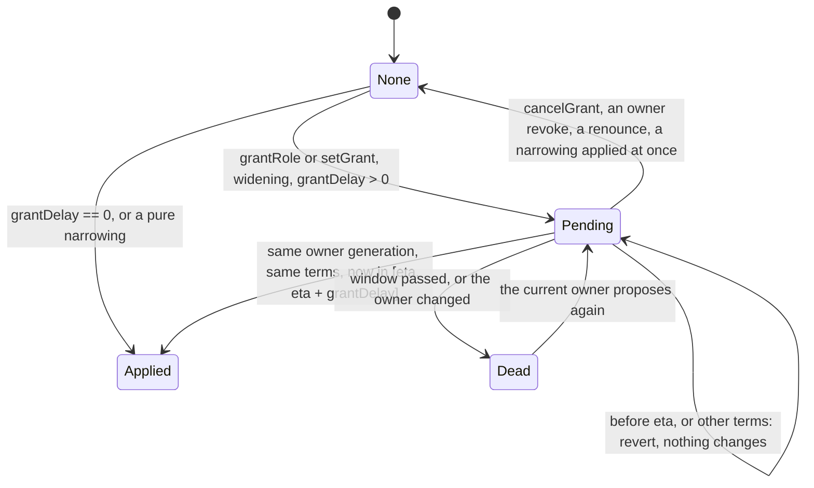

# Governance: `GovernanceBase`, the grant record, the router, the enum, hybrid underlying, the receiver check — design

**Accepted by the owner, 2026-11-03.** The build starts after `msig-nested` reaches `main`.

**Status:** BUILT on branch `governance` by plan tasks T0–T16 (EVM), except what a section marks SPECIFIED or PLANNED: the regulated implementations (§4.3, §4.4), `_delayedRelaxBits()` (§1.3), the families of §6.3 (Part D7 first). §12 applied to the component docs by T17, except §12.1 (CTR-AS-17), which waits for the owner. Written 2026-11-02 on branch `governance` at `08e92597`, from the rulings CTR-GOV-01 to -18; corrected 2026-11-03 at `9f1744c7` from three reviews of `d1132a40` (Claude, Codex, agy; §0.1) and the owner's rulings of that day, and after `6e09e008` from the final review (Fable; §0.1). A measured prototype of D1 and D2 sits on the same
branch (`66c3e74b`, `0e1cf3ac`); it is not a build of this spec. Rows of §0 cite the ruling or finding they rest on; the rows marked **controller call** are the controller's and the owner may
override them. CTR-GOV-19 ended the size gate: §9 is the record of what a public chain still needs, and it blocks nothing. Everything cryptographic here stays `UNAUDITED`.

**Inputs.** [decisions.md](../../decisions.md) CTR-GOV-01 to -19; [permission-model.md](../../research/governance/permission-model.md) (v2, cited "v2"); [permission-model-gaps.md](../../research/governance/permission-model-gaps.md)
(cited "gaps"); [permission-model-v2-attack.md](../../research/governance/permission-model-v2-attack.md) (B-01 to B-34, R-01 to R-19); [permission-model-attack.md](../../research/governance/permission-model-attack.md) (A1-A21, as v2 §3
handled them); [prototype/RESULTS.md](../../research/governance/prototype/RESULTS.md) (cited "RESULTS"); [model-comparison.md](../../research/governance/model-comparison.md); [bit-table.md](../../research/governance/bit-table.md), whose proposed rows §1.2 fixes. Code read at `08e92597`: `src/governance/`, `src/metatx/`
(`WrappedLib`, `MetaTokenBase`, `NormalToken`, `WrappedToken`, `MetaTxBase`, `UAMetaTxBase`, `ERC20MetaTx`), `src/factory/`, `src/dex/`, `src/zether/ZetherLayer.sol`, `ZetherLib.sol`, `src/pqz/PqzLayer.sol`, `test/governance/`, and the admin surface of each non-EVM
family. Form: the DEX round spec and the `typed-signing` plan.

**Words.** *Holder*: a UA id with a non-zero `roles[bit][id]` (an address before the CTR-GOV-01 Change of 2026-11-04, §1.4). *Root*: a holder with no grantor. *Leaf*: a holder set by a delegable root. *Whole shape*: a holder with no `Grant`. *Limited*: a holder bound by a `Grant`. *Live pending*: §1.6. *Live root*, *expired root*: §1.7.
*Hybrid*: a wrapped token with `maxSupply ≠ 0`, fixed at creation; `disableFeature(MINTABLE)` leaves it a hybrid (§5.2). Tags on figures: **[M]** measured in RESULTS or the attack round, **[est.]** not measured, **[I]** inferred.

## 0. Decisions — SPECIFIED

| # | Decision | Source | Section |
|---|---|---|---|
| G1 | One layer `GovernanceBase` on every token kind and `SCaaSDex`, own namespace `scaas.governance`, `AdminLib` → `GovernanceLib`, `IGovernance` replaces `ITokenAdmin` with every name kept; not in `MetaTxBase` or `UAMetaTxBase` | CTR-GOV-01 | §1 |
| G2 | Bits 0-127 global, 128-255 per application, no band refused, word stays `uint256` (CTR-GOV-10's Change, owner 2026-11-04) | CTR-GOV-10 | §1.2 |
| G3 | The whole `Grant` record is built; size blocks nothing, §9 keeps the record | CTR-GOV-02, -19, owner 2026-11-03 | §1.5, §9 |
| G4 | "+0" means no new read on `transfer` and `mtxTransfer`, on every kind, pinned | CTR-GOV-03, -11, B-33 | §10.2 |
| G5 | A regulated instance is known by its implementation; one per kind, never per feature | CTR-GOV-03 | §4 |
| G6 | Two-call `grantRole`, window, confirmer = proposer, `grantDelay` immutable, `pendingGrant`, `lastProposedAt`, `holderCount`; `acceptOwnership` not delayed | CTR-GOV-04 | §1.6 |
| G7 | `grantDelay = 0` means one call; the DEX's initial grants use the INIT path; bound 30 days | B-27 | §1.6 |
| G8 | `setGrant` that creates a holder or widens anything takes the two calls and binds a `termsHash`; a pure narrowing runs at once | B-01 | §1.6 |
| G9 | `hasRole` means listed, not able to act; `RoleGranted` fires for every new holder | B-07, B-31 | §1.5, §2 |
| G10 | Two levels, narrowing, parent debit, epoch kill; a leaf dies when its parent's scope or delegation changes or the parent goes whole | CTR-GOV-02, B-11, B-18 | §1.5 |
| G11 | A word the contract does not bind is refused at `setGrant`: masks `_scalarBits()`, `_scopeBits()` | B-09, B-10 | §1.5 |
| G12 | `grantor` is honoured only while it is live | B-04 | §1.5 |
| G13 | The renounce rule holds at `init` too, and counts live roots | CTR-GOV-02 and its Change, B-06, B-07 | §1.7 |
| G14 | `use` leaves `GovernanceLib`, `requireRole` goes | B-26, B-31 | §1.3 |
| G15 | `UA_POOL` and `SHIELD_POOL` are refused as owner | B-19 | §1.4 |
| G16 | DEX: `admin` → `owner`, `LISTING`, `FEE_ROUTING`, guard on the four powers, `supportsInterface`; a handover needs `revokeRole` | CTR-GOV-01, B-13, B-31 | §2.3 |
| G17 | `GovernanceHolder`: typed entries only, salt, generic path refused. **Since 2026-11-04 one `GovernanceRouter` per chain**, typed entries only, generic path refused (CTR-GOV-15 Change) | gaps §1, B-14, B-20, CTR-GOV-15 | §3 |
| G18 | Two-call rotation, no delay, `proposeOperator(0)` cancels, the disclosure says it once. **Gone with the holder** (CTR-GOV-15 Change): no operator; who controls a power is the governed contract's rule | CTR-GOV-15, B-21, B-22 | §3.4 |
| G19 | Relay rule: an owner or holder operation has no `mtx*` or `ua*` on the governed contract | gaps §2, B-29, B-30 | §3.6 |
| G20 | Real enum members 0-13, off until published; placeholders 6 and 7 refused | CTR-GOV-16, B-03 | §4 |
| G21 | Regulated confidential kinds: the five rules, mapped per path, Zether and PQZ apart | CTR-GOV-17, -13 | §4.3 |
| G22 | Receiver check: two feature bits on one `ComplianceRegistry`, `ALLOWLIST` bit 8 and `DENYLIST` bit 9, both off by default; each disables and locks on its own; the issuer chooses at creation | CTR-GOV-18 | §4.4 |
| G23 | Hybrid underlying | CTR-GOV-12 | §5 |
| G24 | A wrapped kind refuses a leg with bit 6 `FORCE` or bit 21 `MODERATE`; the check reads `isRegisteredToken`; bits 5, 7, 8, 9 are disclosed | CTR-GOV-05, B-15, B-34 | §6.1 |
| G25 | `RESCUABLE`, immutable `rescueTo`, per-asset check, `nonReentrant`; no DEX entry, `DexPuller` only; no tender rescue | CTR-GOV-06, -14, A15, A16, R-16 | §6.2 |
| G26 | Admin rotation and renounce on every family, four semantics | CTR-GOV-07, B-23, B-24, B-25, B-32 | §6.3 |
| G27 | Bits 13, 14 unused for ever; a party fixed at creation holds no bit; bits 15, 16 are reserved names only | CTR-GOV-14 | §1.2 |
| G28 | `MODERATE`: bit 21, body later, public balances only, on the hooked path | CTR-GOV-08 and its Change, -13, -18 | §1.2, §4.3 |
| G29 | Delayed relaxing and `RECORD`: bit taken, body later, and it covers every relaxing path | CTR-GOV-09, B-28 | §1.2 |

**Rows from the reviews of 2026-11-03.** Each changes this spec. Owner rulings first; §0.1 gives every finding its disposition.

| # | Decision | Source | Section |
|---|---|---|---|
| G30 | A leg's `decoyFee` reaches a denied account's public balance: accepted, disclosed, no cap | CTR-GOV-17, Claude I-2 | §4.3 |
| G31 | `forceTransfer` moves on an unhooked body with its own refusals of both pools and `this`; `moderatedTransfer` stays hooked and is subject to `FREEZE`, `PAUSE` and the receiver check | CTR-GOV-08 Change, Claude I-1 (FORCE half), agy C-2 | §4.3 |
| G32 | `PAUSE` on a confidential kind as on a public one: unwrap of public units is never paused. It stops shielded and public transfers, shield, unshield, unshield-unwrap; roll-over stays open. Bit 7 keeps one sentence; the old U1 is replaced | CTR-GOV-17, Claude I-5, agy C-2 | §1.2, §4.3 |
| G33 | Bit 5 differs by U4: one sentence per class of kind, recorded in the table and in `governance_bits.json` | CTR-GOV-17, Claude I-5 | §1.2 |
| G34 | The renounce rule and the relaxing rule count live roots; an expired root is defined | CTR-GOV-02, -09 Changes, Claude I-6, Codex 6, 8 | §1.3, §1.7 |
| G35 | An edit that ends a protected power before `now + grantDelay` takes the delay | CTR-GOV-09 Change, Codex 5 | §1.3 |
| G36 | C1 stands, now the owner's: a hybrid's rate may fall with no `addReserve`, and the disclosure says so | CTR-GOV-12; agy I-4 rejected | §5.3, §5.5 |
| G37 | `complianceRegistry()` is named apart from `registry()`, the UA registry | Codex 1 | §1.2, §1.8, §4.4 |
| G38 | An ownership generation: A → B → A revives no pending | Codex 2, Claude M-4 | §1.4, §1.6 |
| G39 | An operator generation, a signed word: A → B → A revives no envelope; two calls and zero delay stay. **Gone with the holder** (CTR-GOV-15 Change, §3.4) | Codex 4, Claude M-4, CTR-GOV-15 | §3.1, §3.2, §3.4 |
| G40 | `acceptOperator` is exempt from the operator check; its subject is the pending operator. **Gone with the holder** | Codex 3 | §3.1, §3.4 |
| G41 | The owner's revoke, the holder's own renounce and a narrowing delete the pending; a grantor's revoke does not; `cancelGrant` cancels one | agy C-3, Claude M-6, Fable M-1 | §1.5, §1.6 |
| G42 | `0 → finite` is a narrowing on every bound, the window pair included | Codex 7, Claude M-5, agy I-2 | §1.6 |
| G43 | `Counts` transitions complete, one test each | agy C-1, Claude M-7 | §1.7, §10.3 |
| G44 | Leaf creation refuses an expired or exhausted parent; `maxUses` is read by what remains | agy I-3 | §1.5 |
| G45 | `GrantWindowInUse` also covers a past period that lies inside the new grid | agy I-1 | §1.5 |
| G46 | `barred` is written before the early return on a non-holder | Claude M-8 | §1.5 |
| G47 | Hybrid is defined by `maxSupply ≠ 0` | Claude I-4 | Words, §5.2, §5.5 |
| G48 | The path tables of §4.3 reworked: U1 to U5, the beneficiary in `F`, the `PAUSE` sites, `wrapToUA`, `_ticketSubject()` for `UA_POOL`, late refusals before the proof | Claude I-3, M-9, M-10, M-11, agy C-2 | §4.3 |
| G49 | The three examples of CTR-GOV-10 run on the final rules | CTR-GOV-10, Claude I-7 | §1.9 |
| G50 | A second holder release carries the regulated powers; the node's rule takes a set of factories | Claude I-9 | §3.2, §12.7 |
| G51 | Rescue details: order of checks, the native asset on `NORMAL*`, `rescueTo` refused as `this` or a pool, `IRescuable` written out | agy I-7, M-2 | §6.2 |
| G52 | `_validBits()` of the plain kinds holds no `REGULATED` bit; the refusal and its error stay | agy I-6 | §1.2 |
| G53 | `Roles.compliance` is refused as bit 10 `RECORD`, not bit 8 | agy M-1 | §1.2, §2.1 |
| G54 | Matrix rows corrected: fees, `shieldScale`, the fee bounds, a rate pending against `disableFeature` | Claude M-1, M-2, Codex 9, agy §5 row 8 | §7 |
| G55 | Stale gate text gone | Claude M-3 | header, §5.6, §9, §11, §12.9 |
| G56 | The docs §12 missed | Claude M-13 | §12.2, §12.4, §12.6 |
| G57 | Buildability: `_namedCall`, the holder's immutables, errors and root, `IRescuable`, `ZetherWrappedLib`, `PqzWrappedLib`, node rows, what a regulated release needs | Claude M-12, M-14, agy I-5, M-2 | §2.3, §3, §4.2, §6.1, §11, §12.7 |
| G58 | A "+0" test on the UA path that can really fail | Codex 11 | §10.2 |
| G59 | The disclosure of a delegable holder: unlimited leaves share one budget | Codex 10 | §1.5, §1.8 |

**Controller calls.**

| # | Call | Why | If wrong |
|---|---|---|---|
| C1 | `executeRate` on a hybrid keeps every check but `c ≥ supply` (§5.3). **No longer a controller call:** the owner confirmed it on 2026-11-03, CTR-GOV-12 | That check is false by design on a token with unbacked units, and CTR-GOV-12 says a hybrid claims no full backing | A rate fall leaves the reserve short with no `addReserve`, bounded by delay, step and window. The owner accepts it: the issuer runs the rate and depositors accept it, and the disclosure states it (§5.5) |
| C2 | `maxSupply` sits in `scaas.underlying`, with a `capped` copy in leg slot a (§5.2) | A wrapped token only needs it, and slot a already holds such a copy "so a fixed-rate wrap reads no config"; a non-hybrid wrap reads nothing new, and `reserve` keeps its offset for the indexer | A slot layout to re-pin before the freeze; nothing after it, since nothing is deployed |
| C3 | Where a finding offered two fixes, the smaller that fails closed, in the library: B-02 finite budget and the disclosure; B-05 a `barred` mark; B-07 `roots` packed with `holders`, no `prune`; B-08 no `setGrant` while owner is 0; B-12 refuse a window change while spent; B-13 state it, a wizard revokes; B-14 refuse the generic path; B-16 the matrix says so; B-17 same `window`; B-31 remove `requireRole`, add the guard, emit `RoleGranted` | Each is a library line at 0 token bytes, or no code at all. Each refusal can be relaxed later by a new release; a hole cannot be closed on a deployed clone | Each is one line before the build. The one with a visible product cost: B-08 stops a locked bit's holder from delegating after a renounce |
| C4 | Names: `RETIRED_6`, `RETIRED_7`, `NORMAL_ZETHER_REGULATED`, `WRAPPED_ZETHER_REGULATED`, `NORMAL_PQZ_REGULATED`, `WRAPPED_PQZ_REGULATED`; the holder's typed struct names; `GovernanceUse`; `GovernanceHolderFactory` | CTR-GOV-16 gives numbers and the four kinds, not names | A rename before the freeze |
| C5 | Bit 18 `PUBLISH` reads "adds a release **or an environment** to a catalogue" | gaps §4: no bit covered `publishEnv`, the most powerful of the four registrar powers. No code: the bit is for a later factory | One sentence of a reserved row |
| C6 | The rules of §1 to §4 become one component doc, `docs/contracts/governance.md`, at build | The register's rows point at themselves today; "one rule, one place" wants a home, and README §3 keeps the list | Text moves between two files |
| C7 | An expired root counts as live until it is revoked (§1.7). A Change to CTR-GOV-09, accepted by the owner 2026-11-03 | The owner asked for a definition. `Counts.roots` is a stored number and no holder list exists on chain, so an expiry cannot move it without a walk. It fails toward the protection: a renounce takes one more `revokeRole`, and a frozen account stays frozen until its own bound or the owner's revoke | An exact count needs a holder list or a stored latest expiry, a new release |
| C8 | `cancelGrant(bit, account)` is the way to cancel a pending, where agy offered a revoke of a non-holder and Claude an overwrite | A confirm with other terms keeps its revert (CTR-GOV-04); a revoke would also bar the account or take the role; an entry says what it does. One more selector on every contract and one more holder op | One entry to drop before the build |
| C9 | **Gone with the holder (CTR-GOV-15 Change).** The operator generation is a named `uint64 generation`, a signed word of every holder struct, compared with the stored value before the self-call | Explicit parameters: a wallet shows it, the node builds it from a named field, and a stale envelope gets a named error, not a bad signature | Every holder typehash moves, before any is deployed |
| C10 | `F` on the payer of a wrap applies when the destination is another id. A shield and, by the owner's word of 2026-11-03, a wrap-shield keep `F` on the payer whatever `toUA` is | agy C-2's route runs through `wrapToUA`; a wrap into one's own frozen balance is a credit, and credits are never refused (CTR-AS-05). The underlying is another asset, so a frozen account can still hand it to someone else: this closes the account's own route only. A wrap-shield into one's own id spends that same other asset, so it follows the wrap. A shield spends the locked public balance itself (`_poolMove`, `_toPool`), which CTR-GOV-17 locks | One condition in `_wrap`, the order entries and the wrap-shield entries, when built |
| C11 | Under `PAUSE`: `rescue`, direct `addReserve` and `mtxPrepareAcc` stay open; every relayed op that stays open runs at fee `NONE` | `rescue` moves what the token does not owe, `addReserve` is "unchanged" in asset-suite §2.4, prepare is what a roll-over needs; a fee leg is a transfer (CTR-AS-06) | One line of a table of a kind not built |

### 0.1 Disposition of the three reviews

Reviews of `d1132a40`, by Claude, Codex and agy. agy rated three findings Critical; they are treated as top Important. Every finding has a row. **Rejected** means the code or a ruling refutes it, with the reason in the row. "Owner" means a ruling of 2026-11-03 in `docs/decisions.md`.

| Finding | Disposition |
|---|---|
| Claude I-1 | **FORCE half fixed**, §4.3, CTR-GOV-08 Change. **MODERATE half rejected:** "passes `FREEZE` and `ALLOWLIST`" means subject to them, not past them (`permission-model.md` F11): a frozen `from` is refused, `PAUSE` refuses it, the receiver check applies. `moderatedTransfer` stays hooked, CTR-GOV-08 Change |
| Claude I-2 | Owner: accepted and disclosed, no cap. CTR-GOV-17, §4.3 |
| Claude I-3 | Fixed, §4.3: the beneficiary in every `F` cell of Transfer, Unshield, Unshield-unwrap |
| Claude I-4 | Fixed, Words, §5.2, §5.3, §5.5, §7.4 |
| Claude I-5 | Owner: bit 7 one sentence, CTR-GOV-17. Bit 5 one sentence per class, §1.2 |
| Claude I-6 | Owner: live roots, CTR-GOV-09 Change. Expired root defined, §1.7, C7 |
| Claude I-7 | Fixed, §1.9, §10.3 |
| Claude I-8 | Closed by the owner: CTR-GOV-02 Change |
| Claude I-9 | Fixed, §3.2, §12.7 |
| Claude M-1 | Fixed, §7.2. `MtxPipelineLib._callFee`: `ABSOLUTE` + `FIXED` is the signed amount, uncapped |
| Claude M-2 | Fixed, §7.5, §7.6. See the disagreements below |
| Claude M-3 | Fixed: header, G3, §5.6, §9, S0, §12.9 |
| Claude M-4 | Fixed, §1.6, §3.4 |
| Claude M-5 | Fixed, §1.6 |
| Claude M-6 | Fixed, §1.6, by `cancelGrant`, not by an overwrite (C8) |
| Claude M-7 | Fixed, §1.7 |
| Claude M-8 | Fixed, §1.5 |
| Claude M-9 | Fixed: U4's fee at the shape step, §4.3; the reserve quote before the proof, §5.4 |
| Claude M-10 | Fixed, §4.3: the payer is `_subject()`; the Zether check sits in the layer. On `_burn`, the owner's PAUSE ruling makes `F` and `P` right for both entries, so only `R(recipient)` moves to `mtxUnshield` |
| Claude M-11 | Fixed, §4.3, C11 |
| Claude M-12 | Fixed, §4.2, §12.1 |
| Claude M-13 | Fixed, §12.2, §12.4, §12.6 |
| Claude M-14 | Fixed: `_namedCall` §3.2; `FACTORY` §3.1; holder implementation in the config, §12.7; `_roleBits()` per kind §1.2; PQZ layout JSON §10.4; pools and the holder refused as operator §3.1; S2's node cell §11 |
| Codex 1 | Fixed, §1.2, §1.8, §4.4, §7.7, §12.4 |
| Codex 2 | Fixed, §1.4, §1.6. A cancelled `transferOwnership` kills nothing: only a completed change of owner bumps the generation |
| Codex 3 | Fixed, §3.1, §3.4 |
| Codex 4 | Fixed, §3.1, §3.2, §3.4. See the disagreements below |
| Codex 5 | Owner: CTR-GOV-09 Change. §1.3, PLANNED with the mask; test in §10.3 |
| Codex 6 | Owner: CTR-GOV-09 Change. §1.3, §1.7: a bit is active while `roots ≠ 0`, never by `holderCount`; test in §10.3, PLANNED |
| Codex 7 | Fixed, §1.6 |
| Codex 8 | Closed by the owner: CTR-GOV-02 Change |
| Codex 9 | Fixed, §7.5, §7.6 |
| Codex 10 | Fixed, §1.5, §1.8, §8 B-02 |
| Codex 11 | Fixed, §10.2 |
| agy C-1 | Fixed, §1.7: sequence A is a real gap of the rules as written (`_grant` adds no root over a `LIMITED` leaf); B and C are implementation traps, closed by reading `r` first and by the owner's apply clearing `grantor` |
| agy C-2.1 | Fixed, §4.3: the beneficiary in `F`, the Zether checks before the proof |
| agy C-2.2 | **Rejected:** it rests on the old U1, which the owner replaced. Roll-over stays open under `PAUSE` (CTR-GOV-17, controller reading, owner may override) |
| agy C-2.3 | `forceTransfer`: fixed, §4.3, CTR-GOV-08 Change |
| agy C-2.4 | Fixed in part, §4.3, C10. Not a bypass of a freeze: `wrapToUA` moves no frozen value, the underlying is another asset. The route is closed for one's own account only |
| agy C-2.5 | Fixed, §4.3 |
| agy C-3 | Fixed, §1.5, §1.6. Sequence A needs the owner's revoke to delete the pending (narrowed by Fable M-1); sequence B needs a cancel |
| agy I-1 | Fixed, §1.5, in one condition: the "old window still active" arm is implied. Its last step, a stale record under `WHOLE`, is fixed too: the check skips a `WHOLE` holder |
| agy I-2 | Fixed, §1.6 |
| agy I-3 | Fixed, §1.5 |
| agy I-4 | **Rejected:** CTR-GOV-12. A `RATE_ADJUSTABLE` hybrid's rate may fall with no `addReserve`: the issuer runs that rate and depositors accept it, and the disclosure states it. C1 stands, §5.3, §5.5 |
| agy I-5 | Fixed, §3.2 (`_namedCall`), §12.7 (`deploy` row, `NESTED`, `ALL`, `UACancelNonce`, the relay path) |
| agy I-6 | Fixed, §1.2, keeping each kind's error |
| agy I-7 | Fixed, §6.2 |
| agy M-1 | Fixed, §1.2, §2.1 |
| agy M-2.1 | Fixed, §6.1: `_addLeg` reads the factory as `msg.sender`, so no signature changes; §11 lists the two libraries for their `libCodeHashes` |
| agy M-2.2 | Fixed, §2.3, §6.2 |
| agy M-2.3 | Fixed, §3.1. **Its root constant is rejected:** the ERC-7201 formula, which reproduces the roots of `scaas.governance` and `scaas.underlying`, gives `0x86d8592a976ab91a258d36c502084dc93b41b1785adce6f7419d9b3d4ee9be00` for `scaas.holder`, not `0x1798…5000` |
| agy M-2.4 | **Rejected:** `MetaTokenBase.sol:45` declares `address public immutable SMART_KEY_ACCOUNT_IMPL`, so every token has the getter. §7.2's row is true |
| agy §5 row 8 | Fixed, §7.4: `disableFeature(RATE_ADJUSTABLE)` cancels a pending at once, if unlocked |
| agy §5 row 9 | **Rejected:** see the disagreements below |
| agy R-2 | **Rejected as stated:** see the disagreements below. agy R-1 and R-3 to R-6 stand |

Each reviewer's other refuted claims stand: they were tested against the code and the rulings and no hole was shown. Codex's "a confirmation can substitute other terms" and Claude's "`termsHash` swap" are the same claim, refuted the same way.

**Disagreements settled from the code.**

| Question | Who is right | Why |
|---|---|---|
| Is §7.5's and §7.6's "`shieldScale`, `maxShielded` `≤ 2^54` / `≤ 2^62`" true? agy: true. Claude, Codex: false | **Claude and Codex** | `ZetherLib.init` and `PqzStateLib.init` bound `maxShielded` alone: `shieldScale == 0` reverts, and `maxShielded > type(uint256).max / shieldScale` reverts. `maxShielded = 1` with `shieldScale = 2^70` passes both. agy's citation shows the constant, which applies to the cap |
| Is envelope replay after a rotation refuted? agy R-2: yes. Codex 4: A → B → A replays | **Codex** | agy tested one way: `O1`'s envelope fails while `O2` is operator, which is true. But a revert leaves the nonce unspent and no signed word changes, so when the operator returns to `O1` the withheld envelope runs. Hence §3.1's generation |

**The final review of `6e09e008`, by Fable.** No Critical, no Important, nine Minor, each checked here against the text and the code. Its Refuted list changes nothing.

| Finding | Disposition |
|---|---|
| Fable M-1 | Fixed, §1.5, §1.6, §1.7, §2.2, §10.3, G41. A grantor's revoke bars nobody, and the confirm re-runs every check and makes the root the owner proposed, so deleting the pending only let a grantor cancel the owner's proposal |
| Fable M-2 | Fixed, §1.8, §3.1, §3.3, §10.3. The holder refuses its factory, its implementation and clones of it, by the clone code hash of §12.7. A token has no such hash, and another release's clone or one not yet deployed passes: disclosed. **Its wallet sentence is rejected:** printing "no controller" for every contract that is no `SmartKeyAccount` clone or UA would misname a Safe, which can call the holder |
| Fable M-3 | Fixed, C10, §4.3. Owner 2026-11-03: a frozen payer's wrap-shield is refused whatever `toUA` is, as a shield is (CTR-GOV-17) |
| Fable M-4 | Fixed, §4.2. `WrappedLib` links `GovernanceLib`; `ZetherWrappedLib` and `PqzWrappedLib` link `WrappedLib`, not `GovernanceLib` itself, so the closure takes all three |
| Fable M-5 | Accepted by the owner 2026-11-03: Change lines in the register, §12.9 |
| Fable M-6 | Fixed, §5.2, §5.4, §5.5, §7.4, §10.3. The cap is the token's: it binds wraps and stays after `disableFeature(MINTABLE)`. The finding's other option, lifting it on wraps, is not taken |
| Fable M-7 | Fixed, §5.4, §7.4, §10.3: the refusal stays, stated with what it costs |
| Fable M-8 | Fixed, §11, §12.7. **Its failure is corrected:** a missing field is `422 BAD_PAYLOAD` at accept, not a silent `dead`. The node builds from the job's field, never from `generation()`, and the guard compares the two at lease, since intake reads no chain. The field sits in `args`, apart from `origin.generation` |
| Fable M-9 | Fixed, §1.2. The finding's sentence still left out unshield and the fee leg, and roll-over stays open too, so the sentence names them |

## 1. The model — SPECIFIED

### 1.1 One sentence

A bit says whether a right exists on this contract; a holder entry says who has it; an optional grant record says within what; the owner, after a delay, changes holders and grants; a lock makes a bit permanent.

The worst case of a contract's bits is the worst case of **that contract's own code** (A5). A leg's issuer is read separately (§1.8).

**Who takes the base.** Every contract with a power that can change hands: the six token kinds, the regulated kinds when built, `SCaaSDex`, a third-party application. **Not** a contract whose parties are fixed at creation (CTR-GOV-14): `SealedBidTender`, `VestingGrant`,
`Distribution`, `ExchangeOffer`. Not `OpenFactory` (its `registrar` stays one address), `UARegistry`, `MandateWallet`, `SmartKeyAccount`, the relay router.

### 1.2 The bit table, final allocation

`GovernanceBits.sol` holds the constants. A contract without the power leaves the bit off. **Capability**: no holder, serves or binds everyone, `grantRole` reverts `NoSuchRole`. **Power**: has holders. The type is `_roleBits()`, never a second declaration. **Reduce-only** means reduces power over holders (A9).

| Bit | Name | Meaning, the same on every contract | Type | Reduce-only | Contract-only | In this release |
|---|---|---|---|---|---|---|
| 0 | `PAYABLE` | anyone may pay through the pay entries | capability, always locked | — | — | as built |
| 1 | `MINTABLE` | a holder creates units | power | no | no | `NORMAL*`, and `WRAPPED*` as a hybrid (§5). Scalar bit |
| 2 | `BURNABLE` | any holder of units destroys its own | capability, always locked | — | — | as built |
| 3 | `RATE_ADJUSTABLE` | a holder changes a conversion rate under the rate timelock | power | no | yes | as built |
| 4 | `WRAP_DISABLEABLE` | a holder closes an inflow, one-way | power | yes | no | as built |
| 5 | `FREEZE` | a holder stops one account from sending, bounded in time. **Public kinds:** that account in any role, the envelope `from` of a meta-tx op included (CTR-AS-05). **Confidential kinds:** that account as a proof's sender; an envelope `from` is not read (§4.3, U4) | power | no | yes | refused, regulated kinds |
| 6 | `FORCE` | a holder moves units out of a frozen account to a recorded beneficiary; public balances only | power | no | yes | refused, regulated kinds |
| 7 | `PAUSE` | a holder stops transfers, mints, wraps, shields, unshields and every relayed fee, bounded in time; unwrap of public units, holder burn, a forced transfer and roll-over are never paused (CTR-AS-06, §4.3) | power | no | yes | refused, regulated kinds |
| 8 | `ALLOWLIST` | a receiver of a public balance must hold `requiredFlags` in a `ComplianceRegistry` pinned at creation (§4.4) | capability, parameters `complianceRegistry`, `requiredFlags` | — | — | refused, regulated kinds |
| 9 | `DENYLIST` | a receiver of a public balance must hold none of `deniedFlags` in that registry (§4.4) | capability, parameters `complianceRegistry`, `deniedFlags` | — | — | refused, regulated kinds |
| 10 | `RECORD` | a holder writes a compliance record another power relies on; one holder is refused both this and `FORCE` | power | no | yes | number only (CTR-GOV-09) |
| 11 | `LISTING` | a holder decides what this instance trades or accepts | power | no | no | `SCaaSDex` |
| 12 | `FEE_ROUTING` | a holder decides who receives this instance's fees, never how much | power | no | no | `SCaaSDex` |
| 13 | unused | never allocated, never reused (CTR-GOV-14) | | | | |
| 14 | unused | never allocated, never reused (CTR-GOV-14) | | | | |
| 15 | `ARBITRATE` | reserved name, no spec behind it, no meaning yet | | | | none |
| 16 | `CORRECT` | reserved name, no spec behind it, no meaning yet | | | | none |
| 17 | `RESCUABLE` | anyone may move what this instance does not owe to `rescueTo` | capability, always locked, parameter `rescueTo` | — | — | token kinds (§6.2) |
| 18 | `PUBLISH` | a holder adds a release or an environment to a catalogue (C5) | power | no | no | none: `OpenFactory` keeps `registrar` |
| 19 | `DEPRECATE` | a holder marks a release unusable for new instances, never undone | power | yes | no | none |
| 20 | `ENABLE_KIND` | a holder turns a catalogue kind on or off | power | no | no | none |
| 21 | `MODERATE` | a holder moves public units out of an account, no record, subject to `FREEZE`, `PAUSE` and the receiver check (§4.3) | power | no | yes | number only (CTR-GOV-08, -13) |
| 22-127 | free | allocated once, by a spec, when one names a power | | | | |
| 128-255 | per application | the contract's own, labelled by `bitLabel(bit)`; never in this table (CTR-GOV-10's Change, owner 2026-11-04) | | | | |

`MODERATE` had a number and no code; CTR-GOV-18 moved it from 9 to 21 so that the two receiver bits sit together. Bit 10 maps `Roles.compliance`; bits 8 and 9 have no holder, so the `compliance` word stops meaning "the `ALLOWLIST` role" (§12.3), and `init` refuses a non-zero `roles.compliance` with `RoleWithoutFeature(10)`, not 8.

Bit 7 is one sentence, since a public kind has no shielded path and the shielded words bind nothing there. Bit 5 is two: U4 is a ruling against CTR-AS-05 on the confidential kinds, so CTR-GOV-10's "one meaning" reads here as one sentence per class of kind, recorded in this table and in `governance_bits.json`, and proposed as a Change to CTR-GOV-10, §12.9. Per contract in this release:

| Contract | `_validBits()` | `_roleBits()` | `_contractOnlyBits()` | `_scalarBits()` | `_scopeBits()` |
|---|---|---|---|---|---|
| `NORMAL*` | 0, 1, 2, 17 | 1 | 0 | 1 | 0 |
| `WRAPPED*` | 0, 1, 3, 4, 17 | 1, 3, 4 | 3 | 1 | 0 |
| `SCaaSDex` | 11, 12 | 11, 12 | 0 | 0 | 0 |

`_validBits()` holds no bit of 5-9 on any kind of this release, so `validBits()` tells a wallet the truth; `NormalToken` and `WrappedToken` carry `| REGULATED` today, and it leaves that function. The refusals stay as they are: `NORMAL` and `WRAPPED` pass `_validBits() | REGULATED` to `GovernanceLib.init`, so 5-9 reach its `FeatureNotBuilt`; the four confidential kinds pass `_validBits()`, so they stay `FeatureInvalidForKind`. That is the built state, not a permanent rule (CTR-GOV-03). `init` refuses by the mask it is given, so when a release lifts `FeatureNotBuilt` (§4.2) the plain kinds drop `| REGULATED` in the same release, or a plain kind would take a control it has no hook for.

The masks replace the shared `TOKEN_ROLES` and `TOKEN_CONTRACT_ONLY`: `WrappedLib.initToken` takes the kind's masks. A `grantRole(3, x)` on a `NORMAL*` kind moves from `RoleWithoutFeature` to `NoSuchRole`.

`smartcontracts/vectors/governance/governance_bits.json` carries `bit → name → type → one disclosure sentence`, written by a forge test from the constants and read by every client. Bit 1 has two sentences, plain and hybrid; bit 5 two, public and confidential kinds. Bits 128-255 come from `bitLabel(bit)`.

### 1.3 The pieces

| Piece | What it is |
|---|---|
| `GovernanceBits` | constants only |
| `GovernanceLib` | external library, DELEGATECALL, one body audited once: `init`, `initHolder`, `grantRole`, `setGrant`, `cancelGrant`, `revokeRole`, `renounceRole`, `disableFeature`, `transferOwnership`, `acceptOwnership`, `renounceOwnership`, `useLimited`, and the rescue of a `NORMAL*` kind |
| `GovernanceUse` | internal library in `GovernanceBase.sol`: `use`, whose body is the whole-shape fast path and one DELEGATECALL to `GovernanceLib.useLimited`. solc refuses a qualified call from `GovernanceLib` into itself, so today's `use` inlines `useLimited` into every caller (B-26). Measured [M]: `NormalToken` −1,096 B, `NormalZetherToken` −1,082, `NormalPqzToken` −1,058, `SCaaSDex` −1,065, `WrappedLib` −1,077, every wrapped token 0 |
| `GovernanceBase` | abstract: one-line wrappers, the `IGovernance` ABI, the masks below, no storage of its own |
| `IGovernance` | §2 |

`requireRole` is removed (B-31): nothing calls it, and it skips a limited holder's grant. Every power runs through `use`. `hasRole` stays a view.

```solidity
abstract contract GovernanceBase is IGovernance {
    function _guardIn() internal virtual returns (bool);
    function _guardOut(bool outer) internal virtual;
    function _caller() internal view virtual returns (address);
    function _govSubject() internal view returns (bytes32); // CTR-GOV-01 Change: GOV_ROUTER's subject, else the native id of _caller()
    function _validBits() internal pure virtual returns (uint256);        // both bands
    function _roleBits() internal pure virtual returns (uint256);         // subset with holders
    function _contractOnlyBits() internal pure virtual returns (uint256); // subset whose holder must have code
    function _scalarBits() internal pure virtual returns (uint256);       // subset whose power passes the number it acts on (B-09)
    function _scopeBits() internal pure virtual returns (uint256);        // subset whose power reads `use`'s return (B-10)
    function _scopeNarrows(uint8, bytes32 parent, bytes32 child) internal view virtual returns (bool) { return parent == child; }
}
```

`_delayedRelaxBits()` of CTR-GOV-09 is not added now: it arrives with the regulated implementations, which are new releases. When it is written it covers `revokeRole`, `disableFeature`, `renounceRole`, an edit that makes the power end before `now + grantDelay`, and a parent's revoke killing leaf issuers (B-28). An edit ends a power by a `validUntil` before that time, or by a budget at or below what is spent: a one-second expiry takes the delay as a past one does (CTR-GOV-09 Change, Codex 5), and on a masked bit such an edit is no pure narrowing of §1.6. A masked bit stays active while `roots ≠ 0` (§1.7), never by `holderCount`, which counts dead leaves (Codex 6). PLANNED.

### 1.4 Storage, `erc7201:scaas.governance`

Root `0x0a3a361961b35589cdb03530b6f9e23a4db6ca9a0dad5ddf5d7761c7fabc8700`. `scaas.token` keeps `creator`, `version`, `kind`, `decimals`, `initialized`, `name`, `symbol` (`TokenStore`). `reserve` stays in `scaas.underlying`.

**Every identity is a UA id, `bytes32`** (CTR-GOV-01 Change, owner 2026-11-04; [Change spec](2026-11-04-governance-ua-identity.md) §1, §4): `owner`, `pendingOwner`, every key of `roles`, `grants`, `epoch`, `pending`, `Grant.grantor`, `PendingGrant.proposer`. A native account's id is its address padded to 32 bytes (`bytes32(uint256(uint160(a)))`), a derived UA's its registered id. `rescueTo` is a payout destination and stays an `address`. All chains are test-only, so the layout was renewed, not migrated (`test/v2/layout/namespaces.json`). BUILT on branch `governance` (plan T10b).

```solidity
struct Counts { uint128 holders; uint128 roots; }                       // one slot: `holderCount` is `holders`, the renounce rule reads `roots`
struct PendingGrant { uint64 eta; uint32 generation; bytes32 proposer; bytes32 termsHash; } // three slots; 0 termsHash = `grantRole`
/// @custom:storage-location erc7201:scaas.governance
struct GovernanceStorage {
    uint256 features;                                                   // +0, written by init, cleared one-way
    uint256 lockedFeatures;                                             // +1, no writer after init
    bytes32 owner;                                                      // +2
    bytes32 pendingOwner;                                               // +3
    uint64 grantDelay; uint32 ownerGeneration; uint64 lastProposedAt;   // +4, grantDelay has no writer after init; §1.6
    mapping(uint256 bit => mapping(bytes32 => uint8)) roles;            // +5, 0 none, 1 WHOLE, 2 LIMITED
    mapping(uint256 bit => Counts) counts;                              // +6
    mapping(uint256 bit => mapping(bytes32 => IGovernance.Grant)) grants; // +7
    mapping(uint256 bit => mapping(bytes32 => uint32)) epoch;           // +8
    mapping(uint256 bit => mapping(bytes32 => PendingGrant)) pending;   // +9
    address rescueTo;                                                   // +10, no writer after init
}
```

**Who is calling.** `_govSubject()` is the subject of every governance check and of every power's own entry (`mint`, `mintToUA`, `disableWrap`, the rate entries, the DEX's setters): when `msg.sender` is the release's `GOV_ROUTER` (an immutable from `Env.govRouter`; 0 = no router on this chain), `IGovernanceRouter(GOV_ROUTER).subject()`, the UA the router authenticated for that call, 0 outside a live call, which every check refuses; from any other caller its native id. No signature is verified in the governed contract. BUILT; the router itself BUILT by plan T11 (§3).

`init` and `transferOwnership` refuse `UA_POOL` and `SHIELD_POOL` as owner (`OwnerAccountPool`, B-19), as native ids; `_check` refuses them as holders (`RoleAccountPool`) and 0 (`RoleAccountZero`). A contract-only bit (`_contractOnlyBits()`, `RATE_ADJUSTABLE` on `WRAPPED*`) is held only by a native id whose address has code at the grant: a derived UA is refused `RoleNotContract`. `grantDelay` above 30 days is refused (`GrantDelayTooLong`): `MAX_NOTICE_PERIOD`'s reason applies (B-27).

### 1.5 The grant record

`GrantTerms` and `Grant` are in §2.1. A grant binds one `(bit, holder)`; no clone exists, so no second budget does. The scalar a contract passes to `use` is the number it then acts on, never a number the caller chose for the check (A11).

**At `use`.** Feature set, else `FeatureNotSet`. `WHOLE` returns 0. No holder: `MissingRole`. `LIMITED`: `useLimited` debits the holder's terms, then, for a leaf, checks `roles[bit][parent] == LIMITED` and the epoch (`GrantExhausted(7)`), then debits the parent on the same scalar, so its `min`, `max`, `maxUses` and expiry bind too.

**At `setGrant`, every caller:**

| Check | Refusal |
|---|---|
| bit outside `_roleBits()`, zero account, a pool, feature clear, contract-only and no code | as `grantRole` |
| bit outside `_scalarBits()` and any of `min ≠ 0`, `max ≠ type(uint128).max`, `total ≠ 0`, `perWindow ≠ 0`, `window ≠ 0` | `GrantWordRefused(bit, field)` (B-09). Only `validUntil`, `maxUses`, `delegable` bind such a bit |
| bit outside `_scopeBits()` and `scope ≠ 0`; or bit inside it and `scope == 0` | `GrantWordRefused(bit, 7)` (B-10). 0 means whole shape on a scoped power and nothing else; CTR-GOV-08's "any" is a non-zero constant named when `MODERATE` is built |
| `(perWindow == 0) != (window == 0)` | `GrantWordRefused(bit, 3)` |
| `delegable` with no finite budget: `total == 0` on a scalar bit, `maxUses == 0` on another | `GrantBudgetRequired(bit)` (B-02). The budget bounds what is spent, not how many leaves exist: a leaf spends nothing until it acts (Codex 10), so the disclosure prints "can add unlimited leaves at once, sharing a remaining budget of N" |

**The owner's path** is §1.6. When it applies terms to a `LIMITED` holder and `scope` changed or `delegable` cleared, it bumps `epoch[bit][holder]`, so the leaves die as at a revoke (B-11). `_grant` over a `LIMITED` holder bumps it too (B-18). A leaf the owner edits becomes a root: `grantor` 0, `roots + 1`. The owner's apply, by either entry, writes `grantor = 0`, `grantorEpoch = 0`, `barred = false`, whatever the kept record held; `Counts` moves by §1.7.

**The leaf path.** Caller `LIMITED` and `delegable` (else `NotOwner`); `owner ≠ 0` (else `NotOwner`, B-08: nothing above changes once the owner is 0, the holder list included); the caller is not expired (`GrantExpired(bit, caller)`); the target holds nothing or is the caller's own leaf; the target is not `barred` (`GrantBarred`, B-05); the terms narrow, so an expired parent or one with nothing left adds nobody:

| Field | Child against parent `p` | `GrantNotNarrower(field)` |
|---|---|---|
| `delegable` | false | 6 |
| `min` | `≥ p.min` | 0 |
| `max` | `≤ p.max` | 1 |
| `total` | if `p.total ≠ 0`: `≠ 0` and `p.spentTotal + t.total ≤ p.total`, by comparison, never a subtraction (B-18) | 2 |
| `perWindow`, `window` | if `p.perWindow ≠ 0`: `perWindow ≠ 0`, `≤ p.perWindow`, and `window == p.window` (B-17) | 3, 8 |
| `validUntil` | if `p.validUntil ≠ 0`: `≠ 0`, `≤ p.validUntil` | 4 |
| `maxUses` | if `p.maxUses ≠ 0`: `≠ 0` and `p.uses + t.maxUses ≤ p.maxUses`, by comparison, as `total` | 5 |
| `scope` | `_scopeNarrows(bit, p.scope, t.scope)`, checked in the stub after the library returns: the library is DELEGATECALLed and cannot reach an internal virtual | 7 |

A wrong `_scopeNarrows` is application code the base cannot see (v2 §7.2); the epoch rule below covers a parent that loses a scope, and that is the mitigation there is.

**Edits.** One rule: an edit never refreshes a budget. `spentTotal`, `spentInWindow`, `uses` carry. A change of `window` on a holder that is not `WHOLE` is refused (`GrantWindowInUse`, B-12) while `spentInWindow ≠ 0` and the period that spent ends after the start of the current period on the new grid: `windowStart + g.window > now − now % t.window`, with `now` for the right side when `t.window == 0`, in `uint256`. The grid start depends on `window`, so a period already over on the old grid can lie inside the new one, and `_debit` would read it as unspent (agy I-1: 100 spent at day 15 on a 10-day grid, a change to 30 days at day 21, 100 more the same day). A `WHOLE` holder had no bound: stale words of its kept record refuse nothing.

**Revoke.** Owner, or the leaf's grantor while `roles[bit][account] == LIMITED` and the grantor still holds the bit (B-04); `_grant` clears `grantor`. A revoke keeps the record and bumps the epoch, or revoke then grant would refresh a budget. A revoke by the owner sets `barred`: only the owner re-admits that account (B-05). It writes `barred` first, before the early return on a non-holder, so a leaf that front-runs the revoke with `renounceRole` is barred all the same. The owner's revoke and the holder's own renounce delete `pending[bit][account]`: a pending must not restore in one call what a revoke took, `barred` included (agy C-3). A grantor's revoke leaves it: it bars nobody, and the confirm re-runs every check and makes the account the root the owner proposed (Fable M-1).

**`hasRole` means listed, not able to act** (B-07). A dead leaf stays listed and counted; a wallet reads `grantOf` and still simulates.

### 1.6 The delay



A pending at `(bit, account)` is **live** when `eta ≠ 0`, `generation == ownerGeneration` and `now ≤ eta + grantDelay`. `termsHash` is `keccak256(abi.encode(GrantTerms))`, or 0 for `grantRole`.

`ownerGeneration` counts completed changes of owner: `acceptOwnership` and `renounceOwnership` bump it, and a `transferOwnership` that is cancelled or never accepted does not. So after A → B → A a pending of A's first term stays dead, though A is the owner again (Codex 2). An equal generation means the same owner, which is CTR-GOV-04's "the confirmer must be the proposer"; `proposer` stays in the record for `pendingGrant`. An accept by the owner itself bumps it too, and kills every pending, which harms nothing.

The owner calls the same entry twice.

| Situation at the call | Result |
|---|---|
| `grantDelay == 0` | applied at once: the window would be one timestamp, and an EOA's second call would land dead (B-27) |
| `grantRole` on a `WHOLE` holder | no-op, nothing proposed |
| `setGrant` on a `WHOLE` root, `delegable` false | applied at once: a narrowing; deletes the pending at `(bit, holder)` |
| `setGrant` on a `LIMITED` root and `t` narrows the record field by field: `min` not lower, `max` not higher; each of `total`, `perWindow`, `validUntil`, `maxUses` with `g.x == 0 \|\| (t.x ≠ 0 && t.x ≤ g.x)`, since 0 is no bound and `0 → finite` narrows on every bound; `window` equal, or new with the limit it carries (`g.perWindow == 0 && t.perWindow ≠ 0`); `scope` equal; `delegable` not raised | applied at once (B-01); deletes the pending at `(bit, holder)` |
| anything else: a new holder, `grantRole` on a `LIMITED` holder, an edit that widens any word, a leaf the owner would make a root (it drops the parent's bound) | two calls |
| no live pending | writes the pending with `generation = ownerGeneration`, `lastProposedAt = now`, emits `GrantProposed` |
| live pending, other `termsHash` | `GrantTermsMismatch` |
| live pending, `now < eta` | `GrantNotReady` |
| live pending, in the window, same `termsHash` | deletes the pending, applies, re-running every check at confirm |

`cancelGrant(bit, account)`: the owner, at once, deletes a pending, live or dead; none there is a no-op. A wrong proposal is cancelled and proposed again: without it a live pending refuses every other term for up to `2 × grantDelay`, and only a change of owner would clear it (agy C-3, C8). A dead pending is harmless: nobody can confirm it, `pendingGrant` says it is dead, and the next proposal overwrites it. `holderCount` never counts a pending. INIT grants take the INIT path, once, undelayed. `acceptOwnership` is not delayed. `revokeRole`, `disableFeature`, `renounceOwnership`, `renounceRole` run at once (A6).

The rate timelock stays as built. `grantDelay` delays an address, never who controls it (§3.4).

### 1.7 The renounce rule, live roots, `Counts`

**Live root.** A root is a holder with `grantor == 0`; a leaf never counts, live or dead. An **expired root** is a `LIMITED` root past its `validUntil` (`validUntil ≠ 0`, `now > validUntil`): it cannot act, its leaves cannot act since their parent's debit reverts, and only an owner's edit revives it, in two calls. A root out of budget is not expired. `Counts.roots` is the count both rules read (CTR-GOV-02, -09 Changes), and it is a stored number: the chain sees an expiry only by a walk, and no holder list exists on chain. So **an expired root counts as live until it is revoked** (C7; proposed Change, §12.9). For the renounce rule that costs the owner one `revokeRole`. For the relaxing rule it fails toward the protection: the bit stays active, a freeze or a pause ends by its own bound (CTR-AS-05, CTR-AS-06), and the owner's revoke is the relaxation.

`renounceOwnership` reverts `OwnerHasHolders(bit)` while a set bit in `features & ~lockedFeatures & _roleBits()` has `roots ≠ 0`. Dead leaves do not count: they would otherwise block it until the owner walks them by hand (B-07), and revoking every root kills every leaf.

`init` runs the same loop when `owner == 0` (B-06): a token cannot be born in the state a renounce refuses. A locked bit's holders survive a renounce, because a lock promises the power is permanent; a surviving limited holder keeps its `Grant` and can add nobody (B-08).

**`Counts`, every transition.** `r` is `roles[bit][account]` before the call. A kept record's `grantor` never decides anything while `r == 0` (agy C-1). `_clear` reads `grantor` before it clears `r`. One test per row, §10.3.

| # | Before | By | After | `holders` | `roots` |
|---|---|---|---|---|---|
| 1 | `r == 0` | the owner's apply, or INIT | root, `WHOLE` or `LIMITED`, `grantor` 0 | +1 | +1 |
| 2 | `r == 0` | a delegable holder | leaf | +1 | 0 |
| 3 | leaf | its grantor, an edit | leaf | 0 | 0 |
| 4 | leaf | the owner's `setGrant` | root, `LIMITED`, `grantor` 0 | 0 | +1 |
| 5 | leaf | the owner's `grantRole` | root, `WHOLE`, `grantor` 0 | 0 | +1 |
| 6 | root | the owner's `setGrant` or `grantRole` | root | 0 | 0 |
| 7 | root | `revokeRole`, `renounceRole` | `r == 0`, record kept, pending deleted | −1 | −1 |
| 8 | leaf | `revokeRole`, `renounceRole` | `r == 0`, record kept; pending deleted by the owner's revoke or the renounce, kept by a grantor's revoke | −1 | 0 |
| 9 | `r == 0` | `revokeRole` by the owner | `barred` set, pending deleted | 0 | 0 |
| 10 | leaf whose parent went | nobody: the leaf is dead, listed | unchanged | 0 | 0 |
| 11 | root past `validUntil` | nobody: it counts until row 7 | unchanged | 0 | 0 |

Rows 4 and 5 are agy C-1's first sequence: without `+1` a live root is uncounted, the owner renounces past it, and its own revoke underflows.

A DEX handover (B-13): `transferOwnership` moves neither bit 11 nor 12, since the owner holds them as an ordinary holder. The old owner keeps them until `revokeRole`, and the new owner waits `grantDelay`. A wizard runs the revoke. Stated, 0 B.

### 1.8 What a wallet reads, in order

1. `factory.isRegisteredToken(t)`, `versionOf(t)`.
2. `kind()`, `features()`, `lockedFeatures()`: one sentence per set bit. `lockedFeatures` says the power exists for ever, the reverse of "locked" in most systems.
3. `owner()`: 0 means nothing above can change. Else `grantDelay()`, `pendingOwner()`, and a warning when `lastProposedAt()` is within `2 × grantDelay`: read `GrantProposed` and `pendingGrant`, which says whether a pending is live.
4. Per power bit: `holderCount(bit)` against the indexed `RoleGranted` / `RoleRevoked` list, then per holder `grantOf`. A delegable holder prints "can add unlimited leaves at once, sharing a remaining budget of N".
5. A holder that is a native id with code prints "whole shape, mutable by its own rules"; a derived UA prints its kind from the registry, an `msig` its members, weights and threshold (CTR-UA-37: a new `msig` takes over by a grant, never by a change of members). Once, for every contract holder: **`grantDelay` delays an address, never who controls it** (CTR-GOV-15). The router is never a holder: it names the subject it authenticated, and only to the contract it calls (§3).
6. Per leg of `underlyings()`: recurse on `isRegisteredToken`, others print "unknown issuer powers". A leg with bit 5, 7, 8 or 9 prints "its issuer can stop unwraps of this leg" (B-34). A registered leg never has 6 or 21.
7. Bits 8 and 9, read apart: `complianceRegistry()`, never `registry()`, which is the UA registry; `requiredFlags()`, `deniedFlags()` and the compliance registry's controller, "X can change this list at once" (A13). A bit that is off prints that it can never come on: features only lose bits, so the issuer chose at creation. Both off prints "this token can never stop a receiver".
8. A hybrid, `maxSupply() ≠ 0`: §5.5. `rescueTo()` when bit 17 is set.

### 1.9 The three examples of CTR-GOV-10, on the final rules

The owner's examples must run on the model. `permission-model.md` §1.6 ran them before the attack round; these are the forms that pass §1.5 and §1.6 as they now stand. Each is an application contract with bits in 128-255, and a test with a mock of it (§10.3).

**A loan approval bounded on a named argument.** `LoanBook is GovernanceBase`, bit 128 `APPROVE_LOAN`, `bitLabel(128) = (approveLoan.selector, "approve a loan")`, in `_validBits()`, `_roleBits()`, `_scalarBits()`, `_scopeBits()`. `approveLoan(uint256 loanId)` reads `principal` from its own record, the number it then pays, checks its preconditions, then `use(128, sender, principal)`, and compares the returned scope with the loan's branch. The committee, `owner`, grants in two calls `setGrant(128, manager, {min 1e6, max 1e8, total = portfolio cap, validUntil, scope = branchId, delegable})`; `total` is what `GrantBudgetRequired` asks of a scalar bit. The manager grants at once `setGrant(128, officer, {min 1e6, max 2e7, total ≤ what remains, scope = branchId})`. An approval debits the officer, then the manager, on the same principal.

**Adding or removing members only in one's own subtree.** `FamilyTree is GovernanceBase`, bits 128 `ADD_MEMBER`, 129 `REMOVE_MEMBER`, in `_scopeBits()`, not in `_scalarBits()`. `use(128, sender, 0)` returns `bytes32(rootId)`, and the contract checks `isDescendant(rootId, parent)`, bounded by a `MAX_DEPTH`. `_scopeNarrows(128, headId, sonId) = isDescendant(headId, sonId)`. The form `permission-model.md` gave, `{scope = headId, delegable}`, now reverts `GrantBudgetRequired`, by B-02. The clan's `owner` grants `{scope = headId, maxUses = N, delegable}`, and the son's leaf `{scope = sonId, maxUses ≤ what remains}`. Every add in the subtree debits the head, so N is the number of adds the subtree has; more takes the owner's edit, in two calls, and `uses` carries. A contract that wants no such limit states the largest `maxUses`, and the disclosure prints it. A removal is the same on bit 129, a tombstone that references the record.

**Circulation only within a group.** Two forms, by where balances live. (i) Custody: `GroupLedger is GovernanceBase` holds a plain `NORMAL` token and keeps member balances; bit 128 `MOVE_WITHIN`, in `_scalarBits()` and `_scopeBits()`; `moveWithin(uint64 from, uint64 to, uint256 amount)` passes the amount to `use`, which returns `groupId`, and both ends must be members. A delegable holder needs a `total`. The token sees one holder, and this runs in this release. (ii) Wallet balances: a token property, not a grant. Bit 8 `ALLOWLIST` with the group's contract pinned as `complianceRegistry`, which answers `hasFlags`. It needs kind 8 `NORMAL_REGULATED`, not built, and the registry's controller is disclosed.

## 2. ABI — SPECIFIED

### 2.1 Types

```solidity
interface IGovernance {
    enum BitType { CAPABILITY, POWER }
    struct GrantTerms {        // 0 = no bound, except `max`: type(uint128).max = no bound
        uint128 min; uint128 max; uint128 total; uint128 perWindow;
        uint32 window; uint64 validUntil; uint32 maxUses; bool delegable; bytes32 scope;
    }
    struct Grant {             // six slots; `grantor` a UA id, 0 on a root
        uint128 min; uint128 max; uint128 total; uint128 spentTotal;
        uint128 perWindow; uint128 spentInWindow; uint32 window; uint32 windowStart;
        uint64 validUntil; uint32 maxUses; uint32 uses; uint32 grantorEpoch; bool delegable; bool barred;
        bytes32 scope;
        bytes32 grantor;
    }
}
```

`GovernanceLib.Roles`: `minter`, `rateAdmin`, `guardian`, `issuer`, `compliance`, each a `bytes32` UA id (CTR-GOV-01 Change). The word `compliance` maps bit 10 `RECORD` (§1.2). Every `address` of an identity in §2.2 and §2.3 below is a `bytes32` UA id since that Change: entries, views, events and errors alike; payout destinations (`rescueTo`, `treasury`) stay addresses.

### 2.2 Entries, every `GovernanceBase` contract

Each is one direct entry under the contract's guard. None is on `mtxSelectors()` or `_uaAllowed` (§3.6).

| Entry | Caller | Effect | Events | Errors |
|---|---|---|---|---|
| `grantRole(uint8 bit, bytes32 account)` | owner | §1.6; `roles = WHOLE`; a `LIMITED` holder's epoch bumps | `GrantProposed`, `RoleGranted` | `NotOwner`, `FeatureReserved`, `RoleAccountZero`, `RoleAccountPool`, `NoSuchRole`, `RoleWithoutFeature`, `RoleNotContract`, `GrantNotReady`, `GrantTermsMismatch` |
| `setGrant(uint8 bit, bytes32 holder, GrantTerms terms)` | owner, or a delegable holder of `bit` | §1.5, §1.6 | `GrantProposed`, `GrantSet`, and `RoleGranted` for a new holder (B-31) | the above, and `GrantWordRefused`, `GrantBudgetRequired`, `GrantNotNarrower`, `GrantBarred`, `GrantWindowInUse`, `GrantExpired` |
| `cancelGrant(uint8 bit, bytes32 account)` | owner | deletes a pending, live or dead; none is a no-op | `GrantCancelled` | `NotOwner` |
| `revokeRole(uint8 bit, bytes32 account)` | owner, or the live grantor | at once; record kept, epoch bumped; by the owner, pending deleted and `barred` set, a non-holder too | `RoleRevoked` | `NotOwner` |
| `renounceRole(uint8 bit)` | a holder | at once; pending deleted | `RoleRevoked` | `MissingRole` |
| `disableFeature(uint8 bit)` | owner | one-way | `FeatureDisabled` | `NotOwner`, `FeatureLocked`, `FeatureNotSet` |
| `transferOwnership(bytes32 newOwner)` | owner | two-step, no delay; 0 cancels | `OwnershipTransferStarted` | `NotOwner`, `OwnerAccountPool` |
| `acceptOwnership()` | `pendingOwner` | at once | `OwnershipTransferred` | `NotPendingOwner` |
| `renounceOwnership()` | owner | owner 0 for ever, `pendingOwner` cleared | `OwnershipTransferred` | `NotOwner`, `OwnerHasHolders` |

| View | Returns |
|---|---|
| `features()`, `lockedFeatures()`, `validBits()` | `uint256` |
| `owner()`, `pendingOwner()` | `bytes32` |
| `grantDelay()`, `lastProposedAt()` | `uint64` |
| `hasRole(uint8 bit, bytes32 account)` | `bool`, listed |
| `holderCount(uint8 bit)` | `uint256`, holders, leaves included, pendings never |
| `pendingGrant(uint8 bit, bytes32 account)` | `(uint64 eta, bytes32 proposer, bytes32 termsHash, bool live)`, dead ones too |
| `grantOf(uint8 bit, bytes32 holder)` | `Grant` |
| `bitLabel(uint8 bit)` | `(BitType, bytes4, string)`, bits 128-255; a contract with none reverts `FeatureInvalidForKind` |
| `supportsInterface(bytes4)` | every `GovernanceBase` contract answers `IGovernance` and `IERC165`, the DEX too (B-31); a token answers `IRescuable` while bit 17 is set |

**Events, kept:** `RoleGranted(uint8 indexed bit, bytes32 indexed account, bytes32 indexed sender)`, `RoleRevoked(same)`, `FeatureDisabled(uint8 indexed bit, bytes32 indexed by)`, `OwnershipTransferStarted(bytes32 indexed, bytes32 indexed)`, `OwnershipTransferred(bytes32 indexed, bytes32 indexed)`; `WrapDisabled`'s `guardian` is `bytes32 indexed` too.
**New:** `GrantCancelled(uint8 indexed bit, bytes32 indexed account, bytes32 indexed by)`, `GrantSet(uint8 indexed bit, bytes32 indexed holder, bytes32 indexed grantor)`, `GrantUsed(uint8 indexed bit, bytes32 indexed holder, uint256 scalar)`, `GrantProposed(uint8 indexed bit, bytes32 indexed account, bytes32 indexed proposer, uint64 eta, bool whole, GrantTerms terms)`. A wallet compares `terms` with `termsHash`: a narrow grant shown during the delay cannot confirm as a wide one.

**Errors, kept:** `FeatureInvalidForKind(bit)`, `FeatureNotBuilt(bit)`, `LockedNotSubset()`, `RoleWithoutFeature(bit)`, `RoleNotContract(bit, account)`, `RoleAccountZero(bit)`, `NoSuchRole(bit)`, `FeatureLocked(bit)`, `FeatureNotSet(bit)`, `NotOwner(caller)`, `NotPendingOwner(caller)`, `MissingRole(bit, account)`; every `account`, `caller`, `holder` in an error is a `bytes32` UA id.
**From the prototype:** `FeatureReserved(bit)`, `RoleAccountPool(bit, account)`, `GrantNotNarrower(uint8 field)` (0 min, 1 max, 2 total, 3 perWindow, 4 validUntil, 5 maxUses, 6 delegable, 7 scope, 8 window), `GrantExhausted(uint8 field)` (0 min, 1 max, 2 total, 3 perWindow, 5 maxUses, 7 parent), `GrantExpired(bit, holder)`, `OwnerHasHolders(bit)`.
**New:** `GrantDelayTooLong(uint64 delay)`, `GrantNotReady(uint8 bit, bytes32 account, uint64 eta)`, `GrantTermsMismatch(uint8 bit, bytes32 account)`, `GrantWordRefused(uint8 bit, uint8 field)`, `GrantBudgetRequired(uint8 bit)`, `GrantBarred(uint8 bit, bytes32 account)`, `GrantWindowInUse(uint8 bit, bytes32 holder)`, `OwnerAccountPool(bytes32 account)`.

### 2.3 Per contract

**Creation.** `TokenConfig` gains `uint64 grantDelay`, `address rescueTo`, `uint256 maxSupply` (`WRAPPED*` only, `ConfigFieldForOtherKind(5)` elsewhere). A regulated kind adds the parameters of §4.4. `TokenConfig.owner` is a `bytes32` UA id (CTR-GOV-01 Change). `DexConfig` becomes `{bytes32 owner; uint32 relayerSharePpm; address treasury; bool listedOnly; uint64 grantDelay; address rescueTo}`. `IFactoryToken.Env` gains `address govRouter` (last field), every governed contract's `GOV_ROUTER`; `TokenCreated` and `DexCreated` carry `bytes32 owner`. Wizard default for `grantDelay` 2 days, dev chains 0.

**`SCaaSDex`.** `owner()` replaces `admin()`. `setMarket`, `setExchangeTarget`, `setListedOnly` under bit 11, `setFeeSplit` under bit 12, each through `use` with scalar 0 and under the `governed` guard, so no governance entry runs inside a settlement (B-31). `initialize` calls `GovernanceLib.initHolder` for both bits when `owner ≠ 0`: `grantRole` would only propose (B-27). `initHolder` is reachable from `initialize` alone. `DexCreated`'s last field reads `owner()`.

**Tokens.** Every power runs through `use`: `mint`, `mintToUA` with the amount, the rate and guardian entries with 0. `rescue(address asset)`, `rescueTo()` are §6.2, in `IRescuable`, written out there, so `IGovernance`'s interface id is one on the DEX and on a token. `ZetherWrappedLib.init` and `PqzWrappedLib.init` decode `TokenConfig` in the library, so these two change with it (§11). `mint`, `mintToUA`, `maxSupply()` on the wrapped kinds are §5.

`createTokenUnregistered` is unchanged. No `mtx*` or `ua*` struct changes, so no existing typehash moves.

## 3. `GovernanceRouter` — BUILT on branch `governance` (plan T11, the clients' rows T12, the node rows T15)

The per-operator `GovernanceHolder` this section first specified is replaced by one `GovernanceRouter` per chain
(CTR-GOV-15 Change, owner 2026-11-04; [Change spec](2026-11-04-governance-ua-identity.md) §3). Every identity is a UA id
(§1.4), so a derived UA or a PQ `msig` holds a power under its own id, and the router only authenticates it for one call.

### 3.1 Shape

| Part | Text |
|---|---|
| Contracts | `GovernanceRouterBase is UAMetaTxBase, IGovernanceRouter` (abstract: the flow, the generic path refused, the owner's and a holder's ops of `IGovernance`); `GovernanceRouter` (the powers of SCaaS's kinds and the DEX). `src/governance/` |
| Deployment | one per chain, `new GovernanceRouter{salt}(chain_uid, registry, smartKeyAccountImpl, hedera)` by the deterministic CREATE2 deployer: one predictable address per chain. `DeployBase._deployGovRouter` deploys it after the UA registry and before every release (JSON `governance_router`). `script/pqz/e2e.py` deploys it the same way (the deterministic deployer, `DeployBase`'s salt) on its own UA registry, the PQZ stack's with the `pqz-mlwe` kind, so on a chain that runs both the PQZ stack has a second router, `governance_router` of `deployments/7622-pqz.json`, which the node lists in `governance_routers` too. Not a release, not a `TokenKind`; `OpenFactory` does not know it |
| Who points at it | every governed contract's `GOV_ROUTER` immutable, from its release's `Env.govRouter`; 0 = no router on that chain (§1.4) |
| Domain | `("SCaaS GovernanceRouter", "1", chainId, router, chain_uid)` |
| State | none of its own (`test/v2/layout/GovernanceRouter.json` is empty): the nonce map of `scaas.metatx`, `cancelUsed` of `scaas.ua.ledger`, and the transient pair `(subject, target)` in two slots, `keccak256("scaas.govrouter.subject")`, `keccak256("scaas.govrouter.target")` |
| No owner | no owner, no operator, no rotation, no `generation`, no clone factory, no upgrade |
| Holds nothing | no `receive`, no payable entry, no balance, no allowance |
| Fee | `supportedModes() == 0x03`, fee mode `NONE`; any other mode reverts `MetaTxUnknownMode`. A relayer is paid, if at all, through `MtxRelayFee` |
| `subject()` | `IGovernanceRouter.subject()`: the subject of the live call when `msg.sender` is the live target, else 0 (outside a call too) |

### 3.2 Entries

Each op of the closed table is one `mtx<Op>(Envelope e, address target, <op params>, bytes sig)` (a native address
signs: EOA, ERC-1271, HIP-632 on Hedera, `MtxPipelineLib`'s address rule) and one `ua<Op>(UAEnvelope e, address target,
<op params>, UASig auth)` (any id the UA registry authorizes under `PURPOSE_METATX`: a native id as its native kind, a PQ
key, an `msig`, every registered kind). The structs are `<Op>` and `UA<Op>`: `from` first, `target`, the op's parameters,
then the seven envelope fields `batch, nonce, validUntil, mode, relayer, fee, feeRecipient`. No direct entry: a native
caller calls the governed contract itself. **No `execute(bytes)`.**

| Group | Op | Target call |
|---|---|---|
| Owner (`GovernanceRouterBase`) | `grantRole(address target, uint8 bit, bytes32 account)` | `IGovernance.grantRole` |
| | `revokeRole(address target, uint8 bit, bytes32 account)` | `IGovernance.revokeRole` |
| | `setGrant(address target, uint8 bit, bytes32 holder, GrantTerms terms)` | `IGovernance.setGrant`; `terms` a nested typed struct, its `hashStruct` the struct word, the whole struct the call's argument |
| | `cancelGrant(address target, uint8 bit, bytes32 account)` | `IGovernance.cancelGrant` |
| | `disableFeature(address target, uint8 bit)` | `IGovernance.disableFeature` |
| | `transferOwnership(address target, bytes32 newOwner)` | `IGovernance.transferOwnership` |
| | `acceptOwnership(address target)` | `IGovernance.acceptOwnership` |
| | `renounceOwnership(address target)` | `IGovernance.renounceOwnership` |
| Holder of a bit (`GovernanceRouterBase`) | `renounceRole(address target, uint8 bit)` | `IGovernance.renounceRole` |
| Powers on tokens (`GovernanceRouter`) | `mint(address target, address to, uint256 amount)` | `mint` |
| | `mintToUA(address target, bytes32 to, uint256 amount)` | `mintToUA` |
| | `disableWrap(address target, address leg, bytes32 reason)` | `disableWrap` |
| | `proposeRate(address target, address leg, uint96 num, uint96 den)` | `proposeRate` |
| | `cancelRate(address target)`, `executeRate(address target)` | `cancelRate`, `executeRate` |
| Powers on the DEX (`GovernanceRouter`) | `setMarket(address target, address base, address quote, bool listed)` | `setMarket` |
| | `setExchangeTarget(address target, address exchangeTarget, bool listed)` | `setExchangeTarget` |
| | `setListedOnly(address target, bool on)` | `setListedOnly` |
| | `setFeeSplit(address target, uint32 relayerSharePpm, address treasury)` | `setFeeSplit` |

19 ops, 38 entries, 38 structs. `GrantTerms` in the struct string: `SetGrant(address from,address target,uint8 bit,bytes32 holder,GrantTerms terms,uint256 batch,uint256 nonce,uint256 validUntil,uint32 mode,address relayer,uint256 fee,address feeRecipient)GrantTerms(uint128 min,uint128 max,uint128 total,uint128 perWindow,uint32 window,uint64 validUntil,uint32 maxUses,bool delegable,bytes32 scope)`; `UASetGrant` the same with `bytes32 from`. Every typehash is `GovernanceRouterTypes.<OP>` and pinned by `test/governance/GovRouterTypehash.t.sol` (39 pins, `GrantTerms` included). A contract-only bit (`RATE_ADJUSTABLE`) is held only by a native id with code (§1.4), so its rate ops come from such a contract, signing `mtx<Op>` by ERC-1271 or `ua<Op>` as its native kind.

**No generic path (B-14).** The ops are on neither `_mtxRule` nor `_uaAllowed`: an entry passes the pipeline its own
facts (fee class `ABSOLUTE`, no shape row) and never self-calls. `_execute` refuses (`MtxSelectorNotAllowed`), so
`mtxExecute`, `executeMetaTransaction` and `mtxBatch` refuse every blob, `cancelNonce` included; `uaExecute` and `uaBatch`
refuse the same. `cancelNonce`, `mtxCancelNonce` and `uaCancelNonce` stay. `mtxSelectors()` is empty: the generic path
reaches nothing, so the router publishes no allow-list row, and the node's list for it equals that (plan T13, controller).

**Another router.** Application bits 128-255 (CTR-GOV-10's Change) and the regulated powers (bits 5-7, 10, 21) are not in
this closed table, and a closed table takes none later. A router for them is another child of `GovernanceRouterBase`
with one typed entry per power; it inherits the owner's and a holder's ops. It plugs in where a governed contract takes
its router: an application contract passes it to `GovernanceBase(router)` in its own constructor; a factory release
takes it from its `Env.govRouter`, which is published per kind and env version, so the regulated kinds' env names the
second router while the plain kinds' envs keep this one. One governed contract has one `GOV_ROUTER`. Not built.

### 3.3 The flow, and how a derived UA and a PQ `msig` reach a power

```mermaid
sequenceDiagram
    participant R as relayer
    participant GR as GovernanceRouter
    participant P as MtxPipelineLib
    participant G as UARegistry
    participant T as token or DEX
    R->>GR: uaGrantRole(UAEnvelope, target, bit, account, UASig)
    Note over GR: lock (Reentrancy on re-entry)
    GR->>P: preNamedUA(ctx, typehash, envelope, target ‖ words, facts, auth)
    P->>G: requireAuthorized(subject, PURPOSE_METATX, digest, auth)
    Note over G: msig: each MemberSig of an accepted slot, by the member's kind, up to the threshold
    G-->>P: ok, or UAUnauthorized, or UAVerifyGas when starved
    P-->>GR: fee 0, nonce consumed
    Note over GR: TargetHasNoCode unless target has code; tstore (subject, target)
    GR->>T: grantRole(bit, account), msg.sender == router
    T->>GR: subject() → the subject (only to the live target)
    Note over GR: tstore (0, 0), event, unlock; a revert of T reverts all, the nonce included
```

The `mtx<Op>` path runs the same with `preNamed` and the address rule; its subject is the signer's native id. Each member
registers a single-key PQ UA, `registerMsig` registers the structure, and each member accepts its slot (CTR-UA-37; a slot
that signed the registration's `pop` is accepted). Below the accepted threshold the `msig` authorizes nothing. The creator
names the UA as `TokenConfig.owner` or a role holder at creation, or an owner transfers to it; no deployment per issuer
exists. The router never reads a member.

### 3.4 Who controls a power, CTR-GOV-15

No operator exists, so nothing rotates behind a fixed address. Changing who controls a power is the governed contract's
own rule: the owner grants or revokes the new UA (two calls when widening, §1.6), and ownership moves by
`transferOwnership(bytes32)` and `acceptOwnership` signed by the new UA through the router. No delay is added (CTR-GOV-15).
A signed envelope carries no generation: an envelope of a former owner or holder is refused by the target at run time
(`NotOwner`, `MissingRole`), and its nonce stays unspent; a subject that wants an envelope dead before the hand-over
cancels its lane (`mtxCancelNonce`, `uaCancelNonce`). An `msig`'s members cannot change (CTR-UA-37): a new `msig` takes over
by the same calls. **`grantDelay` delays an address, never who controls it** stays true of a contract holder (a Safe, a
`SmartKeyAccount`), which changes its signers by its own rules.

### 3.5 The gas it runs under, and what fails closed

Three limits, in this order. **Registration:** `_membersWorst` refuses an `msig` whose worst minimal signing set does not fit `verifyBudget`, 12,000,000 on EIP-7825 chains and 10,500,000 on Hedera, so an `msig` that registers authorizes within the budget. **The transaction:** 2^24 = 16,777,216 regular gas; at the bound about 4.7 M is left for calldata, the pipeline and the target call, not measured [est.]. **No ERC-1271 cap:** the governed contract sees a call, never a signature.

| Member kind, no precompile | Signers at 12 M | Worst | At 10.5 M |
|---|---|---|---|
| `mldsa44` | 2 | 8,653,611 | 2 |
| `mldsa65` | 1 (2 needs 12,080,595) | 6,085,595 | 1 |
| `fndsa512` | 4 | 10,215,833 | 4 |
| `slhdsa128s` | 8 | 11,578,373 | 7 |

Computed from `_membersWorst`, confirmed by the attack round (R-15). A threshold of two ML-DSA-65 signers does not register on a chain without a precompile, and a wallet must not promise it. With a precompile the caps fall; the rule is the bound, not this table.

Two authorizations do not fit one transaction above 8.39 M: an `msig` at the bound cannot pay its relayer by its own `MtxRelayFee` signature (B-30: `mldsa44` c=2 17.3 M, `fndsa512` c=4 20.4 M, `slhdsa128s` c=8 23.2 M; `mldsa65` c=1 12.2 M fits). It relays at fee 0 or another account pays. A relayer can reorder across lanes, so **a wallet uses one lane per target**, `batch = uint256(uint160(target))`: on two lanes a relayer that lands `revokeRole` before `setGrant` leaves the holder holding. A withheld item blocks its own lane, and delay is all it gets (R-07).

| Failure | Result | Test (`test/governance/GovRouter.t.sol`) |
|---|---|---|
| wrong subject: a signer without the power | the target's own refusal (`NotOwner`, `MissingRole`), the whole call reverts, nonce unspent | `test_wrongSubjectRefusedNonceUnspent` |
| another signer's signature | `MetaTxBadSignature` (`mtx`), `UAUnauthorized` (`ua`) | `test_wrongSignerRefused` |
| an envelope of a former owner | `NotOwner` at run time, nonce unspent | `test_refuted_formerOwnersEnvelope` (R-03) |
| `msig` below its threshold, or by a slot never accepted | the registry refuses, `UAUnauthorized` (R-14) | `test_msigBelowThresholdRefused`, `test_msigSlotNotAcceptedIsInert` |
| starved relayer | `UAVerifyGas`, no verdict, nonce unspent | `test_starvedRelayerUAVerifyGasNonceUnspent` |
| `target` re-enters the router, by a signed entry or `cancelNonce` | `Reentrancy` (R-04) | `test_refuted_targetReentersTheRouter` |
| `target` has no code | `TargetHasNoCode(target)`, nonce unspent | `test_targetWithoutCodeRefused` |
| `target` reverts | the call reverts with the target's data | `test_wrongSubjectRefusedNonceUnspent` |
| replay across routers (same chain, another `chain_uid`), chains, targets | refused: `verifyingContract`, `chain_uid`, `chainId` in the domain, `target` a signed word (R-02) | `test_refuted_replayAcrossRoutersAndChains`, `test_refuted_relayerAltersTheTarget` |
| other `GrantTerms` under a signature | refused: the terms' hash is a signed word | `test_nestedTermsRoundTrip` |
| a fee mode other than `NONE` | `MetaTxUnknownMode` | `test_feeModeIsNone` |
| the generic path | `MtxSelectorNotAllowed` on all five entries (B-14) | `test_fixed_theRoutersOpIsNotReachableAsABytesBlob` |
| `subject()` asked by a non-target during a call, or after it in the same transaction | 0 | `test_subjectOnlyToTheLiveTarget`, `test_subjectClearedInTheSameTransaction` |

Every op by both forms on a real `NormalToken`, `WrappedToken` and `SCaaSDex`: `test_eachOpByMtx`, `test_eachOpByUa`; a PQ
`msig` that becomes owner, grants a PQ single key, which mints, and hands a token and the DEX over:
`test_pqMsigOwnsGrantsMintsAndHandsOver`. The registry in these tests has the PQ kinds on the stand-in verifier of
`UARegistryBase`: its kind caps, `msig` threshold and acceptance are real, the signature check is the stand-in's.

### 3.6 Relay rule

> An owner or holder operation of a `GovernanceBase` contract has one direct entry and no `mtx*` or `ua*` twin on that contract, and is on neither of its allow-lists. Its relayed form lives once per chain, in `GovernanceRouter`: a named typed `mtx<Op>` and `ua<Op>` per operation, fee mode `NONE`, relayable at fee 0. A creator names any UA, derived or native, as `owner`; no first gas is needed, since the router's entries are relayed.

A `SmartKeyAccount` owner is relayable through its own `mtxExecute` too, and that path carries a `bytes` blob, hex in a wallet; it stays because it exists, and a wallet says so (B-29). An EOA or a Safe that keeps the power directly pays its own gas, or signs `mtx<Op>` / `ua<Op>` on the router as its native id.

Why: a `ua*` twin on a governed contract would verify signatures there; one named entry measures 287-301 B per kind [M], and `WrappedPqzToken` has no room for thirteen of them (Change spec §3, the refused alternative). The generic path carries the most dangerous signature an owner makes as a blob. "Every state-changing `mtx*` is relayable" holds: no `mtx*` exists on the governed contract, and every one on the router is relayable.

## 4. The kind enum and regulated kinds — SPECIFIED; regulated implementations PLANNED

### 4.1 Members, CTR-GOV-16

```solidity
enum TokenKind {
    NORMAL,                    // 0
    WRAPPED,                   // 1
    NORMAL_ZETHER,             // 2
    WRAPPED_ZETHER,            // 3
    NORMAL_PQZ,                // 4
    WRAPPED_PQZ,               // 5
    RETIRED_6,                 // 6, the dropped NORMAL_ZETHER_PQZ, never reused
    RETIRED_7,                 // 7, the dropped WRAPPED_ZETHER_PQZ, never reused
    NORMAL_REGULATED,          // 8
    WRAPPED_REGULATED,         // 9
    NORMAL_ZETHER_REGULATED,   // 10
    WRAPPED_ZETHER_REGULATED,  // 11
    NORMAL_PQZ_REGULATED,      // 12
    WRAPPED_PQZ_REGULATED      // 13
}
```

A kind named in a comment does not decode: `createToken` with kind 8 reverts today, and after a freeze a regulated kind could only come from a second factory, whose token is an outside leg and `KIND_OUTSIDE` to the DEX (B-03). `DEX_DOMAIN` is 255, so no env domain collides.

| Id | How it is off |
|---|---|
| 6, 7 | `deployImplementation` refuses them (`KindRetired(kind)`), so no release exists and `createToken` reverts `VersionUnknown` |
| 8-13 | no release (`VersionUnknown`) and `_enabled` clear (`KindDisabled`): the bitmask starts at 3 |
| 2-13 on `createTokenUnregistered` | refused as today by `uint8(kind) >= NORMAL_ZETHER`, so unvetted code never claims a regulated kind. The error keeps its name |

### 4.2 Publishing later, on the same factory

No factory change is needed: `publishEnv(kind, envVersion, env)`, `deployImplementation(kind, version, envVersion, initcode, implArgs)`, `noticePeriod`, `setKindEnabled(kind, true)`, the order `DeployBase` already uses for the Zether kinds. `_checkImplementation` compares `kind()`; `TokenStore` gains the `KIND_*` constants when a kind is built. A regulated token is `isRegisteredToken`, `KIND_SCAAS` to the DEX, and a wrapped kind's leg check reads it (§6.1).

**Rules that change.** CTR-TOK-21: ids 6 and 7 decode and are refused by `deployImplementation`, not by the ABI decoder. `deployImplementation`'s "interim rule, until the governance-matrix spec" ends: the registrar names the env explicitly, for good; the owner's "must not simply bind the kind's latest Env" is met by it, and §7 is that matrix. The plain kinds keep refusing flags 5-9 (CTR-GOV-03, -18).

The regulated implementation of a kind is the same source with a hook compiled into `_update` and `_uaMove`, never into `_poolMove` (§4.3), and takes the combinations of flags 5-9 that asset-suite §2.2's init checks accept: `FORCE ⇒ FREEZE`, and `FORCE` wants a holder of bit 10 `RECORD`, outside the mask. Designing it is not this spec's work beyond the rules below. It needs bytes nobody has measured: §9.

**What a regulated release needs, though the factory needs nothing.** `GovernanceLib.init` refuses bits 5-9 with `FeatureNotBuilt` and a non-zero `roles.issuer` or `roles.compliance` in its own body. A regulated release lifts both, so it takes a `GovernanceLib` of its own. A `public` library's address is linked into its caller's bytecode: `WrappedLib` links `GovernanceLib`, and `ZetherWrappedLib` and `PqzWrappedLib` link `WrappedLib`. So a regulated wrapped kind takes a `WrappedLib`, and on the confidential kinds a `ZetherWrappedLib` or `PqzWrappedLib`, linked to that body, each in `Env.libs`, and `LinkClosure.t.sol` proves the closure. An old `WrappedLib` in a new `Env` fails closed, `FeatureNotBuilt`. The plain kinds drop `| REGULATED` in the release that takes that body (§1.2). Its role masks come from the kind (§1.2), not from a shared constant, and they hold bits 5-7 and 10.

### 4.3 Regulated confidential kinds, CTR-GOV-17

**The rules, as ruled.** On a regulated `NORMAL_ZETHER`, `WRAPPED_ZETHER`, `NORMAL_PQZ` or `WRAPPED_PQZ`:

> - **FREEZE** of an account blocks its shield, unshield and transfer, and locks its public balance. A frozen account still receives shielded credits: it may be a decoy, and a refusal would break the ring and name it. It cannot take the credit out, but it may roll a credit over into its own balance, since that moves nothing out. A frozen `beneficiaryUA` is refused: that name is public, not a decoy. The check reads the proof's sender, so a frozen account may submit another account's proof as envelope `from`, against CTR-AS-05's rule on these kinds.
> - **PAUSE** means what it means on the public kinds (CTR-AS-06): unwrap is never paused. It stops shielded and public transfers, shield, unshield and unshield-unwrap (owner 2026-11-03); direct unwrap of public units, holder burn and `FORCE` stay open, and roll-over too, since it moves nothing out (controller reading, owner may override). Freeze and pause durations are CTR-AS-05's and CTR-AS-06's.
> - **A denylist, not an allowlist,** when `DENYLIST` is on: a denied account cannot receive into a public balance. `ALLOWLIST` is invalid on these four kinds: decoys hide the real receiver. The check sits on the public balance, so a multi-recipient transfer with decoys is not checked, and each leg's `decoyFee` stays unchecked: a denied or frozen account named as a leg still receives it, since a refusal would reveal the decoy. That fee is bounded only by `minDecoyFee ≤ d < 2^64` and one leg is enough, so a sender can reach a denied account's public balance by it: accepted by the owner, 2026-11-03. The disclosure states this exception.
> - **FORCE** acts on public balances only, as `MODERATE` does (CTR-GOV-13): a shielded balance never moves without its owner's proof.
> - **Who sees what is not on chain.** An auditor decides what to share, off chain; no on-chain viewing right exists.

**The transfer path checks FREEZE on the sender and the public beneficiary, never on a recipient or a decoy** (owner 2026-11-02, CTR-GOV-17).

The denylist is bit 9 of §4.4, and it applies when that bit is on. "Not an allowlist" means bit 8 is outside `_validBits()` of these four kinds (`FeatureInvalidForKind(8)`). No bit, entry or view grants viewing; `auditorKey`, `auditorMode`, `auditorUA` stay as built.

**One structural result.** `_poolMove` and `_fromPool` carry the beneficiary's fee, an unshield's payout and each leg's `decoyFee` alike, and each leg's `decoyFee` must stay unchecked. So no check can sit in `_poolMove` or `_fromPool`. Hooks go in `_update` and `_uaMove`, which a shielding layer's own moves bypass, and the shielded entries check at their own sites. The note at `ERC20MetaTx._uaMove` already names `_uaMove`; the UA → UA branch is included.

**Whom a hook reads.** A derived subject reaches `_update` as `from == UA_POOL`, on `uaBurn`, `uaUnwrap*` and `uaExecute`, so the hook reads `F(from == UA_POOL ? _ticketSubject() : pad(from))`; `F(pad(UA_POOL))` would pass every frozen derived UA. A mint reaches the hooks with `from == 0`, so a hook never sees who pays for a wrap: the Wrap row checks at its own site.

**Every refusal before the proof.** A public name is known before the proof, so `P`, `F` and `R` run first at each site, as C2-5 already does for `shieldIn`, and a refusal costs the relayer the cheap prefix, not a proof's gas. Three checks sit outside the tables' sites:

- The envelope's `feeRecipient` and, when `fee ≠ 0`, the envelope's `from` are checked at CTR-AS-08's shape step, before the self-call. By U4 a frozen `from` may submit another account's proof, but its fee moves its locked public balance, and step 6 charges that after the proof.
- `P` with an envelope `fee ≠ 0` refuses a relayed op that stays open, at the shape step: a fee leg is a transfer (CTR-AS-06). So public unwrap, roll-over and prepare run relayed at fee `NONE` during a pause.
- A wrapped kind's reserve: §5.4.

Below, `F(x)` is FREEZE on id `x`, `P` is PAUSE, `R(x)` the denylist, when `DENYLIST` is on. Everything is keyed by the `bytes32` id (CTR-AS-07): a public balance and a confidential account share one id (CTR-ZTH-51). Entries are named by the direct op; the signed twins self-call into it. **Payer** is `_subject()`: the ticket's subject under a relayed call, else the caller padded, never `_msgSender()` alone, which is `UA_POOL` for every derived signer. **Beneficiary** is the op's `beneficiaryUA`, skipped when 0.

**Classical Zether** (`ZetherLayer`, `ZetherLib`, `WrappedZetherToken`). The sender is not an argument: it is `uaOf(t.yFrom)` / `uaOf(b.yFrom)`, and `ZetherLib.uaOf` is internal pure, so the layer computes it and the library needs no hook.

| Path | Entry | `F` on | `P` | `R` on | Where the check would sit |
|---|---|---|---|---|---|
| Shield | `mtxShield(toUA, amount)` | the payer, whatever `toUA` is: it spends the locked public balance (C10). Never `toUA` | yes | none: a shielded credit | entry body, before `ZetherLib.shield` |
| Wrap-shield | `mtxWrapShield(underlying, amountIn, toUA)` | the payer, whatever `toUA` is (owner 2026-11-03, CTR-GOV-17). Never `toUA` | yes | none | entry body, before `WrappedLib.wrap` |
| Transfer | `mtxConfidentialTransfer`, `…Compact` (`_multi`), `…Single` | `uaOf(t.yFrom)` and the beneficiary. Never a `yTo`, never a leg | yes | the beneficiary; **not** `f.legs[j]`'s `decoyFee` | layer, top of `_multi` and `mtxConfidentialTransferSingle`, before `ZetherLib`; the decoy loop untouched |
| Unshield | `mtxUnshield(b, amount, recipient, proof)` | `uaOf(b.yFrom)` and the beneficiary | yes | `recipient` and the beneficiary | layer, top of the entry, before `ZetherLib.unshield` |
| Unshield-unwrap | `mtxUnshieldUnwrap(b, x, proof)` | `uaOf(b.yFrom)` and the beneficiary | yes | the beneficiary; not `x.recipient`: it receives another asset (CTR-AS-05) | `WrappedZetherToken`, top of the entry, before `ZetherLib.unshield` |
| Roll-over | `mtxRollOver`, `mtxRollOverBatch`, `mtxRollOverSigned`, `mtxSetRollOverMode` | none (U2) | no (U1) | none | no check |
| Public send | `transfer`, `transferFrom`, `mtxTransfer`, `transferToUA`, `uaExecuteTransfer`, trade, pay | `from`, as §2.4 of asset-suite | yes | `to`, fee recipient | hooks in `_update`, `_uaMove` |
| Mint | `mint`, `mintToUA` | none | yes | `to` | hooks |
| Wrap | `wrap`, `wrapToUA`, `mtxWrapOrder`, `uaWrapOrder` | the payer (`o.from` on an order) when the destination is another id (C10) | yes | the destination, fee recipient | `_wrap` and the order entries, for `F`; hooks for the rest |
| Public exit | `unwrap`, `unwrapToUA`, holder `burn` | `from` (CTR-AS-05) | no: unwrap of public units is never paused | none | hooks, which read `F` here and not `P` |

**PQZ** (`PqzLayer`, `PqzTransferLib`, `PqzBurnLib`, `WrappedPqzToken`). The sender is an explicit field, `t.fromUA` / `b.fromUA`, so the check can sit in the layer. PQZ has a public leg Zether lacks: `shieldIn` on a transfer or a burn, paid by `_toPool` from `_msgSender()`, who need not be `fromUA`. That payer is a second account to check, or a frozen public balance funds another account's op.

| Path | Entry | `F` on | `P` | `R` on | Where the check would sit |
|---|---|---|---|---|---|
| Shield | `mtxShield(toUA, amount)` | the payer in `_toPool`, whatever `toUA` is: it spends the locked public balance (C10). Never `toUA` | yes | none | entry body, before `_toPool` |
| Wrap-shield | `mtxWrapShield(underlying, amountIn, toUA)` | the payer, whatever `toUA` is (owner 2026-11-03, CTR-GOV-17). Never `toUA` | yes | none | entry body, before `WrappedLib.wrap` |
| Transfer | `mtxConfidentialTransfer`, `…Compact` (`_multi`), `…Single`, `…SingleCompact` (`_single`) | `t.fromUA` and the beneficiary, and the `shieldIn` payer when `shieldIn ≠ 0`. Never `toUA`, never a leg | yes | the beneficiary; **not** `t.legs[j].ua`'s `decoyFee` | layer, first in `_single` / `_multi`, before `_pullShieldIn`, so a refusal stays cheap (C2-5) and precedes a 9-13 M gas proof |
| Unshield | `mtxUnshield(b, amount, recipient, …)` (`_burn`) | `b.fromUA` and the beneficiary, and the `shieldIn` payer | yes | `recipient` and the beneficiary | `F`, `P`, `R(beneficiary)` first in `_burn`; `R(recipient)` in the entry, before `_burn`, which unshield-unwrap shares |
| Unshield-unwrap | `mtxUnshieldUnwrap(b, x, …)` | `b.fromUA` and the beneficiary, and the `shieldIn` payer | yes | the beneficiary; not `x.recipient` | first in `_burn`, as above |
| Roll-over | `mtxRollOver(ua, n)`, `mtxPrepareAcc(ua, half)` | none (U2) | no (U1) | none | no check |
| Public send, mint, wrap, public exit | as Zether | as Zether | as Zether | as Zether | hooks in `_update`, `_uaMove`; `_wrap` |

**Open under `PAUSE`, the rest** (C11). `rescue`, which moves what the token does not owe; direct `addReserve`, "unchanged" in asset-suite §2.4, while its relayed form falls under CTR-AS-06's "every meta-tx op". `mtxPrepareAcc` goes with roll-over, in the tables.

**FORCE and MODERATE.** One sentence each, because they differ (CTR-GOV-08 Change).

- `forceTransfer` runs on an unhooked body over `_poolMove`, under CTR-AS-04's record rules: a hook in `_uaMove` would stop it on the frozen account it exists for, and during a pause. Its own refusals: `pad(UA_POOL)`, `pad(SHIELD_POOL)` and `pad(this)` as either side, so it reaches a public balance only; `!F(beneficiary)` and `R(beneficiary)` as asset-suite §2.5. `totalShielded`, an `acc`, a pending are never read or written by it.
- `moderatedTransfer` stays on `_uaMove`, hooked. "Passes `FREEZE` and `ALLOWLIST`" means it is subject to them: a frozen `from` is refused, `PAUSE` refuses it, the receiver check applies (`permission-model.md` F11). PLANNED, built later.

**What this implies, stated.** Accepted by the owner, and part of the disclosure: a denied or frozen account named as a leg receives `decoyFee` into its public balance, because the rule leaves that transfer unchecked and the fee is paid to every leg, the real recipient included, so that it reveals no decoy. `decoyFee` has no cap beyond `minDecoyFee ≤ d < 2^64`, and one leg is enough, so a sender can reach a denied account's public balance by it (CTR-GOV-17, 2026-11-03). A frozen leg's fee is locked with the balance; a denied leg holds public units a named transfer could not have sent it. A shield with `toUA` a frozen account is a shielded credit and passes.

**Settled by the owner, 2026-11-02 and 2026-11-03 (CTR-GOV-17).** Only U6 stays open.

| # | Question | Ruling |
|---|---|---|
| U1 | What `PAUSE` reaches | As on the public kinds (CTR-AS-06). It stops shielded and public transfers, shield, unshield, unshield-unwrap. Direct unwrap of public units, holder burn and `FORCE` stay open, and roll-over (controller reading, owner may override). It replaces the first U1, which stopped everything but `FORCE` |
| U2 | Roll-over of a frozen account's credits | Allowed: it moves nothing out. `PAUSE` does not stop it either |
| U3 | A frozen `beneficiaryUA` | Refused: that name is public, not a decoy |
| U4 | A frozen envelope `from` submitting another account's proof | Allowed on these kinds: the check reads the proof's sender, against CTR-AS-05's rule. A fee of its own is refused before the proof |
| U5 | Freeze and pause durations | CTR-AS-05's and CTR-AS-06's |
| U6 | Whether a regulated form fits | **Not known.** §9. It blocks nothing today (CTR-GOV-19) |

### 4.4 The receiver check, CTR-GOV-18

**The rule, as ruled.** The receiver check has two feature bits on the same `ComplianceRegistry`, both off by default, so by default nobody is stopped. `ALLOWLIST` keeps bit 8 and reads `requiredFlags`; `DENYLIST` takes bit 9 and reads `deniedFlags`:

> `R(a) = (!ALLOWLIST || (flags(a) & requiredFlags) == requiredFlags) && (!DENYLIST || (flags(a) & deniedFlags) == 0)`

Both on means known, and not denied. Each bit is disabled and locked on its own. **Features only lose bits after creation, so a token created with a bit off never gets it: the issuer chooses at creation.** One bit, one meaning: a wallet reads the two controls directly.

| Item | Text |
|---|---|
| Creation | `RegulatedParams { address complianceRegistry; uint64 requiredFlags; uint64 deniedFlags; bytes32 termsHash; }`. `ALLOWLIST ⇔ requiredFlags ≠ 0`; `DENYLIST ⇔ deniedFlags ≠ 0`; `complianceRegistry ≠ 0` ⇔ either is on; it has code; else `RegulatedConfigInvalid` |
| Confidential | `ALLOWLIST` is not valid (§4.3); `DENYLIST` is |
| After creation | both masks and `complianceRegistry` are immutable. `disableFeature(ALLOWLIST)` and `disableFeature(DENYLIST)` are two calls on two bits, each one-way, each refused if that bit is locked |
| `flags(a)` | the registry's effective flags: the stored word while `attesterEnabled(id) && validUntil ≥ now`, else 0. So with `ALLOWLIST` a lapsed attestation fails, as today, and with `DENYLIST` a lapsed denial stops denying |
| Registry | `hasFlags(bytes32 account, uint64 required, uint64 denied)` replaces the two-argument form: one call, the token holds no flag logic. The token passes 0 for a bit that is off, which is the `!ALLOWLIST \|\|` and `!DENYLIST \|\|` of the rule. Key is `bytes32`, as CTR-AS-07 already requires. Nothing is built, so nothing migrates |
| `ELIGIBLE_CONTRACT` | satisfies any `requiredFlags` (CTR-AS-16), which CTR-GOV-18 does not touch. **It does not pass `deniedFlags`**: the ruled formula has no such exception on that side |
| Who is checked | receivers only, as CTR-AS-07: `to` of a transfer or mint, fee recipient. A denied account can still send, burn and unwrap. `FREEZE` stops a sender and expires; a sanctioned account takes both |
| Storage | `deniedFlags` packs into `requiredFlags u64 ‖ cooldownUntil u64`, no new slot |
| Reads | a token with both off adds no read: a plain implementation carries no hook (CTR-GOV-11), and a regulated instance with both off makes no registry call |
| Errors | `NotEligible(account, reason)`: 1, 2, 3 as today, under `ALLOWLIST`, plus 4 denied, under `DENYLIST` |
| Views | `complianceRegistry()`, `requiredFlags()`, `deniedFlags()`, `canReceive(account)`. `registry()` stays the UA registry (`UAMetaTxBase`, `IUALedger`), a getter a token already has |

The disclosure says what follows: a token created with both off can never stop anyone, through these bits, ever, and a denylist acts after the fact.

## 5. Hybrid underlying — SPECIFIED

### 5.1 The rule, as ruled

A wrapped token may also be minted by its issuer, under a cap. Redemption runs until the reserve is empty: any unit redeems at the rate while the reserve lasts, first come, no pro-rata, no queue. When it is empty the units stay valid and redemption of the underlying stops; a holder's way out is then off chain. A `RATE_ADJUSTABLE` hybrid's rate may fall with no `addReserve`, which also leaves the reserve short: the issuer runs that rate, and depositors accept it (owner 2026-11-03). The owner's example: a government issues a CBDC on a public chain; a foreign user deposits USDC and receives e-VND at the rate, up to a cap; the user must understand that others can drain the USDC reserve, in which case the user still holds e-VND and can change it at a bank.

### 5.2 Creation and the cap

`MINTABLE` joins `_validBits()` on every `WRAPPED*` kind. `TokenConfig.maxSupply`: on a wrapped kind, at creation, `MINTABLE ⇔ maxSupply ≠ 0`, else `MaxSupplyInvalid()`. **A hybrid is a wrapped token with `maxSupply ≠ 0`**, immutable. `disableFeature(MINTABLE)` ends the minting, not the hybrid: units already minted stay unbacked, the cap and `capped` stay, and the disclosure stays. The cap is a property of the token, not of the mint: `maxSupply` caps wraps too, and after `disableFeature(MINTABLE)` it goes on capping them, so deposits stop at `maxSupply` until an unwrap or a burn makes room. `initialSupply` stays refused on a wrapped kind; the issuer mints through `minter`. CTR-GOV-12 names every wrapped kind: bytes on the confidential ones go to §9.

`mint(address to, uint256 amount)` and `mintToUA(bytes32 to, uint256 amount)` are the entries of `NormalToken`, through `use` on bit 1, into a public balance. A minter never mints into a shielded balance. `maxSupply()` is a view.

**One cap, every path that raises `totalSupply()`:** `totalSupply() + minted ≤ maxSupply`, else `MaxSupplyExceeded(supply, maxSupply)`:

| Path | Check |
|---|---|
| `wrap`, `wrapToUA`, `mtxWrapShield` | `WrappedLib.wrap` |
| `mtxWrapOrder`, `uaWrapOrder` | `WrappedLib._sigQuote`'s callers |
| `mint`, `mintToUA` | the token, through `WrappedLib`'s cap check |

`maxSupply` sits in `WrappedStorage`; `Leg` slot a gains `bool capped`, the copy that lets a non-hybrid wrap read nothing new, and the token passes `supply` as `executeRate` already does (C2). Shielded value counts, because the pool's units are in `totalSupply()`.

### 5.3 The invariant

Today, CTR-TOK-05: `collateralValue() ≥ totalSupply()`. **On a hybrid it is not claimed.**

| Invariant | Non-hybrid | Hybrid |
|---|---|---|
| `Σ⌊reserve_i·num_i/den_i⌋ ≥ totalSupply()` | holds | **no claim** |
| `totalSupply() ≤ maxSupply` | — | holds, always |
| `balanceOf_i ≥ reserve_i` while the underlying behaves | holds | holds |
| `reserve_i` changes only through wrap, unwrap, `addReserve` | holds | holds: a mint adds no reserve |

`_requireCollateral` keeps its balance checks. Its final `c < supply` runs only when the token is not capped (C1, the owner's, CTR-GOV-12): a rate fall on a hybrid needs no `addReserve`, in either form of shortfall, since nothing tells a unit an issuer minted from one a depositor wrapped. The step, the delay and the window stay.

**`RateDecreaseWithDisabledLeg` stays, on a hybrid too.** Dropping it would be one branch more, and nothing here needs that. It keeps a rate fall out of an incident: a guardian closed a leg, holders are leaving, and the operator's runbook relies on the refusal. The owner's ruling lifts the `addReserve`, not this; a hybrid with a disabled leg cannot lower a rate. A later release can relax a refusal.

### 5.4 Redemption

`_quote` does not change: `out > reserve` reverts `InsufficientReserve`. That is "until empty", and first come is what a block's order gives. A multi-leg hybrid bounds each unwrap by the chosen leg. Unshield-unwrap goes through the same `payOutTo`, and on a hybrid an empty reserve is ordinary, so `mtxUnshieldUnwrap` quotes the chosen leg first, by `quoteUnwrap` or `quoteUnwrapToUA` as `payOutTo` picks, before the proof: the refusal costs the relayer the cheap prefix, not a proof's gas (Claude M-9). `WrappedZetherToken` and `WrappedPqzToken` each, on every wrapped confidential token. `addReserve` stays open to anyone, and stays refused on a disabled leg (`WrapDisabledFor`), on a hybrid too. So the reserve of a leg a guardian closed only falls: neither a wrap nor a top-up can raise it, even when the issuer wants to fund redemptions, and when it is empty that leg's redemption ends for good; the way out is another leg or off chain. Units are fungible: no unit is marked backed.

Nothing stops a minter from minting and unwrapping at once: "others can drain" includes the issuer's own minted units. Nothing stops it from minting to the cap either: every later wrap reverts `MaxSupplyExceeded`, so an issuer can shut deposits first and drain the reserve after. The rule accepts both, and the disclosure says so.

### 5.5 The disclosure

Readable on chain, not left to a document, and keyed on `maxSupply() ≠ 0`, never on bit 1: `maxSupply()`, `totalSupply()`, `collateralValue()`, bits 1 and 3. `governance_bits.json` carries the sentence, and a wallet prints it before a user wraps:

> *This token is not fully backed. Supply, wraps included, is capped at {maxSupply}; at the cap, deposits stop. [Its issuer can mint up to {maxSupply − totalSupply} more units, and by filling the cap it can stop deposits.] [Its issuer can lower the rate with no top-up, which also leaves the reserve short.] Any unit, the issuer's included, redeems for the underlying at the rate while the reserve lasts, first come, with no share and no queue. When the reserve is empty your units stay valid, and redeeming the underlying on chain stops; your way out is then off chain.*

The first bracket prints only while bit 1 is set, the second only while bit 3 is set.

A wrapper with a hybrid leg inherits it by §1.8 step 6.

### 5.6 Dependency on CTR-GOV-02

A hybrid wants a mint allowance, and that is a `Grant` on bit 1 on a wrapped kind. CTR-GOV-19 settled it: the whole record is built on every kind, so `total`, `perWindow`, `validUntil` and the two-level minter bind beside `maxSupply`.

## 6. D5, D6, D7 — SPECIFIED, family rows PLANNED

### 6.1 The leg check, CTR-GOV-05 — SPECIFIED

`_addLeg` of every wrapped kind, before the leg is stored, for `u ≠ NATIVE`:

```solidity
if (IOpenFactory(msg.sender).isRegisteredToken(u)
    && IGovernance(u).features() & ((1 << FORCE) | (1 << MODERATE)) != 0) revert IWrappedToken.UnderlyingInvalid(u);
```

`isRegisteredToken`, not `isToken`: `createTokenUnregistered` makes `isToken` true for anyone's code, whose `features()` says whatever it likes (B-15). An unregistered leg, and a second factory's token, is an outside leg and is disclosed as one. Features only lose bits, so a check at init holds. Body in `WrappedLib`. `msg.sender` is the factory: `MetaTokenBase.initialize` has checked it, and DELEGATECALL keeps it, through `ZetherWrappedLib.init` and `PqzWrappedLib.init` too, so `initToken` keeps its signature and no `FACTORY` is passed down. One `isRegisteredToken` and one `features()` per leg at init.

The wizard refuses a `MODERATE` token as a tender, vesting or offer deposit asset. Outside legs cannot be checked: a wrapped unit's value is as good as each leg's issuer. Bits 5, 7, 8, 9 stay allowed on a leg, and §1.8 step 6 says what they do (B-34).

### 6.2 Rescue, CTR-GOV-06 — SPECIFIED

`RESCUABLE` is set ⇔ `rescueTo ≠ 0`, else `RescueConfigInvalid()`, and `init` refuses a `rescueTo` that is `this`, `UA_POOL` or `SHIELD_POOL` with the same error: the first would repeat `Rescued` for one surplus, the other two brick the rescue of a SCaaS token. Always locked; `rescueTo` has no writer after `init`. `rescue(address asset)`: anyone, no signature, not an `mtx*`, `nonReentrant` (R-16), one direct entry on every token kind, `WrappedPqzToken` last. The body is `WrappedLib.rescue` on `WRAPPED*`, `GovernanceLib` on `NORMAL*`.

```solidity
interface IRescuable {
    event Rescued(address indexed asset, address indexed to, uint256 amount);
    error RescueConfigInvalid();
    error RescueAssetInvalid(address asset);
    error RescueTouchedLeg(address leg);
    function rescue(address asset) external;
    function rescueTo() external view returns (address);
}
```

The first row that matches decides.

| Asset | Amount | Check |
|---|---|---|
| `asset == address(this)` | refused, `RescueAssetInvalid(asset)`: `_update` refuses `to == this`, and a pool row is the token's own ledger | |
| `address(0)`, every kind | native balance less a native leg's reserve | sent by value, not `safeTransfer`; refused to a designator `rescueTo`, as `payOut` |
| `NORMAL*`, any other | whole balance | none to prove |
| `WRAPPED*`, a leg | `balanceOf − reserve` | first `balanceOf ≥ reserve`, else `ReserveShortfall(asset, balanceOf, reserve)`, never a panic on the subtraction; the same after the transfer; and every other leg's balance unchanged across the call, ≤ 8 reads, else `RescueTouchedLeg(leg)`: two legs over one ledger (a double-entry token) each read the shared balance, so one leg's surplus would hold the other's reserve (review 2026-11-04 M-1) |
| `WRAPPED*`, foreign | whole balance | every leg's balance unchanged across the call, ≤ 8 reads, else `RescueTouchedLeg(leg)`: this catches an alias of a leg without trapping a rescue behind a short leg (A16) |

`safeTransfer` for ERC-20; `Rescued`. Refund of a stray's owner is off chain. The wizard refuses rebasing legs. A token answers `IRescuable` by `supportsInterface` while bit 17 is set.

**Not on:** `SCaaSDex`, CTR-DEX-20 pays strays to the next submitter, and bit 17 stays off there (CTR-GOV-10). `DexPuller` takes `rescueTo` as a constructor argument from `DexConfig.rescueTo`, immutable, with `rescue(address token)`, anyone, whole balance; 0 reverts `RescueOff()`. `SCaaSDex.initialize` refuses a `rescueTo` that is `UA_POOL`, `SHIELD_POOL`, the DEX or its puller with `RescueConfigInvalid()`, as `init` does for a token (review 2026-11-04 M-2). It calls only `balanceOf` and `transfer`, so user allowances stay out of reach (R-16). `SealedBidTender`: none, CTR-TND-08 stands (CTR-GOV-14). The relay router holds nothing and has no owner.

### 6.3 Every family, CTR-GOV-07 — SPECIFIED for the semantics, PLANNED per family

Nothing here is decided outside the entries of CTR-GOV-07, its extension below, and the semantics. The rest of v2 §4 is design inference, each family's own (B-32).

**The four semantics, once (B-24):**

1. `set_admin(new)` by the admin only records a pending; `accept_admin()` by the new admin takes effect.
2. `renounce_admin()` clears the pending, in the same step. A family that does not lets a pending admin accept after the renounce and undo it.
3. The admin is an option. Every reader and every gated entry handles none with a named error, never a panic on unwrap.
4. Renounce is one-way.

CTR-GOV-02's renounce rule has no holder to count while the admin is the only minter. It lands with the first `roles` of a family.

| Family | Today | Change | When |
|---|---|---|---|
| **Soroban** | `Key::Admin` in the token and the DEX, no setter; `admin()` is `get().unwrap()` | `set_admin`, `accept_admin`, `renounce_admin`; `admin() → Option<Address>`; `Error::NoAdmin`. Roles and grants, when they come, are persistent entries per `(bit, holder)`, as balances are: instance storage is read on every invocation (B-25). `Address.executable()` is the contract-only reading (B-32) | before the Soroban freeze, on top of `ua8-soroban` |
| **NEAR** | `admin: AccountId` in the token, set in `new`; the DEX has no admin | same three, `Option<AccountId>`; `deploy.sh` reads `admin()` and changes with it. Contract-only and "native `from` with code" have no reading here (B-32) | `ua-near` |
| **Algorand** | `admin` global state in `token.py`; `dex.py` has none | same three; zero address = none. `called_by_app` is a reading (B-32). A rekey of the admin account is a silent replacement the token cannot see | `ua-algorand` |
| **Sui** | `AdminCap has key`, no `store`, no entry | the two-step, not `store`, which gives a one-step `public_transfer` (B-24): `propose_admin(cap, next)` wraps the cap in a shared `PendingAdmin { cap, from, next }`; `accept_admin` by `next`; `cancel_admin` by `from`; `renounce_admin(cap)` deletes it. A wrapped cap cannot be burned, so semantic 2 holds by construction | before `make_immutable` |
| **Aptos** | `assert_admin` reads the code object's owner; `object::transfer` is one step [I] | an `Admin { admin: Option<address>, pending: Option<address> }` resource, read by `assert_admin` instead of the object's owner; same three | its `ua-aptos` round |
| **Solana** | `Config.admin: Pubkey`, `has_one = admin` | `Option<Pubkey>`, `pending_admin`, same three; an explicit check replaces `has_one`. SPL and Token-2022 mints are display only (NET-SOL-09) | its `ua-solana` round |
| **Cosmos** | DEX `Config.admin: Addr`; CW20 `minter: Option<Addr>` | DEX `SetAdmin`, `AcceptAdmin`, `RenounceAdmin`, `Option<Addr>`. CW20 the same three on `minter`, its power holder | its `ua-cosmos` round |
| **TON** | `ScaasJettonMaster.admin`, `ScaasDex.admin`, no write; `mintable: true` constant | `SetAdmin`, `AcceptAdmin`, `RenounceAdmin`, `admin: Address?`; `get_jetton_data` derives `mintable` from the admin and reports `addr_none`, so a fixed supply can exist at last (B-23). Every wallet is a contract, so contract-only has no reading (B-32) | its `ua-ton` round |
| **Hedera** | the EVM code | none | with EVM |

A family frozen first cannot add these later without a new deployment, so each lands before that family's freeze. **Fixed supply** outside EVM and Cosmos is "initial mint, then renounce", which needs these entries.

**Not decided, routed to each family's round:** the admin-chosen `Sweep` of the Cosmos DEX and `admin_sweep` on Aptos against CTR-GOV-06's fixed destination; TON `WithdrawFees` with a free `to`; a UA holder per family (gaps §1.7); `grantDelay`, `Grant`, `holderCount` per family, with NEAR and TON async and Algorand atomic. NEAR and Algorand stay separate rows.

## 7. Governance matrix — SPECIFIED

Replaces gov-inventory's line numbers, from code at `08e92597` and the rulings. **Fixed**: by the implementation or a constant. **Creation**: per instance. **After**: who, delay, lockable. "—" = no. Where a row says *this spec*, nothing of it is built.

### 7.1 Releases and `Env`

| Property or power | Fixed | Creation | After |
|---|---|---|---|
| Registrar | constructor immutable | — | — . A contract registrar rotates its own signers; otherwise a new factory. Bits 18-20 are for a later factory |
| `noticePeriod` | immutable, ≤ 30 days | — | — |
| Publish an `Env` | — | — | registrar, no delay, append-only, never changed, no revoke |
| `Env` content: registry, `smartKeyAccountImpl`, `hedera`, `deps`, `libs`, `libCodeHashes` | immutable in each release built on it | — | per version |
| `deployImplementation`, `deployDexImplementation`: which `Env` | — | — | registrar names `envVersion` explicitly, `EnvUnknown` otherwise, delay `noticePeriod`, append-only. *This spec:* the rule is final; ids 6, 7 refused |
| `deprecate`, `deprecateDex` | — | — | registrar, at once, one-way; instances untouched |
| `setKindEnabled` | plain kinds start on | — | registrar, at once, both ways, not lockable |
| Kind ids | 0-13 (§4.1) | — | — |
| `createToken`, `createDex` | — | anyone; salt scoped by creator; ≤ 8 legs | — |
| `createTokenUnregistered` | plain kinds only | anyone, `version = 0` | — ; trust `isRegisteredToken` only |
| Upgrade of an instance | clones, no proxy | — | — |

### 7.2 Every token kind

| Property or power | Fixed | Creation | After |
|---|---|---|---|
| `kind()`, `FACTORY`, `CHAIN_UID`, registry, `SMART_KEY_ACCOUNT_IMPL`, `IS_HEDERA` | `Env`, per release | — | — |
| `creator`, `version`, `name`, `symbol`, `decimals` | — | factory, `TokenConfig` | — |
| `features` | valid set per kind | `TokenConfig.features` | owner `disableFeature`, at once, one-way, refused on a locked bit |
| `lockedFeatures` | `PAYABLE`, `BURNABLE`, `RESCUABLE` always | `⊆ features` | — . Locked means the power exists for ever |
| `owner` | — | 0 = none ever | two-step, no delay; renounce at once, §1.7 |
| `grantDelay` | ≤ 30 days | `TokenConfig` | — |
| Holders | power bits per kind | `Roles`, undelayed, refused if `owner == 0` and the bit is unlocked | owner, two calls under `grantDelay`; revoke at once, by the owner or a live grantor |
| Grant terms | — | — | owner: widen in two calls, narrow at once, `cancelGrant` a pending. A delegable holder: a narrower leaf at once, any number sharing its budget, not when expired or spent, not while owner is 0 |
| Renounce a role | — | — | the holder, at once |
| Allow-lists | per kind, pure, no governance selector | — | — |
| Fees | `MAX_FEE_PPM` 1 % on `AMOUNT`-class calls and typed transfers; `ABSOLUTE` + `FIXED` is the signed amount, uncapped | — | per signed intent |
| `rescueTo` | — | ≠ 0 ⇔ bit 17; not `this`, not a pool | — ; `rescue` by anyone |
| Pause, blacklist, clawback, sweep | absent on the plain kinds | — | — |
| Flags 5-9 | refused on the plain kinds; regulated kinds off until published | — | — |

### 7.3 `NORMAL*`

| Property or power | Fixed | Creation | After |
|---|---|---|---|
| Initial supply | — | `initialSupply`, `initialHolder` | — |
| Further supply | public balance only | `MINTABLE`, `minter` | holder, at once; bounded by a `Grant` if limited; else no cap. Ends by `disableFeature` if unlocked, or by revoking every holder |
| Holder `burn` | — | `BURNABLE`, always locked | any holder, own units |

### 7.4 `WRAPPED*`

| Property or power | Fixed | Creation | After |
|---|---|---|---|
| Legs, order | 1-8 | `legs` | — |
| Leg check | code, decimals; bit 6 or 21 on a registered leg refused | — | — |
| Rate | `num, den` in `[1, 2^96)` | per leg | bit 3 holder, a contract: propose, `rateDelay`, execute in 7 days, step `maxRateStepBps`, collateral checked unless hybrid; fixed by `disableFeature` |
| `rateDelay`, `maxRateStepBps` | 2-30 days, 1-1000 bps | `rate` | — |
| Wrap paused while a change is pending | — | — | every adjustable leg, until execute, cancel or `eta + 7 days`. A revoked rate admin's proposal outlives it to that end (B-16): the owner can grant a canceller, under the delay, or, on an unlocked bit, `disableFeature(RATE_ADJUSTABLE)`, which cancels at once and fixes the rate |
| `disableWrap` | — | `WRAP_DISABLEABLE`, `guardian` | holder, at once, one-way per leg; unwrap stays open |
| `addReserve` | — | — | anyone, no mint; refused on a disabled leg, a hybrid's too (§5.4), and under a shortfall |
| Stray underlying | — | `rescueTo` | `rescue`, surplus only |
| Hybrid: `maxSupply` | — | ≠ 0 ⇔ `MINTABLE` at creation; ≠ 0 is what makes it a hybrid | — ; mint as §7.3, under the cap, while bit 1 is set. The cap binds wraps too and stays after `disableFeature(MINTABLE)`. A rate may fall with no `addReserve`; §5 |

### 7.5 Classical Zether

| Property or power | Fixed | Creation | After |
|---|---|---|---|
| Verifiers, disclosure, curve | `Env.deps` | by picking a version | — ; not on Hedera |
| Runs here | verifier self-check at `init`; the factory's kind gate stays | — | — |
| `maxShielded` | `≠ 0`, `≤ 2^54` | `conf` | — |
| `shieldScale` | `≠ 0`, and `maxShielded · shieldScale` fits `uint256`; no other bound | `conf` | — |
| `confidentialFee`, `minDecoyFee` | each `< 2^64`; `confidentialFee + 16 · minDecoyFee` `< 2^64` and `< maxShielded` | `conf` | — |
| `auditorKey`, `auditorMode`, `disclosureMode` | — | `conf` | — , no rotation |
| Roll-over mode | — | — | the account, signed, at once |
| Regulated | refused on this kind; ids 10, 11 off | — | §4.3 |

### 7.6 PQZ

| Property or power | Fixed | Creation | After |
|---|---|---|---|
| `UAPqzVerifier` | `Env.deps[0]` | by picking a version | — ; not on Hedera |
| Precompile, proof system | self-test at `init` | — | — |
| `maxShielded` | `≠ 0`, `≤ 2^62` | `conf` | — |
| `shieldScale` | `≠ 0`, and `maxShielded · shieldScale` fits `uint256`; no other bound | `conf` | — |
| `confidentialFee`, `minDecoyFee` | each `< 2^64`; `confidentialFee + 8 · minDecoyFee` `< 2^64` and `< maxShielded` | `conf` | — |
| Auditor, modes | a registered 32-byte UA | `conf` | — , no rotation |
| Roll-over | — | — | anyone, by `(ua, n)` |
| Regulated | refused on this kind; ids 12, 13 off | — | §4.3 |

### 7.7 Regulated kinds, when built

| Property or power | Fixed | Creation | After |
|---|---|---|---|
| Implementation | one per kind, ids 8-13 | — | — |
| Bits 5-7 | code; `FORCE ⇒ FREEZE` | chosen, locked or disableable | holders per bit, contract-only, two calls; relaxing per CTR-GOV-09, on live roots |
| Bit 8 `ALLOWLIST` | not valid on a confidential kind | off by default; on with `complianceRegistry`, `requiredFlags`; locked or disableable. Off at creation means off for ever | mask and registry: — . Owner disables one-way if unlocked. **The registry's attesters and admin change who passes at once** |
| Bit 9 `DENYLIST` | — | off by default; on with `complianceRegistry`, `deniedFlags`; locked or disableable, apart from bit 8. Off at creation means off for ever | as bit 8 |
| Bit 21 `MODERATE` | — | chosen | public balances only, on the hooked path, later |
| Bit 10 `RECORD` | — | holder | later |
| `termsHash` | — | ≠ 0 | — |

### 7.8 `SCaaSDex`, accounts, registry

| Property or power | Fixed | Creation | After |
|---|---|---|---|
| `owner` | — | `DexConfig.owner`, 0 accepted | two-step, renounce |
| `grantDelay` | ≤ 30 days | `DexConfig` | — |
| Markets, exchange targets, `listedOnly` | — | owner holds bit 11 at INIT; `listedOnly` | holders of bit 11, at once; holders change under the delay |
| Fee split | `ppm ≤ 10^6` | `relayerSharePpm`, `treasury`; owner holds bit 12 at INIT | holders of bit 12, at once |
| Fee amount | at most 1 % | — | per signed order |
| `rescueTo` | puller only | `DexConfig.rescueTo` | — |
| Pause, upgrade, access to funds | absent | — | — |
| Strays | — | — | next exchange submitter (CTR-DEX-20); `DexPuller`: `rescue` |
| `MandateWallet` | `owner` immutable | constructor | owner, at once; delegate may revoke |
| `SmartKeyAccount` | no owner | first key, guardian | self, at once; guardian recovery after 2 days |
| `GovernanceRouter` | no owner, no state | constructor: `chain_uid`, registry | — ; anyone relays a signed op, the target decides |
| `UARegistry` | constructor immutables, no owner | — | — ; anyone registers |
| Tender, vesting, distribution, offer | no base | parties fixed per clone | their own rules, no bit (CTR-GOV-14) |

## 8. Disposition — SPECIFIED

Every finding of the v2 attack round. "Accepted" says why.

| Id | Sev | Disposition |
|---|---|---|
| B-01 | P1 | Fixed, §1.6: two calls, `termsHash`, narrowing at once. CTR-GOV-04 Change in §12.9 |
| B-02 | P2 | Fixed, §1.5: finite budget refused otherwise; §1.8 step 4 prints it. The budget bounds spending, not the number of leaves (Codex 10) |
| B-03 | P1 | Fixed, §4.1 |
| B-04 | P2 | Fixed, §1.5. Library, mutant measured |
| B-05 | P2 | Fixed, §1.5: `barred`, written before the early return on a non-holder |
| B-06 | P2 | Fixed, §1.7. Library, mutant measured |
| B-07 | P2 | Fixed, §1.4, §1.7: `Counts`, every transition; `hasRole` stated |
| B-08 | P2 | Fixed, §1.5: no `setGrant` while owner is 0 |
| B-09 | P2 | Fixed, §1.5: `_scalarBits()` |
| B-10 | P2 | Fixed, §1.5: `_scopeBits()`, non-zero on a scoped bit |
| B-11 | P1 | Fixed, §1.5. Library, mutant measured |
| B-12 | P2 | Fixed, §1.5: `GrantWindowInUse`, a past period inside the new grid included |
| B-13 | P2 | Fixed by statement, §1.7, and a wizard step |
| B-14 | P2 | Fixed, §3.2: `_execute`, `uaExecute`, `uaBatch` refuse, pinned |
| B-15 | P2 | Fixed, §6.1. CTR-GOV-05 Change in §12.9 |
| B-16 | P3 | Accepted, §7.4: bounded by `eta + 7 days`, inflow only, and a hook from the library into `WrappedLib` costs bytes for that |
| B-17 | P3 | Fixed, §1.5: same `window` |
| B-18 | P3 | Fixed, §1.5: compare, epoch on upgrade |
| B-19 | P3 | Fixed, §1.4 |
| B-20 | P1 | Fixed, §3.1: the operator is in the salt, and CTR-GOV-15 removed the delay it would choose. Since the router (CTR-GOV-15 Change) no salt names an operator: one router per chain, no clone |
| B-21 | P1 | Fixed by CTR-GOV-15, §3.4: `proposeOperator` overwrites, `(0)` cancels, pending readable, it dies with the rotation; a completed rotation bumps `generation`. The window went with the delay; a stale pending is shown, not expired. Since the router: no rotation exists (§3.4) |
| B-22 | P2 | Decided, CTR-GOV-15; §1.8 step 5 says it once. Since the router: no operator, a contract holder rotates by its own rules |
| B-23 | P2 | Fixed, §6.3: TON, Solana, Cosmos, Aptos added. CTR-GOV-07 Change in §12.9 |
| B-24 | P2 | Fixed, §6.3: four semantics, Sui two-step and burn, the renounce rule's mapping stated |
| B-25 | P2 | Fixed, §6.3: persistent entries |
| B-26 | P2 | Fixed, §1.3: `GovernanceUse` |
| B-27 | P3 | Fixed, §1.6, §1.4, §2.3 |
| B-28 | P3 | Routed, §1.3: CTR-GOV-09's mask covers every relaxing path when written, a future expiry inside the delay included |
| B-29 | P3 | Fixed, §3.6, §12.7, §12.8 |
| B-30 | P3 | Fixed by statement, §3.5: fee 0 or another payer, one lane per target |
| B-31 | P3 | Fixed, §1.3, §2.2, §2.3 |
| B-32 | P3 | Fixed, §6.3: cells corrected, the family table tagged PLANNED |
| B-33 | P3 | Fixed: figure 110,422, §9; test widened, §10.2. "Reads as six" is overtaken by CTR-GOV-03 and -16: six regulated kinds is the ruling. Status note on gaps |
| B-34 | P3 | Fixed, §1.8 step 6 |

Still-open items of the gaps note and the earlier round:

| Item | Disposition |
|---|---|
| gaps §1.7 family forms of a UA holder | Routed, §6.3 |
| gaps §2 an EOA owner needs gas once | Accepted, §3.6: it is the price of no `mtx*` on the token |
| gaps §3.1 interim `Env` rule | Closed, §4.2 |
| gaps §3.1, §4 no bit for `publishEnv` | Closed, C5 |
| gaps §3.8 (1) mint allowance, "Open: nothing" | B-01 was open; now §1.6 |
| gaps §3.8 (2) moderator, "never on confidential kinds" | CTR-GOV-13, -17: public balances only on every kind |
| gaps §3.8 (3) hybrid | §5 |
| gaps §4 "every contract that has rights" | §1.1, CTR-GOV-14 |
| gaps §4 `Roles.compliance` maps to bit 10; CTR-AS-03 | §1.2, §12.3 |
| gaps §4 "it suffices": `approveMilestone`, `addAttester`, bond claim have no row | Accepted: bits 22-127 are for the spec that names them; §1.2 |
| gaps §5, §7 the wording of CTR-AS-17, CTR-ZTH-47, token-wrappers cells | §12.1, §12.6 |
| gaps §6 hybrid, `MODERATE`, regulated confidential, bits 13-14, tender rescue, `operatorDelay` | CTR-GOV-12, -13, -17, -14, -14, -15 |
| gaps §6 which prototype choices stand | A leaf's revoker: kept, §1.5. A revoke keeps the record: kept. `_scopeNarrows` in the stub: kept. Parent debited by the same function: kept. `perWindow` needs `window`: kept. Two hooks for the guard: kept. Masks passed as arguments: kept. `use` in the library: reversed, B-26 |
| A9 revoking the last issuer | Routed, CTR-GOV-09 |
| A21 `WrappedPqzToken` bytes | §9 |
| model-comparison: no batch across tokens; a delay on grants only; no pause built | Accepted: not rulings of this round, recorded there |

## 9. Size — the record; it blocks nothing

**Owner 2026-11-03, CTR-GOV-19.** Every kind, `WrappedZetherToken` included, first runs on the SCaaS testnet at a higher `maxCodeSize`; the whole `Grant` record is built. Reducing size, and what `WrappedZetherToken` needs before a public chain, is decided later. The measured options are on branch `token-core`, `docs/research/governance/prototype/size-options.md`. This section stays as the record of what must be solved before a public chain, and nothing here holds the build. The route is S0 of §11.

**The route, measured** (`pqz-core/nethermind/runs/2026-11-03-code-size-probe.txt`). With EIP-7954 active the limit is 65,536 B whatever `maxCodeSize` says. With `eip7954TransitionTimestamp` removed, `maxCodeSize` `0x20000` carries the code: 119,800 B deployed and ran on Nethermind 2.2.0. Owner 2026-11-03: the SCaaS testnet leaves EIP-7954 out. Not measured on that route: the ceiling at 131,072 B and the init code limit.

**Measured** [M], `main` `2a864638`, Foundry 1.8.5, solc 0.8.37, Amsterdam, optimizer 200, default set:

| Contract | `main` | D1 | D1 + D2 | + B-26 | Fallback of CTR-GOV-02 |
|---|---|---|---|---|---|
| `NormalToken` | 37,228 | 37,638 | 40,575 | 39,479 | 40,575 |
| `WrappedToken` | 48,015 | 48,500 | 50,166 | 50,166 | 48,640 |
| `NormalZetherToken` | 52,741 | 53,115 | 55,974 | 54,892 | 55,974 |
| `WrappedZetherToken` | 62,169 | 62,635 | 64,284 | 64,284 | 62,775 |
| `NormalPqzToken` | 52,891 | 53,257 | 56,088 | 55,030 | 56,088 |
| **`WrappedPqzToken`** | 63,423 | 63,875 | **65,520** | **65,520** | 64,015 |
| `SCaaSDex` | 27,957 | 29,893 | 32,757 | 31,692 | 32,757 |
| `GovernanceLib` | 3,272 (`AdminLib`) | 3,474 | 7,634 | 8,021 with B-04, -06, -11 | 7,634 |
| `WrappedLib` | 15,684 | 15,722 | 17,161 | 16,084 | 17,161 |

On a public chain: stop line 64,500 B, chain limit 65,536 B. `WrappedPqzToken` is **1,020 B over the stop line and 16 B under a cliff**: past 65,535 every jump target is a `PUSH3`, and one entry cost 4,675 B instead of about 300 [I from the figures].

**What each piece costs on `WrappedPqzToken`:**

| Piece | Token bytes | Library bytes | State |
|---|---|---|---|
| D1 | +452 | `GovernanceLib` 3,474 | [M] |
| D2: `setGrant`, `grantOf`, `use` | +1,645, of which the two stubs 1,505 | 7,634, `WrappedLib` +1,439 | [M] |
| B-26 | 0 | `WrappedLib` −1,077 | [M] |
| B-04, B-06, B-11 | 0 | +387 | [M] |
| Other fixes of §1.5, §1.6 | expected 0 beyond the masks | not measured | [est.] |
| `_scalarBits`, `_scopeBits` as `setGrant` arguments | not measured | | [est.] |
| D4: `grantDelay()`, `pendingGrant`, `lastProposedAt` | v2 said +150-250 | not measured | [est.] |
| D5 | 0 in the token, the factory address passed down | `WrappedLib` not measured | [est.] |
| D6: `rescue`, `rescueTo()` | v2 said +150-250 | `WrappedLib` not measured | [est.] |
| Hybrid: `mint`, `mintToUA`, `maxSupply()`, the cap on wrap | not measured | not measured | [est.] |
| `msig-nested`, on its own branch | +140 (63,423 → 63,563) | | [M], alone |
| A regulated form | **unknown** | | none exists |

v2's estimates ran two to five times low against the measurement of D1 and D2 (RESULTS §5), so its figures above are a floor, not a forecast.

**Sums, not measurements:** D1 + D2 + `msig-nested` is 65,520 + 140 = **65,660 B**, over the chain limit by 124 B, before D4, D6 and the hybrid. Sizes do not add exactly, and past 65,535 they do not add at all. `WrappedZetherToken`: 64,284 + 136 = 64,420, 80 B of room before the same three. The fallback's room, 485 B and 1,725 B, is a measured fact recorded in CTR-GOV-02; with `msig-nested` the first is 345 B.

**Regulated forms.** Whether a regulated form of either tight contract fits is not known. RESULTS §2 says plainly that there is too little room; CTR-GOV-17 repeats it. This spec does not size it.

**What a public chain still needs,** the owner's to decide, for a kind the size gate lists above 64 KiB:

1. the owner's method is recorded in `docs/decisions.md`;
2. the method's result is measured, with every feature of this spec on, `msig-nested` included if it has landed, by `scripts/size_gate.py`, at all four PQZ sets (`script/pqz/at-set.sh`), `WrappedPqzToken` first;
3. `WrappedPqzToken` and `WrappedZetherToken` are each under that chain's limit on those figures;
4. the "+0" pin of §10.2 still passes with the method in place, because a method that moves code can move a read.

Gas, for the owner's reading [M]: a fresh `setGrant`, every field, 812,687 against v2's 90-110 k, six new slots under Amsterdam's state gas; a limited `mint` 99,778 and a leaf 124,812 against 54,498 whole shape; the first grant at `createToken` costs a new `holderCount` slot, 110,422 by the table (RESULTS' 110,183 is wrong, B-33). `Counts` packs `roots` in that slot, so it adds none.

## 10. Test plan — SPECIFIED

A negative test must be able to fail: positive control, one change at a time, a mutant per rule. Everything through `scripts/capped`, foreground.

### 10.1 Selector audit (v1 §4)

`test/governance/SelectorAudit.t.sol`, on the six kinds, `SCaaSDex`, `DexPuller`, `GovernanceRouter`. It reads each artifact's ABI, and every external that writes state is in a pinned JSON row with one class: `BIT(n)`, `OWNER`, `HOLDER_OWN`, `OWN_BALANCE`, `SIGNED`, `FACTORY`, `PERMISSIONLESS(reason)`. An unclassified or moved selector fails.

The sentence it pins: *no entry point moves, freezes or pauses a balance its caller does not own unless gated by a feature bit, and no feature bit exists outside the list.* For every `BIT` and `OWNER` row a stranger's call must revert with its named error. And no governance selector is in `mtxSelectors()` or `_uaAllowed` of a governed contract. Control: a mutant adding one ungated entry goes red.

### 10.2 "+0", CTR-GOV-11

`test/governance/PlusZero.t.sol`, for each of the six kinds, four entries: `transfer`, `mtxTransfer` (the rule of CTR-GOV-11, both on `_transfer`), `transferToUA` (native → UA) and `uaExecuteTransfer` (UA → UA). The last two reach `_uaMove`, including the branch that skips `ERC20._update`, which `transfer` and `mtxTransfer` never do: a control placed in `_uaMove` could not fail on them (Codex 11). Each runs `vm.record()`, the call, `vm.accesses(token)`, and the **exact list of read and written slots** is compared with a pin recorded at `2a864638`, per kind and entry. Not a range around the root: a mapping read is at a hash, and the prototype's test covered `root..root+7` on `NormalToken` only (B-33).

Controls, each one change: a `features` read in `_update`, which must go red on `transfer` and `mtxTransfer`; a `roles[1][from]` read in `_update`, the same; each of the two in `_uaMove`, which must go red on `transferToUA` and `uaExecuteTransfer`. Each on every kind. Gas figures stay in the pins, old and new in the commit: dispatcher drift is allowed, a read is not.

### 10.3 Negatives and mutants

Every `test_attack_*` of `GovAttackV2.t.sol` passes while its hole is open, so each fix turns it red; each becomes `test_fixed_*` with its positive control kept. New:

| Rule | Test | Mutant |
|---|---|---|
| B-01 | new holder and each widened word take two calls, each narrowed word one | `setGrant` applies at once |
| B-01 | confirm with other terms reverts | no `termsHash` compare |
| B-01, derived | a leaf the owner makes a root takes two calls | leaf edit treated as a narrowing |
| CTR-GOV-04 | before `eta`, after the window, after renounce, after transfer, proposer changed | no window; no proposer check |
| B-27 | delay 0 is one call; DEX init holds both bits; delay > 30 days refused | DEX init through `grantRole` |
| A20 | `holderCount`: INIT once, idempotent, pendings never, leaves counted | count at propose |
| Codex 2 | A → B → A leaves the pending dead; a cancelled `transferOwnership` kills nothing; a renounce kills it | generation not compared; not bumped at accept |
| agy C-3 | the owner's revoke, a renounce, a narrowing each delete the pending; a revoked account is not restored by a confirm; `cancelGrant`, live and dead; a grantor's revoke keeps the pending, and the confirm makes the account a root (Fable M-1) | each delete dropped; a grantor's revoke deleting it |
| Codex 7 | `0 → finite` on each of `total`, `perWindow`, `validUntil`, `maxUses` runs at once; a window with its limit runs at once; `finite → 0` takes two calls | `0 → finite` read as a widening |
| agy C-1 | one test per row of §1.7's table, `holders` and `roots` read after each; then the renounce rule and a revoke on the result | row 4 or 5 without `roots + 1`; `_clear` on a stale `grantor` |
| CTR-GOV-02 Change | a dead leaf does not block a renounce; an expired root does, until revoked | `roots` replaced by `holders` |
| Claude M-8 | a leaf that renounces before the owner's revoke is barred | `barred` after the early return |
| agy I-1 | agy's sequence refused; a period past on both grids changes; a `WHOLE` holder's stale record refuses nothing | old-grid check only |
| agy I-3 | an expired parent adds nobody; an exhausted one adds nobody; `t.maxUses` above what remains refused | each dropped |
| Claude M-9 | an unshield-unwrap against a short reserve reverts before the verifier is called, Zether and PQZ apart | quote after the proof |
| agy I-6 | `validBits()` holds no bit of 5-9 on the six kinds; each of 5-9 refused, with each kind's error | `\| REGULATED` dropped at init |
| CTR-GOV-10 | `LoanBook`, `FamilyTree`, `GroupLedger` mocks run §1.9: band and portfolio cap, leaf debits parent, a scope outside the subtree, a head with no budget refused, a move out of the group | `_scopeNarrows` accepting all |
| B-02 | delegable without a budget refused | check dropped |
| B-04, B-05 | stale grantor refused; barred leaf refused; owner re-admits | each check dropped |
| B-06, B-07, B-08 | born unrevocable refused; dead leaves do not block; no leaf while owner is 0 | each dropped |
| B-09, B-10 | each word on each kind's scalar-less bit refused | mask 0 |
| B-11, B-18 | scope change, delegation end, upgrade kill leaves; no revival | no epoch bump |
| B-12, B-17 | window change while spent refused; leaf window equal | each dropped |
| B-14 | `mtxExecute`, `mtxBatch`, `executeMetaTransaction`, `uaExecute`, `uaBatch` refuse every op on the holder | override removed |
| B-15 | unregistered and second-factory legs are outside; a registered `FORCE` or `MODERATE` leg refused, with a mock | reads `isToken` |
| CTR-GOV-12 | each row of §5.2 at the cap and one over; unwrap to empty; `InsufficientReserve` after; units still transfer; `executeRate` on a hybrid short of supply; a rate fall with no `addReserve`; `RateDecreaseWithDisabledLeg` still refused on a hybrid; after `disableFeature(MINTABLE)` it stays a hybrid, wraps stay capped and the mint clause goes; a mint to the cap stops wraps; `addReserve` refused on a hybrid's disabled leg | a path without the cap; the cap lifted on wraps once bit 1 is off; `addReserve` open on a disabled leg; `c ≥ supply` kept on a capped token; dropped on an uncapped one |
| CTR-GOV-12 | a non-hybrid wrap reads no new slot | `capped` removed |
| CTR-GOV-06 | each row of §6.2, first match; alias leg; reentrant asset; rescue past a short leg; a leg with a shortfall names `ReserveShortfall`; the native asset on `NORMAL*`; `rescueTo` as `this` and each pool refused at `init` | post-check dropped; `nonReentrant` dropped |
| CTR-GOV-15 | the router (§3.5's table, `GovRouter.t.sol`): every op by both forms, a PQ `msig` that becomes owner and hands over, a former owner's envelope refused at run time, the lock, the pair, the generic path | `subject()` without the target compare; the lock dropped; the clear dropped; the generic path left open; `target` out of the signed words |
| CTR-GOV-16 | every id decodes; 6, 7 refused; 8-13 off; a mock implementation of 8 publishes, enables and creates on the same factory | enum order swapped |
| CTR-GOV-18 | `R` over bit 8 and bit 9 on and off against flags held and missing; each bit disabled alone; a lapsed denial; `ELIGIBLE_CONTRACT` against `deniedFlags`; `ALLOWLIST` refused on the four confidential kinds; no registry call with both off | formula drops a side; disabling one bit clears both |

R-01 to R-19 stay as `test_refuted_*`, and §3's holder is run for real: a true PQ `msig` through `uaGrantRole`, which the attack round only read.

PLANNED, with the code they test: a future expiry inside `grantDelay` takes the delay, and a parent's revoke ends a leaf's freeze only after the delay, read on `roots`, not `holderCount` (Codex 5, 6); every row of §4.3.

### 10.4 Pins and gates

| Gate | Command |
|---|---|
| EVM | `forge test`; `script/pqz/at-set.sh <set> test` at all four sets, one run per work tree, `PqzSet.sol` restored; `forge test --isolate --match-path 'test/ua/{UAGas,UARegistryGroups}.t.sol'` |
| Layout | `test/v2/layout/*.json` gain the two PQZ kinds and `SCaaSDex`, which have no JSON today, and labelled rows for `scaas.token`, `scaas.governance`, `scaas.underlying`, `scaas.ua.ledger`, `scaas.metatx`, and the struct offsets of §1.4; `Features.t.sol::test_adminWritesDoNotTouchOtherNamespaces` follows |
| Typehashes | a `*TypehashIsPinned` for every holder struct; existing ones must not move |
| Links | `LinkClosure.t.sol`: `Env.libs`, `libCodeHashes`; `test_libraryOpcodes` counts move with B-26 |
| Size | `forge build src --sizes --json`, `size_gate.py` |
| Node | `cargo test && cargo clippy --all-targets -- -D warnings`, `cargo test --test e2e -- --ignored` |
| Docs | `docs_check.py check`, `test_docs_check.py` |
| Cross-language | `typed_ops_kat_every_entry`, every client's reader of `typed_ops.json` and `governance_bits.json` |

The three failures RESULTS keeps on purpose: `DexKat` (regenerate `dex_order_kat.json` with its generator, every client reads it), `Factory.t` `test_sizes` and `HederaV2.t` `test_implementationSizes` (39,945; B-26 brings `NormalToken` to 39,479 on the prototype, re-read at build). No pin moves to go green.

## 11. Build order — SPECIFIED

From v2 §6, adjusted by the findings. The enum moves up, because every later step rebuilds the factory; `GovernanceUse` comes first, because it changes every later measurement; the holder comes after the entries it calls. Measure after S1, S4, S6, S7: the figures decide nothing. The prototype commits on `governance` are the base, rebased as the owner directs.

| Step | Work | Layout pins | Typehashes | KATs, vectors | `size-baseline.json` | Clients | Node | Docs |
|---|---|---|---|---|---|---|---|---|
| S0 | the route of CTR-GOV-19: the probe, its gap (the ceiling and init limit without EIP-7954), `code_size_limit`, the size gate's ceiling and list, the chain's limit declared at deploy | — | — | — | ceiling, list | — | — | NET-EVM-06 Change, §12.10 |
| S1 | D1 with `GovernanceUse`, `requireRole` gone, DEX guard, `supportsInterface`, `initHolder` | namespace roots, `DexStorage` | none | `dex_order_kat.json` | every kind and the DEX; `AdminLib` entry → `GovernanceLib` | DEX `admin` → `owner` | none | §12.5, §12.8 |
| S2 | enum, `KindRetired` | — | none | any KAT on factory bytecode | `OpenFactory` | enum tables | none: nothing there decodes `TokenKind` | CTR-TOK-21 |
| S3 | D2 with every fix of §1.5, masks, `Counts`, `barred` | `scaas.governance` | none | none | every kind, `GovernanceLib` | `GrantTerms` | none | §1 |
| S4 | D4: two calls, `termsHash`, `grantDelay` in `TokenConfig`, `DexConfig` | `scaas.governance` | none | `TokenConfig` encoders in tests | every kind | `TokenConfig`, `DexConfig` | none | CTR-GOV-04 Change |
| S5 | D5 | none | none | none | `WrappedLib` | wizard | none | CTR-GOV-05 Change |
| S6 | hybrid | `scaas.underlying`: `capped`, `maxSupply`, `reserve` offset unmoved | none | none | wrapped kinds | `maxSupply`, disclosure | none: `maxSupply()` is a wallet's view, and the indexer reads no token parameter | §12.2, CTR-TOK-05 |
| S7 | D6, `DexPuller` | `rescueTo` | none | `dex_order_kat.json` again | every kind, `SCaaSDex` | `rescueTo` | none | CTR-DEX-22 |
| S8 | `GovernanceRouter`, `DeployBase` and `e2e.py` deploy it before the releases | `test/v2/layout/GovernanceRouter.json` (empty) | all new, pinned | `typed_ops.json` rows | new contract, 20,284 B at T11, 20,073 B with T13's empty `mtxSelectors()`, under EIP-170: no baseline row | `clientkeys` digests | §12.7 | §3 |
| S9 | selector audit, "+0" pins | — | — | `governance_bits.json` | — | every client reads it | — | — |
| S10 | node rows: contract kind `gov_router` in `typed.rs` `TYPED` (38 rows), `ALL`, `UACancelNonce`, `domain_name` → `"SCaaS GovernanceRouter"`; `GrantTerms` in `NESTED`; `guard.rs` `rule_of`, a target rule by address over the config's list of the chain's routers, on the direct and the relay path; `config.rs`; `abi.rs`; no factory row, no generation | — | — | `typed_ops_kat_every_entry` | — | — | yes | NODE-JOB-01, -19, -20 |
| S11 | §12 applied, `docs/contracts/governance.md` | — | — | — | — | — | — | yes |
| S12 | D7 Soroban, after `ua8-soroban` merges, same freeze window | — | — | Soroban vectors | — | clients of `admin()` | Soroban rows if any | §6.3 |

`ZetherWrappedLib` and `PqzWrappedLib` decode `TokenConfig` and pass the kind's masks, so S1, S4, S6 and S7 move their bytecode and their `libCodeHashes`. `GovernanceBits` carries `DENYLIST = 9` and `MODERATE = 21`, and `REGULATED` covers bits 5-9. Regulated implementations, the asset suite and the later family rounds are not steps here. `size-baseline.json` moves only with a reason in its `_comment`, old → new; gas pins likewise, in the commit. `CALL_TABLE` in AGENTS.md no longer exists under that name: the rows are `typed.rs`'s `TYPED` and `PLAIN`, and `guard.rs` holds the rule per contract kind. Allow-lists stay equal to the contract's in both directions.

**Conflicts with other branches. Do not touch them here.**

| Branch or work | Conflict |
|---|---|
| `msig-nested` | `MtxPipelineLib`, `UARegistry*`, `UAKinds`, `test/v2/DexKat.t.sol`, `dex_order_kat.json`. `MemberSig` changes shape, so every `ua<Op>` selector of the holder and its rows are written against whichever lands first. `_membersWorst` becomes recursive: §3.5's table keeps its counts by its own §6, and the worst figures move (`slhdsa128s` 11,958,373). +140 B on `WrappedPqzToken`, §9 |
| `ua8-soroban` | `smartcontracts/soroban/contracts/{token,dex}`, node Soroban rows. S12 waits for its merge |
| Any token-core rewrite for size | later, by CTR-GOV-19. Whatever method the owner picks touches `MetaTokenBase`, `ERC20MetaTx`, `WrappedToken`, `WrappedPqzToken`, `WrappedLib`, the same lines as S1, S3, S6, S7. The "+0" pins are re-recorded only if the rewrite proves no read was added |
| Asset-suite stream | `_delayedRelaxBits`, `RECORD`, `ComplianceRegistry`, the regulated hook: all on top of this |
| Family rounds | §6.3 cells |

## 12. Normative doc changes — applied by plan T17 (2026-11-04), except §12.1

Proposed at the spec, applied to the component docs by T17 as amended by the later rulings (identity by UA, the router, the bands); §12.1 is not applied. CTR-GOV-03 records that the Change to CTR-AS-17 waits for the owner.

### 12.1 asset-suite.md, CTR-AS-17, replacing its first paragraph

> **CTR-AS-17** — **Regulated controls are flags 5–9 (`FREEZE`, `FORCE`, `PAUSE`, `ALLOWLIST`, `DENYLIST`), on the ABI of a kind's regulated implementation; one regulated implementation per kind, never per feature; a plain `transfer` and `mtxTransfer` add no storage read, on every kind, pinned by a test** (owner, T8, T11; owner 2026-11-02, CTR-GOV-03, CTR-GOV-11). The flags stay creation-time flags of [CTR-TOK-22](token-wrappers.md#CTR-TOK-22), chosen per token and locked or disableable per flag; their holders are administered as that bullet says; the rules of [CTR-AS-03](#CTR-AS-03)…[CTR-AS-09](#CTR-AS-09) apply to any token with one of the flags. What changes is where the hook lives: the plain implementation of a kind carries no hook in `_update` or `_uaMove` and refuses flags 5–9, so its holders pay nothing for a control their token does not have; the regulated implementation of the same kind is the same source with the hook compiled in, and takes the combinations of flags 5–9 that §2.2's init checks accept. So a control combination still needs no implementation of its own, the reason this rule exists. Ids 8–13 are real members of `TokenKind`, off until published ([CTR-GOV-16](../decisions.md#ctr-gov-16--regulated-kinds-are-real-enum-members-before-the-factory-freezes)). The four regulated confidential kinds follow [CTR-GOV-17](../decisions.md#ctr-gov-17--regulated-confidential-kinds-the-rules): rules decided, not designed in detail, not built. Whether they fit the size limit is not known. Today a confidential kind refuses flags 5–9 in `initialize` (`FeatureInvalidForKind`; the token validates, not the factory): this is the built state, not a permanent rule.

Its **Transitional** line stays. In §1 Scope, "there are no regulated kinds or contracts of their own" becomes "each kind has at most one regulated implementation; there is none per feature", and "Not covered: confidential (Zether) regulated tokens" points at CTR-GOV-17. Register, under CTR-AS-17:

> Change (2026-11-02, owner, CTR-GOV-03, CTR-GOV-11): the flags move from "on the ordinary kinds" to "on the ABI of one regulated implementation per kind". Why: a `features` read on the hot path is +2,100 gas cold on every plain transfer, measured. "+0" is no new read, not an equal gas figure: every added selector reshapes the dispatcher. The cost this entry names, "separate regulated kinds multiply implementations", stands in part: per kind, not per feature. Status: not built.

### 12.2 token-wrappers.md, CTR-TOK-22, CTR-TOK-05, CTR-TOK-10, CTR-TOK-21, CTR-TOK-24, CTR-TOK-25

Table rows of CTR-TOK-22:

| Bit | Flag | Holder | Valid kinds | Meaning |
|---|---|---|---|---|
| 1 | `MINTABLE` | `minter` | `NORMAL*`, `WRAPPED*` as a hybrid (under `maxSupply`, [CTR-GOV-12](../decisions.md#ctr-gov-12--hybrid-underlying-wrap-and-issuer-mint-on-one-token-the-reserve-can-run-out)) | `mint` to a public balance (a minter never mints into a shielded balance) |
| 5 | `FREEZE` | contract | regulated implementations ([CTR-AS-17](asset-suite.md#CTR-AS-17)) | as [CTR-AS-05](asset-suite.md#CTR-AS-05) |
| 6 | `FORCE` | contract | regulated implementations | forced transfer on a recorded order ([CTR-AS-04](asset-suite.md#CTR-AS-04)); public balances only |
| 7 | `PAUSE` | contract | regulated implementations | as [CTR-AS-06](asset-suite.md#CTR-AS-06) |
| 8 | `ALLOWLIST` | none, parameters | regulated implementations, not the confidential kinds | a receiver must hold `requiredFlags` in a `ComplianceRegistry` ([CTR-AS-07](asset-suite.md#CTR-AS-07)) |
| 9 | `DENYLIST` | none, parameters | regulated implementations | a receiver must hold none of `deniedFlags` in that registry ([CTR-AS-07](asset-suite.md#CTR-AS-07)) |
| 17 | `RESCUABLE` | none, `rescueTo` | all | §6.2 of the governance doc |
| 21 | `MODERATE` | contract | regulated implementations, later | public balances only ([CTR-GOV-13](../decisions.md#ctr-gov-13--moderate-only-on-public-balances)) |

Administration bullet, replacing it:

> **Administration: one `owner`, in `GovernanceBase`** ([CTR-GOV-01](../decisions.md#ctr-gov-01--governancebase-on-every-token-kind-and-the-dex)). Each token has one `owner`; 0 at creation means no administration ever, and `initialize` refuses a holder on an unlocked bit in that case. The owner can: `grantRole(bit, account)` and `setGrant(bit, holder, terms)`, in two calls within `[eta, eta + grantDelay]` when they add a holder or widen anything, at once when `grantDelay` is 0 or they narrow; `cancelGrant(bit, account)`, which deletes a pending; `revokeRole(bit, account)`, at once, which deletes one too; `disableFeature(bit)`, one-way, only for a flag not in `lockedFeatures`; two-step `transferOwnership`, not delayed; `renounceOwnership()`, after which the owner is 0 for ever. **`renounceOwnership` reverts while a bit that is not locked has a live root:** revoke them first, an expired root included. A locked bit's holders survive it, and can add nobody. A holder performs the flag's actions, within its `Grant` if limited, and may `renounceRole(bit)`. The owner only administers: it acts on a flag only if it holds the role. `PAYABLE`, `BURNABLE` and `RESCUABLE` have no holder and are always locked. `hasRole` means listed, not able to act.

The sentence on `AccessControlDefaultAdminRules` goes. "**The four regulated controls are flags 5–8** on the ordinary kinds…" becomes "the regulated controls are flags 5–9" and points at CTR-AS-17; `AdminLib` → `GovernanceLib` throughout. The `non-confidential` cells go with the rows above. Views gain `grantDelay()`, `pendingGrant`, `lastProposedAt()`, `holderCount`, `grantOf`, `validBits()`.

CTR-TOK-05, appended:

> On a hybrid, a wrapped token with `maxSupply ≠ 0` ([CTR-GOV-12](../decisions.md#ctr-gov-12--hybrid-underlying-wrap-and-issuer-mint-on-one-token-the-reserve-can-run-out)), the solvency invariant is not claimed: `totalSupply() ≤ maxSupply` holds instead, `balanceOf_i ≥ reserve_i` stays, a mint adds no reserve, and `executeRate` runs every check but the supply comparison, so a rate may fall with no `addReserve`. Any unit redeems at the rate while the reserve lasts, first come.

CTR-TOK-06: "`collateralValue() ≥ totalSupply()` afterwards" gains "except on a hybrid (CTR-TOK-05)". The rate rows that name `RateDecreaseWithDisabledLeg` stay.

CTR-TOK-10: "no role can … touch reserves" stays; "move balances (except under the forced-transfer flag)" becomes "(except under `FORCE` or `MODERATE`, on public balances, chosen at creation)", and "mint" gains "a hybrid's issuer mints unbacked units under `maxSupply`". CTR-TOK-21: ids 6 and 7 are `RETIRED_6`, `RETIRED_7`, decoded and refused by `deployImplementation`; ids 8–13 as §4.1. CTR-TOK-24: `scaas.governance` joins; `scaas.token` loses features and roles; `AdminLib` row → `GovernanceLib`; the storage line's "`scaas.token` (features, roles, kind, version)" follows, and `scaas.admin`, a word for a library that is gone, becomes `scaas.regulated`, in that line and in the note on flags 5–8, which reads 5–9 (§8 of that doc). CTR-TOK-25: the fields of §2.3. Hybrid rows in the kind tables follow. Test plan, the invariants `collateralValue() ≥ totalSupply()` and "slack never decreases": on a non-hybrid.

### 12.3 asset-suite.md, CTR-AS-03, replacing its first sentences

> **CTR-AS-03** — **Holders per bit** (owner; [CTR-GOV-01](../decisions.md#ctr-gov-01--governancebase-on-every-token-kind-and-the-dex)). `issuer` names the holders of bits 5–7, `compliance` the holders of bit 10 `RECORD`, each **a contract** (a multisig with an external seat is recommended, default 3-of-5, which the contract cannot prove), granted at creation and later by the token's owner under `grantDelay`. `issuer` executes (freeze, unfreeze, forced transfer, pause, unpause); `compliance` records and revokes orders; one holder is refused both `FORCE` and `RECORD`. Neither is transferable; a holder may `renounceRole` and the owner may revoke it, and losing a role **relaxes**: when no live root of a bit is left, that bit stops being active, whatever dead leaves stay listed and an expired root counting until it is revoked: `FREEZE` and `PAUSE` end at once, `FORCE` stops, and `FORCE` stops too when no live root of `RECORD` is left. [CTR-GOV-09](../decisions.md#ctr-gov-09--delayed-relaxing-and-record-later-with-the-asset-suite) replaces "at once" with `grantDelay` when `_delayedRelaxBits()` is built, on every path that relaxes.

The rest of the entry stays.

### 12.4 asset-suite.md, CTR-AS-07, §2.2, §2.3, §2.4, §2.6

> **CTR-AS-07** — **Receiver check through a separate `ComplianceRegistry`: two feature bits, both off by default** (owner, [CTR-GOV-18](../decisions.md#ctr-gov-18--receiver-check-two-feature-bits-allowlist-and-denylist-off-by-default)). (`bytes32` account → `{uint64 flags, uint64 validUntil, uint32 attesterId}` in one slot; an immutable `admin` contract manages attesters; disabling an attester voids its attestations at once; no personal data.) The UA registry is **not** extended (…as today…). `ALLOWLIST`, bit 8, reads `requiredFlags`; `DENYLIST`, bit 9, reads `deniedFlags`; a regulated token pins one `complianceRegistry` and its masks at creation: `R(a) = (!ALLOWLIST || (flags(a) & requiredFlags) == requiredFlags) && (!DENYLIST || (flags(a) & deniedFlags) == 0)`, where `flags(a)` is the attestation's word while its attester is enabled and `validUntil` has not passed, else 0. Both off, nobody is stopped, and a token with both off adds no read. Both on means known, and not denied. Each bit is disabled and locked on its own. **Features only lose bits after creation, so a token created with a bit off never gets it: the issuer chooses at creation.** Money for general use turns on `DENYLIST`; a security needing known holders turns on `ALLOWLIST`. **Only receivers of this token are checked** (`to` of a transfer or mint, fee recipient): a denied account can still send, burn and unwrap, and a holder whose attestation lapsed can still send to an eligible party. A sanctioned account takes `FREEZE` as well, which stops a sender and expires. The owner may `disableFeature` either bit one-way when it is not locked, so a dead registry never locks a token that left it disableable. A sender-side check would trap holders when an attester is slow. **Universal Accounts** (…as today…).

§2.2: `RegulatedParams.registry` becomes `complianceRegistry`, its comment `≠ 0 iff ALLOWLIST or DENYLIST`, and it gains `uint64 deniedFlags; // receivers must hold none of these; ≠ 0 iff DENYLIST`. The init row becomes:

| Init check | Error |
|---|---|
| `ALLOWLIST` ⇔ `requiredFlags ≠ 0`; `DENYLIST` ⇔ `deniedFlags ≠ 0`; `complianceRegistry ≠ 0` ⇔ either; it has code | `RegulatedConfigInvalid()` |

Storage: `requiredFlags u64 ‖ deniedFlags u64 ‖ cooldownUntil u64`. §2.3: `IRegulatedToken.registry()` becomes `complianceRegistry()`, since `registry()` is already the UA registry on every token; view `deniedFlags()`; `NotEligible` reason 4 denied. §2.4: `R(a)` = receiver check (`complianceRegistry.hasFlags(a, ALLOWLIST on ? requiredFlags : 0, DENYLIST on ? deniedFlags : 0)`; both off ⇒ true, no call). §2.6: `hasFlags(bytes32 account, uint64 required, uint64 denied)`: `(required == 0 || (active && ((flags & required) == required || flags & ELIGIBLE_CONTRACT != 0))) && !(active && flags & denied != 0)`, with `active = attesterEnabled(id) && validUntil ≥ now`. CTR-AS-16: `ELIGIBLE_CONTRACT` satisfies any `requiredFlags`, never `deniedFlags`. I5 reads "while `ALLOWLIST` or `DENYLIST` is on". Threat A7 gains: a compromised registry admin clears a denial. A15: `disableFeature` of either bit. CTR-AS-02 lists `DENYLIST` beside `ALLOWLIST`, and bit 21 `MODERATE` joins its disclosure and `termsHash` when built (CTR-GOV-08).

Lines the first draft missed. CTR-AS-09: "`collateralValue() ≥ totalSupply()`" reads "on a non-hybrid", and a token with flags 5–8 as an underlying is no longer "refused by the wizard": bit 6 or 21 is refused at `_addLeg` (CTR-GOV-05), bits 5, 7, 8, 9 stay allowed and are disclosed; §2.7's row "Flags 5–8 on an underlying" follows, and its row "Zether | none (not covered)" points at CTR-GOV-17. §2.2's "any of flags 5–8 on a confidential kind" reads 5–9. I1: "wrapper tiers" reads "non-hybrid wrapper tiers". The `scaas.admin` namespace, in §2.1 and §10, becomes `scaas.regulated`. §2.1's `AdminLib` → `GovernanceLib`.

### 12.5 dex.md, contracts/README.md §3, architecture.md

CTR-DEX-03, replacing its first sentence and its opening of the four powers:

> **CTR-DEX-03** — The DEX is on `GovernanceBase` ([CTR-GOV-01](../decisions.md#ctr-gov-01--governancebase-on-every-token-kind-and-the-dex)): one `owner`, set at creation ([CTR-DEX-24](#CTR-DEX-24)), with a two-step transfer and a renounce; in production a Safe, a multisig or a holder. A holder or owner that is an EIP-7702 designator is refused at every governance entry (`CallerDelegated`, owner ruling D2, 2026-10-30). The order `relayer` binding, the settle submitter and solver interaction targets are not checked for a designator (owner rulings D3 / D4). Holders of bit 11 `LISTING` can do three things: list or delist a market (…), list or delist an exchange target or executor (…), switch the DEX-wide listed-only mode (…). Holders of bit 12 `FEE_ROUTING` can set the fee split (…). `initialize` gives the owner both bits; a handover needs `revokeRole` for the old owner, and the new owner waits `grantDelay`. They change who receives fees and in what proportion, **never the amount**.

The "No timelock" sentence: "No timelock on a use of a power: there is nothing to wait for — …", and "A new holder of either bit waits `grantDelay`." CTR-DEX-24: `DexConfig` as §2.3, "`owner` is written once" goes, "`admin` moves…" reads `transferOwnership`, `DexCreated`'s last field `owner`. CTR-DEX-22 gains `DexPuller.rescue(token)`, anyone, to the immutable `rescueTo`; 0 = no rescue. CTR-DEX-12, CTR-DEX-18's classification text and the other `admin` words in dex.md: `owner` or "a holder of `LISTING`". CTR-DEX-20 stays.

`contracts/README.md` §3: the "Any token" rows read as §12.2, with `grantDelay`; the `SCaaSDex` row as CTR-DEX-03; `rescue` a row with holder "anyone"; hybrid: "Minting is a supply power, never a balance power" gains "a hybrid's minted units are unbacked, and the disclosure says so"; "None can move, freeze or pause a subject's balance, except the regulated flags (5–8)" becomes (5–9) and gains `MODERATE`, later. `architecture.md` :857-859 likewise.

### 12.6 tender.md, zether.md, pq-zero-knowledge.md

**CTR-TND-08 stays, word for word.** No owner, pause, upgrade, sweep, or rescue. The rescue row v1 and v2 held for the tender is dropped (CTR-GOV-14).

CTR-ZTH-47 gains: "This is the built state, not a permanent rule: the regulated confidential kinds follow CTR-GOV-17", and "flags 5–8 (`FREEZE`, `FORCE`, `PAUSE`, `ALLOWLIST`)" reads 5–9, with `DENYLIST`. The PQZ doc takes the same line where it states the refusal.

Reserve invariants, each gaining "on a non-hybrid; a hybrid claims none (CTR-GOV-12)". `zether.md`, the reserve invariant of `WRAPPED_ZETHER`. `pq-zero-knowledge.md`, apart: the escrow line `underlying.balanceOf(this) ≥ totalSupply()` of the pool invariant, and `reserve ≥ totalSupply()` of the pool section.

### 12.7 node, `docs/node/job-api.md`

NODE-JOB-19 and NODE-JOB-20: "a role holder never calls one through a token" stays, and gains: "A `GovernanceRouter` is a registered contract kind `gov_router`: its `mtx*` and `ua*` entries are rows of the table, relayed at fee 0, target one of the chain's routers (config `governance_routers`, a list: a second router of §3.2 is a config row), `chainUid()` equal to `chain.chain_uid`. The rule runs on the direct path and on the inner target of `MtxRelayFee.relayCall` and `uaRelayCall`. Its generic entries are refused by the contract and are no rows." NODE-JOB-01 gains the rule of the kind. `typed.rs`: `gov_router` joins `ALL` and `UACancelNonce`'s contracts, `GrantTerms` joins `NESTED`. A lane stays no holder: it relays what the subject signed. A router job carries no generation and no factory exists to deploy; the router is deployed once per chain with the release set (`DeployBase`, JSON `governance_router`). No existing job's shape changes.

### 12.8 metatx.md, code comments

CTR-MTX-16, the sentence "no call **out** to another contract with the signer's calldata" gains: "A `GovernanceRouter` calls out, by typed entries only, with named parameters the signer signed, each to a `target` it names ([CTR-GOV-01](../decisions.md#ctr-gov-01--governancebase-on-every-token-kind-and-the-dex)); no generic forwarder exists, there as anywhere." CTR-MTX-19: a governance operation is no allow-list row on a governed contract. `MetaTxBase._msgSender`'s NatSpec and `SigCheck.CallerDelegated`: "it acts through a relayed, key-signed `mtx*`, or for an owner operation through the chain's `GovernanceRouter`." The `_uaMove` note: `DENYLIST` beside `ALLOWLIST`, and `_poolMove` carries no hook.

### 12.9 Register Change lines, on owner rulings

Each amends an owner ruling. The owner accepted the first four on 2026-11-02; they are in `docs/decisions.md`.

> CTR-GOV-04, Change: `setGrant` that creates a holder or widens any term takes the same two calls, and the pending binds a `termsHash` the confirm must match; a pure narrowing runs at once. `grantDelay = 0` means one call. `grantDelay ≤ 30 days`. Source: attack B-01, B-27.

> CTR-GOV-05, Change: the check reads `isRegisteredToken`, not `isToken`. An unregistered leg is an outside leg, disclosed as one. Source: attack B-15.

> CTR-GOV-07, Change: TON, Solana, Cosmos and Aptos take the same entries in their rounds. Semantics, every family: a two-step with acceptance; a renounce clears the pending; the admin is an option; a renounce is one-way. Sui takes the two-step and a burn, not `store`. Source: attack B-23, B-24.

> CTR-GOV-09, Change: the mask covers `renounceRole`, a `setGrant` to a past `validUntil`, and a parent's revoke killing a leaf. Source: attack B-28.

The Change lines of 2026-11-03 are also in the register, each the owner's: CTR-GOV-02, -08, -09, and the amended rules of CTR-GOV-12, -17, -19.

**Accepted by the owner, 2026-11-03,** and in the register: two readings of owner words (Fable M-5).

> CTR-GOV-09, Change: an expired root counts as live until it is revoked, for the relaxing rule and for the renounce rule of CTR-GOV-02. `Counts.roots` is a stored number, and the chain sees an expiry only by a walk. Source: C7, §1.7.

> CTR-GOV-10, Change: bit 5 has one sentence per class of kind. Public kinds: the account in any role, the envelope `from` of a meta-tx op included. Confidential kinds: the account as a proof's sender. Source: CTR-GOV-17 U4, §1.2.

### 12.10 networks/evm.md, NET-EVM-06, CTR-GOV-19

Applied at the build, with the chainspec. Proposed Change to NET-EVM-06, in the register and in the doc:

> Change (owner 2026-11-03, CTR-GOV-19): the SCaaS testnet runs every Amsterdam EIP but EIP-7954, by removing `eip7954TransitionTimestamp` from its chainspec, because with EIP-7954 active the code limit is 65,536 B whatever `maxCodeSize` says (`pqz-core/nethermind/runs/2026-11-03-code-size-probe.txt`). `maxCodeSize` is `0x20000`. 22776 stays the owner's at launch. Every other chain keeps the rule above.

`docs/networks/evm.md`: the Forks row reads "Amsterdam from block 1, EIP-7954 left out"; the Contract code size row takes `maxCodeSize` `0x20000` and the limit of the init code as measured; the Integration tests line takes the anvil limit; the release table takes the measured figures. CTR-GOV-19's status names the result.
