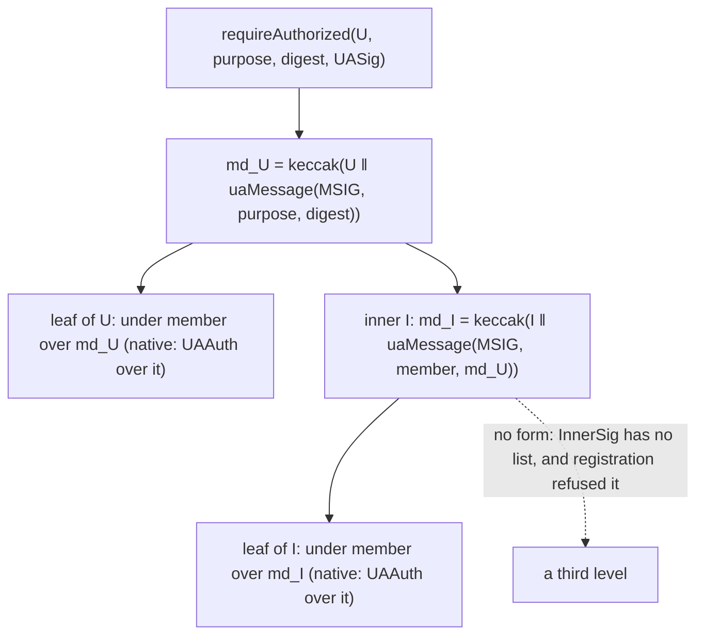

# Nested `msig`: an `msig` member of an `msig`, verified two levels only — design

**Status:** EVM built on branch `msig-nested`, with the node, `clientkeys`, the `ua-*` clients and the vectors; Soroban, NEAR and Algorand not built, each takes the
rule in its own round (owner 2026-11-03). The normative rule is [CTR-UA-38](../../contracts/accounts.md#CTR-UA-38); this file keeps the design, the measurements and why. Rows N0, N2, N5,
N14 and N15 are **owner rulings**. Every row marked **controller call** is the controller's; the owner may override it. §12 lists what the spec review changed.

**Owner's rule, 2026-11-02, verbatim:** "1 MSIG có thể có 1 hoặc nhiều members là các msig khác (dĩ nhiên có thể có chữ ký thường). Khi kiểm
tra chữ ký, chỉ đi 2 level thôi." An `msig` may have one or more members that are other `msig`s, beside ordinary signing members.
Verification goes two levels only. It supersedes [CTR-UA-09](../../contracts/accounts.md#CTR-UA-09)'s "nesting is one level" for `msig`
members.

**Owner's ruling, 2026-11-02, relayed by the coordinator:** a MuSig2 or FROST kind as an `msig` member is right as the code has it
(`UAKinds._singleSigning`, `isMember`); the docs are what is wrong. Row N14 and §11.

**Owner's rulings, 2026-11-02, relayed by the coordinator:** N2 accepted: `members` replaces `MemberSig.keyData`, and CTR-UA-33's wording changes at landing. N5 accepted: a native signer listed in two inner `msig`s of one outer signs once, and that one signature serves both slots of that record, bound to that outer and that record.

**Owner's ruling, 2026-11-03, relayed by the coordinator:** an acceptance is stored, so a nested `pop` copies to another registry with no new signature. Row N15 and §4.

**Inputs.** `smartcontracts/evm/src/ua/`; [accounts.md](../../contracts/accounts.md) CTR-UA-07, -09, -16, -33, -36, -37;
[pq-zero-knowledge.md](../../contracts/pq-zero-knowledge.md) CTR-PQZ-12; [soroban.md](../../networks/soroban.md) NET-SOR-18, -22, -27, -28;
`smartcontracts/soroban/contracts/ua-registry/`; [near.md](../../networks/near.md) NET-NEAR-04; [algorand.md](../../networks/algorand.md)
NET-ALG-09.

**Words.** *Outer*: the `msig` `U` a verification starts from. *Inner*: an `msig` `I` listed as a member of `U`. *Leaf*: a signing member,
at either level. *Slot*: one listed member.

## 0. Decisions

Each row: the decision, the options weighed, the choice and why, the cost if it is wrong, who decides.

| # | Decision | Options | Choice and why | Cost if wrong | Who |
|---|---|---|---|---|---|
| N0 | The rule | none | An `msig` may hold `msig` members beside signing members; verification goes two levels only. | | **owner** 2026-11-02 |
| N1 | How two levels are enforced | (a) at registration, from the records; (b) a depth counter at verify; (c) a stored level per record | **(a)**, plus the type. `_slotCap` refuses an `msig` one level too deep: listing `U`, which holds `I`, reverts `UAMemberUnknown(I)`; no new error. A member is registered first (`kindOf(id) == kind`, as every derived member). At verify `InnerSig` has no list, so level 3 has no form. **Cycles:** an id is `keccak256(TAG ‖ keyData)` and `keyData` holds the member ids, so a cycle needs a hash that contains itself; and a member must exist before the structure that lists it. Confirmed: none. No new state. | A level 3 would have to bypass step 4 and the type at once | controller call |
| N2 | The typed shape | (a) `abi.encode(MemberSig[])` in `sig`; (b) a fourth field `MemberSig.members`; (c) a parallel `UASig.groups`; (d) `members` in `keyData`'s place | **(d)** `MemberSig { uint16 index; InnerSig[] members; bytes sig }`, `InnerSig { uint16 index; bytes sig }`. (a) breaks "no packed `bytes` holding several fields". (c) changes `UASig` too, needs a merge of two lists by index and a second stored form. (b) is +64 B per slot, moves every vector and one Soroban limit (§2). (d) keeps every flat signature's bytes, because `keyData` is always empty ([CTR-UA-33](../../contracts/accounts.md#CTR-UA-33)) and an empty array encodes as empty `bytes`. The one selector change is the same for all four. | The always-empty `keyData` is gone from the type: a later use of it has no field | **owner** 2026-11-02: accepted, CTR-UA-33's wording changes at landing |
| N3 | Selectors, typehashes, node | none | Every signature with `MemberSig` changes selector: the tuple string does. Typehashes do not move: `MemberSig` is in no EIP-712 type. §9 has the counts. | | follows from N2 |
| N4 | Digest chain | (a) `memberDigest` per level, purpose `member` below the outer; (b) one flat digest for both levels; (c) a new purpose per level | **(a)**: `md_I = memberDigest(I, uaMessage(MSIG, PURPOSE_MEMBER, md_U))`. It is the existing check one level down, with no new tag, and it binds `U`, `I` and the digest (§3). (b) would let a list serve any outer holding `I`. | A wrong chain replays across outers: `test_digestChainBindsOuterAndInner` | controller call |
| N5 | A native leaf of an inner in a portable record | (a) the record's typed digest itself; (b) a new typed struct `{inner, digest}` per record | **(a)**, TS-D4 at both levels: the wallet shows the record's fields, and its `ua` is the outer, so it cannot replay in another outer. (b) shows a hash, or needs four new structs and typehashes. One signature then serves two slots if that native signer sits in two inner `msig`s of one outer, on that record only: a signer the structure gave both slots (§3). | A signer listed twice has its one signature counted twice on one record; an owner who wants a signature per slot takes (b) | **owner** 2026-11-02: accepted, one signature serves both slots of that record, bound to that outer and that record |
| N6 | [CTR-UA-07](../../contracts/accounts.md#CTR-UA-07) minimal rule | (a) both levels; (b) the outer only | **(a)** in the portable path: `T − w_min < N` for the outer's slots and for each inner's, the same `_msig`. A dropped or added inner signature is refused, so a front-runner has nothing to vary but the quorum, as today. `requireAuthorized` keeps stop-at-threshold at both levels: that is what makes `c` sound. An acceptance's inner list is minimal too: the same pass, and a client builds one. | A minimal set is always a subset of a valid one: no signer is locked out | controller call |
| N7 | [CTR-UA-37](../../contracts/accounts.md#CTR-UA-37) at two levels | (a) a slot of `U` accepted by `I`'s threshold over `UAMembership{U, I}`, both words read at verify; (b) `I`'s own acceptance implied | **(a)** §4. Each word speaks for its own structure. The `pop` exemption stops at the outer: `I` signs a `pop` of `U` by its accepted slots. | (b) would make a listing in `U` an act of `I`'s members without their threshold | controller call |
| N8 | [CTR-PQZ-12](../../contracts/pq-zero-knowledge.md#CTR-PQZ-12), `_pqEligible`, records | (a) an `msig` member is PQ iff PQ-eligible itself; (b) always classical; (c) always PQ | **(a)** §5: it is the rule's reason (no classical-only subset can authorize) applied one level down. (b) refuses sound structures; (c) is unsound. `pop`, KEM and PQZ records follow with no other change; a copy registers `I` first. `_pqEligible` stops being `pure`: it reads the member's structure. | (c) would let a classical forger hold a PQ slot; (a) has a test each way | controller call |
| N9 | The bound | (a) recursion over `_worst`, `w` as the slot's cap, one `held`; (b) a fixed cap per `msig` member; (c) a groups × members shape | **(a)** §6: the limit is the total of signatures across both levels. **Measured:** an inner `msig` costs at most 18,646 gas cold (`--isolate`), against the 47,500 the bound gives it, so no new constant; `MSIG_MEMBER_GAS` holds at 48 ML-DSA-65 signatures (31.2 k to 32.0 k per signature). The controller's starting figures hold. | Under-counting starves an `msig` at the bound: `UAVerifyGas`, never a verdict, but its funds wait | controller call |
| N10 | Generic `bytes auth` | (a) a hand decoder in `UAKinds`; (b) refuse nested `msig`s there; (c) forward the blob, the registry decodes | **(c)** §7: no parser on an untrusted path, one rule on every entry. solc cannot compile a decoder of this type from memory on the legacy pipeline (§7). | `MtxPipelineLib` gains a low-level call: the no-code check is the guard, `test/metatx` covers the refusal | controller call |
| N11 | Soroban | | The same rule, `Signer(id)` as the inner's key read, limits in bytes per entry, plus a signer count Soroban did not need before (§8). Not built here. | | "one rule on every chain"; the constant is that round's |
| N12 | NEAR, Algorand | | Each takes the rule in its own UA round, separately (§8). | | owner scope |
| N13 | The same id at both levels | (a) allowed; (b) refused | **(a)**: the rule does not forbid it, a key may sit in `U` and in `I`, or in two inner `msig`s, and each slot counts in the bound. Refusing needs a scan of 256 ids for nothing the structure's author could not write otherwise. | One signer counted in two slots: the structure says so, and it is public | controller call |
| N15 | An acceptance a copy needs | (a) the signature in no record, the copy asks the member again; (b) kept in state, a view returns it | **(b)** `acceptMembership` keeps it, bound to `(ua, index)`, write-once with its bit, as Soroban's `AcceptSig`; `membershipSigOf` returns it; a third party replays it on the new registry. A slot of a `pop` keeps none: the `pop` holds it. §4 | The state cost of §4 on every acceptance | **owner** 2026-11-03 |
| N14 | MuSig2 and FROST as `msig` members | | **Owner ruling 2026-11-02:** right as the code has it. Each is one key on chain, `_singleSigning` holds 0x0110–0x0113 and `isMember` admits them. "Structure" in CTR-UA-09 and the MEMBER row barred only an `msig`, and this rule replaces that (§11). `test/ua/UAMsigGroupMember.t.sol` is a positive test of it on the real verifiers, all four kinds; it passed on `159d267e` before any edit here. | | **owner** 2026-11-02 |

## 1. The rule in one page

`U` lists members `(kind, id, weight)` as today; `kind = 0x0120` is now allowed. A member `msig` must be registered first and must itself hold
no `msig` member. So the depth is fixed by the records, ids stay hashes, and no new state exists.



An inner slot is the existing `msig` check run one level down, under purpose `member`, over the outer's `member_digest`. That is the whole
verification change: `_memberOk` gets one branch, in `UARegistry` and in `UARegistryLib`.

## 2. Signature shape

```solidity
struct InnerSig  { uint16 index; bytes sig; }                     // new
struct MemberSig { uint16 index; InnerSig[] members; bytes sig; } // `members` replaces `keyData`, same position
struct UASig     { bytes keyData; bytes signature; MemberSig[] members; } // unchanged
```

| Slot | `members` | `sig` | Otherwise |
|---|---|---|---|
| signing member | empty | its signature | a list there fails the slot |
| `msig` member | its slots, increasing, its own threshold | empty | a `sig` there, or no list, fails the slot |

`InnerSig` has no list, so level 3 cannot be written. Recursive structs are not allowed in an ABI anyway.

**Why `members` takes `keyData`'s place.** [CTR-UA-33](../../contracts/accounts.md#CTR-UA-33) has `MemberSig.keyData` always empty, so the
field carries nothing. An empty array and empty `bytes` encode alike (an offset, a zero length), so **a flat signature's bytes are identical**
(`test_flatEncodingUnchanged`). Every stored `pop`, every `sig` row of `portable.json` and `structures.json`, and the Soroban slot size
`192 + ⌈sig / 32⌉ × 32` stay. Adding a fourth field instead costs +64 B per slot, changes every vector, and takes Soroban's `set_pqz_key`
limit for ML-DSA-65 at `n2816-kmax65536` from 12 slots to 11 (22,528 + 64 + 12 × 3,584 = 65,600 > 65,536).

Sizes of `abi.encode(MemberSig[])`: `64 + Σ slots`; a signing slot `192 + ⌈sig / 32⌉ × 32`, as published; an `msig` slot
`192 + Σ leaves`, a leaf `128 + ⌈sig / 32⌉ × 32`.

| Leaf | signing slot today | leaf inside an `msig` slot |
|---|---|---|
| `slhdsa128s` | 8,064 B | 8,000 B |
| ML-DSA-65 | 3,520 B | 3,456 B |
| ML-DSA-44 | 2,624 B | 2,560 B |
| `fndsa512` | 864 B | 800 B |
| `ed25519` | 256 B | 192 B |

## 3. Digest chain

```
md_U = keccak256(U ‖ uaMessage(MSIG, purpose, digest))             as today
md_I = keccak256(I ‖ uaMessage(MSIG, PURPOSE_MEMBER, md_U))        new: the inner slot, one level down
```

| Signer | `requireAuthorized` | The three portable purposes and `acceptMembership` |
|---|---|---|
| derived leaf of `U` | `uaMessage(kind, PURPOSE_MEMBER, md_U)` | the same |
| native leaf of `U` | `UAAuth(id, PURPOSE_MEMBER, md_U)`, the registry's domain | the record's typed digest itself |
| derived leaf of `I` | `uaMessage(kind, PURPOSE_MEMBER, md_I)` | the same |
| native leaf of `I` | `UAAuth(id, PURPOSE_MEMBER, md_I)`, the domain of the registry that holds `I` | the record's typed digest itself |

- **Another outer:** `md_I` contains `md_U`, which contains `U`, so a list made for `U` fails in `U'` holding the same `I`
  (`test_digestChainBindsOuterAndInner`). A portable record's typed digest carries `ua = U`; `UAMembership` carries `ua = U` and
  `member = I`.
- **Another inner:** `md_I` contains `I`.
- **One level short:** a leaf that signed `md_U` directly fails at the inner level (same test).
- **The purposes:** an inner level is always purpose `member`, whatever the outer's. A derived leaf's message is chain-free, as today, so a
  portable record stays portable; a native leaf of `I` signs chain-free in the portable path and `UAAuth` in the other.
- **No new typehash, no new purpose.** `MemberSig` is in no EIP-712 type, so no `*TypehashIsPinned` moves.

**A native leaf in two inner `msig`s of one outer** signs one typed digest, which serves both slots of that record, where a derived leaf
signs two `md_I`. It reaches no one else's record: the structure already gave that signer both slots, and the digest stays bound to `U`
and to the record (row N5).

## 4. Acceptance ([CTR-UA-37](../../contracts/accounts.md#CTR-UA-37))

- **An inner `msig` accepts its slot in `U`** by `acceptMembership(U, MemberSig{index, members, ""})`: a threshold of `I`'s accepted slots signs
  `UAMembership{ua: U, member: I}`, through `md_I` over `memberDigest(U, uaMessage(MSIG, PURPOSE_MEMBERSHIP, typed))`. It is the same call, the
  same event, the same bit in `U`'s word; nothing is signed by `I` as a key, because `I` has none.
- **"Accepted" at each level** is a statement about that structure's own slot. `U`'s bit `i`: `I` agreed to be in `U`. `I`'s bit `j`: leaf `j` agreed
  to be in `I`. Neither implies the other, and both are read at verify: `U`'s word, then `I`'s word when its slot signs.
- **Below the threshold.** `I` below its own accepted threshold can sign nothing, so it cannot accept a slot, sign `U`'s `pop` or fill its slot at
  verify: each fails `UAUnauthorized` / `UAPoP`. `U` below its threshold in accepted weight authorizes nothing, whatever `I` signs (`test_acceptanceAtBothLevels`).
- **The `pop` exemption stops at the outer.** `U`'s `pop` accepts `U`'s slots. An inner slot of `U`'s `pop` is signed by accepted slots of `I`, because
  `I` is purpose `member` there (`test_popInnerSlotNeedsItsOwnAcceptance`).
- **The inner list of an acceptance is minimal** (row N6). The outer rule stays: one slot speaks for itself.
- **Generations.** `I` on gen 1, `U` on gen 2: the bits of `U` live on gen 2, those of `I` on gen 1, read through `memberAccepted` in the portable path
  and by gen 1 itself in `requireAuthorized`. A native leaf of a gen-1 `I` in the portable path on gen 2 is judged by gen 1's clone hash (`smartKeyCloneHash`), so a clone of gen 1's
  implementation has the 400 k cap the bound counts for it, whatever gen 2 was deployed with (review M1).
- **The acceptance is kept (owner 2026-11-03, row N15).** `acceptMembership` writes the signature with the bit, SSTORE2 `acceptSig[ua][index]`, slot 16 of `UAStore.Layout`: the slot's `sig`, or an
  `msig` member's `abi.encode(InnerSig[])`, as `pqzKeySigOf` keeps `signature` or `abi.encode(members)`. `membershipSigOf(ua, index)` returns it, as Soroban's `membership_sig_of`; the slot's kind in
  `msigOf` says which form. Write-once: the bit returns first. A slot of the `pop` keeps none. Bits are per registry, so a `pop` that uses a slot of `I` accepted by `acceptMembership` reverts `UAPoP` on
  another registry until that acceptance is replayed: anyone sends `acceptMembership` with the stored bytes, no new signature, leaves of `I` first, then `U`'s `pop` registers
  (`test_copyReplaysTheStoredAcceptance`, `test_nestedVectors_copyReplaysTheAcceptance`).
- **The price.** `requireAuthorized` pays nothing: it reads the bit. Measured (`test_acceptanceCostRows`, regular + EIP-8037 state):

| Acceptance | Stored | Before | Now |
|---|---|---|---|
| native member, first bit of the word | 65 B | 58,776 + 97,920 | 97,867 + 578,340 |
| an `msig` member, a two-leaf list, second bit | 384 B | 124,083 + 0 | 164,803 + 968,490 |


## 5. PQ eligibility, records, keys

- **`_pqEligible`** ([CTR-PQZ-12](../../contracts/pq-zero-knowledge.md#CTR-PQZ-12)): a member counts as classical weight unless its kind is 0x0130–0x0133 **or it is an
  `msig` that is PQ-eligible itself**. A forger of every classical key cannot reach a PQ-eligible inner's threshold, so that slot needs a PQ
  signature; a classical-dominant inner counts its whole outer weight as classical. An outer's own `pop` follows: PQ-eligible, a nested
  m-of-n `pop`; classical-dominant, an empty `pop` (`test_pqEligibleCountsInnerByItsOwnRule`).
- **`pop`.** `abi.encode(MemberSig[])`, with the inner lists in it: `popOf`, `registrationOf`, `UARegistered.popHash` as today. Portable: the same bytes
  register on every registry where `I` is registered first and the acceptances its list uses are replayed (§4); `I`'s id is in `U`'s key data, so a copy must copy `I` first (`UAMemberUnknown` otherwise).
- **Holders.** A PQ-eligible outer holds a PQZ key and KEM records as any PQ-eligible `msig`. `setKemKey` and `setPqzKey` take `UASig.members` with inner
  lists, stored as `abi.encode(members)` (`test_setKemKeyNested`).
- **The PQZ debit bound** over the new `w`, with the authorization's own calldata (review I1; the flat formula lacked it too): `w + w / 63 + GAS_MARGIN + PQZ_DEBIT_MIN_GAS + 16 × a ≤ 2^24` and `PQZ_DEBIT_MIN_GAS + 64 × a ≤ 2^24`, the
  EIP-7976 floor. `a` = `_authBytes`: the largest `MemberSig[]` a quorum signs, both levels (§2's sizes), PQ signatures at their size, every classical kind and native at 1,024 B. Nesting lifted the 16-signature limit, so the omitted term
  grew: `{fndsa512, [16, 12]}` was admitted at 17.44 M. The largest of that family at `n2304-kmax4096` is now 24 signatures, 16,013,586 of 2^24 with the least frame (`test_pqzHolderFits2p24WithItsCalldata`). The debit's one holder signature is counted twice, on the safe side.
- **`I`'s records are `I`'s.** `U` reads no KEM or PQZ key of `I`.

## 6. The bound

`_membersWorst` becomes one level per call of `_worst`:

```
worst(d)  = c × MSIG_MEMBER_GAS + MSIG_ACCEPTED_GAS + Σ the c largest slot caps                 c: lightest slots to reach the threshold
slot cap  = the leaf's cap, a native's, or worst(I) for an `msig` member
            + w / 63 + GAS_MARGIN when gen 1 holds I                                            one more call level
held      = the largest single leaf cap listed, at either level
bound     = worst(U) + (held − 400 k) / 63, if held > 400 k                                     ≤ verifyBudget
```

- **The verify limit is a total of signatures.** Every signature across both levels counts `cap + MSIG_MEMBER_GAS`, plain members and inner thresholds
  together, and each inner `msig` adds `MSIG_MEMBER_GAS + MSIG_ACCEPTED_GAS` (47,500). A listing can reach 16 × 16 = 256 leaves; the bound admits what the
  budget admits. **That is a limit on verifying, not on registering:** an all-PQ structure must store its `pop`, whose regular + state gas has to fit one block (see "What registers"). `requireAuthorized` keeps stop-at-threshold at both levels, which is what makes `c` sound at each.
- **The hold of 1/63 is per call level, not per inner.** A local inner runs in the same frame, so it loses nothing to 63/64; only the last capped call needs
  its hold, hence one `held` term for the whole authorization. `held` is the largest cap listed, as it is today at one level (`caps[count - 1]`).
- **Gen-1 hand-off.** An inner gen 1 holds is `via(predecessor, I, member, md_U, …)`, one call level over its whole worst: `w + w / 63 + GAS_MARGIN`.
  Its leaves still count their own hand-off term, which over-counts by `cap / 63` per leaf: the bound stays sound and no code asks whose natives are clones, so
  natives there count 400 k.

### Measured

`requireAuthorized`, `forge test --isolate`, `test/ua/UARegistryNestedGas.t.sol`, foundry 1.8.5 at `foundry.toml`'s settings, each probe a transaction of its own, cold. Every capped call burns its whole cap, every signature has
the kind's real length (`mldsa65` 3,309 B, `mldsa44` 2,420 B, `fndsa512` 666 B, `slhdsa128s` 7,856 B, `bip340` 64 B), every leaf has its own key and record. Each structure is registered exactly at its bound: `bound − 1` refused
(`UAKeyData(0x0120)`), `bound` accepted, `bound` gas authorizes, one gas under the least frame gas reverts `UAVerifyGas` or out of gas, never `UAUnauthorized`. ML-DSA rows read the key from the record, the precompile path, which is the larger
memory; the cached path reads two slots instead of 1,952 B. Frame margin = bound − least. Budget margin = 12,000,000 − bound (Hedera 10,500,000).

| Structure | Signatures | Inner `msig`s | Bound `w` | Least frame gas | Frame margin | Budget margin | Calldata (B) |
|---|---|---|---|---|---|---|---|
| fndsa512 1L | 4 | 0 | 10,215,833 | 10,118,180 | 97,653 | 1,784,167 | 3,780 |
| fndsa512 2L `[4]` | 4 | 1 | 10,263,333 | 10,135,623 | 127,710 | 1,736,667 | 3,716 |
| fndsa512 2L `[2,2]` | 4 | 2 | 10,310,833 | 10,153,417 | 157,416 | 1,689,167 | 3,908 |
| fndsa512 2L `[1x4]` | 4 | 4 | 10,405,833 | 10,189,007 | 216,826 | 1,594,167 | 4,292 |
| gen 2 slhdsa128s `[1x6]` | 6 | 6 | 9,307,585 | 8,739,677 | 567,908 | n/a | 49,476 |
| gen 2 slhdsa128s `[3,3]` | 6 | 2 | 9,097,427 | 8,704,192 | 393,235 | n/a | 48,708 |
| gen 2 fndsa512 `[2,2]` | 4 | 2 | 10,664,772 | 10,255,017 | 409,755 | n/a | 3,908 |
| mldsa44 1L | 2 | 0 | 8,653,611 | 8,625,007 | 28,604 | 3,346,389 | 5,572 |
| mldsa44 2L `[2]` | 2 | 1 | 8,701,111 | 8,642,336 | 58,775 | 3,298,889 | 5,636 |
| mldsa44 2L `[1,1]` | 2 | 2 | 8,748,611 | 8,660,125 | 88,486 | 3,251,389 | 5,828 |
| mldsa65 1L | 1 | 0 | 6,085,595 | 6,083,275 | 2,320 | 5,914,405 | 3,844 |
| mldsa65 2L | 1 | 1 | 6,133,095 | 6,100,524 | 32,571 | 5,866,905 | 3,972 |
| mldsa65 200k 1L | 16 | 0 | 3,922,500 | 3,564,016 | 358,484 | 8,077,500 | 56,644 |
| mldsa65 200k 2L `[16x3]` | 48 | 3 | 11,905,000 | 11,099,092 | 805,908 | 95,000 | 166,788 |
| mldsa65 200k 2L `[10,10,10,9,9]` | 48 | 5 | 12,000,000 | 11,137,717 | 862,283 | 0 | 167,172 |
| bip340 cap 50k 2L `[16x7,10]` | 122 | 8 | 11,972,500 | 8,339,183 | 3,633,317 | 27,500 | 25,284 |
| bip340 cap 50k 1L | 16 | 0 | 1,522,500 | 1,090,095 | 432,405 | 10,477,500 | 4,420 |
| slhdsa128s 1L | 8 | 0 | 11,578,373 | 11,406,862 | 171,511 | 421,627 | 64,836 |
| slhdsa128s 2L `[8]` | 8 | 1 | 11,625,873 | 11,425,449 | 200,424 | 374,127 | 64,516 |
| slhdsa128s 2L `[4,4]` | 8 | 2 | 11,673,373 | 11,443,564 | 229,809 | 326,627 | 64,708 |
| slhdsa128s 2L `[1x8]` | 8 | 8 | 11,958,373 | 11,552,417 | 405,956 | 41,627 | 65,860 |
| slhdsa128s mixed 4 + `[2,2]` | 8 | 2 | 11,673,373 | 11,443,616 | 229,757 | 326,627 | 64,964 |
| slhdsa128s Hedera 2L `[1x7]` | 7 | 7 | 10,465,873 | 10,109,959 | 355,914 | 34,127 | 57,668 |
| slhdsa128s 2L `[1x8]`, each inner listing 16 | 8 | 8 | 11,958,373 | 11,556,032 | 402,341 | 41,627 | 65,860 |

**Most signatures at the budget**, the controller's starting figures, verified:

| Kind (cap) | One level | Two levels | Two-level bound at most inner `msig`s | Budget margin |
|---|---|---|---|---|
| `mldsa65`, no precompile (5.95 M) | 1 | 1 | 6,133,095 | 5,866,905 |
| `mldsa44` (4.25 M) | 2 | 2 | 8,748,611 | 3,251,389 |
| `fndsa512` (2.5 M) | 4 | 4 | 10,405,833 | 1,594,167 |
| `slhdsa128s` (1.4 M) | 8 | 8 | 11,958,373 | 41,627 |
| `slhdsa128s`, Hedera 10.5 M | 7 | 7 | 10,465,873 | 34,127 |
| `mldsa65`, 200 k precompile | 16 (the list) | 48 | 12,000,000 | 0 |
| a 50 k kind (`bip340`) | 16 (the list) | 122 | 11,972,500 | 27,500 |

One more signature is refused at the real budget for every PQ row (`test_edges_oneMoreIsRefused`).

These are the rows the bound admits. Their counts are not what a chain can register.

### What registers

A PQ-eligible structure stores its `pop` whole (`UARegistryLib._register`), so `registerMsig` pays for it: the transaction must fit the block by regular + state gas (EIP-8037). Measured (`test_registrationCostRows`, n2304-kmax4096, no attributes, `--isolate`):

| Structure | Signatures | `pop` (B) | Regular | State | Regular + state | On a 200 M block |
|---|---|---|---|---|---|---|
| mldsa65 200k 1L | 16 | 56,384 | 4,373,284 | 88,449,300 | 92,822,584 | fits |
| mldsa65 200k 2L `[16x2]` | 32 | 111,040 | 9,226,918 | 171,757,800 | 180,984,718 | fits |
| mldsa65 200k 2L `[16x3]` | 48 | 166,528 | 14,378,528 | 257,269,500 | 271,648,028 | **does not** |
| slhdsa128s 1L | 8 | 64,576 | 12,211,414 | 100,542,420 | 112,753,834 | fits |
| slhdsa128s 2L `[1x8]` | 8 | 65,600 | 12,604,938 | 102,294,270 | 114,899,208 | fits |

So the 48-signature row of the table above verifies and does not register on the 200 M block of the SCaaS testnet. Foundry's `gas_limit` of 2^33 hid it. The block limit is a chain's own; the registry assumes none, and a structure that does not fit is refused by the chain, not by the contract. A classical-dominant structure stores no `pop` and has no such limit. With a PQZ key the state grows and the debit bound applies too (§5): at most 24 signatures of the §5 family at `n2304-kmax4096`.

`MSIG_MEMBER_GAS` holds at the calldata limit too (review, 75 ML-DSA-65 at cap 110 k, 260,484 B, margin 755,303; SLH-DSA at cap 350 k, 30 signatures); it failed "authorizes with the bound" only at 180 ML-DSA-65 at cap 20 k and 80 SLH-DSA at cap 100 k, past the 261,909 B an EIP-7976 transaction carries. So the 45,000 rests on that calldata limit.

**An inner `msig` costs, cold:** 17,249 to 18,646 gas, by `(least two-level − least one-level) / inner`: 17,249 (`mldsa65`), 17,329 to 17,559 (`mldsa44`), 17,443 to 17,707 (`fndsa512`), 18,194 to 18,587 (`slhdsa128s`), 18,646 for eight inner `msig`s listing
16 slots each. The controller's 47.5 k was the allowance, and it holds: each inner adds 28.9 k or more of frame margin, so the margin grows with the inner count and the tightest two-level row is 32,571 gas, where one level has 2,320. No `MSIG_GROUP_GAS` is needed.

**`MSIG_MEMBER_GAS`.** Memory grows with the total: per signature beyond its cap, 22,751 gas at 16 ML-DSA-65, 31,231 at 48 in 3 inner `msig`s, 32,036 at 48 in 5, under the 45,000 by 13 k. The rows at the 12 M edge are the largest totals the budget admits for that signature size; they are measurements, not a proof for every shape.

**Gen 2.** The outer on gen 2, inner `msig`s and leaves on gen 1 (`test_nested_gen2`): margins 393,235 to 567,908, because a leaf and its inner each count a hand-off.

## 7. Generic `bytes auth`: a compiler limit

`UAKinds.uaSig` decoded `abi.encode(MemberSig[])` from memory for the tokens' generic `uaExecute` / `uaBatch` / `uaShield` (TS-D14). solc's legacy pipeline cannot
compile that decoder for a list inside a list of structs: `Stack too deep`, in the generated Yul, with every field order and with `bytes[]` in place of `InnerSig[]`
(a word-only inner struct compiles). The error names no file or function, only `AsmCodeGen.cpp:62`: a `--match-path` run that does not reach the file stays green, so check with a plain `forge build`. `via_ir` is not an option here. The prototype replaces it with `UAKinds.uaAuthCall`: the blob goes to the registry unparsed, past its
one offset word, and the registry's calldata decoder reads it; `MtxPipelineLib._authorize` refuses an address without code and then makes the `staticcall`: the check a
high-level call makes, where solc puts it. No hand-written decoder on an untrusted path.

Which forms of `MemberSig[]`, or of anything holding `UASig` (`DexLeg`, `ExchangeLeg`, the plans holding them), compile, each tested alone with solc at `foundry.toml`'s settings:

| Form | Legacy pipeline |
|---|---|
| `abi.decode` from `bytes memory` | `Stack too deep` |
| The return-data decoder: an external call returning the type | `Stack too deep` |
| `abi.decode` from `bytes calldata`, the calldata decoder of an external function | compiles |
| `memory` parameters of an external or public function, calldata-to-memory copies | compile |
| `abi.encode`, `abi.encodeCall`, a calldata pass-through, events | compile |

So a contract or test can decode the type only from calldata: `test/v2/DexKat.t.sol` goes through its own external function, as its `mtxExchangeBatch` round trip already did, and no external call may return it. Trusted test bytes go through `UACall.memberSigs`.

## 8. Soroban (same rule, SPECIFIED, not built here)

"One rule on every chain": every row of §0 applies. The form:

- **Types.** `scaas_ua_common::MemberSig { index, members: Vec<InnerSig>, sig }`, `InnerSig { index, sig }`. `abi::encode_member_sigs` writes the empty list where the
  empty `keyData` was, so flat `pop` bytes and `slot = 192 + ⌈sig / 32⌉ × 32` stay, and every line of NET-SOR-27's limits table stays.
- **Registration.** `layout_member_ok` admits `MSIG` (not native space). `check_members`: an `msig` member's `Ua(id)` kind is `MSIG`, else `MemberUnknown`; its own key data
  holds no `msig` member, else `MemberUnknown`. Its weight counts toward `signable` only if it has a `Signer(id)`: an inner that is not `signable` weighs 0, as a
  relayer-checked member does (a member of `signable` only), never `MemberUnknown`.
- **Verify.** `check_slot` gets an `MSIG` arm: `check_msig(id, Signer(id).key, PURPOSE_MEMBER, md, lifted, portable, relayer, short)`; `Signer(id)` is at most 580 B, so the inner
  never loads `Ua(id)` with its `pop`. A `G…` leaf of an inner signs `require_auth_for_args((I, PURPOSE_MEMBER, md_U))`, an `evm-eoa` leaf the typed digest in a portable
  record and is `NotVerifiable` elsewhere, a relayer-checked leaf attests as today. `checked` keeps the worst mark of both levels.
- **`Accepted(I)`** is read once per inner, one entry more per inner in the footprint.
- **`pq_eligible`** becomes a read of each `msig` member's `Signer` or `Ua`, the same rule.
- **Limits.** Bytes per entry stay the bound. Against entry 65,536 B and transaction 132,096 B, `pop = 64 + Σ slots`:

| Leaves in one `msig` slot, each 16 at most | `pop` (B) | Entry 65,536 B |
|---|---|---|
| 16 `slhdsa128s` | 128,256 | refused; 8 leaves in one slot, 64,256 B, are the edge to measure (8 flat slots, 64,576 B, are refused today) |
| 16 ML-DSA-65 | 55,552 | fits |
| 16 × 16 ML-DSA-65 | 887,872 | refused |
| 16 × 16 `ed25519` | 52,288 | fits |

  The stored record caps ML-DSA-65 at about 18 signatures in one `pop` (65,536 / 3,456), the transaction at about 38. So the 16 × 16 listing cannot sign with a `pop` on PQ kinds: a structure
  that needs more signatures than an entry holds **can never be registered there**, final for a deployment, as NET-SOR-27 says of today's rows.
- **A new bound Soroban needs.** Today `count ≤ 16` bounds a verification: 16 ML-DSA-65 use 58.2 M of 400 M instructions. With 256 leaves it no longer does: the passkey `require_authorized` at
  3.15 M × 256 is 806 M. A structure whose threshold needs more than the host can verify could be listed and never sign. Soroban takes EVM's rule in its own unit: `register_msig` counts
  `c`, the signers needed across both levels, and refuses (`KeyData`) above `MSIG_MAX_SIGNERS`, a constant measured in that round against 400 M instructions and 200,000 B read. No figure is given here:
  not measured.
- **Relayer-checked slots.** A relayer-checked leaf of an inner stays what it is at one level: weight 0 for signing, an attested part in a stored record, the mark in `checked`. `scaas_ua::ua8::check_*`
  and `clientkeys` re-verify the inner lists too.
- `G…` members inside an inner: `derive_ua` refuses them off chain today, the open item of CTR-UA-34 carries over unchanged.

**NEAR and Algorand take the rule in their own UA rounds, each separately.** NEAR: no registry, `MSIG_MAX_MEMBERS` 12, "no nested msig" (NET-NEAR-04), to be changed in `ua-near`. Algorand: no registry,
`MSIG_MAX_MEMBERS` 3, bound by 2,048 B of app-call arguments (NET-ALG-09), to be sized in `ua-algorand`. Neither is built or specified here. Each round answers how it verifies an inner `msig`
without a registry of records.

## 9. Blast radius

| Surface | Change |
|---|---|
| Selectors | 50 function names. The registry's five: `registerMsig` `0x82b86a46` → `0x61947129`, `setKemKey` `0xa00cce2a` → `0x6a3318f9`, `setPqzKey` `0x3c6897f1` → `0x0052c1b5`, `acceptMembership` `0x73fd7d54` → `0x2c1ac986`, `requireAuthorized` `0x58d5ff4f` → `0x9600639d`. Every entry taking a `UASig`: `NormalToken` 13, `WrappedToken` 16, `NormalZetherToken` 25, `WrappedZetherToken` 29, `NormalPqzToken` 30, `WrappedPqzToken` 36, `SCaaSDex` 8, `MtxRelayFee` 1 (`uaRelay`, the one name no token has). No selector changes meaning: the tuple string `(uint16,bytes,bytes)` becomes `(uint16,(uint16,bytes)[],bytes)` |
| `mtxSelectors` | The source does not move (`.selector`), the values do: `mtxConfidentialTransfer*`, `mtxUnshield`, `mtxUnshieldUnwrap`, and on Zether `mtxRollOverSigned`, `mtxSetRollOverMode`. Allow-lists stay equal to `_uaAllowed` per kind in both directions; `typed.rs`, `guard.rs` `CALL_TABLE` and the parity fixture regenerate. Measured: `MetaTxParity` 64 + 48 mismatches, all these selectors |
| New views | `membershipSigOf(bytes32,uint256)`, `smartKeyCloneHash()`. Gen 2's constructor calls `membershipSigOf`, so a gen 2 over a gen 1 without this ABI reverts `UAConfig(0)` (review M2) |
| Typehashes | none: `MemberSig` is in no EIP-712 type |
| Storage layout (`UAStore.Layout`) | slot 16 appended, `acceptSig` (row N15). `test/v2/layout/` pins the tokens only, and they did not move; the registry's layout has no pin |
| `scaas-node` | `abi.rs`, `typed.rs` struct table (`InnerSig`, `MemberSig`), `submit.rs` literal selector pins, `guard.rs` `CALL_TABLE`, `adapters/soroban.rs`, `tests/e2e_ua8.rs`, `tests/e2e_soroban_ua.rs`. JSON `members: [{index, keyData, sig}]` becomes `[{index, members: [{index, sig}], sig}]`: a job shape change needs a note for operators. A typed decode is bounded in depth by the type's two levels and in width by 16 slots at each level (`typed.rs`, `MSIG_MAX_SLOTS`, review M3). Width matters: the registry copies calldata to memory before its first index check, and overlapping offsets amplified that, 6,948 B of calldata burned about 12.0 M gas before `UAUnauthorized`. The caller pays, and the node re-encodes a job from named fields, so overlapping offsets cannot leave it; the bound keeps the canonical size at 16 × 16 |
| `script/pqz/e2e.py` | Done here: `MEMBER_S` / `MEMBER_T`, its three flat slot builders and its literal pins of `registerMsig`, `setKemKey`, `setPqzKey`, `requireAuthorized`, so `--self-test` has no ABI failure. 14 rows stay red against `vectors/typed` until that is regenerated (all clear on a throwaway copy with the new selectors). Clients need no change for it: this file signs flat |
| Clients | `clientkeys` (`evm.js`, `ua.js`, `ua-verify.js`, `soroban.js`, scripts, tests with `(uint16,bytes,bytes)` selectors), `ua-rs` (`json.rs`, `ua8.rs`), `ua-py`, `ua-go`, `ua-cs`, `ua-dart`: selectors, the typed shape, the nested verify; flat encoders keep their bytes. The four `ua-rs` wrappers (`ua-c`, `ua-cxx`, `ua-qt`, `ua-dart-frb`) take `inner` as `{id: keyData}` JSON in the `_with` / `With` forms of PQ eligibility, the holder PoP and the PQZ key record, and turn `membershipSigOf`'s bytes into a slot (`scaas_ua_replayed_member_sig`, `replayedMemberSig`): a nested PQ holder no longer stops at `UAMemberUnknown` there ([ua-libraries.md](../../clients/ua-libraries.md)) |
| Vectors | `smartcontracts/vectors/ua/{portable,structures}.json`, `vectors/typed`, `soroban/vectors`: flat `pop` bytes keep; selectors, the `keyData` field name of member rows and every KAT that holds a CREATE2 address move; new nested rows, including a non-zero negative at each level |
| CREATE2 addresses, `dex_order_kat` | `IUARegistry.sol` and `UAKinds.sol` enter every importer's metadata, so token and DEX addresses move; regenerate, re-pin |
| Size | Moved with the landing, ratchet commit `size-baseline.json`: `UARegistry` 28,429 → 29,498 B, `UARegistryLib` 32,667 → 35,596 B (the prototype's 29,211 and 34,452, then `_authBytes` and the kept acceptance), `NormalToken` 37,228 → 37,487, `WrappedToken` 48,015 → 48,278, `NormalZetherToken` 52,741 → 52,874, `WrappedZetherToken` 62,169 → 62,305, `NormalPqzToken` 52,891 → 53,042, `WrappedPqzToken` 63,423 → 63,563 (1,973 B under the 64 KiB ceiling), `SCaaSDex` 27,957 → 28,089, `PqzBurnLib` 9,910 → 10,040, `PqzTransferLib` 17,504 → 17,634. Every token grows by the encoder of the deeper `UASig`. |
| Gas pins | Moved in the pins commit, 28 rows at four sets, old → new there; the figures below are the prototype's, before the two views and `_quorum` added dispatch and frame gas (`register msig-classical` ended at 166,104). A flat `msig` pays about 115 gas per member for the empty list: `requireAuthorized` 16 members 5,113,989 → 5,115,826, 9 `slhdsa128s` + 1 clone 11,818,215 → 11,819,460, per derived member 21,135 → 21,292. The tightest flat row at its bound stays inside it: gen 2, one 400 k member, 458,340 → 458,577 of 459,029. Four rows are over their pins, at every parameter set, the same deltas, and no state gas moves; `test_T_GAS_*` stop at their first bad row, so list them with `GAS_REPIN=1`. `register msig-classical` 165,778 → 165,943 and `register webauthn-p256` 181,861 → 181,878, set-free; `registrationOf msig-pq` on gen 1, +22: 99,494 → 99,516 (`n2048-kmax1024`), 105,419 → 105,441 (`n2304-kmax4096`), 111,562 → 111,584 (`n2560-kmax16384`), 125,760 → 125,782 (`n2816-kmax65536`); on gen 2 with a gen 1 record, +44, two hops: 143,722 → 143,766, 153,454 → 153,498, 163,568 → 163,612, 182,107 → 182,151. The last three have untouched bodies, which fits the dispatchers of five moved selectors; not separated further. The pins commit (dafe4a85) has other figures for `registrationOf msig-pq`: +45 on gen 1 (99,494 → 99,539, 105,419 → 105,464, 111,562 → 111,607, 125,760 → 125,805) and +90 on gen 2, +45 a hop (143,722 → 143,812, 153,454 → 153,544, 163,568 → 163,658, 182,107 → 182,197). The cause is the dispatcher alone; the body of `registrationOf` did not change. `UARegistry` went from 55 selectors to 57 (`membershipSigOf`, `smartKeyCloneHash`), and five moved (the `MemberSig` tuple). So `registrationOf` (`0x1456926b`) passes one more split (22, plus 1 for the JUMPDEST taken) and one more comparison (22), and `popOf` one more comparison (+22). By inference: solc's legacy dispatcher (`via_ir = false`, 200 runs) replayed on both selector lists, not measured apart. Old → new go in that commit. `register msig-classical` was 169,078 on the prototype, +3,300, none of it for nesting: 2,167 was `hederaNative()` read per slot, 968 `registerMsig` copying the structure to memory for `_packed`, both gone (`UARegistryLib` +144 B, `test_gasHotPath` holds the line). Of the +165 left, a 2-member flat `registerMsig` is below `159d267e` (143,320 → 143,014), so it grows with the members: about 40 gas a slot over the pin at four. By inference from those two rows, not measured alone, that is `_slotCap`'s frame and `held`, the price of one recursion for both levels. It costs once, at registration |
| Registry tests | §10 |
| Docs | §11 |

## 10. Prototype status, as it stood

Built on `msig-nested` before the landing, kept as the record of what the prototype broke on purpose: `IUARegistry` (`InnerSig`, `MemberSig`), `UAKinds` (`isMember`, `uaAuthCall`), `UAStore.lift`, `UARegistry._memberOk`, `UARegistryLib` (`_msig`, `_memberOk`, `_pqEligible`, `_worst`, `_slotCap`, `_packed`, `_msigBytes`), `MtxPipelineLib._authorize`. New tests: `test/ua/UARegistryNested.t.sol`, `UARegistryNestedGas.t.sol`, `UAMsigGroupMember.t.sol`, `UARegistryLibMsig.t.sol`, `MtxPipelineLib.t.sol` `test_authorize_registryWithoutCodeRefuses`, `test_authorize_lowLevelAnswersAsTheTypedCall`. Test changes: `MemberSig` constructors, `UACall.memberSigs` (a hand reader of trusted test bytes), `UACall.aList` for the old `keyData` negatives, `DexKat` through the calldata decoder. Not built: Soroban, node, clients, vectors, docs. **UNAUDITED.**

**A negative must be able to fail.** Each mutant, one change, restored after its run:

| Mutant | Fails |
|---|---|
| `pop` exemption reaches the inner level | `test_popInnerSlotNeedsItsOwnAcceptance` |
| every `msig` member counts as PQ | `test_pqEligibleCountsInnerByItsOwnRule` |
| no code check before the low-level call | `test_authorize_registryWithoutCodeRefuses`, `test_authorize_lowLevelAnswersAsTheTypedCall` |
| no refusal of a third level | `test_twoLevelsOnly` |
| a list on a signing member ignored | `test_nestedNegatives` |
| `md_I` not bound to `md_U` (source and test helper alike) | `test_digestChainBindsOuterAndInner` |
| `MSIG_MEMBER_GAS` 45,000 → 20,000 | 6 of 9 in `UARegistryNestedGas.t.sol`, `authorizes with the bound` |
| failure of the low-level call ignored | `test_preCall_orderUaPath`, `test_authorize_lowLevelAnswersAsTheTypedCall` |
| revert data of the low-level call dropped | `test_preCall_orderUaPath`, `test_authorize_lowLevelAnswersAsTheTypedCall` |
| half the gas forwarded | `test_authorize_lowLevelAnswersAsTheTypedCall` |
| head words of `uaAuthCall` swapped | `test_genericAuthIsTheTypedCall` |
| no canonical offset check, or a 32-byte `sig` accepted, in `uaAuthCall` | `test_genericAuthMalformed` |
| `UARegistryLib._msig`: no stop at the threshold | `test_libMsig_stopsAtTheThreshold`, `calls out: 3 != 2`: the verdict alone stays `UAPoP` |
| `UARegistryLib._msig`: no strictly increasing index | `test_libMsig_sameMemberTwice`, `test_libMsig_popRows` |
| `UARegistryLib._msig`: no check of an index past the members | `test_libMsig_indexPastTheMembers`, `calls out: 2 != 1`: the verdict alone stays `UAPoP` |

**Tests this prototype breaks, on purpose; none is edited to pass, no pin moved:**

| Test | Why | On landing |
|---|---|---|
| `UAKinds.t.sol` `test_invalidRows`, `test_kindTable` | `kinds.json` "structure member": an `msig` member was invalid | regenerate |
| `UARegistry.t.sol` `test_T_AUTH_2_msigRegistration`, `test_T_REG_2_negativeKeyData` | they expect the refusal of an `msig` member | rewrite to the new refusal |
| `UARegistryVectors.t.sol` `test_vectors_msig`, `test_requireAuthorizedUASigEveryKind` | `signatures.json` rows `native-member-keydata`, `derived-member-keydata`: no field for them. The tests stop in the test helper: `UACall.memberSigs` reads a `keyData` length as a list count and runs out of gas in the test's own frame (`InvalidOperandOOG`), and the registry is never called. On the registry itself, through `UAKinds.uaAuthCall`, both rows are a bare revert at about 21 k gas, not `UAUnauthorized`, and the other 8 rows answer as designed | drop the rows, add a list-on-a-signing-slot row |
| `UARegistryUA8.t.sol` `test_ua8_writeSelectorsPinned`; `ConfidentialSelectors.t.sol` 2 | literal selectors | new values |
| `UARegistryUA8.t.sol` `test_T_GAS_register_ua8PerKind`, `test_T_GAS_storePqzPop` | gas pins, §9 | old → new |
| `UARegistryUA8.t.sol` `test_split_portableRowsSame`, `test_split_storePqzPopWithAVerify` | the pre-split source | move to `legacy/` |
| `DexKat.t.sol` `test_dexKat`, `test_dexKat_newEntriesRoundTrip` | `dex_order_kat` | regenerate |
| `MetaTxParity.t.sol` `test_parity`, `test_ruleTableParity`; `MtxRelayFee.t.sol` `test_relayFeeRows`; `TradeTyped.t.sol` 18; `TypedOps.t.sol` 6 | selectors and calldata in `vectors/typed`, the parity fixture. Of `MetaTxParity`'s 112 mismatches, 96 are selector identities; 16 are one `digest` over a signed inner `data` that holds a moved selector (with the old inner selector, every `digests.*` row returns to the fixture) | regenerate |
| `PqzTyped.t.sol`, `ZetherTyped.t.sol`, 22 tests | rows of `vectors/typed` with the old selector: nothing dispatches, the revert is empty, so "the op's own check" is a misleading message. Checked row by row: with only `abi` and the selector rewritten in a throwaway copy, all 22, with `TradeTyped`, `TypedOps` and `test_relayFeeRows`, reach their op's own check, 206 of 206 | regenerate |

**At the other parameter sets** (`at-set.sh`, `forge test`): the same tests fail for the same reasons, and the same four gas rows (§9). Two differences, both by design. `MetaTxParity.test_parity` skips: its fixture is written at `n2304-kmax4096` only, so its 64 mismatches are that set's. `test_pqzhN2048FitsBothPaths`, in `PqzStateGas`, `MtxSplitOverhead` and `PqzPackGas`, runs at `n2048-kmax1024` only and fails there, 66 against 63: it reads `abi` from `vectors/typed` and sends the old selector, so it regenerates with that file. With only `abi` and the selector rewritten in a throwaway copy, the row suites and these three pass at every set: 328, 324 and 318 of 328, the rest skipped, 0 failed.

`UARegistrySplit.t.sol`, `SplitDiff.sol` and the two `test_split_*` of `UARegistryUA8.t.sol` moved to `smartcontracts/evm/legacy/msig-nested/test/ua/`: the pre-split source reads `MemberSig.keyData`, so it no longer compiles, and it is a differential of a finished refactor. What still applies is in `test/ua/UARegistryLibMsig.t.sol`: `UARegistryLib._msig`'s guards (the file's `_msigIndexGuards`), the nested-offset note with its post-split half, `test_gasHotPath` against the figures of `159d267e`, the last commit where the differential ran. `size-baseline.json`, `test/v2/layout/` and every pin are as they were.

## 11. Doc changes on landing

Done at landing, with [CTR-UA-38](../../contracts/accounts.md#CTR-UA-38) as the rule's one place:

- **accounts.md CTR-UA-09:** title and text: an `msig` may hold `msig` members, verification goes two levels, an `msig` holding one cannot be a member. "A member may not itself be a structure" goes: "structure" there barred only an `msig`, and this rule replaces that (owner ruling 2026-11-02). Bounded gas stays (register step 4); "two-level governance uses `SmartKeyAccount` or Safe" stays as another way.
- **accounts.md MEMBER row (§1.6) and the members paragraph (§1.9):** "SIGNING single-key kinds except `0x0141`, plus `msig`, one level down"; "no structure is ever an EVM member" goes, as does "never … a structure". MuSig2 and FROST stay members, as the code has them: each is one key on chain.
- **CTR-UA-33 B:** `MemberSig` has no `keyData`; a member's key is read from its record by type, not by a check. `UASig.keyData` stays.
- **CTR-UA-07, CTR-UA-36, CTR-UA-37:** the rows of §3 to §5, the two structs, the new selectors. **Step 4 of §1.8:** §6.
- **CTR-PQZ-12:** the `msig` member rule of §5.
- **NET-SOR-18, -27, -28:** §8. **NET-NEAR-04, NET-ALG-09:** untouched until their rounds.
- **decisions.md:** the owner's rule (N0) and the owner's rulings N2, N5 and N14, `owner: yes`; rows N1, N3, N4, N6 to N13 as controller calls.
- **job-api.md:** the JSON shape, with the operator note.

## 12. Spec review, 2026-11-03

Findings of the review of this file at `72f8a031`, each checked before acting. UNAUDITED: an AI review.

| # | Finding | Outcome |
|---|---|---|
| I1 | The PQZ debit bound had no term for the authorization's calldata; the flat formula neither | Fixed, §5. `test_pqzHolderFits2p24WithItsCalldata`, `test_pqzHolderCalldataFloor` |
| I2 | A nested `pop` did not copy on its bytes alone | Owner 2026-11-03: acceptances are stored, row N15, §4 |
| I3 | §6's headline counts were verify limits | §6 "What registers" |
| M1 | A gen-1 clone got gen 2's cap in the portable path | Gen 1's clone hash is read for a structure gen 1 holds, §4. `test_cloneCapPortableOnGen2` |
| M2 | A gen 2 over an old-ABI gen 1 was not refused | Constructor probe, §9. `test_newGen2OverOldGen1` |
| M3 | Overlapping offsets amplify memory before any refusal | 16 slots at each level in the node, §9 |
| M4 | Three mutants survived; N5 had no test | Killed by `test_nestedVectors_negatives`, `test_gen1InnerBitsReadOnGen2`, `test_gen1InnerNativeCapAtTheBound`; `test_n5OneSignatureTwoSlots` |
| M5 | `PqzCore._check` turns an out-of-gas registry frame into `AuthRejected` | Pre-existing, not fixed here |
| Q4 | The minimal rule, exhaustively | `clientkeys`: every weight vector of up to 4 slots of weight 1 to 4, every threshold, every subset, 42,010 cases: the rule is "each slot necessary", such a set passes stop-at-threshold, and none is larger than the `c` the bound counts |
| Q9 | Stack bound | Solidity recursion follows the type (`lift`, `inner`). `typed.rs` parses over the type, not the JSON: `member_sig_json_is_two_levels`, a 100,000-level value stops at the type's second level |

**Mutants added at landing, each killed and restored:** no 16-per-byte term, no floor term, no kept signature, gen 2's clone hash only, no constructor probe, plus the review's three.

**Not done by the review:** Q5 attack tests, Q6 worst gen-2 shapes at the calldata limit, the §8 Soroban arithmetic, including "8 flat slots, 64,576 B, are refused today".
