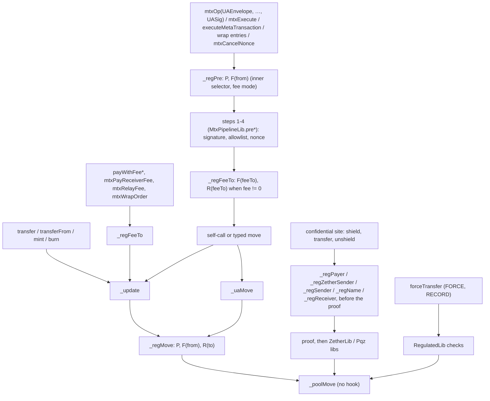

# Regulated token kinds 8–13: one regulated implementation per kind — design (draft for the owner)

**Status:** revised after the Fable and Codex reviews (2026-11-05). SPECIFIED; nothing is built. Work order item 3b. **Owner
2026-11-05:** all six regulated kinds are built **inside branch `ua-mtx-merge`**, as task group T24–T36 after T18 and before T19
(docs) and T22 (review), so the round's docs, review and PR cover them; before the EVM freeze, so the audit covers them; no
governance or voting token. The reviews: [Fable](../../research/regulated-kinds-fable-review.md) (0 P0, 5 P1, 14 P2, 18 P3),
[Codex](../../research/regulated-kinds-codex-review.md) (2 high, 4 medium, 1 low); every finding's outcome is in §15.

**Rules this spec applies, not reopens:** [CTR-GOV-03](../../decisions.md#ctr-gov-03--a-plain-transfer-stays-0-one-regulated-implementation-per-kind-never-per-feature)
(one regulated implementation per kind, never per feature), [CTR-GOV-11](../../decisions.md#ctr-gov-11--0-on-a-plain-transfer-means-no-new-read)
("+0" = no new read), [CTR-GOV-13](../../decisions.md#ctr-gov-13--moderate-only-on-public-balances),
[CTR-GOV-16](../../decisions.md#ctr-gov-16--regulated-kinds-are-real-enum-members-before-the-factory-freezes),
[CTR-GOV-17](../../decisions.md#ctr-gov-17--regulated-confidential-kinds-the-rules),
[CTR-GOV-18](../../decisions.md#ctr-gov-18--receiver-check-two-feature-bits-allowlist-and-denylist-off-by-default),
[CTR-GOV-05](../../decisions.md#ctr-gov-05--a-wrapped-kind-refuses-a-scaas-leg-with-force-or-moderate),
[CTR-GOV-08](../../decisions.md#ctr-gov-08--moderate-later-with-flags-5-8),
[CTR-GOV-09](../../decisions.md#ctr-gov-09--delayed-relaxing-and-record-later-with-the-asset-suite),
[CTR-GOV-19](../../decisions.md#ctr-gov-19--build-first-on-the-scaas-testnet-at-a-higher-code-size-ceiling-reduce-later);
asset-suite [CTR-AS-02](../../contracts/asset-suite.md#CTR-AS-02)…[CTR-AS-09](../../contracts/asset-suite.md#CTR-AS-09),
[CTR-AS-16](../../contracts/asset-suite.md#CTR-AS-16), [CTR-AS-17](../../contracts/asset-suite.md#CTR-AS-17); the governance
spec [§1.2, §4.2–§4.4, §7.7](2026-11-02-governance.md); the merge spec's entry form and §8
([2026-11-04-ua-mtx-merge.md](2026-11-04-ua-mtx-merge.md), [CTR-MTX-30](../../decisions.md#CTR-MTX-30)). Where asset-suite §2
writes `address`, this spec writes the `bytes32` id (CTR-AS-07's UA constraint, CTR-GOV-01's identity by UA); nothing else in
those rules changes.

**Owner answers (2026-11-05): Q1–Q8 all as recommended**, with Q7 read after T9's deprecation (no lever L or D is
built): `WrappedRegulatedToken` and the confidential regulated releases that miss 60 / 70 M are accepted; they deploy on
any chain whose block takes their release transaction (SCaaS testnet, Sepolia at 200 M), and the gap is recorded in TODO
beside `WrappedToken`'s. **Owner 2026-11-05 on the reviews:** apply every Fable P1 and every Codex finding in this text;
Fable P2 as rules or plan tasks; P3 as notes. **F-01 decided (owner 2026-11-05): yes** — a threshold UA (`msig`) counts as a
contract for the contract-only bits 5–7, 10, 21, on every family
([CTR-AS-03 Change](../../decisions.md#ctr-as-03--issuer-and-compliance-roles-renouncing-relaxes)).

**Owner 2026-11-05, the five calls of the revision, accepted:**
1. The DEX relayer share is an ordinary credit: a frozen relayer still receives it; CTR-AS-05's "relayer fee" is read as the
   token's own fee legs (§3.2, RK-6).
2. A frozen payee cannot pay a receiver fee (`mtxPayReceiverFee` refuses); the payer uses `mtxPay` (§3.2).
3. The pause-open set requires fee mode `NONE`: a percent fee that computes to zero stays paused (§3.2, RK-7).
4. `mtxCancelNonce` goes through `_regPre` and `_regFeeTo` with no exception (§2.2, RK-8, F-18, F-32).
5. The `ComplianceRegistry` admin lives in storage, written once by the constructor (§5).

**Owner 2026-11-05, bit 22 `OPERATOR_TRANSFER` ([CTR-GOV-20](../../decisions.md#ctr-gov-20--operator_transfer-bit-22-any-holder-the-regulated-kinds)).**
The transfer power this text drafted as `moderatedTransfer` on bit 21 moves to a new bit 22 `OPERATOR_TRANSFER`, entry
`operatorTransfer(bytes32 from, bytes32 to, uint256 amount, bytes32 ref)`, relayed as `mtxOperatorTransfer`, with the
CTR-GOV-08 refusals unchanged and public balances only (CTR-GOV-13). **Any holder** (an EOA, a single-key UA, an `msig`, a
contract). The bit grants the power; each holder's own grant is `WHOLE` or `LIMITED` (a `LIMITED` grant binds a daily `perWindow`, `total`, `maxUses`, `validUntil`, `delegable` leaves: the loyalty /
point-of-sale case), on the **regulated kinds 8–13 only** (owner correction, same day): a plain kind refuses bit 22 as it
refuses 5–9 (`FeatureInvalidForKind`), so the plain kinds take no byte and "+0" is untouched. Bit 21 `MODERATE` keeps its
rules (contract-only, RK-1) and is re-scoped by the owner to "other hierarchical moderation", meaning TBD: no body is built
for it. Wherever this text still says `moderatedTransfer`, `ModeratedTransfer`, `ModerateTargetRefused` or bit 21 for the
transfer power, read `operatorTransfer` on bit 22 (T19 sweeps the text); the governance part is in T24, the entry and the
router op in T32 (in place of `moderatedTransfer`).

## 1. Scope and non-goals — SPECIFIED

**In scope (EVM, Hedera for kinds 8 and 9):**

| Item | Rule |
|---|---|
| Six implementations, ids 8–13 | one per kind, each the base kind's source plus the regulated hooks (§2) |
| Controls `FREEZE` 5, `FORCE` 6, `PAUSE` 7, `ALLOWLIST` 8, `DENYLIST` 9, `RECORD` 10, `MODERATE` 21 | §3; bit 8 not on the confidential kinds; bit 21 re-scoped by the owner (2026-11-05), no body |
| `OPERATOR_TRANSFER` 22 (CTR-GOV-20) | §3.4; kinds 8–13 only, any holder; entry in plan T32 |
| `RegulatedLib` | external library, the control bodies, namespace `scaas.regulated` |
| `ComplianceRegistry` | CTR-AS-07, keyed by `bytes32`, one pinned runtime (§5) |
| `_delayedRelaxBits()` and the relaxation state machine | CTR-GOV-09, in `GovernanceLib` (§3.6) |
| Router ops | one `mtx<Op>(UAEnvelope, address target, …, UASig)` per control on `GovernanceRouter` (§3.1) |
| Factory, deploy, node rows, client rows, vectors | §6, §7 |

**Non-goals.** No governance or voting token (owner 2026-11-05). No viewing right on chain (CTR-GOV-17: the auditor shares off
chain; `auditorKey`, `auditorMode`, `auditorUA` stay as built). No change to a Zether or PQZ statement, transcript,
`proofSystemId` or binding tag. The action contracts of asset-suite §3–§6 (`VestingGrant`, `Distribution`, `ExchangeOffer`,
`AssetFactory`) and templates: not this group. No non-EVM family (one rule on every chain: each family's own round states
the same controls). No HTS-native regulated token. No migration: every chain is test-only; the SCaaS testnet takes the kinds
at reset 2. No size lever: T9 is deprecated (owner 2026-11-05).

**Family-neutral statements** (for the later rounds, F-26): the controls, the freeze arithmetic, `recordId` and the `R` truth
table are portable and live in `regulated_kat.json`. "A contract holder" means, on every family, a holder the family
authenticates as a contract **or a threshold (`msig`) UA record** (owner 2026-11-05). The `GovernanceRouter` is the EVM's way
to relay a derived holder's power; a family whose host authenticates the holder itself (Soroban's `require_auth`) builds no
router.

## 2. How each kind is built — SPECIFIED

### 2.1 One implementation per kind

| Id | Kind | Contract | Inherits | Bits added to the base kind's `_validBits()` | Sites beyond the ledger hooks |
|---|---|---|---|---|---|
| 8 | `NORMAL_REGULATED` | `NormalRegulatedToken` | `NormalToken`, `RegulatedBase` | 5, 6, 7, 8, 9, 10, 21 | — |
| 9 | `WRAPPED_REGULATED` | `WrappedRegulatedToken` | `WrappedToken`, `RegulatedBase` | 5, 6, 7, 8, 9, 10, 21 | wrap payer, wrap order |
| 10 | `NORMAL_ZETHER_REGULATED` | `NormalZetherRegulatedToken` | `NormalZetherToken`, `RegulatedBase` | 5, 6, 7, 9, 10, 21 | Zether sites (§4.1) |
| 11 | `WRAPPED_ZETHER_REGULATED` | `WrappedZetherRegulatedToken` | `WrappedZetherToken`, `RegulatedBase` | 5, 6, 7, 9, 10, 21 | Zether sites, wrap payer, unshield-unwrap |
| 12 | `NORMAL_PQZ_REGULATED` | `NormalPqzRegulatedToken` | `NormalPqzToken`, `RegulatedBase` | 5, 6, 7, 9, 10, 21 | PQZ sites (§4.2) |
| 13 | `WRAPPED_PQZ_REGULATED` | `WrappedPqzRegulatedToken` | `WrappedPqzToken`, `RegulatedBase` | 5, 6, 7, 9, 10, 21 | PQZ sites, wrap payer, unshield-unwrap |

- **Inheritance (F-13).** `RegulatedBase` is abstract over `MetaTokenBase` (which brings `GovernanceBase`, `ERC20MetaTx`,
  `UAMetaTxBase`): it overrides the masks (`GovernanceBase` / `MetaTokenBase` members), the ledger and fee hooks
  (`UAMetaTxBase`, `ERC20MetaTx`), `disableFeature`, `supportsInterface`, and holds the checks `F`, `P`, `R` as internal
  functions. Each kind contract lists its base kind first, `RegulatedBase` second, and overrides the **layer hooks**
  (`ZetherLayer`, `PqzLayer`, `WrappedToken`) by forwarding to `RegulatedBase`'s checks: `RegulatedBase` does not inherit a
  layer. On kinds 9, 11, 13 `disableFeature` overrides both `WrappedToken`'s and `RegulatedBase`'s (`override(WrappedToken,
  RegulatedBase)`): the rate-pending drop and the mirror sync compose (§2.2).
- Each kind overrides `kind()` (`TokenStore.KIND_*_REGULATED`, new constants 8–13), `_validBits()`, `_roleBits()` (base | 5,
  6, 7, 10, 21), `_contractOnlyBits()` (base | 5, 6, 7, 10, 21: a native id with code **or a threshold (`msig`) UA**, CTR-AS-03
  Change 2026-11-05), `_scalarBits()` (base | 6, 21: the power passes its amount), `_delayedRelaxBits()` (5, 6, 7). Bit 8 is
  outside `_validBits()` of 10–13, so `ALLOWLIST` there is `FeatureInvalidForKind(8)` (CTR-GOV-17).
- **Threshold holders (F-01).** `GovernanceLib._check` accepts, on a contract-only bit inside `GovernanceBits.REGULATED_ROLES`
  (5, 6, 7, 10, 21, a new constant), a derived id iff `IUARegistry(uaRegistry).kindOf(account) == UAKinds.MSIG`; the governed
  contract passes its UA registry (`uaRegistry`, 0 = none: a derived id is then refused). `RATE_ADJUSTABLE` keeps "a native id
  with code". The registry is read at grant and init only, never on use: an `msig` record never changes kind (CTR-UA-15). An
  `msig` holder acts through the router (§3.1).
- **No user-facing entry is added or changes form.** A regulated kind's `mtxSelectors()`, `_uaAllowed`, `_mtxRule`, typed
  structs, domain and nonce space are its base kind's. Its relayed paths are the merged `mtx<Op>(UAEnvelope, …, UASig)` of the
  base kind, hooked.
- **ERC-165 (M-10).** `supportsInterface` becomes `virtual`; kinds 8–13 add `type(IRegulatedToken).interfaceId`, so a wallet
  detects a regulated kind without reading `kind()`. Kinds 0–5 answer as today.
- The plain kinds 0–5 stop passing `_validBits() | REGULATED` to `GovernanceLib.init` in the same release that lifts
  `FeatureNotBuilt` (governance spec §1.2), so they refuse 5–9 with `FeatureInvalidForKind` (Q3).

### 2.2 The hooks, and why the plain kinds stay "+0"

The base sources gain **eight** `internal view virtual` hooks with **empty bodies**. Only `RegulatedBase` and the regulated kind contracts override them; the router inherits the two `UAMetaTxBase` hooks
empty and never overrides them. A plain kind compiles each call to an empty internal function: no `SLOAD`, no call, so
CTR-GOV-11 holds by construction; the proof is the pin (slots **and** gas, old → new, §8 I0), not the argument.

**Raw arguments (F-10).** A hook argument is a value the base already holds: a calldata field, a local, a constant. A value
that costs a hash, a storage or transient read, or an external call (`ZetherLib.uaOf`, `_ticketSubject()`, `_msgSender()` not
already read) is computed inside the regulated override, never at the call site.

| Hook (empty in the base) | Declared in | Called from (base source) | Regulated body |
|---|---|---|---|
| `_regPre(bytes32 from, bytes4 sel, uint32 mode)` | `UAMetaTxBase` | **before** `MtxPipelineLib.pre*`: `_uaExecute`, `_namedCallUA`, `mtxCancelNonce` (UA path); `_execute`, `_namedCall` (address path, `from = pad(m.from)`); `_uaExecuteTransfer` (`sel = 0`: a typed transfer). `sel` is the **inner** operation's selector (`bytes4(m.data)`), `mode` the envelope's | the pre row of §3.2 (`P`, `F(from)`), before any signature check (F-09) |
| `_regFeeTo(bytes32 feeTo, uint256 fee)` | `UAMetaTxBase` | after `pre*` and before the self-call or move, with `o.feeTo`, `o.fee` (same five seats and `mtxCancelNonce`); `payWithFee`, `payWithFeeToUA` (`pad(feeRecipient)`, `feeAmount`); `mtxPayReceiverFee` (`pad(feeRecipient)`, `fee`); `mtxRelayFee` (`payee`, `value`); `mtxWrapOrder` (`pad(msg.sender)`, `fee`); always before effects | `fee ≠ 0`: `F(feeTo)` ⇒ `FeeRecipientFrozen`, `!R(feeTo)` ⇒ `NotEligible` (Codex 1, F-15) |
| `_regMove(bytes32 from, bytes32 to, uint256 value)` | `ERC20MetaTx` | `_update` (after `from == UA_POOL` resolves to the `ua` local the base already reads) and `_uaMove`, the UA → UA branch included; **never `_poolMove`**, which calls `ERC20._update` qualified (F-12) | the ledger rows of §3.2: `P`, `F(from)`, `R(to)` by row (mint `from == 0`, burn `to == 0`) |
| `_regPayer()` | `ERC20MetaTx` | `approve` (contract callers); a wrap whose destination is another id (`_wrap` with `to ≠ 0`, C10); Zether and PQZ `mtxShield`, `mtxWrapShield`; PQZ `shieldIn ≠ 0` | resolves the payer (`_msgSender()`, `UA_POOL` ⇒ `_ticketSubject()`), then `_regSender(payer)` |
| `_regSender(bytes32 a)` | `ERC20MetaTx` | `mtxWrapOrder` when `o.destination ∉ {0, o.from}` (`o.from`, F-28); PQZ `t.fromUA`, `b.fromUA` (§4.2) | `P`, then `F(a)` |
| `_regName(bytes32 beneficiary)` | `ERC20MetaTx` | a confidential op's public `beneficiaryUA` (§4) | `beneficiary ≠ 0`: `F(beneficiary)` ⇒ `FeeRecipientFrozen`, then `R(beneficiary)` |
| `_regReceiver(bytes32 recipient)` | `ERC20MetaTx` | an unshield's `recipient` when the amount is not 0 | `R(recipient)` |
| `_regZetherSender(IZetherToken.G1 calldata yFrom)` | `ZetherLayer` | each direct Zether transfer and unshield entry, before `_multi` or the library call (§4.1, Codex 6) | `_regSender(unwrap(ZetherLib.uaOf(yFrom)))` |



**Why `_poolMove` carries no hook:** it carries the beneficiary's fee, an unshield's payout and each leg's `decoyFee` alike,
and the decoy fee must stay unchecked (governance spec §4.3, "one structural result"). `forceTransfer` runs on it for the same
reason: a hook would stop it on the frozen account it exists for (CTR-GOV-08 Change).

**Hot path of a regulated instance** (estimates, asset-suite §2.9; measured by T27): the hot slot
`complianceRegistry ‖ controls u8 ‖ pausedUntil u64` (2,100 cold), `FreezeState(from).a` (2,100 cold), and with bit 8 or 9 a
bounded registry `STATICCALL` per checked receiver (§5). `counts[bit].roots` (`scaas.governance` +6, §3.6) is read only when
the account is frozen or the pause window is open, so an unfrozen holder pays two slots. The hooks never read
`scaas.governance`'s `features` (F-30): `controls` mirrors bits 5–10 of `features`.

**Mirror sync (Codex 3).** `GovernanceLib.disableFeature` returns `bool applied` (false when the call only proposed, §3.6).
The regulated `disableFeature` clears the bit in `controls` **only when `applied` is true**, in the same call. A proposal, a
cancellation, a refused confirm (`GrantNotReady`, `NotProposer`, `GrantTermsMismatch`) and an expired proposal leave
`controls` and every hook's behaviour unchanged, for `FREEZE` and `PAUSE` alike (pinned, §9). Invariant I12: `controls ==
(features >> 5) & 0x3F` after every call.

### 2.3 Storage, `erc7201:scaas.regulated`

| Slot | Content |
|---|---|
| +0, hot | `complianceRegistry (20) ‖ controls u8 (bits 5–10 of features, shifted) ‖ pausedUntil u64` |
| +1 | `requiredFlags u64 ‖ deniedFlags u64 ‖ pauseCooldownUntil u64` |
| +2 | `termsHash` |
| +3 | `mapping(bytes32 account ⇒ FreezeState)`: slot a `until u64 ‖ episodeStart u64 ‖ issuerCooldownUntil u64 ‖ recordBacked bool`, slot b `recordId` |
| +4 | `mapping(bytes32 recordId ⇒ OrderRecord)` |

`OrderRecord { bytes32 subject; bytes32 beneficiary; uint64 freezeUntil; bool revoked; uint256 maxAmount; uint256 executed; }`.
`recordBacked` sits in slot a so `F` reads one slot (§3.3). The namespace is pinned in `test/v2/layout/namespaces.json` (layout
pins move with old → new).

### 2.4 Creation: `TokenConfig.reg`

```solidity
struct RegulatedParams {
    address complianceRegistry; // ≠ 0 iff ALLOWLIST or DENYLIST; extcodehash == the release's REGISTRY_CODEHASH
    uint64  requiredFlags;      // ≠ 0 iff ALLOWLIST
    uint64  deniedFlags;        // ≠ 0 iff DENYLIST
    bytes32 termsHash;          // ≠ 0 iff any of 5-9, 10, 21
}
// TokenConfig gains `RegulatedParams reg` (Q2); a plain kind with a non-zero `reg` reverts ConfigFieldForOtherKind(6).
```

| Init check, in `initialize` before the initial-supply mint | Error |
|---|---|
| a bit outside the kind's mask (bit 8 on 10–13) | `FeatureInvalidForKind(bit)` |
| `FORCE ⇒ FREEZE ∧ RECORD`; `RECORD ⇒ FREEZE`; `MODERATE` alone allowed | `RegulatedConfigInvalid()` |
| `ALLOWLIST ⇔ requiredFlags ≠ 0`; `DENYLIST ⇔ deniedFlags ≠ 0`; `complianceRegistry ≠ 0 ⇔` either; `termsHash` as above | `RegulatedConfigInvalid()` |
| `complianceRegistry.codehash == REGISTRY_CODEHASH`, an immutable of the regulated implementation set from `implArgs` by `DeployBase` (F-11, §5) | `RegistryCodeMismatch(address registry, bytes32 codehash)` |
| `roles.issuer` (bits 5–7 set) and `roles.compliance` (bit 10) are native ids with code or `msig` UAs | `RoleNotContract(bit, account)` |
| one id holding `FORCE` and `RECORD` (init, `grantRole`, `setGrant`, a leaf) | `RoleConflict(bit, account)` (new, `IGovernance`) |
| the initial-supply recipient passes `R` | `NotEligible(account, reason)` |

**The `TokenConfig` ripple (F-20, Codex "raw init paths").** A new field changes `abi.encode(TokenConfig)` for every kind and
every encoder: `ZetherWrappedLib.init` and `PqzWrappedLib.init` (which `abi.decode` the raw config **and pass fixed
`GovernanceBits.WRAPPED_*` masks**: they take the kind id and the four masks from the token, and call `RegulatedLib.init(cfg.reg,
…)` before any mint), `WrappedLib.initToken`, `IFactoryToken`'s `ConfigFieldForOtherKind` NatSpec (field 6 `reg`),
`DeployBase`, `script/pqz/e2e.py`, `script/ZetherE2E.s.sol`, `Factory.t.sol`, `FactoryZether.t.sol` and the node's
`tests/e2e.rs`. No encoder exists in `scaas-node/src` or `clientkeys` (F-20's claim there is rejected, §15). All move in T25.

**Owner 0.** With regulated role bits set and `owner == 0`, `init` refuses `OwnerHasHolders` as today unless those bits are
locked (`_noLiveHolder`, B-06); a disclosure states it.

## 3. The controls — SPECIFIED

### 3.1 Entries, roles, router ops

Every control is a **direct entry** on the regulated token, `nonReentrant` (the token's one guard, F-05), gated by
`GovernanceUse.use(bit, _govSubject(), scalar)`: a direct contract caller is its native id; a relayed one arrives through the
`GovernanceRouter` (G19: no `mtx*` twin on the governed contract). `_govSubject()` is evaluated **in the token** (it reads the
`GOV_ROUTER` immutable) and passed to `RegulatedLib` as a `bytes32` argument: inside the `DELEGATECALL` the library sees no
immutable and `msg.sender` is the router or the caller, never the subject (F-05). The router gains one **merged** entry per
control, `mtx<Op>(MetaTxLib.UAEnvelope e, address target, <params>, IUARegistry.UASig auth)`, signing `UA<Op>(bytes32 from,address
target,<params>,uint256 batch,uint256 nonce,uint256 validUntil,uint32 mode,address relayer,uint256 fee,address feeRecipient)`,
fee mode `NONE` as every router op, so relayable at fee 0. A contract holder signs it by ERC-1271 on the native branch; an
`msig` holder through the registry; a single-key derived UA cannot hold these bits.

| Op | Direct entry on the token | Bit, holder | Router entry, struct `UA<Op>` params | Event |
|---|---|---|---|---|
| Freeze | `freeze(bytes32 account, bytes32 ref, bytes32 recordId)` | 5, issuer | `mtxFreeze`: `bytes32 account, bytes32 ref, bytes32 recordId` | `AccountFrozen(bytes32 indexed account, bytes32 indexed ref, bytes32 recordId, uint64 until)` |
| Unfreeze | `unfreeze(bytes32 account, bytes32 ref)` | 5, issuer | `mtxUnfreeze`: `bytes32 account, bytes32 ref` | `AccountUnfrozen(bytes32 indexed account, bytes32 indexed ref)` |
| Forced transfer | `forceTransfer(bytes32 recordId, uint256 amount)` | 6, issuer, scalar | `mtxForceTransfer`: `bytes32 recordId, uint256 amount` | `ForcedTransfer(bytes32 indexed recordId, bytes32 indexed from, bytes32 indexed to, uint256 amount)` |
| Pause | `pause(bytes32 ref, uint64 until)` | 7, issuer | `mtxPause`: `bytes32 ref, uint64 until` | `Paused(bytes32 indexed ref, uint64 until)` |
| Unpause | `unpause(bytes32 ref)` | 7, issuer | `mtxUnpause`: `bytes32 ref` | `Unpaused(bytes32 indexed ref)` |
| Record order | `recordOrder(bytes32 orderId, bytes32 documentHash, bytes32 subject, bytes32 beneficiary, uint256 maxAmount, uint64 freezeUntil)` | 10, compliance | `mtxRecordOrder`: the same six | `OrderRecorded(bytes32 indexed recordId, bytes32 indexed orderId, bytes32 indexed subject, bytes32 beneficiary, uint256 maxAmount, uint64 freezeUntil, bytes32 documentHash)` |
| Revoke order | `revokeOrder(bytes32 recordId, bytes32 reasonRef)` | 10, compliance | `mtxRevokeOrder`: `bytes32 recordId, bytes32 reasonRef` | `OrderRevoked(bytes32 indexed recordId, bytes32 reasonRef)`, and `AccountUnfrozen(subject, reasonRef)` when it ends a freeze (M-08) |
| Operator transfer (CTR-GOV-20) | `operatorTransfer(bytes32 from, bytes32 to, uint256 amount, bytes32 ref)` | 22, any holder, scalar | `mtxOperatorTransfer`: the same four, the moved account named `account` in `UAOperatorTransfer(bytes32 from, address target, bytes32 account, bytes32 to, uint256 amount, bytes32 ref, …)` because the envelope's `from` is the signer (Change, owner 2026-11-06) | `OperatorTransfer(bytes32 indexed from, bytes32 indexed to, uint256 amount, bytes32 indexed ref)` |

`recordId = keccak256(abi.encode(orderId, subject, beneficiary))`. Each stub `DELEGATECALL`s `RegulatedLib` (CTR-AS-02's
shape, asset-suite §2.1); `forceTransfer` and `moderatedTransfer` move in the token (`_poolMove`, `_uaMove`), which the library
cannot reach. **`revokeOrder` with `RECORD` disabled** checks the role only (`hasRole(10, subject)`, no `use`, no debit): a
revoke only relaxes, and the audit trail stays writable (§3.3 T8). Owner relaxations are the governance entries:
`disableFeature(bit)`, `revokeRole`, `renounceRole` (§3.6).

**Views** (one struct where a wallet reads several words, fewer selectors):
`regulatedConfig() returns (RegulatedConfig { address complianceRegistry; uint8 controls; uint64 requiredFlags; uint64
deniedFlags; bytes32 termsHash; uint64 pausedUntil; uint64 pauseCooldownUntil; })`, `freezeOf(bytes32) returns (FreezeState)`,
`isFrozen(bytes32) returns (bool)` (`F` as §3.2 defines it), `canReceive(bytes32) returns (bool ok, uint8 reason)` (reasons
1–4 from `attestationOf` and `attesterEnabled`, two bounded calls), `order(bytes32) returns (OrderRecord)`. `registry()` stays
the UA registry.

**Errors** (`IRegulatedToken`): `Frozen(bytes32 account)`, `TokenPaused(uint64 until)`, `NotEligible(bytes32 account, uint8
reason)` (0 refused by `hasFlags` on the hot path; 1 not attested or flags missing, 2 expired, 3 attester disabled, 4 denied,
from `canReceive`), `FeeRecipientFrozen(bytes32 account)`, `RefRequired()`, `RegulatedConfigInvalid()`,
`RegistryCodeMismatch(address registry, bytes32 codehash)`, `RegistryUnavailable(address registry)`,
`RegistryGasStarved(uint256 cap, uint256 left)`, `OrderExists(bytes32)`, `OrderUnknown(bytes32)`, `OrderInactive(bytes32)`,
`SubjectNotFrozen(bytes32)`, `OrderExceeded(uint256 remaining)`, `FreezeTooLong(uint64 maxUntil)`, `FreezeCooldown(uint64
until)`, `NotFrozen(bytes32)`, `AlreadyRecordFrozen(bytes32 account)`, `RecordFreezeShorter(uint64 until)`,
`FreezeTargetRefused(bytes32)`, `PauseTooLong(uint64 until)`, `PauseCooldown(uint64 until)`, `ForceTargetRefused(bytes32)`,
`ModerateTargetRefused(bytes32)`. The role and pending errors are `IGovernance`'s (`MissingRole`, `RoleNotContract`,
`RoleConflict`, `GrantTermsMismatch`, `GrantNotReady`, `NotProposer`).

### 3.2 Path table, public balances (every kind 8–13)

`F(a)`: bit 5 in `controls`, `s = freezeOf(a)`, `s.until > now`, `!s.recordBacked || bit 10 in controls`, and `counts[5].roots
≠ 0`. `P`: bit 7 in `controls`, `pausedUntil > now`, and `counts[7].roots ≠ 0`. `R(a)`: CTR-GOV-18's formula through the
bounded `hasFlags(a, ALLOWLIST ? requiredFlags : 0, DENYLIST ? deniedFlags : 0)` (§5); both off: no call. **Fee-bearing** means
the envelope's fee mode is not `NONE` (`mode & MODE_FEE_MASK ≠ MODE_FEE_NONE`), known before `pre*`.

**The pause-open set (Codex 5, Q6, F-27),** by the **inner** operation selector, the same on the named, generic (`mtxExecute`,
`mtxBatch`) and address (`executeMetaTransaction`) paths: `unwrap(uint256,address,uint256)`,
`unwrap(address,uint256,address,uint256)`, `unwrapToUA(address,uint256,bytes32,uint256)`, `burn(uint256)`, each only where the
kind lists it, and only when not fee-bearing (CTR-AS-06: "the meta-tx op with fee `NONE`"; a `PERCENT` or `FIXED` mode whose fee
computes to 0 stays paused, which the pre-`pre*` seat needs). No confidential selector is in the set: `mtxUnshieldUnwrap` stays
paused on 11 and 13 (§4).

| Path | Refused when | Site |
|---|---|---|
| pre, public kinds 8, 9 | `F(from)`; `P` unless `sel` is in the pause-open set | `_regPre`, before `pre*` |
| pre, confidential kinds 10–13 | fee-bearing and (`P`, or `F(from)`); not fee-bearing: nothing read (U4) | `_regPre`, before `pre*` |
| fee leg of an envelope, every kind | `fee ≠ 0` and (`F(feeTo)` ⇒ `FeeRecipientFrozen`, or `!R(feeTo)`) | `_regFeeTo`, after `pre*`, before the self-call |
| `mtxCancelNonce` (Codex 7, F-18, F-32) | as the pre row and the fee-leg row; `cancelNonce` is not pause-open | `_regPre`, `_regFeeTo` |
| `payWithFee`, `payWithFeeToUA` (CTR-AS-08) | `feeAmount ≠ 0` and (`F(feeRecipient)` or `!R(feeRecipient)`); then the ledger rows | `_regFeeTo` in the entry, before the moves |
| `mtxPayReceiverFee` | the payee's fee leg is a send by the payee: `F(payee)` refuses it (a frozen payee cannot pay a receiver fee; the payer uses `mtxPay`); `F(feeRecipient)` or `!R(feeRecipient)` | `_regFeeTo` before `_uaExecuteTransfer`; `_regMove` |
| `mtxRelayFee` | the relay's `payee` is a relayer-fee recipient: `F(payee)` or `!R(payee)` | `_regFeeTo` before `_uaExecuteTransfer` |
| `mtxWrapOrder` (kinds 9, 11, 13) | the mints by the mint row; `fee ≠ 0` and (`F(msg.sender)` or `!R(msg.sender)`); `o.destination ∉ {0, o.from}`: `P`, `F(o.from)` (C10, F-28) | `_regFeeTo`, `_regSender`, before the mints |
| DEX relayer share (decided) | not a token fee leg: `SCaaSDex` pays it from its own balance as an ordinary transfer, which the token cannot tell from a payout; credits are never refused for a freeze (CTR-AS-05), so `R(submitter)` applies and `F` does not; disclosed | `_regMove` |
| `transfer`, `transferFrom`, `mtxTransfer` group, pay, `mtxTrade`, `transferToUA` | `P`; `F(from)`; `!R(to)` | `_regMove` |
| `approve` (contract callers) | `P`; `F(owner)` | `_regPayer` |
| mint (`minter`, wrap, a hybrid's mint) | `P`; `!R(to)` | `_regMove` (`from == 0`) |
| wrap whose payer is not the destination | `P`; `F(payer)` | `_regPayer` at the wrap site (C10) |
| holder burn, the burn inside unwrap | `F(from)`; never `P` | `_regMove` (`to == 0`) |
| unwrap recipient | not checked: another asset (CTR-AS-05) | — |
| `forceTransfer` | §3.3 only; never `P`, never `F(from)` | `RegulatedLib` |
| `moderatedTransfer` | `P`; `F(from)`; `!R(to)`; §3.4 | `_uaMove`, hooked |
| roll-over, `mtxPrepareAcc`, `rescue`, direct `addReserve`, the PQZ refresh (§4.2) | never | — |

A refusal by `_regPre` costs no signature verification (F-09): a frozen subject's relayed op stops before `pre*`, whatever the
signer class.

### 3.3 FREEZE, RECORD, FORCE (CTR-AS-04, CTR-AS-05)

`frozen(a)` below is `F(a)` without the `controls` and roots terms. **Transitions (F-04):** `until` never decreases except by
`unfreeze` and by `revokeOrder` (and T1 replacing a value that no longer counts); every record-backed freeze is backed in full
by the record its `recordId` names.

| # | Call and state | Precondition (error) | Effect |
|---|---|---|---|
| T1 | `freeze(a, ref, 0)`, `a` not frozen | `a ∉ {0, pad(UA_POOL), pad(SHIELD_POOL), pad(this)}` (`FreezeTargetRefused`); `ref ≠ 0` (`RefRequired`); `now ≥ issuerCooldownUntil` (`FreezeCooldown`) | `episodeStart = now`; `until = now + 30 d`; `recordBacked = false`; `recordId = 0`; `issuerCooldownUntil = until + 30 d` |
| T2 | `freeze(a, ref, 0)`, `a` frozen issuer-only | `ref ≠ 0`; `n = min(now + 30 d, episodeStart + 60 d) > until` (`FreezeTooLong(episodeStart + 60 d)`) | `until = n`; `issuerCooldownUntil = n + 30 d` |
| T3 | `freeze(a, ref, 0)`, `a` frozen record-backed | — | refused `AlreadyRecordFrozen(a)` |
| T4 | `freeze(s, ref, r)`, `r ≠ 0` | target refusal as T1; `ref ≠ 0`; `r` exists (`OrderUnknown`), live and names `s` (`OrderInactive`); `r.freezeUntil > now` (`OrderInactive`); `s` frozen ⇒ `r.freezeUntil ≥ until` (`RecordFreezeShorter(until)`) | `until = max(until, r.freezeUntil)`, which the refusal makes `r.freezeUntil` (`type(uint64).max` = open-ended); `recordBacked = true`; `recordId = r` |
| T5 | `unfreeze(a, ref)` | `ref ≠ 0`; `frozen(a)` (`NotFrozen`) | `until = now`; `recordBacked = false`; `recordId = 0`; `issuerCooldownUntil = now + 30 d` |
| T6 | `revokeOrder(r, reasonRef)` | `reasonRef ≠ 0`; `r` exists, not revoked (`OrderUnknown`, `OrderInactive`) | `revoked = true`; when `freezeOf(r.subject).recordId == r` and frozen: T5's effect and `AccountUnfrozen(subject, reasonRef)` (F-17: the issuer cooldown starts, as asset-suite §2.5) |
| T7 | expiry, `until ≤ now` | — | nothing written; an issuer-only episode's cooldown was set at freeze |
| T8 | `disableFeature(RECORD)` (one call: bit 10 is not in `_delayedRelaxBits`) | owner, not locked | mirror bit 10 cleared: every record-backed freeze stops counting at once (`F` reads `recordBacked ⇒ RECORD`), no record is live, `FORCE` stops; `revokeOrder` still runs on the role alone (§3.1) |
| T9 | `disableFeature(FREEZE)` confirmed (§3.6) | | mirror bit 5 cleared: no freeze counts |

| Call | Rule, as asset-suite §2.5, on `bytes32` ids |
|---|---|
| `recordOrder(…)` | `orderId`, `documentHash` ≠ 0; `subject ≠ beneficiary`, both ≠ 0, neither `pad(UA_POOL)`, `pad(SHIELD_POOL)`, `pad(this)`; `maxAmount > 0`, or 0 with `freezeUntil > now` (freeze-only); `recordId` unused (`OrderExists`) |
| **record live (F-02)** | exists, `!revoked`, and bit 10 in `controls` |
| `forceTransfer(recordId, amount)` | bit 6 (`use`) and `RECORD` active: bit 10 in `controls` **and** `counts[10].roots ≠ 0`; record live (`OrderUnknown`, `OrderInactive`); `amount ≠ 0`; `F(subject)` (`SubjectNotFrozen`); `executed + amount ≤ maxAmount` (`OrderExceeded`); `!F(beneficiary)`, `R(beneficiary)`; a derived beneficiary registered SIGNING (`_checkTo`); then `executed += amount`, `_poolMove(subject, beneficiary, amount)`. No court-ordered burn |

On every kind `forceTransfer` moves the subject's **public** balance only: the native ERC-20 balance or the derived UA-ledger
balance. On 10–13 no `acc`, pending, `totalShielded` or ciphertext is read or written (CTR-GOV-17, never lose ciphertext).

**Ordering against front-running (F-14).** `OrderRecorded` names the subject one transaction before a record-backed freeze. The
order of calls is: issuer-only `freeze` first (no record needed, ≤ 30 d), `recordOrder` second, record-backed `freeze` third
(T4 extends the issuer-only freeze). A contract issuer whose freeze must not be seen first calls the direct entry from its own
transaction: a relayed `mtxFreeze` is visible to every relayer of an open node. The node's `OrderRecorded` alert serves wallets;
it is not a mitigation.

### 3.4 OPERATOR_TRANSFER (bit 22), PAUSE, receiver check

- **`operatorTransfer`** (bit 22, CTR-GOV-20; the refusals of CTR-GOV-08, -13; was `moderatedTransfer` on bit 21): on
  `_uaMove`, hooked, so `P`, `F(from)` and `R(to)` apply; refuses `amount == 0`, `from == to`, `pad(UA_POOL)`,
  `pad(SHIELD_POOL)`, `pad(this)` on either side, an unregistered or non-SIGNING derived `to`, and a native `from` with code;
  public balances only, on every regulated kind 8–13 (owner correction 2026-11-05: not on the plain kinds, which refuse bit
  22 with `FeatureInvalidForKind`); `ref ≠ 0`. **Holder (owner 2026-11-05):** any id, not contract-only: an EOA, a single-key
  UA, an `msig` or a contract; `WHOLE` for one or two operators, or `LIMITED` (`perWindow` over a 1-day `window`, `total`,
  `maxUses`, `validUntil`; `delegable` for a store manager who grants the clerks as leaves). The grant terms and the owner's
  revoke bound what one key moves. Built: the governance part in T24 (the constant, the holder rule, tests); the entry,
  the router op, vectors and client rows in plan T32; bit 22 in the masks of 8–13 (`_validBits()`, `_roleBits()`,
  `_scalarBits()`, never `_contractOnlyBits()`) with the kinds (§2.1).
- **Bit 21 `MODERATE`** keeps its rules (contract-only, RK-1); the owner re-scopes it to "other hierarchical moderation"
  (2026-11-05), meaning TBD; no body is built.
- **`pause(ref, until)`** (CTR-AS-06): `ref ≠ 0`; `now < until ≤ now + 7 days` (`PauseTooLong`); `now ≥ pauseCooldownUntil`
  (`PauseCooldown`, which also refuses a pause while paused); `pauseCooldownUntil = until + 7 days`. `unpause`: paused;
  `pausedUntil = now`, `pauseCooldownUntil = now + 7 days`. Expiry is passive.
- **Receiver check** (CTR-AS-07, CTR-GOV-18): only receivers (`to` of a transfer, mint or moderated transfer, a fee recipient of
  §3.2, a beneficiary). A denied account can still send, burn and unwrap. `ELIGIBLE_CONTRACT` satisfies `requiredFlags`, never
  `deniedFlags`.

### 3.5 Durations and caps, one place

| Constant | Value | Source |
|---|---|---|
| issuer-only freeze | ≤ 30 d, ≤ 60 d per episode, 30 d between episodes | CTR-AS-05 |
| record-backed freeze | until `freezeUntil`, ends on `revokeOrder` or with `RECORD` | CTR-AS-05, §3.3 |
| pause | ≤ 7 d, 7 d cooldown from its actual end, no extension | CTR-AS-06 |
| forced transfer | cumulative ≤ `maxAmount` per record | CTR-AS-04 |
| relaxation of 5, 6, 7 | `grantDelay`, confirm window `[eta, eta + grantDelay]` (§3.6) | CTR-GOV-09 |
| registry call | `REGISTRY_GAS` per call, at most 4 calls per item (§5) | §5 |

### 3.6 Losing a role relaxes, after `grantDelay` (CTR-GOV-09, F-03, Codex 2, Codex 3)

`_delayedRelaxBits()` (5, 6, 7 on 8–13; 0 elsewhere) is passed to `GovernanceLib` like the other masks. A masked bit stays
active while `counts[bit].roots ≠ 0` (an expired root counts until revoked). `FORCE` also stops when `RECORD` is not active
(§3.3). The draft's "no new mechanism" was wrong: today `revokeRole` bars and deletes the pending before `_clear` with no delay,
`renounceRole` deletes it, `disableFeature` has no account to key on, `_narrowing` applies a `validUntil` cut at once, and
`_due` keys a whole grant with hash 0 and never compares the proposer. The state machine below replaces that on masked bits.

**Commitment.** `PendingGrant.termsHash` becomes `commit` (same slot and type; the layout pin's label moves old → new):
`commit = keccak256(abi.encode(action, bit, account, argsHash))` with `action` `GRANT = 1` (`argsHash` 0), `SET = 2`
(`keccak256(abi.encode(GrantTerms))`), `REVOKE = 3` (0), `RENOUNCE = 4` (0), `DISABLE = 5` (0). The grant paths of every bit
use the same commitment (their `whole`-hash-0 form goes), so a grant can never confirm a revoke or the reverse.

| Rule | Content |
|---|---|
| Key | one pending per `(bit, account)`; `disableFeature` keys `account = 0` (never a holder: `RoleAccountZero`) |
| Delayed calls (`grantDelay ≠ 0`, bit masked) | `revokeRole` (owner, or the grantor of a leaf), `renounceRole` (the holder), `disableFeature` (owner), and a `setGrant` on either path whose `validUntil ≠ 0` and `< now + grantDelay` (`_narrowing` returns false for it). `grantRole` and a widening `setGrant` keep today's two calls on every bit. Unmasked bits, or `grantDelay = 0`: one call, today's bodies |
| Propose | no live pending at the key: write `{eta = now + grantDelay, generation = ownerGeneration, proposer = caller, commit}`; emit `GrantProposed` (grant, set) or `RelaxProposed(uint8 indexed bit, bytes32 indexed account, uint8 action, bytes32 proposer, uint64 eta)` (new, `IGovernance`); **no other effect**: the role acts, the feature and the mirror stay, nothing is barred. A dead pending is overwritten |
| Mutual exclusion | a live pending with another `commit` reverts `GrantTermsMismatch(bit, account)`: a pending grant and a proposed revoke, or an owner's revoke and a holder's renounce, on one `(bit, account)` exclude each other |
| Proposer binding | a confirm by any id but `p.proposer` reverts `NotProposer(bit, account, proposer)` (new): owner → holder and holder → owner confirms are refused |
| Confirm | same caller, same `commit`, `now ∈ [eta, eta + grantDelay]` (`GrantNotReady` before); the pending is deleted, then the effect: `REVOKE` by the owner sets `barred` and `_clear`s; by a grantor `_clear`s; `RENOUNCE` `_clear`s; `DISABLE` clears `features` and returns `applied = true` (the regulated override then clears the mirror, §2.2); `SET` writes the terms |
| Cancel, replace | `cancelGrant(bit, account)`: the owner, or the pending's proposer, deletes a pending of any action (`GrantCancelled`). Replacing an action is cancel, then propose |
| Owner change | every pending dies on `acceptOwnership` and `renounceOwnership` (`ownerGeneration`), a holder's renounce and a grantor's leaf revoke included: the new term starts clean, the holder proposes again |
| Window | after `eta + grantDelay` the pending is dead (`_live`); a confirm then proposes anew |
| Unmasked bits | `revokeRole` keeps barring and deleting the pending at once (B-05, agy C-3); `renounceRole` deletes it |

**Emergency runbook (F-06, M-06),** also in the operator note: who stops what at once, who only after `grantDelay` (≤ 30 d).

| Threat | At once | After `grantDelay` |
|---|---|---|
| Compromised issuer (bits 5–7) | its harm is bounded: ≤ 30 d per issuer-only freeze (≤ 60 d per episode), ≤ 7 d pause, then cooldowns; `unfreeze` and `unpause` by another issuer root | owner `revokeRole(5/6/7)` or `disableFeature`, confirmed |
| Compromised `FORCE` holder | compliance `revokeOrder` of each live record; or owner `revokeRole(10, ·)` of every compliance root; or `disableFeature(RECORD)` (T8); each stops `FORCE` | owner `revokeRole(6)` |
| Compromised compliance (bit 10) | owner `revokeRole(10, holder)` (not delayed); `FORCE` still needs a frozen subject and the issuer | — |
| Registry hostile, unavailable or gas-starving | owner `disableFeature(8)` / `(9)` when not locked (not delayed); a locked bit has no recovery, as disclosed | — |
| Owner proposes a relaxation | `RelaxProposed` is public for `grantDelay`; the node alerts | the proposer confirms in the window |

Triggers: the node alerts on `OrderRecorded`, `RelaxProposed`, `AccountFrozen`, `Paused`, `FeatureDisabled` (§7).

## 4. The confidential kinds 10–13 (CTR-GOV-17) — SPECIFIED

Every refusal runs **before the proof** (a public name is known first), so a refused op costs the relayer the prefix and at most
four bounded registry calls (§5), not 9–13 M gas of a PQZ proof. The prefix of a relayed op includes the envelope's signature
check (the site runs inside the self-call): I10 bounds it per signer class. Nothing here reads a `yTo`, a ring member, a leg or
a shield's `toUA`: a frozen or denied account still receives shielded credits and each leg's `decoyFee` (the owner accepted the
decoy-fee exception 2026-11-03; the disclosure states it). **Payer** is `_subject()`, never `_msgSender()` alone (`UA_POOL` for
every derived signer); `_regPayer()` resolves it.

### 4.1 Classical Zether, kinds 10, 11 (`ZetherLayer`, `WrappedZetherToken`; `ZetherLib` unchanged)

| Path | Merged entry | Sender check | `_regName` | `_regReceiver` | Site |
|---|---|---|---|---|---|
| Shield | `mtxShield(UAEnvelope, toUA, amount, UASig)`, direct `mtxShield(toUA, amount)` | `_regPayer()` | — | — | layer, before `ZetherLib.shield` |
| Wrap-shield (kind 11) | `mtxWrapShield(Envelope, underlying, amountIn, toUA, sig)` and direct | `_regPayer()` | — | — | token, before `WrappedLib.wrap` |
| Multi transfer | `mtxConfidentialTransfer`, `…Compact` (direct; the signed forms self-call them) | `_regZetherSender(t.yFrom)` | `t.beneficiaryUA` | — | **each direct entry, before it calls `_multi`** (Codex 6: `_multi` receives only the beneficiary and mode; the leg loop is untouched, no recipient is decoded) |
| Single transfer | `mtxConfidentialTransferSingle` (direct; signed self-calls it) | `_regZetherSender(t.yFrom)` | `t.beneficiaryUA` | — | direct entry, before the library call |
| Unshield | `mtxUnshield(UAEnvelope, b, amount, recipient, proof, UASig)` and direct | `_regZetherSender(b.yFrom)` | `b.beneficiaryUA` | `recipient` | direct entry, top |
| Unshield-unwrap (kind 11) | `mtxUnshieldUnwrap(UAEnvelope, b, x, proof, UASig)` and direct | `_regZetherSender(b.yFrom)` | `b.beneficiaryUA` | — (`x.recipient` gets another asset) | token, top, before the reserve quote |
| Roll-over | `mtxRollOver`, `mtxRollOverBatch`, `mtxRollOverSigned`, `mtxSetRollOverMode` | — | — | — | none (U1, U2) |

`ZetherLib.uaOf` is internal pure: the regulated override computes the sender from the raw `G1` (F-10) and the library takes no
hook (library-split checklist: no library storage, `this`, `msg.sender` or return data changes). The envelope subject is never
substituted for the proof sender (U4).

### 4.2 PQZ, kinds 12, 13 (`PqzLayer`, `WrappedPqzToken`; `PqzTransferLib`, `PqzBurnLib` unchanged)

| Path | Merged entry | Sender check | `_regName` | `_regReceiver` | Site |
|---|---|---|---|---|---|
| Shield | `mtxShield(UAEnvelope, toUA, amount, UASig)`, direct | `_regPayer()` | — | — | before `PqzStateLib.shield` |
| Wrap-shield (kind 13) | `mtxWrapShield(Envelope, …)`, direct | `_regPayer()` | — | — | before `WrappedLib.wrap` |
| Transfer | `mtxConfidentialTransfer`, `…Compact`, `…Single`, `…SingleCompact` | `_regSender(t.fromUA)`; `t.shieldIn ≠ 0`: `_regPayer()` | `t.beneficiaryUA` | — | first in `_single` / `_multi`, before `_pullShieldIn` |
| Unshield | `mtxUnshield(UAEnvelope, b, p, proof, …)`, direct | amount ≠ 0: `_regSender(b.fromUA)`; `b.shieldIn ≠ 0`: `_regPayer()` | `b.beneficiaryUA` | amount ≠ 0: `recipient`, in the entry | first in `_burn` |
| Refresh (F-23, M-09) | `mtxUnshield` with `amount = 0`, `recipient = 0` | **open under `FREEZE` and `PAUSE`**, as roll-over (U1, U2: it moves nothing out); `shieldIn ≠ 0` still takes `_regPayer()` | `b.beneficiaryUA` | none | first in `_burn` |
| Unshield-unwrap (kind 13) | `mtxUnshieldUnwrap(UAEnvelope, b, x, proof, …)` | `_regSender(b.fromUA)`; `shieldIn` payer | `b.beneficiaryUA` | — | first in `_burn` |
| Roll-over, prepare | `mtxRollOver`, `mtxPrepareAcc` | — | — | — | none |

The `shieldIn` payer is a second account: without its check a frozen public balance funds another account's op.

### 4.3 Specifics, kept apart

| Rule (CTR-GOV-17, governance spec §4.3 U1–U5) | Zether 10, 11 | PQZ 12, 13 |
|---|---|---|
| Whose `F` the transfer reads | `uaOf(yFrom)`, computed in the override | `fromUA`, an explicit field; plus the `shieldIn` payer |
| A frozen envelope `from` submitting another's proof | allowed when not fee-bearing; refused when fee-bearing (pre row) | same |
| A frozen account receiving a shielded credit | received; roll-over into its own balance allowed | received; roll-over, prepare and refresh allowed |
| `PAUSE` | stops shield, wrap-shield, transfers, unshield, unshield-unwrap; roll-over open | same; prepare and refresh open |
| `FORCE`, `MODERATE` | public balance only; `ZetherLib` state never touched | public balance only; `acc`, pending, `totalShielded` never touched |
| Binding tag of a relayed proof | `SCAAS-ZETHER-UA-ENVELOPE-V1`, unchanged | `SCAAS-PQZ-UA-ENVELOPE-V1`, unchanged |
| Size class (§6.2) | under 64 KiB on M | the tight one: kind 13 |
| What a refusal reveals (F-25) | `Frozen(ua)` names the sender, which `yFrom` already makes public | same with `fromUA` |

## 5. `ComplianceRegistry` (CTR-AS-07, CTR-AS-16) — SPECIFIED

One plain contract per issuer policy, deployed by anyone (not a release, not a clone, not a `GovernanceBase` contract); a
regulated token pins one at creation (`reg.complianceRegistry`, immutable). **Code pinned (F-11):** the registry keeps `admin`
in storage, written once by its constructor with no writer after (immutable in the CTR-AS-07 sense), so every deployment has
the same runtime and one `extcodehash`; `DeployBase` publishes it as each regulated release's `REGISTRY_CODEHASH` (`implArgs`,
an immutable of the implementation), `initialize` refuses another code (`RegistryCodeMismatch`), and wallets show the hash. A
proxy or other policy code cannot be pinned; the canonical code has no `SELFDESTRUCT` and no upgrade path.

```solidity
interface IComplianceRegistry {
    event AttesterSet(address indexed attester, uint32 indexed attesterId, bool enabled);
    event Attested(bytes32 indexed account, uint64 flags, uint64 validUntil, uint32 indexed attesterId);
    error NotAdmin(); error NotAttester(); error AdminNotContract(address a); error LengthMismatch();
    error EligibleContractAdminOnly(); error AdminWrittenSlot(bytes32 account);   // the latter: owner 2026-11-06
    function admin() external view returns (address);                 // set once by the constructor, a contract (CTR-AS-07)
    function setAttester(address attester, bool enabled) external;     // admin; ids assigned once, never reused
    function attesterId(address attester) external view returns (uint32);
    function attesterEnabled(uint32 id) external view returns (bool);
    function attest(bytes32[] calldata accounts, uint64[] calldata flags, uint64[] calldata validUntil) external;
    function attestationOf(bytes32 account) external view returns (uint64 flags, uint64 validUntil, uint32 attesterId);
    function hasFlags(bytes32 account, uint64 required, uint64 denied) external view returns (bool);
}
```

- Storage: `bytes32 ⇒ {uint64 flags, uint64 validUntil, uint32 attesterId}` in one slot; no personal data in bytes (the
  inference is public, §14). Flags `KYC_DONE = 1`, `ACCREDITED = 2`, `SANCTIONS_CLEAR = 4`, `ELIGIBLE_CONTRACT = 8` (admin only,
  pass-through contracts only, `validUntil = type(uint64).max`), 16–63 issuer-defined.
- `hasFlags`: `(required == 0 || (active && ((f & required) == required || f & ELIGIBLE_CONTRACT ≠ 0))) && !(active && f &
  denied ≠ 0)`, `active = attesterEnabled(id) && validUntil ≥ now`. Disabling an attester voids its attestations at once.
- Hook on the UA ledger: `_regMove` calls it for every receiver, native and derived, the UA → UA branch included.
- Identity of `admin` and attesters: as CTR-AS-07 states (addresses; accounts keyed `bytes32`). Q5.
- **Change (owner 2026-11-06): only the admin overwrites an admin-written slot.** A slot the admin (attester id 0) wrote
  can be overwritten or revoked only by the admin; an attester gets `AdminWrittenSlot(account)` (the whole batch reverts).
  An empty slot also reads `attesterId == 0`, so the slot is admin-held when `attesterId == 0 && flags != 0`. An admin row
  of flags 0 (a revoke, whatever its `validUntil`) is open to attesters again: nothing is left to protect. Attesters still
  overwrite their own rows and each other's. The registry's `REGISTRY_CODEHASH` moves with it. Status: BUILT (branch
  `ua-mtx-merge`, `test_adminWrittenSlotOnlyAdmin`).

**Bounded call (Codex 4, F-11).** The token never calls the registry through a Solidity interface. `RegulatedBase._hasFlags`:
if `gasleft() < REGISTRY_GAS × 64 / 63 + margin` revert `RegistryGasStarved(REGISTRY_GAS, left)` (a relayer cannot starve the
call into a failure); `STATICCALL` with gas `REGISTRY_GAS`, a 32-byte output buffer; success iff the call succeeded,
`returndatasize == 32` and the word is 0 or 1; anything else reverts `RegistryUnavailable(registry)`. **A failure never means
eligible.** `REGISTRY_GAS` is a constant, 50,000 [est.]; T29 sets it to at least twice the canonical `hasFlags` measured cold
and pins it (`SigCheck._erc1271` and `SCaaSDex._bal` are the pattern). The cap is a second fence behind the code pin.

**Call budget per item** (a batch: per item); I10 uses it:

| Path | Registry calls at most |
|---|---|
| direct transfer, mint, `moderatedTransfer`, `forceTransfer` | 1 |
| relayed public op with a fee; `payWithFee*`; `mtxPayReceiverFee`; `mtxRelayFee`; `mtxWrapOrder` with a fee | 3 (the receiver, the fee recipient at the fee seat and at its move) |
| relayed confidential transfer with a fee | 3 (beneficiary, fee recipient twice) |
| relayed unshield with a fee | 4 (beneficiary, recipient, fee recipient twice) |

## 6. Factory, catalogue, deploy, sizes — SPECIFIED

### 6.1 Releases and kind enabling

No factory change (governance spec §4.2): per kind `publishEnv(kind, envVersion, env)` with `RegulatedLib` in `Env.libs` and
`libCodeHashes`, `deployImplementation(kind, version, envVersion, initcode, implArgs)` (`implArgs` carries `REGISTRY_CODEHASH`),
`noticePeriod`, then `setKindEnabled(kind, true)`. `_checkImplementation` compares `kind()`. A regulated token is
`isRegisteredToken`, `KIND_SCAAS` to the DEX, and a wrapped kind's leg check refuses it as a leg when bit 6 or 21 is set
(CTR-GOV-05, built). `createTokenUnregistered` keeps refusing ids ≥ 2. Since every release is new at reset 2, **one**
`GovernanceLib` and `WrappedLib` serve plain and regulated kinds (Q3); `LinkClosure.t.sol` proves the closure with
`RegulatedLib` added. `DeployBase` deploys 8, 9 with their bases, 10, 11 under `DEPLOY_ZETHER=1`; `script/pqz/e2e.py` deploys
12, 13 on the PQZ stack; `deploy.sh` gains `DEPLOY_REGULATED=1`. Hedera: kinds 8, 9 with `IS_HEDERA`; 10–13 are not on Hedera.

- **Registry deploy (F-21).** Under `DEPLOY_REGULATED=1`, `deploy.sh` deploys one canonical `ComplianceRegistry` whose admin is
  a contract the operator names (`COMPLIANCE_ADMIN`, an env var naming an address, no key in config), and the admin attests
  `SCaaSDex` and `DexPuller` as `ELIGIBLE_CONTRACT` before an `ALLOWLIST` token trades; the deployments JSON gains
  `compliance_registry` and the registry codehash; `node.example.toml` gains the key's name.
  **Change (owner 2026-11-06):** the attestations are the operator's step, not the deploy's: the admin is a contract the
  script holds no key for, and a venue and its puller exist only after `createDex`. After `createDex` the admin signs
  `attest([venue, venue.puller()], [8, 8], [2^64-1, 2^64-1])`; `deploy.sh` prints that step (built in T33, `63aa8696`).
- **Router address (M-07).** The new hooks move `GovernanceRouter`'s bytecode (the empty `UAMetaTxBase` hooks and CBOR
  metadata), so its CREATE2 address, `Env.govRouter` of every release, `deployments/*.json` and the node's `governance_routers`
  move; reset 2 covers it, as T7's address move.

### 6.2 Sizes and deploy gas per release

**Method.** T0's stand-in (six direct stubs and a two-read hook in `_update` and `_uaMove`) measured +995 B on the `NORMAL*`
kinds and +1,067 B on the `WRAPPED*` kinds on M (runs `2026-11-04-ua-mtx-merge/t0-M-reg.txt`). It is a **floor**: the design
adds eight hooks at more sites, eight stubs, the views, the init path, the fee seats and the bounded call. Estimate [est.]:
**+3.0 to +4.5 KB** on 8, 9 and **+3.3 to +5.0 KB** on 10–13; the revision adds about +0.5 KB [est.] (the pre and fee seats, the
transition checks, the bounded call; the relaxation state machine is library bytes). The governance record ran 2–5 × over earlier
estimates, so **T27 measures kinds 9 and 13 first** on a skeleton (every hook seat wired, stubs at their final arity, bodies
reverting) before T28–T32 fill the bodies (F-19), and these rows are replaced. Asked gas = (regular × 64/63 + state) × 1.05 +
the 0.37 M factory frame; on T0's rows that is about **1,680 gas per runtime byte**. Base figures: T10's M
(`runs/2026-11-04-ua-mtx-merge-deploy-gas.txt`).

| Release | Base on M: B / asked | Regulated on M [est.]: B / asked | 60 M | 70 M | Stand-in [M] |
|---|---|---|---|---|---|
| `NormalRegulatedToken` | 32,089 / 54.64 M | 35.1–36.6 K / 59.7–62.2 M | at the edge | yes | 33,093 / 56.32 M |
| `WrappedRegulatedToken` | 42,669 / 72.36 M | 45.7–47.2 K / 77.4–80.0 M | no | no | 43,745 / 74.16 M |
| `NormalZetherRegulatedToken` | 40,543 / 68.90 M | 43.8–45.5 K / 74.4–77.3 M | no | no | 41,547 / 70.58 M |
| `WrappedZetherRegulatedToken` | 51,031 / 86.47 M | 54.3–56.0 K / 92.0–94.9 M | no | no | 52,107 / 88.28 M |
| `NormalPqzRegulatedToken` | 46,384 / 78.62 M | 49.7–51.4 K / 84.2–87.0 M | not a target (CTR-GOV-19) | | 47,388 / 80.31 M |
| **`WrappedPqzRegulatedToken`** | 56,223 / 95.11 M | **59.5–61.2 K / 100.6–103.5 M** | not a target | | 57,299 / 96.91 M |
| `RegulatedLib` | — | 8–12 K / 13.5–20.3 M | yes | yes | — |
| `ComplianceRegistry` (plain deploy) | — | 3–5 K / 5–8.5 M | yes | yes | — |

- **The tight one is `WrappedPqzRegulatedToken`:** under the 65,536 B jump-width cliff with 3.8–5.5 KB to spare on M after the
  revision's +0.5 KB (a Δ above ~9.3 KB crosses it and costs ~4.7 KB at once); it fits the SCaaS testnet (131,072 B, 200 M
  block) on every estimate. PQZ kinds run only where the precompile is (CTR-GOV-19). **Change (owner 2026-11-06): reduce, never
  `_above64KiB`.** Old: "If T27 shows kind 13 crossing 65,536 B, the `_above64KiB` row is added there with the reason, not in
  T33." New: T27, T31 and T33 measure kind 13 first against the stop line **64,512 B**; a regulated kind at or above it is
  reduced lever by lever (the levers and the checklist of the [pay-meta-tax spec §6.4](2026-11-05-pay-meta-tax.md), those that
  apply to this code), re-measured after each, until it is under; back to the controller only when every lever is used; the
  `_above64KiB` row is no fallback for any regulated kind.
- **Public gates** (merge Q4, NET-EVM-06): public = measured (regular + state) × 1.05 ≤ the chain's limit and regular × 1.05
  < 2^24 (largest here ~4.5 M, all pass); the SCaaS testnet keeps `runtime × 1,530 + 2^24` ≤ 200 M (admits ≤ 119,753 B; all
  pass). At **60 M** only `RegulatedLib`, the registry and perhaps `NormalRegulatedToken` fit; at **70 M** add
  `NormalRegulatedToken`. `WrappedRegulatedToken` and the confidential regulated releases miss 70 M; accepted (Q7, owner
  2026-11-05), recorded in TODO beside `WrappedToken`'s gap.
- `size-baseline.json` gains six rows by measurement (reason in `_comment`); `_above64KiB` stays empty for kinds 8–13 (owner
  2026-11-06: reduce instead).

## 7. Node, clients, vectors — SPECIFIED

| Area | Rows |
|---|---|
| `scaas-node` `typed.rs` `TYPED` | kinds 8–13 take their base kind's token rows unchanged (same `mtxSelectors()`, `_uaAllowed`, `_mtxRule`); `gov_router` gains 8 rows (`UAFreeze`, `UAUnfreeze`, `UAForceTransfer`, `UAPause`, `UAUnpause`, `UARecordOrder`, `UARevokeOrder`, `UAModeratedTransfer`) |
| `guard.rs` | per kind 8–13 the base kind's rules; equality both directions against `mtxSelectors()`, `_uaAllowed`, `selector_audit.json` (a test per kind, both directions) |
| `selector_audit.json` | the eight direct control entries in the class the existing powers carry (`mint`, `disableWrap`, …; F-31); the router's `mtxSelectors()` stays empty |
| Errors | named decode of the §3.1 errors and `NotProposer`; a revert with `Frozen`, `TokenPaused`, `NotEligible`, `FeeRecipientFrozen`, `RegistryUnavailable`, `RegistryGasStarved` is a refusal, never `dead` while a tx may land |
| Indexer, alerts (M-08) | topics of the §3.1 events and `RelaxProposed`; an alert on every `OrderRecorded`, `RelaxProposed`, `AccountFrozen`, `Paused`; the indexer derives "every freeze ended" from `FeatureDisabled(5)`, "every record-backed freeze ended" from `FeatureDisabled(10)`, "holder lost the bit" from `RoleRevoked` |
| DEX venue | NODE-DEX-11 pre-check from `isFrozen`, `canReceive`, `regulatedConfig().pausedUntil`, `balanceOf` (reasons 1–3 receiver, 4 frozen, 5 paused, 6 balance); drop a maker's orders on `AccountFrozen`; the grief-score exemption of asset-suite §2.7; **a market with a regulated leg halts on `Paused` and reopens on `Unpaused` or at `pausedUntil`; a settlement revert `TokenPaused` is never grief-scored (F-16)** |
| Mandate wallets (M-10) | a `MandateWallet` holding a regulated token is a native id with code: freezable, force-able, not moderatable; the wallet and node rows say so (asset-suite §2.7) |
| `node.example.toml` | `compliance_registry` per chain (an address, no secret) |
| `typed_ops.json` | +8 router rows by `typed-ops-vectors.mjs`; `clientkeys` builders for the 8 ops; `ua-rs` signs them from the table; each digest tested with a non-zero unbound `relayer` / `feeRecipient` |
| `governance_bits.json` | bits 5–10 and 21: valid on kinds 8–13 (bit 8 not on 10–13); contract-only with the `msig` rule; the confidential decoy-fee sentence of CTR-GOV-17 |
| New `smartcontracts/vectors/governance/regulated_kat.json` | `recordId` rows, the `R` truth table (both bits, `ELIGIBLE_CONTRACT` on each side, lapsed, `validUntil == now`, disabled attester), the freeze transition table T1–T9, the relaxation `commit` rows (each action); written by a forge test, read by `clientkeys` and the node |
| `plus_zero_slots.json` | kinds 0–5 byte-for-byte unchanged in slots; kinds 8–13 rows list the hot slot and `FreezeState.a` |
| `zether-prover`, PQZ provers | no change: statements and tags unchanged |

## 8. Invariants — SPECIFIED

| # | Invariant | Test |
|---|---|---|
| I0 | **+0:** `transfer`, `mtxTransfer`, `transferToUA`, `mtxExecuteTransfer` on kinds 0–5, and the router's entries, read the same slots as before the group; their gas moves only with old → new in the commit (F-35) | `PlusZero.t.sol` on every kind and the router (`vm.record` / `vm.accesses` and a gas pin) |
| I1 | `Σ balances == totalSupply`; non-hybrid wrappers keep `collateralValue() ≥ totalSupply()` across every regulated call | invariant suite |
| I2 | every `ForcedTransfer` has a live record, `RECORD` active, a subject frozen at execution, `to == beneficiary`, `amount ≠ 0`, cumulative `executed ≤ maxAmount` | invariant suite |
| I3 | no public balance of a frozen account decreases except by `ForcedTransfer` (on 10–13 also not by a proof-sender path) | invariant suite |
| I4 | while paused, only the open rows of §3.2 (the pause-open set, by inner selector, not fee-bearing) and §4.3 succeed; no pause > 7 d; pauses ≥ 7 d apart | invariant suite |
| I5 | every receiver of a public balance increase passed `R` at that block, except a confidential leg's `decoyFee` | invariant suite |
| I6 | no regulated call changes `reserve_i`, `num_i/den_i`, `wrapEnabled_i`, `minter`; `controls` only loses bits | invariant suite |
| I7 | no issuer-only episode > 60 d; episodes on one account ≥ 30 d apart; `until` never decreases but by `unfreeze`, `revokeOrder` (§3.3) | invariant suite |
| I8 | on 10–13 no `FORCE` or `MODERATE` reads or writes shielded state; every ciphertext stays in contract state | state diff test |
| I9 | no confidential check reads a ring member, a leg, a `yTo` or a shield's `toUA` | a transfer with a frozen and a denied decoy succeeds |
| I10 | a refusal by `_regPre` costs < 200 k on every signer class (before authorization); every other refusal on a confidential site precedes proof verification and costs ≤ the signer class's authorization + 4 × `REGISTRY_GAS` + 200 k; the authorization cost is measured per class (ECDSA, ERC-1271 capped, HIP-632, a PQ registry verify) and pinned (F-09, F-22, Codex 4) | gas of each refused op, per class |
| I11 | allow-lists equal both directions per kind; regulated kinds' relayed surface equals their base kind's | node and forge tests |
| I12 | `controls == (features >> 5) & 0x3F` after every call; a relaxation proposal changes neither | invariant suite and the Codex 3 pins |
| I13 | a pending confirms only with its own `commit`, by its proposer, in `[eta, eta + grantDelay]`, in the owner generation it was proposed in | `GovRelax.t.sol` |

## 9. Test plan — SPECIFIED

Red first (the plan's rule): every new behaviour has a test that fails before the change, its **positive control first** (the
same call on an unfrozen account, an unpaused token, an attested receiver passes), one change at a time. Tests in `test/as/`
(asset-suite §2.10's areas on `bytes32` ids) and `test/as/confidential/` (Zether and PQZ apart); the relaxation machine in
`test/governance/GovRelax.t.sol`. PQZ: `script/pqz/at-set.sh` at all four sets for kinds 12, 13 (one run per work tree,
`PqzSet.sol` restored).

**Negatives the reviews add** (each with its positive control; F-33, Codex 2, 3, 5, 6, 7): record-backed `freeze` with
`freezeUntil ≤ now`, and with `freezeUntil < until` on an issuer-frozen account (T4); issuer-only `freeze` on a record-frozen
account (T3); `unfreeze` clears `recordId`, then a revoke of the old record changes nothing (T5, T6); `disableFeature(RECORD)`,
then `forceTransfer` refused, the record-backed freeze ended, `revokeOrder` still runs (T8); a pending grant and a proposed
revoke on one `(bit, account)`, both orders (grant → revoke, revoke → grant); owner → holder and holder → owner confirms
(`NotProposer`); `acceptOwnership` kills a pending relaxation; a `disableFeature(FREEZE)` and `disableFeature(PAUSE)` proposal,
cancellation, early confirm and expired confirm each leave frozen accounts frozen and the pause on (Codex 3); `payWithFee` and
`payWithFeeToUA` with a frozen fee recipient; `mtxPayReceiverFee` to a frozen payee and with a frozen fee recipient;
`mtxRelayFee` to a frozen payee; `mtxWrapOrder` with a frozen submitter, and with a frozen `o.from` and another destination;
a sponsored `mtxUnwrap`, `mtxUnwrapLeg`, `mtxUnwrapToUA`, the generic `mtxExecute(unwrap…)`, the address
`executeMetaTransaction(unwrap…)` and a fee-0 `burn` succeed under `P` on kinds 8, 9, and each with a fee is refused; an
unshield-unwrap under `P` refused on 11, 13; `mtxCancelNonce` by a frozen `from` and under `P` on 8, 9 refused, and at fee 0
on 10–13 allowed; a Zether `BUNDLE` and `COMPACT` multi transfer, direct and signed, from a frozen `yFrom` refused before the
proof; a PQZ refresh under `FREEZE` and `PAUSE` passes; `forceTransfer(…, 0)` and `moderatedTransfer(a, a, …)` refused;
`hasFlags` at `validUntil == now` passes (`≥`); a registry with another codehash refused at init; a reverting, a gas-burning,
a short-return and a 2-returning registry stub (installed by `vm.etch` over the canonical address): transfers, mints and fee
legs fail by `RegistryUnavailable` or the cap, burn and unwrap succeed; a starved call reverts `RegistryGasStarved`; a derived
`msig` issuer granted and acting through the router, a single-key derived issuer refused `RoleNotContract`; `freeze(0)`,
`freeze(pad(UA_POOL))`, `freeze(pad(SHIELD_POOL))`, `freeze(pad(this))` refused.

**Mutants**, one at a time on a clean tree, logged `mutant | test that went red | rc`; a survivor is a finding:

| Control | Mutants |
|---|---|
| +0 | a `features` read added to the base `_regMove`; the hook body moved into the base; `uaOf` evaluated at the plain call site (gas pin) |
| FREEZE | hook dropped from `_uaMove`; hook reads `pad(UA_POOL)` instead of the ticket subject; 30 d bound off by one; cooldown not set on unfreeze; `revokeOrder` does not end the backed freeze; `recordId` not cleared on `unfreeze`; T4 sets `until = freezeUntil` without the `≥ until` check; relax without delay; `F(from)` moved after `pre*` |
| Relaxation | the proposer not compared; the action not in `commit`; `barred` set at propose; the mirror cleared at propose; `controls` mirror not cleared by the wrapped kinds' composed `disableFeature`; `ownerGeneration` not read |
| FORCE | `executed` not accumulated; beneficiary `F` / `R` skipped; a pool or `this` accepted; `RECORD` root not required; `counts[10].roots` read without the `RECORD` bit; moved via `_uaMove` (then refused on the frozen subject) |
| PAUSE | cooldown dropped; unwrap paused; `burn` paused at fee 0; roll-over paused; the open set matched on the outer selector; a fee-bearing unwrap accepted under `P` |
| Fee legs | `_regFeeTo` dropped from `payWithFee`; from `mtxWrapOrder`; from `mtxRelayFee`; `mtxCancelNonce` without `_regPre` |
| ALLOWLIST | `ELIGIBLE_CONTRACT` ignored; a lapsed attestation passes; a disabled attester passes; a failed registry call read as eligible; the gas cap removed |
| DENYLIST | `ELIGIBLE_CONTRACT` passes `deniedFlags`; `R` on a decoy leg (a ring with a denied decoy reverts: I9) |
| MODERATE | moved on `_poolMove` (a frozen `from` moves); `from` with code accepted; a shielded balance touched |
| Confidential | `F` on the envelope `from` when not fee-bearing; frozen beneficiary passes; check after the proof (I10); PQZ `shieldIn` payer unchecked; Zether multi check dropped from the `COMPACT` entry; the envelope subject used as the Zether sender; refresh refused under `FREEZE`; Zether ≠ PQZ: a Zether site hook in `PqzLayer` |
| Ledger | `_poolMove` calls `_update` unqualified (I9 catches it) |
| Node, clients | a router row on the token domain; a kind 8–13 row missing on one side; `UAForceTransfer` field order swapped |

## 10. Tasks — SPECIFIED

The task group is written into the merge plan as **T24–T36**
([plan](../plans/2026-11-04-ua-mtx-merge.md)),
after T18 and before T19. The draft's 11 tasks (13 agent-days) become 13 (19 agent-days): the relaxation state machine
(T24 1.5 → 3), the `TokenConfig` ripple split out (T25, 1), the measure-first skeleton (T27, 1), the fee seats and transitions
(T28 2 → 3), the bounded call and code pin (T29 1 → 1.5), the invariant and mutant suite (T36 1 → 1.5). T19 then covers
asset-suite §2 (BUILT), token-wrappers, zether, pq-zero-knowledge, decisions (CTR-GOV-03, -08, -09, -13, -16, -17, -18 to BUILT
with commits, the CTR-AS-03 Change, and an entry per rule of §13), the operator note with the runbook of §3.6; T21's runner
gains `forge-as` and the regulated named tests; T22 reviews the group with the round.

## 11. Risks — SPECIFIED

| # | Risk | Mitigation |
|---|---|---|
| 1 | Real sizes 2–5 × the stand-in; kind 13 crosses 65,536 B | T27 measures kinds 9 and 13 first; one struct view; at or above 64,512 B reduced lever by lever (owner 2026-11-06, §6.2); Q7 accepted |
| 2 | Hooks in shared base sources move every kind's bytecode and gas pins | empty bodies, raw arguments; I0 slots and gas per kind; old → new in the commit |
| 3 | A path missed: the address `_settle`, `approve`, the four wrap entries and `mtxWrapShield`, a direct confidential entry, a fee seat | same-class rule; §3.2 / §4 tables as test rows, direct and relayed each |
| 4 | A hook placed in `_poolMove` checks decoy fees and names a decoy | mutant (I9) |
| 5 | `GovernanceLib` grows on every kind and the DEX (relaxation machine, roles, `msig` check) | library bytes only; size gate; the DEX and router pins old → new |
| 6 | A slow or reverting registry blocks receivers | canonical code pinned; bounded call; named failure; `disableFeature` of 8 or 9 when unlocked (A15) |
| 7 | The group delays T19–T23 and the PR | sequential after T18; no task touches T17's files |
| 8 | Audit surface grows by six kinds and a library | the reason it lands before the freeze (owner) |
| 9 | The relaxation machine changes the grant paths of every governed contract | one commitment for every action; `GovRelax.t.sol` and the existing `Gov*` suites green; mutants |

## 12. Open questions for the owner

Q1–Q8 answered 2026-11-05 as recommended (kept for the record); F-01 decided 2026-11-05. No question is open.

| # | Question | Recommendation (accepted) |
|---|---|---|
| Q1 | Is `MODERATE` (bit 21) built in this group, and its scope "any or a registry" read as: a grant's scope is either any account or the token's own `complianceRegistry` flags? | **Yes, in this group:** CTR-GOV-08's status says "built with the regulated implementations", and a token created without bit 21 never gets it. Scope: build "any" now; the registry scope only when the owner states its meaning |
| Q2 | Where `RegulatedParams` goes (asset-suite §2.2 "P1-open") | A field `reg` of `TokenConfig`, as `conf` and `maxSupply` are: one config shape, `ConfigFieldForOtherKind(6)` on a plain kind |
| Q3 | One `GovernanceLib` (and `WrappedLib`) for plain and regulated kinds in the reset-2 release, instead of governance spec §4.2's separate regulated libraries; plain kinds then refuse 5–9 with `FeatureInvalidForKind`, not `FeatureNotBuilt` | **Yes:** §4.2's reason was publishing onto a deployed release; nothing is deployed and all chains are test-only; one body audited once. `FeatureNotBuilt` stays declared |
| Q4 | `_delayedRelaxBits` mechanics on the existing `pending` record | **Yes, on the existing record**, with the commitment, proposer binding and exclusion of §3.6 (the reviews showed the draft's "no new mechanism" was not enough) |
| Q5 | `ComplianceRegistry` admin and attesters: addresses as CTR-AS-07 states, or UA ids with a router path | **As stated** (addresses; accounts `bytes32`): the registry is not a governed contract; a derived signer attests through a contract wallet |
| Q6 | A relayed fee-0 `mtxBurn` during a pause on kinds 8, 9 | **Open it at fee 0** like unwrap (§3.2's pause-open set) |
| Q7 | If `WrappedRegulatedToken` misses 70 M | Accept on the SCaaS testnet (200 M); record the gap beside `WrappedToken`'s 60 M gap in TODO; no extra lever |
| Q8 | The router carries the eight control ops (`UA<Op>`, fee mode `NONE`) while the token keeps no `mtx` twin | **Yes:** the router is how every power is relayed (CTR-GOV-15 Change); the token stays twin-free |
| F-01 | Who may hold a contract-only regulated bit | **A native id with code or a threshold (`msig`) UA**, bits 5–7, 10, 21, every family (owner 2026-11-05) |

## 13. Rules this revision adds — SPECIFIED

Each lands in `docs/decisions.md` in T19 with its commit; the CTR-AS-03 Change is written now.

| Id | Rule (one line) | Section |
|---|---|---|
| RK-1 | A threshold (`msig`) UA counts as a contract for bits 5–7, 10, 21, on every family (owner, CTR-AS-03 Change); bit 22 `OPERATOR_TRANSFER` is not contract-only: any holder (owner 2026-11-05, CTR-GOV-20) | §2.1, §3.4 |
| RK-2 | A relaxation on a masked bit is a pending keyed `(bit, account)` (`account = 0` for a disable) committing action, bit, account and arguments; confirm by the proposer only, in the window, in the same owner generation; one pending per key | §3.6 |
| RK-3 | A relaxation proposal changes nothing: `barred`, `_clear`, `features` and the `controls` mirror change only at confirm | §2.2, §3.6 |
| RK-4 | `until` never decreases except by `unfreeze` and `revokeOrder`; a record-backed freeze needs `freezeUntil > now` and `≥ until`; `unfreeze` clears `recordId` | §3.3 |
| RK-5 | `RECORD` disabled: no record is live, record-backed freezes stop, `FORCE` stops, `revokeOrder` still runs on the role | §3.3 |
| RK-6 | Every fee leg of a token checks its recipient (`F`, `R`) before effects: the envelope fee, `payWithFee*`, `mtxPayReceiverFee`, `mtxRelayFee`, the wrap-order fee; the DEX relayer share is an ordinary credit | §3.2 |
| RK-7 | The pause-open set is the inner selectors `unwrap` ×2, `unwrapToUA`, `burn`, at fee mode `NONE`, on every path; no confidential selector is in it | §3.2 |
| RK-8 | `P` and `F(from)` of a meta-tx op run before `pre*`; `mtxCancelNonce` is a meta-tx op | §2.2, §3.2 |
| RK-9 | A registry call is a bounded `STATICCALL` (gas cap, 32-byte output, 0 or 1) whose failure reverts by name and never means eligible; the registry's runtime is pinned by codehash at creation | §5 |
| RK-10 | Hook arguments are raw: anything that costs a hash or a read is computed in the regulated override | §2.2 |
| RK-11 | A PQZ refresh (`amount = 0`) is open under `FREEZE` and `PAUSE`; its `shieldIn` payer and beneficiary are still checked | §4.2 |

## 14. Notes (Fable P3 and the short notes)

| Id | Note |
|---|---|
| F-07 | `_check` also refuses `pad(address(this))` as holder or owner (`RoleAccountPool`, as the pools, B-19); inert today, cheap; built in T24 |
| F-08 | `forceTransfer(…, 0)` and `moderatedTransfer(a, a, …)` are refused (§3.3, §3.4) |
| F-12 | `_poolMove` reaches `ERC20._update` qualified, so `_regMove` never runs on it; the mutant "unqualified `_update`" is in §9 |
| F-13 | Inheritance stated in §2.1; the router inherits the two `UAMetaTxBase` hooks empty |
| F-17 | `revokeOrder` ending a freeze starts the issuer cooldown, as asset-suite §2.5 (§3.3 T6) |
| F-18, F-32 | `mtxCancelNonce` goes through `_regPre` and `_regFeeTo` (Codex 7): CTR-AS-05's "any meta-tx op" is read as written, no exception |
| F-21 | Registry deploy and `ELIGIBLE_CONTRACT` attestations in §6.1, plan T33 |
| F-22 | I10 per signer class, with `P` / `F(from)` before authorization (§8) |
| F-24 | The registry's `Attested` events and `AccountFrozen` / `OrderRecorded` make attestation status and freezes public per id; the disclosure of bits 5, 8, 9 says so |
| F-25 | A refusal names the sender, already public (`yFrom`, `fromUA`): no new leak (§4.3) |
| F-26 | Family-neutral statements in §1 |
| F-29 | Bit 21 contract-only: the owner's F-01 ruling names it (CTR-AS-03 Change), so it is a stated rule, not an addition |
| F-30 | The hooks never read `features`; they read `counts` when frozen or paused (§2.2) |
| F-31 | `selector_audit.json` class: the one the existing powers carry (§7) |
| F-34 | The mutants are in §9 (the `extcodehash`-of-a-proxy one is moot: the code is pinned) |
| F-35 | I0 pins slots and gas (§8) |
| M-10 | Mandate wallets and `IRegulatedToken` in `supportsInterface` (§2.1, §7) |
| owner 0 | `init` with regulated role bits and no owner refuses `OwnerHasHolders` unless they are locked (§2.4) |
| `controls` | `regulatedConfig().controls == (features >> 5) & 0x3F` is I12 |
| attester disable | a registry admin's `setAttester(false)` voids every attestation of that attester at once: a mass receive-stop for its accounts; the registry's disclosure says so |
| wrap entries | the named wrap entries are `mtxWrap`, `mtxWrapLeg`, `mtxWrapToUA`, `mtxAddReserve` and, on 11 and 13, `mtxWrapShield` |

## 15. Review response

Every finding of the two reviews, with its outcome: applied (section), plan task, note, or rejected (with evidence). Each claim
was checked against `smartcontracts/evm/src/` (and the scripts, node and clients where a finding names them) at `b8694463`. No
finding is rejected whole; one claim inside F-20 is (the encoder list).

| Finding | Severity | Claim checked | Outcome |
|---|---|---|---|
| F-01 / M-01 | P1 | `GovernanceLib._check` refuses any derived id on a contract-only bit (`uint256(account) >> 160 != 0`) | applied, owner decision: §2.1, §12, RK-1, CTR-AS-03 Change; T24 |
| F-02 / M-04 | P1 | `disableFeature` clears only `features`; `revokeOrder` under `use(10)` reverts `FeatureNotSet` | applied: §3.3 record live, T8, `revokeOrder` on the role, RK-5; T28 |
| F-03 / M-02 | P1 | `revokeRole` bars and deletes the pending before `_clear`; `renounceRole` deletes it; `disableFeature` has no account; `_narrowing` applies a `validUntil` cut at once; `_due` hashes a grant as 0 | applied: §3.6 state machine, RK-2, RK-3, I13; T24 re-estimated 1.5 → 3 |
| F-04 / M-03 | P1 | the draft's `until = freezeUntil` and the issuer row's skipped branch | applied: §3.3 transition table T1–T9, RK-4; T28 |
| F-27 | P1 | `burn` is on `NormalToken._uaAllowed`; the shape row listed unwraps only | applied: §3.2 pause-open set, I4, mutant; RK-7 |
| F-05 | P2 | `GovernanceBase._govSubject()` reads the `GOV_ROUTER` immutable; every token entry is `nonReentrant` | applied as a rule: §3.1 |
| F-06 / M-06 | P2 | revoke / disable of 5–7 delayed; bit 10 not | applied as a rule: §3.6 runbook; operator note in T19 |
| F-09 | P2 | authorization is step 2 and the nonce step 4 inside `MtxPipelineLib.pre*` | applied as a rule: `_regPre` before `pre*` (§2.2), RK-8, I10 |
| F-10 | P2 | `ZetherLib.uaOf` hashes 128 calldata bytes; `via_ir` off | applied as a rule: raw arguments (§2.2), RK-10; gas pin in I0 |
| F-11 | P2 | the draft checked the registry for code only; a Solidity view call forwards all gas | applied as a rule: codehash pin and bounded call (§5), RK-9; T29 |
| F-14 | P2 | `OrderRecorded` names the subject before the freeze | applied as a rule: §3.3 ordering |
| F-15 / M-05 | P2 | `payWithFee` moves the fee by `_transfer` (`R` only); `mtxWrapOrder` mints `fee` to `msg.sender`; `mtxPayReceiverFee`'s fee leg is `_uaMove(t.to, …)` | applied as a rule: `_regFeeTo` on every fee leg (§3.2), RK-6; decided: a frozen payee cannot pay a receiver fee |
| F-16 | P2 | a paused leg stalls `mtxTrade` and DEX payouts | applied as a rule: §7 venue row; T35 |
| F-19 | P2 | the stand-in measured 2 seats | plan task: T27 measures kinds 9 and 13 first; Change (owner 2026-11-06): reduce under 64,512 B, never `_above64KiB` (§6.2) |
| F-20 / M-07 | P2 | `ZetherWrappedLib.init`, `PqzWrappedLib.init` decode `TokenConfig` and pass fixed `WRAPPED_*` masks; NatSpec of `ConfigFieldForOtherKind` lists fields 1–5. **Partly rejected:** "the node's config builders and `clientkeys` encode it" does not hold: a search for `TokenConfig`, `initialHolder`, `createToken` in `clients/` and `scaas-node/` (legacy excluded) finds only `scaas-node/tests/e2e.rs` | applied as a rule (§2.4 ripple, with the real encoder list) and plan task T25; router address move in §6.1 |
| F-23 / M-09 | P2 | `PqzLayer.mtxUnshield` with `amount = 0`, `recipient = 0` is the refresh | applied as a rule: §4.2, RK-11 |
| F-28 | P2 | `mtxWrapOrder` has no `_wrap` call | applied as a rule: §3.2 wrap-order row |
| F-33 | P2 | — | applied: §9 negatives |
| M-08 | P2 | revoke emits no unfreeze; a disable ends every freeze with one `FeatureDisabled`; no proposal event | applied as a rule: §3.1 `AccountUnfrozen` on revoke, `RelaxProposed`, §7 indexer derivation |
| F-07, F-08, F-12, F-13, F-17, F-18, F-21, F-22, F-24, F-25, F-26, F-29, F-30, F-31, F-32, F-34, F-35, M-10, the four short notes | P3 | each checked; `_check` has no `this` refusal; `_poolMove` calls `ERC20._update` qualified; `_uaSettle` is `private` in `UAMetaTxBase`; `supportsInterface` is not virtual | notes (§14); F-08, F-17, F-18/F-32, F-22, F-30, F-35, M-10 also folded into the text where they cost nothing |
| Codex 1 (medium) | — | as F-15; `SCaaSDex._payLeg` sends the relayer share by an ordinary `_send` | applied: `_regFeeTo` (§2.2, §3.2); the DEX share decided as an ordinary credit (§3.2), RK-6 |
| Codex 2 (high) | — | `_due` never compares `p.proposer` to the caller; whole grants hash 0 | applied: §3.6 commitment, proposer binding, exclusion, cancel and replace; I13 |
| Codex 3 (high) | — | `GovernanceLib.disableFeature` is void; `WrappedToken.disableFeature` calls it then acts | applied: `disableFeature` returns `applied`; mirror cleared at completion only (§2.2), RK-3, I12, pins in §9 |
| Codex 4 (medium) | — | `SigCheck._erc1271` and `SCaaSDex._bal` use a capped, fixed-output `STATICCALL` | applied: bounded call, named failure, per-path budget (§5), I10, RK-9 |
| Codex 5 (medium) | — | `mtxUnwrap` self-calls `SEL_UNWRAP_MIN` (`unwrap(uint256,address,uint256)`), etc. | applied: §3.2 pause-open set by inner selector, fee mode `NONE`, confidential unshield-unwrap excluded, RK-7 |
| Codex 6 (medium) | — | `ZetherLayer._multi(bytes32 beneficiary, TransferMode mode)` has no sender; signed forms self-call the direct bodies (`uaMultiCall` encodes the direct call) | applied: §4.1, the check in each direct multi entry before `_multi` |
| Codex 7 (low) | — | `mtxCancelNonce` runs `preNamedUA` and bumps the lane, never `_uaSettle` | applied: through `_regPre` and `_regFeeTo` (§3.2), no rule exception, RK-8 |

**Counts:** 37 Fable findings (5 P1, 14 P2, 18 P3) and 4 short notes, 7 Codex findings. Applied in the text: 5 P1, 14 P2 (as
rules, two of them, F-19 and F-20, also as plan tasks), 7 Codex. Notes: 18 P3 and the 4 short notes. Rejected: 0 findings whole; 1 sub-claim (F-20's node and `clientkeys` encoders).
